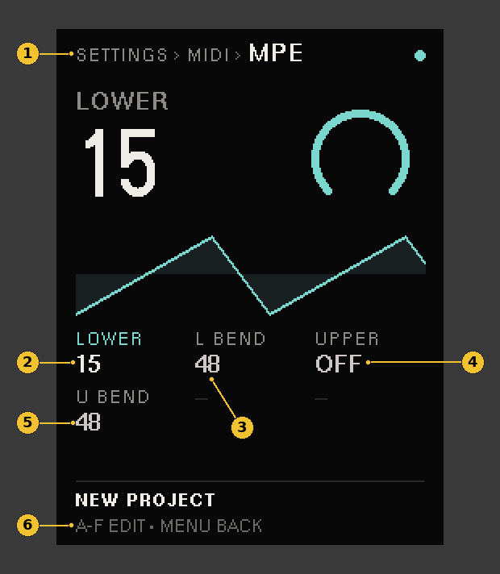
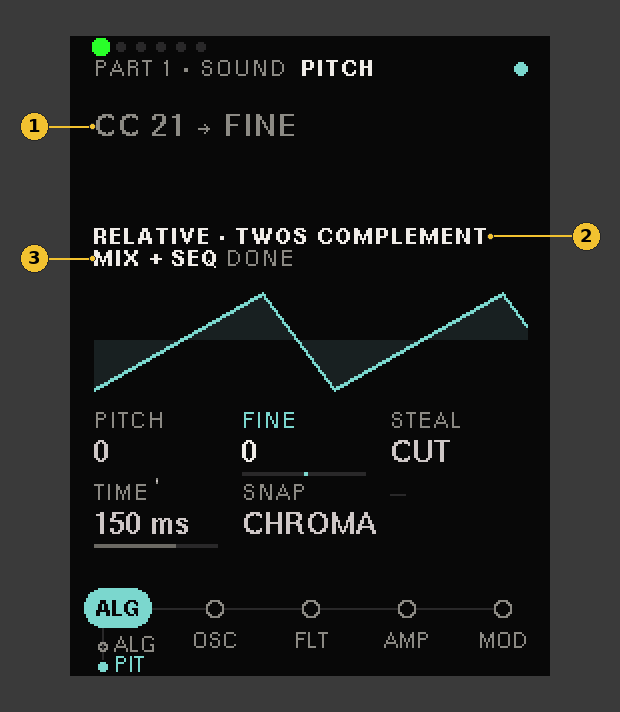
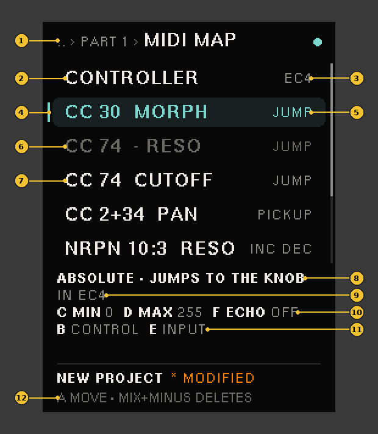
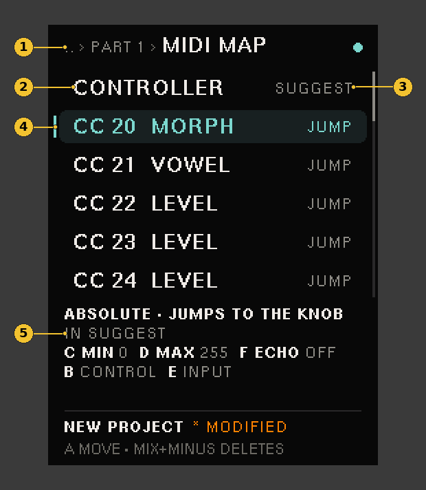
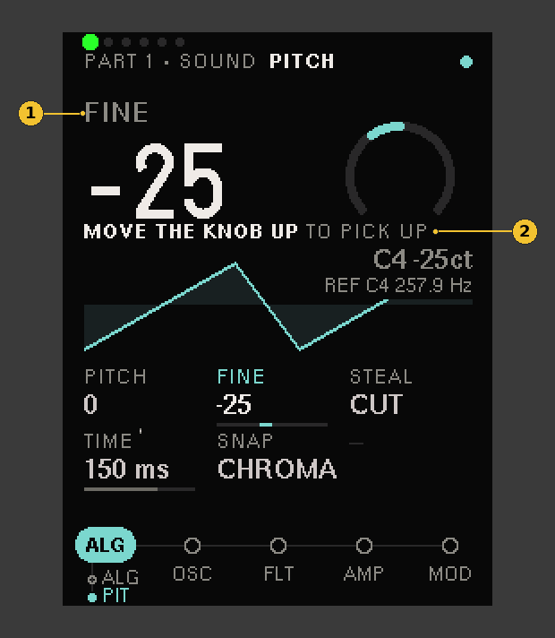
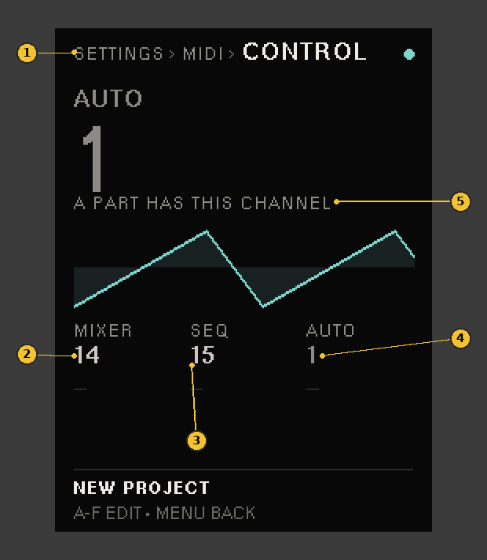
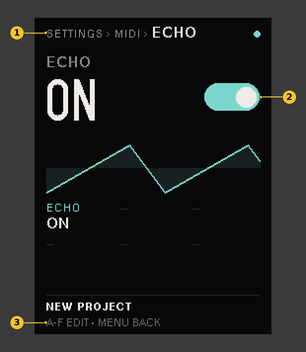
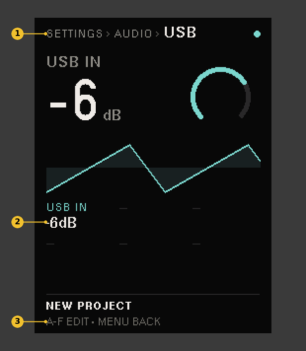

# MIDI control

How Chimera answers your controllers, keyboards and sequencers, over DIN and USB. New to the panel? Read the [quick start](QUICK-START.md) first. On SETTINGS pages and on MIDI MAP, the letters **A** to **F** are encoders 1 to 6.

**Contents:** [What a binding can drive](#what-a-binding-can-drive) · [The mod wheel and aftertouch in the matrix](#the-mod-wheel-and-aftertouch-in-the-matrix) · [MPE](#mpe) · [The built-in CCs](#the-built-in-ccs) · [Learn](#learn) · [SysEx controllers](#sysex-controllers) · [The MIDI MAP page](#the-midi-map-page) · [Controller maps](#controller-maps) · [CONTROL CHANNELS](#control-channels-mixer-sequencer-and-auto) · [ECHO](#echo-values-back-to-the-controller) · [USB MIDI and audio](#usb-midi-and-audio) · [Program change](#program-change-sounds-from-a-sequencer) · [What else Chimera answers](#what-else-chimera-answers)

Each Sound carries a MIDI map of up to 16 bindings. A binding ties one control on your controller to one cell of the Sound, on the Part's own MIDI channel. The map travels with the Sound: load the Sound on another Part and its knobs come with it, on that Part's channel. Parts that share a channel each follow their own map.

Each Part can also play a **controller map**: a named set of bindings kept on the card, apart from any Sound or project, so a controller is set up once and works in every project (see [Controller maps](#controller-maps)).

A binding's control can be:
- a **CC** (`CC 74`): a knob, fader, endless encoder or button;
- a **14-bit CC pair** (`CC 2+34`): a fine control that sends CC *n* and then CC *n*+32;
- an **NRPN** (`NRPN 10:3`): a sequencer lane or a high-resolution control;
- **PRESSURE**: channel aftertouch;
- a **SysEx message** (`SYSEX 9`): a knob on an old hardware editor or programmer that edits a synth by SysEx (see [SysEx controllers](#sysex-controllers)).

## What a binding can drive

- **The Sound's cells:** every engine, filter, envelope, LFO, FX slot and output cell, but the patching jacks.
- **The Part's LEVEL and PAN.**
- **The master FX's knobs:** CHORUS, DELAY, REVERB and MASTER, each continuous cell (RATE, TIME, MIX…). Their TYPE and MODE switches stay on the panel.
- **ORBIT's ring amounts**, per ring: HITS, ROTATE, CHANCE, MUTATE, GATE, VEL, ACCENT and OCTAVE. STEPS, MUTE, a ring's choices and the chord ring stay on the panel.

The master FX and ORBIT are shared by every Part, but a binding to them still lives in one Part's map and listens on that Part's channel: the Part you learned it on owns it. If two Parts bind the same cell, both move it, and the last message wins. A ring amount moves the playing scene and its saved slot, as a turn on its page does. A fader on HITS or ROTATE covers the ring as it is now, 0 to STEPS or 0 to STEPS − 1, once over its travel.

Every stored parameter also has a fixed NRPN address of its own, which works with no binding at all: see the [NRPN chart](NRPN.md), which lists every address by engine and block. A binding on the same NRPN number wins over it.

## The mod wheel and aftertouch in the matrix

The MOD MATRIX has three rows for your hands, after NOTE:

- **WHEEL** (MOD WHEEL in the readout): the mod wheel, CC 1, on the Part's channel. At rest it is 0, fully up it is 1.
- **PRESS** (PRESSURE in the readout): aftertouch. A keyboard with channel pressure moves every note on the Part's channel; one with poly pressure moves only the note whose key you press harder. Each note follows the higher of the two.
- **SLIDE**: CC 74 (timbre, the forward and back slide on an MPE controller) on the Part's channel, 0 to 1. Under MPE each note also has its own; each note follows the higher of the two.

Route them like any other source: put the cursor on the WHEEL, PRESS or SLIDE row, under the column you want, and turn encoder 5 for the amount. They glide, so a fast wheel throw or a sudden squeeze never steps the sound. A new note starts with no poly pressure of its own; the channel's wheel and pressure carry on across notes, Sound loads and project loads.

A new Sound (INIT) comes with the wheel's vibrato as a route: WHEEL into LFO 1's DEPTH at +127, and LFO 1 into PITCH. LFO 1 rests at DEPTH 0, so the wheel down plays no vibrato and the wheel up plays it at full depth. Moving the wheel is playing, not editing: the Sound stays as it was saved. Factory Sounds that move LFO 1 keep the wheel they were voiced with, a MIDI map binding of CC 1 on LFO 1's DEPTH: there the wheel sets DEPTH itself, and the Sound shows as edited.

Any LFO's DEPTH is a destination: prime it with **MIX + PLUS** on the LFO page and route any source into it. A DEPTH route reaches its LFO one block (1.3 ms) after its source moves.

The wheel, CC 74 and channel pressure still reach the MIDI map as well, so a binding on CC 1, CC 74 or PRESSURE keeps working beside a route.

## MPE

An MPE controller (LinnStrument, Seaboard, Osmose and the like) sends each note on a channel of its own, so each finger bends, presses and slides its own note. Chimera plays MPE in zones:

- The **lower zone**: master channel 1, its notes on channels 2 and up.
- The **upper zone**: master channel 16, its notes on channels 15 and down.

A zone's notes play the Parts on its master channel: set a Part's channel to 1 for the lower zone (Part 1 is there already) or 16 for the upper. Parts on the zone's other channels don't hear them while the zone is on.

Each note's own pitch bend bends that note alone, over the zone's bend range (48 semitones each way unless the controller or you set another). Its own pressure feeds PRESS and its own CC 74 feeds SLIDE, for that note only. What comes on the master channel reaches every note of the zone: its bend on top of each note's (over the Part's BEND), its mod wheel, pressure and CC 74, and its sustain pedal and All Notes Off.

Most MPE controllers set the zones themselves when they start: their configuration message (RPN 6) turns a zone on with its channel count, and sets its bend range to 48. You can also set them by hand in **SETTINGS › MIDI CONFIG › MPE** (the last row of MIDI CONFIG):

1. **Breadcrumb:** `SETTINGS › MIDI › MPE`.
2. **LOWER** (A): the lower zone's note channels, `OFF` or 1 to 15, from channel 2 up; they play the Parts on channel 1.
3. **L BEND** (B): the lower zone's note bend range, 0 to 96 semitones each way.
4. **UPPER** (C): the upper zone's note channels, `OFF` or 1 to 15, from channel 15 down; they play the Parts on channel 16.
5. **U BEND** (D): the upper zone's note bend range.
6. **The hint:** `A-F EDIT · MENU BACK`.

The zones never overlap: growing one shrinks the other. RPN 0 on a note channel sets its zone's bend range; on the master channel it sets the Part's BEND, as on any channel. The zones are kept with the rest of SETTINGS, not in the project. With both zones OFF every channel is its own, as with any keyboard.

## The built-in CCs

Every Part answers the General MIDI controllers on its own channel, with no binding and no setup, so a DAW's mixer lanes, a GM sequencer or any keyboard's sliders work at once:

| CC | Name | Moves |
|---|---|---|
| 7 | Volume | The Part's LEVEL |
| 10 | Pan | The Part's PAN |
| 11 | Expression | A swell on top of LEVEL (see below) |
| 71 | Resonance | FILTER RESO |
| 72 | Release | Shifts the release from the Sound's own (64 is the Sound). ALGO: every operator's RR. VA and TAPE: ENV 1's REL. MODAL: DAMP |
| 73 | Attack | Shifts the attack from the Sound's own (64 is the Sound). ALGO: every operator's AR. VA and TAPE: ENV 1's ATK. MODAL: nothing |
| 74 | Brightness | FILTER CUTOFF |
| 91 | Reverb | The Sound's REVERB send |
| 93 | Chorus | The Sound's CHORUS send |
| 94 | Delay | The Sound's DELAY send |

- **Each glides** to its value as a knob does, the same way an [NRPN](NRPN.md) with no binding does. A 0 to 127 sweep covers the cell's whole range. ATTACK and RELEASE are the exception (below).
- **ATTACK and RELEASE** shift the envelope that shapes the Part's loudness, as the MIDI sound controllers are meant to: 64 is the Sound as it is, above 64 is longer, below is shorter. They move each cell from its own value, so an ALGO patch keeps the shape of its six operators' envelopes. On VA and TAPE that is ENV 1's ATK and REL, 1/127 of the range a step. On ALGO it is every operator's AR or RR, turned round (a higher rate is a shorter time): 64 to 127 is 15 AR steps slower and 7 RR steps longer, and AR never reaches 0, which never rises. MODAL rings until DAMP stops it, so RELEASE shifts DAMP; its strike has no attack. What you hear is what you see and save: the cells on the page show the shifted values, and saving the Sound (SAVE TO PROJ, the LIBRARY, a project save or the MENU-hold quick save) keeps them as they sound. From then on 64 is the Sound as saved. A cell stops at its end, so going back to 64 after a clamp lands a little off. A Sound load starts again from that Sound, and a Reset All Controllers (CC 121) takes the shifts back to 64.
- **Expression** (CC 11) turns the whole Part down from its LEVEL, its sends to the master FX too: 127 is the Part as set, 64 about 12 dB under it, 0 silent. It is playing, not editing: it is never saved, leaves no `*`, and is back at 127 after a project load, NEW, or a Reset All Controllers (CC 121).
- **Your bindings come first.** When the Sound's own rows or the Part's controller map bind a CC, that binding moves and the built-in CC does nothing. Bind CC 74 to MORPH and CC 74 drives MORPH.
- **With MPE**, CC 74 on a zone's master channel is SLIDE only and leaves CUTOFF alone; the other built-in CCs still answer there. On a zone's note channels every CC is the note's own.
- **AUTO** (see [CONTROL CHANNELS](#control-channels-mixer-sequencer-and-auto)) plays the Part you are on, so the built-in CCs sent there move that Part. MIXER's and SEQUENCER's channels are never a Part's, so their charts never meet these.
- The mod wheel (CC 1) is the WHEEL row in the matrix, as above.

To turn the built-in CCs off (when a controller sends CC 7 or CC 74 for something else and you'd rather not bind it), set **BUILT-IN** (D) to `OFF` on SETTINGS › MIDI CONFIG › CONTROL CHANNELS. It is kept with the rest of SETTINGS.

## Learn

1. Touch the cell you want to control (turn its encoder a notch), on a Part's page, a master FX page or an ORBIT page.
2. Hold **MIX** and press **SEQ**. The value line reads `MOVE A KNOB · CUTOFF` (the cell's name).
3. Move the control on your controller. The binding is written at once, and Chimera listens on to tell what kind of control it is.
4. Turn it right, then left. Chimera guesses the kind and shows the guess in words.
5. Press **MIX + SEQ** again to keep the guess. A page change, a nav key or a turn of one of Chimera's own encoders also ends learn.

While learn listens, the control you are teaching moves nothing.

1. **The binding:** the control heard and the cell it drives (`CC 21 → FINE`).
2. **The guess**, in the value's place: `TURN IT RIGHT, THEN LEFT` until Chimera is sure, then the kind it heard (`RELATIVE · TWOS COMPLEMENT`).
3. **The hint:** `MIX + SEQ  DONE` once the guess is sure. Press it to finish.

The guesses are `ABSOLUTE` (a knob or fader), `RELATIVE · TWOS COMPLEMENT`, `RELATIVE · BINARY OFFSET` and the other relative encodings (an endless encoder), `BUTTON`, `14-BIT CC` and `INC DEC` (NRPN increment and decrement). A wrong guess is fixed on the MIDI MAP page with **E**.

Learn refuses, and says why, when a cell can't be mapped (`NOT MAPPABLE`), when the control comes in on another channel than the Part's (`CC 21 ON CH 3, PART ON CH 1`), when the CC is one Chimera keeps for itself (`CC 64 RESERVED`: the sustain pedal, bank select, data entry, NRPN and RPN select, and the channel mode messages) and when the map holds 16 bindings already (`MAP FULL`).

Learning a relative encoder or a 14-bit control turns its **ECHO** on, so a controller with LED rings shows the value. Knobs, faders, buttons and pressure learn with ECHO off.

## SysEx controllers

Old programmers and hardware editors (made to edit another synth by SysEx) can drive Chimera's cells too. They send one message a parameter, with the value in one byte (or two) and often a checksum at the end.

1. Touch the cell and press **MIX + SEQ**, as for any learn.
2. Move the knob on the box slowly, so it sends at least two different values. Chimera compares two of its messages to find the byte the value sits in and maps the cell to it.
3. Keep turning: a box that sends a 14-bit value (two bytes) shows it when the knob crosses from one coarse step to the next, and Chimera then reads both bytes. Press **MIX + SEQ** to finish.

From then on, that message moves the cell from its lowest to its highest value, gliding as a CC does. A message for another parameter of the box (another address) moves nothing. SysEx bindings listen on every Part whose Sound holds them, whatever the channel, since a box addresses a synth, not a channel.

On MIDI MAP a SysEx binding reads `SYSEX` and the byte its value is in, counting F0 as the first (`SYSEX 9`). It is always absolute and `JUMP`, and has no ECHO: Chimera can't send the box its message back.

Messages up to 32 bytes are heard. A box that splits one value over two bytes as two 4-bit halves (nibbles) is read as a 14-bit value and won't reach the whole range.

## The MIDI MAP page

SETTINGS › PART › MIDI MAP shows the current Part's bindings, one a row. The first row, `CONTROLLER`, is the Part's controller map (see [Controller maps](#controller-maps)). Then come the controller map's rows, then the Sound's own. With no bindings it reads `NO CCS · MIX+SEQ ON A CELL` under the first row.

Here Part 1 plays the controller map `EC4`, with two rows, above its Sound's own rows.

1. **Breadcrumb:** the Part whose map this is.
2. **`CONTROLLER`:** the first row, the Part's controller map.
3. **The map's name**, or `NONE`.
4. **The bar**, here on the controller map's first row: `CC 30`, the control, then `MORPH`, the cell it drives. **A** moves the bar. A control reads `CC 74`, `CC 2+34`, `NRPN 10:3`, `PRESSURE` or `SYSEX 9`. A master FX or ORBIT cell names its block first: `REVERB MIX`, `RING 1 CHANCE`.
5. **How it moves**, in short: `JUMP`, `PICKUP`, `SCALE`, a relative encoding, `MOMENTARY`, `TOGGLE` or `INC DEC`.
6. **A dimmed row** does nothing now. A controller map's row is dimmed when the Sound binds the same control (here CC 74, the Sound's CUTOFF). Any row is dimmed when it drives a cell the Part's engine doesn't have (`- STRUCT`, a MODAL cell on an ALGO Sound); it works again when the Part plays that engine.
7. **The Sound's own rows**, after the controller map's.
8. **The bar's binding, spelled out:** its kind in full words. For a relative encoding, the line below gives the bytes it sends for one step right and one step left, as controller manuals print them.
9. **`IN EC4`:** the row belongs to the controller map, not the Sound.
10. **C MIN** and **D MAX**: the part of the cell's range the control sweeps; MAX below MIN turns the control round. **F ECHO**: `ON` sends the cell's value back to the controller.
11. **B CONTROL**: the CC number. NRPN, PRESSURE and SysEx controls are fixed: learn them again to change them (the line reads `RELEARN TO CHANGE`). **E INPUT**: how the control moves the cell.
12. **The hint:** `A MOVE · MIX+MINUS DELETES`. MIX + MINUS asks before it deletes the bar's binding.

B to F edit a controller map's row as they edit a Sound's. The change is written to the map on the card, so every project that uses the map gets it; the Sound is not changed.

**E INPUT** steps through the kinds the control can be:

| Row | Spelled out | For |
|---|---|---|
| `JUMP` | `ABSOLUTE · JUMPS TO THE KNOB` | A knob or fader. The cell glides to the knob's place at once. The default |
| `PICKUP` | `ABSOLUTE · WAITS TO PICK UP` | A knob or fader. Nothing moves until the knob reaches the cell's value |
| `SCALE` | `ABSOLUTE · SCALES TO MEET` | A knob or fader. The cell moves at once, scaled so knob and value meet at the ends |
| `TWOS COMP` | `RELATIVE · TWOS COMPLEMENT` | Endless encoders that send 1 for right and 127 for left |
| `OFFSET` | `RELATIVE · BINARY OFFSET` | 65 for right, 63 for left |
| `SIGNED` | `RELATIVE · SIGNED BIT` | 1 for right, 65 for left |
| `SIGNED 2` | `RELATIVE · SIGNED BIT 2` | 65 for right, 1 for left |
| `INC DEC` | `RELATIVE · NRPN`, then `INCREMENT AND DECREMENT` on the line below | NRPN only |
| `MOMENTARY` | `BUTTON · HELD IS MAX` | A button: held is MAX, let go is MIN |
| `TOGGLE` | `BUTTON · EACH PRESS FLIPS` | A button: each press flips between MIN and MAX |

A 14-bit pair and PRESSURE take JUMP, PICKUP or SCALE. A relative encoder turns the cell exactly as Chimera's own encoder does, a step a detent.

## Controller maps

A controller map is a named set of bindings on the card (FADERFOX, CIRKLON, LCXL3…). It holds a **shared** section and one section an engine (ALGO, MODAL, TAPE, VA). A binding's section is its cell's: a cell of an engine's own page (MORPH, STRUCTURE, SHAPE…) belongs to that engine's section; a cell every engine has (CUTOFF, LEVEL, an LFO, an FX pot) is shared. A Part plays its engine's rows and the shared rows, so switching the Part's engine swaps the engine rows by itself. A map made for one engine just leaves the others empty.

The Sound's own rows win: when the Sound and the controller map both bind a control, the Sound's binding moves and the map's row is dimmed. Inside the map, an engine's row wins over a shared row on the same control. A Part plays at most 16 controller rows.

The project remembers each Part's controller map by name. It is read from the card again each time the project loads, so a map saved later reaches every project that uses it.

### Picking a map

1. Go to SETTINGS › PART › MIDI MAP. The bar is on `CONTROLLER`; the row names the Part's map, or `NONE`.
2. Turn **B** to step through the maps on the card and `NONE`. The Part plays the map at once, and its rows show below the first row.

Each row of the map reads as a Sound's row does; its spelled-out line ends `IN FADERFOX` (the map's name).

### Saving a map

1. Learn the controls you want on the Part, with **MIX + SEQ**, as above. They become the Sound's own rows.
2. On MIDI MAP, with the bar on `CONTROLLER`, press **EDIT**. NAMING opens on the Part's map's name (`CONTROLLER` if it has none).
3. Keep the name to update that map, or type a new one, and press **EDIT**.

The Sound's rows move into the map, into their sections, each replacing the map row it was hiding. The Part then plays the saved map, and its Sound's map is empty, so the Sound shows `*` until you save or revert it. Saving under a new name copies the Part's map first, then adds the rows. A save that would give any engine more than 16 rows is refused with `MAP FULL`. Two names can share a file pair (see [On the card](#on-the-card)): a save whose files hold another map is refused with `NAME TAKEN`, and that map stays as it was.

To make a map for another engine, switch the Part's engine, learn that engine's cells and save under the same name: only that engine's section and the shared one change.

### Keeping the Part's rows: KEEP MAP

A controller map already stays with the Part through any Sound load. The Sound's own rows don't: they belong to the Sound, so loading another Sound brings that Sound's rows. To browse Sounds with the rows you learned, turn on KEEP MAP:

1. On MIDI MAP, with the bar on `CONTROLLER`, press **MIX + PLUS**. The line under the row reads `MIX + PLUS KEEP MAP ON`.
2. Load Sounds into the Part as usual. Each one plays the Part's rows, not its own.

Kept rows don't count as an edit: a Sound loaded this way shows no `*`, and the next load asks nothing. Any other change to the Sound still shows `*` and asks. Rows learned or changed while KEEP MAP is on are kept from then on; they show `*` like any edit, so the next load asks once (REPLACE keeps them). A revert keeps the rows too.

Press **MIX + PLUS** again to turn it off. If the Part's rows differ from its Sound's, the Sound then shows `*`: save it to keep the rows in the Sound, or revert it to take the Sound's own. KEEP MAP is not saved: it is off for every Part after a project loads or the unit starts.

### Changing and deleting rows

- **To change a map row**, put the bar on it and turn **B** to **F**, as on a Sound's row. The row changes at once and is written to the map on the card a moment later. Or learn the same control on the Part (it hides the map's row), then save.
- **To delete a map row**, put the bar on it and press **MIX + MINUS**. Chimera asks, then removes the row from the map on the card.

If the map has left the card since it was read, either says `FILE NOT FOUND` and writes nothing.

### Renaming and deleting a map

With the bar on `CONTROLLER` and a map picked, the line under the row reads `MIX+EDIT RENAME`, and the hint below `EDIT SAVE  MIX+MINUS DELETE`.

- **To rename the map**, press **MIX + EDIT**. NAMING opens on the map's name (`RENAME MAP`). Type the new name and press **EDIT**. Every Part playing the map plays it under its new name. A name another map already has is refused with `NAME TAKEN`, and nothing changes.
- **To delete the map**, press **MIX + MINUS**. Chimera asks `DELETE MAP?` with the map's name, then deletes it from the card. Every Part that played it plays `NONE`.

### On the card

Maps live in `/CHIMERA/MAPS`, one pair of files a map (`FADE3C04.A` and `.B`): up to four letters of the name, then four characters made from the whole name. The map's full name is inside the file. MIDI MAP lists up to 16 maps; with more on the card and no map picked, `CARD HOLDS MORE: 16 SHOWN` shows under the first row.

To copy a map to or from your computer, reach the card over USB from the bootloader, as when you install:

1. Turn the PreenFM3 off. Hold **MENU** and turn it on.
2. Press **button 3 (SD card access)**. The card shows up on your computer like a USB drive.
3. Open **CHIMERA**, then **MAPS**. Each map is one or two files with the same name, ending `.A` and `.B`. Copy every file of that name, to keep a map on your computer or to bring one onto the card. If the card has no **MAPS** folder yet, save a map on the unit first.
4. Eject the drive, press **MENU** to leave SD card access, and turn the PreenFM3 off and on.

The map's name is inside its files, so MIDI MAP lists it under that name. A map copied onto the card replaces the one of the same name; every Part playing it plays the new one after the restart.

### SUGGEST, the factory map

The factory set's `CHIMERA/MAPS` holds **SUGGEST**, a ready-made map for any controller of knobs or faders: set them to send these CCs on the Part's channel, pick `SUGGEST` on MIDI MAP, and each knob plays the same kind of control whatever the Part's engine. CC 20 is the engine's main timbre knob, CC 21 its second, CC 29 its character; the shared rows play on every engine. A Part plays 16 rows: the 6 shared and its engine's 10.

| CC | Shared |
|---|---|
| 14 | LFO 1 RATE |
| 15 | LFO 1 DEPTH |
| 85 | ENV 2 LEVEL |
| 86 | VOICE TIME |
| 87 | FX AMOUNT |
| 88 | FX MIX |

| CC | ALGO | MODAL | VA | TAPE |
|---|---|---|---|---|
| 20 | MORPH | STRUCT | WAVE1 | POSITION (WALK POSITION, STRCH POSITION, SCRUB FINGER, WAVE FRAME) |
| 21 | VOWEL | BRIGHT | WAVE2 | MOTION (STRCH SPEED, SCRUB SPEED, WAVE SCAN) |
| 22 | OPERATOR 2 LEVEL | POS | SHAPE1 | SIZE (WALK LENGTH, STRCH D-TIME, SCRUB LENGTH, WAVE RANGE) |
| 23 | OPERATOR 3 LEVEL | EXCITE | SHAPE2 | DRAG (WALK FADE, SCRUB DRAG) |
| 24 | OPERATOR 4 LEVEL | BODY | AMNT | DRIFT (WALK DRIFT) |
| 25 | OPERATOR 2 CRSE | COLOR | MODE | LENGTH (STRCH LENGTH) |
| 26 | OPERATOR 3 CRSE | BURST | SUB | GRAIN (STRCH GRAIN) |
| 27 | OPERATOR 4 CRSE | FORCE | NOISE | SPRAY (STRCH SPRAY) |
| 28 | OPERATOR 2 DETUN | COUPLE | FINE2 | TAPE |
| 29 | OPERATOR 4 FDBK | HALO | STAB | AGE |

Here Part 1, on INIT ALGO, plays SUGGEST:

1. **Breadcrumb:** the Part whose map this is.
2. **`CONTROLLER`:** the Part's controller map …
3. … here `SUGGEST`.
4. **The bar** on SUGGEST's first ALGO row: CC 20 drives MORPH.
5. **`IN SUGGEST`:** the row is the map's, not the Sound's.

Every row is absolute, `JUMP`, as learn sets a knob; change one to PICKUP with **E** on MIDI MAP. The CCs are ones MIDI leaves undefined, so they meet no GM control: CC 1 (the wheel), 7 (LEVEL), 10 (PAN), 74 (CUTOFF) and the other [built-in CCs](#the-built-in-ccs) stay free. A TAPE row names the cell, then in brackets what each machine calls it; on a machine that doesn't read the cell, the knob does nothing. ENV 2 LEVEL sets how far ENV 2 moves what it drives (the filter, in most Sounds); VOICE TIME is the glide; FX AMOUNT and FX MIX are the Sound's FX slot.

To change SUGGEST, first save it under a new name (with the bar on `CONTROLLER`, press **EDIT** and type another name), then edit that copy. Copying the factory set onto the card again replaces `SUGGEST`'s file, and any edit made to it, with the factory map; that is also how to get it back. The file is `SUGG05F6.A`, in **CHIMERA/MAPS**.

SUGGEST fills all 16 rows of every engine. Learning still works, since a learned row goes into the Sound's own rows and wins over the map's row on the same control. But saving a learned row into SUGGEST or a copy of it is refused with `MAP FULL`, unless the row takes over a control or cell the map already uses. Delete a row from your copy first (**MIX + MINUS** on it), or start a new map from `NONE`.

### Pickup

A binding on PICKUP waits for the knob. While it waits, the touched cell's value line says which way to move it.

1. **The touched cell**, FINE, bound to a PICKUP knob that sits below its value.
2. **The hint:** `MOVE THE KNOB UP TO PICK UP` (or `DOWN`). It clears as soon as the knob reaches the value; from then on the knob moves the cell.

The hint shows while HINTS is on at SETTINGS › PERSONALIZE › THEME.

## CONTROL CHANNELS: MIXER, SEQUENCER and AUTO

SETTINGS › MIDI CONFIG › CONTROL CHANNELS gives three channels a job of their own, beside the Parts' channels. Each is `OFF` (the default) or a channel, 1 to 16.

1. **Breadcrumb:** `SETTINGS › MIDI › CONTROL`.
2. **MIXER:** the channel the mixer chart below listens on. A turns it.
3. **SEQ:** SEQUENCER's channel, ORBIT's chart below. B turns it.
4. **AUTO:** the channel that plays whichever Part you are on. C turns it. Here it is `1`, Part 1's channel, so it reads dimmed: it does nothing.
5. **Why:** on a dimmed cell the band reads `A PART HAS THIS CHANNEL`.
6. **BUILT-IN:** `ON` (the default) or `OFF`: whether each Part answers the [built-in CCs](#the-built-in-ccs) on its own channel. D turns it.

A Part's own channel always wins: a CONTROL channel that a Part also listens on is the Part's, and its cell reads dimmed until you move one of them. When two CONTROL channels share a channel, MIXER wins over SEQUENCER, and SEQUENCER over AUTO. If you use MPE, keep these channels off its zones' member channels.

The MIXER and SEQUENCER charts are fixed: learn does not bind on their channels, and a controller map does not apply there.

### AUTO

Notes, CCs, bend, pressure and the pedal sent on AUTO's channel play the Part you are on, as if you had sent them on that Part's channel (every Part on that channel plays them, and the Part's map answers the CCs). Change Part and AUTO follows. A note you are holding, or the pedal, stays with the Part that started it until you let go, so nothing hangs.

### MIXER

On MIXER's channel these CCs move the mixer and the FX, gliding as a knob does. They are plain 7-bit CCs (0 to 127); for finer steps on the FX, send their NRPNs. An NRPN of the FX's (CHORUS, DELAY, REVERB or COMP, by the [NRPN chart](NRPN.md)) moves it too, so you reach their other parameters. Notes on MIXER's channel are ignored.

| CC | Part | Parameter |
|---|---|---|
| 20 | Part 1 | PART LEVEL |
| 21 | Part 2 | PART LEVEL |
| 22 | Part 3 | PART LEVEL |
| 23 | Part 4 | PART LEVEL |
| 24 | Part 5 | PART LEVEL |
| 25 | Part 6 | PART LEVEL |
| 26 | Part 1 | PART PAN |
| 27 | Part 2 | PART PAN |
| 28 | Part 3 | PART PAN |
| 29 | Part 4 | PART PAN |
| 30 | Part 5 | PART PAN |
| 31 | Part 6 | PART PAN |
| 41 | Part 1 | OUT CHORUS |
| 42 | Part 2 | OUT CHORUS |
| 43 | Part 3 | OUT CHORUS |
| 44 | Part 4 | OUT CHORUS |
| 45 | Part 5 | OUT CHORUS |
| 46 | Part 6 | OUT CHORUS |
| 47 | Part 1 | OUT DELAY |
| 48 | Part 2 | OUT DELAY |
| 49 | Part 3 | OUT DELAY |
| 50 | Part 4 | OUT DELAY |
| 51 | Part 5 | OUT DELAY |
| 52 | Part 6 | OUT DELAY |
| 53 | Part 1 | OUT REVERB |
| 54 | Part 2 | OUT REVERB |
| 55 | Part 3 | OUT REVERB |
| 56 | Part 4 | OUT REVERB |
| 57 | Part 5 | OUT REVERB |
| 58 | Part 6 | OUT REVERB |
| 70 | FX | CHORUS RATE |
| 71 | FX | CHORUS DEPTH |
| 72 | FX | CHORUS MIX |
| 73 | FX | DELAY TIME |
| 74 | FX | DELAY FDBK |
| 75 | FX | DELAY MECHANICS |
| 76 | FX | DELAY SAT |
| 77 | FX | DELAY TONE |
| 78 | FX | DELAY MIX |
| 79 | FX | DELAY REV |
| 80 | FX | DELAY SIZE |
| 81 | FX | DELAY DENSITY |
| 82 | FX | DELAY PITCH |
| 83 | FX | DELAY TEXTURE |
| 84 | FX | REVERB TIME |
| 85 | FX | REVERB DAMP |
| 86 | FX | REVERB SIZE |
| 87 | FX | REVERB MIX |
| 88 | FX | REVERB TONE |
| 89 | FX | REVERB DIFFUSE |
| 90 | FX | REVERB PRE-DLY |
| 91 | FX | REVERB SHAPE |
| 92 | FX | REVERB SMEAR |
| 93 | FX | REVERB RATE |
| 94 | FX | REVERB DENSITY |
| 102 | FX | COMP THRESH |
| 103 | FX | COMP ATK |
| 104 | FX | COMP REL |
| 105 | FX | COMP MAKEUP |
| 106 | FX | COMP MIX |
| 107 | FX | COMP VOL |
| 108 | FX | COMP PAN |

OUT CHORUS, OUT DELAY and OUT REVERB are the Part's Sound's sends. MIXER uses no CC that MIDI keeps for itself (bank select, data entry and its increment and decrement, RPN and NRPN select, the sustain pedal).

### SEQUENCER

On SEQUENCER's channel these CCs drive ORBIT. PLAY/STOP and a ring's ON/OFF act as B6 and MIX + B*n* do, each time the value rises past 63: a button that sends 127 and then 0 is one press. CHANCE, STEPS, KEY and SCALE step through their values across 0 to 127. A note on SEQUENCER's channel sets KEY to its pitch class: play an E and ORBIT's chords move to E.

| CC | Parameter |
|---|---|
| 20 | PLAY/STOP |
| 21 | RING1 ON/OFF |
| 22 | RING2 ON/OFF |
| 23 | RING3 ON/OFF |
| 24 | RING4 ON/OFF |
| 25 | RING5 ON/OFF |
| 26 | RING1 CHANCE |
| 27 | RING2 CHANCE |
| 28 | RING3 CHANCE |
| 29 | RING4 CHANCE |
| 30 | RING5 CHANCE |
| 102 | RING1 STEPS |
| 103 | RING2 STEPS |
| 104 | RING3 STEPS |
| 105 | RING4 STEPS |
| 106 | RING5 STEPS |
| 107 | ORBIT KEY |
| 108 | ORBIT SCALE |

## ECHO: values back to the controller

SETTINGS › MIDI CONFIG › ECHO (after SYNC, PORT CONFIG, CHANNELS and CONTROL CHANNELS) is the switch for everything Chimera sends from its MIDI OUT, and where PARAM OUT sends your edits.

1. **Breadcrumb:** `SETTINGS › MIDI › ECHO`.
2. **The focused cell**, large: here PARAM OUT, its switch on.
3. **ECHO** (A): `ON` (the default) or `OFF`.
4. **PARAM OUT** (B): `OFF` (the default) or `NRPN`.
5. **The hint:** `A-F EDIT · MENU BACK`.

With ECHO on, each binding whose own ECHO is on sends its cell's value on the Part's channel, on its own control: a CC sends the value, a 14-bit pair both halves, an NRPN its full address and value, a button MIN or MAX as 0 or 127, and a relative encoder the absolute value on its CC, so its LED ring follows. Chimera sends a value when it changes, whatever changed it: Chimera's encoders, a Sound or project load, another binding, ORBIT. It holds a binding's echo for a quarter second after that binding's control last moved, so it never fights your hand. A Part change, a Sound load and a project load send the Part's values all at once.

When two Parts share a channel and bind the same control, the lower-numbered Part echoes.

With ECHO off, MIDI OUT stays silent, PARAM OUT included.

### PARAM OUT: recording your edits

With PARAM OUT at `NRPN`, every cell you turn on Chimera goes out of MIDI OUT and USB as its NRPN from the [NRPN chart](NRPN.md), on the Part's channel, so a sequencer or DAW can record your knob moves and play them back. A cell that is not on the chart (a jack, a mod route, a SETTINGS cell) sends nothing.

- Only your hands on the panel send: a value that came in over MIDI, a Sound or project load, ORBIT's playing and the modulation never go out, so a MIDI thru loop never feeds back.
- A fast turn sends the latest value, as often as MIDI OUT has room, never a backlog: DIN carries about 300 NRPNs a second.
- A continuous cell sends 14 bits (CC 99, 98, 6 and 38); a stepped cell or a choice sends its MSB alone (CC 99, 98 and 6).
- The master FX send on the channel of the Part you are on.

### MIDI thru loops

If your setup sends Chimera's MIDI OUT back into its MIDI IN (a DAW track with MIDI thru on, an interface's soft thru, a controller that merges its input), ECHO can stay on: an echo that comes back within that quarter second is not taken as a turn, so a relative encoder's cell never walks.

## USB MIDI and audio

Over USB, Chimera is class compliant: it needs no driver on Linux, macOS or Windows. Connect it to your computer with a USB cable and it shows up as:

- **Chimera**, one MIDI port both ways: every channel, as on DIN, each Part on its own channel. Clock, SysEx, the identity reply and ECHO use this port.
- **Chimera**, an audio input: the main out in stereo, 24-bit, 48 kHz, exactly what the main out jacks play. Record it in your DAW like any interface's input; the jacks keep playing while it streams.
- **Chimera**, an audio output: stereo, 24-bit, 48 kHz from your computer, mixed into the main out jacks. Pick it as your DAW's or your system's output and Chimera plays it beside its own sound. Chimera sets the pace (the computer follows its clock), so it never drifts or clicks over a long session.

DIN and USB work side by side. So far USB MIDI and audio have been tried on Linux only: see [KNOWN-ISSUES.md](KNOWN-ISSUES.md#usb).

### Playing your computer through Chimera

Chimera plays your computer's sound at the computer's own scale: a full-scale sample is as loud as the synth at full scale. Your computer's output volume for Chimera still applies. On Linux, PipeWire may start the new Chimera output at 40 % (about −24 dB): set Chimera's output to 100 % in your sound settings.

Your computer's sound is mixed in after the synth's, so the audio input never records it back: a DAW recording Chimera while it plays a backing track records only Chimera. If you monitor the input in your DAW while playing out through Chimera, you hear Chimera twice; turn the DAW's input monitoring off.

### USB AUDIO: how loud the computer plays

1. **SETTINGS › AUDIO ROUTING › USB AUDIO.**
2. **USB IN** (A): how loud your computer's sound joins the main out: `OFF`, `-24dB`, `-18dB`, `-12dB`, `-9dB`, `-6dB`, `-3dB` or `0dB` (the default). A change fades in over a few milliseconds, never with a click. At `0dB` a loud computer track on top of a loud patch can pass full scale: the main out then clips hard at full scale, so turn one of them down. `OFF` keeps the output there for your computer but silent.
3. **The hint:** `A-F EDIT · MENU BACK`. MENU goes back.

## Program change: Sounds from a sequencer

A program change on a Part's MIDI channel loads a Sound into that Part, so a sequencer can change Sounds with its patterns. Turn it on at SETTINGS › MIDI CONFIG › SYNC: B is **PROGRAM**, `OFF` (the default) or `ON`. With it off, Chimera ignores program changes and bank selects.

What a program change loads depends on the bank:

| Bank | Program 0 to 127 loads |
|---|---|
| 0 (the default) | the project's Sound slots: program 0 is SLOT 01, program 127 is SLOT 128 |
| 1 | an INIT Sound: 0 ALGO, 1 MODAL, 2 TAPE, 3 VA |

Select the bank with **CC 0** (bank select MSB) before the program change; if your sequencer sends only **CC 32** (the LSB), or CC 0 at 0 and then CC 32, Chimera reads CC 32. The bank stays selected on that channel until the next bank select. A program change to an empty slot, to a program past the last INIT, or in bank 2 or higher does nothing. LIBRARY and FACTORY Sounds can't be loaded by program change: save them into the project first.

- **Every Part on the channel** loads the Sound. Parts on other channels keep theirs.
- **A Part already playing that Sound** keeps it, edits and all, so a sequencer that sends the same program change on every pattern costs nothing. A Part marked `◦` (its slot was saved over since) loads the slot's new Sound.
- **A Part with unsaved edits** (`*`) loads the new Sound without asking. Its edits are kept: a program change back to the Sound you edited brings them back, still marked `*`. Each Part keeps one set of edits this way, the last one it left. Loading anything into the Part another way (RELOAD, the Sound rung, a library load) or loading a project lets them go. To keep edits for good, save the Sound.
- **The notes that follow** a program change on its channel wait for the new Sound, up to 40 ms, so a pattern's first note plays the new Sound.
- **While Chimera is busy** loading from the card, or a prompt, learn or the Part's Sound rung is open, the last program change on each channel waits and loads when it closes.
- **On the Part you are editing,** the pages follow the new Sound's engine. Other Parts change without moving the page.

## What else Chimera answers

When SETTINGS › ABOUT reads `NEEDS UPDATE`, Chimera ignores MIDI in, notes and clock too, until the update is installed: MIDI MAP reads `NEEDS UPDATE`, and **MIX + SEQ** says `NEEDS UPDATE` instead of starting learn.

- **Identity request** (`F0 7E 7F 06 01 F7`): Chimera answers with its identity and firmware version, while ECHO is on.
- **All Notes Off** (CC 123), and the Omni and Mono/Poly messages (CC 124–127): the notes of every Part on that channel are released. **All Sound Off** (CC 120) silences them, and **Reset All Controllers** (CC 121) resets the pedal, the bend, the mod wheel, pressure, CC 74 and expression (CC 11).
- **System Reset** (`FF`): every sound stops and every controller resets.
- **Active Sensing:** once a controller sends it, a pulled cable releases every held note within a third of a second, and the screen shows **DIN MIDI LOST**. A USB host that resets or sleeps while you hold a note or pedal does the same, with **USB MIDI LOST**.
- **RPN 0** sets the Part's BEND range, in semitones (0 to 24).
- **RPN 6** on channel 1 or 16 sets an MPE zone (see [MPE](#mpe)).
- **MIDI Tuning Standard** SysEx retunes every Part whose TUNING is `MTS`: see [Tuning](TUNING.md#midi-tuning-standard).
