# Chimera quick start

How to get around, fast, and a tour of every page. Install first with the [README](README.md); for "how do I…" questions see the [FAQ](FAQ.md).

The screenshots are rendered by the firmware's own screen code. Your values will differ. Where a page has no picture of its own, the band in the middle of the screen shows the live output's waveform: the screenshots show a test wave there.

**Contents:** [1. The panel](#1-the-panel) · [2. The idea](#2-the-idea) · [3. Key combos](#3-key-combos) · [4. The screen](#4-the-screen) · [5. Sub-pages and hints](#5-sub-pages-and-hints) · [6. The chain map](#6-the-chain-map) · [7. The filter](#7-the-filter) · [8. AMP](#8-amp) · [9. PITCH](#9-pitch) · [10. VA](#10-va) · [11. TAPE](#11-tape) · [12. The MOD matrix and the LFOs](#12-the-mod-matrix-and-the-lfos) · [13. The mixer and the effects](#13-the-mixer-and-the-effects) · [14. The Sound browser](#14-the-sound-browser) · [15. SETTINGS](#15-settings) · [16. ORBIT, the ring sequencer](#16-orbit-the-ring-sequencer) · [17. First steps](#17-first-steps)

## 1. The panel

| Control | What it does |
|---|---|
| **Encoders 1–6** | Each turns the cell above it: 1 2 3 on the top row of cells, 4 5 6 below |
| **B1–B6** | The six Parts. Each Part is its own instrument with its own engine |
| **MINUS / PLUS** | Previous / next page along the chain |
| **EDIT** | Back one sub-page. Also **OK** in a dialog, and it opens the selected row in lists |
| **SEQ** | On to the next sub-page (wraps round from the last). Also cancels, with MENU, in a dialog |
| **MIX** | Held, it turns other keys into secondary actions (MIX + …) |
| **MENU** | SETTINGS. Tap again to step back out, one level at a time |

## 2. The idea

- **A Part is a chain of pages.** Each page holds up to six parameters, one per encoder.
- **Some pages have sub-pages** in a row under the chain map. The FILTER page has MODULATION, FX and JACKS beside it; a VA Part's VA page has OSC1, OSC2, NOISE and PITCH beside it.
- **One D-pad, everywhere.** The same four keys move you through a Part's pages, the mixer, the Sound browser, ORBIT and every SETTINGS list.
- **Any encoder moves a list.** In SETTINGS, the Sound browser, project lists and dialogs, turn any encoder to move the bar.
- **Nothing to memorise.** Touch a cell and the focus band shows any MIX combo that cell answers to.
- **Changes glide.** A turned value shows its new number at once; its arc or bar eases there, and the sound glides.

```
   MINUS (previous page)  ◀  page  ▶  PLUS (next page)

   EDIT (previous sub-page)  ◀  sub-page  ▶  SEQ (next sub-page)

   An ALGO Part's chain (ALG is its home):

   ALG ──── OSC ─────────── FLT ──────── AMP ──────── MOD
    └ PIT    ├ CRS … FBK     ├ FMD        └ SENDS      ├ E1  E2  E3
             └ OP1 … OP6     ├ FX                      ├ SPD
                             └ JACK                    └ L1  L2  L3
```

The sub-pages of a page sit in a row at the bottom of the screen, each named in a full word (ALGORITHM, PITCH, MODULATION, MATRIX, ENV1 …). The diagram above draws them stacked, with their short names. If you like a stacked list better, SETTINGS › PERSONALIZE › CHAIN MAP › PAGES: STACK. Then **EDIT** goes down a sub-page and **SEQ** goes back up.

## 3. Key combos

| Keys | Does |
|---|---|
| B*n* | Part *n*'s pages. Press the same B*n* again to flip to its mixer and back |
| MIX + B*n* | Part *n*'s mixer |
| EDIT + B*n* | The Sound browser for Part *n* |
| MIX + turn | Jump the value to its next landmark (minimum, default, maximum). On TAPE's START and END: the next onset in the source |
| MIX + PLUS | On a parameter: prime it as a modulation destination. On TAPE's SOURCE: load the card source |
| MIX + MINUS | On a route: delete it. In the browser: clear the slot |
| MIX + SEQ | Learn a MIDI CC for the touched cell |
| MENU | Open SETTINGS; inside, step back a level |
| EDIT / MENU or SEQ | In a dialog: OK / cancel. The hint reads `EDIT OK · MENU BACK` |
| hold MENU | Quick-save the project to the card (a new project asks for a name first) |
| hold SEQ | ORBIT, the ring sequencer |

## 4. The screen

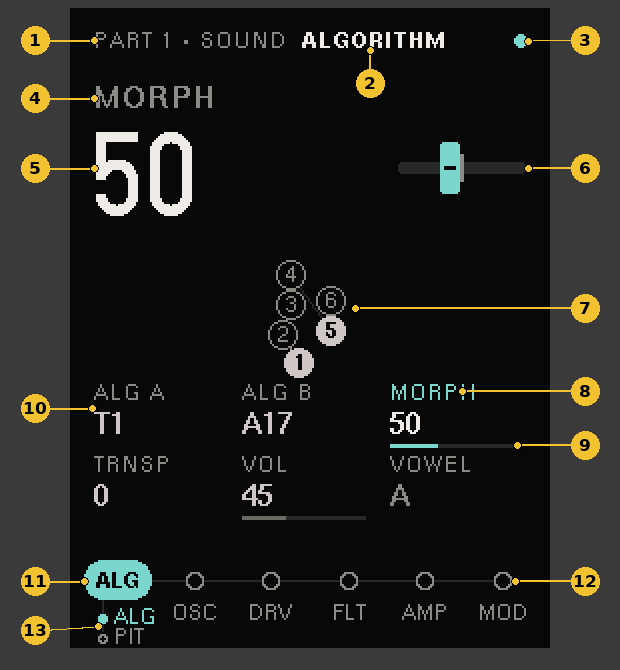

1. **Part dots.** One dot a Part, B1 to B6. The current Part is the bright green dot; a Part that is playing has a ring round its dot.
2. **Part and place.** `PART 1 · SOUND` is Part 1's sound pages; `PART 1 · MIX` is its mixer. If the Part plays out of output pair 2 or 3, an `OUT P2` or `OUT P3` warning shows on the right of this line.
3. **Page name.** The page you are on (ALGORITHM).
4. **Sounding dot.** Lit while the instrument is making sound. A second dot to its left pulses ORBIT's beat while it runs.
5. **Focus band: label.** The parameter you last touched or turned.
6. **Focus band: value**, large. A unit (Hz, kHz, ms, %) is set small after the number, so `2.14 kHz` never runs under the glyph. The number is the value you set: it shows as soon as you turn, and modulation never moves it.
7. **Focus band: glyph.** A picture of the value. It depends on the parameter: an arc for most knobs (filled from 12 o'clock when the value is bipolar), a crossfader for blends (MORPH, VA's BLEND, with what each end gives written under it), a level bar for levels and sends, a switch for on/off, a wave scope for a wave choice and for VA's MODE (the two oscillators combined), a spirit level for STABILITY, a picture of the order for FX PLACE, a loop for the filter's FEEDBACK, the LFO's own picture for each LFO control, a picture of the machine for TAPE's knobs, and animated pictures for the effects (the chorus braid, the delay rings, the reverb cube). Word choices (MODEL, the filter's MODE, STEAL) have no glyph: the word takes the band.
8. **The page's picture.** Here the algorithm diagram. While you pick ALG A or ALG B, the picture shows that one algorithm on its own; on any other cell it shows A blending into B. Pages without their own picture show the live output's waveform.
9. **The focused cell.** Its label turns to the accent colour.
10. **The bar** under a cell shows where the value sits in its range; accent on the focused cell. Stepped values (ALG A, PITCH, CRSE) have no bar. A thin line under the bar shows modulation reaching that parameter.
11. **A cell.** Six per page, in encoder order. A dash means the slot is empty; a dimmed cell does nothing in the current setting, and the focus band says why when you touch it.
12. **Chain map: where you are.** The current page is the filled pill.
13. **Chain map: the other pages** of the chain, MINUS / PLUS away.
14. **Sub-pages** sit in a row under the map. The current one is underlined. `<` and `>` at the ends mean there are more.

Some pages (FILTER, MASTER, the envelopes and LFO speeds, ORBIT's ORB) give the whole band to a picture and have no focus band.

## 5. Sub-pages and hints

From FLT, press **SEQ** to go on to FILTER MOD. **EDIT** goes back to FLT. (On the last sub-page, SEQ wraps round to the first.)

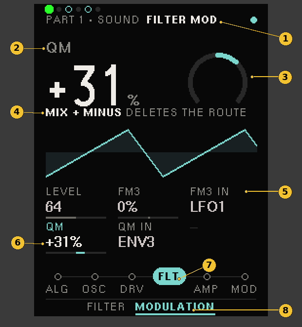

1. The page name is the sub-page's: FILTER MOD.
2. The touched cell, RES MOD, and the source that drives it (ENV3).
3. Its arc, bipolar here, so it fills from 12 o'clock.
4. **The hint line.** Under the value, the touched cell's combos: keys in bold, what they do beside them. It shows only while that cell is the touched one. Turn hints off at SETTINGS › PERSONALIZE › THEME › HINTS.
5. A route amount (FREQ MOD). The source it reads is set on JACKS (section 7).
6. The touched cell, RES MOD, with its amount.
7. The node, FLT, still lit on the map.
8. Its sub-pages in a row: FILTER (the page itself), MODULATION (underlined because you are on it), FX …
9. … and `>`: more sub-pages (JACKS) off the edge.

## 6. The chain map

The strip at the bottom of every Part, mixer and ORBIT page is the map of the chain you are in.

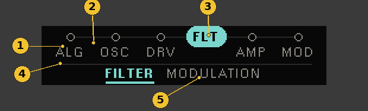

1. **A node:** one page of the chain. MINUS / PLUS step to the neighbours.
2. **The line** joins the chain's pages in order, left to right.
3. **The pill:** the page you are on.
4. **Node labels** are the pages' short names (ALG, OSC, FLT, AMP, MOD).
5. **The sub-page row** under the map: the node's own page first, then its sub-pages, each in a full word. The underlined one is where you are.
6. A long row scrolls: `<` and `>` show that more pages are off the edge (OSC has 18).

The map changes with the engine: ALGO is ALG · OSC · FLT · AMP · MOD, MODAL is EXC · RES · FLT · AMP · MOD, VA is VA · FLT · AMP · MOD, TAPE is SRC · DECK · FLT · AMP · MOD. SETTINGS has no map: its bottom band shows the project instead (section 15).

## 7. The filter

FLT is the same on every engine. Its sub-pages are MODULATION, FX and JACKS.

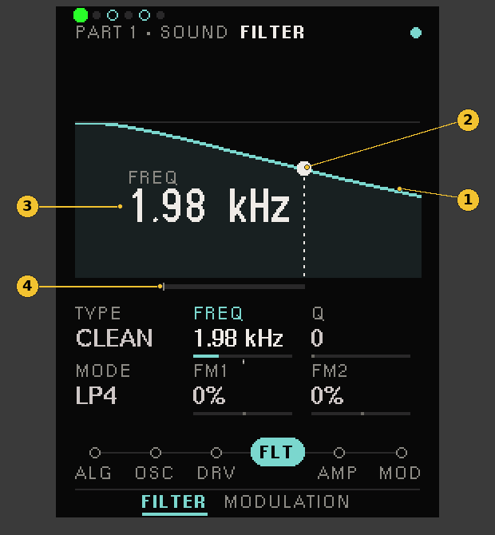

1. **The response**, drawn from the filter's real response at the values you set, resonance peak included.
2. **The corner**, at the cutoff you set.
3. **The readout** of the touched control: here FREQ (CUTOFF on the 2040), the value you set. It stays still while an LFO or envelope moves the sound.
4. **The modulation mark.** A faint band under the plot runs from the corner to where modulation has the cutoff now, with a tick at its end. It is gone when nothing modulates the cutoff.
5. **TYPE**, the kind of filter: CLEAN (a clean state-variable filter in the manner of the Cascadia's), 2040 (the SSM2040 four-pole), DIRTY (a Chamberlin filter that drives hard), LADDER (the Moog transistor ladder) or SEM (the Oberheim SEM's 12 dB filter). The cells change with TYPE.
6. **FX**, the voice's FX slot: OFF, SOFT (drive), FUZZ (modelled on the Big Muff's circuit) or FOLD (a wavefolder).
7. **FX PLACE**: the slot before the filter (PRE, FX into FLT) or after it (POST, FLT into FX). The cell draws the order.
8. **FREQ**, with Q and MODE beside it. The thin line under the bar shows modulation reaching it.
9. `>`: more sub-pages off the edge.

The front page reads TYPE · FX · Q · MODE · FX PLACE · FREQ on every TYPE except two:

- **2040:** RES in Q's place, VOICE in MODE's (REV2, the Prophet-5 chip, or EXPNDR, the Kobol Expander's), CUTOFF in FREQ's. Touch TYPE and the readout names its one mode, 4-POLE LP.
- **SEM:** RES in Q's place, and MODE is a knob: it sweeps the output from low-pass, through a notch at FREQ, to high-pass. MODE can be modulated. SEM's OUTPUT, on FILTER MOD, picks MODE (the knob's sweep) or BP (band-pass).

MODE on CLEAN: LP1, LP2, LP4, BP2, BP4, HP4, NOTCH1, NOTCH2. On DIRTY: LP2, BP2, HP2, NOTCH1. On LADDER: LP2, LP4, BP2, BP4, HP4.

**FILTER MOD** (section 5) holds ENV AMT (envelope 1 into the cutoff), KEYBOARD (how far the cutoff follows the key), FREQ MOD and RES MOD (route amounts, their sources set on JACKS), and FDBK, feedback: the filter's output fed back into its own cutoff, positive or negative, in the manner of the Kobol Expander's. FDBK is a MOD matrix destination.

### FX

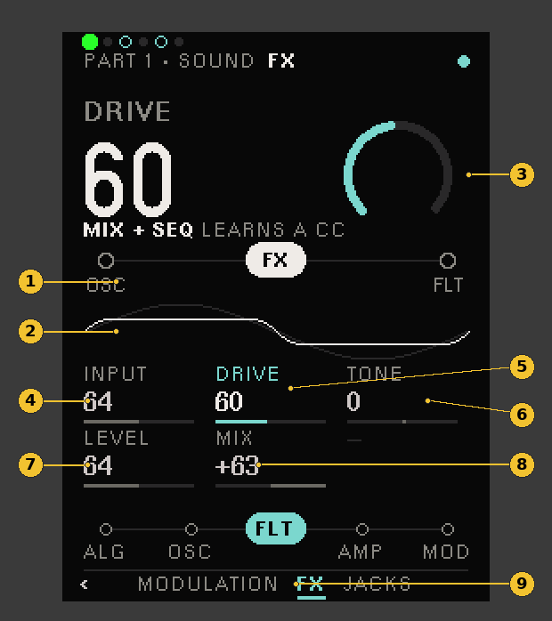

1. **The signal path**, in the order FX PLACE sets: here the oscillators into FX into the filter.
2. **The effect's curve:** a sine going in (faint), the shaped wave coming out.
3. The touched pot's arc.
4. **INPUT:** the level into the filter.
5. The FX TYPE's first pot …
6. … and its second: for SOFT, DRIVE and TONE.
7. Its third: LEVEL.
8. **MIX:** dry to wet. Dimmed when FX is OFF.
9. The sub-page row, on FX.

The three pots follow the TYPE: SOFT has DRIVE, TONE and LEVEL; FUZZ has SUSTAIN, TONE and VOLUME (and starts PRE); FOLD has FOLD, SYMMETRY and LEVEL. The four TYPEs are level-matched, and changing TYPE or PLACE fades over 20 ms with no click. On the 2040, LADDER and SEM the sixth cell is **STABILITY**: each voice gets its own slightly different chip (a cutoff offset, slow drift, a tracking error and a resonance spread). New Sounds start halfway, a Prophet-like amount.

### JACKS

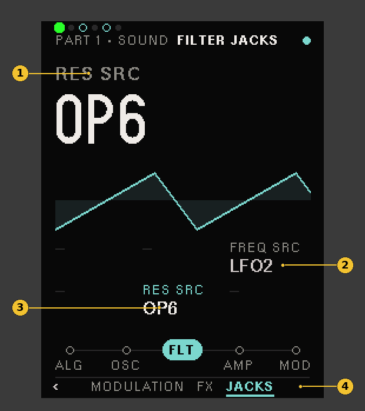

1. The touched jack and the source plugged into it.
2. **FREQ SRC:** the source FREQ MOD reads.
3. **RES SRC:** the source RES MOD reads.
4. The sub-page row, on JACKS.

FREQ SRC takes LFO1–3, ENV2, ENV3 or velocity; RES SRC any MOD matrix source. On ALGO both also take the audio of operator 5 or 6 (OP5, OP6). On FILTER MOD, FREQ MOD and RES MOD name their source in the focus band, for example `FREQ MOD LFO1`.

## 8. AMP

AMP is the voice's VCA. LPG, DECAY and STRIKE turn it into a low-pass gate, in the manner of the one in Mutable Instruments' Plaits. With all three at 0 it is a plain VCA.

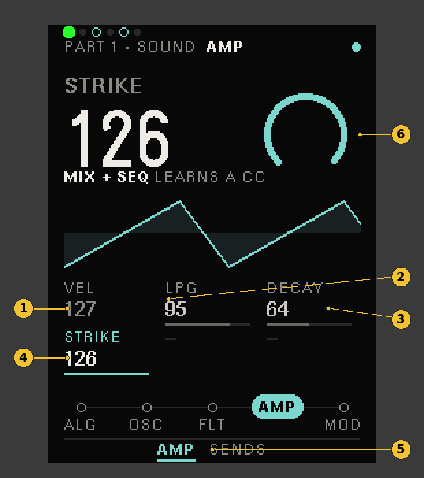

1. **VEL:** how far velocity scales what is routed into the VCA.
2. **LPG:** the darkening follows the level: the quieter the note, the darker it is.
3. **DECAY:** how slowly the gate closes: fast while bright, slower as it dims, like a vactrol.
4. **STRIKE:** each note-on strikes the gate, as hard as the note is played, and it rings out through DECAY. It adds to the envelope routed into VCA as an accent, and a held note falls back to the envelope. With nothing routed into VCA, the strike alone plays the note.
5. AMP's sub-page, SENDS.
6. The touched knob's arc.

LPG, DECAY and STRIKE can be modulated in the MOD matrix and learned to a MIDI CC.

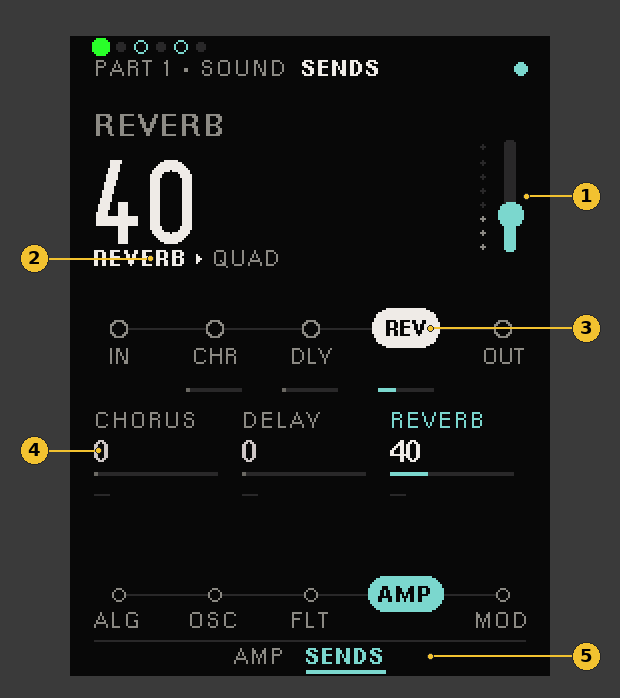

1. The touched send's level bar.
2. The effect it sends to, and that effect's TYPE (REVERB › QUAD).
3. The effects chain, the touched send's effect lit; the short bars under it are the three sends.
4. **CHORUS, DELAY, REVERB:** the Part's three send levels. This is the same page as SND in the Part's mixer.
5. The sub-page row, on SENDS.

## 9. PITCH

Every engine has a PITCH sub-page: under ALG on ALGO, under RES on MODAL, under VA on VA, and after the machine's page on TAPE.

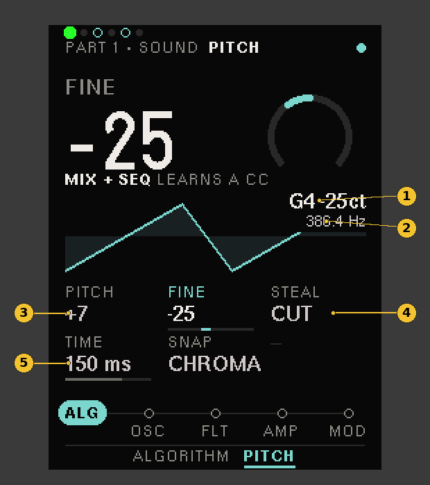

1. **The tuner:** the note the Part's last note sounds at, and how far off it is in cents (A4 = 440 Hz). It follows PITCH and FINE as they turn, with no note held. It is lit while the Part sounds and dim between notes; before the first note it reads `REF C4`.
2. That pitch in Hz.
3. **PITCH** in semitones, **FINE** in cents.
4. **STEAL:** CUT, or GLIDE (a note that takes over a voice glides from its pitch).
5. **TIME:** the glide time. **SNAP:** how PITCH steps: CHROMA, by semitone, or MUSICAL, by fifths and octaves.

On TAPE a source plays at the key you play, from its root. A source with no known pitch reads `ROOT ?` in the tuner, over its shift from the source's own speed.

## 10. VA

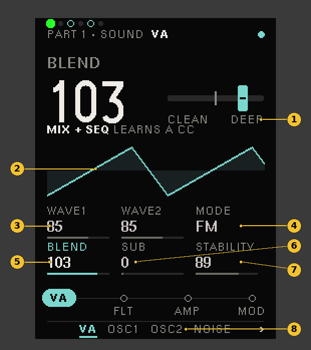

1. **BLEND's glyph:** a crossfader, with what each end gives under it. The words change with MODE (here FM: CLEAN to DEEP).
2. The live output.
3. **WAVE1, WAVE2:** each oscillator's wave, morphing through sine, triangle, saw and pulse.
4. **MODE:** how OSC 1 and OSC 2 combine. Touch MODE and the glyph draws the result. The [FAQ](FAQ.md#engines) has the table of MODEs.
5. **BLEND:** how far MODE goes.
6. **SUB:** a sub-oscillator an octave under OSC 1.
7. **STABILITY:** how far the oscillators drift, voice by voice.
8. VA's sub-pages: OSC1, OSC2 (coarse, fine and shape for each), NOISE and PITCH.

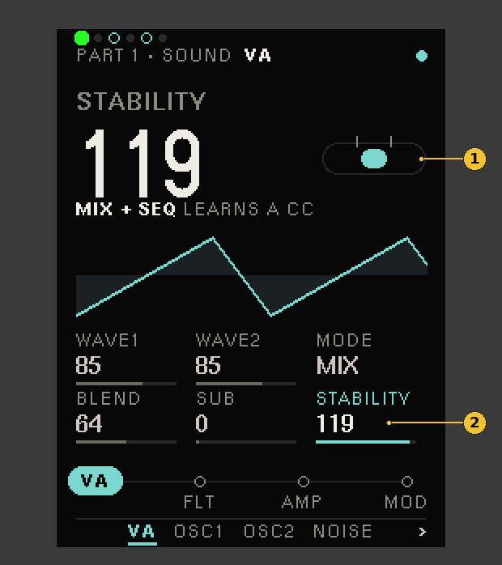

1. **STABILITY's glyph** is a spirit level: the further the bubble sits from the middle, the more the voices drift.
2. STABILITY, touched.

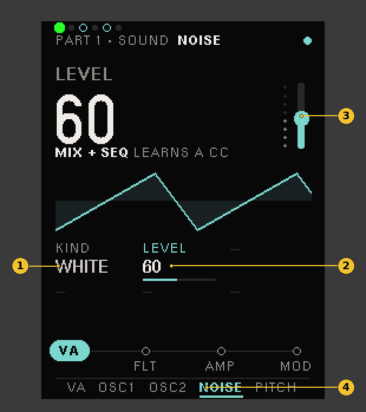

1. **KIND:** WHITE, PINK, RED or DIGITAL. DIGITAL steps 16 times each OSC 1 cycle, so it follows the key.
2. **LEVEL:** how much noise. The lower half of LEVEL is a breath; at full the noise is about as loud as INIT's two oscillators.
3. LEVEL's level bar.
4. The sub-page row, on NOISE.

The noise is mixed in beside SUB, after MODE and before the filter.

## 11. TAPE

A TAPE Part plays a sound source: a recording held in the project's memory, or streamed from the card while it plays. Its chain is SRC · DECK · FLT · AMP · MOD.

- **SRC** picks the source and the stretch of it that plays, the *window* (START to END).
- **DECK** picks the machine with MODEL, and holds the knobs that shape it. Turning MODEL sets the machine's knobs to its defaults.
- **The machine's own page**, the sub-page after DECK, is named after it (WALK, STRETCH, SCRUB or WAVE). It starts with the tape's wear on every machine: **TAPE** (how much wow and flutter), **AGE** (darker, with hiss; past halfway, dropouts) and **WOW** (its kind: CAPSTAN, a tape machine's steady wow and flutter, or WARBLE, a pitch that wanders).
- **PITCH** is the last sub-page (section 9).

Every machine draws its own picture in the focus band. DECK's knobs move it, and it stays still when nothing changes.

INIT TAPE has no source: it is silent until you pick one on SRC. The factory TAPE Sounds come with their sources (copy the factory set onto the card, [README](README.md#step-3-copy-the-files-to-the-card)).

### SRC: the source

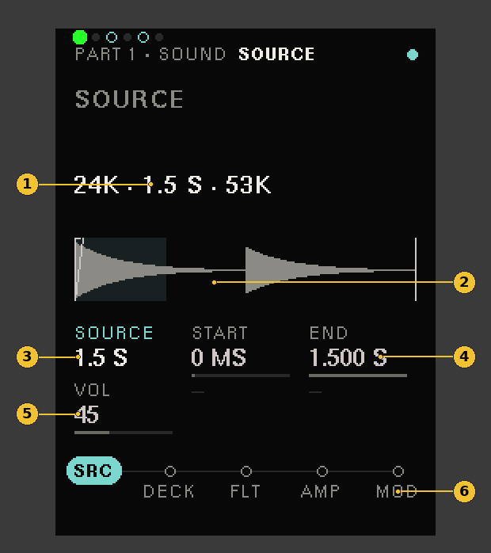

1. **SOURCE's readout:** the source's rate, length and the memory it takes (`24K · 1.5 S · 53K`). A source too long for memory streams from the card; then the readout says how many notes of it can stream at once (`… · 7 STREAMS`).
2. **The strip:** the source's waveform, the window lit, and the play heads while notes play.
3. **SOURCE:** turn it through the sources the project holds, then the ones on the card.
4. **START** and **END:** the window, in time, 1 to 100 ms a detent. **MIX + turn** snaps to the next onset in the source. END before START plays the window backwards.
5. **VOL:** the source's level.
6. TAPE's chain.

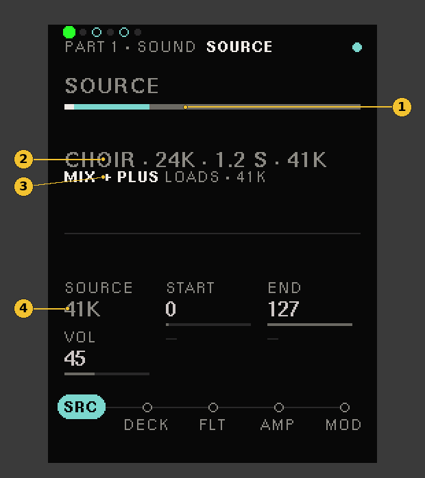

1. **The memory meter**, with what loading this source would take.
2. The card source's name, rate, length and size.
3. **MIX + PLUS** loads it into the project, and the Part plays it. If it won't fit, the hint says WON'T FIT.
4. Until it is loaded, SOURCE shows its size, dimmed.

A machine that a streamed source can't play is dimmed, with the reason (`… NEEDS RAM · STREAMED`). A file that can't be read is marked BAD FILE: only the notes reading it drop out.

### WALK

WALK plays the window as a one-shot, a loop, a ping-pong or a Mellotron-style tape.

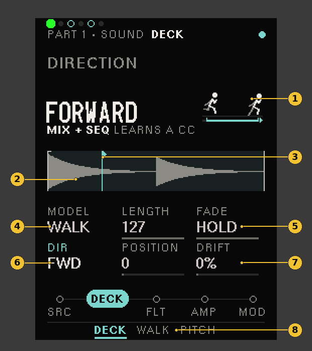

1. **WALK's picture:** a runner on the window, facing the way it plays, the window's arrow under it. FADE draws as a dashed tail.
2. **The strip**, the window lit.
3. **The play head.**
4. **MODEL:** WALK, STRCH (STRETCH), SCRUB or WAVE.
5. **LENGTH:** how much plays from POSITION. **FADE:** the fade at the note's edges, 10 to 500 ms. Played once through with TRON off, FADE's last step is HOLD: the note plays to its end whatever the key does.
6. **DIR:** FWD (forward, once through), REVERSE, LOOP or PING (ping-pong).
7. **POSITION:** where the run starts. **DRIFT:** at each note, POSITION moves by a random step of up to DRIFT, from where the last note left it, so repeats wander through the source.
8. The sub-pages: DECK, WALK (the machine's page) and PITCH.

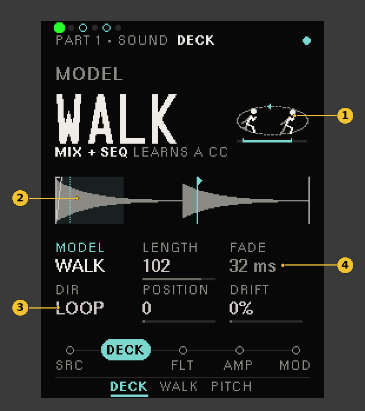

1. On LOOP the runner goes round a track.
2. The loop, inside the window: LENGTH sizes it and POSITION places it.
3. DIR: LOOP.
4. FADE in ms: around a loop the note fades out at key up.

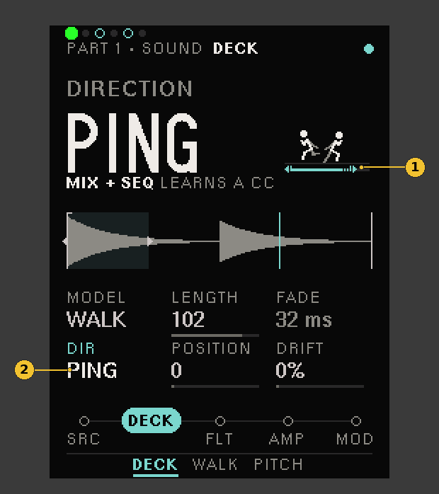

1. On PING the window's arrow points both ways: the run goes there and back.
2. DIR: PING.

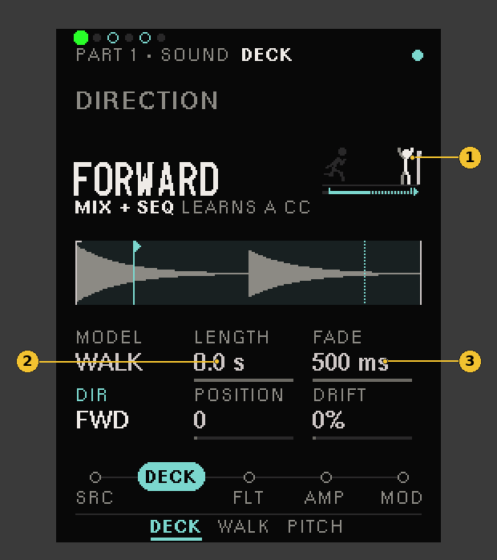

1. With TRON on, a finish post marks the end of the tape.
2. **LENGTH** reads in seconds: each key has its own tape, 0.25 to 8 s long, the same at every pitch, as on a Mellotron. The window comes round again until the tape runs out.
3. **FADE:** at key up the pressure pad lifts through FADE.

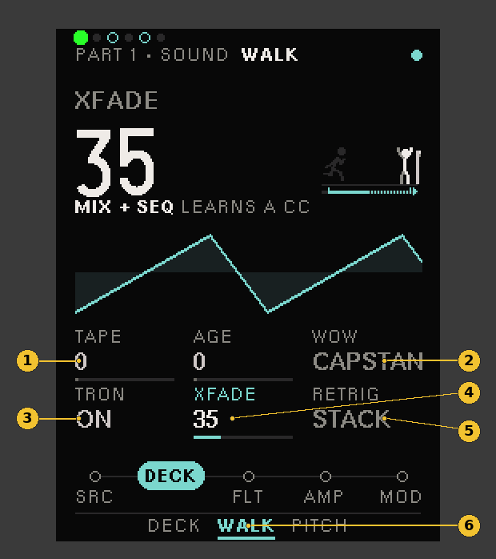

1. **TAPE, AGE, WOW:** the tape's wear.
2. WOW's kind: CAPSTAN or WARBLE.
3. **TRON:** OFF or ON.
4. **XFADE:** the crossfade at the loop's seam, heard on LOOP and on TRON's rounds.
5. **RETRIG:** STACK (notes play over each other) or CUT (a new note cuts the last). Heard once through with TRON off. A cell that the current DIR can't use is dimmed, and the focus band says why.
6. The sub-page row, on WALK.

### STRETCH

STRETCH plays the source at the key's pitch, stretched or squeezed in time.

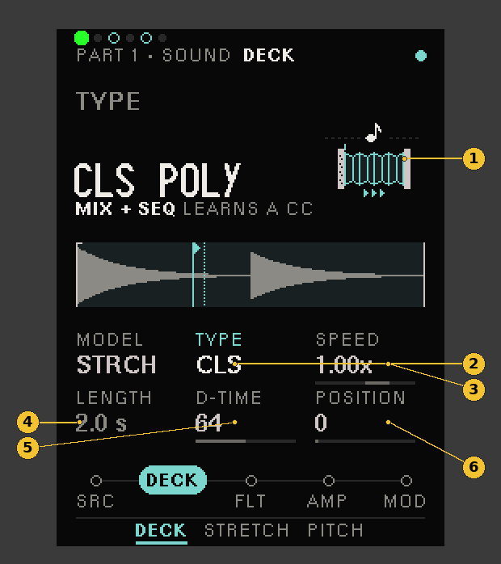

1. **STRETCH's picture:** an accordion under a note.
2. **TYPE:** CLASSIC and CLS POLY splice the source in the manner of the Akai S950 (CLASSIC locks its splices to a pitched source, CLS POLY to D-TIME, for chords and unpitched sources); GRAIN plays it in grains.
3. **SPEED:** how fast it moves through the source, `0.00x` (frozen in place) to `2.00x`, and backwards below 0.
4. **LENGTH:** how long a key plays the source, 0.25 to 8 s. GRAIN's: dimmed under CLASSIC.
5. **D-TIME:** the splice length. CLASSIC's: dimmed under GRAIN.
6. **POSITION:** where CLASSIC starts. A cell dimmed under the other TYPE says so in the focus band (GRAIN TYPE ONLY, CLASSIC TYPE ONLY).

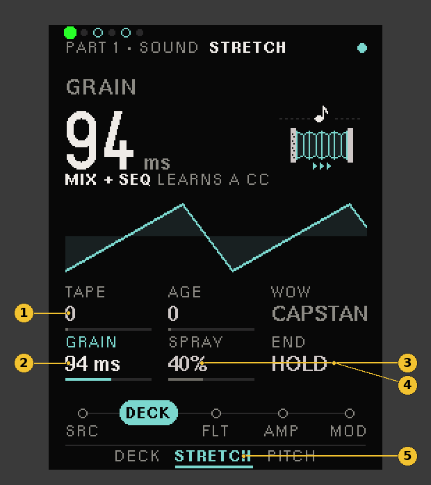

1. TAPE, AGE, WOW: the tape's wear.
2. **GRAIN:** each grain's length, 30 to 250 ms.
3. **SPRAY:** scatters the grains in time, so an unpitched source never combs.
4. **END:** what GRAIN does at the window's end: HOLD keeps playing its last grains while the key is held, STOP ends the note.
5. The sub-page row, on STRETCH.

GRAIN, SPRAY and END are GRAIN's. GRAIN stays in tune at every LENGTH.

### SCRUB

SCRUB moves through a source by hand, like a tape reel under your finger.

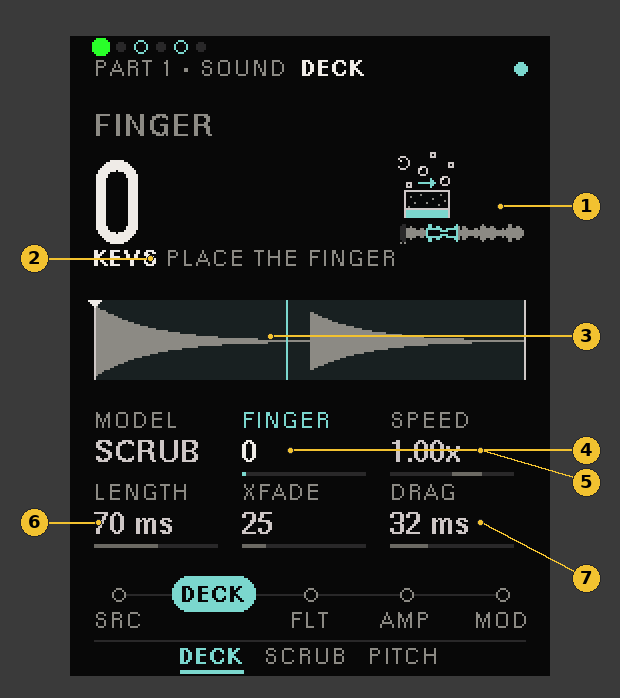

1. **SCRUB's picture:** a sponge on the tape.
2. On FINGER, with KEY at POSITION, the hint reads KEYS PLACE THE FINGER.
3. The strip, the finger's place marked.
4. **FINGER:** turn it like a jog wheel: it reads how fast you turn, and glides to a stop through DRAG when you let go. A MIDI CC or a MOD route moves it too.
5. **SPEED:** the speed of the loop behind the finger, as a factor of the source's (`1.00x`, −2× to 2×).
6. **LENGTH:** the loop behind the finger, 2 ms to 2 s. **XFADE:** its seam's crossfade.
7. **DRAG:** how long the finger takes to stop, 10 to 500 ms.

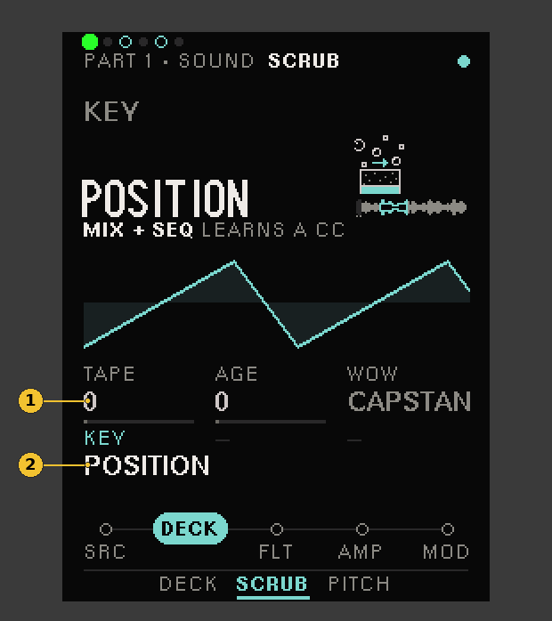

1. TAPE, AGE, WOW: the tape's wear.
2. **KEY:** POSITION (each key places the finger: C is the start of the window and each semitone up is 1/12 further along, the same in every octave; FINGER adds to it) or PITCH (the scrub plays at the key's pitch).

### WAVE

WAVE plays wavetable sources: a source made of single-cycle frames.

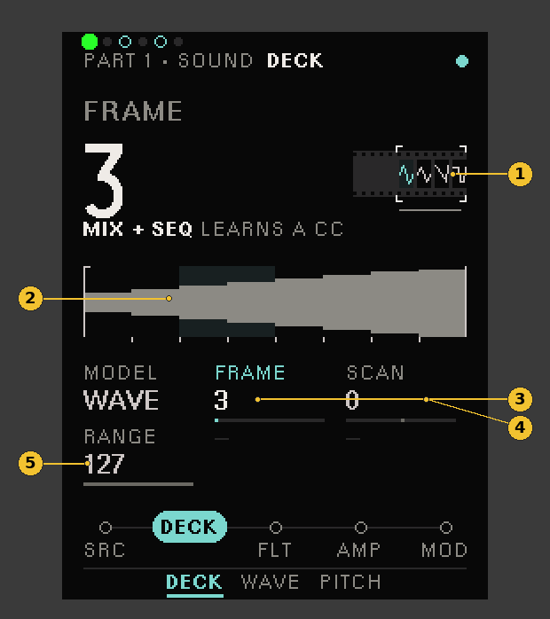

1. **WAVE's picture:** film running through a gate.
2. **The strip:** the source's frames, the playing ones lit.
3. **FRAME:** the frame it starts on.
4. **SCAN:** how it moves through the frames.
5. **RANGE:** how many frames it travels.

WAVE's own page holds TAPE, AGE and WOW.

## 12. The MOD matrix and the LFOs

The MOD node's own page (MATRIX). Its sub-pages are the three envelopes (ENV1–ENV3), their speeds (SPEED) and three LFOs (LFO1–LFO3).

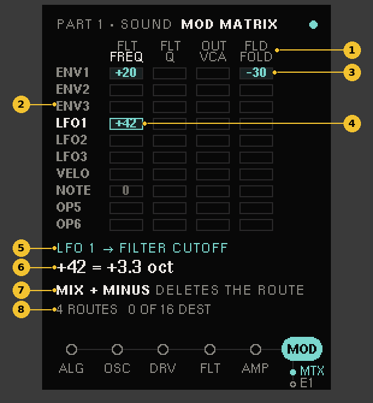

1. **Columns.** The first four (FLT FREQ, FLT Q, OUT VCA and FX, the filter FX slot's first pot) are always there; after them come the destinations you have primed: on any page, touch a parameter and press MIX + PLUS. Encoder 4 scrolls them sideways.
2. **Rows** are the sources: ENV1–3, LFO1–3, VELO, NOTE (and OP5, OP6 for ALGO's operator taps).
3. **A route**, with its amount.
4. **The cursor.** Encoder 1 moves it up and down, encoder 2 across; encoder 5 sets the amount.
5. The route under the cursor, in full words.
6. Its amount, and what that means in the destination's terms.
7. The hint: MIX + MINUS deletes the route under the cursor.
8. How many routes and destinations are in use.

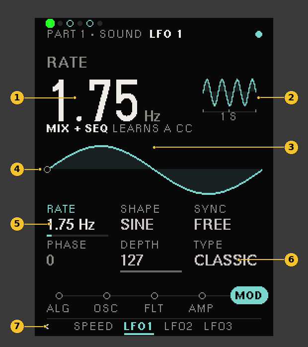

1. The touched control's value: CLASSIC's RATE reads in Hz.
2. **The control's own glyph.** RATE draws two seconds of the LFO; SHAPE, SYNC, PHASE, DEPTH and the others each draw what they do.
3. **The LFO itself:** one cycle at the values you set.
4. A dot rides the newest voice's place in the cycle. It rests at the start while nothing plays.
5. **RATE, SHAPE, SYNC** on the top row; **PHASE** (dimmed under SYNC FREE) and **DEPTH** below.
6. **TYPE:** CLASSIC or FUNC. FUNC has its own controls (TILT, DELTA, SLEW and others) and its RATE goes up to 93.75 Hz.
7. `<`: more sub-pages to the left (the envelopes and SPEED).

## 13. The mixer and the effects

Press B*n* twice, or MIX + B*n*. It opens on SND, or on the effect page you last left. The mixer chain is PRT · SND · CHR · DLY · REV · MST: the Part's own strip and sends, then the shared effects.

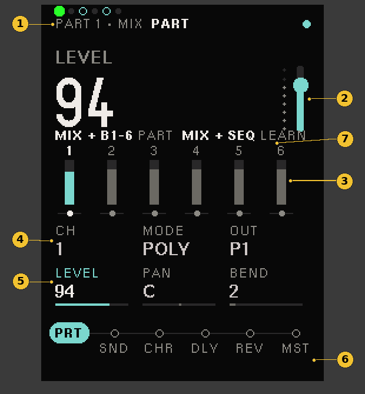

1. `PART 1 · MIX`: Part 1's mixer.
2. LEVEL's glyph, a level bar.
3. All six Parts' levels, the current Part's in accent.
4. CH (MIDI channel), MODE (MONO or POLY), OUT (output pair P1, P2 or P3).
5. LEVEL, PAN, and BEND (pitch-bend range in semitones).
6. The mixer's chain. EDIT from PRT or SND goes down to the Sound browser.
7. **The hint:** `MIX + B1-6 PART` jumps to that Part's mixer and keeps the page you are on. `MIX + SEQ LEARN` starts MIDI learn for the touched cell.

SND holds the Part's CHORUS, DELAY and REVERB sends, the same page as AMP › SENDS. PLUS walks on to the shared effects:

| Page | Cells | Sub-pages |
|---|---|---|
| CHR (chorus) | MODE (OFF, I, II, I+II), RATE, DEPTH, MIX | |
| DLY (delay) | TYPE (TAPE, GRAIN), TIME, FDBK, TONE, REV (delay into the reverb), MIX | CHARACTER, GRAIN |
| REV (reverb) | TYPE (QUAD, ROOM, HALL, BLOOM, GATE, REVERSE), SIZE, TIME, DAMP, SMEAR, MIX | MORE, MORE 2: extra controls for the TYPE |
| MST (master) | Compressor: THRESH, RATIO, ATK, REL, MAKEUP, MIX | LVL: VOL and PAN of the whole synth |

### The delay

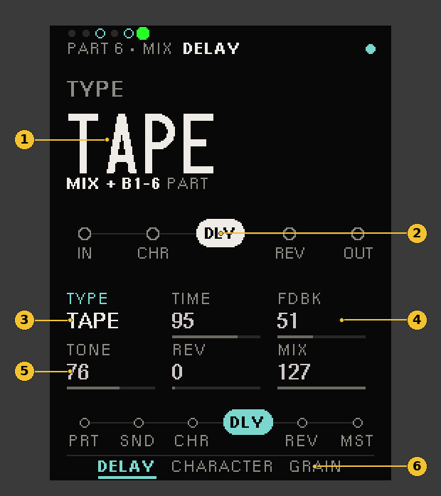

1. **TYPE**, large while touched: TAPE, a tape echo, or GRAIN, which builds its repeats from short grains of the last half second, in the manner of Mutable Instruments' Beads.
2. **The effects chain**, the delay lit.
3. TYPE's cell.
4. **TIME** and **FDBK** (feedback).
5. **TONE**, **REV** (the delay sent on into the reverb) and **MIX**.
6. DLY's sub-pages: DELAY, CHARACTER (TAPE's) and GRAIN (GRAIN's).

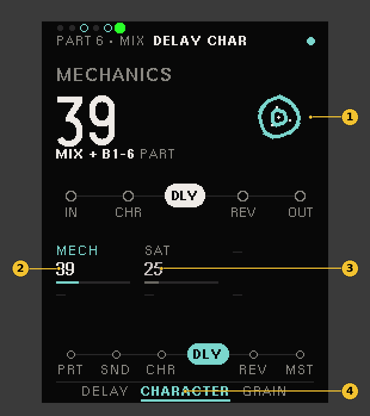

1. **MECHANICS'** glyph: the tape reel, wobbling as much as the transport does.
2. **MECH:** wow and flutter.
3. **SAT:** tape saturation.
4. The sub-page row, on CHARACTER.

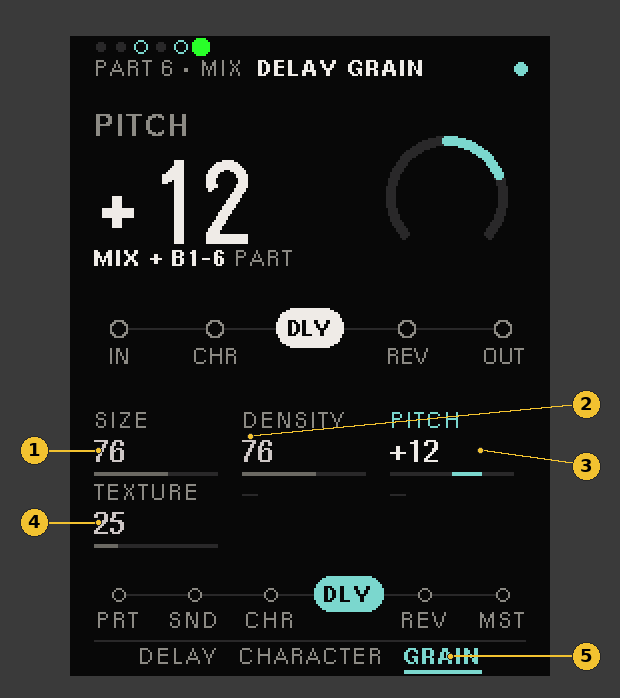

1. **SIZE:** a grain's length.
2. **DENSITY:** how many grains start each second.
3. **PITCH:** each grain's shift in semitones. +12 with a high FDBK is a shimmer.
4. **TEXTURE:** scatters where and when the grains start.
5. The sub-page row, on GRAIN.

CHARACTER is heard under TAPE and GRAIN under GRAIN; under the other TYPE their cells are dimmed, and the focus band says TAPE TYPE ONLY or GRAIN TYPE ONLY.

## 14. The Sound browser

EDIT + B*n*, or EDIT from the mixer. MINUS / PLUS switch Part; SEQ goes back up to the mixer.

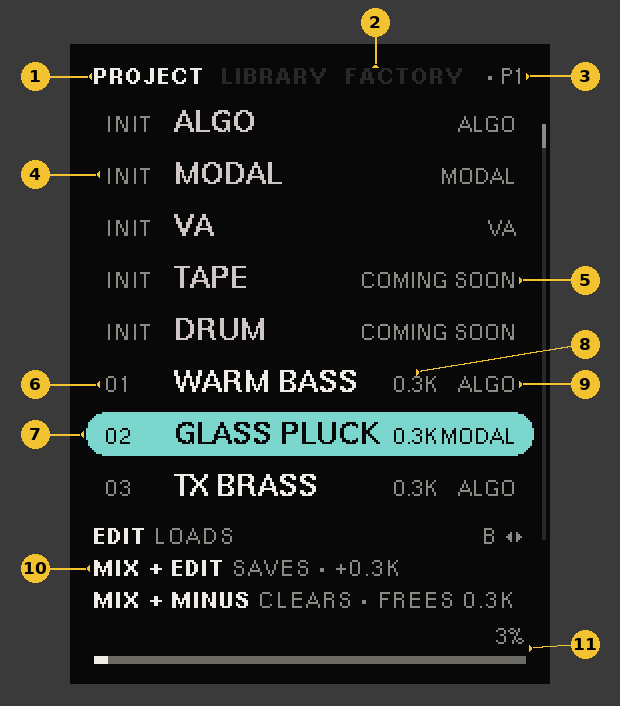

1. **Tabs.** PROJECT lists the project's own Sounds; LIBRARY lists Sounds saved on the card; FACTORY lists the factory Sounds from the card. A long list comes in pages of 48: `NEXT ›` at the bottom turns to the next page, `‹ PREVIOUS` at the top goes back (LIBRARY says `OLDER ›` and `‹ NEWER`). The 127 factory Sounds fill three pages.
2. `B ◂▸`: turn **encoder 2** to switch tab.
3. The Part you are loading into.
4. **INIT rows:** a clean Sound per engine (ALGO, MODAL, VA, TAPE), above the project's Sounds.
5. DRUM reads COMING SOON and doesn't load yet.
6. The slot number. Turn **encoder 1** to move.
7. The selected row.
8. What the Sound costs in the project's Sound memory.
9. Its engine.
10. **Hints:** EDIT loads, MIX + EDIT saves the Part's Sound, MIX + MINUS clears the slot, each with the memory it takes or frees.
11. How full the project's Sound memory is.

## 15. SETTINGS

MENU opens it. EDIT opens a row (or runs it), SEQ or MENU goes back. MINUS / PLUS, or any encoder, move the bar.

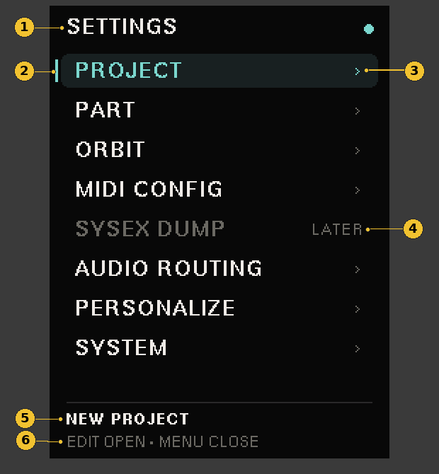

1. **Breadcrumb:** where you are in SETTINGS (`SETTINGS › PROJECT`, and so on).
2. The bar: the selected row.
3. A chevron: this row opens a list.
4. LATER: not built yet. Dimmed rows are skipped.
5. The loaded project's name, then its state (`SAVED`, `* MODIFIED`).
6. What the keys do here.

The top list: PROJECT, PART, ORBIT, MIDI CONFIG, SYSEX DUMP (later), AUDIO ROUTING, PERSONALIZE, SYSTEM. PROJECT also holds POOL (the project's memory) and PURGE UNUSED SRC, which frees the memory held by TAPE sources no Part uses (the files on the card stay). PERSONALIZE holds THEME, SCREENSAVER (OFF, or 5 seconds up to 10 minutes; 5 minutes is the default), CHAIN MAP (PAGES: ROW or STACK) and TEXT SIZE (SIZE: NORMAL or LARGE; LARGE sets the cells, the focus label, the hints, the SETTINGS lists and the Sound names a size up).

## 16. ORBIT, the ring sequencer

ORBIT plays Chimera by itself while you shape sounds. A chord progression turns round the outside of five rhythm rings; each ring has its own number of steps, so they run as polyrhythms. Each ring plays a Part and fits its notes to the key, the scale or the current chord. Eight scenes hold whole setups.

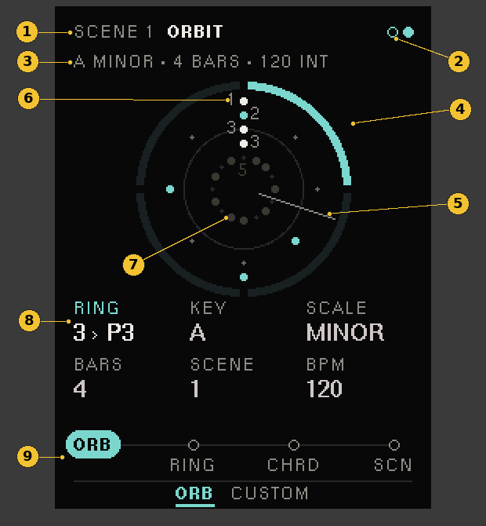

1. The playing scene, and the page (ORBIT).
2. ORBIT's beat dot, then the sounding dot.
3. Key, scale, loop length in bars, and tempo (INT: its own clock).
4. The chord progression, round the outside; the playing segment lit.
5. The sweep: where the bar is.
6. Each ring's Part number, at its first step.
7. A ring's steps: a hit filled, the step playing lit. A muted ring goes dark.
8. ORB's cells: RING (the selected ring and its Part, `3 › P3`), KEY, SCALE, BARS, SCENE, BPM.
9. ORBIT's own chain: ORB · RING · CHRD · SCN.
10. ORB's sub-pages: ORB and CUSTOM.

| In ORBIT | Does |
|---|---|
| hold SEQ (from anywhere) | Enter ORBIT |
| B6 | Play / stop |
| B1–B5 | Open ring 1–5 on the RING page |
| hold B1–B5 | Go to the Part that ring plays |
| MIX + B1–B5 | Mute / unmute that ring |
| MENU | Leave ORBIT, back where you were |

| Page | Sub-pages | What it holds |
|---|---|---|
| ORB | CUSTOM | The overview above. CUSTOM is a circle of the twelve notes for your own scale |
| RING | RHYTHM, VOICE, NOTES | RHYTHM: STEPS, HITS, ROTATE, CHANCE, MUTATE, MUTE. VOICE: GATE, VEL, ACCENT, OCTAVE, RANGE, SNAP. NOTES: MODE, WALK, TARGET (the Part it plays), LEARN, CLEAR, NOTE |
| CHRD | | The progression: SEGS, DEGREE, PLAY |
| SCN | | SCENE (switches on the loop), SAVE (EDIT saves the scene to that slot), SWITCH |

ORBIT follows its own clock, or a MIDI clock from your DAW: SETTINGS › MIDI CONFIG › SYNC.

## 17. First steps

1. Power on, with a MIDI keyboard on the DIN input. Part *n* listens on MIDI channel *n*.
2. Press **B1** and play. Turn the encoders; watch the focus band.
3. Press **PLUS** a few times to walk the chain, then **SEQ** to step into a sub-page and **EDIT** to come back.
4. Press **B1** again for its mixer. It opens on SND, the sends: turn REVERB to send Part 1 to the reverb. MINUS goes to PRT for LEVEL and PAN.
5. Press **EDIT** to reach the Sound browser. Turn encoder 1 up to INIT VA and press **EDIT**: Part 1 is now a VA. Press **B1** to see its pages.
6. PLUS along to MOD. On the matrix, move the cursor to the LFO1 row under the FLT FREQ column (encoders 1 and 2) and turn encoder 5. Press MINUS twice, back to FLT, and play: the faint band under the picture shows the LFO moving the cutoff. To modulate any other parameter, touch it and press **MIX + PLUS** to give it a column first.
7. Load a TAPE Sound: **EDIT + B2**, turn encoder 2 to FACTORY, pick a Sound tagged TAPE and press **EDIT**. Play Part 2 on channel 2, then **B2** and PLUS to DECK, and turn MODEL to hear the same source through another machine.
8. **Hold MENU** to save the project. Give it a name (encoder 1 moves the cursor, 2 picks a letter) and press **EDIT**.
9. ORBIT: **hold SEQ**, then press **B6**.
