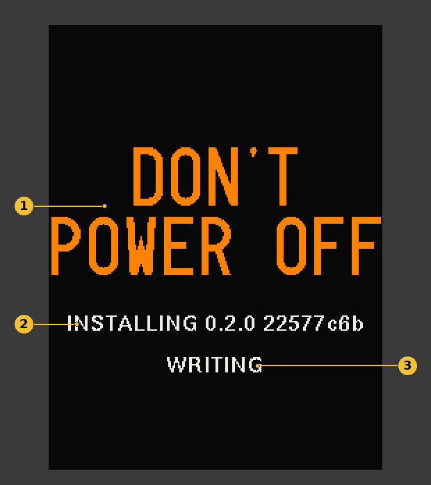

# Chimera

**A new way to make music with your PreenFM3.**

Chimera is alternative firmware for the PreenFM3 synthesizer. It gives your synth new sound engines, effects, sequencing tools, and a different way to explore and create sounds.

It runs on the original PreenFM3 hardware. You don't need to modify your synth or buy anything else.

And if you decide Chimera isn't for you, you can switch back to the original PreenFM3 firmware.

**Current version: Alpha 0.2.0**

Chimera is still in development. Some features aren't finished, and you may run into bugs.

[Download Chimera](../../releases) | [Getting Started](GETTING-STARTED.md) | [FAQ](FAQ.md)

---

## Installing Chimera

Installing Chimera is straightforward. **We recommend using the SD card**, since this doesn't require installing any software on your computer. The card stays inside your PreenFM3: your computer reaches it over USB.

You'll need:

- Your PreenFM3
- A computer
- A USB cable

The same steps install Chimera for the first time and update it from an earlier version.

### Step 1: Check your bootloader

Before installing Chimera, let's check that your PreenFM3 is ready.

1. Turn off your PreenFM3.
2. Hold down the **MENU** button.
3. While holding MENU, turn the PreenFM3 back on.
4. Keep holding MENU until the screen lights up.

You should see a screen with a version number at the top.

**Does it say `pfm3 BootLoader 1.09`?**

Great! You're ready to install Chimera. Continue to Step 2. Chimera never changes the bootloader.

**Does it show an older version?**

You'll need to [update your bootloader](#updating-an-older-bootloader) first. This is a one-time process.

**Nothing happens?**

See [Troubleshooting](#troubleshooting).

### Step 2: Download Chimera

1. Open the [Chimera Releases page](../../releases).
2. Download three files: `CHIMERA.BIN`, `CHIMERA.BK2` and `factory-v1.zip`. `CHIMERA.BIN` and `CHIMERA.BK2` are the firmware: Chimera needs both. `factory-v1.zip` holds the factory Sounds, the sources the TAPE Sounds play, and four demo projects.
3. Save them somewhere easy to find, like your Downloads folder, and unzip `factory-v1.zip`. It unzips to a folder called **CHIMERA**.

**Keep the names exactly as they are.** If your browser saved a second copy as `CHIMERA (1).BIN` (or `CHIMERA (1).BK2`), rename it back to `CHIMERA.BIN` in Finder or Explorer. Rename it; don't delete it. The version number is in the release title, not in the file name.

### Step 3: Copy the files to the card

You don't have to take the SD card out of your PreenFM3.

1. Connect your PreenFM3 to your computer using a USB cable.
2. Enter the bootloader (turn on the synth while holding MENU).
3. Press **button 3 (SD card access)**.
4. Your SD card appears on your computer like a USB drive.
5. Copy `CHIMERA.BIN` and `CHIMERA.BK2` into the drive's main folder (not inside another folder). If older copies are already there, choose **Replace**.
6. Copy the factory set from the unzipped **CHIMERA** folder:
   - **If the drive has no CHIMERA folder yet**, copy the whole **CHIMERA** folder onto the drive.
   - **If it already has one**, copy folder by folder instead: open **SOUNDS**, **TAPES** and **PROJECTS** in the unzipped folder, and copy the files inside each into the folder of the same name on the drive (copy the whole folder across if the drive doesn't have it). Choose **Replace** for files with the same name. Copying file by file keeps your own Sounds and projects: on a Mac, replacing a whole *folder* throws away what was in it.
   - The demo projects take the first four project slots. If you saved projects of your own there (`P0000001.A` to `P0000004.A` in **PROJECTS**), copy them to your computer first.
7. Safely eject the drive from your computer.
8. Press **MENU** on the PreenFM3 to leave SD card access.

### Step 4: Flash and install

1. Under **Firmware to flash**, press **−** and **+** to step through the files on the card until it shows `CHIMERA.BIN`.
2. Press **button 1 (flash)**.
3. When Chimera starts, it finds `CHIMERA.BK2` on the card and installs it. Leave the power on until it's done.



1. **DON'T POWER OFF.** Chimera is writing the second half of its firmware. Your sound keeps playing, but leave the power on.
2. The version it is installing.
3. What it is doing: **ERASING**, then **WRITING**, then **SEALING**. When it's done, Chimera carries on by itself.

If the power does go off during the install, nothing is lost: the next start installs it again.

> **Make sure you've picked `CHIMERA.BIN` before you press button 1.** The bootloader shows every `.bin` on the card, one at a time, and the Chimera file may not be the first. Step through them all with − / + and check the name. This applies on every computer: Mac, Windows and Linux.

**On a Mac:** macOS also adds a small hidden twin next to anything you copy, named `._CHIMERA.BIN`. The bootloader lists it as `CHIMER~1.BIN`. It isn't firmware, and flashing it leaves a black screen. You can leave it on the card: just pick the real one, `CHIMERA.BIN` (the big file), with − / +. Copying the files from a Windows or Linux computer doesn't make the twin at all.

**Black screen after flashing?** The bootloader is never touched, so hold MENU while powering on and flash again with the right file.

**`CHIMERA.BK2` is required.** It holds TAPE, ORBIT, the reverbs, the GRAIN delay, NOISE, the low-pass gate, the SEM filter, FUZZ, the filter's FEEDBACK and VA's FM, LOOPFM, SOFT SYNC and PHASE modes, among other things. If it's missing from the card, or is from another version, those stay silent and their screens say **UPDATE** or **NEEDS UPDATE**. Copy the `CHIMERA.BK2` from the same release onto the card as in Step 3 and restart.

**That's it. Chimera is installed!**

You can now continue to the [Getting Started Guide](GETTING-STARTED.md). To find the factory Sounds, press **EDIT + B1** and turn **encoder 2** to the **FACTORY** tab.

**A small tip:** You can leave `CHIMERA.BIN` and `CHIMERA.BK2` on the card. The next release uses the same two names: copy the new ones over them and choose Replace. That keeps old firmware from getting mixed up with new.

---

## Another way to install: USB (DFU)

If you can't use the SD card method, you can install Chimera directly over USB.

This requires a small program called `dfu-util`. The steps are slightly different depending on your computer.

Choose your operating system:

- [macOS](#macos)
- [Windows](#windows)
- [Linux](#linux)

### First: Put your PreenFM3 into DFU mode

This part is the same for every computer.

1. Connect your PreenFM3 to your computer with a USB cable.
2. Turn off the PreenFM3.
3. Hold **MENU** while turning it on.
4. When the bootloader appears, press **button 2 (DFU Mode)**.

Now follow the instructions for your computer.

**Only ever use the command shown below.** Chimera always goes to address `0x08020000`. Never write it to `0x08000000` (that's the bootloader), and never use `-a 1`.

### macOS

1. Install `dfu-util` if you don't already have it. If you use Homebrew, open Terminal and run:

   ```bash
   brew install dfu-util
   ```

2. Open Terminal and go to the folder containing your downloaded Chimera firmware. For example, if it's in Downloads:

   ```bash
   cd ~/Downloads
   ```

3. Run this command:

   ```bash
   dfu-util -a 0 -d 0483:df11 -D CHIMERA.BIN -s 0x08020000:leave
   ```

Your PreenFM3 should restart into Chimera.

**Then add `CHIMERA.BK2` and the factory set.** Hold MENU while powering on, press **button 3 (SD card access)**, and copy `CHIMERA.BK2` and the factory set onto the card as in [Step 3](#step-3-copy-the-files-to-the-card). Eject, press MENU, and turn the PreenFM3 off and on. Chimera installs `CHIMERA.BK2` on that start (**DON'T POWER OFF** on the screen).

### Windows

On Windows, please use the [SD card method](#step-3-copy-the-files-to-the-card).

### Linux

1. Install `dfu-util` using your Linux distribution's package manager.

   For example, on Ubuntu or Debian:

   ```bash
   sudo apt install dfu-util
   ```

2. Open a terminal in the folder containing your downloaded Chimera firmware.

3. Run:

   ```bash
   dfu-util -a 0 -d 0483:df11 -D CHIMERA.BIN -s 0x08020000:leave
   ```

4. Copy `CHIMERA.BK2` and the factory set onto the card as described at the end of the macOS steps.

If Linux says it cannot access the USB device, see [Troubleshooting](#troubleshooting).

**Note:** You might see `Error during download get_status` after the firmware transfers successfully. If the PreenFM3 has already restarted into Chimera, this is normal.

---

## After installation

Once Chimera starts, you're ready to explore!

We recommend starting here:

**[Getting Started](GETTING-STARTED.md)** explains the basics of Chimera.

**[Quick Start](QUICK-START.md)** shows you how to navigate the synth.

**[FAQ](FAQ.md)** answers common questions.

`factory-v1.zip` holds 127 factory Sounds across ALGO, MODAL, VA and TAPE, the sources the TAPE Sounds play, and four demo projects. If you skipped it, copy it onto the card as in [Step 3](#step-3-copy-the-files-to-the-card) at any time.

---

## Switching back to the original PreenFM3 firmware

Chimera doesn't replace or modify your PreenFM3's bootloader during a normal installation.

You can return to the original firmware whenever you like.

1. Download the original PreenFM3 v1.03 firmware.
2. Find the file named `p3_1_03.bin`.
3. Enter the bootloader by holding MENU while powering on.
4. Install the original firmware using either the SD card method or the USB/DFU method described above.

Your original PreenFM3 firmware will be restored.

Chimera also keeps its own files in a separate `/CHIMERA/` folder on your SD card, leaving your original PreenFM3 patches and settings alone.

---

## Updating an older bootloader

Chimera requires PreenFM3 bootloader version 1.09.

If your synth is running an older bootloader, you'll need to update it before installing Chimera.

**Important:** Updating the bootloader is different from installing normal firmware. Interrupting a bootloader update can prevent your PreenFM3 from starting normally.

Download the official PreenFM3 v1.03 release and locate `p3_boot_1_09.bin`.

Enter DFU mode using the steps above, then run:

```bash
dfu-util -a 0 -d 0483:df11 -D p3_boot_1_09.bin -s 0x08000000
```

This is the only time you ever write to `0x08000000`, and only with this file.

Do not disconnect the synth or turn off its power while the update is running.

Once finished, restart your PreenFM3 and check that the bootloader version is now 1.09.

You can then follow the normal Chimera installation instructions.

---

## Troubleshooting

**I held MENU, but nothing happened.**

Turn your PreenFM3 off completely. Hold MENU before turning it back on, and keep holding until the bootloader screen appears.

If it still doesn't work, please [open an issue](../../issues) before trying anything else.

**My computer doesn't see the SD card.**

Check your USB cable and make sure you've selected button 3 (SD card access) from the bootloader menu.

Some USB cables only provide power and can't transfer data.

**Linux says it cannot access the DFU device.**

Run the `dfu-util` command with `sudo`, or allow your user once with:

```bash
echo 'SUBSYSTEM=="usb", ATTRS{idVendor}=="0483", ATTRS{idProduct}=="df11", TAG+="uaccess"' | sudo tee /etc/udev/rules.d/70-stm32-dfu.rules && sudo udevadm control --reload
```

Then unplug the PreenFM3 and plug it back in.

**Chimera doesn't start after installation.**

Restart the PreenFM3 and try entering the bootloader again. If the bootloader still works, you can reinstall the firmware.

If the problem continues, [report a bug](../../issues).

---

## Reporting bugs

Chimera is currently in alpha, so bug reports are extremely helpful.

If something goes wrong, please open a [bug report](../../issues/new/choose).

Tell us which version you're using, what you were doing when the problem happened, and what you expected to happen.

If possible, include a photo, screenshot, or short recording.

---

## What's inside

- **Six Parts**, each its own instrument on its own MIDI channel, with a mixer, three shared effects (chorus, delay with TAPE and GRAIN types, reverb) and a master compressor.
- **ALGO**, a six-operator phase-modulation synth: two algorithms, ALG A and ALG B, with MORPH blending between them.
- **MODAL**, struck, plucked and bowed resonators: STRING, BANK, BOWED and SYMP.
- **VA**, two variable-wave oscillators combined by MODE (MIX, SYNC, SOFT SYNC, RING, AM, FM, PHASE, LOOPFM, MAX, XOR, BITS), with a SUB, a NOISE source and STABILITY drift.
- **TAPE**, which plays sound sources from the card through four machines: WALK (one-shots, loops, ping-pong and Mellotron-style tapes), STRETCH, SCRUB and WAVE.
- **A filter for every voice**: CLEAN, 2040, DIRTY, LADDER and SEM, with an FX slot (SOFT drive, FUZZ or FOLD) before or after it, and FEEDBACK.
- **A low-pass gate** in every voice's VCA: LPG, DECAY and STRIKE on AMP.
- **ORBIT**, a ring sequencer that plays Chimera by itself: a chord progression round five rhythm rings.
- **127 factory Sounds** in `factory-v1.zip`, with the TAPE sources they play and four demo projects.

## Not in this release

DRUM is marked COMING SOON in the Sound browser. It isn't in this release.

Watch this repository for new releases.

## Source code and licence

Chimera is © 2026 Joe Giralt. All rights reserved.

This repository contains firmware releases, documentation, and the issue tracker. The source code is not currently public.

Firmware binaries are distributed under the [tester licence](LICENSE.md).
