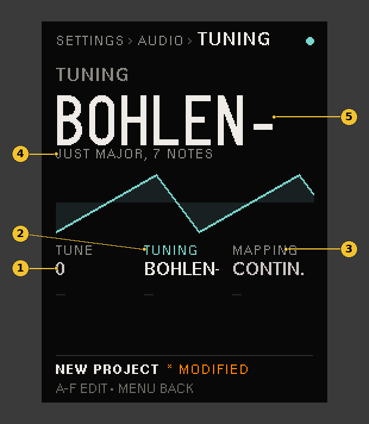

# Tuning

Each Part plays in a tuning of its own: equal temperament, a historical temperament, a Scala file from the card, or a tuning sent over MIDI. New to the panel? Read the [quick start](QUICK-START.md) first. On SETTINGS pages the letters **A** to **F** are encoders 1 to 6.

Pick the tuning on **SETTINGS › AUDIO ROUTING › TUNING**, cell B, **TUNING**. It sets the tuning of the Part you are on (press another Part's button to set its own). Cell A, **TUNE**, shifts the whole unit. A new note plays the tuning; a note already sounding keeps its pitch.

1. **TUNE** (A): the whole unit, in cents.
2. **TUNING** (B): the Part's tuning. Turn past `MTS` and it steps through the Scala files on the card, by file name. The cell shows a name's first 7 characters.
3. **MAPPING** (C): how a Scala file lies on the keys, `CONTIN.` (continuous) or `KEYBD` (keyboard).
4. The Scala file's own name for its scale (its description line), or the file's name if it has none.
5. While TUNING has focus, a longer file name scrolls here and in the cell: it holds still, runs to its end, holds, and starts again.

| TUNING | What it plays |
|---|---|
| `12-TET` | Equal temperament, every semitone 100 cents |
| `JUST` | 5-limit just intonation on C: pure thirds and fifths in C's keys |
| `PYTHAG` | Pythagorean on C: pure fifths, bright wide thirds |
| `MEANTONE` | Quarter-comma meantone: pure major thirds, a wolf fifth on G♯–E♭ |
| `WERCK` | Werckmeister III: a well temperament, every key playable, each its own colour |
| `MTS` | The tuning a DAW or editor sends as MIDI Tuning Standard SysEx (below) |
| a file name, such as `PELOG` | A Scala file from the card |

C stays at its usual pitch in every named temperament, so a Part in `JUST` plays in tune with one in `12-TET` on C.

The PITCH sub-page's tuner reads the note as the Part's tuning plays it.

## Scala files

A Scala file (`.scl`) holds a scale: up to 128 steps, in cents or as ratios. Thousands are in the Scala archive (huygens-fokker.org). Files up to 4 KB are read.

### Putting Scala files on the card

The card is inside the case, so you reach it over USB from the bootloader, as when you install:

1. Turn the PreenFM3 off. Hold **MENU** and turn it on.
2. Press **button 3 (SD card access)**. The card shows up on your computer like a USB drive.
3. Open the **CHIMERA** folder. If it has no **TUNINGS** folder, make one there.
4. Copy the `.scl` file into **TUNINGS**. To map it to the keys yourself, copy a `.kbm` file of the same name beside it (`bohlen-pierce.kbm` with `bohlen-pierce.scl`).
5. Eject the drive, press **MENU** to leave SD card access, and turn the PreenFM3 off and on.

Files keep the names they have: `bohlen-pierce.scl` shows as `BOHLEN-PIERCE`, in capitals (letters outside A–Z show as `?`, and the first 32 characters are shown). The hidden files a Mac leaves beside the ones you copy (`._bohlen-pierce.scl`, `.DS_Store`) are harmless: they are never listed. Chimera only reads that folder; it never writes to it.

To take a file off the card, move it out of the folder the same way. Every Part playing it then plays `12-TET` (or, with only the `.kbm` gone, the scale by its MAPPING).

### Picking one

On TUNING, turn past `MTS`: B steps through the `.scl` files, and the cell shows the file's name. The first 128 `.scl` files in the folder are reached, in the order they were copied; turning past the last of them when the folder holds more says `FIRST 128 FILES ONLY`. If a file is missing or can't be read, the Part plays `12-TET` and the screen says why, such as `PELOG.SCL NOT FOUND` or `PELOG.SCL NOT SCALA`.

The project keeps the file's name, not its place in the list: a file added later moves nothing, a file copied onto the card again under the same name is still the one it plays, and a changed `PELOG.SCL` on the card changes every project that plays `PELOG`.

### MAPPING: the scale on the keys

- `CONTIN.` (continuous): middle C plays the scale's first step at its usual pitch, and each key up plays the next step, whatever the scale's size.
- `KEYBD` (keyboard): each scale starts on a C. The scale's steps go on the keys from C up; the octave is rounded up to whole octaves of keys (a 7-step scale takes 12 keys, a 19-step scale 24), and the keys left over are silent.

A 12-step scale plays the same either way.

A `.kbm` file of the same name, if present, maps keys to the scale's steps and sets the reference pitch, in place of MAPPING. Keys it leaves out (`x`), or outside its range, play equal temperament.

## MIDI Tuning Standard

A Part on `MTS` plays the tuning received over MIDI, DIN or USB. Chimera takes:

- **single-note tuning changes** (real-time, and the bank form);
- **bulk tuning dumps** (all 128 keys);
- **scale/octave tuning**, one-byte and two-byte (each pitch class in every octave).

Messages for device 7F (all) or 0 are taken. Every Part on `MTS` follows one MTS tuning; the tuning program and channel bits in a message are ignored. A received tuning lasts until the unit is turned off: it isn't saved with the project.
