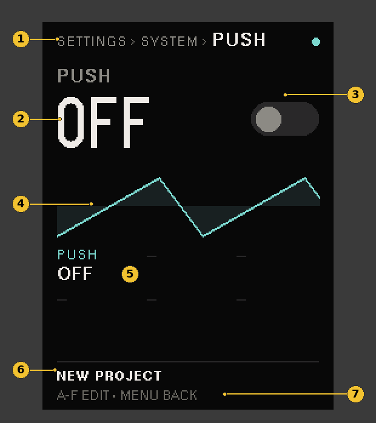
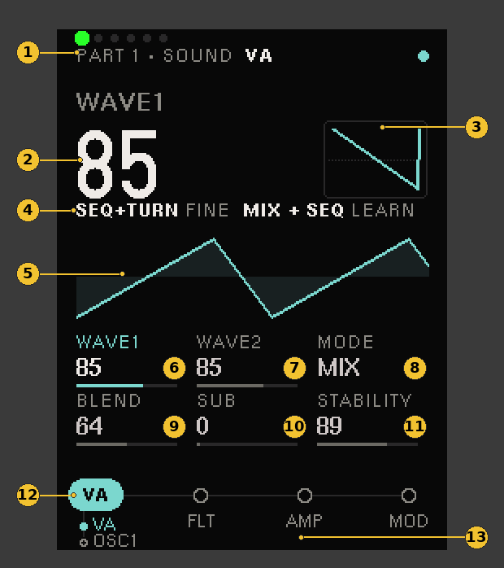
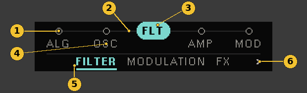
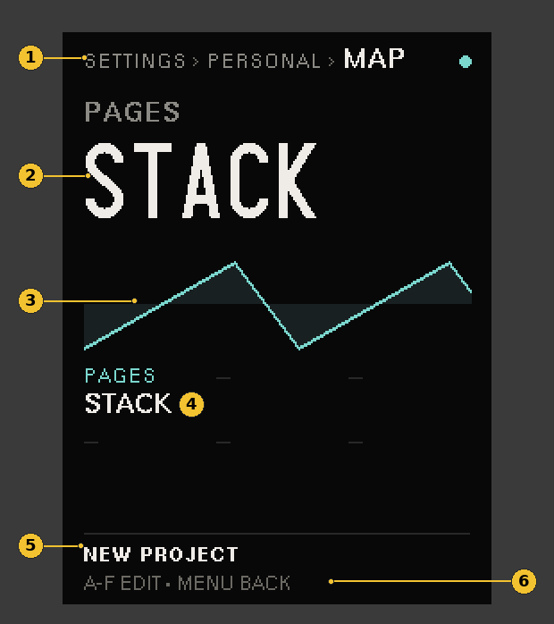
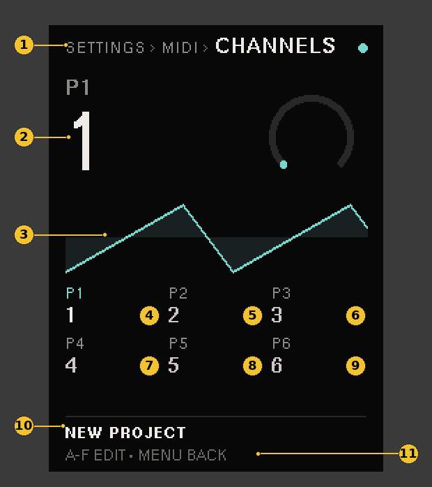
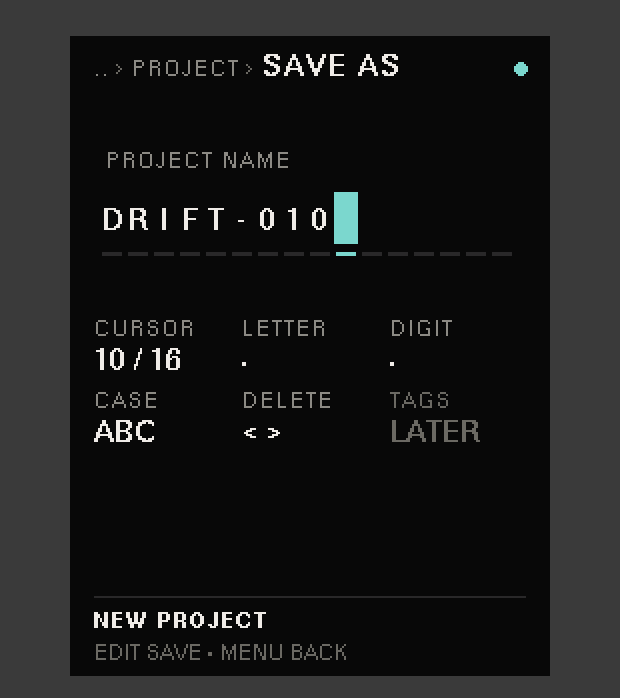
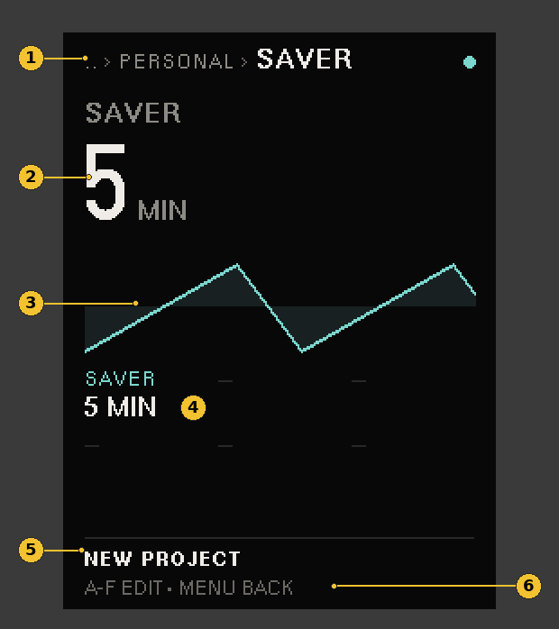
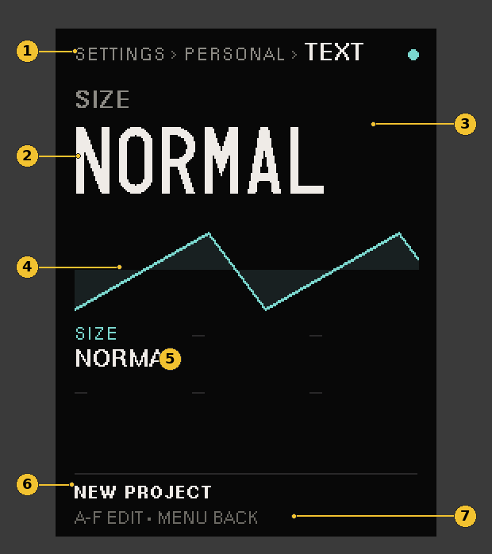
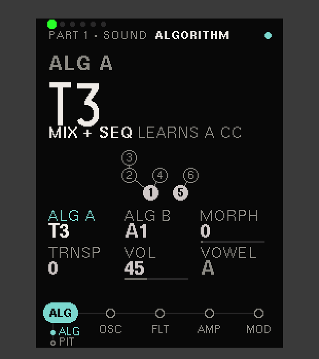

# The panel and navigation

This chapter covers every control on the panel, the layout of the screen, how the four D-pad keys move you around, every key combo and hold, the hints that name them, dialogs and naming, lists, the chain map, the screensaver and text size. It does not explain the engine or effect pages themselves; each has its own chapter, linked from [the chapter list](README.md). The ideas behind Parts, Sounds and projects are in [Concepts](01-concepts.md).

## Panel: the controls

| Control | What it does |
|---|---|
| **Encoders 1–6** | Each turns the cell above it on screen: 1 2 3 on the top row of cells, 4 5 6 on the row below. Some hints name them by letter, A to F (A is encoder 1, F is encoder 6) |
| **B1–B6** | The six Parts. Press B*n* for Part *n*'s sound pages; press it again for its mixer. In ORBIT, B1–B5 are the rings and B6 is play / stop |
| **MINUS / PLUS** | Along: the previous / next page of the chain, the previous / next row of a list, the previous / next Part in the Sound browser |
| **EDIT** | Down or back between a page and its sub-pages (see [The D-pad](#panel-the-d-pad)); opens or runs the selected row in a list; **OK** in a dialog |
| **SEQ** | The other way between a page and its sub-pages; back one level in SETTINGS; cancels a dialog. Held, it enters ORBIT |
| **MIX** | A shift key: held, it turns other keys and turns into secondary actions (MIX + …) |
| **MENU** | Opens SETTINGS; inside it, steps back out one level at a time. Held, it saves the project |

The front-panel LED pulses ORBIT's beat while ORBIT runs: a short blink on each beat, a long one on the first beat of the bar.

A button acts when you press it, except where it also has a hold: SEQ, MENU and, in ORBIT, B1–B5 act when you let go, or at the hold after half a second.

### Panel: encoders that push

The encoders on most PreenFM3 units only turn. Some control boards have encoders that also push. Chimera never needs a push: every push is a shortcut for something you can also do without it.

If your encoders push, turn on SETTINGS › SYSTEM › PUSH ENCODERS › **PUSH**: ON (OFF by default). Then:

- **PUSH** (press and let go without turning) sets the cell to its default.
- **PUSH + TURN** steps the value finely.



1. **Header:** SETTINGS › SYSTEM › PUSH.
2. **The focused cell**, large: PUSH and its value.
3. **Its glyph**, a switch.
4. **The picture band**, the live output.
5. **Cell A** (encoder 1): **PUSH**, OFF or ON.
6. **Footer:** the project and its state.
7. **Footer:** the keys this page answers to.

With PUSH on, a cell's hint reads `PUSH DEFAULT  PUSH/SEQ FINE`. Without push encoders, use **SEQ + turn** for fine steps (see [Panel: fine steps](#panel-fine-steps-with-seq-and-turn)) and **MIX + turn** to reach the default (see [Panel: landmarks](#panel-jumping-to-a-landmark-with-mix-and-turn)).

## Panel: the screen



1. **Header.** Above the text, one dot a Part, B1 to B6: the current Part is the bright green dot, and a Part that is playing has a ring round its dot. Then the place, `PART 1 · SOUND` (a Part's sound pages; `PART 1 · MIX` is its mixer), and the page's full name, VA. The dot on the right is the sounding dot, lit while the instrument makes sound; a second dot beside it pulses ORBIT's beat while it runs. If the Part plays out of output pair 2 or 3, an `OUT P2` or `OUT P3` warning shows on the right of this line.
2. **Focus band: the touched cell**, its label (WAVE1) and its value, large. A unit (Hz, kHz, ms, %) is set small after the number. The number is the value you set: it shows as soon as you turn, and modulation never moves it.
3. **Focus band: the glyph**, a picture of the value: here WAVE1's wave.
4. **Focus band: the hint line**, the combos the touched cell answers to: `SEQ+TURN FINE` and `MIX + SEQ LEARN` (see [Hints](#panel-hints-in-the-focus-band)).
5. **The picture band** (the viz band): what the page does. Pages without a picture of their own, like this one, show the live output's waveform.
6. **Cell 1** (encoder 1), WAVE1. The focused cell's label is in the accent colour, and the bar under it shows where the value sits in its range.
7. **Cell 2** (encoder 2), WAVE2.
8. **Cell 3** (encoder 3), MODE. A choice has no bar.
9. **Cell 4** (encoder 4), BLEND.
10. **Cell 5** (encoder 5), SUB.
11. **Cell 6** (encoder 6), STABILITY. A thin line under a cell's bar shows modulation reaching it; a dash in a cell means the slot is empty; a dimmed cell does nothing in the current setting.
12. **The chain map**: the page you are on is the filled pill (VA); the other nodes (FLT, AMP, MOD) are MINUS / PLUS away.
13. **The sub-page row** under the node: VA (the page itself, lit) and its sub-pages, OSC1 and on. `<` and `>` at the ends of a long row mean more sub-pages are off the edge.

What each VA cell does is in [VA](05-va.md).

From top to bottom, every Part, mixer and ORBIT page has the same five bands: the **header** (1), the **focus band** (2–4), the **viz band** (5), the **six cells** (6–11) and the **chain map** (12–13). Some pages (FILTER, MASTER, the envelopes and LFO speeds, ORBIT's ORB) give the focus band and viz band together to one larger picture.

SETTINGS uses the same header, with a breadcrumb in place of the Part line (`SETTINGS › PROJECT › POOL`), and puts the project's name and state at the bottom in place of the chain map (see [SETTINGS](13-settings.md)).

### Panel: the CPU readout in the header

When nothing else needs the right of the header, it shows the audio load, `CPU 23%`: grey up to 60 %, amber from 61 % to 80 %, red above 80 %. A long page name or the `OUT P2` / `OUT P3` warning takes its place. What the number means, and what happens near 100 %, is in [Limits: CPU](20-limits.md#limits-cpu-and-the-load-readout).

### Panel: the boot screen

At power-on the screen shows the Yellow Sign on a yellow ground, with the firmware's version under it. If the second half of the firmware needs installing, the screen says DON'T POWER OFF while it does (see [Updating and recovery](19-updating-and-recovery.md)). Then Chimera opens on Part 1's home page.


> **Design note:** the sign on the boot screen is the Yellow Sign, designed by Christian Knutsson for Pelgrane Press, who released it into the public domain. It is the emblem of the King in Yellow, a play that, in the old stories, drives its readers mad. Carcosa, where the King holds court, is never far from this project. You have been warned; the manual, at least, is safe to read.

## Panel: the focus band

The focus band is the strip under the header. It reads the cell you last touched: turning an encoder touches its cell, and the band keeps showing it, with no timer, until you touch another. Each page remembers its own focused cell.

It shows:

- **the label and the value**, large, with its unit;
- **a glyph**, a picture of what the value does. Most knobs draw an arc (filled from 12 o'clock when the value runs both ways). Blends draw a crossfader with what each end gives written under it (MORPH, VA's BLEND). Levels and sends draw a level bar, switches a switch, wave choices a scope, STABILITY a spirit level, FX PLACE a picture of the order, the filter's FEEDBACK a loop, each LFO control the LFO, TAPE's knobs the machine, and the effects their own animated pictures. Word choices (MODEL, the filter's MODE, STEAL) have no glyph: the word takes the band;
- **a note** where one helps: the source a route reads (`FREQ MOD LFO1`), the ratio an operator's coarse and fine come to, the reserves booked on **RESERVE** (`RESERVES 3/8`);
- **the reason** a dimmed cell or a refused choice can't be used, in place of the hint (`GRAIN TYPE ONLY`, `OVER BUDGET`, `REVERSE NEEDS RAM`);
- **the hint line** (see [Hints](#panel-hints-in-the-focus-band)).

**Why:** six cells leave little room for long names and units. The focus band gives the one control you are working on the room to explain itself.

## Panel: the cells and how values move

Each page has up to six cells, one per encoder, laid out as the encoders are. Turning an encoder changes its cell at once on screen and touches it (it becomes the focus). An empty slot (a dash) does nothing and doesn't take the focus.

- **Turn speed.** A quick turn moves a value further each detent. A list or a choice of names (a TYPE, a MODEL, a source) moves more gently, one row a detent for the first few, so it doesn't overshoot.
- **Gliding.** The sound glides to the new value; the cell's bar eases there at the same speed. A MIDI CC or the browser editor moving a cell shows on screen the same way.
- **Dimmed cells.** A cell the current setting doesn't use is dimmed. You can still turn it; it has no effect until the setting that uses it is on. The focus band says why it is dimmed.
- **Refused choices.** Some choices can't always be played: an ALGO operator WAVE or algorithm past the formant budget, a TAPE machine or direction a streamed source can't feed, a DRUM pad's CHOKE that would need a ninth voice group, a Part's VOICES or RESERVE that the other Parts' reserves don't leave room for. Turning onto one shows it dimmed with its reason, and nothing changes; turn on to one that can be played, or touch another cell to drop it.

**Why:** a refused choice is shown rather than skipped so you can see that it exists and what stands in its way, and is never applied so the sound never breaks under you.

## Panel: the D-pad

Four keys move you everywhere, as a D-pad:

| Key | Does |
|---|---|
| **MINUS / PLUS** | Along: the previous / next page of the chain (the nodes on the chain map), the previous / next row of a list, the previous / next Part in the Sound browser |
| **SEQ** | With the chain map on ROW (the default): on to the next sub-page. From the last sub-page it wraps round to the page itself |
| **EDIT** | With ROW: back to the previous sub-page. On the page itself it does nothing on a Part's pages |
| **MENU** | Leave: open SETTINGS, step back out of it a level at a time, leave ORBIT |

The same keys work on a Part's pages, in the mixer and the effects, in the Sound browser, in ORBIT and in every SETTINGS list.

```
   MINUS (previous page)  ◀  page  ▶  PLUS (next page)

   EDIT (previous sub-page)  ◀  sub-page  ▶  SEQ (next sub-page, wraps)

   An ALGO Part's chain (ALG is its home):

   ALG ──── OSC ─────────── FLT ──────── AMP ──────── MOD
    └ PIT    ├ CRS … FBK     ├ FMD        ├ STER       ├ E1  E2  E3
             └ OP1 … OP6     ├ FX         └ SND        ├ SPD
                             └ JACK                    └ L1  L2  L3
```

MINUS on the first page and PLUS on the last do nothing: the chain doesn't wrap along, only down through the sub-pages.

**Why:** the panel has no arrow keys, so these four stand in for them. One meaning per key, everywhere, so your hand learns it once. See [Concepts: one D-pad everywhere](01-concepts.md#concepts-one-d-pad-everywhere).

### Panel: the chain map and its STACK option

The strip at the bottom of every Part, mixer and ORBIT page is the map of the chain you are in.



1. **A node:** one page of the chain. MINUS / PLUS step to the neighbours.
2. **The line** joins the chain's pages in order, left to right.
3. **The pill:** the page you are on.
4. **Node labels** are the pages' short names (ALG, OSC, FLT, AMP, MOD).
5. **The sub-page row** under the map: the node's own page first, then its sub-pages, each in a full word. The underlined one is where you are.
6. A long row scrolls: `<` and `>` show that more pages are off the edge (OSC has 18).

The chain changes with the engine and the place:

| Where | Chain |
|---|---|
| ALGO Part | ALG · OSC · FLT · AMP · MOD |
| MODAL Part | EXC · RES · FLT · AMP · MOD |
| VA Part | VA · FLT · AMP · MOD |
| TAPE Part | SRC · DECK · FLT · AMP · MOD |
| DRUM Part | KIT · MCH · FLT · AMP · MOD |
| A Part's mixer | PRT · SND · CHR · DLY · REV · MST |
| ORBIT | ORB · RING · CHRD · SCN |

The map shows short names (FLT); the sub-page row and the header show full names (FILTER, MODULATION, JACKS). Each engine's chapter lists both.

**STACK.** If you prefer the sub-pages as a vertical list, set SETTINGS › PERSONALIZE › CHAIN MAP › **PAGES** to STACK (ROW is the default). With STACK the sub-pages hang under the node, and the keys follow the picture: **EDIT** goes down a sub-page (wrapping from the last to the first) and **SEQ** goes back up.



1. **Header:** SETTINGS › PERSONAL › MAP.
2. **The focused cell**, large: PAGES and its value.
3. **The picture band**, the live output.
4. **Cell A** (encoder 1): **PAGES**, ROW or STACK.
5. **Footer:** the project and its state.
6. **Footer:** `A-F EDIT · MENU BACK`.

**Why:** on ROW the sub-pages run left to right, and EDIT sits left of SEQ on the panel, so EDIT goes left and SEQ goes right. On STACK they run top to bottom, so EDIT, the lower key in the stack's sense, goes down. Either way the key moves the way the picture does.

### Panel: Part buttons

| Where you are | B*n* does |
|---|---|
| Part *n*'s sound pages | Flips to Part *n*'s mixer (SENDS, or the effect page you last left in the mixer) |
| Part *n*'s mixer | Flips back to Part *n*'s sound pages, on the page you left |
| Another Part's sound pages | Opens Part *n*'s sound pages on the same page, when its chain has it (FLT stays FLT), else the nearest match, else its home |
| Anywhere else (another Part's mixer, the browser, SETTINGS) | Opens Part *n*'s home page |
| ORBIT | B1–B5 open ring 1–5; B6 plays / stops (see [ORBIT](12-orbit.md)) |

**Why:** a Part's button is the way into everything about that Part. Keeping the page when you switch Parts lets you compare one page across Parts with one press.

### Panel: the mixer's own moves

In a Part's mixer, MINUS and PLUS walk PRT · SND · CHR · DLY · REV · MST. PRT has two sub-pages, VOICES and EQ (SEQ on ROW, EDIT on STACK). **EDIT** on PRT or SND goes down to the Sound browser for that Part, and **SEQ** in the browser comes back up. The mixer is the top of its chain: SEQ on SND does nothing. **MIX + B*n*** opens Part *n*'s mixer on the same page (its hint reads `MIX + B1-6 PART`). The mixer itself is in [The MIXER and the master effects](11-mixer-and-master-fx.md).

### Panel: the Sound browser's moves

Open it with **EDIT + B*n***, or EDIT from the mixer's PRT or SND. Encoder 1 moves the bar through the rows, and only encoder 2 switches tab (PROJECT, LIBRARY, FACTORY). MINUS / PLUS switch Part. **EDIT** loads the selected Sound; **MIX + EDIT** saves the Part's Sound (to the project on the PROJECT tab, to the card on the LIBRARY tab; FACTORY is read-only); **MIX + MINUS** clears the selected project slot, after asking. SEQ goes back up to the mixer. See [The SD card, Sounds and the library](16-card-sounds-library.md).

### Panel: SETTINGS moves

MENU opens SETTINGS on its top list. In a list, MINUS / PLUS or any encoder move the bar; **EDIT** opens the row (or runs it); **SEQ** or **MENU** go back a level. On the top list SEQ does nothing and MENU closes SETTINGS, back where you were. A row marked LATER isn't built yet and is skipped. On a settings page with cells (CHANNELS, THEME, CHAIN MAP, AUDIO LOAD), the encoders turn the cells, as the footer's `A-F EDIT` says. See [SETTINGS](13-settings.md).



1. **Header:** the breadcrumb, where you are in SETTINGS (SETTINGS › MIDI › CHANNELS).
2. **The focused cell**, large: its name (P1) and value (channel 1), with its glyph.
3. **The picture band.** A settings page with no picture of its own shows the live output.
4. **Cell A** (encoder 1): P1, Part 1's MIDI channel.
5. **Cell B** (encoder 2): P2.
6. **Cell C** (encoder 3): P3.
7. **Cell D** (encoder 4): P4.
8. **Cell E** (encoder 5): P5.
9. **Cell F** (encoder 6): P6.
10. **Footer:** the loaded project's name and its state (`SAVED`, `* MODIFIED`); nothing after the name means a project not yet saved.
11. **Footer:** the keys this page answers to, `A-F EDIT · MENU BACK`: the encoders edit, MENU goes back.

## Panel: key combos and holds

Every combo and hold, in one place. Each also has a hint on the cells where it applies (see [Hints](#panel-hints-in-the-focus-band)).

| Keys | Where | Does |
|---|---|---|
| B*n* | anywhere but ORBIT | Part *n*'s pages; again for its mixer (see [Part buttons](#panel-part-buttons)) |
| **MIX + B*n*** | anywhere but ORBIT | Part *n*'s mixer; inside the mixer, the same page for Part *n* |
| **EDIT + B*n*** | anywhere but ORBIT | The Sound browser for Part *n* |
| **MIX + turn** | a cell | Jump the value to its next landmark: minimum, default, maximum |
| **SEQ + turn** | a value cell on a Part's, mixer or effect page | Fine steps (see [below](#panel-fine-steps-with-seq-and-turn)) |
| **MIX + PLUS** | a parameter | Prime it as a MOD matrix destination: it gets a column in the matrix. The focus band says ADDED, ALREADY ROUTED, NOT MODULATABLE or MATRIX FULL |
| **MIX + MINUS** | a parameter | Take it out of the MOD matrix |
| **MIX + MINUS** | a route amount (the filter's ENV AMT, FREQ MOD, RES MOD; the matrix's cursor) | Delete the route |
| **MIX + SEQ** | a cell | MIDI learn for the touched cell; press again to finish ([MIDI](14-midi.md)) |
| **MIX + MINUS / PLUS** | a DRUM pad's pages | The previous / next pad (hint `MIX + -/+ PAD`; see [DRUM](07-drum.md)) |
| **MIX + EDIT** | the Sound browser | Save the Part's Sound |
| **MIX + MINUS** | the Sound browser, PROJECT tab | Clear the selected slot |
| **MIX + turn** | TAPE's START and END | Snap to the next onset in the source (hint `MIX + TURN NEXT ONSET`; see [TAPE](06-tape.md)) |
| **hold SEQ** | anywhere but SETTINGS | Enter ORBIT. A turn while SEQ is down cancels this |
| **hold MENU** | anywhere | Quick-save the project to the card. A new project asks for a name first |
| **MENU** | ORBIT | Leave ORBIT, back where you were |
| **B6** | ORBIT | Play / stop |
| **B1–B5** | ORBIT | Open ring 1–5 |
| **hold B1–B5** | ORBIT | Go to the Part that ring plays |
| **MIX + B1–B5** | ORBIT | Mute / unmute that ring |

Pages have combos of their own as well, each with its hint on the cell: the matrix's cursor, ORBIT's NOTES, CHRD and RHYTHM cells, the delay's SYNC, RANDOMIZE, MIDI MAP and the TAPE machines. They are described with their pages; the hint always names them.

**Why:** the PreenFM3 has twelve buttons and six encoders. MIX turns a few buttons into many, and holds give the two most-used jumps (ORBIT and saving) a key of their own without taking one away.

### Panel: jumping to a landmark with MIX and turn

Hold **MIX** and turn a cell: the value jumps to its next landmark in that direction, its minimum, its default or its maximum. Use it to get back to a cell's default quickly, or to throw a value to an end. On a list of names it jumps to the end of the list that way.

### Panel: fine steps with SEQ and turn

Hold **SEQ** and turn a value cell on a Part's, mixer or effect page: the value moves one small step a detent, with no speed-up, so you can set it exactly. The hint `SEQ+TURN FINE` shows on every cell that takes it. Choices, SETTINGS and ORBIT don't take it.

A turn while SEQ is down cancels SEQ's own press: SEQ then neither changes sub-page nor opens ORBIT.

**Why:** most units have no push encoders, so the fine turn needed another key. SEQ is the one held key that otherwise only waits half a second before opening ORBIT, so a turn tells Chimera you meant fine, not ORBIT.

### Panel: quick save with MENU held

Hold **MENU** for half a second, from anywhere, to save the project to the card. A project that has never been saved asks for a name first. A toast confirms it. Tapping MENU (shorter than half a second) opens or backs out of SETTINGS as usual. Quick save writes the project file only: TAPE sources are already on the card.

## Panel: hints in the focus band

Touch a cell, and the bottom line of the focus band lists the combos that cell answers to: the keys in bold, what they do beside them, for example `MIX + SEQ LEARNS A CC` or `MIX + MINUS DELETES THE ROUTE`. Arrows in a hint show which way to turn: `◂▸` along, `▴▾` up and down.


1. The page name is the sub-page's: FILTER MOD.
2. The touched cell, RES MOD, and the source that drives it (ENV3).
3. Its arc, bipolar here, so it fills from 12 o'clock.
4. **The hint line.** Under the value, the touched cell's combos: keys in bold, what they do beside them. It shows only while that cell is the touched one.
5. A route amount (FREQ MOD). The source it reads is set on JACKS.
6. The touched cell, RES MOD, with its amount.
7. The node, FLT, still lit on the map.
8. Its sub-pages in a row: FILTER (the page itself), MODULATION (underlined because you are on it), FX …
9. … and `>`: more sub-pages (JACKS) off the edge.

A hint shows only while its cell is the touched one and goes when you touch another. Where a cell has words of its own (a reason it is dimmed, a note), they take the line.

Some hints you will see often:

| Hint | Where |
|---|---|
| `MIX + SEQ LEARNS A CC` (or `LEARN`) | Every cell a MIDI control can be learned to |
| `SEQ+TURN FINE` | Every value cell that takes the fine turn |
| `MIX + B1-6 PART` | Mixer cells |
| `MIX + MINUS DELETES THE ROUTE` | Route amounts and the matrix's cursor on a route |
| `MIX + PLUS ON A PARAM PRIMES IT` | The matrix's cursor on an empty cell |
| `MIX + -/+ PAD` | A DRUM pad's cells |
| `EDIT LOADS`, `MIX + EDIT SAVES`, `MIX + MINUS CLEARS` | The Sound browser, with the memory each takes or frees |
| `MOVE THE KNOB UP TO PICK UP` | A cell bound to a MIDI knob that is waiting to catch the value ([MIDI](14-midi.md)) |

To turn hints off: SETTINGS › PERSONALIZE › THEME › **HINTS**: OFF. The combos still work.

**Why:** with few buttons, combos stand in for the ones the panel lacks, and a combo you can't discover may as well not exist. A hint that appears only for the cell you touch tells you what you need at that moment and keeps the screen quiet otherwise.

## Panel: lists

SETTINGS, the Sound browser, project lists, MIDI MAP and the dialogs are lists with a bar on one row.

- **Any encoder moves the bar** (in the Sound browser, encoder 2 is kept for the tabs). MINUS / PLUS move it a row too.
- **EDIT** opens or runs the row under the bar.
- A list turn starts gently, one row a detent, and speeds up only after several detents, so it doesn't overshoot.
- A long list scrolls; a scrollbar on the right shows where you are. The Sound browser's tabs come in pages of 48 rows, with `NEXT ›` and `‹ PREVIOUS` rows at the ends (`OLDER ›` and `‹ NEWER` on LIBRARY).
- A name too long for its cell scrolls sideways while its row is selected.


1. **Breadcrumb:** where you are in SETTINGS.
2. The bar: the selected row.
3. A chevron: this row opens a list.
4. LATER: not built yet. Dimmed rows are skipped.
5. The loaded project's name, then its state (`SAVED`, `* MODIFIED`).
6. What the keys do here.

## Panel: dialogs

When an action needs a decision (load over unsaved work, delete a project, save over a slot), a dialog opens over the page: a question, the reason in colour under it, and two or three answers as pills.


- **Any encoder** moves the highlight between the pills.
- **EDIT** confirms the highlighted pill. It acts only on its own: EDIT pressed together with MIX or a B key confirms nothing.
- **MENU** or **SEQ** cancels.
- The bottom line reads `EDIT OK · MENU BACK`.
- A dialog opens on its safe answer. The destructive ones (DELETE, CLEAR, SAVE OVER, PURGE, ENTER DFU, a map's delete, and CLEAR or RELOAD on a scene) open on CANCEL. Others lead with the answer that keeps your work: SAVE THEN LOAD, SAVE PART FIRST, KEEP BOTH, UPDATE, SAVE AS.

**Why:** a dialog uses the same keys as everything else (EDIT goes in, MENU leaves, SEQ goes back), so it needs no keys of its own. Opening on the safe answer means a reflex press of EDIT never loses work.

### Panel: naming

Naming a project, a library Sound, a Part or a controller map opens the naming screen.



| Encoder | Cell | Does |
|---|---|---|
| 1 | **CURSOR** | Moves the cursor along the name (up to 16 characters) |
| 2 | **LETTER** | Picks a letter at the cursor |
| 3 | **DIGIT** | Picks a digit, a space or a dash |
| 4 | **CASE** | Upper or lower case |
| 5 | **DELETE** | Deletes at the cursor |

**EDIT** saves; **MENU** or **SEQ** cancels. The bottom line reads `EDIT SAVE · MENU BACK`.

### Panel: toasts and BUSY

A **toast** is a short message in a box over the screen: SAVED, a card error, a refusal. It blocks nothing and goes by itself; any key or turn dismisses it. While a card operation that has to finish first is running (at boot), the screen shows **BUSY**. While a Sound or a source is being read from the card, other keys wait; MENU cancels the read.

## Panel: the screensaver

After a while with no key or encoder touched, the screen shows a large oscilloscope of the output, with the last note played, the pitch it sounds at, the pitch measured off the scope, and the keys held with their chord. Set the wait at SETTINGS › PERSONALIZE › SCREENSAVER › **SAVER**: OFF, 5 S, 7 S, 10 S, 30 S, 60 S, 2 MIN, 5 MIN (the default) or 10 MIN.



1. **Header:** SETTINGS › PERSONAL › SAVER.
2. **The focused cell**, large: SAVER and its value.
3. **The picture band**, the live output.
4. **Cell A** (encoder 1): **SAVER**, the wait.
5. **Footer:** the project and its state.
6. **Footer:** the keys this page answers to.

Any button or encoder wakes it; MIDI does not. A button that wakes the screen also does its job. A turn that wakes it loses its first detent.

**Why:** a turn you make before you can see the screen shouldn't change a value you couldn't see. A button press is deliberate, so it acts.

## Panel: text size

SETTINGS › PERSONALIZE › TEXT SIZE › **SIZE**: NORMAL (the default) or LARGE. LARGE draws the cell labels and values, the focus label, the hints, the SETTINGS lists and the Sound names a size up, where they fit. The header, the chain map, the big value and the pictures stay as they are. This setting belongs to the unit, not to a project.



1. **Header:** SETTINGS › PERSONAL › TEXT.
2. **The focused cell**, large: SIZE and its value.
3. **Its glyph.**
4. **The picture band**, the live output.
5. **Cell A** (encoder 1): **SIZE**, NORMAL or LARGE.
6. **Footer:** the project and its state.
7. **Footer:** the keys this page answers to.



The rest of PERSONALIZE (THEME's colours and HINTS, PAD FOLLOW, ALGO PAGES) is in [SETTINGS](13-settings.md).
