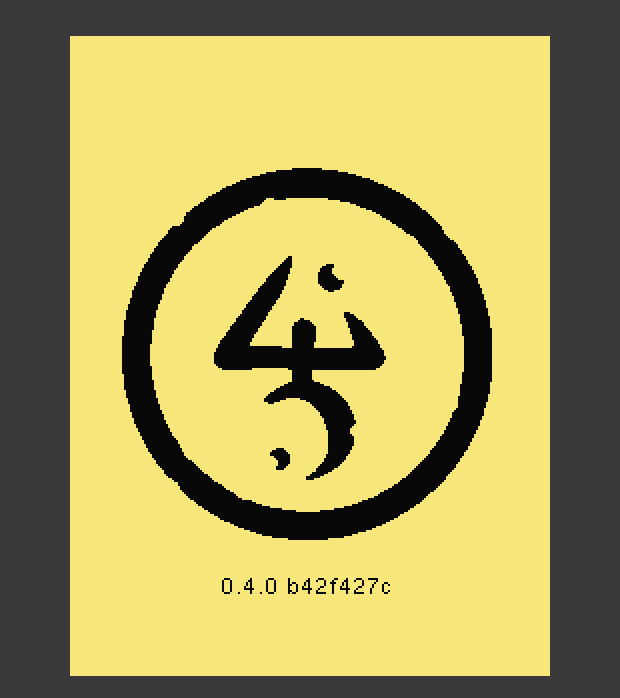
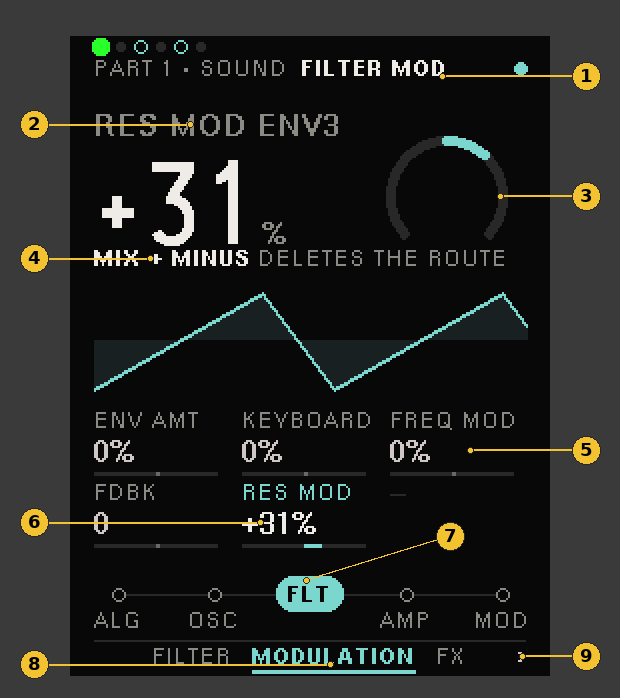
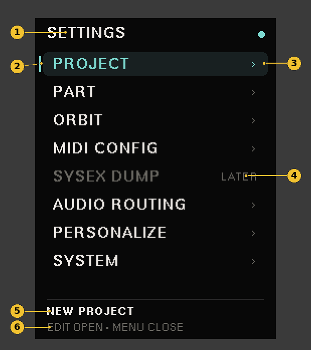
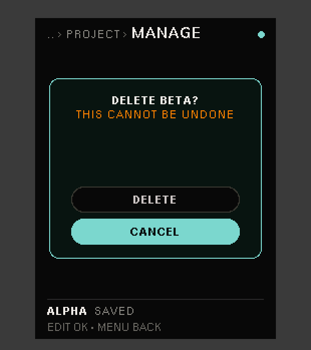

# The panel and navigation

This chapter covers the panel, the screen, the D-pad, every key combo and hold (the full table lives here), hints, dialogs, naming, lists, the chain map, the screensaver and text size. The pages have their own chapters ([the chapter list](README.md)); Parts, Sounds and projects are in [Concepts](01-concepts.md).

## Panel: the controls

| Control | What it does |
|---|---|
| **Encoders 1–6** | Each turns the cell above it: 1 2 3 on the top row, 4 5 6 below. Hints name them A to F |
| **B1–B6** | The six Parts: B*n* for Part *n*'s sound pages, again for its mixer. In ORBIT, B1–B5 are the rings and B6 is play / stop |
| **MINUS / PLUS** | Along: previous / next page, row or Part (see [The D-pad](#panel-the-d-pad)) |
| **EDIT** | Between a page and its sub-pages; opens or runs a list row; **OK** in a dialog |
| **SEQ** | The other way between sub-pages; back one level in SETTINGS; cancels a dialog. Held, enters ORBIT |
| **MIX** | Shift: held, it turns keys and turns into secondary actions |
| **MENU** | Opens SETTINGS, steps back out of it. Held, saves the project |

The front-panel LED pulses ORBIT's beat while it runs: short on each beat, long on the bar.

A button acts when pressed, except where it also has a hold: SEQ, MENU and, in ORBIT, B1–B5 act on release, or at the hold after half a second.

### Panel: encoders that push

Most PreenFM3 encoders only turn, and Chimera never needs a push: every push is a shortcut. If yours push, turn on SETTINGS › SYSTEM › PUSH ENCODERS › **PUSH** (OFF by default). Then **PUSH** sets the cell to its default and **PUSH + TURN** steps finely; the hint reads `PUSH DEFAULT  PUSH/SEQ FINE`. Without push, use **SEQ + turn** and **MIX + turn** ([the gesture table](#panel-key-combos-and-holds)).


1. Header: SETTINGS › SYSTEM › PUSH.
2. The focused cell, PUSH, and its value.
3. Its glyph, a switch (off).
4. The picture band, the live output.
5. Cell A (encoder 1): **PUSH**, OFF or ON.
6. Footer: the project and its state.
7. Footer: the keys this page answers to.

## Panel: the screen


1. **Header.** A dot per Part (current bright green, playing ringed), the place (`PART 1 · SOUND` or `PART 1 · MIX`) and the page's full name. Right: the sounding dot, ORBIT's beat, and `OUT P2` / `OUT P3` for a Part on another pair.
2. **Focus band:** the touched cell's label (WAVE1) and value (85), large, with its unit. Modulation never moves this number.
3. **Focus band: the glyph**, a picture of the value (here the wave's shape).
4. **Focus band: the hint line**, the touched cell's combos (`SEQ+TURN FINE  MIX + SEQ LEARN`).
5. **The picture band** (viz band): what the page does; pages without a picture show the live output.
6. **Cell 1** (encoder 1), WAVE1. The focused label is in the accent colour; the bar shows where the value sits.
7. **Cell 2**, WAVE2.
8. **Cell 3**, MODE (MIX). A choice has no bar.
9. **Cell 4**, BLEND.
10. **Cell 5**, SUB.
11. **Cell 6**, STABILITY. A line under a bar shows modulation; a dash is an empty slot; dimmed does nothing now.
12. **The chain map**: the filled pill (VA) is the current page; FLT, AMP, MOD are MINUS / PLUS away.
13. **The sub-page row**: VA (underlined, you are here), OSC1, OSC2, NOISE; `>` (and `<`) mean more off the edge.

What each VA cell does is in [VA](05-va.md).

Every Part, mixer and ORBIT page has these five bands; some (FILTER, MASTER, the envelopes and LFO speeds, ORB) merge focus and viz into one picture. SETTINGS has a breadcrumb header (`SETTINGS › PROJECT › POOL`) and the project at the bottom ([SETTINGS](13-settings.md)).

### Panel: the CPU readout in the header

When nothing else needs the right of the header, it shows the audio load, `CPU 23%`: grey up to 60 %, amber to 80 %, red above. A long page name or `OUT P2` / `OUT P3` takes its place. See [Limits: CPU](20-limits.md#limits-cpu-and-the-load-readout).

### Panel: the boot screen

At power-on the screen shows the Yellow Sign on yellow with the firmware's version; while the second half of the firmware installs, it says DON'T POWER OFF ([Updating and recovery](19-updating-and-recovery.md)). Then Chimera opens on Part 1's home page.



> **Design note:** the sign on the boot screen is the Yellow Sign, designed by Christian Knutsson for Pelgrane Press, who released it into the public domain. It is the emblem of the King in Yellow, a play that, in the old stories, drives its readers mad. Carcosa, where the King holds court, is never far from this project. You have been warned; the manual, at least, is safe to read.

## Panel: the focus band

The strip under the header reads the cell you last touched, with no timer, until you touch another. Each page remembers its own focused cell. It shows:

- **the label and value**, large, with its unit;
- **a glyph**: an arc for most knobs (from 12 o'clock when bipolar), a crossfader for blends (MORPH, BLEND), a level bar, a scope for waves, a spirit level for STABILITY, a loop for FEEDBACK; word choices (MODEL, MODE, STEAL) show as words;
- **a note** where it helps: a route's source (`FREQ MOD LFO1`), an operator's ratio, the reserves booked (`RESERVES 3/8`);
- **the reason** a cell is dimmed or a choice refused, in place of the hint (`GRAIN TYPE ONLY`, `OVER BUDGET`, `REVERSE NEEDS RAM`);
- **the hint line** ([Hints](#panel-hints-in-the-focus-band)).

**Why:** six cells leave little room for names and units; the focus band gives the control you are working on room to explain itself.

## Panel: the cells and how values move

Each page has up to six cells laid out as the encoders are. Turning an encoder changes its cell and focuses it; an empty slot (a dash) does nothing.

- **Turn speed.** A quick turn moves further per detent. Lists and named choices start gently, one row a detent, so they don't overshoot.
- **Gliding.** Sound and bar ease to the new value, from a knob, a CC or the editor.
- **Dimmed cells** still turn but have no effect until the setting that uses them is on; the focus band says why.
- **Refused choices** (an ALGO WAVE past the formant budget, a TAPE machine a streamed source can't feed, a ninth DRUM CHOKE group, VOICES or RESERVE with no room) show dimmed with their reason; nothing changes until you land on one that can play.

**Why:** a refused choice is shown, not skipped, so you see what stands in its way; it is never applied, so the sound never breaks under you.

## Panel: the D-pad

| Key | Does |
|---|---|
| **MINUS / PLUS** | Along: previous / next page of the chain, row of a list, Part in the Sound browser. No wrap at the ends |
| **SEQ** | With the chain map on ROW (default): next sub-page, wrapping from the last back to the page itself |
| **EDIT** | With ROW: previous sub-page; on the page itself it does nothing |
| **MENU** | Leave: open SETTINGS, step back out, leave ORBIT |

The same keys work on a Part's pages, the mixer, the Sound browser, ORBIT and every SETTINGS list.

```
   MINUS (previous page)  ◀  page  ▶  PLUS (next page)

   EDIT (previous sub-page)  ◀  sub-page  ▶  SEQ (next sub-page, wraps)

   An ALGO Part's chain (ALG is its home):

   ALG ──── OSC ─────────── FLT ──────── AMP ──────── MOD
    └ PIT    ├ CRS … FBK     ├ FMD        ├ STER       ├ E1  E2  E3
             └ OP1 … OP6     ├ FX         └ SND        ├ SPD
                             └ JACK                    └ L1  L2  L3
```

**Why:** the panel has no arrow keys, so these four stand in for them, with one meaning everywhere.

### Panel: the chain map and its STACK option

The strip at the bottom of every Part, mixer and ORBIT page maps the chain you are in.


1. A node: one page of the chain.
2. The line joins the pages in order.
3. The pill: the page you are on.
4. Node labels: short names (ALG, OSC, FLT, AMP, MOD).
5. The sub-page row, in full words: FILTER (underlined, where you are), MODULATION, FX.
6. `>`: more sub-pages off the edge (`<` when some are off the left; OSC has 18).

| Where | Chain |
|---|---|
| ALGO Part | ALG · OSC · FLT · AMP · MOD |
| MODAL Part | EXC · RES · FLT · AMP · MOD |
| VA Part | VA · FLT · AMP · MOD |
| TAPE Part | SRC · DECK · FLT · AMP · MOD |
| DRUM Part | KIT · MCH · FLT · AMP · MOD |
| A Part's mixer | PRT · SND · CHR · DLY · REV · MST |
| ORBIT | ORB · RING · CHRD · SCN |

The map shows short names (FLT); the sub-page row and header show full names (FILTER, MODULATION, JACKS).

**STACK.** SETTINGS › PERSONALIZE › CHAIN MAP › **PAGES** sets ROW (default) or STACK. With STACK the sub-pages hang under the node and the keys follow the picture: **EDIT** goes down (wrapping), **SEQ** goes up.


1. Header: SETTINGS › PERSONAL › MAP.
2. The focused cell, PAGES, and its value (ROW).
3. The picture band, the live output.
4. Cell A (encoder 1): **PAGES**, ROW or STACK.
5. Footer: the project and its state.
6. Footer: `A-F EDIT · MENU BACK`.

**Why:** on ROW, EDIT sits left of SEQ, so it goes left; on STACK, it goes down. The key always moves the way the picture does.

### Panel: Part buttons

| Where you are | B*n* does |
|---|---|
| Part *n*'s sound pages | Its mixer (SENDS, or the mixer page you last left) |
| Part *n*'s mixer | Back to its sound pages, on the page you left |
| Another Part's sound pages | Part *n*'s same page if its chain has it, else the nearest, else its home |
| Anywhere else | Part *n*'s home page |
| ORBIT | B1–B5 open ring 1–5; B6 plays / stops |

**Why:** keeping the page when you switch Parts lets you compare one page across Parts with one press.

### Panel: the mixer and browser moves

In a Part's mixer, MINUS / PLUS walk PRT · SND · CHR · DLY · REV · MST; PRT has two sub-pages, VOICES and EQ. **EDIT** on PRT or SND goes down to the Sound browser; **SEQ** in the browser comes back up; SEQ on SND does nothing. See [The MIXER](11-mixer-and-master-fx.md).

In the [Sound browser](16-card-sounds-library.md), encoder 1 moves the bar, encoder 2 switches tab (PROJECT, LIBRARY, FACTORY), MINUS / PLUS switch Part.

### Panel: SETTINGS moves

In a SETTINGS list, MINUS / PLUS or any encoder move the bar, **EDIT** opens or runs the row, **SEQ** or **MENU** go back a level. On the top list SEQ does nothing and MENU closes SETTINGS. A LATER row isn't built and is skipped. On a page with cells (CHANNELS, THEME, CHAIN MAP, AUDIO LOAD) the encoders turn the cells (`A-F EDIT`). See [SETTINGS](13-settings.md).


1. Header: the breadcrumb, SETTINGS › MIDI › CHANNELS.
2. The focused cell: P1 and its channel, with its glyph.
3. The picture band, the live output.
4. Cell A: P1, Part 1's MIDI channel.
5. Cell B: P2.
6. Cell C: P3.
7. Cell D: P4.
8. Cell E: P5.
9. Cell F: P6.
10. Footer: the project and its state (`SAVED`, `* MODIFIED`; nothing means never saved).
11. Footer: `A-F EDIT · MENU BACK`.

## Panel: key combos and holds

Every combo and hold, in one place. Each also shows as a hint on the cells where it applies.

| Keys | Where | Does |
|---|---|---|
| B*n* | anywhere but ORBIT | Part *n*'s pages; again for its mixer ([Part buttons](#panel-part-buttons)) |
| **MIX + B*n*** | anywhere but ORBIT | Part *n*'s mixer; in the mixer, the same page for Part *n* (hint `MIX + B1-6 PART`) |
| **EDIT + B*n*** | anywhere but ORBIT | The Sound browser for Part *n* |
| **MIX + turn** | a cell | Jump to the next landmark that way: minimum, default, maximum (end of a list) |
| **SEQ + turn** | a value cell on a Part, mixer or effect page | Fine steps, no speed-up (hint `SEQ+TURN FINE`). Not on choices, SETTINGS or ORBIT |
| **PUSH**, **PUSH + TURN** | a cell, with push encoders on | Default; fine steps |
| **MIX + PLUS** | a parameter | Add it as a MOD matrix destination: ADDED, ALREADY ROUTED, NOT MODULATABLE or MATRIX FULL |
| **MIX + MINUS** | a parameter | Take it out of the MOD matrix |
| **MIX + MINUS** | a route amount (ENV AMT, FREQ MOD, RES MOD; the matrix cursor) | Delete the route |
| **MIX + SEQ** | a cell | MIDI learn; press again to finish ([MIDI](14-midi.md)) |
| **MIX + MINUS / PLUS** | a DRUM pad's pages | Previous / next pad (hint `MIX + -/+ PAD`; [DRUM](07-drum.md)) |
| **EDIT** | the Sound browser | Load the selected Sound (asks if the Part has unsaved edits) |
| **MIX + EDIT** | the Sound browser | Save the Part's Sound: to the project on PROJECT, to the card on LIBRARY; nothing on FACTORY |
| **MIX + MINUS** | the Sound browser, PROJECT tab | Clear the selected slot, after asking |
| **MIX + turn** | TAPE's START and END | Snap to the next onset (hint `MIX + TURN NEXT ONSET`; [TAPE](06-tape.md)) |
| **hold SEQ** | anywhere but SETTINGS | Enter ORBIT. A turn while SEQ is down cancels this |
| **hold MENU** | anywhere | Quick-save the project; a new project asks for a name |
| **MENU** | ORBIT | Leave ORBIT |
| **B6** | ORBIT | Play / stop |
| **B1–B5** | ORBIT | Open ring 1–5 |
| **hold B1–B5** | ORBIT | Go to the Part that ring plays |
| **MIX + B1–B5** | ORBIT | Mute / unmute that ring |

Page-specific combos (the matrix cursor, ORBIT's NOTES, CHRD and RHYTHM, the delay's SYNC, RANDOMIZE, MIDI MAP, the TAPE machines) are described with their pages and always hinted.

A turn while SEQ is held cancels SEQ's own press: it neither changes sub-page nor opens ORBIT. Holding MENU for half a second saves the project file (TAPE sources are already on the card) and a toast confirms; a shorter tap opens or backs out of SETTINGS.

**Why:** MIX turns a few keys into many, and holds give ORBIT and saving a key without taking one away. SEQ carries the fine turn because its hold waits, so a turn says you meant fine, not ORBIT.

## Panel: hints in the focus band

Touch a cell and the focus band's bottom line lists its combos, keys in bold (`MIX + SEQ LEARNS A CC`). Arrows show which way to turn: `◂▸` along, `▴▾` up and down. A cell's own words (a reason, a note) take the line instead.



1. The page name is the sub-page's: FILTER MOD.
2. The touched cell, RES MOD, and its source (ENV3).
3. Its arc, bipolar, filled from 12 o'clock.
4. The hint line: the touched cell's combo, `MIX + MINUS DELETES THE ROUTE`.
5. A route amount (FREQ MOD); its source is set on JACKS.
6. The touched cell, RES MOD, with its amount.
7. The node, FLT, lit on the map.
8. The sub-page row: FILTER, MODULATION (underlined, you are here), FX …
9. … and `>`: JACKS off the edge.

| Hint | Where |
|---|---|
| `MIX + SEQ LEARNS A CC` (or `LEARN`) | Every learnable cell |
| `SEQ+TURN FINE` | Every cell that takes the fine turn |
| `MIX + B1-6 PART` | Mixer cells |
| `MIX + MINUS DELETES THE ROUTE` | Route amounts, the matrix cursor on a route |
| `MIX + PLUS ON A PARAM PRIMES IT` | The matrix cursor on an empty cell |
| `MIX + -/+ PAD` | A DRUM pad's cells |
| `EDIT LOADS`, `MIX + EDIT SAVES`, `MIX + MINUS CLEARS` | The Sound browser, with the memory each takes or frees |
| `MOVE THE KNOB UP TO PICK UP` | A cell bound to a MIDI knob waiting to catch the value ([MIDI](14-midi.md)) |

SETTINGS › PERSONALIZE › THEME › **HINTS**: OFF hides hints; the combos still work.

**Why:** a hint only for the cell you touched tells you what you need then and keeps the screen quiet otherwise.

## Panel: lists

SETTINGS, the Sound browser, project lists, MIDI MAP and dialogs are lists with a bar on one row.

- Any encoder (but the browser's encoder 2) or MINUS / PLUS moves the bar, one row a detent at first; **EDIT** opens or runs the row.
- A long list scrolls with a scrollbar. Sound browser tabs come in pages of 48 rows, with `NEXT ›` and `‹ PREVIOUS` rows (`OLDER ›` and `‹ NEWER` on LIBRARY).
- A name too long for its cell scrolls sideways while selected.



1. Breadcrumb: where you are in SETTINGS.
2. The bar: the selected row.
3. A chevron: this row opens a list.
4. LATER: not built yet; dimmed rows are skipped.
5. The project's name and state (`SAVED`, `* MODIFIED`).
6. What the keys do here.

## Panel: dialogs

When an action needs a decision, a dialog opens: a question, the reason in colour, and two or three answers as pills.



- Any encoder moves between pills; **EDIT** confirms (only on its own: with MIX or a B key it confirms nothing); **MENU** or **SEQ** cancels. The bottom line reads `EDIT OK · MENU BACK`.
- Destructive dialogs (DELETE, CLEAR, SAVE OVER, PURGE, ENTER DFU, a map's delete, a scene's CLEAR or RELOAD) open on CANCEL. Others lead with the answer that keeps your work: SAVE THEN LOAD, SAVE PART FIRST, KEEP BOTH, UPDATE, SAVE AS.

**Why:** a dialog uses the keys you already know, and opening on the safe answer means a reflex EDIT never loses work.

### Panel: naming

Naming a project, library Sound, Part or controller map opens the naming screen.


| Encoder | Cell | Does |
|---|---|---|
| 1 | **CURSOR** | Moves along the name (up to 16 characters) |
| 2 | **LETTER** | A letter at the cursor |
| 3 | **DIGIT** | A digit, space or dash |
| 4 | **CASE** | Upper or lower case |
| 5 | **DELETE** | Deletes at the cursor |

**EDIT** saves; **MENU** or **SEQ** cancels (`EDIT SAVE · MENU BACK`).

### Panel: toasts and BUSY

A **toast** is a short boxed message (SAVED, a card error, a refusal). It blocks nothing, goes by itself, and any key or turn dismisses it. At boot, while a card operation must finish, the screen shows **BUSY**. While a Sound or source is read from the card, other keys wait; MENU cancels the read.

## Panel: the screensaver

After a while untouched, the screen shows a large oscilloscope of the output, with the last note, its sounding and measured pitch, and the held chord. SETTINGS › PERSONALIZE › SCREENSAVER › **SAVER** sets the wait: OFF, 5 S, 7 S, 10 S, 30 S, 60 S, 2 MIN, 5 MIN (default) or 10 MIN.


1. Header: the breadcrumb, `..` › PERSONAL › SAVER (shortened to fit).
2. The focused cell, SAVER, and its value (5 MIN).
3. The picture band, the live output.
4. Cell A (encoder 1): **SAVER**, the wait.
5. Footer: the project and its state.
6. Footer: the keys this page answers to.

Any button or encoder wakes it; MIDI does not. A waking button also does its job; a waking turn loses its first detent.

**Why:** a turn made before you can see the screen shouldn't change a value you couldn't see; a button press is deliberate.

## Panel: text size

SETTINGS › PERSONALIZE › TEXT SIZE › **SIZE**: NORMAL (default) or LARGE. LARGE draws labels, values, hints, lists and Sound names a size up where they fit. It belongs to the unit, not a project.


1. Header: SETTINGS › PERSONAL › TEXT.
2. The focused cell, SIZE, and its value (NORMAL).
3. The picture band, the live output.
4. Cell A (encoder 1): **SIZE**, NORMAL or LARGE.
5. Footer: the project and its state.
6. Footer: the keys this page answers to.


The rest of PERSONALIZE (THEME's colours and HINTS, PAD FOLLOW, ALGO PAGES) is in [SETTINGS](13-settings.md).
