# ALGO, the six-operator engine

ALGO is Chimera's operator engine: six phase-modulation operators wired by one of 32 algorithms, with MORPH blending between two algorithms. This chapter covers the ALGORITHM page, the OSC page with its twelve group pages, the FORMANT page and the six operator pages, the operator envelopes, formant and noise operators, what a patch costs in voices, and some starting points. The pages every engine shares (PIT, FLT, FMD, FX, JACK, AMP, STER, SND, MTX, E1–E3, SPD, L1–L3) are in [the voice chain](08-voice-chain.md), [envelopes and LFOs](09-envelopes-and-lfos.md) and [the mod matrix](10-mod-matrix.md); this chapter says only what is different about them on ALGO.

## ALGO: what the engine is

An ALGO Sound has six operators. Each operator is an oscillator with its own wave, frequency ratio, level and envelope. An **algorithm** says which operators modulate which, and which ones you hear:

- A **carrier** is an operator you hear. Its LEVEL sets how loud it is.
- A **modulator** feeds another operator. Its LEVEL sets how much it changes that operator's tone: more LEVEL, more harmonics.
- An operator can also feed itself back, set by **FDBK**: a sine with feedback turns towards a saw.

Two algorithms are stored in every Sound, **ALG A** and **ALG B**. **MORPH** blends one into the other, so a single knob (or an envelope, or an LFO) can move a sound between two wirings.

Each operator can be one of three kinds: a **table** operator playing one of 16 waves, a **formant** operator (FRMT) that makes a vowel-like resonance, or a **noise band** (NOISE). The kind is set by the operator's **WAVE**.

**Why:** one algorithmic engine does the work of several. One or two operators play a plain wave or a simple bell; four to six play full FM tones; formants and noise bands sing and breathe; MORPH moves between them. There is one set of pages to learn, and every Sound is billed for the operators it really uses (see [ALGO: voices and what a patch costs](#algo-voices-and-what-a-patch-costs)).

**Why phase modulation:** the operators modulate each other's **phase**, not their frequency. The pitch of a carrier stays centred however deep the modulation goes, so a modulator never drags the note out of tune. The stock PreenFM3 firmware does true frequency modulation; Chimera's engine is phase modulation throughout.

> **Design note:** ALGO grew out of a faithful four-operator TX81Z engine that turned out to cost more than the whole chip had to spend on a single voice: every FM note was refused. Rather than trim it, it was replaced with one six-operator engine written from scratch in single-precision maths. The TX81Z is still in its bones. The 64 COARSE ratios, the FINE targets, the 0.75 dB LEVEL step, the 3 dB DECAY 1 LEVEL step, the four-rate envelope and the eight feedback steps were all re-entered by hand from the TX81Z owner's manual, and the first eight algorithms, T1 to T8, are the TX81Z's eight on operators 1 to 4. The waves W1 to W8 were redrawn from their shapes as formulas, rendered into tables when the unit boots. No code from any earlier FM engine came along. The other 24 algorithms are Chimera's own, because six operators deserve more than eight ways to meet.

## ALGO: the chain and its pages

An ALGO Part's chain map reads **ALG · OSC · FLT · AMP · MOD**. ALG is the home: entering the chain lands there.

```
ALG ──── OSC ─────────── FLT ──────── AMP ──────── MOD
 └ PIT    ├ FRM (only with a formant or noise operator)
          ├ CRS FIN DET LVL VEL
          ├ AR D1R D1L D2R RR RS FBK
          └ OP1 … OP6
```

| Node | Its pages, short name (full word on the sub-page row) |
|---|---|
| ALG | **ALG** (ALGORITHM), **PIT** (PITCH) |
| OSC | **OSC** (WAVE), **FRM** (FORMANT), **CRS** (COARSE), **FIN** (FINE), **DET** (DETUNE), **LVL** (LEVEL), **VEL** (VELOCITY), **AR** (ATTACK RATE), **D1R** (DECAY 1 RATE), **D1L** (DECAY 1 LEVEL), **D2R** (DECAY 2 RATE), **RR** (RELEASE RATE), **RS** (RATE SCALE), **FBK** (FEEDBACK), **OP1**, **OP2**, **OP3**, **OP4**, **OP5**, **OP6** (OPERATOR 1 to OPERATOR 6) |
| FLT | FILTER, MODULATION, FX, JACKS: see [the voice chain](08-voice-chain.md) |
| AMP | AMP, STEREO, SENDS: see [the voice chain](08-voice-chain.md) |
| MOD | MATRIX, ENV1–ENV3, SPEED, LFO1–LFO3: see [envelopes and LFOs](09-envelopes-and-lfos.md) and [the mod matrix](10-mod-matrix.md) |

The page header shows the full name (ATTACK RATE, OPERATOR 2; DECAY 1 LEVEL reads DECAY 1 LVL in the header, where the full word does not fit). The chain map's sub-page row shows the full words. MINUS and PLUS move between nodes; SEQ goes on to the next sub-page (wrapping from the last to the first) and EDIT goes back one. With SETTINGS › PERSONALIZE › CHAIN MAP › PAGES set to STACK, EDIT goes down and SEQ goes up instead (see [the panel and navigation](02-panel-and-navigation.md)).

The OSC node has 18 sub-pages after its home, 19 when the FORMANT page is shown. The row scrolls, with `<` and `>` at its ends when there is more.

## ALGO: ALG PAGES FIRST, parameters or operators first

SETTINGS › PERSONALIZE › ALGO PAGES › **FIRST** picks the order of the OSC node's pages:

- **PARAMS** (the default): OSC opens on WAVE, then the group pages (each holds one parameter for all six operators), then OP1 to OP6.
- **OPS**: OSC opens on OP1, then OP2 to OP6, then WAVE and the group pages in their usual order. With a formant or noise operator, FORMANT follows WAVE.

No page is added, removed or dimmed by this setting; only the order changes. The node still reads OSC on the map. The setting belongs to the unit, not to a Sound. See [SETTINGS](13-settings.md).

**Why:** some players work a parameter at a time across the operators (all the ratios, then all the levels); others work an operator at a time, as on many software FM synths. Both orders hold the same pages, so a Sound looks the same either way.

## ALGO: the ALGORITHM page (ALG)

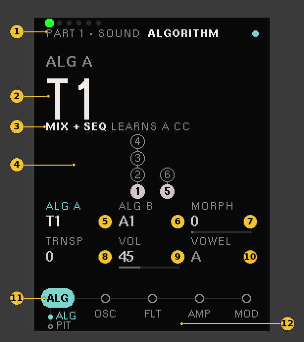

1. **Header:** the Part (PART 1 · SOUND) and the page, ALGORITHM.
2. **Focus band:** the touched cell, large: ALG A, T1.
3. **Hint:** the gestures the touched cell answers to: MIX + SEQ learns a MIDI control.
4. **Picture:** the algorithm chart: carriers filled on the bottom row, modulators above what they feed, loops on operators with feedback.
5. **ALG A:** the algorithm at MORPH 0.
6. **ALG B:** the algorithm at MORPH 127.
7. **MORPH:** blends ALG A into ALG B.
8. **TRNSP:** transposes the Sound in semitones.
9. **VOL:** the Sound's output level.
10. **VOWEL:** moves the formant and noise operators along U O A E I (dimmed without one).
11. **Chain map:** the ALG node lit.
12. **Sub-pages:** the node's sub-pages, the current one lit.

The home page. Its band draws the algorithm chart: carriers on the bottom row, each modulator above what it feeds. A carrier is drawn filled. An operator with FDBK above 0 wears a small loop beside its node: MID colour while FDBK is under 4.0, the accent colour from 4.0 up, where a sine starts to break towards a saw.

| Cell | Range | Default | What it does |
|---|---|---|---|
| **ALG A** | T1–T8, A1–A24 | T1 | The algorithm at MORPH 0 |
| **ALG B** | T1–T8, A1–A24 | A1 | The algorithm at MORPH 127 |
| **MORPH** | 0–127 | 0 | Blends ALG A (0) into ALG B (127) |
| **TRNSP** | −24 to +24 | 0 | Transposes the whole Sound in semitones |
| **VOL** | 0–127 | 45 | The Sound's output level |
| **VOWEL** | U, O, A, E, I | A | Moves every formant and noise operator along the vowels |

- While **ALG A** or **ALG B** is the touched cell, the chart shows that one algorithm on its own (a dimmed, refused choice too), whatever MORPH holds. On any other cell the chart shows A blending into B as MORPH sets it.
- **MIX + turn** on ALG A or ALG B runs to the end of the list.
- **MORPH** is dimmed while ALG A and ALG B are the same algorithm: there is nothing to blend. Its encoder is ignored, and **MIX + PLUS** on it reports NOT MODULATABLE. A route into MORPH set up earlier stays in the matrix, drawn as inert (see [the mod matrix](10-mod-matrix.md)).
- **MORPH** glides about 30 ms with each turn, as the other knobs do. It is a mod destination: **MIX + PLUS** on it primes it for a route.
- **VOWEL** is dimmed until at least one operator is a formant (FRMT) or noise band (NOISE). The value shows the nearest vowel; the arc under it shows the exact place, which moves smoothly between vowels. VOWEL is a mod destination. See [ALGO: VOWEL and the slots](#algo-vowel-and-the-slots).
- A change of ALG A or ALG B while a note sounds ducks the output for a moment, swaps the wiring, and brings it back, so there is no click.
- **MIX + SEQ** learns a MIDI control for the touched cell, as on every page (see [MIDI](14-midi.md)).

**Why MORPH blends the links:** each link between two operators has a weight, 1 if the algorithm has it and 0 if not. MORPH moves every weight from ALG A's value to ALG B's. Halfway, a link that only A has plays at half depth. Each end sounds exactly like its algorithm alone. One evaluation order serves both algorithms (modulators are always numbered above what they feed), so the whole sweep is smooth.

**Why INIT is T1 into A1:** with operators 5 and 6 silent, T1 is one stack of four operators (4 into 3 into 2 into 1). A1 is the same four operators with no links, all heard: the stack's clean additive twin. So on INIT, MORPH works as an FM-depth macro: turning it up lowers every link and the sound goes from bright to clean.

**Why the output is scaled by the carriers:** the more carriers sound at once, the louder an algorithm would be. ALGO scales its output by the stored carrier levels, so the 32 algorithms play at a closer loudness. The scale only changes when you change a stored LEVEL, ALG A, ALG B or MORPH; a route into one carrier's LEVEL (velocity, an envelope, an LFO) never makes another carrier louder or softer. The scale never boosts.

## ALGO: the 32 algorithms

Operators are numbered 1 to 6. In every algorithm a higher-numbered operator modulates a lower-numbered one, never the reverse. "4→3" means operator 4 modulates operator 3.

| Algorithm | Links | Carriers (heard) |
|---|---|---|
| T1 | 4→3, 3→2, 2→1, 6→5 | 1, 5 |
| T2 | 4→2, 3→2, 2→1, 6→5 | 1, 5 |
| T3 | 3→2, 2→1, 4→1, 6→5 | 1, 5 |
| T4 | 4→3, 3→1, 2→1, 6→5 | 1, 5 |
| T5 | 4→3, 2→1, 6→5 | 1, 3, 5 |
| T6 | 4→1, 4→2, 4→3, 6→5 | 1, 2, 3, 5 |
| T7 | 4→3, 6→5 | 1, 2, 3, 5 |
| T8 | 6→5 | 1, 2, 3, 4, 5 |
| A1 | none | 1, 2, 3, 4, 5, 6 |
| A2 | 6→1 | 1, 2, 3, 4, 5 |
| A3 | 6→1, 6→2 | 1, 2, 3, 4, 5 |
| A4 | 6→1, 5→2 | 1, 2, 3, 4 |
| A5 | 6→1, 6→2, 6→3, 6→4 | 1, 2, 3, 4, 5 |
| A6 | 6→5, 5→1 | 1, 2, 3, 4 |
| A7 | 4→1, 5→2, 6→3 | 1, 2, 3 |
| A8 | 4→1, 5→1, 6→1 | 1, 2, 3 |
| A9 | 6→5, 5→4, 4→1 | 1, 2, 3 |
| A10 | 6→4, 6→5, 4→1, 5→2 | 1, 2, 3 |
| A11 | 5→4, 6→4, 4→1, 4→2, 4→3 | 1, 2, 3 |
| A12 | 5→3, 3→1, 6→4, 4→2 | 1, 2 |
| A13 | 3→1, 4→1, 5→2, 6→2 | 1, 2 |
| A14 | 3→1, 3→2, 4→1, 4→2, 5→3, 6→4 | 1, 2 |
| A15 | 6→5, 5→3, 3→1, 4→2 | 1, 2 |
| A16 | 3, 4, 5 and 6 each into both 1 and 2 | 1, 2 |
| A17 | 6→5, 5→4, 4→3, 3→2, 2→1 | 1 |
| A18 | 2, 3, 4, 5 and 6 each into 1 | 1 |
| A19 | 4→2, 4→3, 2→1, 3→1, 6→5, 5→1 | 1 |
| A20 | 3→2, 2→1, 5→4, 4→1, 6→1 | 1 |
| A21 | 6→5, 5→4, 4→1, 3→2, 2→1 | 1 |
| A22 | 6→4, 6→5, 4→2, 5→3, 2→1, 3→1 | 1 |
| A23 | 6 into 2, 3, 4 and 5; 2, 3, 4 and 5 each into 1 | 1 |
| A24 | 6→5; 5 into 2, 3 and 4; 2, 3 and 4 each into 1 | 1 |

- **T1–T8** are the TX81Z's eight four-operator algorithms on operators 1 to 4, plus a two-operator pair, 6 into 5, heard beside them. With operators 5 and 6 at LEVEL 0 they play as the TX81Z's do.
- **A1** has no links: six sine (or any wave) partials, an additive organ.
- **A17** is the deepest stack: six operators in one chain.
- **A16**, **A18** and **A23** pile many modulators onto one or two carriers, for dense, bright tones. A16 together with A17 is the costliest pair to morph between (see [ALGO: voices and what a patch costs](#algo-voices-and-what-a-patch-costs)).

## ALGO: the OSC node and the group pages

The OSC node's pages hold the operators. The first fourteen are **group pages**: one parameter on each, for all six operators. Their six cells are labelled **OP1**, **OP2**, **OP3**, **OP4**, **OP5** and **OP6**, one per encoder, in the same places on every group page. The focus band names the page's parameter over the value (ATTACK RATE, not OP1), and the lit cell names the operator.

| Page (row word) | Cells | Range | INIT | What it sets |
|---|---|---|---|---|
| **OSC** (WAVE) | OP1–OP6 | W1–W8, TRI, SAW, SQR, P25, P12, TSAW, RSQR, SSAW, FRMT, NOISE | W1 on all | The operator's wave or kind |
| **FRM** (FORMANT) | OP1–OP6 | 100 Hz to 12.8 kHz | 734 Hz, 1.10 kHz, 2.47 kHz, 3.49 kHz, 3.49 kHz, 3.49 kHz | A formant's centre (a noise band's CENTRE) |
| **CRS** (COARSE) | OP1–OP6 | 0.50 to 25.95 | 1.00 | Frequency ratio to the note |
| **FIN** (FINE) | OP1–OP6 | 0–15 | 0 | Raises the ratio towards the next |
| **DET** (DETUNE) | OP1–OP6 | −3 to +3 | 0 | Detune, 1.5 cents a step |
| **LVL** (LEVEL) | OP1–OP6 | 0–99 | 99, 72, 72, 72, 0, 0 | Output level, 0.75 dB a step |
| **VEL** (VELOCITY) | OP1–OP6 | 0–7 | 0 | Velocity sensitivity |
| **AR** (ATTACK RATE) | OP1–OP6 | 0–31 | 31 | Attack rate |
| **D1R** (DECAY 1 RATE) | OP1–OP6 | 0–31 | 0 | First decay rate |
| **D1L** (DECAY 1 LEVEL) | OP1–OP6 | 0–15 | 15 | Where the first decay stops |
| **D2R** (DECAY 2 RATE) | OP1–OP6 | 0–31 | 0 | Second decay rate, while held |
| **RR** (RELEASE RATE) | OP1–OP6 | 1–15 | 5 | Release rate after key up |
| **RS** (RATE SCALE) | OP1–OP6 | 0–3 | 0 | Faster envelopes on higher notes |
| **FBK** (FEEDBACK) | OP1–OP6 | 0.0–7.0 | 0.0 | The operator feeding itself back |

The envelope pages (AR to RS) draw the touched operator's envelope in the band. FBK's page shows the live output, so you can watch feedback bend the wave.

### ALGO: WAVE and the operator kinds

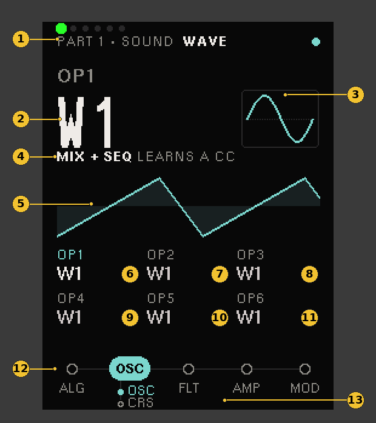

1. **Header:** the Part (PART 1 · SOUND) and the page, WAVE.
2. **Focus band:** the touched cell, large: OP1 and its wave, W1.
3. **Glyph:** a scope of the touched operator's wave.
4. **Hint:** the gestures the touched cell answers to.
5. **Picture:** the live output's waveform.
6. **OP1:** operator 1's wave or kind.
7. **OP2:** operator 2's wave or kind.
8. **OP3:** operator 3's wave or kind.
9. **OP4:** operator 4's wave or kind.
10. **OP5:** operator 5's wave or kind.
11. **OP6:** operator 6's wave or kind.
12. **Chain map:** the OSC node lit.
13. **Sub-pages:** the node's sub-pages, the current one lit.

The OSC page's cells set each operator's **WAVE**:

| WAVE | What it is |
|---|---|
| **W1** | Sine |
| **W2** | A sharpened sine: each half bulges towards a square |
| **W3** | Half-wave sine: the positive half of W1, silence for the negative half |
| **W4** | Half-wave W2 |
| **W5** | W1 squeezed into the first half of the cycle, silence for the second |
| **W6** | W2 squeezed into the first half of the cycle |
| **W7** | Two positive humps of W1 in the first half of the cycle, silence for the second |
| **W8** | The same with W2 |
| **TRI** | Triangle |
| **SAW** | Saw |
| **SQR** | Square |
| **P25** | Pulse, 25 % |
| **P12** | Pulse, 12.5 % |
| **TSAW** | Trisaw: a slow rise over three quarters of the cycle and a fast fall |
| **RSQR** | Rounded square |
| **SSAW** | Soft saw |
| **FRMT** | A formant operator (the cell reads FRMT; the band spells FORMANT) |
| **NOISE** | A noise band |

W1 to W8 are the TX81Z's eight waves, drawn from their shapes. W3, W4, W7 and W8 keep their DC offset, as on the TX81Z; every other wave is centred. All tables are band-limited, so high notes and bright modulation do not alias.

- **MIX + turn** on a WAVE cell runs to the end of the list.
- **FRMT** and **NOISE** change the operator's page and turn on the FORMANT page (see [ALGO: formant and noise operators](#algo-formant-and-noise-operators)). Some choices can be refused by the formant budget: the cell shows the name dimmed and nothing is written until you turn on to a choice that fits. The focus band says why (see [ALGO: the formant budget](#algo-the-formant-budget)).
- A WAVE change under a held note crossfades, so it does not click.

### ALGO: COARSE, FINE and DETUNE, the ratio

An operator plays at the note's frequency times its **ratio**. **COARSE** picks the ratio from the TX81Z's 64:

| | | | | | | | |
|---|---|---|---|---|---|---|---|
| 0.50 | 0.71 | 0.78 | 0.87 | 1.00 | 1.41 | 1.57 | 1.73 |
| 2.00 | 2.82 | 3.00 | 3.14 | 3.46 | 4.00 | 4.24 | 4.71 |
| 5.00 | 5.19 | 5.65 | 6.00 | 6.28 | 6.92 | 7.00 | 7.07 |
| 7.85 | 8.00 | 8.48 | 8.65 | 9.00 | 9.42 | 9.89 | 10.00 |
| 10.38 | 10.99 | 11.00 | 11.30 | 12.00 | 12.11 | 12.56 | 12.72 |
| 13.00 | 13.84 | 14.00 | 14.10 | 14.13 | 15.00 | 15.55 | 15.57 |
| 15.70 | 16.96 | 17.27 | 17.30 | 18.37 | 18.84 | 19.03 | 19.78 |
| 20.41 | 20.76 | 21.20 | 21.98 | 22.49 | 23.55 | 24.22 | 25.95 |

- Whole numbers (1.00, 2.00, 3.00 …) give harmonic tones. The others (1.41, 3.14, 6.28 …) give inharmonic, bell-like and metallic ones. 3.14 and 6.28 are TX81Z ratios, not π and 2π.
- **FINE** (0–15) raises the ratio in 16 even steps towards the next region, as on the TX81Z. Below 1.00 (the four lowest COARSE values) FINE has 8 steps: FINE 8 to 15 hold the top.
- **DETUNE** (−3 to +3) shifts the operator by 1.5 cents a step, up to ±4.5 cents. Detuned carriers beat slowly against each other.
- On CRS, FIN and DET (and on an operator's own COARSE and FINE cells) the focus band shows where the operator ended up: `RATIO 1.41`, and with DETUNE off 0, `RATIO 1.41, DETUNE +4.5 CENTS`. A noise band has no pitch and shows none.
- COARSE steps; FINE and DETUNE glide when turned.


1. **Header:** the Part (PART 1 · SOUND) and the page, COARSE.
2. **Focus band:** the touched cell, large: OP1 and its ratio.
3. **Glyph:** the touched value's glyph.
4. **Hint:** the gestures, or the ratio the operator comes to (`RATIO 1.00`).
5. **Picture:** the live output's waveform.
6. **OP1:** operator 1's frequency ratio.
7. **OP2:** operator 2's frequency ratio.
8. **OP3:** operator 3's frequency ratio.
9. **OP4:** operator 4's frequency ratio.
10. **OP5:** operator 5's frequency ratio.
11. **OP6:** operator 6's frequency ratio.
12. **Chain map:** the OSC node lit.
13. **Sub-pages:** the node's sub-pages, the current one lit.

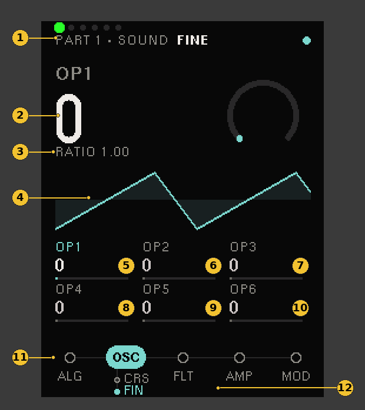

1. **Header:** the Part (PART 1 · SOUND) and the page, FINE.
2. **Focus band:** the touched cell, large: OP1 and its FINE.
3. **Hint:** the gestures, or the ratio the operator comes to.
4. **Picture:** the live output's waveform.
5. **OP1:** operator 1's FINE step towards the next ratio.
6. **OP2:** operator 2's FINE step towards the next ratio.
7. **OP3:** operator 3's FINE step towards the next ratio.
8. **OP4:** operator 4's FINE step towards the next ratio.
9. **OP5:** operator 5's FINE step towards the next ratio.
10. **OP6:** operator 6's FINE step towards the next ratio.
11. **Chain map:** the OSC node lit.
12. **Sub-pages:** the node's sub-pages, the current one lit.

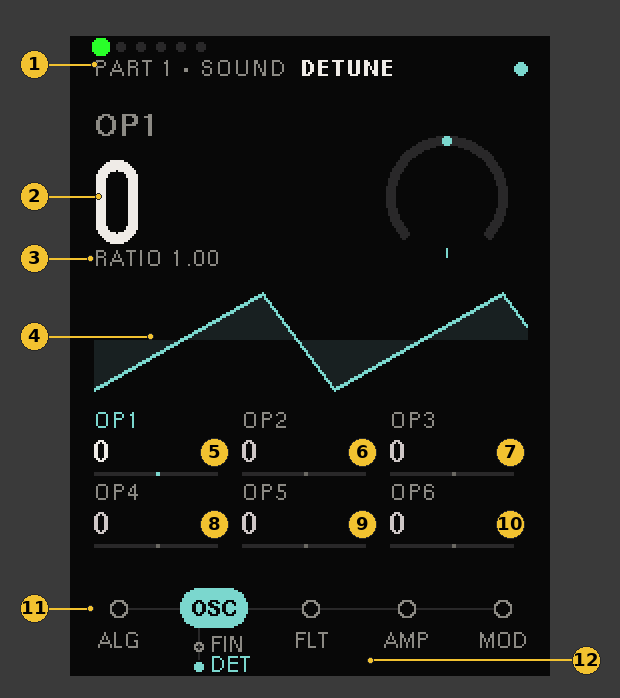

1. **Header:** the Part (PART 1 · SOUND) and the page, DETUNE.
2. **Focus band:** the touched cell, large: OP1 and its DETUNE.
3. **Hint:** the gestures, or the ratio and detune the operator comes to.
4. **Picture:** the live output's waveform.
5. **OP1:** operator 1's detune, 1.5 cents a step.
6. **OP2:** operator 2's detune, 1.5 cents a step.
7. **OP3:** operator 3's detune, 1.5 cents a step.
8. **OP4:** operator 4's detune, 1.5 cents a step.
9. **OP5:** operator 5's detune, 1.5 cents a step.
10. **OP6:** operator 6's detune, 1.5 cents a step.
11. **Chain map:** the OSC node lit.
12. **Sub-pages:** the node's sub-pages, the current one lit.

### ALGO: LEVEL and VELOCITY

- **LEVEL** (0–99) is the operator's output level, 0.75 dB a step: LEVEL 91 is 6 dB under 99. On a carrier it is loudness; on a modulator it is brightness, how deep it modulates. LEVEL 0 is silent, and a silent operator that nothing routes into costs nothing.
- Each LEVEL is a mod destination, so an envelope or LFO can open a modulator over time. A route into LEVEL moves smoothly between steps.
- **VELOCITY** (0–7) is how far the key's velocity scales the operator's level. At 0 every velocity plays the LEVEL as set. Each step takes up to 3 dB off at the softest velocity: at VEL 7 a very soft note plays that operator about 21 dB lower. On a modulator, VELOCITY makes harder notes brighter.

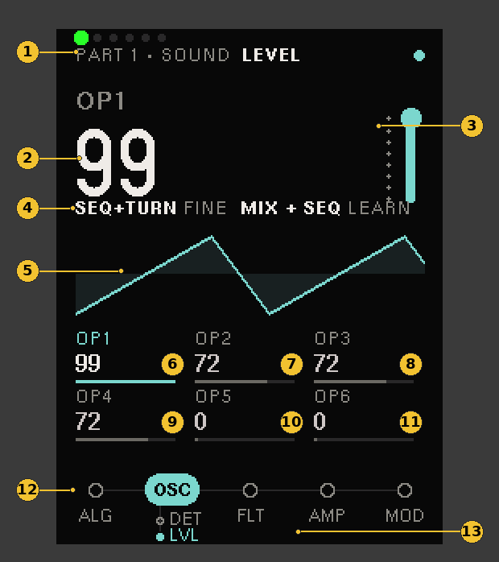

1. **Header:** the Part (PART 1 · SOUND) and the page, LEVEL.
2. **Focus band:** the touched cell, large: OP1 and its LEVEL.
3. **Glyph:** a level bar.
4. **Hint:** the gestures the touched cell answers to.
5. **Picture:** the live output's waveform.
6. **OP1:** operator 1's output level, 0–99.
7. **OP2:** operator 2's output level, 0–99.
8. **OP3:** operator 3's output level, 0–99.
9. **OP4:** operator 4's output level, 0–99.
10. **OP5:** operator 5's output level, 0–99.
11. **OP6:** operator 6's output level, 0–99.
12. **Chain map:** the OSC node lit.
13. **Sub-pages:** the node's sub-pages, the current one lit.

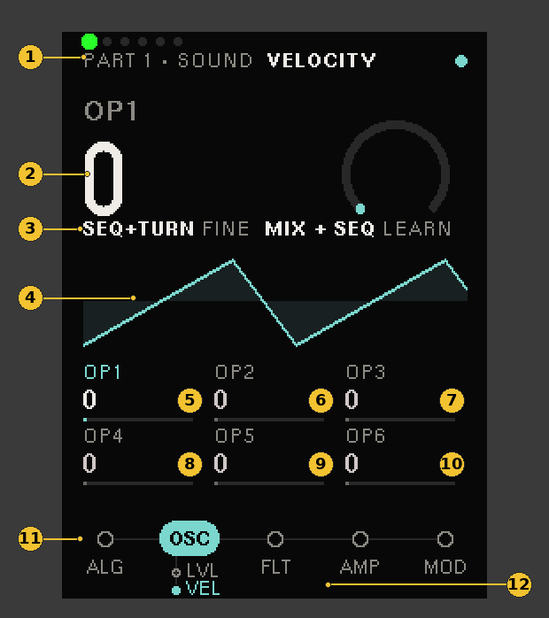

1. **Header:** the Part (PART 1 · SOUND) and the page, VELOCITY.
2. **Focus band:** the touched cell, large: OP1 and its VELOCITY.
3. **Hint:** the gestures the touched cell answers to.
4. **Picture:** the live output's waveform.
5. **OP1:** operator 1's velocity sensitivity, 0–7.
6. **OP2:** operator 2's velocity sensitivity, 0–7.
7. **OP3:** operator 3's velocity sensitivity, 0–7.
8. **OP4:** operator 4's velocity sensitivity, 0–7.
9. **OP5:** operator 5's velocity sensitivity, 0–7.
10. **OP6:** operator 6's velocity sensitivity, 0–7.
11. **Chain map:** the OSC node lit.
12. **Sub-pages:** the node's sub-pages, the current one lit.

### ALGO: FEEDBACK

**FDBK** (0.0 to 7.0) feeds the operator's output back into its own phase. A sine with rising feedback gains harmonics and turns towards a saw; at the top it breaks up into noise-like grit.

- The whole numbers are the TX81Z's eight steps. From step 1 each step doubles the swing.
- One encoder detent is a tenth of a step, so there are 71 settings: ten under what step 1 was, nine between each pair above.
- **MIX + turn** jumps to the next whole number. **SEQ + turn** steps by tenths. The focus band shows both: `MIX+TURN WHOLE` and `SEQ+TURN FINE`.
- Each operator with FDBK above 0 wears a loop on the ALGORITHM chart: MID under 4.0, accent from 4.0.
- A noise band ignores FDBK and wears no loop.

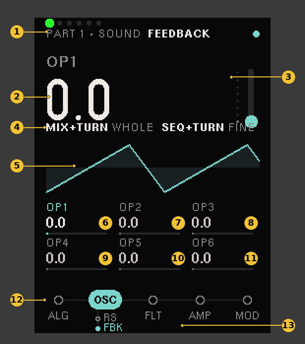

1. **Header:** the Part (PART 1 · SOUND) and the page, FEEDBACK.
2. **Focus band:** the touched cell, large: OP1 and its FDBK.
3. **Glyph:** a level bar.
4. **Hint:** `MIX+TURN WHOLE` and `SEQ+TURN FINE`.
5. **Picture:** the live output's waveform, where feedback is seen bending the wave.
6. **OP1:** operator 1's feedback, 0.0–7.0.
7. **OP2:** operator 2's feedback, 0.0–7.0.
8. **OP3:** operator 3's feedback, 0.0–7.0.
9. **OP4:** operator 4's feedback, 0.0–7.0.
10. **OP5:** operator 5's feedback, 0.0–7.0.
11. **OP6:** operator 6's feedback, 0.0–7.0.
12. **Chain map:** the OSC node lit.
13. **Sub-pages:** the node's sub-pages, the current one lit.

With feedback set, the ALGORITHM chart wears a loop beside each feeding operator:

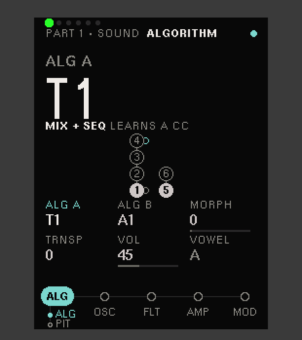

**Why tenths:** the TX81Z's steps double, so the jump from 0 to 1 and between the low steps was coarse for subtle colour. Tenths fill the gaps; a whole number plays exactly as the same step did.

## ALGO: the operator envelopes

Every operator has its own envelope, in the classic Yamaha four-rate shape:

1. **AR** (attack rate) rises from silence to full.
2. **D1R** (first decay rate) falls to the level **D1L** sets.
3. **D2R** (second decay rate) falls on from there while the key is held.
4. **RR** (release rate) falls to silence after key up.

**RS** (rate scaling) makes every rate faster on higher notes.


1. **Header:** the Part (PART 1 · SOUND) and the page, ATTACK RATE.
2. **Focus band:** the touched cell, large: ATTACK RATE over the value.
3. **Glyph:** an arc for the rate.
4. **Hint:** the gestures the touched cell answers to.
5. **Picture:** the touched operator's envelope, its stages marked.
6. **OP1:** operator 1's attack rate, 0–31.
7. **OP2:** operator 2's attack rate, 0–31.
8. **OP3:** operator 3's attack rate, 0–31.
9. **OP4:** operator 4's attack rate, 0–31.
10. **OP5:** operator 5's attack rate, 0–31.
11. **OP6:** operator 6's attack rate, 0–31.
12. **Chain map:** the OSC node lit.
13. **Sub-pages:** the node's sub-pages, the current one lit.

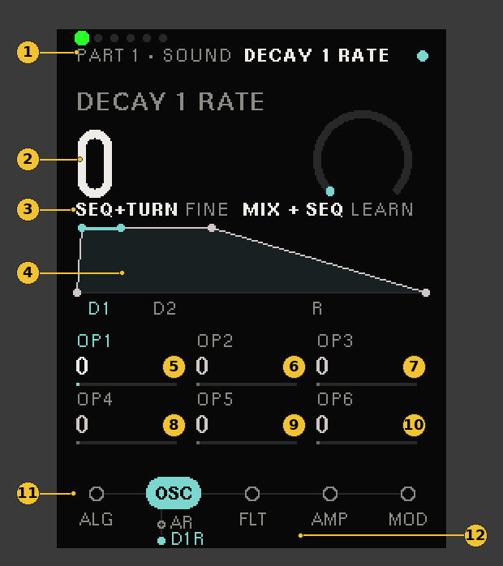

1. **Header:** the Part (PART 1 · SOUND) and the page, DECAY 1 RATE.
2. **Focus band:** the touched cell, large: DECAY 1 RATE over the value.
3. **Hint:** the gestures the touched cell answers to.
4. **Picture:** the touched operator's envelope, its stages marked.
5. **OP1:** operator 1's first decay rate, 0–31.
6. **OP2:** operator 2's first decay rate, 0–31.
7. **OP3:** operator 3's first decay rate, 0–31.
8. **OP4:** operator 4's first decay rate, 0–31.
9. **OP5:** operator 5's first decay rate, 0–31.
10. **OP6:** operator 6's first decay rate, 0–31.
11. **Chain map:** the OSC node lit.
12. **Sub-pages:** the node's sub-pages, the current one lit.

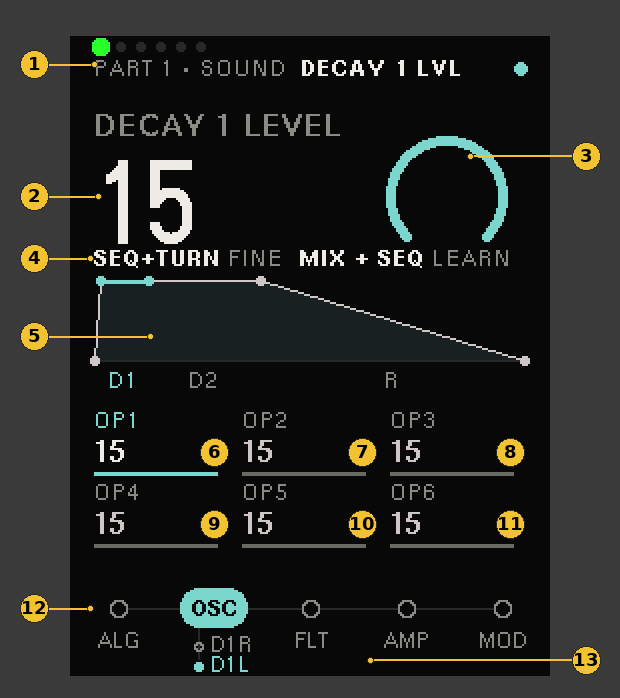

1. **Header:** the Part (PART 1 · SOUND) and the page, DECAY 1 LVL.
2. **Focus band:** the touched cell, large: DECAY 1 LEVEL over the value.
3. **Glyph:** an arc for the level.
4. **Hint:** the gestures the touched cell answers to.
5. **Picture:** the touched operator's envelope, its stages marked.
6. **OP1:** operator 1's first decay level, 0–15.
7. **OP2:** operator 2's first decay level, 0–15.
8. **OP3:** operator 3's first decay level, 0–15.
9. **OP4:** operator 4's first decay level, 0–15.
10. **OP5:** operator 5's first decay level, 0–15.
11. **OP6:** operator 6's first decay level, 0–15.
12. **Chain map:** the OSC node lit.
13. **Sub-pages:** the node's sub-pages, the current one lit.

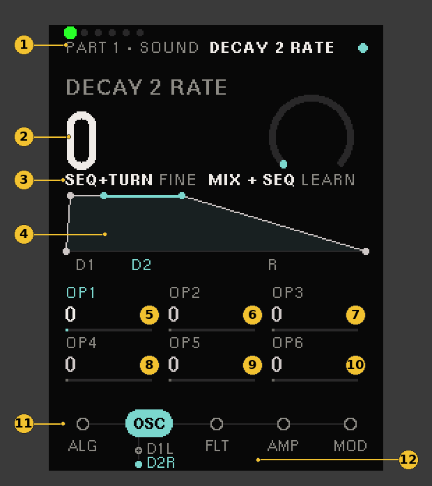

1. **Header:** the Part (PART 1 · SOUND) and the page, DECAY 2 RATE.
2. **Focus band:** the touched cell, large: DECAY 2 RATE over the value.
3. **Hint:** the gestures the touched cell answers to.
4. **Picture:** the touched operator's envelope, its stages marked.
5. **OP1:** operator 1's second decay rate, 0–31.
6. **OP2:** operator 2's second decay rate, 0–31.
7. **OP3:** operator 3's second decay rate, 0–31.
8. **OP4:** operator 4's second decay rate, 0–31.
9. **OP5:** operator 5's second decay rate, 0–31.
10. **OP6:** operator 6's second decay rate, 0–31.
11. **Chain map:** the OSC node lit.
12. **Sub-pages:** the node's sub-pages, the current one lit.

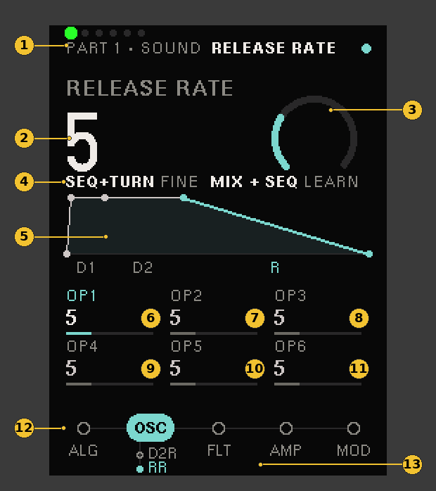

1. **Header:** the Part (PART 1 · SOUND) and the page, RELEASE RATE.
2. **Focus band:** the touched cell, large: RELEASE RATE over the value.
3. **Glyph:** an arc for the rate.
4. **Hint:** the gestures the touched cell answers to.
5. **Picture:** the touched operator's envelope, its stages marked.
6. **OP1:** operator 1's release rate, 1–15.
7. **OP2:** operator 2's release rate, 1–15.
8. **OP3:** operator 3's release rate, 1–15.
9. **OP4:** operator 4's release rate, 1–15.
10. **OP5:** operator 5's release rate, 1–15.
11. **OP6:** operator 6's release rate, 1–15.
12. **Chain map:** the OSC node lit.
13. **Sub-pages:** the node's sub-pages, the current one lit.

The cells are **rates, not times: a higher number is faster.** AR, D1R and D2R run 0 to 31, RR 1 to 15, D1L 0 to 15 and RS 0 to 3.

At 0, a rate stops its stage:

- **AR 0** never rises, so the operator stays silent.
- **D1R 0** holds at full while the key is down. D1L then does nothing; touch a DECAY 1 LEVEL cell whose operator has D1R 0 (and D1L under 15) and the band says `DECAY 1 RATE 0: NEVER REACHED`.
- **D2R 0** holds at D1L: D1L is then the sustain level.
- **D1L 0** makes D1R fall all the way to silence. **D1L 15** is full level, so D2R starts at once.

Each D1L step below 15 is 3 dB down. An operator's LEVEL sets how loud it is, not how long its stages take.

**Why the TX81Z's names:** the tabs keep the TX81Z's AR, D1R, D1L, D2R and RR, so a patch sheet or a TX81Z manual reads straight across, while the headers and the row spell out ATTACK RATE, DECAY 1 RATE and so on. D1L is not called sustain: it is where decay 1 ends, and it only acts as a sustain while D2R is 0.

### ALGO: envelope rates in seconds

Two steps of AR, D1R or D2R make a stage twice as fast; one step of RR does. The times below have no rate scaling.

- **Attack** rises in a straight line from silence to full.
- **Decays and the release** fall at a steady number of dB a second. The table gives the time to fall from full to −80 dB, where a note ends. A stage that starts lower, or stops at D1L, takes its share of that time: D1R falls from full to D1L 11 (−12 dB) in 12/80 of its time.

| Rate | AR: full attack | D1R or D2R: full to −80 dB |
|---|---|---|
| 1 | 8.2 s | 55 s |
| 2 | 5.8 s | 39 s |
| 4 | 2.9 s | 19 s |
| 6 | 1.45 s | 9.7 s |
| 8 | 725 ms | 4.8 s |
| 10 | 363 ms | 2.4 s |
| 12 | 181 ms | 1.2 s |
| 14 | 91 ms | 604 ms |
| 16 | 45 ms | 302 ms |
| 18 | 23 ms | 151 ms |
| 20 | 11 ms | 76 ms |
| 22 | 5.7 ms | 38 ms |
| 24 | 2.8 ms | 19 ms |
| 26 | 1.4 ms | 9.4 ms |
| 28 | 0.7 ms | 4.7 ms |
| 30 | 0.4 ms | 2.4 ms |
| 31 | 0.25 ms | 1.7 ms |

| RR | Full to −80 dB after key up |
|---|---|
| 1 | 27 s |
| 2 | 14 s |
| 3 | 6.8 s |
| 4 | 3.4 s |
| 5 | 1.7 s |
| 6 | 854 ms |
| 7 | 427 ms |
| 8 | 214 ms |
| 9 | 107 ms |
| 10 | 53 ms |
| 11 | 27 ms |
| 12 | 13 ms |
| 13 | 6.7 ms |
| 14 | 3.3 ms |
| 15 | 1.7 ms |

### ALGO: RATE SCALE

**RS** makes every rate of the operator, the release too, faster on higher keys, as the keyboard rate scaling of Yamaha's FM synths does: a high piano or bell note dies sooner than a low one. While an RS cell is touched, the band reads `HIGH NOTES, FASTER ENVELOPES`.

Each note adds steps to every rate, counted from the bottom of the keyboard (A0), and every 4 added steps make a stage twice as fast. **RS 0 is not off**: it still adds up to 3 steps across the keyboard, a gentle tilt, as on the TX81Z.

| RS | C2 | C4 | C6 | C8 | Per octave |
|---|---|---|---|---|---|
| 0 | 1.00× | 1.19× | 1.41× | 1.68× | about 1.1× |
| 1 | 1.19× | 1.68× | 2.4× | 3.4× | about 1.2× |
| 2 | 1.41× | 2.8× | 5.7× | 11× | about 1.4× |
| 3 | 2.4× | 9.5× | 38× | 152× | 2× |

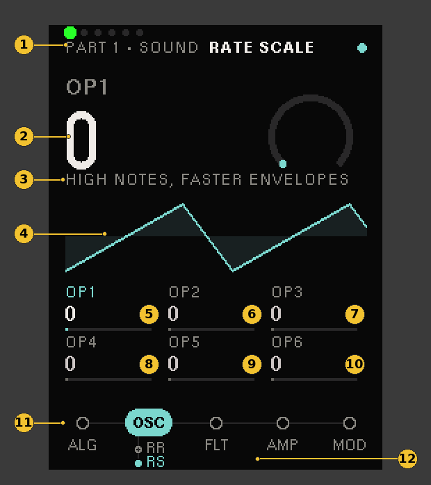

1. **Header:** the Part (PART 1 · SOUND) and the page, RATE SCALE.
2. **Focus band:** the touched cell, large: OP1 and its RATE SCALE.
3. **Hint:** in the hint's place, `HIGH NOTES, FASTER ENVELOPES`.
4. **Picture:** the live output's waveform.
5. **OP1:** operator 1's rate scaling, 0–3.
6. **OP2:** operator 2's rate scaling, 0–3.
7. **OP3:** operator 3's rate scaling, 0–3.
8. **OP4:** operator 4's rate scaling, 0–3.
9. **OP5:** operator 5's rate scaling, 0–3.
10. **OP6:** operator 6's rate scaling, 0–3.
11. **Chain map:** the OSC node lit.
12. **Sub-pages:** the node's sub-pages, the current one lit.

Each figure in the RS table is how much faster every stage runs on that key than in the rate tables. At RS 3, a D1R of 12 (1.2 s from full to −80 dB) takes about 127 ms on C4 and 32 ms on C6. Every rate tops out at the fastest, so AR 31 and RR 15 barely speed up.

### ALGO: longer than the operator envelopes

For a swell or sweep over minutes, use a MOD envelope (ENV1–ENV3) on a SLOW speed range (see [envelopes and LFOs](09-envelopes-and-lfos.md)). To open a sound over a minute: take a modulator's LEVEL down to where the sound is dull, prime it with **MIX + PLUS** on its LEVEL cell, and route a SLOW envelope into it with a positive amount, ATTACK long and SUSTAIN full. The brightness then rises over the whole attack. A negative amount from a full LEVEL closes the sound instead. Routes into a carrier's LEVEL change its loudness the same way.

**Why the operators shape the note:** ALGO does not need the amp envelope. Each carrier's own envelope is the note's loudness contour, and each modulator's is its brightness contour, as on a Yamaha FM synth. So a release rings out on the operators' RR. ENV1 still runs as a mod source. See [ALGO: the shared pages](#algo-the-shared-pages-on-an-algo-part) for how a route into VCA changes this.

## ALGO: the operator pages OP1 to OP6

Each operator has its own page with its six most-used settings. Its band draws the operator's envelope with an inset at the top right: the wave for a table operator, the grain for a formant, the band's bell for a noise band. The cells follow the operator's kind:

| Kind | Cells |
|---|---|
| Table (W1 … SSAW) | **WAVE**, **COARSE**, **FINE**, **LEVEL**, **FDBK**, **VELOCITY** |
| Formant (FRMT) | **WAVE**, **FORMANT**, **BW**, **SKIRT**, **KEY**, **SLOT** |
| Noise band (NOISE) | **WAVE**, **CENTRE**, **WIDTH**, **RES**, **SLOT**, **LEVEL** |

These are the same settings as on the group pages; changing one in either place changes both. FDBK is spelled FEEDBACK in the focus band. A formant operator's COARSE, FINE, LEVEL, FDBK and VELOCITY stay on their group pages.

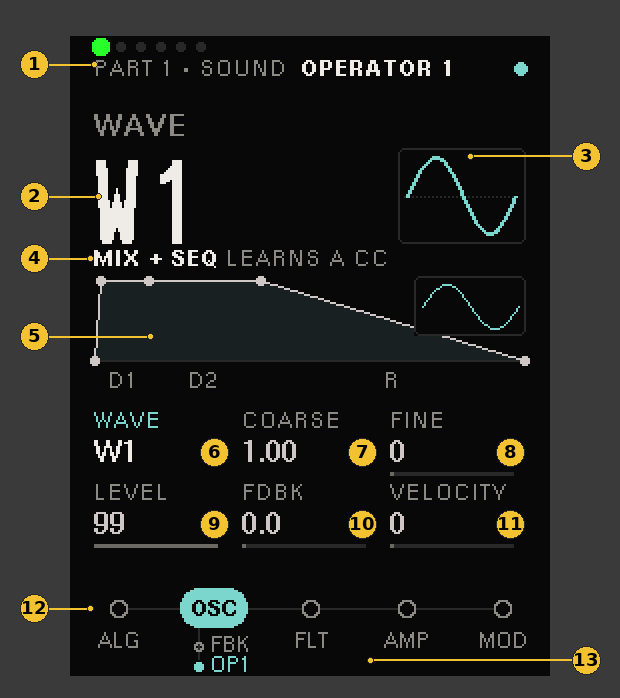

1. **Header:** the Part (PART 1 · SOUND) and the page, OPERATOR 1.
2. **Focus band:** the touched cell, large: WAVE and its value.
3. **Glyph:** a scope of the operator's wave.
4. **Hint:** the gestures the touched cell answers to.
5. **Picture:** the operator's envelope (D1, D2 and R marked) with an inset of its wave.
6. **WAVE:** the operator's wave or kind.
7. **COARSE:** its frequency ratio.
8. **FINE:** its FINE step.
9. **LEVEL:** its output level.
10. **FDBK:** its feedback.
11. **VELOCITY:** its velocity sensitivity.
12. **Chain map:** the OSC node lit.
13. **Sub-pages:** the node's sub-pages, the current one lit.


1. **Header:** the Part (PART 1 · SOUND) and the page, OPERATOR 2.
2. **Focus band:** the touched cell, large: WAVE and its value.
3. **Glyph:** a scope of the operator's wave.
4. **Hint:** the gestures the touched cell answers to.
5. **Picture:** the operator's envelope (D1, D2 and R marked) with an inset of its wave.
6. **WAVE:** the operator's wave or kind.
7. **COARSE:** its frequency ratio.
8. **FINE:** its FINE step.
9. **LEVEL:** its output level.
10. **FDBK:** its feedback.
11. **VELOCITY:** its velocity sensitivity.
12. **Chain map:** the OSC node lit.
13. **Sub-pages:** the node's sub-pages, the current one lit.


1. **Header:** the Part (PART 1 · SOUND) and the page, OPERATOR 3.
2. **Focus band:** the touched cell, large: WAVE and its value.
3. **Glyph:** a scope of the operator's wave.
4. **Hint:** the gestures the touched cell answers to.
5. **Picture:** the operator's envelope (D1, D2 and R marked) with an inset of its wave.
6. **WAVE:** the operator's wave or kind.
7. **COARSE:** its frequency ratio.
8. **FINE:** its FINE step.
9. **LEVEL:** its output level.
10. **FDBK:** its feedback.
11. **VELOCITY:** its velocity sensitivity.
12. **Chain map:** the OSC node lit.
13. **Sub-pages:** the node's sub-pages, the current one lit.


1. **Header:** the Part (PART 1 · SOUND) and the page, OPERATOR 4.
2. **Focus band:** the touched cell, large: WAVE and its value.
3. **Glyph:** a scope of the operator's wave.
4. **Hint:** the gestures the touched cell answers to.
5. **Picture:** the operator's envelope (D1, D2 and R marked) with an inset of its wave.
6. **WAVE:** the operator's wave or kind.
7. **COARSE:** its frequency ratio.
8. **FINE:** its FINE step.
9. **LEVEL:** its output level.
10. **FDBK:** its feedback.
11. **VELOCITY:** its velocity sensitivity.
12. **Chain map:** the OSC node lit.
13. **Sub-pages:** the node's sub-pages, the current one lit.

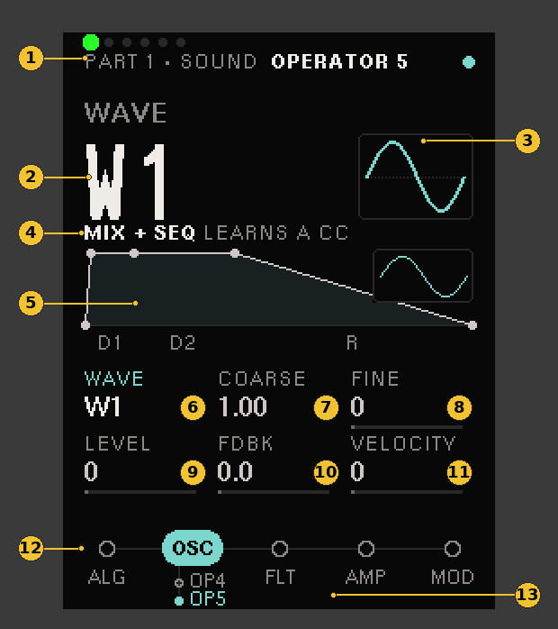

1. **Header:** the Part (PART 1 · SOUND) and the page, OPERATOR 5.
2. **Focus band:** the touched cell, large: WAVE and its value.
3. **Glyph:** a scope of the operator's wave.
4. **Hint:** the gestures the touched cell answers to.
5. **Picture:** the operator's envelope (D1, D2 and R marked) with an inset of its wave.
6. **WAVE:** the operator's wave or kind.
7. **COARSE:** its frequency ratio.
8. **FINE:** its FINE step.
9. **LEVEL:** its output level.
10. **FDBK:** its feedback.
11. **VELOCITY:** its velocity sensitivity.
12. **Chain map:** the OSC node lit.
13. **Sub-pages:** the node's sub-pages, the current one lit.


1. **Header:** the Part (PART 1 · SOUND) and the page, OPERATOR 6.
2. **Focus band:** the touched cell, large: WAVE and its value.
3. **Glyph:** a scope of the operator's wave.
4. **Hint:** the gestures the touched cell answers to.
5. **Picture:** the operator's envelope (D1, D2 and R marked) with an inset of its wave.
6. **WAVE:** the operator's wave or kind.
7. **COARSE:** its frequency ratio.
8. **FINE:** its FINE step.
9. **LEVEL:** its output level.
10. **FDBK:** its feedback.
11. **VELOCITY:** its velocity sensitivity.
12. **Chain map:** the OSC node lit.
13. **Sub-pages:** the node's sub-pages, the current one lit.

An operator set to FRMT shows the formant cells instead (OPERATOR 2 here):

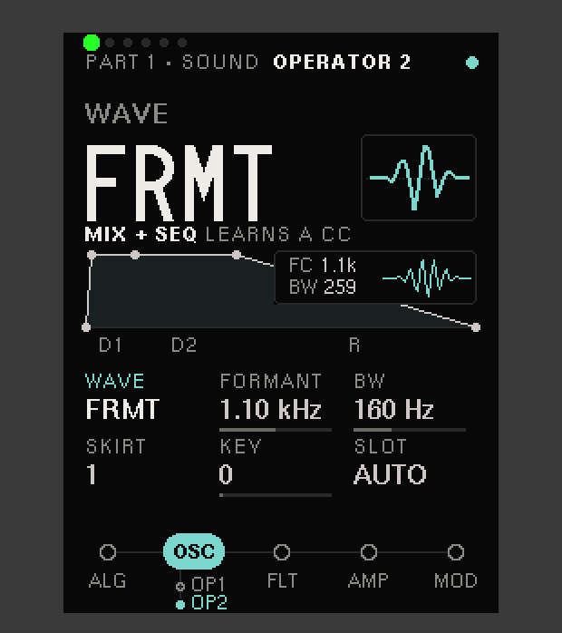

**Why both views:** the group pages compare one setting across the operators (are the ratios harmonic? which carriers are loud?); the operator pages show one operator whole. See [ALGO: ALG PAGES FIRST, parameters or operators first](#algo-alg-pages-first-parameters-or-operators-first) to open OSC on the operators.

## ALGO: formant and noise operators

Set an operator's WAVE to **FRMT** or **NOISE** and it stops being an oscillator at a ratio and becomes a resonance at a fixed place in the spectrum, as the formants of a voice are. A formant operator is voiced: it fires short grains at the note's pitch, each holding a tone at the formant frequency. A noise band is unvoiced: noise shaped into a band around its centre. Both work as carriers or modulators, in every algorithm and in MORPH.

While any operator is a FRMT or NOISE, the **FORMANT** page (**FRM**) joins the OSC row right after WAVE, and VOWEL on the ALGORITHM page wakes up.

### ALGO: the formant operator's cells

| Cell | Range | INIT | What it does |
|---|---|---|---|
| **FORMANT** | 100 Hz to 12.8 kHz | per operator: 734 Hz, 1.10 kHz, 2.47 kHz, then 3.49 kHz | The formant's centre frequency, at vowel A |
| **BW** | 20 Hz to 10.2 kHz | 160 Hz | Bandwidth: how wide the formant is |
| **SKIRT** | 0–3 | 1 | The shape of the formant's sides: 0 is the softest window, with audible side lobes; 1 is clean; 2 and 3 push the side lobes lower still |
| **KEY** | 0–100 | 0 | How far the formant follows the note, in %. 0 keeps it still, as a real formant is; 100 moves it with the keys |
| **SLOT** | AUTO, F1, F2, F3, OFF | AUTO | Which vowel formant VOWEL moves it as |

- FORMANT and BW step 50 cents (a quarter tone) a detent; the value reads in Hz or kHz.
- BW, SKIRT and the noise band's WIDTH change the tone only, never the level: a formant at full LEVEL sits about 12 dB under a sine's level and never clips on its own.
- FORMANT, BW and VOWEL are mod destinations and move smoothly. SKIRT, KEY, SLOT and RES are taken at each note-on, so turning them changes the next note, not a sounding one.
- Above about A2, a floor set by the note's pitch takes over from a narrow BW: the formant cannot be narrower than that.
- A formant has no RES; on its operator page the cells it does not read are not there, and on the group pages they are dimmed.

### ALGO: the noise band's cells

| Cell | Range | INIT | What it does |
|---|---|---|---|
| **CENTRE** | 100 Hz to 12.8 kHz | as FORMANT | The band's centre |
| **WIDTH** | 20 Hz to 10.2 kHz | 160 Hz | The band's width: down at 20 Hz it is nearly a tone; at 10 kHz a full breath |
| **RES** | 0–100 | 0 | Blends the band noise into a pure tone at the centre, in %. 0 is pure band noise |
| **SLOT** | AUTO, F1, F2, F3, OFF | AUTO | As for a formant |
| **LEVEL** | 0–99 | as the operator's LEVEL | Its level |

CENTRE and FORMANT are the same setting, shown under the name that fits the kind; so are WIDTH and BW. A noise band has no pitch, so it ignores COARSE, FINE, DETUNE, FDBK, SKIRT and KEY; those cells are dimmed for it.

### ALGO: VOWEL and the slots

**VOWEL** (ALGORITHM page) moves every formant and noise operator together along **U, O, A, E, I**, from dark to bright. Each operator's FORMANT (or CENTRE) is its place at vowel A; VOWEL shifts it from there to where that vowel's formant sits. The vowel targets are average adult male formant frequencies from a published 1952 measurement study (Peterson and Barney).

Each operator's **SLOT** says which formant of the vowel it follows:

| SLOT | What it does |
|---|---|
| **AUTO** | Takes F1, F2, F3 in order among the AUTO operators (lowest-numbered first); a fourth AUTO operator follows none |
| **F1** | Follows the vowel's first formant |
| **F2** | Follows the second |
| **F3** | Follows the third |
| **OFF** | Ignores VOWEL |

- Two operators can share a slot, for a detuned choir.
- An explicit slot does not shift the AUTO ones: with operators 1 and 2 on F1, AUTO operators 3 and 4 still take F1 and F2.
- The slots are taken at note-on, so a SLOT or WAVE change never makes a sounding formant jump.

**Why three slots:** the first two formants carry a vowel's identity and the third adds clarity. Higher formants barely move from vowel to vowel; they colour the voice instead, so a fourth operator is better left on a fixed FORMANT.

### ALGO: the formant budget

A formant operator costs several times what a table operator does, more again when another operator modulates it. To keep every Sound playable, a Sound with a formant always keeps at least three voices (every other ALGO Sound keeps at least four), and ALGO refuses an edit that would break that:

- Up to three formant operators fit when nothing modulates them, or one modulated formant beside one that is not. Noise bands are cheap: a Sound can hold several.
- WAVE and ALG A / ALG B list every choice. A turn onto a choice the budget cannot pay for shows it dimmed and writes nothing; the next turn goes on from there, so a refused FRMT never blocks NOISE beyond it.
- The focus band says why, shown even with HINTS off:
  - `OP 1 MODULATED · OVER BUDGET`: that operator has a modulator in the algorithm and would only fit unmodulated.
  - `BUDGET FULL · OTHER FORMANTS`: the other formants have used the budget.
  - `LINKS A FORMANT · OVER BUDGET`: that algorithm would make an operator modulate a formant the budget cannot carry.
- The hold ends at any button press, a turn on another cell, a page change or a load. Nothing in the Sound changes.
- A MIDI control or a load that lands on a refused choice shows the toast `FORMANT BUDGET FULL` instead.
- With MORPH, an operator counts as modulated if either algorithm modulates it.

**Why a budget and not fewer voices:** the alternative was a patch that plays one voice, or none, after a single turn. The budget keeps the promise that any Sound you can build plays chords.

> **Design note:** the formant operators follow the structure of an expired Yamaha patent, the approach behind the FS1R's formant synthesis: grains fired at the note's pitch, a carrier at the formant frequency restarted in each grain, two overlapping lanes, and noise low-passed and ring-modulated up to a centre for the unvoiced bands. Everything else is Chimera's own: the window, the width floor, the level law that keeps BW from changing loudness (an FS1R would get louder; this does not), the VOWEL macro and its slots. The vowel table is measurement data, Peterson and Barney's 1952 averages, which means somewhere in the firmware a committee of mid-century American men is still saying "hod", "head" and "hid" on your behalf.

## ALGO: the shared pages on an ALGO Part

The shared pages work as on every engine (see [the voice chain](08-voice-chain.md), [envelopes and LFOs](09-envelopes-and-lfos.md), [the mod matrix](10-mod-matrix.md)). On ALGO:

- **PIT** (PITCH) hangs under ALG. TRNSP on the ALGORITHM page and PITCH on PIT both shift the Sound in semitones; the tuner on PIT reads the result.
- **JACK** (JACKS): FREQ SRC and RES SRC also take the audio of operator 5 or 6 (**OP5**, **OP6**). The filter's cutoff or resonance then moves at audio rate with that operator, for growls and vocal buzzes. In the mod matrix, OP5 and OP6 are sources too (see [the mod matrix](10-mod-matrix.md)).
- **AMP**: with no route into VCA, the carriers' envelopes shape the note. AMP's **VEL** and **BASE** are dimmed until a route goes into VCA. Once one does, the routes are the amp: BASE plus the routes, scaling the carriers, which keep their own shape. A BASE above 0 keeps the carriers' own tail after key up.
- **The amp gate.** After key up, an ALGO voice with no route into VCA may be no louder than four times (12 dB over) what its operators are still putting out. A filter left self-oscillating therefore dies with the note's tail instead of ringing on; a normal release is untouched. It closes no faster than about 21 ms, so a ring fades rather than cuts. It costs nothing while the key is held.
- **E1** (ENV1) is not on the VCA on ALGO. It runs as a mod source for anything you route it to.

## ALGO: voices and what a patch costs

Chimera has 8 voices shared by the six Parts. Each ALGO note is billed for what its Sound really uses:

- an operator costs only if its LEVEL is above 0 or something is routed into its LEVEL;
- each link in the algorithm costs a little, and with MORPH both algorithms' links count;
- feedback costs a little;
- formant operators cost much more, and more again when modulated; noise bands cost little.

A note gets a voice only if its cost fits in what is left. Some figures, for one Part alone on the rev V chip beside the TAPE delay and the QUAD reverb:

| Sound type | Example | Voices |
|---|---|---|
| One or two operators | DRIFT ORGAN | 8 |
| Typical | AIR RAID | 7 |
| Heaviest | SOFT HORNS | 3 |
| With formants | NULL CHOIR | 4 |

**Why:** a flat worst-case bill would give a one-operator organ the voice count of a six-operator morphing pad. Billing by the patch's shape lets light Sounds play full chords. INIT routes four operators, not six, so that INIT plays all eight voices. See [limits](20-limits.md).

## ALGO: starting points

All of these start from INIT ALGO (in the Sound browser's INIT rows, or SETTINGS › PART › CLEAR). INIT is T1 into A1, MORPH 0; operator 1 at LEVEL 99, operators 2–4 at 72, 5 and 6 silent; every ratio 1.00 on W1; AR 31, D1R 0, D1L 15, D2R 0, RR 5.

- **Hear the stack open and close:** on INIT, turn MORPH. At 0 it is a bright four-deep stack; at 127 the same four sines play side by side, clean.
- **Organ (as DRIFT ORGAN):** ALG A and B T8. Operators 1–4 W1 at COARSE 1.00, 2.00, 4.00 and 8.00, LEVEL 90 each, AR 28, D1R 31, D1L 15, RR 10. DETUNE −3, 0, +1, +3 for a slow beat. Slow LFOs into a couple of LEVELs make the drawbars drift.
- **Punchy bass (as SOLID BASS):** ALG T3. Operators 1–3 at COARSE 0.50, operator 4 at 1.00. Operator 1 LEVEL 99 with a slow D2R (3); operators 2–4 at LEVEL 50–62 with D1R 12–13 and D1L 10–12, so the brightness falls after the attack. FDBK 4.0 on operator 4 for bite; VEL 1–3 on the modulators so harder notes bark.
- **Electric piano (as TINE PIANO):** ALG T5 (three carriers). Ratios near 1.41 with FINE 1 and a little DETUNE, D1R around 12, RS 2 so high notes decay faster, VEL 3 for the tine's bark when played hard.
- **Bells:** take a modulator to an inharmonic ratio (3.46, 4.24 or 6.28), give the carrier a long D1R to D1L 0 and RS 2 or 3.
- **Morphing bass (as MORPH BASS):** ALG A T4, ALG B T5; a W7 modulator at COARSE 5.00 with FDBK 5.0; route ENV2 into MORPH so each note morphs from one wiring into the other.
- **A choir (as NULL CHOIR):** ALG A A1 (no links), two FRMT operators on F1 and F2 (FORMANT around 566 Hz and 1.17 kHz, BW around 270–360 Hz), a NOISE band at 1.80 kHz for breath, two table operators at 1.00 for the pitch. Sweep VOWEL with a slow LFO.
- **A filter growl (as VOWEL BUZZ):** a SAW carrier into the 2040 filter, operator 5 audible at a low LEVEL and chosen as FREQ SRC on JACKS, so it sweeps the cutoff at audio rate.

The factory Sounds named above ship in the factory set (see [the card, Sounds and the library](16-card-sounds-library.md)); load one and open its pages to see the rest of its settings.
