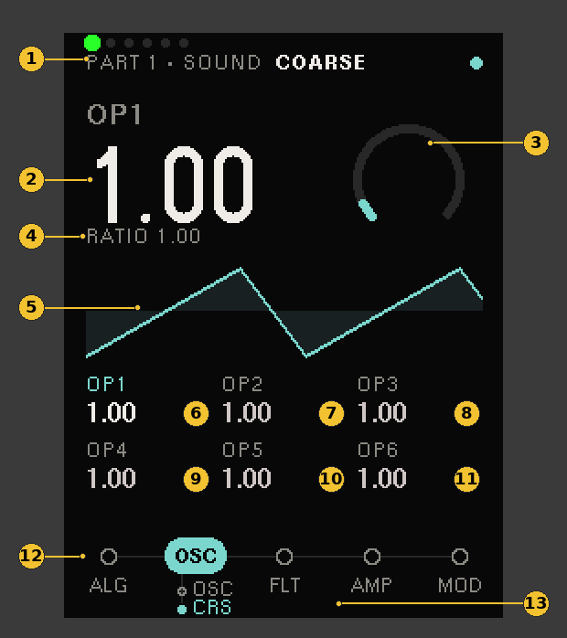
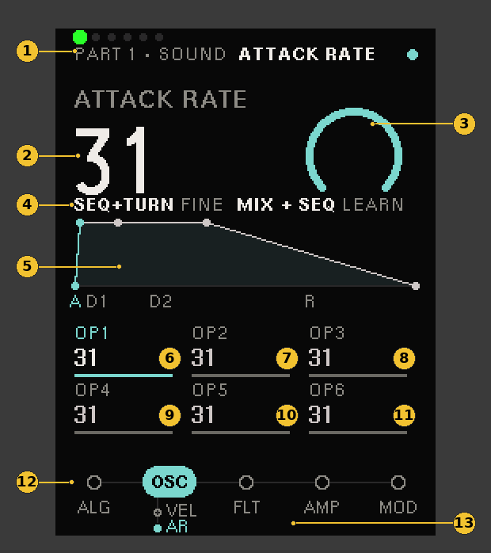
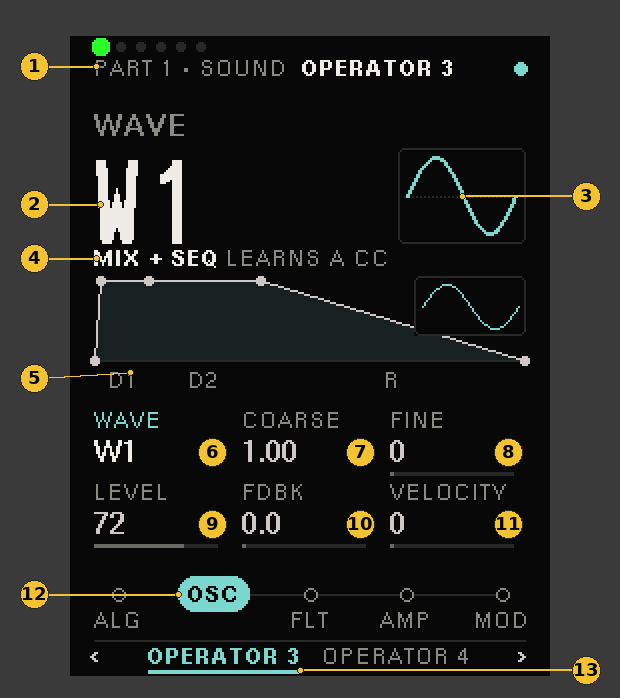

# ALGO, the six-operator engine

ALGO is Chimera's operator engine: six phase-modulation operators wired by one of 32 algorithms, with MORPH blending between two algorithms. This chapter covers the ALGORITHM page, the OSC node's group and operator pages, formant and noise operators, and what a patch costs. The shared pages (PIT, FLT, FMD, FX, JACK, AMP, STER, SND, MTX, E1–E3, SPD, L1–L3) are in [the voice chain](08-voice-chain.md), [envelopes and LFOs](09-envelopes-and-lfos.md) and [the mod matrix](10-mod-matrix.md).

## ALGO: what the engine is

Each operator is an oscillator with its own wave, frequency ratio, level and envelope. An **algorithm** says which operators modulate which, and which you hear:

- A **carrier** is heard. Its LEVEL is loudness.
- A **modulator** feeds another operator. Its LEVEL is brightness: more LEVEL, more harmonics.
- **FDBK** feeds an operator back into itself: a sine with feedback turns towards a saw.

Every Sound stores two algorithms, **ALG A** and **ALG B**; **MORPH** blends one into the other, so a knob, envelope or LFO can move a sound between two wirings. An operator's **WAVE** makes it a **table** operator (16 waves), a **formant** (FRMT) or a **noise band** (NOISE).

**Why:** one engine does the work of several, from a plain wave to a six-operator morphing tone to a singing formant, on one set of pages, and every Sound is billed only for the operators it uses.

**Why phase modulation:** operators modulate each other's phase, not their frequency, so a carrier's pitch stays centred however deep the modulation goes. The stock PreenFM3 firmware does true FM; Chimera is phase modulation throughout.

> **Design note:** ALGO began as a faithful four-operator TX81Z engine that cost more than the whole chip could spend on one voice: every FM note was refused. It was replaced with a six-operator engine written from scratch. The TX81Z is still in its bones: the 64 COARSE ratios, FINE, the 0.75 dB LEVEL step, the four-rate envelope and the feedback steps were re-entered by hand from its owner's manual, and T1 to T8 are its eight algorithms. The waves were redrawn as formulas. The other 24 algorithms are Chimera's own, because six operators deserve more than eight ways to meet.

## ALGO: the chain and its pages

An ALGO Part's chain map reads **ALG · OSC · FLT · AMP · MOD**. ALG is the home.

```
ALG ──── OSC ─────────── FLT ──────── AMP ──────── MOD
 └ PIT    ├ FRM (only with a formant or noise operator)
          ├ CRS FIN DET LVL VEL
          ├ AR D1R D1L D2R RR RS FBK
          └ OP1 … OP6
```

| Node | Its pages, short name (full word on the sub-page row) |
|---|---|
| ALG | **ALG** (ALGORITHM), **PIT** (PITCH) |
| OSC | **OSC** (WAVE), **FRM** (FORMANT), **CRS** (COARSE), **FIN** (FINE), **DET** (DETUNE), **LVL** (LEVEL), **VEL** (VELOCITY), **AR** (ATTACK RATE), **D1R** (DECAY 1 RATE), **D1L** (DECAY 1 LEVEL; DECAY 1 LVL in the header), **D2R** (DECAY 2 RATE), **RR** (RELEASE RATE), **RS** (RATE SCALE), **FBK** (FEEDBACK), **OP1** to **OP6** (OPERATOR 1 to OPERATOR 6) |
| FLT, AMP, MOD | as on every engine: see [the voice chain](08-voice-chain.md), [envelopes and LFOs](09-envelopes-and-lfos.md), [the mod matrix](10-mod-matrix.md) |

The OSC row has 18 sub-pages after its home (19 with FORMANT) and scrolls, with `<` and `>` at its ends. Navigation is as on every page (see [the panel and navigation](02-panel-and-navigation.md)).

## ALGO: ALG PAGES FIRST, parameters or operators first

SETTINGS › PERSONALIZE › ALGO PAGES › **FIRST** sets the order of the OSC node's pages. It belongs to the unit, not the Sound (see [SETTINGS](13-settings.md)).

| Option | What it does |
|---|---|
| **PARAMS** (default) | WAVE, then the group pages, then OP1 to OP6 |
| **OPS** | OP1 to OP6, then WAVE (and FORMANT) and the group pages |

**Why:** some players work a parameter across all operators, others one operator at a time, as on software FM synths. Only the order changes.

## ALGO: the ALGORITHM page (ALG)


1. **Header:** Part and page.
2. **Focus band:** the touched cell (ALG A, T1).
3. **Hint:** its gestures.
4. **Picture:** the algorithm chart.
5. **ALG A**
6. **ALG B**
7. **MORPH**
8. **TRNSP**
9. **VOL**
10. **VOWEL**
11. **Chain map:** ALG lit.
12. **Sub-pages.**

The chart puts carriers, drawn filled, on the bottom row and each modulator above what it feeds. An operator with FDBK above 0 wears a loop: MID colour under 4.0, accent from 4.0, where a sine starts to break towards a saw.


| Cell | Range | Default | What it does |
|---|---|---|---|
| **ALG A** | T1–T8, A1–A24 | T1 | The algorithm at MORPH 0 |
| **ALG B** | T1–T8, A1–A24 | A1 | The algorithm at MORPH 127 |
| **MORPH** | 0–127 | 0 | Blends ALG A into ALG B |
| **TRNSP** | −24 to +24 | 0 | Transposes the Sound in semitones |
| **VOL** | 0–127 | 45 | The Sound's output level |
| **VOWEL** | U, O, A, E, I | A | Moves every formant and noise operator along the vowels |

- Touching ALG A or ALG B shows that algorithm alone (a refused one dimmed); any other cell shows the MORPH blend.
- A change of ALG A or B under a sounding note ducks, swaps and returns, without a click.
- **MORPH** is dimmed while ALG A and ALG B are the same; its routes stay, inert. Otherwise it glides and is a mod destination.
- **VOWEL** is dimmed until an operator is FRMT or NOISE. The arc shows the exact place between vowels (see [ALGO: VOWEL and the slots](#algo-vowel-and-the-slots)).

**Why MORPH blends the links:** each link has a weight, 1 in an algorithm that has it, 0 in one that does not, and MORPH moves every weight from A to B. Each end sounds exactly like its algorithm, and the sweep is smooth.

**Why INIT is T1 into A1:** T1 is a four-deep stack, A1 the same four operators unlinked. On INIT, MORPH is an FM-depth macro, bright to clean.

**Why the output is scaled by the carriers:** more carriers would be louder, so the output is scaled by the stored carrier levels and the 32 algorithms play at a similar loudness. Routes never change the scale, and it never boosts.

## ALGO: the 32 algorithms

A higher-numbered operator always modulates a lower one; "4→3" means 4 modulates 3.

| Algorithm | Links | Carriers |
|---|---|---|
| T1 | 4→3, 3→2, 2→1, 6→5 | 1, 5 |
| T2 | 4→2, 3→2, 2→1, 6→5 | 1, 5 |
| T3 | 3→2, 2→1, 4→1, 6→5 | 1, 5 |
| T4 | 4→3, 3→1, 2→1, 6→5 | 1, 5 |
| T5 | 4→3, 2→1, 6→5 | 1, 3, 5 |
| T6 | 4→1, 4→2, 4→3, 6→5 | 1, 2, 3, 5 |
| T7 | 4→3, 6→5 | 1, 2, 3, 5 |
| T8 | 6→5 | 1–5 |
| A1 | none | 1–6 |
| A2 | 6→1 | 1–5 |
| A3 | 6→1, 6→2 | 1–5 |
| A4 | 6→1, 5→2 | 1–4 |
| A5 | 6→1, 6→2, 6→3, 6→4 | 1–5 |
| A6 | 6→5, 5→1 | 1–4 |
| A7 | 4→1, 5→2, 6→3 | 1, 2, 3 |
| A8 | 4→1, 5→1, 6→1 | 1, 2, 3 |
| A9 | 6→5, 5→4, 4→1 | 1, 2, 3 |
| A10 | 6→4, 6→5, 4→1, 5→2 | 1, 2, 3 |
| A11 | 5→4, 6→4, 4→1, 4→2, 4→3 | 1, 2, 3 |
| A12 | 5→3, 3→1, 6→4, 4→2 | 1, 2 |
| A13 | 3→1, 4→1, 5→2, 6→2 | 1, 2 |
| A14 | 3→1, 3→2, 4→1, 4→2, 5→3, 6→4 | 1, 2 |
| A15 | 6→5, 5→3, 3→1, 4→2 | 1, 2 |
| A16 | 3, 4, 5, 6 each into 1 and 2 | 1, 2 |
| A17 | 6→5→4→3→2→1 | 1 |
| A18 | 2, 3, 4, 5, 6 each into 1 | 1 |
| A19 | 4→2, 4→3, 2→1, 3→1, 6→5, 5→1 | 1 |
| A20 | 3→2, 2→1, 5→4, 4→1, 6→1 | 1 |
| A21 | 6→5, 5→4, 4→1, 3→2, 2→1 | 1 |
| A22 | 6→4, 6→5, 4→2, 5→3, 2→1, 3→1 | 1 |
| A23 | 6 into 2, 3, 4, 5; each of those into 1 | 1 |
| A24 | 6→5; 5 into 2, 3, 4; each of those into 1 | 1 |

T1–T8 are the TX81Z's eight on operators 1–4, plus a 6→5 pair; with 5 and 6 at LEVEL 0 they play as the TX81Z's. A1 is an additive organ, A17 the deepest stack; A16, A18 and A23 pile modulators onto one or two carriers. A16 with A17 is the costliest pair to morph.

## ALGO: the OSC node and the group pages

The first fourteen OSC pages are **group pages**: one parameter for all six operators, in cells **OP1** to **OP6**. The focus band names the parameter; the lit cell names the operator.

| Page | Range | INIT | What it sets |
|---|---|---|---|
| **OSC** (WAVE) | W1 … NOISE (below) | W1 | The operator's wave or kind |
| **FRM** (FORMANT) | 100 Hz to 12.8 kHz | 734 Hz, 1.10 kHz, 2.47 kHz, 3.49 kHz ×3 | A formant's centre (a noise band's CENTRE) |
| **CRS** (COARSE) | 0.50 to 25.95 | 1.00 | Frequency ratio to the note |
| **FIN** (FINE) | 0–15 | 0 | Raises the ratio towards the next |
| **DET** (DETUNE) | −3 to +3 | 0 | 1.5 cents a step |
| **LVL** (LEVEL) | 0–99 | 99, 72, 72, 72, 0, 0 | Output level, 0.75 dB a step |
| **VEL** (VELOCITY) | 0–7 | 0 | Velocity sensitivity |
| **AR** (ATTACK RATE) | 0–31 | 31 | Attack rate |
| **D1R** (DECAY 1 RATE) | 0–31 | 0 | First decay rate |
| **D1L** (DECAY 1 LEVEL) | 0–15 | 15 | Where the first decay stops |
| **D2R** (DECAY 2 RATE) | 0–31 | 0 | Second decay rate, while held |
| **RR** (RELEASE RATE) | 1–15 | 5 | Release rate |
| **RS** (RATE SCALE) | 0–3 | 0 | Faster envelopes on higher notes |
| **FBK** (FEEDBACK) | 0.0–7.0 | 0.0 | Self-feedback |

The envelope pages draw the touched operator's envelope; the others show the live output.

### ALGO: WAVE and the operator kinds


1. **Header.**
2. **Focus band:** OP1, W1.
3. **Glyph:** the touched operator's wave.
4. **Hint.**
5. **Picture:** live output.
6. **OP1**
7. **OP2**
8. **OP3**
9. **OP4**
10. **OP5**
11. **OP6**
12. **Chain map:** OSC lit.
13. **Sub-pages.**

| WAVE | What it is |
|---|---|
| **W1** | Sine |
| **W2** | Sharpened sine, each half bulging towards a square |
| **W3** | W1's positive half, then silence |
| **W4** | W2's positive half, then silence |
| **W5** | W1 squeezed into the first half cycle |
| **W6** | W2 squeezed into the first half cycle |
| **W7** | Two positive humps of W1 in the first half cycle |
| **W8** | The same with W2 |
| **TRI** | Triangle |
| **SAW** | Saw |
| **SQR** | Square |
| **P25** | Pulse, 25 % |
| **P12** | Pulse, 12.5 % |
| **TSAW** | Trisaw: slow rise, fast fall |
| **RSQR** | Rounded square |
| **SSAW** | Soft saw |
| **FRMT** | Formant operator (FORMANT in the band) |
| **NOISE** | Noise band |

W1–W8 are the TX81Z's waves; W3, W4, W7 and W8 keep their DC offset as on the TX81Z. All tables are band-limited. A WAVE change under a held note crossfades. A choice the [formant budget](#algo-the-formant-budget) refuses shows dimmed and writes nothing.

### ALGO: COARSE, FINE and DETUNE, the ratio

An operator plays at the note's frequency times its ratio. **COARSE** picks one of the TX81Z's 64:

| | | | | | | | |
|---|---|---|---|---|---|---|---|
| 0.50 | 0.71 | 0.78 | 0.87 | 1.00 | 1.41 | 1.57 | 1.73 |
| 2.00 | 2.82 | 3.00 | 3.14 | 3.46 | 4.00 | 4.24 | 4.71 |
| 5.00 | 5.19 | 5.65 | 6.00 | 6.28 | 6.92 | 7.00 | 7.07 |
| 7.85 | 8.00 | 8.48 | 8.65 | 9.00 | 9.42 | 9.89 | 10.00 |
| 10.38 | 10.99 | 11.00 | 11.30 | 12.00 | 12.11 | 12.56 | 12.72 |
| 13.00 | 13.84 | 14.00 | 14.10 | 14.13 | 15.00 | 15.55 | 15.57 |
| 15.70 | 16.96 | 17.27 | 17.30 | 18.37 | 18.84 | 19.03 | 19.78 |
| 20.41 | 20.76 | 21.20 | 21.98 | 22.49 | 23.55 | 24.22 | 25.95 |

- Whole numbers give harmonic tones; the rest give bells and metals. 3.14 and 6.28 are TX81Z ratios, not π and 2π.
- **FINE** raises the ratio in 16 steps towards the next region (8 below 1.00; FINE 8–15 then hold the top).
- **DETUNE** moves ±4.5 cents at most; detuned carriers beat slowly.
- The focus band shows where the operator lands: `RATIO 1.41, DETUNE +4.5 CENTS`. COARSE steps; FINE and DETUNE glide.



1. **Header.**
2. **Focus band:** OP1's ratio.
3. **Glyph.**
4. **Hint:** gestures, or `RATIO 1.00`.
5. **Picture:** live output.
6. **OP1**
7. **OP2**
8. **OP3**
9. **OP4**
10. **OP5**
11. **OP6**
12. **Chain map.**
13. **Sub-pages.**


1. **Header.**
2. **Focus band:** OP1's FINE.
3. **Hint:** gestures, or the resulting ratio.
4. **Picture:** live output.
5. **OP1**
6. **OP2**
7. **OP3**
8. **OP4**
9. **OP5**
10. **OP6**
11. **Chain map.**
12. **Sub-pages.**


1. **Header.**
2. **Focus band:** OP1's DETUNE.
3. **Hint:** gestures, or the resulting ratio and detune.
4. **Picture:** live output.
5. **OP1**
6. **OP2**
7. **OP3**
8. **OP4**
9. **OP5**
10. **OP6**
11. **Chain map.**
12. **Sub-pages.**

### ALGO: LEVEL and VELOCITY

- **LEVEL**: LEVEL 91 is 6 dB under 99. A silent operator nothing routes into costs nothing. Each LEVEL is a mod destination.
- **VELOCITY**: each step takes up to 3 dB off at the softest velocity (about 21 dB at VEL 7). On a modulator, harder notes play brighter.


1. **Header.**
2. **Focus band:** OP1's LEVEL.
3. **Glyph:** level bar.
4. **Hint.**
5. **Picture:** live output.
6. **OP1**
7. **OP2**
8. **OP3**
9. **OP4**
10. **OP5**
11. **OP6**
12. **Chain map.**
13. **Sub-pages.**


1. **Header.**
2. **Focus band:** OP1's VELOCITY.
3. **Hint.**
4. **Picture:** live output.
5. **OP1**
6. **OP2**
7. **OP3**
8. **OP4**
9. **OP5**
10. **OP6**
11. **Chain map.**
12. **Sub-pages.**

### ALGO: FEEDBACK

**FDBK** feeds an operator's output into its own phase: a sine gains harmonics, turns towards a saw and at the top breaks into grit. The whole numbers are the TX81Z's eight steps, each doubling the swing from step 1; one detent is a tenth of a step. **MIX + turn** jumps to the next whole number, **SEQ + turn** steps by tenths. A noise band ignores FDBK.


1. **Header.**
2. **Focus band:** OP1's FDBK.
3. **Glyph:** level bar.
4. **Hint:** `MIX+TURN WHOLE`, `SEQ+TURN FINE`.
5. **Picture:** live output, bent by feedback.
6. **OP1**
7. **OP2**
8. **OP3**
9. **OP4**
10. **OP5**
11. **OP6**
12. **Chain map.**
13. **Sub-pages.**

**Why tenths:** the TX81Z's low steps were too coarse for subtle colour. A whole number plays exactly as that step did.

## ALGO: the operator envelopes

Every operator has the classic Yamaha four-rate envelope: **AR** rises to full, **D1R** falls to **D1L**, **D2R** falls on while the key is held, **RR** falls to silence after key up. **RS** speeds every rate up on higher notes. **These are rates, not times: higher is faster.**

- **AR 0** never rises: the operator is silent.
- **D1R 0** holds at full; D1L then does nothing, and the band says `DECAY 1 RATE 0: NEVER REACHED`.
- **D2R 0** holds at D1L, which is then the sustain.
- **D1L 0** falls to silence; **D1L 15** is full, so D2R starts at once. Each step below 15 is 3 dB.

**Why the TX81Z's names:** a TX81Z patch sheet reads straight across. D1L is not "sustain": it only sustains while D2R is 0.



1. **Header.**
2. **Focus band:** ATTACK RATE over the value.
3. **Glyph:** rate arc.
4. **Hint.**
5. **Picture:** the touched operator's envelope.
6. **OP1**
7. **OP2**
8. **OP3**
9. **OP4**
10. **OP5**
11. **OP6**
12. **Chain map.**
13. **Sub-pages.**


1. **Header.**
2. **Focus band:** DECAY 1 RATE over the value.
3. **Hint.**
4. **Picture:** the touched operator's envelope.
5. **OP1**
6. **OP2**
7. **OP3**
8. **OP4**
9. **OP5**
10. **OP6**
11. **Chain map.**
12. **Sub-pages.**


1. **Header:** DECAY 1 LVL.
2. **Focus band:** DECAY 1 LEVEL over the value.
3. **Glyph:** level arc.
4. **Hint.**
5. **Picture:** the touched operator's envelope.
6. **OP1**
7. **OP2**
8. **OP3**
9. **OP4**
10. **OP5**
11. **OP6**
12. **Chain map.**
13. **Sub-pages.**


1. **Header.**
2. **Focus band:** DECAY 2 RATE over the value.
3. **Hint.**
4. **Picture:** the touched operator's envelope.
5. **OP1**
6. **OP2**
7. **OP3**
8. **OP4**
9. **OP5**
10. **OP6**
11. **Chain map.**
12. **Sub-pages.**


1. **Header.**
2. **Focus band:** RELEASE RATE over the value.
3. **Glyph:** rate arc.
4. **Hint.**
5. **Picture:** the touched operator's envelope.
6. **OP1**
7. **OP2**
8. **OP3**
9. **OP4**
10. **OP5**
11. **OP6**
12. **Chain map.**
13. **Sub-pages.**

### ALGO: envelope rates in seconds

Two steps of AR, D1R or D2R, or one of RR, make a stage twice as fast. Attack rises in a straight line; decays and release fall at a steady dB per second. The table gives the time from full to −80 dB, where a note ends; a stage that stops at D1L takes its share (to D1L 11, −12 dB, is 12/80 of it). RR *n* falls as fast as D1R at 2*n* + 1: RR 5 about 1.7 s, RR 15 about 1.7 ms.

| Rate | AR: full attack | D1R or D2R: full to −80 dB |
|---|---|---|
| 1 | 8.2 s | 55 s |
| 4 | 2.9 s | 19 s |
| 8 | 725 ms | 4.8 s |
| 12 | 181 ms | 1.2 s |
| 16 | 45 ms | 302 ms |
| 20 | 11 ms | 76 ms |
| 24 | 2.8 ms | 19 ms |
| 28 | 0.7 ms | 4.7 ms |
| 31 | 0.25 ms | 1.7 ms |

### ALGO: RATE SCALE

**RS** speeds up every rate, release too, on higher keys, as Yamaha's keyboard rate scaling does: a high bell dies sooner than a low one. The band reads `HIGH NOTES, FASTER ENVELOPES`. **RS 0 is not off:** it is a gentle tilt, as on the TX81Z. Rates top out at the fastest, so AR 31 and RR 15 barely change.

| RS | C2 | C4 | C6 | C8 |
|---|---|---|---|---|
| 0 | 1.00× | 1.19× | 1.41× | 1.68× |
| 1 | 1.19× | 1.68× | 2.4× | 3.4× |
| 2 | 1.41× | 2.8× | 5.7× | 11× |
| 3 | 2.4× | 9.5× | 38× | 152× |


1. **Header.**
2. **Focus band:** OP1's RATE SCALE.
3. **Hint:** `HIGH NOTES, FASTER ENVELOPES`.
4. **Picture:** live output.
5. **OP1**
6. **OP2**
7. **OP3**
8. **OP4**
9. **OP5**
10. **OP6**
11. **Chain map.**
12. **Sub-pages.**

**Why the operators shape the note:** as on a Yamaha FM synth, each carrier's envelope is the note's loudness and each modulator's its brightness, so ALGO needs no amp envelope; ENV1 is free as a mod source. For swells over minutes, route a SLOW MOD envelope into a modulator's LEVEL (see [envelopes and LFOs](09-envelopes-and-lfos.md)).

## ALGO: the operator pages OP1 to OP6

Each operator's page holds its six most-used settings, the same values as on the group pages. The band draws its envelope with an inset: the wave, the formant's grain, or the noise band's bell.

| Kind | Cells |
|---|---|
| Table (W1 … SSAW) | **WAVE**, **COARSE**, **FINE**, **LEVEL**, **FDBK**, **VELOCITY** |
| Formant (FRMT) | **WAVE**, **FORMANT**, **BW**, **SKIRT**, **KEY**, **SLOT** |
| Noise band (NOISE) | **WAVE**, **CENTRE**, **WIDTH**, **RES**, **SLOT**, **LEVEL** |

The six table-operator pages share one layout:


1. **Header:** OPERATOR 1.
2. **Focus band:** WAVE and its value.
3. **Glyph:** the operator's wave.
4. **Hint.**
5. **Picture:** the envelope (D1, D2, R marked) with a wave inset.
6. **WAVE**
7. **COARSE**
8. **FINE**
9. **LEVEL**
10. **FDBK**
11. **VELOCITY**
12. **Chain map.**
13. **Sub-pages.**


1. **Header:** OPERATOR 2.
2. **Focus band:** WAVE and its value.
3. **Glyph:** the operator's wave.
4. **Hint.**
5. **Picture:** the envelope with a wave inset.
6. **WAVE**
7. **COARSE**
8. **FINE**
9. **LEVEL**
10. **FDBK**
11. **VELOCITY**
12. **Chain map.**
13. **Sub-pages.**



1. **Header:** OPERATOR 3.
2. **Focus band:** WAVE and its value.
3. **Glyph:** the operator's wave.
4. **Hint.**
5. **Picture:** the envelope with a wave inset.
6. **WAVE**
7. **COARSE**
8. **FINE**
9. **LEVEL**
10. **FDBK**
11. **VELOCITY**
12. **Chain map.**
13. **Sub-pages.**


1. **Header:** OPERATOR 4.
2. **Focus band:** WAVE and its value.
3. **Glyph:** the operator's wave.
4. **Hint.**
5. **Picture:** the envelope with a wave inset.
6. **WAVE**
7. **COARSE**
8. **FINE**
9. **LEVEL**
10. **FDBK**
11. **VELOCITY**
12. **Chain map.**
13. **Sub-pages.**


1. **Header:** OPERATOR 5.
2. **Focus band:** WAVE and its value.
3. **Glyph:** the operator's wave.
4. **Hint.**
5. **Picture:** the envelope with a wave inset.
6. **WAVE**
7. **COARSE**
8. **FINE**
9. **LEVEL**
10. **FDBK**
11. **VELOCITY**
12. **Chain map.**
13. **Sub-pages.**


1. **Header:** OPERATOR 6.
2. **Focus band:** WAVE and its value.
3. **Glyph:** the operator's wave.
4. **Hint.**
5. **Picture:** the envelope with a wave inset.
6. **WAVE**
7. **COARSE**
8. **FINE**
9. **LEVEL**
10. **FDBK**
11. **VELOCITY**
12. **Chain map.**
13. **Sub-pages.**

An operator set to FRMT shows the formant cells (OPERATOR 2 here):


## ALGO: formant and noise operators

With WAVE at **FRMT** or **NOISE**, an operator becomes a resonance at a fixed place in the spectrum, as a voice's formants are. A formant is voiced: grains fired at the note's pitch, each holding a tone at the formant frequency. A noise band is unvoiced: noise shaped around a centre. Both work as carriers or modulators, in every algorithm. While any operator is one, the **FORMANT** page joins the OSC row after WAVE and VOWEL wakes up.

### ALGO: the formant operator's cells

| Cell | Range | INIT | What it does |
|---|---|---|---|
| **FORMANT** | 100 Hz to 12.8 kHz | as FRM | Centre frequency, at vowel A |
| **BW** | 20 Hz to 10.2 kHz | 160 Hz | Bandwidth |
| **SKIRT** | 0–3 | 1 | Side shape: 0 soft with side lobes, 1 clean, 2–3 lower lobes |
| **KEY** | 0–100 | 0 | % the formant follows the note |
| **SLOT** | AUTO, F1, F2, F3, OFF | AUTO | Which vowel formant it follows |

- FORMANT and BW step a quarter tone a detent. They and VOWEL are mod destinations; SKIRT, KEY, SLOT and RES take effect at the next note.
- BW, SKIRT and WIDTH never change the level: a full formant sits about 12 dB under a sine and never clips alone.
- Above about A2 the note's pitch sets a floor on how narrow BW can be.

### ALGO: the noise band's cells

| Cell | Range | INIT | What it does |
|---|---|---|---|
| **CENTRE** | 100 Hz to 12.8 kHz | as FRM | The band's centre (the same value as FORMANT) |
| **WIDTH** | 20 Hz to 10.2 kHz | 160 Hz | From nearly a tone to a full breath (the same value as BW) |
| **RES** | 0–100 | 0 | % blend from band noise to a pure tone at the centre |
| **SLOT** | AUTO, F1, F2, F3, OFF | AUTO | As for a formant |
| **LEVEL** | 0–99 | as LVL | Its level |

A noise band has no pitch: COARSE, FINE, DETUNE, FDBK, SKIRT and KEY are dimmed for it.

### ALGO: VOWEL and the slots

**VOWEL** moves every formant and noise operator together along **U, O, A, E, I**, dark to bright, from its FORMANT (its place at vowel A) to that vowel's formant. The targets are Peterson and Barney's 1952 average adult male formants.

| SLOT | What it does |
|---|---|
| **AUTO** | Takes F1, F2, F3 in turn among AUTO operators, lowest first; a fourth follows none |
| **F1** | Follows the vowel's first formant |
| **F2** | Follows the second |
| **F3** | Follows the third |
| **OFF** | Ignores VOWEL |

Two operators may share a slot, for a choir. Explicit slots do not shift the AUTO ones. Slots are taken at note-on, so a sounding formant never jumps.

**Why three slots:** F1 and F2 carry a vowel's identity, F3 its clarity; higher formants barely move, so a fourth operator is better on a fixed FORMANT.

### ALGO: the formant budget

A formant costs several table operators, more when modulated. A Sound with a formant always keeps at least three voices (other ALGO Sounds four), so ALGO refuses an edit that would break that. Up to three unmodulated formants fit, or one modulated beside one that is not; noise bands are cheap. With MORPH, an operator counts as modulated if either algorithm modulates it.

A turn onto a refused WAVE or ALG choice shows it dimmed and writes nothing; the next turn goes on, so a refused FRMT never blocks NOISE. The focus band says why, even with HINTS off, until the next press, turn elsewhere, page change or load:

| Message | Meaning |
|---|---|
| `OP 1 MODULATED · OVER BUDGET` | That operator has a modulator and would fit only unmodulated |
| `BUDGET FULL · OTHER FORMANTS` | The other formants used the budget |
| `LINKS A FORMANT · OVER BUDGET` | That algorithm would modulate a formant the budget cannot carry |

A MIDI control or load that lands on a refused choice shows the toast `FORMANT BUDGET FULL`.

**Why a budget and not fewer voices:** otherwise one turn could leave a patch playing one voice, or none. Any Sound you can build plays chords.

> **Design note:** your voice is a buzz (the vocal folds, firing once per pitch period) shaped by a few resonances in your throat and mouth: the formants. Move them and the buzz says "ah" or "ee". A formant operator builds that directly. At every pitch period it fires a short grain, a little bell-shaped burst of sine at the formant's frequency. The grains repeat at the note's pitch, so you hear the note; the tone inside each grain sits at a fixed place in the spectrum, so you hear the vowel. Shorter grains mean a wider BW; SKIRT is the bell's shape. Two lanes of grains overlap so a long grain is never cut off by the next. The unvoiced NOISE bands do the same with noise ring-modulated up to a centre: breath, sibilance and consonants.
>
> The idea is old and good:
> - **VOSIM** (Kaegi and Tempelaars, 1978) built vowels from trains of squared-sine pulses.
> - **FOF** (Xavier Rodet's *fonctions d'onde formantique*, IRCAM's CHANT, 1984) made the grain-per-period formant famous, and sang opera with it.
> - **The FS1R** (Yamaha, 1998) put formant operators inside an FM algorithm, so a formant could be modulated like any operator.
>
> Chimera's structure follows the FS1R's expired patent (US 5,610,354). The window, the width floor, the level law (an FS1R gets louder as BW widens; this does not), VOWEL and its slots are Chimera's own. The vowel table is Peterson and Barney's 1952 data, so somewhere in the firmware a committee of mid-century American men is still saying "hod", "head" and "hid" on your behalf.

## ALGO: the shared pages on an ALGO Part

The voice pages work as on every engine (see [the voice chain](08-voice-chain.md#voice-chain-differences-between-engines)). Specific to ALGO:

- **PIT** hangs under ALG; TRNSP and PIT's PITCH add up.
- **JACK** and the matrix also offer **OP5** and **OP6**, the audio of operators 5 and 6, for audio-rate cutoff growls.
- **AMP**: with no route into VCA, the carriers shape the note and a release gate stops a self-oscillating filter outliving the tail. ENV1 is not on the VCA.

## ALGO: voices and what a patch costs

The six Parts share 8 voices. An ALGO note is billed for what its Sound uses: operators with LEVEL above 0 or a route into LEVEL, each link (both algorithms' with MORPH), feedback, and formants (much more, more again when modulated). One Part alone, beside the TAPE delay and QUAD reverb:

| Sound type | Example | Voices |
|---|---|---|
| One or two operators | DRIFT ORGAN | 8 |
| Typical | AIR RAID | 7 |
| Heaviest | SOFT HORNS | 3 |
| With formants | NULL CHOIR | 4 |

**Why:** a flat worst-case bill would give a one-operator organ the voices of a six-operator morphing pad. INIT uses four operators so it plays all eight. See [limits](20-limits.md).

## ALGO: starting points

From INIT ALGO (the Sound browser's INIT rows, or SETTINGS › PART › CLEAR): T1 into A1, MORPH 0; operator 1 at LEVEL 99, 2–4 at 72, 5–6 silent; ratios 1.00 on W1; AR 31, D1R 0, D1L 15, D2R 0, RR 5.

- **Stack open and close:** turn MORPH on INIT.
- **Organ (DRIFT ORGAN):** T8; operators 1–4 at COARSE 1, 2, 4, 8, LEVEL 90, DETUNE −3, 0, +1, +3; slow LFOs into LEVELs.
- **Punchy bass (SOLID BASS):** T3; operators 1–3 at 0.50, 4 at 1.00 with FDBK 4.0; modulators at LEVEL 50–62, D1R 12–13, D1L 10–12, VEL 1–3.
- **Electric piano (TINE PIANO):** T5; ratios near 1.41 with FINE 1 and a little DETUNE, D1R about 12, RS 2, VEL 3.
- **Bells:** a modulator at 3.46, 4.24 or 6.28; a carrier with long D1R to D1L 0 and RS 2–3.
- **Morphing bass (MORPH BASS):** T4 into T5, a W7 modulator at 5.00 with FDBK 5.0, ENV2 into MORPH.
- **Choir (NULL CHOIR):** A1; two FRMT operators on F1 and F2 (about 566 Hz and 1.17 kHz, BW 270–360 Hz), a NOISE band at 1.80 kHz, two table operators at 1.00; a slow LFO on VOWEL.
- **Filter growl (VOWEL BUZZ):** a SAW carrier into the 2040, operator 5 quiet and set as JACKS' FREQ SRC.

These ship in the factory set (see [the card, Sounds and the library](16-card-sounds-library.md)).
