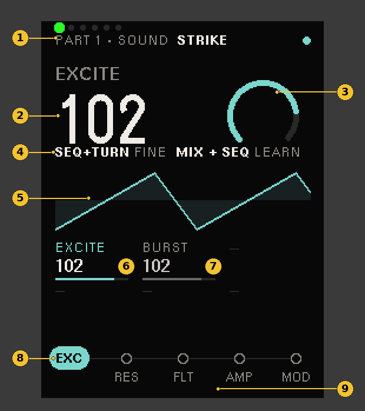
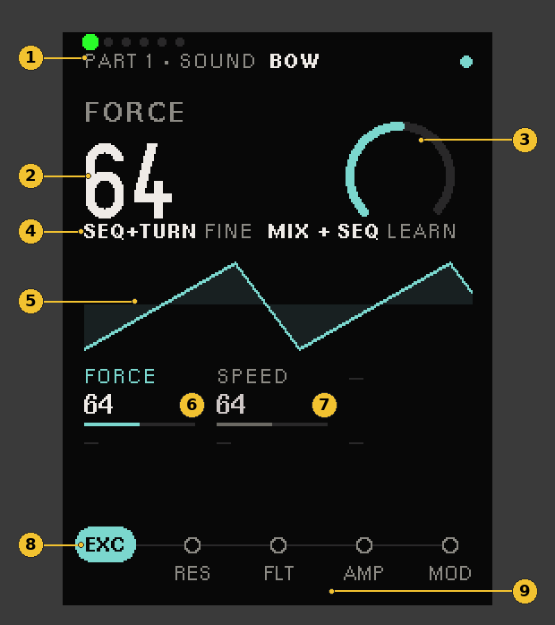
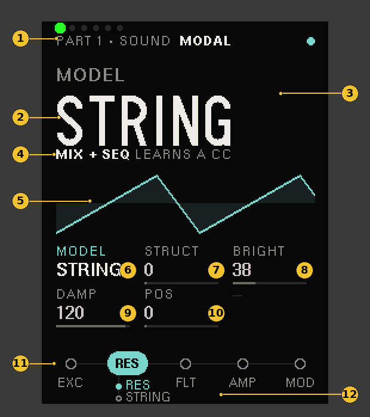
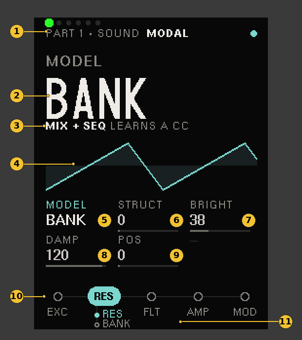
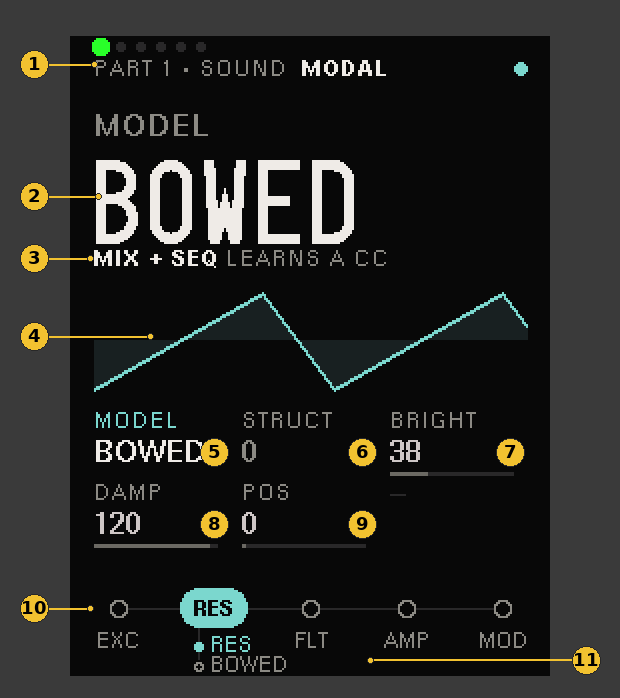
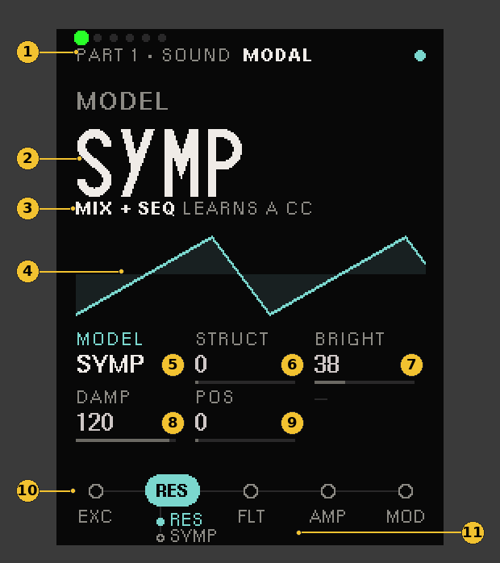
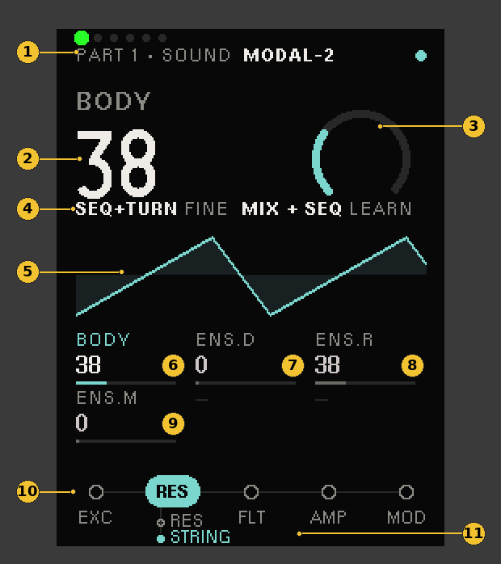
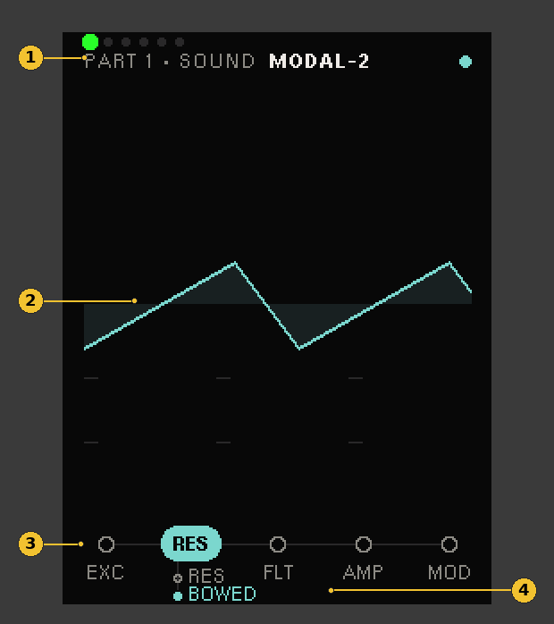
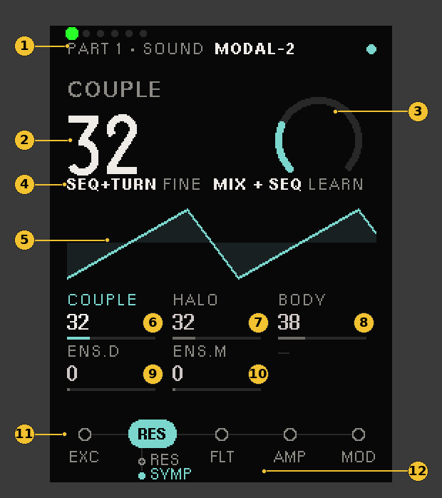

# MODAL, the physical-modelling engine

MODAL plays resonators: strings that are plucked, a bank of tuned modes that is struck, a string that is bowed, and a string that sets seven others ringing. This chapter covers MODAL's own pages: **EXC** (the exciter), **RES** (the resonator) and **MDL2** (the model's second page). The pages MODAL shares with the other engines (PIT, FLT, FMD, FX, JACK, AMP, STER, SND, the MOD matrix, the envelopes and the LFOs) are explained in [the voice chain](08-voice-chain.md), [envelopes and LFOs](09-envelopes-and-lfos.md) and [the mod matrix](10-mod-matrix.md); this chapter says only how they behave on MODAL. For how pages, cells and gestures work in general, see [the panel and navigation](02-panel-and-navigation.md).

## MODAL: what it is and how it plays

A MODAL Part's chain is **EXC · RES · FLT · AMP · MOD**, and a MODAL Part opens on EXC. A note has two halves, as a real instrument does:

- **The exciter** puts energy in: a pluck, a strike or a bow. Its cells are on EXC.
- **The resonator** rings: the string or the bank of modes. **MODEL** picks it, and its four main controls, **STRUCT**, **BRIGHT**, **DAMP** and **POS**, are on RES. Each model's extra controls are on MDL2.

**MODEL** has four choices:

| MODEL | Exciter (EXC's header) | What it is |
|---|---|---|
| STRING | PLUCK | A plucked string. STRUCT makes it stiffer, like piano wire. |
| BANK | STRIKE | A bank of 16 to 48 tuned resonant modes, struck: bars, bells, plates, glass. |
| BOWED | BOW | A bowed string: it sounds while the key is held, and rings when the bow lifts. |
| SYMP | PLUCK | A plucked main string with seven sympathetic strings (the halo) tuned to a chord. |

The FAQ's engine table describes MODAL as "struck, plucked and bowed resonators". The [quick start](https://joegiralt.github.io/chimera-releases/guides/quick-start) has the chain map for each engine.

> **Design note:** MODAL builds on the maths of Émilie Gillet's Mutable Instruments Rings and Elements, which are open source. The modal bank's band-pass filters, its strike-position weights, its stiffness curve and SYMP's chord table follow Rings, and keep its MIT notice. The plucked string itself is Chimera's own code: it began life in an alternative Ambika firmware by Chimera's author, long before it met a PreenFM3. Where Rings is a single Eurorack module with a fixed voice count, MODAL is one engine among several in a six-Part synth, so it had to learn to share: memory, CPU and, in SYMP's case, its sympathetic strings.

## MODAL: notes ring free

On MODAL a note-off stops the exciter and nothing else. A plucked or struck note goes on ringing through its own decay (DAMP) after you let go of the key; a bowed note stops being bowed and rings on. A key struck again while its last note still rings re-plucks the same string: the new pluck is added to the ring, as when you pluck a guitar string that is already sounding. A repeated note therefore costs one voice, not one per strike.

The voice is freed when its ring has fallen 60 dB under its peak. A long DAMP holds a voice for a long time: at INIT's DAMP a string rings about 14 seconds, and SYMP's halo twice that. Hold the sustain or play dense chords with a long DAMP and you will hear older notes stolen sooner; see [limits](20-limits.md).

To make notes stop at key up, either shorten **DAMP**, or route an envelope into the VCA in [the mod matrix](10-mod-matrix.md): a VCA route gates the voice, and its envelope's release then ends the note. With no VCA route, an amp gate after the filter makes sure a resonant filter dies away with the note's ring rather than ringing on by itself ([AMP](08-voice-chain.md)).

**Why:** Rings has no release: its resonator rings on its own damping, and only a new strike touches it. A note that stopped dead at key up sounded wrong for an instrument named after strings and bells. A release time knob would only duplicate what DAMP and an envelope on the VCA already do.

## MODAL: loudness across the models

Every MODEL's INIT plays at about the same loudness, the median of the factory Sounds, so switching MODEL does not jump in level. STRING is the exception by design: it is set by its peak, so that an eight-note chord played at full velocity stays clear of the output limiter. Its single notes sit a few dB under the others.

BANK's strike falls in level as the note rises, so a high note is as loud as a low one, not harsher.

**Why:** a pluck peaks about 11 dB over a sustained tone of the same loudness. Matching STRING's average loudness to the others made its chords hit the limiter and distort.

## MODAL: the EXC page (exciter)

**EXC** (EXC on the chain map) is the first page of a MODAL Part. Its header names the exciter, which follows MODEL: PLUCK on STRING and SYMP, STRIKE on BANK, BOW on BOWED. Its cells change with MODEL too.

All cells here read 0 to 127.

1. Header: the Part, its Sound and the exciter's name, PLUCK.
2. The focused cell, large: EXCITE and its value.
3. EXCITE's glyph, an arc.
4. Focus-band hint: SEQ + turn for fine steps, MIX + SEQ to learn a CC.
5. The picture band: the Part's live output.
6. **EXCITE:** how hard the string is plucked.
7. **COLOR:** the pluck's tone, soft to bright.
8. The chain map, EXC lit.
9. EXC's place on the map: it has no sub-pages.

### MODAL: PLUCK (STRING and SYMP)

| Cell | Range | Default | What it does |
|---|---|---|---|
| **EXCITE** | 0–127 | 102 | How hard the string is plucked. The note's velocity scales it. |
| **COLOR** | 0–127 | 102 | The pluck's tone. Low COLOR smooths the pluck's noise burst several times over, for a soft, round, thumb-like pluck; high COLOR leaves it bright, like a pick. |

SYMP's EXC page is the same as STRING's: EXCITE and COLOR, under the header PLUCK.

### MODAL: STRIKE (BANK)

| Cell | Range | Default | What it does |
|---|---|---|---|
| **EXCITE** | 0–127 | 102 | How hard the bank is struck. The note's velocity scales it. |
| **BURST** | 0–127 | 102 | How long the strike's noise burst lasts, from 2 ms at 0 to 6 ms at 127. Short is a hard mallet's click; long is a softer, duller hit. |

1. Header: the Part, its Sound and the exciter's name, STRIKE.
2. The focused cell, large: EXCITE and its value.
3. EXCITE's glyph, an arc.
4. Focus-band hint: the gestures the cell answers to.
5. The picture band: the Part's live output.
6. **EXCITE:** how hard the bank is struck.
7. **BURST:** how long the strike's noise burst lasts.
8. The chain map, EXC lit.
9. EXC's place on the map: it has no sub-pages.

### MODAL: BOW (BOWED)

| Cell | Range | Default | What it does |
|---|---|---|---|
| **FORCE** | 0–127 | 64 | How hard the bow presses. Harder grips the string more sharply and brightens the tone. Velocity adds to it: a soft key still bows, at half the force. |
| **SPEED** | 0–127 | 64 | How fast the bow moves. A slower bow also sharpens the tone. |

1. Header: the Part, its Sound and the exciter's name, BOW.
2. The focused cell, large: FORCE and its value.
3. FORCE's glyph, an arc.
4. Focus-band hint: the gestures the cell answers to.
5. The picture band: the Part's live output.
6. **FORCE:** how hard the bow presses. Moves a held note.
7. **SPEED:** how fast the bow moves. Moves a held note.
8. The chain map, EXC lit.
9. EXC's place on the map: it has no sub-pages.

FORCE and SPEED move a note you are holding, eased so nothing jumps. EXCITE, COLOR and BURST are read when a note starts: turning them changes the next note, not the one sounding.

FORCE and SPEED are not mod matrix destinations. To swell a bowed note, route an envelope into **BRIGHT** or the filter, as the factory Sound CELLO SWELL does.

**Why:** a pluck or a strike happens once, at the start of the note, so there is nothing to change afterwards. A bow keeps acting while the key is held, so its two controls are live.

A very hard or very slow bow drifts a little out of tune at the top of the keyboard, as a real one does. Inside the middle of FORCE and SPEED it stays within a few cents from G1 to C7.

> **Design note:** BOWED is a single delay loop with a friction curve where the bow touches it: the stick-slip of a real bow, in a few multiplies. A more elaborate two-line waveguide bow was built and tuned, and lost a listening test to this simpler one: the ear, not the maths, had the last word. To get the simple loop in tune it runs at half length and turns the wave upside down on every pass, the inverting reflection described in J. O. Smith's *Physical Audio Signal Processing*. No rosin required.

## MODAL: the RES page (resonator)

**RES** (RES on the chain map, MODAL on the page's header) is MODAL's home page: **MODEL** and the four macros. Its sub-pages, in the stack under RES, are the model's page (MDL2, named on the map after the model: STRING, BANK, BOWED or SYMP) and PIT, the pitch page.

| Cell | Range | Default | What it does |
|---|---|---|---|
| **MODEL** | STRING, BANK, BOWED, SYMP | STRING | The resonator. Turning it restarts the Part's held notes on the new model after a short fade. |
| **STRUCT** | 0–127 | 0 | The resonator's structure. Means something different on each MODEL (below). Dimmed on BOWED. |
| **BRIGHT** | 0–127 | 38 | Dark to bright, on every MODEL. |
| **DAMP** | 0–127 | 120 | How long the note rings. |
| **POS** | 0–127 | 0 | Where the string is plucked, struck or bowed. |

1. Header: the Part, its Sound and the page, MODAL.
2. The focused cell, large: MODEL, here STRING.
3. The glyph's place: empty for MODEL, a word choice, whose word takes the band.
4. Focus-band hint: MIX + SEQ learns a CC.
5. The picture band: the Part's live output.
6. **MODEL:** the resonator.
7. **STRUCT:** the structure (stiffness on STRING).
8. **BRIGHT:** dark to bright.
9. **DAMP:** how long the note rings.
10. **POS:** where the string is plucked.
11. The chain map, RES lit.
12. The sub-pages under RES: RES, the model page (here STRING) and PIT.

1. Header: the Part, its Sound and the page, MODAL.
2. The focused cell, large: MODEL, here BANK.
3. Focus-band hint: MIX + SEQ learns a CC.
4. The picture band: the Part's live output.
5. **MODEL:** BANK.
6. **STRUCT:** the spacing of the modes.
7. **BRIGHT:** how long the upper modes ring against the lower.
8. **DAMP:** how long the bank rings.
9. **POS:** where the bank is struck, weighting the modes.
10. The chain map, RES lit.
11. The sub-pages under RES: RES, BANK (the model page) and PIT.

1. Header: the Part, its Sound and the page, MODAL.
2. The focused cell, large: MODEL, here BOWED.
3. Focus-band hint: MIX + SEQ learns a CC.
4. The picture band: the Part's live output.
5. **MODEL:** BOWED.
6. **STRUCT:** dimmed: BOWED doesn't use it.
7. **BRIGHT:** the bridge's tone, after the string.
8. **DAMP:** the ring after the bow lifts.
9. **POS:** where the bow sits, from near the bridge to the middle.
10. The chain map, RES lit.
11. The sub-pages under RES: RES, BOWED (the model page) and PIT.

1. Header: the Part, its Sound and the page, MODAL.
2. The focused cell, large: MODEL, here SYMP.
3. Focus-band hint: MIX + SEQ learns a CC.
4. The picture band: the Part's live output.
5. **MODEL:** SYMP.
6. **STRUCT:** the halo's chord.
7. **BRIGHT:** dark to bright, main string and halo.
8. **DAMP:** how long the main string rings; the halo rings twice as long.
9. **POS:** where the main string is plucked.
10. The chain map, RES lit.
11. The sub-pages under RES: RES, SYMP (the model page) and PIT.

The four macros, STRUCT, BRIGHT, DAMP and POS, are live: they move a sounding note, glide smoothly as you turn them, and are destinations in the MOD matrix. Touch one and press **MIX + PLUS** to prime it as a destination ([the mod matrix](10-mod-matrix.md)). A control the current MODEL doesn't use is dimmed, with its matrix column.

**Why:** these four are the controls Rings puts on its panel, and the ones every model shares. Keeping them identical across models means a Sound's modulation still makes sense when you change MODEL.

### MODAL: STRUCT on each model

- **STRING:** the string's stiffness. At 0 the partials are harmonic. Turned up, the upper partials go progressively sharp, as on piano wire, more so up the keyboard. The fundamental stays in tune.
- **BANK:** the spacing of the modes. Low settings squeeze the modes together (tube-like), around a quarter of the way they are harmonic, and higher they stretch apart into bell, bar and metal sounds.
- **SYMP:** the halo's chord. STRUCT steps through eleven chords for the seven sympathetic strings, Rings' chord table: from bare octaves at 0, through minor chords (with a seventh, an octave, a ninth, an eleventh), open fifths, and major chords (with an eleventh, a ninth, an octave, a major seventh), to a suspended fourth at 127. A change of chord glides each string to its new pitch, the way a portamento does, taking about a fifth of a second.
- **BOWED:** not used; the cell is dimmed.

### MODAL: BRIGHT, DAMP and POS on each model

- **BRIGHT** runs dark to bright everywhere. On STRING and SYMP it sets how much the string loses its upper harmonics as it rings; on BANK how long the upper modes ring against the lower; on BOWED it is the tone of the bridge, after the string.
- **DAMP** is a ring time. On the strings it runs from 50 ms at 0 to 20 seconds at 127, the same at every pitch, so a high note rings as long as a low one. On BOWED it is the ring after the bow lifts. INIT's 120 is about 14 seconds. On SYMP the halo rings twice as long as the main string.
- **POS** is the pluck's, strike's or bow's place along the string, from the end at 0 to the middle at 127. Away from the end the place cancels some harmonics: at the middle the even ones (the 2nd, 6th, 10th...) fall away, for a hollower tone. On BANK it weights the modes the same way. On BOWED it moves the bow from near the bridge towards the middle.

## MODAL: the MDL2 page (the model's own controls)

**MDL2** sits under RES. On the chain map it is named after the model (STRING, BANK, BOWED or SYMP); its header reads MODAL-2. Its cells follow MODEL. They are read when a note starts: a turn is heard on the next note. They are not matrix destinations.

### MODAL: STRING's model page

| Cell | Range | Default | What it does |
|---|---|---|---|
| **BODY** | 0–127 | 38 | A wooden body's colour: three fixed resonances, low in the range (around 100, 240 and 520 Hz), mixed into the output. It colours without changing the pitch. |
| **ENS.D** | 0–127 | 0 | Ensemble depth: how far the ensemble detunes, up to about 15 cents at 127. |
| **ENS.R** | 0–127 | 38 | Ensemble rate: how fast it moves, from 0.1 Hz to 6 Hz. |
| **ENS.M** | 0–127 | 0 | Ensemble mix. At 0 the ensemble is off. |

1. Header: the Part, its Sound and the page, MODAL-2.
2. The focused cell, large: BODY and its value.
3. BODY's glyph, an arc.
4. Focus-band hint: SEQ + turn for fine steps, MIX + SEQ to learn a CC.
5. The picture band: the Part's live output.
6. **BODY:** the wooden body's colour.
7. **ENS.D:** ensemble depth.
8. **ENS.R:** ensemble rate.
9. **ENS.M:** ensemble mix; 0 is off.
10. The chain map, RES lit.
11. The sub-pages under RES, on STRING (the model page).

The ensemble reads the string twice more, a little ahead and behind, swaying in and out of tune: a doubled, chorused string, made from the string itself rather than an effect after it.

### MODAL: BANK's model page

| Cell | Range | Default | What it does |
|---|---|---|---|
| **MODES** | 16, 24, 32, 48 | 32 | How many modes the bank rings. More modes give a richer, denser strike, and cost more of the voice budget. |

1. Header: the Part, its Sound and the page, MODAL-2.
2. The focused cell, large: MODES and its value.
3. The glyph's place: MODES is a word choice, so the word takes the band.
4. Focus-band hint: the gestures the cell answers to.
5. The picture band: the Part's live output.
6. **MODES:** 16, 24, 32 or 48 modes.
7. The chain map, RES lit.
8. The sub-pages under RES, on BANK (the model page).

MODES is fixed for a note when it starts. A sounding note keeps its modes, and is counted at their cost, until it ends. Modes that would land above what the sample rate can play are dropped, so a high note uses fewer.

**Why:** each mode is a filter running every sample. 48 modes on a high note cost much more than 16, so the count is yours to trade against polyphony; see [limits](20-limits.md).

### MODAL: BOWED's model page

BOWED has no model controls: its page is empty. Everything the bow does is on EXC and RES.

1. Header: the Part, its Sound and the page, MODAL-2.
2. The picture band: the Part's live output. There are no cells.
3. The chain map, RES lit.
4. The sub-pages under RES, on BOWED (the model page).

### MODAL: SYMP's model page

| Cell | Range | Default | What it does |
|---|---|---|---|
| **COUPLE** | 0–127 | 32 | How strongly the main string drives the halo. More COUPLE wakes the sympathetic strings faster and louder. |
| **HALO** | 0–127 | 32 | How loud the halo is in the output. |
| **BODY** | 0–127 | 38 | As on STRING: the body's colour, on the main string and halo together. |
| **ENS.D** | 0–127 | 0 | Ensemble depth, as on STRING. |
| **ENS.M** | 0–127 | 0 | Ensemble mix, as on STRING. SYMP's ensemble runs at a fixed rate. |

1. Header: the Part, its Sound and the page, MODAL-2.
2. The focused cell, large: COUPLE and its value.
3. COUPLE's glyph, an arc.
4. Focus-band hint: SEQ + turn for fine steps, MIX + SEQ to learn a CC.
5. The picture band: the Part's live output.
6. **COUPLE:** how strongly the main string drives the halo.
7. **HALO:** the halo's level.
8. **BODY:** the body's colour.
9. **ENS.D:** ensemble depth.
10. **ENS.M:** ensemble mix.
11. The chain map, RES lit.
12. The sub-pages under RES, on SYMP (the model page).

The halo's chord is STRUCT's, on RES.

**A limit to know:** the sympathetic strings come from a shared set of four halos. Up to four SYMP notes at once get their own halo; a note that starts when all four are in use plays its main string alone, and keeps playing that way. Nothing is stolen to make room: a ringing halo is never cut short for a new note.

**Why:** each halo is seven strings, so it is large. Giving every voice its own would have taken the memory the other engines need. Sharing four, as Rings shares its strings, keeps SYMP polyphonic where it matters, and refusing to steal keeps ringing notes intact.

## MODAL: the pages it shares

These pages work as on every engine and are documented elsewhere. What is MODAL's own:

- **PIT** ([pitch](08-voice-chain.md)) sits under RES, after the model page. The strings are tuned to a fraction of a sample, so STRING and SYMP stay within a fraction of a cent from G1 to C7, at any STRUCT. The lowest note the strings play is about G1: keys below it play at that pitch.
- **FLT, FMD, FX, JACK** ([filter](08-voice-chain.md)): any filter TYPE follows the resonator. A long DAMP and a resonant filter make long, singing tails.
- **AMP** ([AMP](08-voice-chain.md)): with no route into the VCA, MODAL's note lasts as long as its ring (see "MODAL: notes ring free" above).
- **STER** and **SND** ([stereo and sends](08-voice-chain.md)): as on every engine. MODAL's pages have no reverb cell of their own: the reverb send is on SND.
- **The MOD matrix, E1–E3, SPD, L1–L3** ([the mod matrix](10-mod-matrix.md), [envelopes and LFOs](09-envelopes-and-lfos.md)): STRUCT, BRIGHT, DAMP and POS are MODAL's destinations. The exciter and model-page cells are not.

RANDOMIZE ([SETTINGS](13-settings.md)) rolls MODAL's STRUCT and POS (and from RICH the MODEL), its DAMP as the envelope family, its BRIGHT, BODY, COLOR and BURST as tone, and the ensemble as movement.

## MODAL: gestures on its pages

On any MODAL cell:

- **SEQ + turn**: fine steps.
- **MIX + turn**: jump to the next landmark: 0, 100, 127.
- **MIX + SEQ**: learn a MIDI CC for the cell ([MIDI](14-midi.md)). The focus band says so.
- **MIX + PLUS** (on STRUCT, BRIGHT, DAMP or POS): prime it as a MOD matrix destination.

## MODAL: starting points

These come from the factory MODAL Sounds and INIT; values are on the 0–127 knob scale.

- **A nylon-string pluck (STRING):** COLOR 76, BRIGHT 38, DAMP 89, POS 38, BODY 64, ENS.D 38, ENS.M 38. Route NOTE into POS so the pluck position follows the keyboard, and VEL into BRIGHT so harder notes are brighter. This is the factory NYLON.
- **A gamelan or bell (BANK):** STRUCT 76, BRIGHT 13, DAMP 114, EXCITE 44, BURST 13, the filter's cutoff down to about 5 kHz to tame the strike's click, VEL into BRIGHT. A slow LFO on DAMP and BRIGHT keeps it alive. This is GAMELAN.
- **A swelling cello (BOWED):** FORCE 76, SPEED 64, BRIGHT 76, DAMP 76. An ENV 2 with a slow attack into BRIGHT and the cutoff swells the tone; a 5 Hz LFO on FINE is the vibrato. This is CELLO SWELL.
- **A drone with sympathetic strings (SYMP):** STRUCT 51 (the chord), COUPLE 89, HALO 89, DAMP 89, COLOR 38, EXCITE 51, BRIGHT 64, some reverb send, slow LFOs on POS, BRIGHT and the cutoff. This is SITAR DRONE.
- **Shorter, percussive notes on any model:** bring DAMP down to around 60–80, or route ENV 1 into the VCA so key up ends the note.
- **Hollower tone:** turn POS towards 127.
