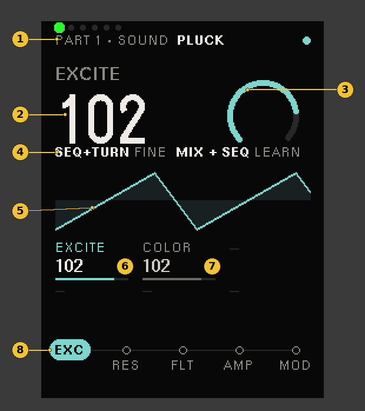
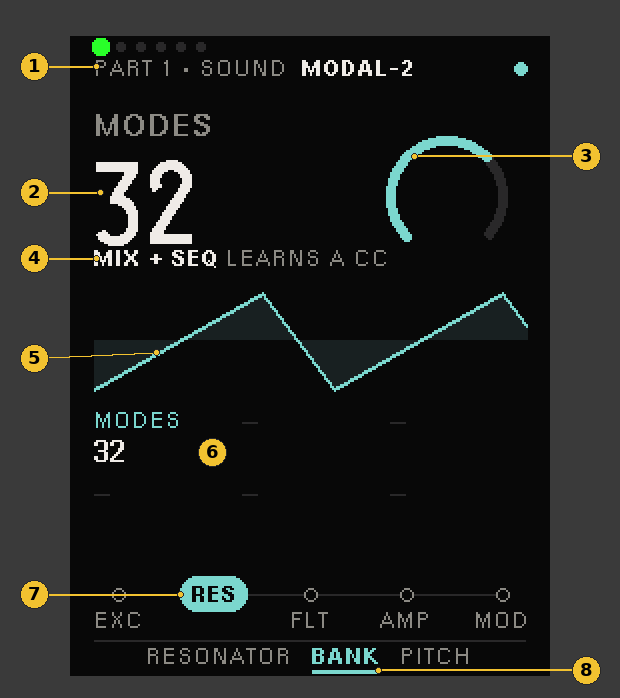

# MODAL, the physical-modelling engine

MODAL plays resonators: a plucked string, a struck bank of tuned modes, a bowed string, and a string that sets seven others ringing. This chapter covers MODAL's own pages: **EXC** (the exciter), **RES** (the resonator) and **MDL2** (the model's second page). The shared pages (PIT, FLT, FMD, FX, JACK, AMP, STER, SND, the matrix, envelopes and LFOs) are in [the voice chain](08-voice-chain.md), [envelopes and LFOs](09-envelopes-and-lfos.md) and [the mod matrix](10-mod-matrix.md).

## MODAL: what it is and how it plays

A MODAL Part's chain is **EXC · RES · FLT · AMP · MOD**, and it opens on EXC. A note has two halves:

- **The exciter** puts energy in: a pluck, a strike or a bow (EXC).
- **The resonator** rings. **MODEL** picks it; its four macros **STRUCT**, **BRIGHT**, **DAMP** and **POS** are on RES, its extra controls on MDL2.

| MODEL | Exciter | What it is |
|---|---|---|
| STRING | PLUCK | A plucked string. STRUCT stiffens it, like piano wire. |
| BANK | STRIKE | 16 to 48 tuned modes, struck: bars, bells, plates, glass. |
| BOWED | BOW | A bowed string: sounds while the key is held, rings when the bow lifts. |
| SYMP | PLUCK | A plucked string with seven sympathetic strings (the halo) tuned to a chord. |

> **Design note:** MODAL builds on the maths of Émilie Gillet's Mutable Instruments Rings and Elements, which are open source. The modal bank's band-pass filters, its strike-position weights, its stiffness curve and SYMP's chord table use code adapted from Émilie Gillet's Mutable Instruments Rings (MIT licence). The plucked string itself is Chimera's own code: it began life in an alternative Ambika firmware by Chimera's author, long before it met a PreenFM3. Where Rings is one module with a fixed voice count, MODAL is one engine among several in a six-Part synth, so it had to learn to share: memory, CPU and, in SYMP's case, its sympathetic strings.

## MODAL: notes ring free

A note-off stops the exciter and nothing else. A plucked or struck note rings on through DAMP after key up; a bowed note stops being bowed and rings on. Striking a key whose note still rings re-plucks the same string, adding to the ring, so a repeated note costs one voice.

The voice is freed when its ring has fallen 60 dB. At INIT's DAMP a string rings about 14 seconds, SYMP's halo twice that, so long DAMP with sustain or dense chords means older notes are stolen sooner ([limits](20-limits.md)).

To stop notes at key up, shorten **DAMP**, or route an envelope into the VCA ([the mod matrix](10-mod-matrix.md)): its release then ends the note. With no VCA route, an amp gate after the filter makes a resonant filter die with the ring ([AMP](08-voice-chain.md)).

**Why:** Rings has no release; its resonator rings on its own damping. A note that stopped dead at key up sounded wrong for strings and bells, and a release knob would duplicate DAMP and a VCA envelope.

## MODAL: loudness across the models

Every MODEL's INIT plays at about the same loudness, so switching MODEL does not jump in level. STRING is set by its peak instead, so an eight-note chord at full velocity stays clear of the output limiter; its single notes sit a few dB under the others. BANK's strike falls in level as the note rises, so a high note is not harsher than a low one.

**Why:** a pluck peaks about 11 dB over a sustained tone of the same loudness; matched by average, STRING's chords hit the limiter.

## MODAL: the EXC page (exciter)

**EXC** is the first page of a MODAL Part. Its header names the exciter (PLUCK, STRIKE or BOW) and its cells follow MODEL. All read 0 to 127. EXC has no sub-pages, so no sub-page row.

EXCITE, COLOR and BURST are read when a note starts: a turn changes the next note. FORCE and SPEED move a held note, eased so nothing jumps. None of them is a matrix destination; to swell a bowed note, route an envelope into **BRIGHT** or the filter, as the factory Sound CELLO SWELL does.

**Why:** a pluck or strike happens once; a bow keeps acting while the key is held, so only its controls are live.

### MODAL: PLUCK (STRING and SYMP)

1. **Header:** PART 1 · SOUND, exciter PLUCK.
2. **Focus band:** EXCITE, 102.
3. **Glyph:** its arc.
4. **Hint:** `SEQ+TURN FINE  MIX + SEQ LEARN`.
5. **Picture band:** live output (a test wave here).
6. **EXCITE.**
7. **COLOR.**
8. **Chain map:** EXC lit.

| Cell | Range | Default | What it does |
|---|---|---|---|
| **EXCITE** | 0–127 | 102 | How hard the string is plucked, scaled by velocity. |
| **COLOR** | 0–127 | 102 | Low: a soft, round, thumb-like pluck. High: bright, like a pick. |

### MODAL: STRIKE (BANK)

1. **Header:** exciter STRIKE.
2. **Focus band:** EXCITE, 102.
3. **Glyph:** its arc.
4. **Hint:** `SEQ+TURN FINE  MIX + SEQ LEARN`.
5. **Picture band:** live output (a test wave here).
6. **EXCITE.**
7. **BURST.**
8. **Chain map:** EXC lit.

| Cell | Range | Default | What it does |
|---|---|---|---|
| **EXCITE** | 0–127 | 102 | How hard the bank is struck, scaled by velocity. |
| **BURST** | 0–127 | 102 | The strike's noise burst, 2 ms to 6 ms: a hard mallet's click to a softer, duller hit. |

### MODAL: BOW (BOWED)

1. **Header:** exciter BOW.
2. **Focus band:** FORCE, 64.
3. **Glyph:** its arc.
4. **Hint:** `SEQ+TURN FINE  MIX + SEQ LEARN`.
5. **Picture band:** live output (a test wave here).
6. **FORCE**, live on a held note.
7. **SPEED**, live on a held note.
8. **Chain map:** EXC lit.

| Cell | Range | Default | What it does |
|---|---|---|---|
| **FORCE** | 0–127 | 64 | Bow pressure. Harder grips more sharply and brightens. Velocity adds to it; a soft key bows at half force. |
| **SPEED** | 0–127 | 64 | Bow speed. Slower also sharpens the tone. |

A very hard or very slow bow drifts a little sharp at the top of the keyboard, as a real one does; mid-range it stays within a few cents from G1 to C7.

> **Design note:** BOWED is a single delay loop with a friction curve where the bow touches it: the stick-slip of a real bow, in a few multiplies. A more elaborate two-line waveguide bow was built and tuned, and lost a listening test to this simpler one: the ear, not the maths, had the last word. To get the simple loop in tune it runs at half length and turns the wave upside down on every pass, the inverting reflection described in J. O. Smith's *Physical Audio Signal Processing*. No rosin required.

## MODAL: the RES page (resonator)

**RES** (MODAL on the header) is MODAL's home: **MODEL** and the four macros. Under it sit the model page (MDL2, named after the model on the sub-page row) and PIT.

| Cell | Range | Default | What it does |
|---|---|---|---|
| **MODEL** | STRING, BANK, BOWED, SYMP | STRING | The resonator. Held notes restart on the new model after a short fade. |
| **STRUCT** | 0–127 | 0 | The structure; per model, below. Dimmed on BOWED. |
| **BRIGHT** | 0–127 | 38 | Dark to bright. |
| **DAMP** | 0–127 | 120 | How long the note rings. |
| **POS** | 0–127 | 0 | Where the string is plucked, struck or bowed. |

The macros are live: they move a sounding note, glide as you turn, and are matrix destinations (touch one, **MIX + PLUS** primes it, see [the mod matrix](10-mod-matrix.md)). A macro the MODEL doesn't use is dimmed, with its matrix column.

**Why:** these are the four controls Rings puts on its panel and every model shares, so a Sound's modulation still makes sense after a MODEL change.

1. **Header:** page MODAL.
2. **Focus band:** MODEL, STRING.
3. **Hint:** `MIX + SEQ LEARNS A CC`.
4. **Picture band:** live output (a test wave here).
5. **MODEL.**
6. **STRUCT:** stiffness.
7. **BRIGHT.**
8. **DAMP.**
9. **POS.**
10. **Chain map:** RES lit.
11. **Sub-page row:** RESONATOR underlined, then STRING and PITCH.

1. **Header:** page MODAL.
2. **Focus band:** MODEL, BANK.
3. **Hint:** `MIX + SEQ LEARNS A CC`.
4. **Picture band:** live output (a test wave here).
5. **MODEL.**
6. **STRUCT:** mode spacing.
7. **BRIGHT:** upper modes' ring.
8. **DAMP.**
9. **POS:** strike place.
10. **Chain map:** RES lit.
11. **Sub-page row:** RESONATOR underlined, then BANK and PITCH.

1. **Header:** page MODAL.
2. **Focus band:** MODEL, BOWED.
3. **Hint:** `MIX + SEQ LEARNS A CC`.
4. **Picture band:** live output (a test wave here).
5. **MODEL.**
6. **STRUCT:** dimmed.
7. **BRIGHT:** the bridge's tone.
8. **DAMP:** ring after the bow lifts.
9. **POS:** bow place.
10. **Chain map:** RES lit.
11. **Sub-page row:** RESONATOR underlined, then BOWED and PITCH.

1. **Header:** page MODAL.
2. **Focus band:** MODEL, SYMP.
3. **Hint:** `MIX + SEQ LEARNS A CC`.
4. **Picture band:** live output (a test wave here).
5. **MODEL.**
6. **STRUCT:** the halo's chord.
7. **BRIGHT:** string and halo.
8. **DAMP:** the halo rings twice as long.
9. **POS.**
10. **Chain map:** RES lit.
11. **Sub-page row:** RESONATOR underlined, then SYMP and PITCH.

### MODAL: the macros on each model

| Macro | STRING | BANK | BOWED | SYMP |
|---|---|---|---|---|
| **STRUCT** | Stiffness: 0 is harmonic; higher, upper partials go sharp as on piano wire, more so up the keyboard. The fundamental stays in tune. | Mode spacing: squeezed (tube-like) low, harmonic about a quarter up, stretched into bell, bar and metal higher. | Not used. | The halo's chord (below). |
| **BRIGHT** | How fast the upper harmonics fade. | How long upper modes ring against lower. | The bridge's tone, after the string. | As STRING, string and halo. |
| **DAMP** | Ring time, 50 ms to 20 s, the same at every pitch (120 is about 14 s). | Ring time. | Ring after the bow lifts. | As STRING; the halo rings twice as long. |
| **POS** | Pluck place, end (0) to middle (127). Towards the middle even harmonics fall away: hollower. | Weights the modes the same way. | Bow from near the bridge to the middle. | As STRING. |

SYMP's STRUCT steps through Rings' eleven chords for the seven sympathetic strings: bare octaves at 0, minor chords (with seventh, octave, ninth, eleventh), open fifths, major chords (with eleventh, ninth, octave, major seventh), and a suspended fourth at 127. A chord change glides each string to its new pitch in about a fifth of a second.

## MODAL: the MDL2 page (the model's own controls)

**MDL2** sits under RES, named after the model on the sub-page row (STRING, BANK, BOWED or SYMP), MODAL-2 on the header. Its cells follow MODEL, are read when a note starts, and are not matrix destinations.

### MODAL: STRING's model page

1. **Header:** page MODAL-2.
2. **Focus band:** BODY, 38.
3. **Glyph:** its arc.
4. **Hint:** `SEQ+TURN FINE  MIX + SEQ LEARN`.
5. **Picture band:** live output (a test wave here).
6. **BODY.**
7. **ENS.D.**
8. **ENS.R.**
9. **ENS.M.**
10. **Chain map:** RES lit.
11. **Sub-page row:** STRING underlined, between RESONATOR and PITCH.

| Cell | Range | Default | What it does |
|---|---|---|---|
| **BODY** | 0–127 | 38 | A wooden body: three fixed resonances near 100, 240 and 520 Hz, mixed in. Colours without changing pitch. |
| **ENS.D** | 0–127 | 0 | Ensemble depth, up to about 15 cents of detune. |
| **ENS.R** | 0–127 | 38 | Ensemble rate, 0.1 Hz to 6 Hz. |
| **ENS.M** | 0–127 | 0 | Ensemble mix; 0 is off. |

The ensemble reads the string twice more, a little ahead and behind, swaying in and out of tune: a chorused string made from the string itself.

### MODAL: BANK's model page

1. **Header:** page MODAL-2.
2. **Focus band:** MODES, 32.
3. **Glyph:** its arc.
4. **Hint:** `MIX + SEQ LEARNS A CC`.
5. **Picture band:** live output (a test wave here).
6. **MODES.**
7. **Chain map:** RES lit.
8. **Sub-page row:** BANK underlined.

| Cell | Range | Default | What it does |
|---|---|---|---|
| **MODES** | 16, 24, 32, 48 | 32 | How many modes ring. More is richer and costs more voice budget. |

A note keeps its mode count, and its cost, until it ends. Modes above what the sample rate can play are dropped, so high notes use fewer.

**Why:** each mode is a filter running every sample; 48 on a high note cost far more than 16, so the count is yours to trade against polyphony ([limits](20-limits.md)).

### MODAL: BOWED's model page

1. **Header:** page MODAL-2.
2. **Picture band:** no cells, only the output (a test wave here).
3. **Chain map:** RES lit.
4. **Sub-page row:** BOWED underlined.

BOWED has no model controls: everything is on EXC and RES.

### MODAL: SYMP's model page

1. **Header:** page MODAL-2.
2. **Focus band:** COUPLE, 32.
3. **Glyph:** its arc.
4. **Hint:** `SEQ+TURN FINE  MIX + SEQ LEARN`.
5. **Picture band:** live output (a test wave here).
6. **COUPLE.**
7. **HALO.**
8. **BODY.**
9. **ENS.D.**
10. **ENS.M.**
11. **Chain map:** RES lit.
12. **Sub-page row:** SYMP underlined.

| Cell | Range | Default | What it does |
|---|---|---|---|
| **COUPLE** | 0–127 | 32 | How strongly the main string drives the halo: faster, louder sympathy. |
| **HALO** | 0–127 | 32 | The halo's level. |
| **BODY** | 0–127 | 38 | As STRING, on string and halo. |
| **ENS.D** | 0–127 | 0 | As STRING. |
| **ENS.M** | 0–127 | 0 | As STRING; the rate is fixed. |

**A limit:** the sympathetic strings come from four shared halos. Up to four SYMP notes get one each; a note that starts when all four are busy plays its main string alone. A ringing halo is never stolen.

**Why:** each halo is seven strings; one per voice would take memory the other engines need. Sharing four, as Rings shares its strings, keeps SYMP polyphonic where it matters.

## MODAL: the pages it shares

The shared pages work as on every engine. What is MODAL's own:

- **PIT** sits under RES. The strings are tuned to a fraction of a sample: within a fraction of a cent from G1 to C7 at any STRUCT. Keys below about G1 play at G1.
- **AMP:** with no VCA route, a note lasts as long as its ring (see above).
- **SND** holds the reverb send; MODAL's pages have none of their own.
- **The matrix:** STRUCT, BRIGHT, DAMP and POS are MODAL's destinations; exciter and model-page cells are not.

RANDOMIZE ([SETTINGS](13-settings.md)) rolls STRUCT and POS (and from RICH the MODEL), DAMP as the envelope family, BRIGHT, BODY, COLOR and BURST as tone, and the ensemble as movement.

## MODAL: starting points

From the factory Sounds; values on the 0–127 scale.

- **Nylon string (STRING, NYLON):** COLOR 76, BRIGHT 38, DAMP 89, POS 38, BODY 64, ENS.D 38, ENS.M 38; NOTE into POS, VEL into BRIGHT.
- **Gamelan or bell (BANK, GAMELAN):** STRUCT 76, BRIGHT 13, DAMP 114, EXCITE 44, BURST 13, cutoff about 5 kHz to tame the click, VEL into BRIGHT, a slow LFO on DAMP and BRIGHT.
- **Swelling cello (BOWED, CELLO SWELL):** FORCE 76, SPEED 64, BRIGHT 76, DAMP 76; a slow-attack ENV 2 into BRIGHT and cutoff; a 5 Hz LFO on FINE for vibrato.
- **Sympathetic drone (SYMP, SITAR DRONE):** STRUCT 51, COUPLE 89, HALO 89, DAMP 89, COLOR 38, EXCITE 51, BRIGHT 64, some reverb, slow LFOs on POS, BRIGHT and cutoff.
- **Shorter notes:** DAMP around 60–80, or ENV 1 into the VCA.
- **Hollower tone:** POS towards 127.
