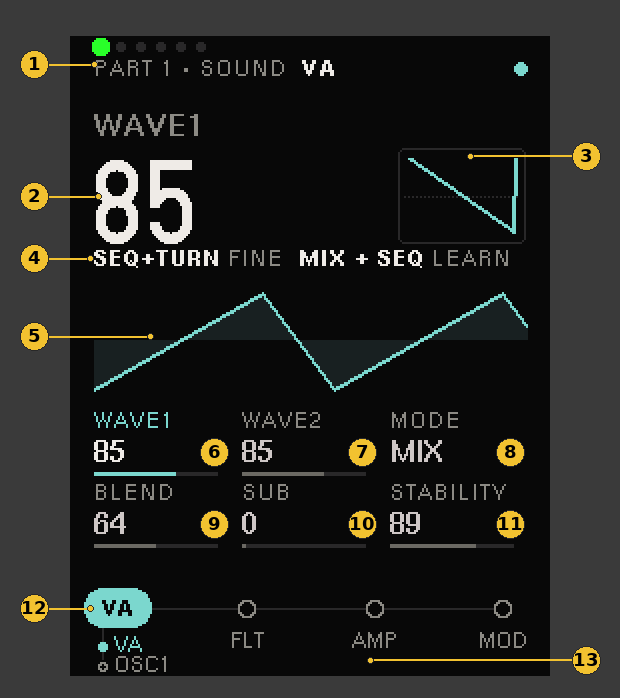
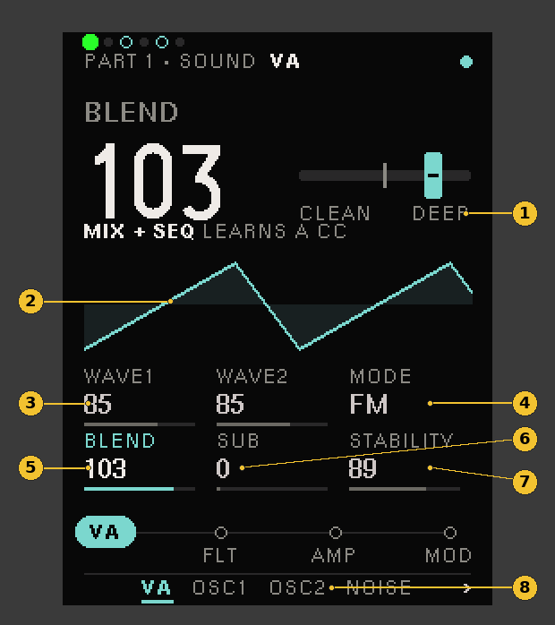
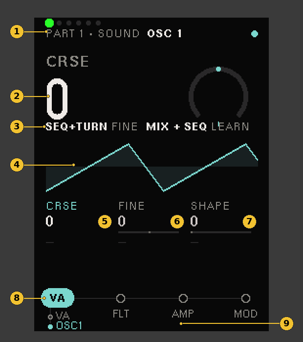
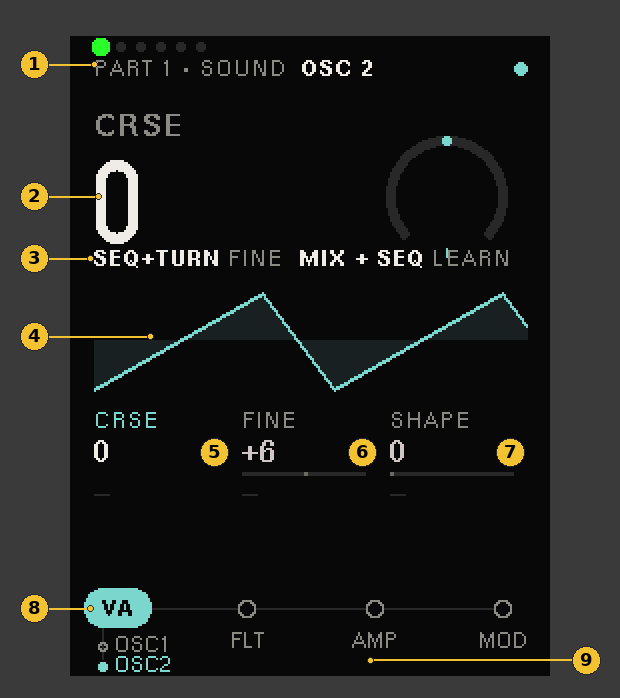
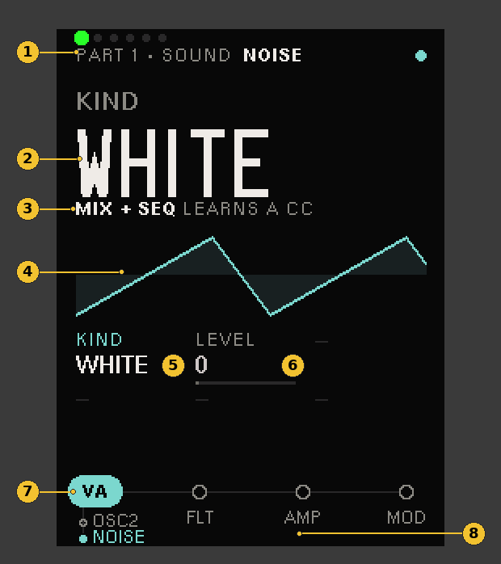

# VA, the variable-wave engine

VA is Chimera's analogue-style oscillator engine: two variable-wave oscillators combined by a MODE, a sub-oscillator, a noise source and STABILITY, which lets each voice drift like a real oscillator. This chapter covers the VA page and its OSC1, OSC2 and NOISE sub-pages, every MODE, what STABILITY models, the voice cost and some starting points. The filter, the FX slot, the amp and the modulation are the pages every engine shares: see [the voice chain](08-voice-chain.md), [envelopes and LFOs](09-envelopes-and-lfos.md) and [the mod matrix](10-mod-matrix.md). This chapter says only what is VA-specific about them.

## VA: what the engine is

A VA voice is:

1. **OSC 1** and **OSC 2**, each a band-limited oscillator whose **WAVE** morphs smoothly from sine through triangle and saw to square, and whose **SHAPE** varies whichever wave is sounding.
2. **MODE**, how the two combine: mixed, hard or soft synced, ring or amplitude modulated, frequency or phase modulated, looped back on themselves, or combined bit by bit. **BLEND** sets how far the MODE goes.
3. **SUB**, a square wave an octave under OSC 1.
4. **NOISE**, the voice's own noise source.
5. **STABILITY**, how far the oscillators drift, voice by voice.

The result then goes through the filter (the 2040 by default), the FX slot and the amp, as on every engine.

**Why:** most digital oscillators sound sterile. The ones that don't build movement into the oscillator itself: a few controls that come alive under modulation, and an instability that lets the sound breathe. VA is built on that idea. Every wave, at every SHAPE, plays at the same level, so turning WAVE, SHAPE or MODE never makes the sound jump in loudness, and every continuous control can be modulated without clicks.

> **Design note:** VA's layout is an open nod to the Mutable Instruments Ambika's: two variable-waveform oscillators, a digital operator between them and a sub locked to the first. Only the architecture came over, taken from the Ambika's manual; the oscillators, operators, tables and names are Chimera's own, written clean-room. The intent was an engine that feels analogue on the way in and can go either way on the way out: East Coast (saws and pulses, SUB, into the 2040 or the LADDER with an envelope on the cutoff) or West Coast (sines and triangles bent by FM, PHASE and LOOPFM, folded in the FX slot and closed by AMP's low-pass gate). The waves are kept clean with polyBLEP and polyBLAMP corrections, the techniques of Välimäki and Huovilainen and of Esqueda, Välimäki and Bilbao. No oscillators were harmed, but several were made deliberately unstable.

## VA: the chain and its pages

A VA Part's chain map reads **VA · FLT · AMP · MOD**. VA is the home: entering the chain lands there.

| Node | Its pages, short name (full word on the sub-page row and header) |
|---|---|
| VA | **VA**, **OSC1** (OSC 1 in the header), **OSC2** (OSC 2), **NOISE**, **PIT** (PITCH) |
| FLT | FILTER, MODULATION, FX, JACKS: see [the voice chain](08-voice-chain.md) |
| AMP | AMP, STEREO, SENDS: see [the voice chain](08-voice-chain.md) |
| MOD | MATRIX, ENV1–ENV3, SPEED, LFO1–LFO3: see [envelopes and LFOs](09-envelopes-and-lfos.md) and [the mod matrix](10-mod-matrix.md) |

From the VA page, **SEQ** goes on to OSC1, OSC2, NOISE and PITCH (wrapping round from the last), and **EDIT** goes back one. With SETTINGS › PERSONALIZE › CHAIN MAP › PAGES set to STACK, EDIT goes down and SEQ goes up instead (see [the panel and navigation](02-panel-and-navigation.md)).

The 0–127 values below are the knob scale the screen shows for VA's continuous controls.

## VA: the VA page

1. **Header:** the Part (PART 1 · SOUND) and the page, VA.
2. **Focus band:** the touched cell, large: WAVE1, 85 (saw).
3. **Glyph:** a scope of OSC 1's wave at the touched WAVE.
4. **Hint:** `SEQ+TURN FINE` and `MIX + SEQ LEARN`.
5. **Picture:** the live output's waveform.
6. **WAVE1:** OSC 1's wave, sine to square.
7. **WAVE2:** OSC 2's wave.
8. **MODE:** how the oscillators combine.
9. **BLEND:** how far MODE goes.
10. **SUB:** the sub-oscillator's level.
11. **STABILITY:** how far the oscillators drift.
12. **Chain map:** the VA node lit.
13. **Sub-pages:** the node's sub-pages, the current one lit.

With BLEND touched, its glyph names the MODE's two ends:

1. **BLEND's glyph:** a crossfader, with what each end gives under it. The words change with MODE (here FM: CLEAN to DEEP).
2. The live output.
3. **WAVE1, WAVE2:** each oscillator's wave, morphing through sine, triangle, saw and pulse.
4. **MODE:** how OSC 1 and OSC 2 combine. Touch MODE and the glyph draws the result.
5. **BLEND:** how far MODE goes.
6. **SUB:** a sub-oscillator an octave under OSC 1.
7. **STABILITY:** how far the oscillators drift, voice by voice.
8. VA's sub-pages: OSC1, OSC2 (coarse, fine and shape for each), NOISE and PITCH.

| Cell | Range | INIT | What it does |
|---|---|---|---|
| **WAVE1** | 0–127 | 85 (saw) | OSC 1's wave: sine at 0, triangle at 42, saw at 85, square at 127, a crossfade between |
| **WAVE2** | 0–127 | 85 (saw) | The same for OSC 2 |
| **MODE** | MIX, SYNC, RING, XOR, BITS, FM, AM, MAX, LOOPFM, SOFT SYNC, PHASE | MIX | How OSC 1 and OSC 2 combine |
| **BLEND** | 0–127 | 64 | How far MODE goes; its two ends are named under the glyph |
| **SUB** | 0–127 | 0 | The sub-oscillator's level |
| **STABILITY** | 0–127 | 89 | 127 is steady; lower, the oscillators drift and breathe |

All six are mod destinations (**MIX + PLUS** on a cell primes it for a route) and can be learned to a MIDI control (**MIX + SEQ**). **MIX + turn** jumps a value to its next landmark; on a continuous cell, hold **SEQ** and turn for fine steps. See [the panel and navigation](02-panel-and-navigation.md).

The MODE cell shows the first word of a long name: it reads SOFT for SOFT SYNC. The focus band spells every MODE in full.

### VA: WAVE

WAVE morphs through four waves at fixed points: **sine** (0), **triangle** (42), **saw** (85) and **square** (127). Between two of them, the oscillator is a crossfade of the two neighbours, so the sound moves smoothly as you turn; it never steps. Every wave is kept in phase with the others, so a crossfade never thins the fundamental.

- WAVE is good to modulate: an envelope into WAVE sweeps a note from sine to saw (as the factory Sound FADED HYMN does), and an LFO on it makes a slow, moving timbre.
- A WAVE change crosses at most one of the four points in each 1.3 ms audio block. A jump from one end to the other therefore lands in about 2.7 ms, passing through the middle, and an audio-rate LFO at full depth on WAVE swings a little narrower than asked.

**Why the one-point limit:** each crossing costs processing time, and allowing two in one block would have cost every VA voice extra in every MODE. One crossing a block kept VA within its voice budget with no audible step.

## VA: OSC1 and OSC2, the oscillator pages

1. **Header:** the Part (PART 1 · SOUND) and the page, OSC 1.
2. **Focus band:** the touched cell, large: CRSE and its value.
3. **Hint:** `SEQ+TURN FINE` and `MIX + SEQ LEARN`.
4. **Picture:** the live output's waveform.
5. **CRSE:** OSC 1's coarse tuning in semitones.
6. **FINE:** OSC 1's fine tuning in cents.
7. **SHAPE:** varies OSC 1's wave.
8. **Chain map:** the VA node lit.
9. **Sub-pages:** the node's sub-pages, the current one lit.

1. **Header:** the Part (PART 1 · SOUND) and the page, OSC 2.
2. **Focus band:** the touched cell, large: CRSE and its value.
3. **Hint:** `SEQ+TURN FINE` and `MIX + SEQ LEARN`.
4. **Picture:** the live output's waveform.
5. **CRSE:** OSC 2's coarse tuning in semitones.
6. **FINE:** OSC 2's fine tuning in cents.
7. **SHAPE:** varies OSC 2's wave.
8. **Chain map:** the VA node lit.
9. **Sub-pages:** the node's sub-pages, the current one lit.

OSC1 and OSC2 are the same page for each oscillator:

| Cell | Range | INIT (OSC 1 / OSC 2) | What it does |
|---|---|---|---|
| **CRSE** | −24 to +24 semitones | 0 / 0 | Coarse tuning |
| **FINE** | −100 to +100 cents | 0 / +6 | Fine tuning |
| **SHAPE** | 0–127 | 0 / 0 | Varies the wave that is sounding |

What SHAPE does depends on WAVE:

| Wave | SHAPE 0 to 127 |
|---|---|
| Sine | Folds brighter, into a sine of a sine |
| Triangle | Skews: the rising part grows from half the cycle to nearly all of it |
| Saw | Splits its reset into two half-height steps that move a quarter cycle apart: the second harmonic thins while the fundamental holds. Never an octave-up saw |
| Square | Narrows the pulse from 50 % to 5 %: pulse-width modulation under an LFO. Never narrower than one sample |

Between two waves, SHAPE varies both. The level holds across SHAPE.

- **CRSE** on OSC 2 sets the interval between the oscillators: +12 an octave, +7 a fifth. In SYNC it is the sync sweep (see below).
- **FINE** on OSC 2 detunes it against OSC 1 for beating. INIT's +6 cents gives a slow beat and keeps XOR from going silent (see [VA: MODE](#va-mode-how-the-oscillators-combine)).
- PIT's PITCH and FINE move the whole voice; CRSE and FINE here move one oscillator.

## VA: MODE, how the oscillators combine

MODE picks how OSC 1 and OSC 2 combine and BLEND sets how far. The words at BLEND's two ends say what you get, and MODE's glyph draws the combined wave.

| MODE | What it does | BLEND from … to … |
|---|---|---|
| **MIX** | The two oscillators mixed | 1 · 2 |
| **SYNC** | OSC 2 restarts at each of OSC 1's cycles (hard sync) | 1 · 2 |
| **SOFT SYNC** | OSC 2 turns round at each of OSC 1's cycles instead of restarting. Softer than SYNC with sine and triangle waves | 1 · 2 |
| **RING** | Ring modulation: the two multiplied | MIX · RING |
| **AM** | OSC 2 swells and dips OSC 1's level without turning it upside down; at audio rates it adds sidebands and keeps OSC 1's note. In the top third of BLEND it runs on into RING | CLEAN · RING |
| **FM** | OSC 2 bends OSC 1's speed, deep enough to run it backwards (through-zero FM). You hear OSC 1; OSC 2 is the modulator | CLEAN · DEEP |
| **PHASE** | OSC 2 bends OSC 1's phase, as in phase distortion | CLEAN · WARP |
| **LOOPFM** | Each oscillator modulates its own frequency; BLEND also brings OSC 2 in. WAVE sets how much each one loops | 1 · LOOP |
| **MAX** | The louder of the two waves at each moment, its corners rounded | MIX · MAX |
| **XOR** | The two waves' samples combined bit by bit (exclusive or): harsh and digital | MIX · XOR |
| **BITS** | The mix crushed from 16 bits down to 2 | CLEAN · CRUSH |

More on each:

- **MIX:** BLEND 0 is OSC 1 alone, 127 OSC 2 alone, 64 an equal mix.
- **SYNC:** keep OSC 2 above OSC 1 and sweep OSC 2's CRSE or FINE (by hand, an envelope or an LFO) for the classic sync sweep. BLEND balances the master against the synced oscillator. While SYNC plays, OSC 1, the master, stops at 7 kHz: a master asked higher (very high notes, or PITCH or CRSE pushing it there) plays 7 kHz. The other MODEs are not limited.
- **SOFT SYNC:** OSC 2 reverses direction at each of OSC 1's cycles. With a saw or square the turn is still a jump; with sines and triangles it is gentle.
- **RING:** BLEND 0 is an equal mix of the two, 127 the pure product. Detune or offset OSC 2 (CRSE +6, a tritone, gives clangorous tones) for bells and blips.
- **AM:** BLEND from 0 to about 85 goes from OSC 1 plain to full amplitude modulation; from 85 to 127 it runs on through over-modulation into ring modulation.
- **FM:** BLEND sets the depth, rising faster towards the top. Past about a fifth of the way the modulation is deep enough to run OSC 1 backwards on OSC 2's troughs. The pitch stays centred on OSC 1's note, and the SUB stays an octave under it whatever the depth. On very high notes the depth is limited so the sound stays clean.
- **PHASE:** BLEND 0 is OSC 1 plain; up the range OSC 2 warps OSC 1's phase, as Casio's CZ phase distortion does. A sine warped by a sine gets brighter and more resonant without any change of pitch.
- **LOOPFM:** each oscillator frequency-modulates itself; each one's WAVE sets how far it loops. The harmonics rise in octaves as WAVE and BLEND go up, ending near a sharp pulse.
- **MAX:** takes whichever oscillator is higher at each moment, with the corners rounded so it stays clean.
- **XOR:** the two waves are turned into 16-bit numbers and combined bit by bit. It aliases on purpose; that is its sound. Two identical oscillators (same WAVE, same pitch, same phase) XOR to silence, so keep a few cents between them: under about 20 cents of detune it is a fat, moving texture.
- **BITS:** BLEND crushes the mix from 16 bits at 0 to 2 bits at 127. Like XOR it is digital and harsh by design, and the crush depth moves in small steps rather than smoothly.

A MODE change while notes sound ducks the output for about 2.7 ms, swaps the MODE and brings it back over the same time, so there is no click.

**Why so many MODEs on one page:** each is a classic way two oscillators interact, from analogue (MIX, SYNC, RING, AM) to the digital and modular (FM, PHASE, LOOPFM, XOR, BITS). They all share WAVE, SHAPE, BLEND and SUB, so a Sound can move from one to another without being rebuilt.

> **Design note:** LOOPFM is built on Tamara Smyth's loopback FM paper (DAFx-26, "Loopback Frequency Modulation Using a Time-Varying Delay Line"), its closed form re-implemented in Chimera's own code, with its own curve for how far the loop goes. XOR's bitwise mixing follows Jari Kleimola's DAFx-08 work on bitwise operations between oscillators. Both are measured against an alias limit, except where aliasing is the point: XOR and BITS were excused from the test the way the drummer is excused from the tuning check.

## VA: SUB

**SUB** adds a square wave one octave below OSC 1, after MODE. It always follows OSC 1's pitch, also when MODE is FM and OSC 1's speed is being bent.

As SUB comes up, the oscillators dip a little so the total stays level: SUB thickens the bottom rather than making the voice louder.

## VA: STABILITY

1. **STABILITY's glyph** is a spirit level: the further the bubble sits from the middle, the more the voices drift.
2. STABILITY, touched.

At **127** the oscillators are steady: every note starts both oscillators and the sub at the start of their cycle, so the attack is the same every time, and a render is exactly repeatable. Below 127 each voice behaves like an untrimmed analogue oscillator:

- **Drift:** each voice has three slow random walks, one shared by both oscillators and one each. They move together, so the pair drifts as one while their interval beats slowly.
- **Trim:** each oscillator gets its own small fixed detune, up to about ±3 cents.
- **High-frequency tracking:** each oscillator goes a little flat (now and then a little sharp) the higher it plays, so the two pull apart and beat faster up the keyboard, as real oscillators do.
- **Scale error:** each oscillator's octaves are slightly stretched or squeezed.
- **Jitter:** each cycle's pitch wobbles very slightly.
- **Free-running phase:** the oscillators run on from note to note, so each attack is a little different.

The amount follows a curve: the top of the knob is fine-grained, and the effect grows faster towards 0. At 0 the shared drift reaches about ±12 cents. The character of each voice (its trims and errors) is fixed by the Part and the voice it plays on, so it comes back the same each time; the drift and the phases differ from take to take.

INIT has STABILITY 89, a gentle amount. The filter's own STABILITY (on FLT › FX, for the 2040, LADDER and SEM) is a separate control: it gives each voice its own slightly different filter chip (see [the voice chain](08-voice-chain.md)).

**Why:** an oscillator that never moves sounds like a computer. STABILITY gives VA the slow life of analogue oscillators, and lets you choose between a perfectly repeatable sound (127) and a sound that is a little different every time.

> **Design note:** STABILITY models the faults of a real voltage-controlled oscillator. Its high-frequency tracking error is an estimate worked out from the CEM3340 oscillator chip's datasheet (a fixed delay in every cycle that makes high notes go flat), not a measurement of one unit; the octave stretch is the same chip's typical untrimmed scale error. The drift is noise through two slow filters, so it wanders rather than wobbles. In other words, a very carefully engineered way of making something worse, which is most of analogue synthesis.

## VA: NOISE

1. **Header:** the Part (PART 1 · SOUND) and the page, NOISE.
2. **Focus band:** the touched cell, large: KIND, WHITE.
3. **Hint:** MIX + SEQ learns a MIDI control.
4. **Picture:** the live output's waveform.
5. **KIND:** the noise's colour, WHITE, PINK, RED or DIGITAL.
6. **LEVEL:** how much noise.
7. **Chain map:** the VA node lit.
8. **Sub-pages:** the node's sub-pages, the current one lit.

| Cell | Range | INIT | What it does |
|---|---|---|---|
| **KIND** | WHITE, PINK, RED, DIGITAL | WHITE | The noise's colour |
| **LEVEL** | 0–127 | 0 | How much noise |

| KIND | Sound |
|---|---|
| **WHITE** | Even hiss across the whole range |
| **PINK** | Softer, fuller hiss: less top |
| **RED** | Dark rumble and wind: mostly low end |
| **DIGITAL** | Stepped, gritty noise that follows the key: brighter on higher notes |

The noise is mixed in beside SUB, after MODE and before the filter. Every voice has its own noise. As with SUB, the oscillators dip a little as LEVEL comes up, so the filter sees the same level. LEVEL is a mod destination: an envelope into it gives a breathy attack.

**Why one noise source and not one per oscillator:** noise after MODE is heard the same whatever the MODE does to the oscillators; inside a MODE (ring modulated or XORed) it would turn into something else.

## VA: the shared pages on a VA Part

The shared pages work as on every engine (see [the voice chain](08-voice-chain.md)). On VA:

- **PIT** (PITCH) hangs under the VA node, after NOISE.
- **FLT:** a new VA Sound starts on the 2040 filter (VOICE REV2), modelled on the SSM2040 chip.
- **AMP:** VA does not shape its own level: with no route into VCA, the key alone starts and ends the note. That is why INIT VA routes ENV 1 into VCA at +127: ENV 1 is the note's contour. Leave AMP's BASE at 0 on VA; above 0 it holds the level up past ENV 1's attack and release.
- **West Coast tools:** the FX slot's FOLD and AMP's LPG, DECAY and STRIKE (a low-pass gate) suit sines and triangles in FM, PHASE or LOOPFM.

## VA: voices and what a patch costs

Chimera has 8 voices shared by the six Parts. A VA note's cost depends mostly on the filter and the FX slot; the MODEs differ only a little. Some figures, for one Part alone on the rev V chip beside the TAPE delay and the QUAD reverb:

| Sound type | Example | Voices |
|---|---|---|
| VA on the 2040 | SOLO PORTA | 7 |
| VA with FUZZ | INIT VA, FX FUZZ | 6 |
| VA on the LADDER with FOLD | GROWL BASS | 5 |

See [limits](20-limits.md).

## VA: starting points

INIT VA: two saws (WAVE1 and WAVE2 85), OSC 2 FINE +6 cents, MODE MIX at BLEND 64, SUB 0, STABILITY 89, NOISE off, the 2040 filter, ENV 1 into VCA.

- **Detuned saw pad (as TAPE DRIFT):** INIT, STABILITY 76, a slow ENV 1 attack and release, a very slow LFO into OSC 2's FINE and another into both SHAPEs in opposite directions.
- **Wide saws (as SUPER SAWS):** OSC 2 CRSE +12 and FINE +3, SUB around 44, an LFO into SHAPE1 for movement.
- **Sync lead (as SYNC SCREAM):** MODE SYNC, OSC 2 CRSE +7, ENV 2 into OSC 2's CRSE so each note sweeps.
- **Ring bell lead (as RING LEAD):** MODE RING, BLEND around 44, OSC 2 CRSE +12, WAVE1 around 51 and WAVE2 around 13; velocity into BLEND adds the bell when played hard.
- **Flute (as SOFT FLUTE):** WAVE1 near square (121), WAVE2 a sine an octave up (CRSE +12), BLEND around 38, STABILITY 102, an LFO into SHAPE1 for breath. Add a touch of NOISE for air.
- **Crushed to clean (as BIT BLOOM):** both WAVEs at sine (0), MODE BITS, BLEND 0, ENV 2 into BLEND at +127 so each note opens crushed.
- **Acid bass (as ACID CLASSIC):** one saw (WAVE1 85, BLEND 0, SUB 0), STABILITY 64, the LADDER filter, ENV 2 into the cutoff, velocity into ENV 2's level for accents.
- **Bass with sub (as GLIDE BASS):** SUB around 25 and STABILITY around 25 for a looser, more analogue pitch; put the Part in mono with glide.
- **A West Coast tone:** both WAVEs at sine, MODE FM or PHASE, BLEND around halfway, FOLD in the FX slot, AMP's LPG up with DECAY and STRIKE for plucks that darken as they fade.

The factory Sounds named above ship in the factory set (see [the card, Sounds and the library](16-card-sounds-library.md)); load one and open its pages to see the rest of its settings.
