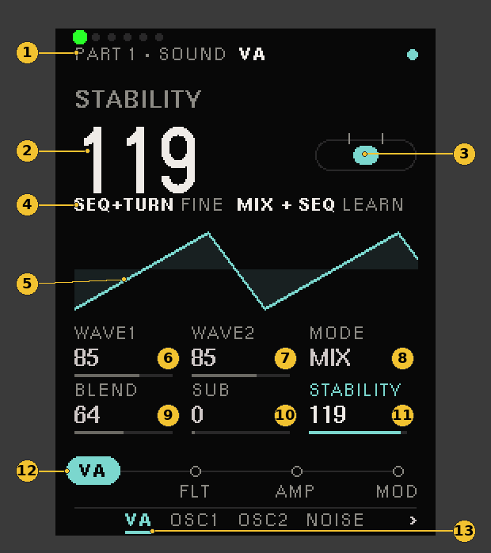

# VA, the variable-wave engine

VA is Chimera's analogue-style oscillator engine: two variable-wave oscillators combined by a MODE, a sub-oscillator, a noise source and STABILITY, which lets each voice drift like a real oscillator. The filter, FX slot, amp and modulation are the shared pages: see [the voice chain](08-voice-chain.md), [envelopes and LFOs](09-envelopes-and-lfos.md) and [the mod matrix](10-mod-matrix.md).

## VA: what the engine is

1. **OSC 1** and **OSC 2**: band-limited oscillators whose **WAVE** morphs from sine through triangle and saw to square, and whose **SHAPE** varies the sounding wave.
2. **MODE**: how the two combine, from a plain mix to sync, ring, FM or bitwise logic. **BLEND** sets how far.
3. **SUB**: a square an octave under OSC 1.
4. **NOISE**: the voice's own noise.
5. **STABILITY**: how far the oscillators drift, voice by voice.

Then the filter (the 2040 by default), the FX slot and the amp, as on every engine.

**Why:** the digital oscillators that don't sound sterile build movement into the oscillator itself. Every wave, at every SHAPE, plays at the same level, so WAVE, SHAPE and MODE never jump in loudness and every continuous control modulates without clicks.

> **Design note:** VA's layout is an open nod to the Mutable Instruments Ambika: two variable-waveform oscillators, a digital operator between them and a sub locked to the first. It is after the Ambika's architecture, as its manual describes it; the code is Chimera's own, written clean-room. It goes East Coast (saws, SUB, the 2040 or LADDER with an envelope) or West Coast (sines bent by FM, PHASE and LOOPFM, folded and closed by the low-pass gate). The waves are kept clean with polyBLEP and polyBLAMP, the techniques of Välimäki and Huovilainen and of Esqueda, Välimäki and Bilbao. No oscillators were harmed, but several were made deliberately unstable.

## VA: the chain and its pages

A VA Part's chain map reads **VA · FLT · AMP · MOD**. VA is the home.

| Node | Its pages (header name) |
|---|---|
| VA | **VA**, **OSC1** (OSC 1), **OSC2** (OSC 2), **NOISE**, **PIT** (PITCH) |
| FLT, AMP, MOD | as on every engine: see [the voice chain](08-voice-chain.md), [envelopes and LFOs](09-envelopes-and-lfos.md), [the mod matrix](10-mod-matrix.md) |

Navigation and gestures are as on every page (see [the panel and navigation](02-panel-and-navigation.md)). Every VA cell is a mod destination and can be MIDI-learned.

## VA: the VA page

1. **Header:** PART 1 · SOUND, page VA.
2. **Focus band:** WAVE1, 85 (saw).
3. **Glyph:** OSC 1's wave at the touched WAVE.
4. **Hint:** `SEQ+TURN FINE`, `MIX + SEQ LEARN`.
5. **Picture:** live output.
6. **WAVE1**, 85.
7. **WAVE2**, 85.
8. **MODE**, MIX.
9. **BLEND**, 64.
10. **SUB**, 0.
11. **STABILITY**, 89.
12. **Chain map:** VA lit.
13. **Sub-page row:** VA underlined, then OSC1, OSC2, NOISE; `>` for PITCH off the edge.

With BLEND touched, its glyph names the MODE's two ends:

1. **Header:** PART 1 · SOUND, page VA.
2. **Focus band:** BLEND, 102.
3. **BLEND's glyph:** a crossfader labelled with each end (here FM: CLEAN to DEEP).
4. **Hint:** `SEQ+TURN FINE`, `MIX + SEQ LEARN`.
5. **Picture:** live output.
6. **WAVE1**, 85.
7. **WAVE2**, 85.
8. **MODE**, FM.
9. **BLEND**, 102, touched.
10. **SUB**, 0.
11. **STABILITY**, 89.
12. **Chain map:** VA lit.
13. **Sub-page row:** VA underlined, then OSC1, OSC2, NOISE; `>` for PITCH.

| Cell | Range | INIT | What it does |
|---|---|---|---|
| **WAVE1** | 0–127 | 85 (saw) | OSC 1's wave: sine 0, triangle 42, saw 85, square 127 |
| **WAVE2** | 0–127 | 85 (saw) | The same for OSC 2 |
| **MODE** | MIX … PHASE (below) | MIX | How OSC 1 and OSC 2 combine |
| **BLEND** | 0–127 | 64 | How far MODE goes |
| **SUB** | 0–127 | 0 | Sub-oscillator level |
| **STABILITY** | 0–127 | 89 | 127 steady; lower drifts more |

The MODE cell shows SOFT for SOFT SYNC; the focus band spells it in full.

### VA: WAVE

Between the four points WAVE crossfades the two neighbours, kept in phase so the fundamental never thins. An envelope on WAVE sweeps a note from sine to saw (as FADED HYMN does). A WAVE change crosses at most one point per 1.3 ms audio block, so an end-to-end jump takes about 2.7 ms.

**Why the one-point limit:** allowing two crossings a block would have cost every VA voice extra in every MODE, with no audible gain.

## VA: OSC1 and OSC2, the oscillator pages

1. **Header:** page OSC 1.
2. **Focus band:** CRSE, 0 (its arc beside it).
3. **Hint:** `SEQ+TURN FINE`, `MIX + SEQ LEARN`.
4. **Picture:** live output.
5. **CRSE**, 0.
6. **FINE**, 0.
7. **SHAPE**, 0.
8. **Chain map:** VA lit.
9. **Sub-page row:** VA, OSC1 (underlined), OSC2, NOISE, PITCH.

1. **Header:** page OSC 2.
2. **Focus band:** CRSE, 0.
3. **Hint:** as OSC 1.
4. **Picture:** live output.
5. **CRSE**, 0.
6. **FINE**, +6.
7. **SHAPE**, 0.
8. **Chain map:** VA lit.
9. **Sub-page row:** VA, OSC1, OSC2 (underlined), NOISE, PITCH.

| Cell | Range | INIT (OSC 1 / OSC 2) | What it does |
|---|---|---|---|
| **CRSE** | −24 to +24 semitones | 0 / 0 | Coarse tuning; on OSC 2, the interval |
| **FINE** | −100 to +100 cents | 0 / +6 | Fine tuning; INIT's +6 gives a slow beat and keeps XOR alive |
| **SHAPE** | 0–127 | 0 / 0 | Varies the sounding wave (below) |

| Wave | SHAPE 0 to 127 |
|---|---|
| Sine | Folds brighter, a sine of a sine |
| Triangle | Skews the rise from half the cycle to nearly all |
| Saw | Splits the reset into two steps a quarter cycle apart: the second harmonic thins, the fundamental holds |
| Square | Narrows the pulse from 50 % to 5 % (PWM) |

Between two waves SHAPE varies both, at a steady level. PIT moves the whole voice; CRSE and FINE move one oscillator.

## VA: MODE, how the oscillators combine

| MODE | What it does | BLEND from … to … |
|---|---|---|
| **MIX** | The two mixed; 64 is equal | 1 · 2 |
| **SYNC** | OSC 2 restarts at each OSC 1 cycle (hard sync) | 1 · 2 |
| **SOFT SYNC** | OSC 2 reverses at each OSC 1 cycle; gentle with sines and triangles | 1 · 2 |
| **RING** | The two multiplied | MIX · RING |
| **AM** | OSC 2 swells OSC 1's level; past about 85 runs on into RING | CLEAN · RING |
| **FM** | Through-zero FM of OSC 1 by OSC 2; pitch and SUB stay on OSC 1's note | CLEAN · DEEP |
| **PHASE** | OSC 2 warps OSC 1's phase, as in Casio's CZ phase distortion | CLEAN · WARP |
| **LOOPFM** | Each oscillator modulates itself, its WAVE setting how far; BLEND brings in OSC 2 | 1 · LOOP |
| **MAX** | The higher wave at each moment, corners rounded | MIX · MAX |
| **XOR** | The waves' 16-bit samples combined bit by bit; aliases on purpose | MIX · XOR |
| **BITS** | The mix crushed from 16 bits to 2, in small steps | CLEAN · CRUSH |

- **SYNC:** keep OSC 2 above OSC 1 and sweep its CRSE or FINE. OSC 1, the master, stops at 7 kHz in SYNC only.
- **FM:** depth rises faster towards the top; on very high notes it is limited to stay clean.
- **XOR:** identical oscillators XOR to silence; keep a few cents apart (under about 20 cents is a fat, moving texture).
- A MODE change while notes sound ducks for about 2.7 ms, swaps and returns, without a click.

**Why so many MODEs on one page:** each is a classic way two oscillators meet, analogue to digital, and all share WAVE, SHAPE, BLEND and SUB, so a Sound moves between them without being rebuilt.

> **Design note:** LOOPFM is built on Tamara Smyth's DAFx-26 paper "Loopback Frequency Modulation Using a Time-Varying Delay Line", re-implemented with its own loop curve. XOR follows Jari Kleimola's DAFx-08 work on bitwise operations between oscillators. Everything is measured against an alias limit, except XOR and BITS, excused the way the drummer is excused from the tuning check.

## VA: SUB

**SUB** adds a square an octave below OSC 1 after MODE, following OSC 1's pitch even under FM. As it comes up the oscillators dip so the total stays level: it thickens rather than adds level.

## VA: STABILITY

1. **Header:** PART 1 · SOUND, page VA.
2. **Focus band:** STABILITY, 119.
3. **STABILITY's glyph:** a spirit level; the further the bubble from the middle, the more drift.
4. **Hint:** `SEQ+TURN FINE`, `MIX + SEQ LEARN`.
5. **Picture:** live output.
6. **WAVE1**, 85.
7. **WAVE2**, 85.
8. **MODE**, MIX.
9. **BLEND**, 64.
10. **SUB**, 0.
11. **STABILITY**, 119, touched.
12. **Chain map:** VA lit.
13. **Sub-page row:** VA underlined, then OSC1, OSC2, NOISE; `>` for PITCH.

At **127** the oscillators are steady and every note starts in the same phase, so a render repeats exactly. Below 127 each voice behaves like an untrimmed analogue oscillator:

| Fault | What it does |
|---|---|
| Drift | Three slow random walks per voice, one shared, one per oscillator |
| Trim | A fixed detune per oscillator, up to about ±3 cents |
| High-frequency tracking | Each oscillator goes a little flat up high, so the pair beats faster up the keyboard |
| Scale error | Octaves slightly stretched or squeezed |
| Jitter | Each cycle's pitch wobbles very slightly |
| Free-running phase | Each attack a little different |

The top of the knob is fine-grained; at 0 the shared drift reaches about ±12 cents. Each voice's trims and errors are fixed by Part and voice, so they come back; drift and phase differ each take. The filter's own STABILITY (FLT › FX) is separate: see [FX: STABILITY](08-voice-chain.md#fx-stability).

**Why:** an oscillator that never moves sounds like a computer. You choose between perfectly repeatable (127) and a little different every time.

> **Design note:** the tracking error is an estimate from the CEM3340 datasheet (a fixed delay each cycle that flattens high notes), the octave stretch that chip's typical untrimmed scale error, and the drift noise through two slow filters, so it wanders rather than wobbles. A very carefully engineered way of making something worse, which is most of analogue synthesis.

## VA: NOISE

1. **Header:** page NOISE.
2. **Focus band:** KIND, WHITE.
3. **Hint:** `MIX + SEQ LEARNS A CC`.
4. **Picture:** live output.
5. **KIND**, WHITE.
6. **LEVEL**, 0.
7. **Chain map:** VA lit.
8. **Sub-page row:** VA, OSC1, OSC2, NOISE (underlined), PITCH.

| Cell | Range | INIT | What it does |
|---|---|---|---|
| **KIND** | WHITE, PINK, RED, DIGITAL | WHITE | The colour (below) |
| **LEVEL** | 0–127 | 0 | How much noise |

| KIND | Sound |
|---|---|
| **WHITE** | Even hiss |
| **PINK** | Softer, less top |
| **RED** | Dark rumble and wind |
| **DIGITAL** | Stepped grit that follows the key |

Noise joins beside SUB, after MODE, with the same level compensation. An envelope into LEVEL gives a breathy attack.

**Why one noise source after MODE:** inside a MODE it would be ring-modulated or XORed into something else.

## VA: the shared pages on a VA Part

See [the voice chain](08-voice-chain.md#voice-chain-differences-between-engines). On VA, PIT hangs under the VA node, a new Sound starts on the 2040 filter, and with no route into VCA the key alone gates the note, so INIT routes ENV 1 into VCA at +127; leave AMP's BASE at 0. For West Coast tones, FX FOLD and AMP's LPG, DECAY and STRIKE suit sines in FM, PHASE or LOOPFM.

## VA: voices and what a patch costs

A VA note's cost depends mostly on the filter and the FX slot. One Part alone, beside the TAPE delay and QUAD reverb:

| Sound type | Example | Voices |
|---|---|---|
| VA on the 2040 | SOLO PORTA | 7 |
| VA with FUZZ | INIT VA, FX FUZZ | 6 |
| VA on the LADDER with FOLD | GROWL BASS | 5 |

See [limits](20-limits.md).

## VA: starting points

INIT VA: two saws, OSC 2 FINE +6, MIX at BLEND 64, SUB 0, STABILITY 89, NOISE off, the 2040, ENV 1 into VCA.

- **Detuned pad (TAPE DRIFT):** STABILITY 76, slow ENV 1, very slow LFOs into OSC 2's FINE and into both SHAPEs in opposite directions.
- **Wide saws (SUPER SAWS):** OSC 2 CRSE +12, FINE +3, SUB about 44, an LFO into SHAPE1.
- **Sync lead (SYNC SCREAM):** SYNC, OSC 2 CRSE +7, ENV 2 into OSC 2's CRSE.
- **Ring bell (RING LEAD):** RING, BLEND about 44, OSC 2 CRSE +12, WAVE1 51, WAVE2 13, velocity into BLEND.
- **Flute (SOFT FLUTE):** WAVE1 121, WAVE2 sine at CRSE +12, BLEND 38, STABILITY 102, an LFO into SHAPE1, a touch of NOISE.
- **Crushed to clean (BIT BLOOM):** both sines, BITS at BLEND 0, ENV 2 into BLEND at +127.
- **Acid bass (ACID CLASSIC):** one saw (BLEND 0), STABILITY 64, LADDER, ENV 2 into cutoff, velocity into ENV 2's level.
- **Bass with sub (GLIDE BASS):** SUB and STABILITY about 25, mono with glide.
- **West Coast:** both sines, FM or PHASE at half, FOLD, LPG with DECAY and STRIKE.

These ship in the factory set (see [the card, Sounds and the library](16-card-sounds-library.md)).
