# TAPE, the sample engine

TAPE plays sound sources, held in the project's memory or streamed from the card, through one of four machines: WALK, STRETCH, SCRUB and WAVE. This chapter covers TAPE's own pages, **SRC**, **DECK** and **MCH**, and what TAPE does on the pitch page. The shared pages are in [the voice chain](08-voice-chain.md), [envelopes and LFOs](09-envelopes-and-lfos.md) and [the mod matrix](10-mod-matrix.md); getting sources onto the card is in [the SD card, Sounds and the library](16-card-sounds-library.md).

## TAPE: what it is and how it plays

A TAPE Part's chain is **SRC · DECK · FLT · AMP · MOD**.

- **SRC** (SOURCE on the header) picks the source and the *window* that plays, **START** to **END**.
- **DECK** picks the machine with **MODEL** and holds the knobs that move its picture.
- **MCH**, under DECK, is the machine's own page, named in full on the header and the sub-page row (WALK, STRETCH, SCRUB, WAVE). It starts with the tape's wear: **TAPE**, **AGE**, **WOW**.
- **PIT** (PITCH on the sub-page row) is the last sub-page under DECK.

| MODEL | The machine |
|---|---|
| WALK | Plays the window once (FWD, REVERSE), round a loop (LOOP) or there and back (PING). TRON gives each key a Mellotron-style tape. |
| STRCH (STRETCH) | Plays at the key's pitch, stretched in time: CLASSIC and CLS POLY splice, GRAIN plays grains. |
| SCRUB | Moves through the source by hand, like a reel under your finger. Keys can place the finger. |
| WAVE | Plays a wavetable source of single-cycle frames. |

INIT TAPE has no source and is silent until you pick one. The factory TAPE Sounds bring their sources once the factory set is on the card.

Each machine draws its picture in the focus band (a runner, an accordion, a sponge on the tape, film through a gate); DECK's knobs move it.

> **Design note:** TAPE treats a recording as raw oscillator material, in the spirit of the 12-bit samplers of the late 80s. Sources are 12-bit with a sample rate of their own, as on the Akai S950. Pitching a source up is not filtered against aliasing: well above its own speed the top end folds back, the gritty character the E-mu SP-1200 made famous, kept on purpose and bounded. Think of it as a vintage sampler that never needs its floppy drive cleaned.

## TAPE: sources and memory

A source is a `.SRC` file in `/CHIMERA/TAPES` on the card: Chimera's own format, mono, 12-bit. TAPE plays only these; converting your own recordings isn't part of this release. A source's file name is a checksum of its contents, so the same source is never stored twice.

A project **loads** a source into its memory (the pool). A source too long for the memory left **streams** from the card while it plays. SETTINGS › PROJECT › POOL shows the pool; PURGE UNUSED SRC frees sources no Part uses, leaving the card's files ([SETTINGS](13-settings.md)). Sizes and stream counts are in [limits](20-limits.md).

While the project is open, each source remembers the Part's **START**, **END**, **PITCH** and **FINE** on it, so turning SOURCE away and back restores them. This is not saved; a saved Sound keeps its own source's values.

**Why:** the card is inside the case, so files arrive over USB and the card never fills with copies. Memory lets machines jump anywhere in a source; streaming lets a long one play at all.

## TAPE: the SRC page (source)

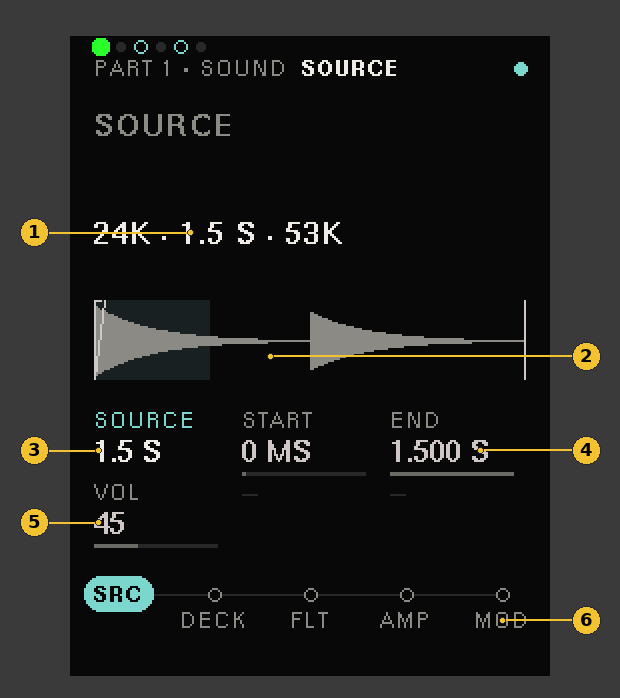

1. **Readout:** rate, length, memory (`24K · 1.5 S · 53K`); a streamed source shows `… · 7 STREAMS`.
2. **Strip:** the waveform, window lit, play heads.
3. **SOURCE.**
4. **END** (START beside it); **MIX + turn** snaps to an onset.
5. **VOL.**
6. TAPE's chain map, SRC lit.

| Cell | Range | Default | What it does |
|---|---|---|---|
| **SOURCE** | project's sources, then the card's | none | The source; the cell shows its length, a card source's size, or a state (below). |
| **START** | the source, in time | 0 MS | Window start. A matrix destination, read at note start: VEL into START starts harder notes further in. |
| **END** | the source, in time | source's end | Window end. Before START, the window plays backwards. |
| **VOL** | 0–127 | 45 | The source's level. |

START and END read `137 MS` or `1.500 S`. A slow turn moves 1 ms a detent, a fast one up to 100 ms (at least a hundredth of the source). **MIX + turn** jumps to the next onset that way (band: `MIX + TURN NEXT ONSET`); with none, the mark stays. On a streamed source only the parts held in memory can be searched. A held note doesn't follow START or END.

### TAPE: picking a card source

Turn **SOURCE** past the project's sources, over a divider, to the card's.

1. **Memory meter**, with what loading would take.
2. Name, rate, length, size.
3. **MIX + PLUS** loads it and the Part plays it; WON'T FIT if it can't.
4. Unloaded: SOURCE shows its size, dimmed.

While it loads the screen shows BUSY; **MENU** cancels.

### TAPE: the source states

| State | Cell | Focus band | Meaning, what to do |
|---|---|---|---|
| Loaded | `1.5 S` | `24K · 1.5 S · 53K` | In memory; every machine plays it. |
| Streamed | its length | `24K · 30.0 S · 7 STREAMS` | Plays from the card; the number is notes at once. Some machines need RAM (below). |
| Card, fits | size, dimmed | `LOADS · 41K` | **MIX + PLUS** loads it. |
| Card, won't fit | size, dimmed | `WON'T FIT · NEEDS 41K, 28K FREE` | Free memory with PURGE UNUSED SRC. |
| No source | NONE | | Pick one. |
| Missing | MISSING | SOURCE MISSING | The Sound names a source the project doesn't hold. |
| Not on card | NO FILE | SOURCE NOT ON CARD | Copy the file or factory set into `/CHIMERA/TAPES`. |
| No room | NO ROOM | POOL FULL | The project's memory is full. |
| Read failed | ERROR | CARD READ FAILED | The card couldn't be read. |
| Streams full | FULL | STREAMS FULL | More than eight streamed sources at once. |
| Fragmented | FRAG | FRAGMENTED · SILENT | File in too many pieces to stream. |
| Bad file | BAD FILE | BAD FILE · DROPS OUT | Part of a streamed file is unreadable; only notes reading it drop out. |
| Not a wavetable | NO WAVE | NEEDS A WAVE TABLE | WAVE needs a wavetable; SOURCE's band says `TURN SOURCE TO A WAVE TABLE`. |

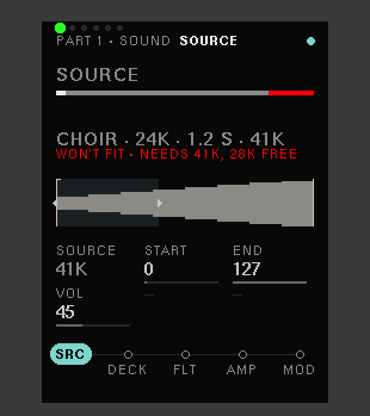

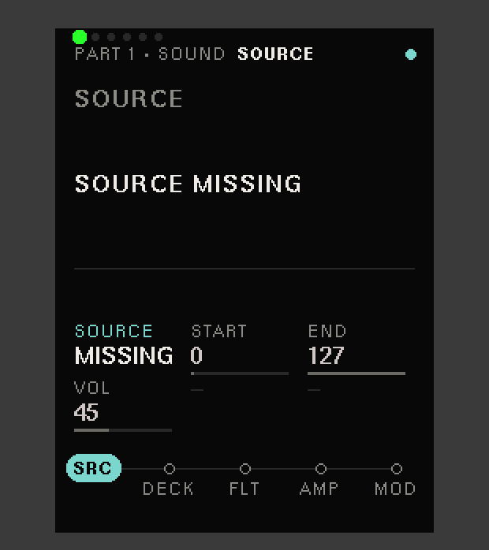

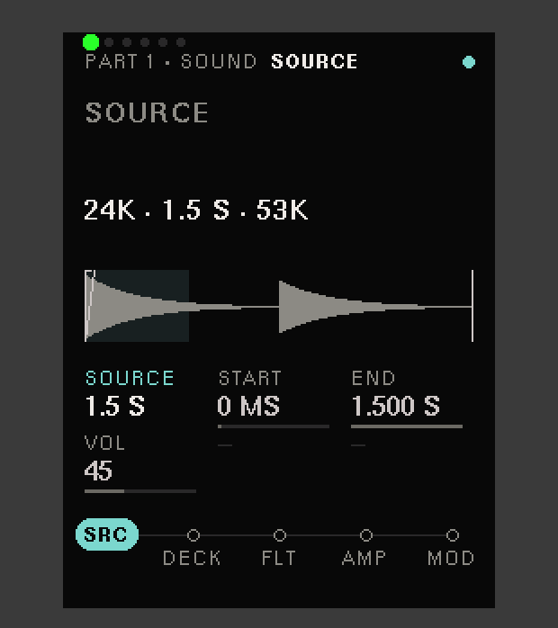

## TAPE: what a streamed source can't play

A streamed source is read forward only. WALK on **REVERSE** or **PING** (or END before START), **STRETCH**, **SCRUB** and **WAVE** need it in memory; WALK forward, on LOOP or with TRON streams.

Turning **MODEL** or **DIRECTION** onto a choice the source can't play lands on it dimmed, changes nothing, and says why: `PING NEEDS RAM · STREAMED`, `REVERSE NEEDS RAM · STREAMED`, `STRETCH NEEDS RAM · STREAMED`, `SCRUB NEEDS RAM · STREAMED`, `WAVE NEEDS RAM · STREAMED`. On SOURCE, a card file that can neither load nor stream reads RAM (the machine needs it), TOO BIG with `TRANSWAVE: NO STREAM` (wavetables never stream) or `ZONES: NO STREAM`, or SHORT with `TOO SHORT TO STREAM`.

A streamed LOOP's crossfade is capped at 100 ms of source: `STREAMED · XFADE CAPPED AT 100 MS`.

**Why:** a card reads fast only straight ahead; jumping would drop out. TAPE tells you on the cell you are turning rather than playing silence.

## TAPE: the DECK page

**DECK** is TAPE's home: **MODEL** (WALK, STRCH, SCRUB, WAVE; default WALK), then five knobs named by the machine.

Turning MODEL sets the new machine's knobs to their defaults, keeping the window, WALK's DIRECTION and the wear. Onto WALK once through, or STRETCH, it also sets ENV 1 to open instantly and hold, so the source is its own envelope, as on a sampler pad. **MIX + SEQ** learns MODEL to a CC.

**Why:** a fresh machine with the last machine's numbers usually makes no useful sound; defaults that play let you hear it first.

## TAPE: WALK

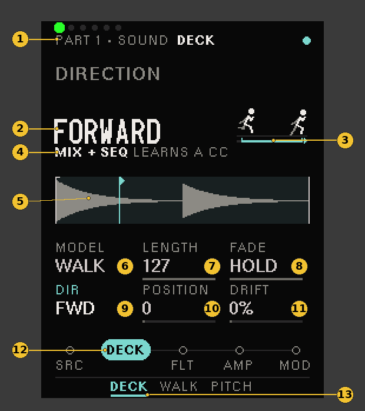

1. Header: PART 1 · SOUND, page DECK.
2. Focused cell, large: DIRECTION FORWARD.
3. **Picture:** a runner facing the way it plays.
4. Hint line: MIX + SEQ LEARNS A CC.
5. **Strip:** window lit, play head.
6. **MODEL:** WALK.
7. **LENGTH:** 127.
8. **FADE:** HOLD.
9. **DIR:** FWD.
10. **POSITION:** 0.
11. **DRIFT:** 0%.
12. Chain map, DECK lit.
13. Sub-page row: DECK WALK PITCH, DECK underlined.

| Cell | Range | Default | What it does |
|---|---|---|---|
| **LENGTH** | 0–127; 0.25–8 s with TRON | 127 once, 102 looped | How much plays from POSITION; around a loop, the loop's size; with TRON, the tape's length. |
| **FADE** | 10–500 ms, then HOLD | HOLD once, 32 ms looped | The fade at the note's edges. HOLD (once through, TRON off) plays to the end whatever the key does: a one-shot. |
| **DIRECTION** (DIR) | FWD, REVERSE, LOOP, PING | LOOP | Once forward, once backward, round a loop, there and back. |
| **POSITION** | 0–127 | 0 | Where the run starts (REVERSE counts from END); around a loop, where the loop sits. |
| **DRIFT** | 0–100 % | 0 % | Each note moves POSITION by a random step up to DRIFT of the window, wrapping; repeats wander the source. |

Turning DIRECTION between once through and looped sets LENGTH and FADE to that side's defaults.

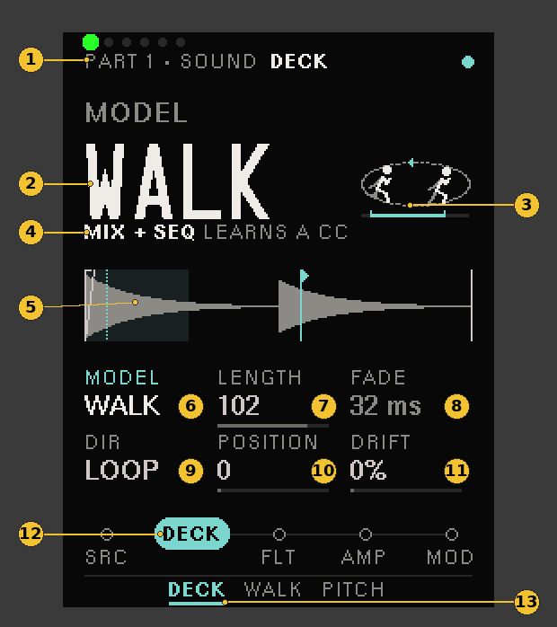

1. Header: page DECK.
2. Focused cell, large: MODEL WALK.
3. **Picture:** the runner goes round a track.
4. Hint line: MIX + SEQ LEARNS A CC.
5. **Strip:** the loop lit; LENGTH sizes it, POSITION places it.
6. **MODEL:** WALK.
7. **LENGTH:** 102, the looped default.
8. **FADE:** 32 ms, dimmed: the amp release ends the note.
9. **DIR:** LOOP.
10. **POSITION:** 0.
11. **DRIFT:** 0%.
12. Chain map, DECK lit.
13. Sub-page row, DECK underlined.

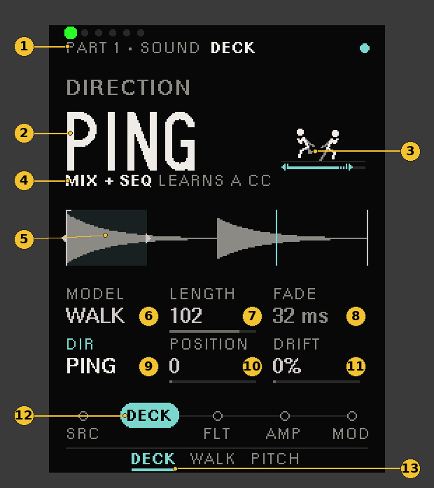

1. Header: page DECK.
2. Focused cell, large: DIRECTION PING.
3. **Picture:** runners both ways, the arrow pointing both ways.
4. Hint line: MIX + SEQ LEARNS A CC.
5. **Strip:** window lit.
6. **MODEL:** WALK.
7. **LENGTH:** 102.
8. **FADE:** 32 ms, dimmed.
9. **DIR:** PING.
10. **POSITION:** 0.
11. **DRIFT:** 0%.
12. Chain map, DECK lit.
13. Sub-page row, DECK underlined.

**FADE and the amp envelope.** A note has one release. With no VCA route, FADE is it. With an envelope routed into the VCA, its release ends the note: on LOOP and PING, FADE is dimmed (`AMP RELEASE ENDS THE NOTE`); once through, only HOLD still counts (`BELOW HOLD AMP RELEASE ENDS IT`). TRON keeps FADE whatever the routes.

**Why:** two releases on one note would fight; the rule picks one and the screen says which.

### TAPE: TRON

With **TRON** ON each key has its own tape: **LENGTH** reads 0.25 to 8 s, the same at every pitch. The window plays from POSITION and comes round again, its seam crossfaded by XFADE, until the tape runs out; at key up the pressure pad lifts through **FADE**. TRON streams.

1. Header: page DECK.
2. Focused cell, large: DIRECTION FORWARD.
3. **Picture:** a finish post marks the tape's end.
4. Hint line: MIX + SEQ LEARNS A CC.
5. **Strip:** play head, the tape's end dotted.
6. **MODEL:** WALK.
7. **LENGTH:** 8.0 s, in seconds with TRON.
8. **FADE:** 500 ms, the pad lifting at key up.
9. **DIR:** FWD.
10. **POSITION:** 0.
11. **DRIFT:** 0%.
12. Chain map, DECK lit.
13. Sub-page row, DECK underlined.

> **Design note:** TRON is modelled on the Mellotron M400, where every key has its own strip of tape about eight seconds long, and a held note simply runs out. Chimera keeps the run-out audible whatever the source: the tape's length is a time, not a stretch of the recording, so even a short source comes round again until the tape ends. Unlike the real thing, nobody has to rewind the tape frame afterwards.

## TAPE: WALK's machine page

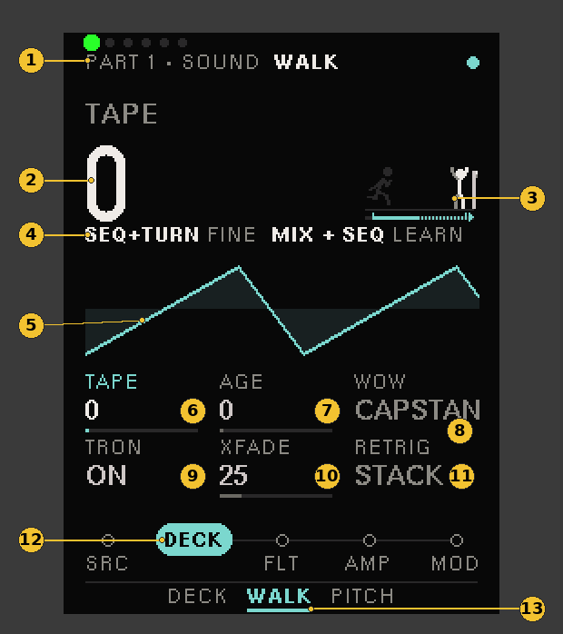

1. Header: page WALK.
2. Focused cell, large: TAPE 0.
3. **Picture:** runner and finish post (TRON on).
4. Hint line: SEQ+TURN FINE, MIX + SEQ LEARN.
5. The picture band: a test wave in this shot.
6. **TAPE:** 0.
7. **AGE:** 0.
8. **WOW:** CAPSTAN, dimmed at TAPE 0.
9. **TRON:** ON.
10. **XFADE:** 25.
11. **RETRIG:** STACK, dimmed with TRON on.
12. Chain map, DECK lit.
13. Sub-page row: DECK WALK PITCH, WALK underlined.

| Cell | Range | Default | What it does |
|---|---|---|---|
| **TRON** | OFF, ON | OFF | The Mellotron-style tape. |
| **XFADE** | 0–127 | 25 | The loop seam's crossfade, as a share of the loop (127 is half). LOOP and TRON only. |
| **RETRIG** | STACK, CUT | STACK | STACK: notes overlap. CUT: a new note cuts the last. Once through, TRON off. |

Unusable cells are dimmed with the reason: `ONLY LOOP AND TRON CROSSFADE`, `PING-PONG TURNS · NO SEAM`, `CUTS ONLY ONCE THROUGH`, `CUTS ONLY WITH TRON OFF`.

## TAPE: the wear on every machine

Every machine page starts with the wear, kept across MODEL turns.

| Cell | Range | Default | What it does |
|---|---|---|---|
| **TAPE** | 0–127 | 0 | Wow and flutter, up to about a quarter semitone. Matrix destination. |
| **AGE** | 0–127 | 0 | Darker (up to three octaves less top), with hiss; past halfway, dropouts. Matrix destination. |
| **WOW** | CAPSTAN, WARBLE | CAPSTAN | CAPSTAN: a tape machine's steady wow. WARBLE: pitch glides to new random places. |

With TAPE at 0 and nothing routed, WOW is dimmed: `TAPE AT 0 · NO WOW TO SHAPE`.

## TAPE: STRETCH

STRETCH plays the source at the key's pitch, stretched or squeezed in time.

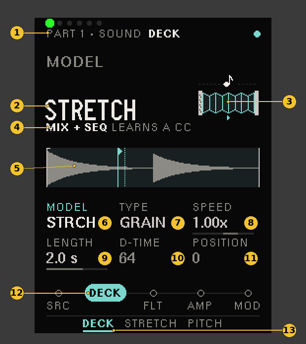

1. Header: page DECK.
2. Focused cell, large: MODEL STRETCH.
3. **Picture:** an accordion under a note.
4. Hint line: MIX + SEQ LEARNS A CC.
5. **Strip:** window lit, play head.
6. **MODEL:** STRCH.
7. **TYPE:** GRAIN.
8. **SPEED:** 1.00x.
9. **LENGTH:** 2.0 s (GRAIN).
10. **D-TIME:** 64, dimmed (CLASSIC only).
11. **POSITION:** 0, dimmed (CLASSIC only); a dimmed cell says why in the band.
12. Chain map, DECK lit.
13. Sub-page row: DECK STRETCH PITCH, DECK underlined.

| Cell | Range | Default | What it does |
|---|---|---|---|
| **TYPE** | CLASSIC, CLS POLY, GRAIN | GRAIN | How it stretches; fixed per note. |
| **SPEED** | `-1.00x` to `2.00x` | `1.00x` | Speed through the source: `0.00x` freezes, below 0 runs backwards. Fine steps below 1×. |
| **LENGTH** | 0.25–8 s | 2.0 s | GRAIN: time to play the window, the same on every key. |
| **D-TIME** | 0–127 | 64 | CLASSIC, CLS POLY: splice length, 10 to 250 ms. |
| **POSITION** | 0–127 | 0 | CLASSIC, CLS POLY: start in the window. |

| TYPE | What it does |
|---|---|
| CLASSIC | Overlapping splices, locked to the source's pitch period. For pitched sources. |
| CLS POLY | Splices at D-TIME, for chords and unpitched sources. |
| GRAIN | Four overlapping grains at the key's pitch while a pointer walks the window in LENGTH. In tune at any LENGTH; on pitched sources the grains lock to the period. |

The other TYPE's cells are dimmed: `GRAIN TYPE ONLY` or `CLASSIC TYPE ONLY`.

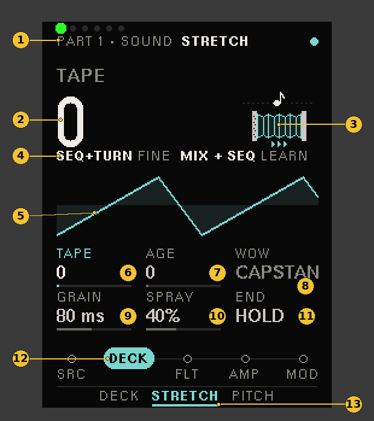

1. Header: page STRETCH.
2. Focused cell, large: TAPE 0.
3. **Picture:** the accordion.
4. Hint line: SEQ+TURN FINE, MIX + SEQ LEARN.
5. The picture band: a test wave in this shot.
6. **TAPE:** 0.
7. **AGE:** 0.
8. **WOW:** CAPSTAN, dimmed at TAPE 0.
9. **GRAIN:** 80 ms.
10. **SPRAY:** 40%.
11. **END:** HOLD.
12. Chain map, DECK lit.
13. Sub-page row, STRETCH underlined.

| Cell | Range | Default | What it does |
|---|---|---|---|
| **GRAIN** | 30–250 ms | 80 ms | Grain length: short is grittier, long smoother. |
| **SPRAY** | 0–100 % | 40 % | Scatters grains up to 25 ms so unpitched sources never comb; whole periods on pitched ones. |
| **END** | HOLD, STOP | HOLD | At the window's end: HOLD keeps the last grains while held (up to 8 s); STOP ends the note. |

These are GRAIN's; a turn affects grains to come. Key up is the amp envelope's.

> **Design note:** CLASSIC is inspired by the Akai S950's time-stretch, done in real time: the S950 had to render a stretched version and make you wait, while CLASSIC stretches as you play. GRAIN's grain core uses code adapted from Émilie Gillet's Mutable Instruments Beads (MIT licence): its pulse-train clock, bell-shaped window and grain stealing. The delay's GRAIN type runs the same core. Around it, Chimera adds what a sampler needs and Beads doesn't: a pointer that reaches the end in exactly LENGTH seconds on every key, grains that lock to the source's pitch so a stretched tone stays a tone, and levels that hold steady whether the grains agree or not. It is an accordion for sound, minus the folk club.

## TAPE: SCRUB

1. Header: page DECK.
2. Focused cell, large: FINGER 51.
3. **Picture:** a sponge on the tape.
4. Hint on FINGER with KEY at POSITION: KEYS PLACE THE FINGER.
5. **Strip:** the finger marked.
6. **MODEL:** SCRUB.
7. **FINGER:** 51.
8. **SPEED:** 1.00x.
9. **LENGTH:** 70 ms.
10. **XFADE:** 25.
11. **DRAG:** 32 ms.
12. Chain map, DECK lit.
13. Sub-page row: DECK SCRUB PITCH, DECK underlined.

| Cell | Range | Default | What it does |
|---|---|---|---|
| **FINGER** | 0–127 | 0 | The finger's place. Turn it like a jog wheel: it follows your hand's speed and glides to a stop through DRAG. CC and matrix move it too. |
| **SPEED** | −2× to 2× | `1.00x` | Speed of the short loop under the finger. |
| **LENGTH** | 2 ms to 2 s | 70 ms | The loop under the finger, at most the window. |
| **XFADE** | 0–127 | 25 | The loop seam's crossfade. |
| **DRAG** | 10–500 ms | 32 ms | Stop time: a hand on the reel to a heavy flywheel. |

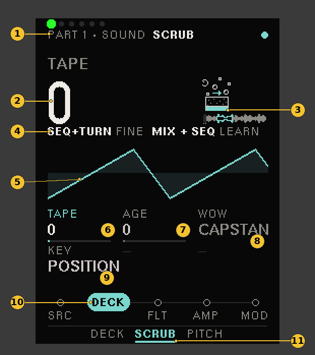

1. Header: page SCRUB.
2. Focused cell, large: TAPE 0.
3. **Picture:** the sponge.
4. Hint line: SEQ+TURN FINE, MIX + SEQ LEARN.
5. The picture band: a test wave in this shot.
6. **TAPE:** 0.
7. **AGE:** 0.
8. **WOW:** CAPSTAN, dimmed at TAPE 0.
9. **KEY:** POSITION.
10. Chain map, DECK lit.
11. Sub-page row, SCRUB underlined.

| Cell | Options | Default | What it does |
|---|---|---|---|
| **KEY** | POSITION, PITCH | POSITION | POSITION: keys place the finger and play at the root; C is the window's start, each semitone 1/12 further, every octave alike; FINGER adds. PITCH: keys transpose. |

On KEY POSITION a legato key change (STEAL at GLIDE) slides the finger.

**Why 70 ms:** under about 50 ms the loop fuses into a buzz; over about 100 ms a sweep stutters and answers late.

**Why KEY POSITION:** SCRUB's pitch belongs to SPEED and the finger; keys as places make the keyboard a map of the source, as slices do on samplers.

## TAPE: WAVE

WAVE scans a wavetable source's single-cycle frames, so the tone morphs.

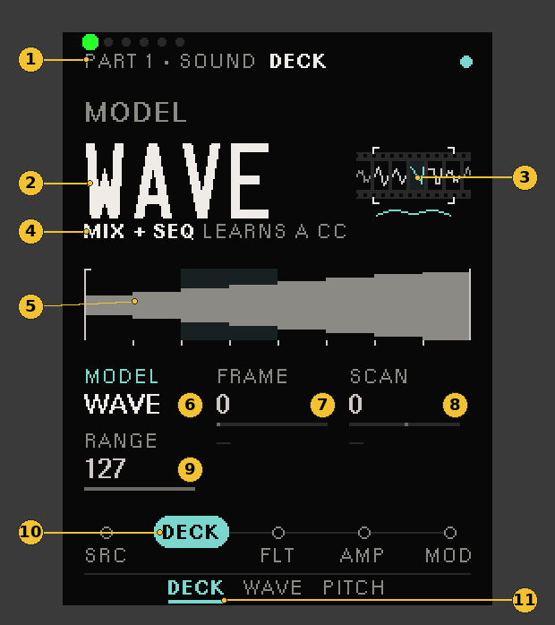

1. Header: page DECK.
2. Focused cell, large: MODEL WAVE.
3. **Picture:** film through a gate, the wave under it.
4. Hint line: MIX + SEQ LEARNS A CC.
5. **Strip:** the frames, playing ones lit.
6. **MODEL:** WAVE.
7. **FRAME:** 0.
8. **SCAN:** 0.
9. **RANGE:** 127.
10. Chain map, DECK lit.
11. Sub-page row: DECK WAVE PITCH, DECK underlined.

| Cell | Range | Default | What it does |
|---|---|---|---|
| **FRAME** | 0–127 | 0 | The frame the scan starts from. |
| **SCAN** | −64 to +63 | 0 | Sweep speed back and forth; 0 stays on FRAME. |
| **RANGE** | 0–127 | 127 | How many frames the sweep covers. |

All three are matrix destinations: an LFO on FRAME is the classic sweep. Each frame is stored at several resolutions, so high notes don't alias. WAVE's own page holds only the wear:

1. Header: page WAVE.
2. Focused cell, large: TAPE 0.
3. **Picture:** film through a gate.
4. Hint line: SEQ+TURN FINE, MIX + SEQ LEARN.
5. The picture band: a test wave in this shot.
6. **TAPE:** 0.
7. **AGE:** 0.
8. **WOW:** CAPSTAN, dimmed at TAPE 0.
9. Chain map, DECK lit.
10. Sub-page row: DECK WAVE PITCH, WAVE underlined.

> **Design note:** WAVE follows the wavetable synths of the 80s and 90s: single-cycle frames, scanned, each kept at a ladder of octave-spaced versions so a high note never folds, in the spirit of the PPG Wave and the Waldorf Microwave. The factory WAVE sources are transwave-style tables made from Chimera's own engines (morphing, saw, bowed, brass). Somewhere, a 1990s workstation is feeling very flattered.

## TAPE: the pitch page

**PIT** is the shared [pitch page](08-voice-chain.md). On TAPE:

- A source plays from its root: C4 plays a C4-rooted source at its own speed. PITCH and FINE shift from there.
- A source with no known root shows `ROOT ?` and its shift (`+7st +0ct`).
- **SNAP MUSICAL** steps fifths and fourths, keeping sampled material in key with itself.
- SCRUB on KEY POSITION plays at the root whatever the key.
- Pitching far up folds the top end by design: on a 24 kHz source, from about 18 semitones up.

1. Header: page PITCH.
2. Focused cell, large: PITCH 0.
3. Hint line: SEQ+TURN FINE, MIX + SEQ LEARN.
4. The picture band, where the tuner shows the note sounding (or `ROOT ?`); a test wave in this shot.
5. **PITCH:** 0.
6. **FINE:** 0.
7. **STEAL:** CUT.
8. **TIME:** 150 ms.
9. **SNAP:** CHROMA.
10. Chain map, DECK lit.
11. Sub-page row: DECK WALK PITCH, PITCH underlined.

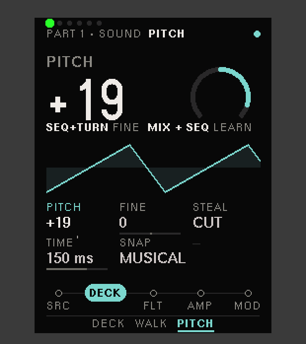

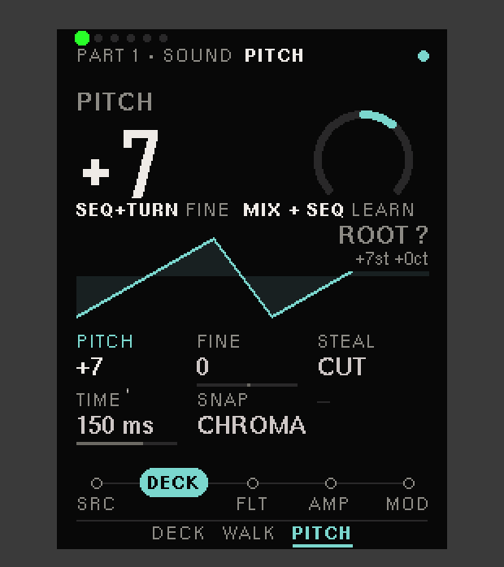

## TAPE: the pages it shares

- **AMP:** a VCA route makes the envelope's release end the note, in place of WALK's FADE.
- **SND** holds the reverb send; TAPE's pages have none.
- **The matrix:** destinations are START, POSITION, FINGER, FRAME, SPEED, SCAN, LENGTH (WALK, SCRUB), D-TIME, RANGE, TAPE and AGE. STRETCH's LENGTH, GRAIN, SPRAY, XFADE, DRAG and DRIFT are not. **MIX + PLUS** primes one.

RANDOMIZE ([SETTINGS](13-settings.md)) never touches a TAPE Sound's source, MODEL, place or pitch.

## TAPE: starting points

From the factory TAPE Sounds; 0–127 unless the cell shows a unit.

- **One-shot (EPIANO HIT, TX BASS HIT, BELL HIT):** WALK, DIR FWD, FADE HOLD, LENGTH 127.
- **Reversed hit (BELL BACKWARDS):** the same with START and END swapped.
- **Sustained loop (PAD LOOP, BRASS LOOP):** WALK, DIR LOOP, LENGTH 127, START past the attack; DRIFT for variety.
- **Ping-pong pad (PAD PINGPONG):** WALK, DIR PING, POSITION 64, LENGTH 127.
- **Mellotron (TRON BOWED):** WALK, FWD, TRON ON, FADE 32 ms, TAPE 38, WOW WARBLE.
- **Stretched voice (STAB STRETCH, VOICE STRETCH):** STRETCH, GRAIN defaults; SPEED `0.00x` freezes.
- **Scrubbed texture (SAW SCRUB, RAIN SCRUB):** SCRUB defaults; keys jump, FINGER scrubs.
- **Wavetable sweep:** WAVE on WAVE MORPH or WAVE SAW, an LFO into FRAME.
- **Worn tape:** TAPE about 38, AGE about 40; past 64 adds dropouts.
