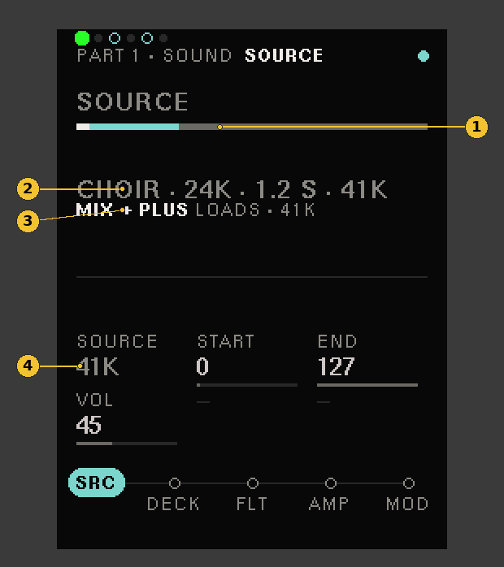
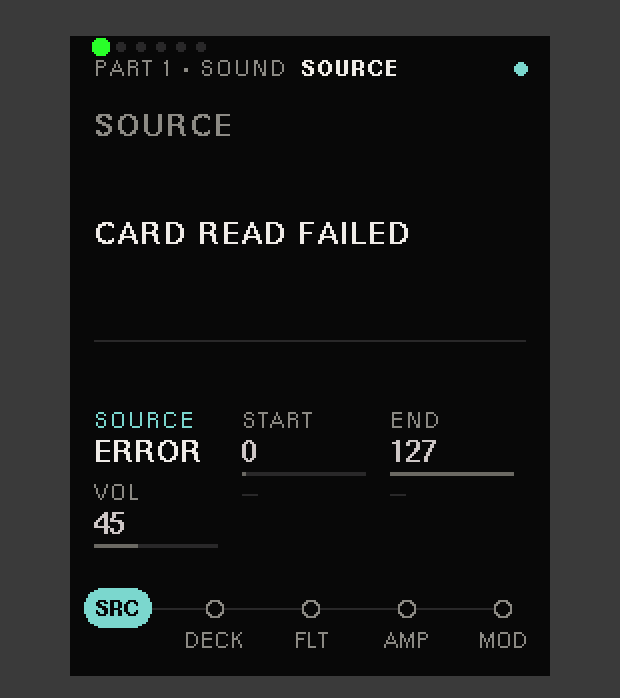
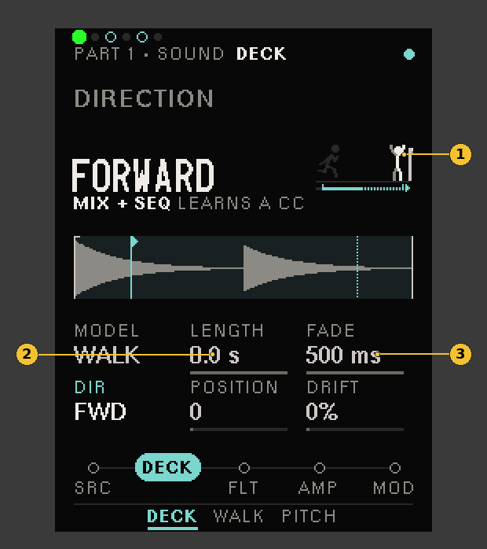
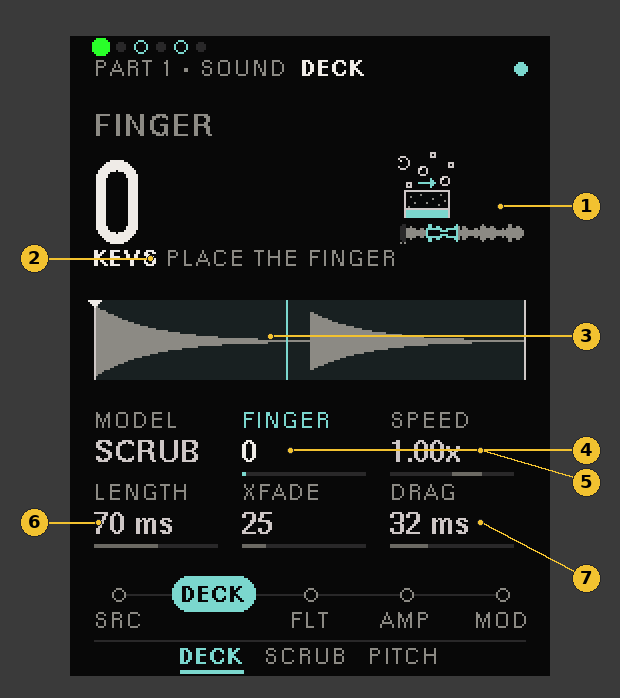
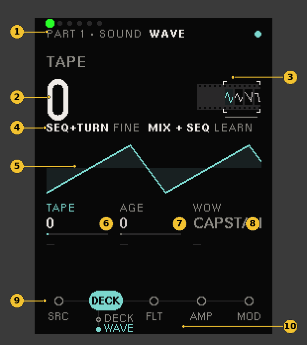
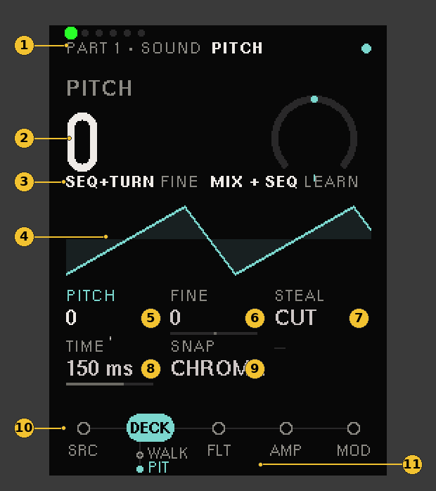

# TAPE, the sample engine

TAPE plays sound sources, recordings held in the project's memory or streamed from the card while they play, through one of four machines: WALK, STRETCH, SCRUB and WAVE. This chapter covers TAPE's own pages: **SRC** (the source and its window), **DECK** (the machine and the knobs that shape it) and **MCH** (the machine's own page), plus what TAPE does on the pitch page and how it tells you what it can't play. The shared pages (PIT, FLT, FMD, FX, JACK, AMP, STER, SND, the MOD matrix, the envelopes and the LFOs) are explained in [the voice chain](08-voice-chain.md), [envelopes and LFOs](09-envelopes-and-lfos.md) and [the mod matrix](10-mod-matrix.md). Getting sources onto the card is in [the SD card, Sounds and the library](16-card-sounds-library.md).

## TAPE: what it is and how it plays

A TAPE Part's chain is **SRC · DECK · FLT · AMP · MOD**.

- **SRC** (SOURCE on the page's header) picks the source and the stretch of it that plays: the *window*, from **START** to **END**.
- **DECK** picks the machine with **MODEL** and holds the knobs that move the machine's picture.
- **MCH**, the machine's own page, sits under DECK. On the chain map it is named after the machine (WALK, STRCH, SCRUB or WAVE), and its header spells it in full (WALK, STRETCH, SCRUB, WAVE). It starts with the tape's wear, **TAPE**, **AGE** and **WOW**, on every machine.
- **PIT**, the pitch page, is the last sub-page under DECK.

| MODEL | The machine |
|---|---|
| WALK | Plays the window once through (FWD or REVERSE), round a loop (LOOP) or there and back (PING). With TRON on, each key gets its own Mellotron-style tape. |
| STRCH (STRETCH) | Plays the source at the key's pitch, stretched or squeezed in time: CLASSIC and CLS POLY splice it, GRAIN plays it in grains. |
| SCRUB | Moves through the source by hand, like a tape reel under your finger. Keys can place the finger. |
| WAVE | Plays a wavetable source: a source made of single-cycle frames. |

INIT TAPE has no source: it is silent until you pick one on SRC. The factory TAPE Sounds come with their sources, once the factory set is on the card ([the SD card](16-card-sounds-library.md)).

Every machine draws its own picture in the focus band: a runner for WALK, an accordion for STRETCH, a sponge on the tape for SCRUB, film through a gate for WAVE. DECK's knobs move it, and it stays still when nothing changes.

> **Design note:** TAPE treats a recording as raw oscillator material, in the spirit of the 12-bit samplers of the late 80s. Sources are 12-bit with a sample rate of their own, as on the Akai S950. Pitching a source up is not filtered against aliasing: well above its own speed the top end folds back, the gritty character the E-mu SP-1200 made famous, kept on purpose and bounded. Think of it as a vintage sampler that never needs its floppy drive cleaned.

## TAPE: sources and memory

A source lives on the card, in `/CHIMERA/TAPES`, as a `.SRC` file: Chimera's own format, mono and 12-bit. TAPE plays these files only; a way to turn your own recordings into them isn't part of this release. Putting the factory sources onto the card, and how the card and its folders work, are in [the SD card, Sounds and the library](16-card-sounds-library.md): in short, the factory set's TAPES folder is copied onto the card over USB, and a source's file name is a checksum of what is in it, so the same source is never stored twice.

To play a source, a project **loads** it into its memory (the pool). A source too long for the memory left is not loaded: it **streams**, read from the card while it plays.

- SETTINGS › PROJECT › POOL shows what the project's memory holds. PURGE UNUSED SRC frees the memory of sources no Part uses; the files on the card stay. See [SETTINGS](13-settings.md).
- How much memory there is, and how many notes can stream at once, are in [limits](20-limits.md).

Each source the project holds remembers the Part's **START**, **END**, **PITCH** and **FINE** on it while the project is open: turn SOURCE away and back, and the Part's window and tuning on that source come back. This memory is not saved; a saved Sound keeps its own source's values.

**Why:** the card is inside the case, so files arrive over USB and the card is never filled with copies. Holding sources in memory lets every machine jump anywhere in them; streaming lets a long recording play at all.

## TAPE: the SRC page (source)

**SRC** (SRC on the chain map, SOURCE on the header) picks the source and its window.

1. **SOURCE's readout:** the source's rate, length and the memory it takes (`24K · 1.5 S · 53K`). A source too long for memory streams from the card; then the readout says how many notes of it can stream at once (`… · 7 STREAMS`).
2. **The strip:** the source's waveform, the window lit, and the play heads while notes play.
3. **SOURCE:** turn it through the sources the project holds, then the ones on the card.
4. **START** and **END:** the window, in time. **MIX + turn** snaps to the next onset in the source.
5. **VOL:** the source's level.
6. TAPE's chain.

| Cell | Range | Default | What it does |
|---|---|---|---|
| **SOURCE** | the project's sources, then the card's | none | The source. The cell shows its length (`1.5 S`), or a card source's size, or why it can't play (below). |
| **START** | the source, in time | 0 MS | Where the window starts. |
| **END** | the source, in time | the source's end | Where the window ends. END before START plays the window backwards. |
| **VOL** | 0–127 | 45 | The source's level. |

**START** and **END** read in time when a source is held: `137 MS` under a second, else `1.500 S`. A turn moves them 1 ms a detent when slow and up to 100 ms a detent when fast, and at full speed at least a hundredth of the source, so a long source crosses in a few turns. **MIX + turn** jumps to the next onset (a note or hit starting) in the direction you turn; the focus band reads `MIX + TURN NEXT ONSET`. With no onset that way, the mark stays. On a streamed source, only the parts held in memory (its start and loop heads) can be searched for onsets.

START is a MOD matrix destination, read when a note starts: route VEL into START and harder notes start further in. START and END are read at the note's start; a held note doesn't follow them.

### TAPE: picking a card source

Turn **SOURCE** past the project's sources, over a divider, to the card's. A card source is not yet loaded: its focus band shows the memory meter, its name, rate, length and size, and what loading it would take.

1. **The memory meter**, with what loading this source would take.
2. The card source's name, rate, length and size.
3. **MIX + PLUS** loads it into the project, and the Part plays it. If it won't fit, the hint says WON'T FIT.
4. Until it is loaded, SOURCE shows its size, dimmed.

While a source loads the screen shows BUSY; **MENU** cancels the load.

### TAPE: the source states

SOURCE's cell and focus band say what state the source is in.

| State | Cell | Focus band | What it means and what to do |
|---|---|---|---|
| Loaded | its length, `1.5 S` | `24K · 1.5 S · 53K` | The source is in the project's memory. Every machine can play it. |
| Streamed | its length | `24K · 30.0 S · 7 STREAMS` | Too long for memory, it plays from the card. The number is how many notes of it can stream at once. Some machines need RAM (below). |
| Card row, fits | its size, dimmed | `LOADS · 41K` | On the card, not loaded. **MIX + PLUS** loads it. |
| Card row, won't fit | its size, dimmed | `WON'T FIT · NEEDS 41K, 28K FREE` | Not enough memory left in the project. Free some with PURGE UNUSED SRC, or use fewer sources. |
| No source | NONE | | INIT TAPE: pick one. |
| Missing | MISSING | SOURCE MISSING | The Sound names a source the project doesn't hold. |
| Not on card | NO FILE | SOURCE NOT ON CARD | The source's file isn't in `/CHIMERA/TAPES`. Copy the factory set (or the file) onto the card. |
| No room | NO ROOM | POOL FULL | The project's memory is full. |
| Read failed | ERROR | CARD READ FAILED | The card couldn't be read. |
| Streams full | FULL | STREAMS FULL | More streamed sources than can play at once (eight). |
| Fragmented | FRAG | FRAGMENTED · SILENT | The file is stored in too many pieces on the card to stream. |
| Bad file | BAD FILE | BAD FILE · DROPS OUT | Part of a streamed file can't be read: only the notes reading it drop out. |
| Not a wavetable | NO WAVE | NEEDS A WAVE TABLE | WAVE on a source that isn't a wavetable. The band on SOURCE says `TURN SOURCE TO A WAVE TABLE`. |

## TAPE: what a streamed source can't play

A streamed source is read forward from the card as it plays. Anything that needs to jump around in it needs the whole source in memory:

- WALK on **REVERSE** or **PING**, or with END before START;
- **STRETCH**, **SCRUB** and **WAVE**.

WALK playing forward, on LOOP, and with TRON on, all stream.

TAPE says so where you are. Turning **MODEL** or **DIRECTION** onto something the streamed source can't play lands on it, dimmed, and the focus band gives the reason: `PING NEEDS RAM · STREAMED`, `REVERSE NEEDS RAM · STREAMED`, `STRETCH NEEDS RAM · STREAMED`, `SCRUB NEEDS RAM · STREAMED` or `WAVE NEEDS RAM · STREAMED`. Nothing is changed; the next turn moves on. On SOURCE, a card file that can't be loaded or streamed reads, in its cell and band: RAM (it needs RAM for the machine in use), TOO BIG with `TRANSWAVE: NO STREAM` (a wavetable never streams) or `ZONES: NO STREAM`, or SHORT with `TOO SHORT TO STREAM`.

On a streamed LOOP, the loop's crossfade is held to 100 ms of source; past that, XFADE's band reads `STREAMED · XFADE CAPPED AT 100 MS`.

**Why:** reading a card is fast only straight ahead. Jumping backwards or anywhere at random would stall the read and drop out. Telling you on the cell you are turning, rather than playing silence, is the rule TAPE follows everywhere.

## TAPE: the DECK page

**DECK** (DECK on the chain map and header) is TAPE's home. Its first cell is **MODEL**; the other five are the machine's knobs, the ones that move its picture, each labelled as the machine names it.

| Cell | Options | Default | What it does |
|---|---|---|---|
| **MODEL** | WALK, STRCH, SCRUB, WAVE | WALK | The machine. The cell reads STRCH for STRETCH. |

Turning MODEL sets the new machine's knobs to their defaults, so every machine plays from the first turn. It keeps the window (START and END), WALK's DIRECTION and the tape's wear (TAPE, AGE, WOW). Onto WALK playing once through, and onto STRETCH, it also sets ENV 1 to open instantly and hold at full, so the source is its own envelope, as on a sampler pad. MODEL can be learned to a MIDI CC with **MIX + SEQ**.

**Why:** a fresh machine with the last machine's numbers in its cells usually makes no sound worth hearing. Defaults that play mean you hear what the machine does before you shape it.

## TAPE: WALK

WALK plays the window as a one-shot, a loop, a ping-pong or a Mellotron-style tape.

1. **WALK's picture:** a runner on the window, facing the way it plays, the window's arrow under it. FADE draws as a dashed tail.
2. **The strip**, the window lit.
3. **The play head.**
4. **MODEL:** WALK, STRCH (STRETCH), SCRUB or WAVE.
5. **LENGTH:** how much plays from POSITION. **FADE:** the fade at the note's edges.
6. **DIR** (DIRECTION): FWD, REVERSE, LOOP or PING.
7. **POSITION:** where the run starts. **DRIFT:** random wandering of POSITION, note by note.
8. The sub-pages: DECK, WALK (the machine's page) and PITCH.

| Cell | Range | Default | What it does |
|---|---|---|---|
| **LENGTH** | 0–127; 0.25–8 s with TRON on | 127 once through, 102 around a loop | How much plays from POSITION. Once through, 127 plays to the window's end. Around a loop, it sizes the loop. With TRON on, it is the tape's length in seconds. |
| **FADE** | 10–500 ms, then HOLD | HOLD once through, 32 ms around a loop | The fade at the note's edges. Once through with TRON off, its last step, HOLD, makes the note play to its end whatever the key does (a drum one-shot). |
| **DIRECTION** (DIR) | FWD, REVERSE, LOOP, PING | LOOP | FWD: forward, once through. REVERSE: backward, once through. LOOP: round a loop. PING: there and back. |
| **POSITION** | 0–127 | 0 | Where the run starts. Around a loop, it places the loop inside the window. Once through, it is the start, counted the way it plays (REVERSE counts from END). |
| **DRIFT** | 0–100 % | 0 % | At each note, POSITION moves by a random step of up to DRIFT of the window, from where the last note left it, wrapping round the window's ends. Repeats wander through the source; 100 % reaches anywhere. |

The cell reads **DIR**; the focus band spells it DIRECTION. Turning DIRECTION between once through (FWD, REVERSE) and a loop (LOOP, PING) sets LENGTH and FADE to that side's defaults; within a side it changes nothing else.

1. On LOOP the runner goes round a track.
2. The loop, inside the window: LENGTH sizes it and POSITION places it.
3. DIR: LOOP.
4. FADE in ms: around a loop the note fades out at key up.

1. On PING the window's arrow points both ways: the run goes there and back.
2. DIR: PING.

**FADE and the amp envelope.** A note has one release. With no route into the VCA, FADE is the release. With an envelope routed into the VCA ([the mod matrix](10-mod-matrix.md)), that envelope's release ends the note: on LOOP and PING, FADE is dimmed and its band reads `AMP RELEASE ENDS THE NOTE`; once through, only FADE's HOLD step still counts, and its band reads `BELOW HOLD AMP RELEASE ENDS IT`. TRON keeps FADE whatever the routes.

**Why:** two releases on one note, FADE's and the envelope's, would fight. The rule picks one and the screen says which.

### TAPE: TRON

With **TRON** ON (on WALK's page), each key has its own tape, as on a Mellotron: **LENGTH** reads in seconds, 0.25 to 8 s, and the tape is the same length at every pitch. The window plays from POSITION and comes round again, its seam crossfaded by XFADE, until the tape runs out. At key up the pressure pad lifts through **FADE**.

1. With TRON on, a finish post marks the end of the tape.
2. **LENGTH** reads in seconds: each key has its own tape, 0.25 to 8 s long, the same at every pitch. The window comes round again until the tape runs out.
3. **FADE:** at key up the pressure pad lifts through FADE.

TRON streams, so long sources can play as TRON tapes.

> **Design note:** TRON is modelled on the Mellotron M400, where every key has its own strip of tape about eight seconds long, and a held note simply runs out. Chimera keeps the run-out audible whatever the source: the tape's length is a time, not a stretch of the recording, so even a short source comes round again until the tape ends. Unlike the real thing, nobody has to rewind the tape frame afterwards.

## TAPE: WALK's machine page

1. **TAPE, AGE, WOW:** the tape's wear.
2. WOW's kind: CAPSTAN or WARBLE.
3. **TRON:** OFF or ON.
4. **XFADE:** the crossfade at the loop's seam, heard on LOOP and on TRON's rounds.
5. **RETRIG:** STACK or CUT.
6. The sub-page row, on WALK.

| Cell | Range | Default | What it does |
|---|---|---|---|
| **TRON** | OFF, ON | OFF | The Mellotron-style tape (above). |
| **XFADE** | 0–127 | 25 | The crossfade at a loop's seam, as a share of the loop: 127 is half the loop. Heard on LOOP and on TRON's rounds. |
| **RETRIG** | STACK, CUT | STACK | STACK: notes play over each other. CUT: a new note cuts the last. Heard once through with TRON off. |

A cell the current DIRECTION can't use is dimmed, and the band says why: XFADE once through with TRON off, `ONLY LOOP AND TRON CROSSFADE`; XFADE on PING, `PING-PONG TURNS · NO SEAM`; RETRIG on LOOP or PING, `CUTS ONLY ONCE THROUGH`; RETRIG with TRON on, `CUTS ONLY WITH TRON OFF`.

## TAPE: the wear on every machine

The first three cells of every machine's page are the tape's wear. They are kept across MODEL turns: a flavour you keep, whatever machine plays.

| Cell | Range | Default | What it does |
|---|---|---|---|
| **TAPE** | 0–127 | 0 | How much the pitch wobbles: wow and flutter, up to about a quarter of a semitone of wow at 127. |
| **AGE** | 0–127 | 0 | Darker, with hiss. AGE lowers the top end over its whole travel, about three octaves at 127. Past halfway, the level drops out now and then, as worn tape does. |
| **WOW** | CAPSTAN, WARBLE | CAPSTAN | How it wobbles. CAPSTAN: a tape machine's steady wow and flutter. WARBLE: a pitch that wanders to a new random place and glides there. |

With TAPE at 0 and nothing routed to it, there is no wow to shape: WOW is dimmed and its band reads `TAPE AT 0 · NO WOW TO SHAPE`. TAPE and AGE are MOD matrix destinations.

## TAPE: STRETCH

STRETCH plays the source at the key's pitch, stretched or squeezed in time: a long note keeps its pitch as you slow it down, and a short one keeps its pitch as you speed it up.

1. **STRETCH's picture:** an accordion under a note.
2. **TYPE:** CLASSIC, CLS POLY or GRAIN.
3. **SPEED:** how fast it moves through the source.
4. **LENGTH:** how long a key plays the source. GRAIN's: dimmed under CLASSIC.
5. **D-TIME:** the splice length. CLASSIC's: dimmed under GRAIN.
6. **POSITION:** where CLASSIC starts. A cell dimmed under the other TYPE says so in the focus band.

| Cell | Range | Default | What it does |
|---|---|---|---|
| **TYPE** | CLASSIC, CLS POLY, GRAIN | GRAIN | How the source is stretched (below). Fixed for a note when it starts. |
| **SPEED** | `-1.00x` to `2.00x` | `1.00x` | How fast it moves through the source. `0.00x` freezes in place, `1.00x` is the source's own speed, below 0 it moves backwards. Fine steps below 1×: 0.1× to 0.5× take many detents. |
| **LENGTH** | 0.25–8 s | 2.0 s | GRAIN's: how long a key takes to play the window. The source reaches its end at LENGTH on every key. Dimmed under CLASSIC and CLS POLY. |
| **D-TIME** | 0–127 | 64 | CLASSIC's and CLS POLY's: the splice length, 10 to 250 ms. Dimmed under GRAIN. |
| **POSITION** | 0–127 | 0 | CLASSIC's and CLS POLY's: where in the window it starts. Dimmed under GRAIN. |

The TYPEs:

- **CLASSIC** splices the source, overlapping short pieces of it D-TIME long, and locks the splices to the source's own pitch period. For a pitched source.
- **CLS POLY** splices to D-TIME instead, for chords and unpitched sources.
- **GRAIN** plays the source in four overlapping grains at the key's pitch, while a pointer walks the window in LENGTH seconds. It stays in tune at every LENGTH. On a pitched source the grains lock to its period, so tones don't comb or beat.

Each TYPE's cells are dimmed under the other, and the band says why: `GRAIN TYPE ONLY` or `CLASSIC TYPE ONLY`.

1. TAPE, AGE, WOW: the tape's wear.
2. **GRAIN:** each grain's length.
3. **SPRAY:** scatters the grains in time.
4. **END:** what GRAIN does at the window's end.
5. The sub-page row, on STRETCH.

| Cell | Range | Default | What it does |
|---|---|---|---|
| **GRAIN** | 30–250 ms | 80 ms | Each grain's length. Short grains are grittier; long ones smoother, and smear fast changes. |
| **SPRAY** | 0–100 % | 40 % | Scatters each grain up to 25 ms in time, so an unpitched source never combs. On a pitched source the lock rounds the scatter to whole periods. |
| **END** | HOLD, STOP | HOLD | At the window's end: HOLD keeps playing the last grains while the key is held (up to 8 s), STOP ends the note there. |

GRAIN, SPRAY and END are GRAIN's. A turn moves the grains to come; the ones playing finish as they started. Key up is the amp envelope's.

> **Design note:** CLASSIC is the Akai S950's time-stretch done in real time: the S950 had to render a stretched copy and make you wait, while CLASSIC stretches as you play. GRAIN's grain core is a port of Émilie Gillet's Mutable Instruments Beads (its pulse-train clock, bell-shaped window and grain stealing), the same core as the delay's GRAIN type. Around it, Chimera adds what a sampler needs and Beads doesn't: a pointer that reaches the end in exactly LENGTH seconds on every key, grains that lock to the source's pitch so a stretched tone stays a tone, and levels that hold steady whether the grains agree or not. It is an accordion for sound, minus the folk club.

## TAPE: SCRUB

SCRUB moves through a source by hand, like a tape reel under your finger.

1. **SCRUB's picture:** a sponge on the tape.
2. On FINGER, with KEY at POSITION, the hint reads KEYS PLACE THE FINGER.
3. The strip, the finger's place marked.
4. **FINGER:** turn it like a jog wheel.
5. **SPEED:** the speed of the loop behind the finger.
6. **LENGTH:** the loop behind the finger. **XFADE:** its seam's crossfade.
7. **DRAG:** how long the finger takes to stop.

| Cell | Range | Default | What it does |
|---|---|---|---|
| **FINGER** | 0–127 | 0 | Where the finger is in the window. Turn it like a jog wheel: it reads how fast you turn, and glides to a stop through DRAG when you let go. A MIDI CC or a MOD route moves it too. |
| **SPEED** | −2× to 2× | `1.00x` | The speed of the short loop playing under the finger, as a factor of the source's own. |
| **LENGTH** | 2 ms to 2 s | 70 ms | The loop under the finger. Never longer than the window. |
| **XFADE** | 0–127 | 25 | The loop's seam crossfade, as a share of the loop. |
| **DRAG** | 10–500 ms | 32 ms | How long the finger takes to stop after you let go. Short is a hand on the reel; long is a heavy flywheel. |

SCRUB's page holds the wear and **KEY**:

1. TAPE, AGE, WOW: the tape's wear.
2. **KEY:** POSITION or PITCH.

| Cell | Options | Default | What it does |
|---|---|---|---|
| **KEY** | POSITION, PITCH | POSITION | POSITION: each key places the finger and plays at the source's root. C is the start of the window and each semitone up is 1/12 further along, the same in every octave; FINGER adds to it. PITCH: the key transposes the scrub. |

On KEY POSITION a legato key change (STEAL at GLIDE on the pitch page) slides the finger to the new key's place. FINGER's band reads `KEYS PLACE THE FINGER`.

**Why 70 ms:** under about 50 ms the loop repeats fast enough to fuse into a buzz of its own pitch; over about 100 ms a sweep sounds like stuttered echoes and the finger answers late. 70 ms sits in between.

**Why KEY POSITION is the default:** SCRUB's pitch already belongs to SPEED and the finger, so keys as pitch would make a chord a smear of one spot. Keys as places make the keyboard a map of the source, as slices and start points do on grooveboxes and samplers.

## TAPE: WAVE

WAVE plays wavetable sources: a source made of single-cycle frames, each a tiny waveform. A scan sweeps across the frames, so the tone morphs.

1. **WAVE's picture:** film running through a gate.
2. **The strip:** the source's frames, the playing ones lit.
3. **FRAME:** the frame it starts on.
4. **SCAN:** how it moves through the frames.
5. **RANGE:** how many frames it travels.

| Cell | Range | Default | What it does |
|---|---|---|---|
| **FRAME** | 0–127 | 0 | The frame the scan starts from. |
| **SCAN** | −64 to +63 | 0 | How fast the scan sweeps back and forth across the frames. At 0 it stays on FRAME. |
| **RANGE** | 0–127 | 127 | How many frames the sweep covers. |

FRAME, SCAN and RANGE are MOD matrix destinations: an LFO or envelope on FRAME is the classic wavetable sweep. WAVE's own page holds only TAPE, AGE and WOW:

1. Header: the Part, its Sound and the page, WAVE.
2. The focused cell, large: TAPE and its value.
3. The machine's glyph: film through a gate.
4. Focus-band hint: SEQ + turn for fine steps, MIX + SEQ to learn a CC.
5. The picture band: the Part's live output.
6. **TAPE:** how much the pitch wobbles.
7. **AGE:** darker, with hiss and, past halfway, dropouts.
8. **WOW:** CAPSTAN or WARBLE; dimmed here, as TAPE is at 0.
9. The chain map, DECK lit.
10. The sub-pages under DECK: DECK, WAVE and PIT.

 Each frame is stored at several resolutions, and WAVE picks the one that suits the note, so high notes don't alias. On a source that isn't a wavetable, SOURCE reads NO WAVE and the band says `TURN SOURCE TO A WAVE TABLE`.

> **Design note:** WAVE follows the wavetable synths of the 80s and 90s: single-cycle frames, scanned, each kept at a ladder of octave-spaced versions so a high note never folds, the way the PPG Wave and the Waldorf Microwave did it. The factory WAVE sources are transwave-style tables made from Chimera's own engines (morphing, saw, bowed, brass). Somewhere, a 1990s workstation is feeling very flattered.

## TAPE: the pitch page

TAPE's **PIT** page is the shared pitch page ([PITCH](08-voice-chain.md)), last in the stack under DECK. On TAPE:

- **A source plays at the key you play, from its root.** Each source carries its root note; C4 on the keyboard plays a C4-rooted source at its own speed, and other keys speed it up or slow it down. PITCH and FINE shift it from there.
- **A source with no known root** reads `ROOT ?` in the tuner, with its shift from the source's own speed (`+7st +0ct`).
- **SNAP MUSICAL** is useful here: PITCH steps a fifth, then a fourth, then a fifth, so two clicks make an octave. Sampled material transposed by fifths and octaves stays in key with itself.
- **Some notes play at the root whatever the key:** SCRUB on KEY POSITION (the key places the finger instead).
- **Pitching far up** folds the top end, by design (see the design note at the top of this chapter). On a 24 kHz source, the fold starts about 18 semitones above the source's own speed.

1. Header: the Part, its Sound and the page, PITCH.
2. The focused cell, large: PITCH and its value.
3. Focus-band hint: the gestures the cell answers to.
4. The picture band: the tuner, with the note the last note sounds at (or `ROOT ?`), over the live output.
5. **PITCH:** the shift in semitones.
6. **FINE:** the shift in cents.
7. **STEAL:** CUT or GLIDE.
8. **TIME:** the glide time.
9. **SNAP:** CHROMA or MUSICAL.
10. The chain map, DECK lit.
11. The sub-pages under DECK: DECK, the machine's page and PIT.

## TAPE: the pages it shares

- **FLT, FMD, FX, JACK** ([filter](08-voice-chain.md)): as on every engine, after the machine.
- **AMP** ([AMP](08-voice-chain.md)): a route into the VCA makes the envelope's release end the note, in place of WALK's FADE (see "TAPE: WALK" above).
- **STER** and **SND** ([stereo and sends](08-voice-chain.md)): as on every engine. TAPE's pages have no reverb cell of their own: the reverb send is on SND.
- **The MOD matrix, E1–E3, SPD, L1–L3** ([the mod matrix](10-mod-matrix.md), [envelopes and LFOs](09-envelopes-and-lfos.md)): TAPE's destinations are START, POSITION (FINGER, FRAME), the speeds (SPEED, SCAN), LENGTH on WALK and SCRUB, D-TIME and RANGE, TAPE and AGE. STRETCH's LENGTH, GRAIN, SPRAY, and XFADE, DRAG and DRIFT are not destinations. Touch one and press **MIX + PLUS** to prime it.

RANDOMIZE ([SETTINGS](13-settings.md)) never touches a TAPE Sound's source, MODEL or place, and leaves its pitch alone.

## TAPE: gestures on its pages

- **SEQ + turn** on a cell: fine steps.
- **MIX + turn** on START or END: snap to the next onset. On other cells: jump to the next landmark.
- **MIX + PLUS** on SOURCE: load the card source. On a modulatable cell: prime it as a MOD matrix destination.
- **MENU** while a source loads: cancel the load.
- **MIX + SEQ**: learn a MIDI CC for the cell ([MIDI](14-midi.md)).
- **FINGER** on SCRUB: turn it like a jog wheel; the speed of your hand moves the reel.

## TAPE: starting points

These come from the factory TAPE Sounds, which all play once the factory set is on the card; numbers are on the 0–127 scale unless the cell shows a unit.

- **A drum or stab one-shot:** WALK, DIR FWD, FADE HOLD, LENGTH 127. Every note plays to its end; ENV 1 opens instantly. This is EPIANO HIT, TX BASS HIT, BELL HIT.
- **A reversed hit:** the same with START at the end and END at the start. This is BELL BACKWARDS.
- **A sustained loop:** WALK, DIR LOOP, LENGTH 127, START a little into the source to skip the attack. This is PAD LOOP and BRASS LOOP. Add DRIFT so every note loops a different part.
- **A ping-pong pad:** WALK, DIR PING, POSITION 64 (past the attack), LENGTH 127. This is PAD PINGPONG.
- **A Mellotron:** WALK, DIR FWD, TRON ON, FADE 32 ms, TAPE 38, WOW WARBLE. This is TRON BOWED.
- **A stretched chord or voice:** STRETCH with TYPE GRAIN at its defaults. This is STAB STRETCH and VOICE STRETCH. Turn SPEED to `0.00x` to freeze it.
- **A scrubbed texture:** SCRUB at its defaults; play keys to jump through the source, turn FINGER to scrub. This is SAW SCRUB and RAIN SCRUB.
- **A wavetable sweep:** WAVE on a WAVE source (WAVE MORPH, WAVE SAW), with an LFO into FRAME.
- **Worn tape on anything:** TAPE around 38, AGE around 40; AGE past 64 adds dropouts.
