# DRUM, the kit engine

A DRUM Part plays a kit of twelve pads. Each pad is a drum machine of its own (a kick, a snare, a hat, a plain sine...) with its own knobs, level, pan, choke group, filter, amp envelope, mod envelope, LFO and four routes. This chapter covers the kit and its keymap, every pad page, every MACHINE and its knobs, choke and voice groups, how a kit is saved, and what each machine costs in voices. The pad's filter types are explained once, in [the voice chain](08-voice-chain.md); the Part's own envelopes, LFOs and matrix in [Envelopes and LFOs](09-envelopes-and-lfos.md) and [the mod matrix](10-mod-matrix.md).

## DRUM: what a kit is

Load **INIT DRUM** from the Sound browser (**EDIT + B*n***, the INIT rows at the top) and the Part becomes a kit. A DRUM Part has two layers:

- **The kit: twelve pads.** Each pad holds a MACHINE and its knobs, LEVEL, PAN, CHOKE, RETRIG, and a compact sound of its own: a filter, an AMP envelope with a gate, a mod envelope, an LFO and four routes.
- **The Part's Sound, shared by every pad:** the FX slot (FX TYPE and FX PLACE), the filter's INPUT, FEEDBACK, STABILITY and its jacks, the filter MODULATION routes, the three envelopes and three LFOs, the MOD matrix, WIDTH and the SENDS.

A note strikes a pad. The hit takes a copy of its pad at that moment and plays it through the Part's chain.

**Why:** a full Sound for each of twelve pads would take more memory than the instrument has for six Parts. A compact pad, as on an Analog Rytm, gives each drum the controls that make it a different drum (its machine, filter, envelope and pan) while the costly, characterful parts of the chain (the FX slot, the matrix) stay one per Part.

> **Design note:** The pads' layout, the choke groups and the way notes reach pads follow the Elektron Analog Rytm. The machines' names and knob sets take their shape from the Elektron Machinedrum's machine reference, read from its manual only: no Elektron code, ROM or samples, and every algorithm is Chimera's own. Each machine was first built on a computer, auditioned by ear, then ported to the instrument line for line, so the firmware's output matches the prototype sample for sample. Think of it as a drum machine that grew up reading other drum machines' manuals, and never their diaries.

## DRUM: the chain map

The DRUM chain is **KIT · MCH · FLT · AMP · MOD**. Each node has sub-pages, shown in a row under the map in full words:

```
   KIT ──────── MCH ──────── FLT ──────────── AMP ──────── MOD
    └ KEYS       └ MORE       ├ FMD             ├ GATE       ├ PENV  PLFO  ROUTE
                              ├ FX              └ SENDS      ├ E1  E2  E3  SPD
                              └ JACK                         └ L1  L2  L3
```

| Map | Full name | Whose | What it holds |
|---|---|---|---|
| **KIT** | KIT | pad, kit | PAD, MACHINE, LEVEL, PAN, TONAL |
| **KEYS** | KEYS | pad | PAD, CHOKE, RETRIG |
| **MCH** | MACHINE | pad | the machine's first six knobs |
| **MORE** | MORE | pad | MACHINE again, the machine's last two knobs |
| **FLT** | FILTER | pad, Part | the pad's filter; the Part's FX and FX PLACE |
| **FMD** | MODULATION | Part (one cell pad) | filter routes; SEM's OUTPUT is the pad's |
| **FX** | FX | Part | INPUT, MIX, STABILITY, the FX slot's knobs |
| **JACK** | JACKS | Part | FREQ SRC, RES SRC |
| **AMP** | AMP | pad | the pad's AHD envelope, VEL, MODE |
| **GATE** | GATE | pad, Part | the pad's LPG, DECAY, STRIKE; the Part's WIDTH |
| **SND** | SENDS | Part | CHORUS, DELAY, REVERB |
| **MTX** | MATRIX | Part | the mod matrix |
| **PENV** | PAD ENV | pad | the pad's mod envelope |
| **PLFO** | PAD LFO | pad | the pad's LFO |
| **ROUTE** | ROUTE | pad | the pad's four routes |
| **E1 E2 E3 SPD L1 L2 L3** | ENV1 ENV2 ENV3 SPEED LFO1 LFO2 LFO3 | Part | the Part's envelopes and LFOs |

A DRUM Part has no PITCH page and no STEREO page: each machine tunes itself, and the GATE page holds the Part's WIDTH.

The header always names the pad you are editing: `PART 1 · 02 TONE SNARE  KIT` is pad 02, a TONE SNARE, on the KIT page. Where the whole name does not fit, it shows the machine's last word (`03 IMPULSE`).

## DRUM: the pad gestures

Every page that edits a pad answers the same keys:

| Keys | Does |
|---|---|
| **MIX + MINUS / PLUS** | Step to the previous / next pad. The page stays, so you can walk all twelve pads on one page |
| Turn **PAD** (KIT, KEYS) | Pick a pad, 01 to 12 |
| Play a note | Strikes its pad; the pad's tile lights. With PAD FOLLOW, it can also select that pad (see [PAD FOLLOW](#drum-pad-follow)) |
| **SEQ + turn** | Fine turn on a value cell |
| **MIX + turn** | Jump to the value's next landmark (minimum, default, maximum), as everywhere |

The focus band's hint line shows `MIX + -/+ PAD` on every pad cell, and on the Part's FX and FX PLACE cells on FLT, since those sit on a pad page. On CHOKE the hint line shows the kit's voice groups instead (see [choke and voice groups](#drum-choke-groups-and-voice-groups)).

The pad cells have no MIDI-learn: **MIX + SEQ** does not bind them, and pads have no NRPN address. The Part's own cells on a DRUM Part (the FX, the envelopes, the LFOs, the sends) learn as on any engine. See [MIDI](14-midi.md).

## DRUM: the KIT page


1. **Header:** the Part, the selected pad and its machine (`01 TONE KICK`), and the page, KIT.
2. **The focused cell, large:** here PAD, 01.
3. **The machine's icon, large:** its family letter (T) and its instrument.
4. **Hint line:** `MIX + -/+ PAD`, the pad step.
5. **The twelve pads:** number, choke group, icon; the selected pad framed.
6. **PAD:** which pad the pages edit.
7. **MACHINE:** what the pad plays.
8. **LEVEL:** the pad's level.
9. **PAN:** the pad's place in the stereo field.
10. **TONAL:** the kit's keymap.
11. **The chain map:** KIT · MCH · FLT · AMP · MOD, KIT lit.
12. **KIT's sub-pages:** KIT and KEYS.

KIT is the home of a DRUM Part. The band shows the twelve pads in two rows of six. Each tile shows:

- the pad's number, top left (01 to 12);
- its choke group, top right (A to D; nothing when CHOKE is OFF);
- its machine's icon: a small picture of the instrument, with the machine family's letter at its left: **T** for TONE, **M** for METAL, **B** for BODY, **P** for PLAIN.

The selected pad is framed in the accent colour. A pad lights while it sounds.

Touch **PAD** or **MACHINE** and the focus band draws the machine's icon large.

| Cell | Range | Default | What it does |
|---|---|---|---|
| **PAD** | 01 to 12 | 01 | Which pad every pad page edits |
| **MACHINE** | the twelve machines, then NONE | per pad (INIT kit below) | What the pad plays. See [every machine](#drum-every-machine) |
| **LEVEL** | 0 to 127 | 127 | The pad's level, applied to the machine before the filter |
| **PAN** | L64 to R63, C in the middle | C | The pad's place in the stereo field (constant power, unity at C) |
| **TONAL** | OFF, 01 to 12 | OFF | The kit's keymap: which pad, if any, plays chromatically. See [the KIT keymap](#drum-the-kit-keymap-and-tonal) |

TONAL is the kit's, not the pad's: it reads the same whichever pad is selected.

A new MACHINE takes its own knob defaults on MCH and MORE. The pad's LEVEL, PAN, CHOKE, RETRIG and its filter, AMP and mod settings stay.

**Why:** LEVEL acts before the filter so a quieter pad drives LADDER or DIRTY less, as a quieter signal would through an analogue filter.

## DRUM: the KIT keymap and TONAL

Which note plays which pad depends on the kit's **TONAL** setting alone.

**TONAL OFF** (the default): every note strikes pad *note mod 12* at its own tuned pitch. The kit repeats every octave:

| Note | C | C# | D | D# | E | F | F# | G | G# | A | A# | B |
|---|---|---|---|---|---|---|---|---|---|---|---|---|
| Pad | 01 | 02 | 03 | 04 | 05 | 06 | 07 | 08 | 09 | 10 | 11 | 12 |

So C1, C2, C3 and C4 all play pad 01, and any octave of a keyboard plays the whole kit.

**TONAL on a pad (01 to 12):** the lowest octave, C0 to B0 (MIDI notes 0 to 11), still strikes the twelve pads as above. Every note from C1 (MIDI 12) up plays the TONAL pad, tuned so middle C (MIDI 60) is its own pitch: C#4 is a semitone up, B3 a semitone down. A TONE TOM on TONAL becomes a playable tom bass; a PLAIN SINE becomes a sine bass.

- What moves with the note is the machine's PITCH knob; the rest of the pad stays as set.
- The TONAL pad keeps its RETRIG and CHOKE. To play chords on it, set its RETRIG to STACK; on CUT it plays one note at a time.
- A machine with no PITCH knob (TONE CLAP, BODY SHAKER, PLAIN NOISE) plays the same hit on every note. TONAL's focus band says so: `NO PITCH ON CLAP`.
- TONAL on a NONE pad plays nothing from C1 up; its band says `NONE PLAYS NOTHING`.

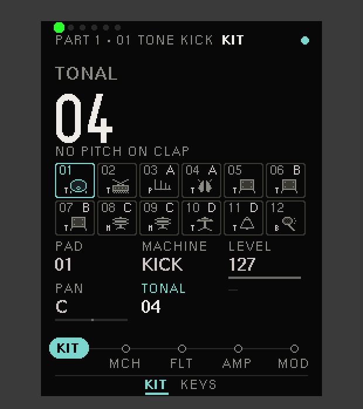

**Why:** what a note plays depends on the kit, which is saved, never on which pad the screen shows. OFF repeats the kit every octave, which is what a drum pad controller, a sequencer or a part written for a General MIDI kit expects: they send notes from 36 up, and each lands on a pad. TONAL puts its pad's tuned pitch at middle C, where a keyboard plays, instead of five octaves down.

## DRUM: the KEYS page

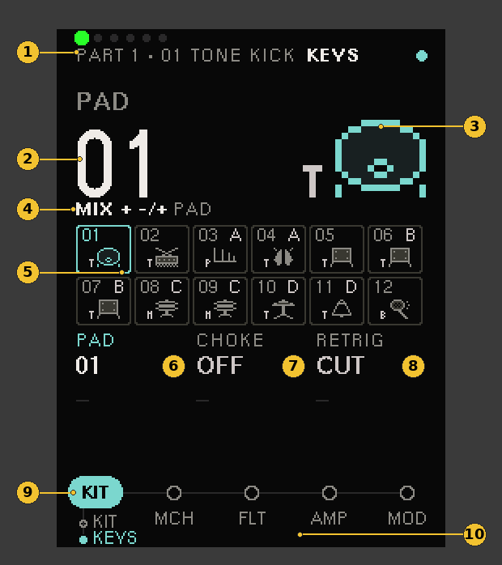

1. **Header:** the Part, the pad and its machine, and the page, KEYS.
2. **The focused cell, large:** here PAD, 01.
3. **The machine's icon, large.**
4. **Hint line:** `MIX + -/+ PAD`. With CHOKE touched it reads the kit's `GROUPS n/8` instead.
5. **The twelve pads**, as on KIT, each with its choke group.
6. **PAD:** which pad.
7. **CHOKE:** the pad's choke group.
8. **RETRIG:** CUT or STACK.
9. **The chain map**, KIT lit.
10. **KIT's sub-pages**, KEYS lit.

KEYS (under KIT; **SEQ** from KIT) sets how the selected pad's hits meet each other.

| Cell | Range | Default | What it does |
|---|---|---|---|
| **PAD** | 01 to 12 | | Which pad, as on KIT |
| **CHOKE** | OFF, A, B, C, D | per pad (INIT kit below) | A hit on a pad ends every other pad in the same group. OFF: the pad chokes nothing and nothing chokes it |
| **RETRIG** | STACK, CUT | CUT | CUT: a new hit ends the pad's own ringing hit. STACK: hits overlap, each rings out |

The ended hit fades out quickly rather than stopping dead, so a choke never clicks.

A classic use: open and closed hats in one group, so the closed hat cuts the open one.

## DRUM: choke groups and voice groups

A Part has eight voices. A DRUM kit fits them by its choke groups: a choke group sounds one pad at a time, and a pad with CHOKE OFF sounds on its own. Each group in use (A to D) counts once and each OFF pad counts once. A kit may hold at most **8 voice groups**.

- With CHOKE touched, the hint line reads `GROUPS n/8`; INIT DRUM reads `GROUPS 8/8`.
- An encoder turn onto a group that would make a ninth lands on it dimmed, with the reason in red: `9 GROUPS · KIT HOLDS 8`. Nothing is written; turn on past it to a group that fits.
- A change that cannot land from a controller shows the reason as a toast.

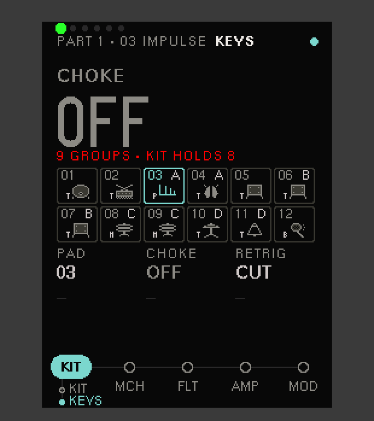

A NONE pad still counts toward the groups, as its choke group or as OFF.

A **STACK** pad that needs a voice when all are busy ends its own oldest hit, never another pad's. A CUT pad has nothing of its own left ringing, so it takes a voice as any note does (the oldest released voice first).

**Why:** a steal is a choke nobody chose. Letting a busy pattern take voices from other pads freed voices, but it sounded worse everywhere except the busiest breakbeat. Eight groups in eight voices means a kit never has to steal from itself. INIT DRUM's kit has exactly eight groups.

## DRUM: the INIT kit

INIT DRUM's kit, every pad on RETRIG CUT, LEVEL 127, PAN C:

| Pad | Note (TONAL OFF) | MACHINE | CHOKE | Set from the machine's defaults |
|---|---|---|---|---|
| 01 | C | TONE KICK | OFF | |
| 02 | C# | TONE SNARE | OFF | |
| 03 | D | PLAIN IMPULSE (a rimshot) | A | |
| 04 | D# | TONE CLAP | A | |
| 05 | E | TONE TOM | OFF | PITCH 30 (about 82 Hz): low tom |
| 06 | F | TONE TOM | B | PITCH 50 (113 Hz): mid tom |
| 07 | F# | TONE TOM | B | PITCH 70 (about 157 Hz): high tom |
| 08 | G | METAL HAT | C | DECAY 20 (39 ms): closed |
| 09 | G# | METAL HAT | C | DECAY 80 (about 0.3 s): open |
| 10 | A | TONE CYMBAL | D | |
| 11 | A# | TONE COWBELL | D | |
| 12 | B | BODY SHAKER | OFF | |

Every pad starts with the same pad sound: CLEAN LP4 at 20.0 kHz with Q 0, an open AMP (DECAY INF) on 1-SHOT, VEL 127, no gate, a mod envelope of ATTACK 0, HOLD 0, DECAY 64 at MED, the LFO on SINE at SPEED 6, DEPTH 127, and no routes.

## DRUM: the MCH and MORE pages

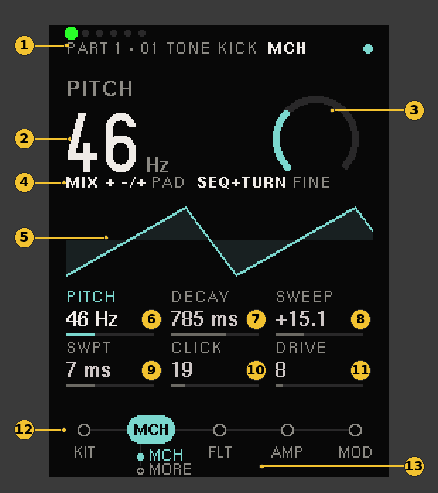

1. **Header:** the Part, the pad and its machine, and the page, MCH.
2. **The focused cell, large:** here PITCH, 46 Hz.
3. **Its arc.**
4. **Hint line:** `MIX + -/+ PAD` and `SEQ+TURN FINE`.
5. **The picture band:** the Part's live output.
6. **Knob A:** here TONE KICK's PITCH.
7. **Knob B:** DECAY.
8. **Knob C:** SWEEP.
9. **Knob D:** SWPT (SWEEP TIME).
10. **Knob E:** CLICK.
11. **Knob F:** DRIVE.
12. **The chain map**, MCH lit.
13. **MCH's sub-pages:** MCH and MORE.

**MCH** (MACHINE on the row) holds the machine's first six knobs; **MORE** (**SEQ** from MCH) holds MACHINE again, then the machine's last two knobs. Each machine labels the knobs its own way, and each knob shows its value in the machine's unit: Hz, ms or s, semitones (+15.1), a ratio (1.47x), octaves (0.50 OCT) or a plain amount. A cell the machine lacks is empty. A label longer than seven letters shows in short on its cell (SWEEP TIME as SWPT); the focus band names it in full. The tables below give both.

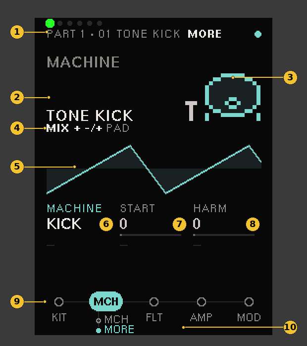

1. **Header:** the Part, the pad and its machine, and the page, MORE.
2. **The focused cell, large:** MACHINE, in its full name (TONE KICK).
3. **The machine's icon, large.**
4. **Hint line:** `MIX + -/+ PAD`.
5. **The picture band:** the Part's live output.
6. **MACHINE:** the pad's machine, as on KIT.
7. **Knob G:** here TONE KICK's START.
8. **Knob H:** here HARM (HARMONICS).
9. **The chain map**, MCH lit.
10. **MCH's sub-pages**, MORE lit.

The machine's knobs, LEVEL, PAN and VEL are read when the pad is struck: a turn is heard on the next hit, not on a hit already ringing. The pad's filter, envelopes, LFO and route amounts follow a turn on hits still ringing (see [what follows a ringing hit](#drum-what-a-ringing-hit-follows)).

**Why:** the machine's knobs set up the strike itself (its pitch sweep, its burst pattern, its tuning). Changing them under a ringing hit would mean rewriting each machine's sound in mid-flight; latching them at the strike keeps every machine exact and cheap. Where a moving sound matters, the filter and the envelopes follow.

## DRUM: every machine

There are twelve machines in four families, and NONE. The family's letter is the badge on the pad's icon.

| Family | Machines | How it sounds |
|---|---|---|
| **TONE** (T) | TONE KICK, TONE SNARE, TONE TOM | A sine body swept down in pitch, a noise layer, and drive |
| **TONE** (T) | TONE CLAP | Bursts of noise through a band-pass, then a tail |
| **TONE** (T) | TONE COWBELL, TONE CYMBAL | Square waves through band-passes |
| **METAL** (M) | METAL HAT | Six square waves through band-passes, with noise |
| **METAL** (M) | METAL JINGLE | The same squares, rung higher and gated by shaken particles, with a frame drum's thump |
| **BODY** (B) | BODY SHAKER | Grains of noise in a shake, through a band-pass |
| **PLAIN** (P) | PLAIN SINE, PLAIN NOISE, PLAIN IMPULSE | One source under one decay |
| | NONE | No machine: the pad plays nothing |

Each table below lists the knobs in cell order: the first six on MCH (top row A B C, bottom row D E F), the last two on MORE. Ranges and defaults are as the screen shows them. The machines' knobs are 0 to 127 on the encoder; the value cell shows the unit.

### DRUM: TONE KICK


1. **Header:** the Part, the pad and `TONE KICK`, and the page, MCH.
2. **The focused cell, large:** PITCH.
3. **Its arc.**
4. **Hint line:** `MIX + -/+ PAD` and `SEQ+TURN FINE`.
5. **The picture band:** the Part's live output.
6. **PITCH** (top left, encoder 1).
7. **DECAY** (top middle, encoder 2).
8. **SWEEP** (top right, encoder 3).
9. **SWPT (SWEEP TIME)** (bottom left, encoder 4).
10. **CLICK** (bottom middle, encoder 5).
11. **DRIVE** (bottom right, encoder 6).
12. **The chain map**, MCH lit.
13. **MCH's sub-pages:** MCH and MORE.

A swept sine kick: the body starts SWEEP semitones above PITCH and falls to it.

| Cell | Range | Default | What it does |
|---|---|---|---|
| **PITCH** | 30 Hz to 120 Hz | 46 Hz | Where the body settles |
| **DECAY** | 80 ms to 3.00 s | 785 ms | How long the body rings |
| **SWEEP** | 0.0 to +48.0 | +15.1 | How far above PITCH the body starts, in semitones |
| **SWEEP TIME** (cell: SWPT) | 2 ms to 120 ms | 7 ms | How fast the sweep falls |
| **CLICK** | 0 to 120 | 19 | The click at the start |
| **DRIVE** | 0 to 100 | 8 | Saturation |
| **START** (MORE) | 0 to 100 | 0 | Starts the body up to a quarter cycle in: a harder edge |
| **HARMONICS** (MORE) (cell: HARM) | 0 to 100 | 0 | Folds in the second and third partials |

Starting points: a long sub kick, DECAY up past 1.5 s, SWEEP low, CLICK 0. A punchy short kick, DECAY around 300 ms, SWEEP high and SWEEP TIME short, a little DRIVE.

### DRUM: TONE SNARE

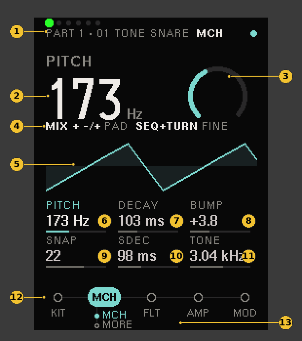

1. **Header:** the Part, the pad and `TONE SNARE`, and the page, MCH.
2. **The focused cell, large:** PITCH.
3. **Its arc.**
4. **Hint line:** `MIX + -/+ PAD` and `SEQ+TURN FINE`.
5. **The picture band:** the Part's live output.
6. **PITCH** (top left, encoder 1).
7. **DECAY** (top middle, encoder 2).
8. **BUMP** (top right, encoder 3).
9. **SNAP** (bottom left, encoder 4).
10. **SDEC (SNAP DECAY)** (bottom middle, encoder 5).
11. **TONE** (bottom right, encoder 6).
12. **The chain map**, MCH lit.
13. **MCH's sub-pages:** MCH and MORE.

Two drum heads and a noise snap.

| Cell | Range | Default | What it does |
|---|---|---|---|
| **PITCH** | 100 Hz to 400 Hz | 173 Hz | The lower head's pitch |
| **DECAY** | 40 ms to 800 ms | 103 ms | The heads' decay |
| **BUMP** | 0.0 to +12.0 | +3.8 | Both heads start this many semitones up and fall quickly |
| **SNAP** | 0 to 35 | 22 | The snare wires' noise level |
| **SNAP DECAY** (cell: SDEC) | 30 ms to 600 ms | 98 ms | How long the noise lasts |
| **TONE** | 800 Hz to 9.00 kHz | 3.04 kHz | The noise's band-pass |
| **INTERVAL** (MORE) (cell: INTV) | 1.20x to 1.77x | 1.47x | The upper head over the lower |
| **DRIVE** (MORE) | 0 to 100 | 0 | Saturation |

### DRUM: TONE TOM

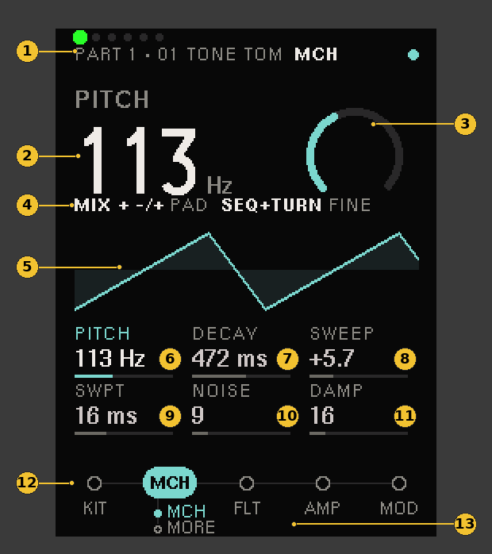

1. **Header:** the Part, the pad and `TONE TOM`, and the page, MCH.
2. **The focused cell, large:** PITCH.
3. **Its arc.**
4. **Hint line:** `MIX + -/+ PAD` and `SEQ+TURN FINE`.
5. **The picture band:** the Part's live output.
6. **PITCH** (top left, encoder 1).
7. **DECAY** (top middle, encoder 2).
8. **SWEEP** (top right, encoder 3).
9. **SWPT (SWEEP TIME)** (bottom left, encoder 4).
10. **NOISE** (bottom middle, encoder 5).
11. **DAMP** (bottom right, encoder 6).
12. **The chain map**, MCH lit.
13. **MCH's sub-pages:** MCH and MORE.

| Cell | Range | Default | What it does |
|---|---|---|---|
| **PITCH** | 50 Hz to 400 Hz | 113 Hz | Where the body settles |
| **DECAY** | 80 ms to 2.00 s | 472 ms | How long it rings |
| **SWEEP** | 0.0 to +24.0 | +5.7 | How far above PITCH it starts, in semitones |
| **SWEEP TIME** (cell: SWPT) | 4 ms to 300 ms | 16 ms | How fast the sweep falls |
| **NOISE** | 0 to 60 | 9 | A noise layer, low-passed at four times PITCH (at most 12 kHz) |
| **DAMP** | 0 to 100 | 16 | Blends in a faster decay: a damped head |
| **DRIVE** (MORE) | 0 to 100 | 0 | Saturation |
| **DRIVE TYPE** (MORE) (cell: DTYP) | 0 to 100 | 0 | From a soft clip (0) leaning into a wavefolder (100) |

### DRUM: TONE CLAP

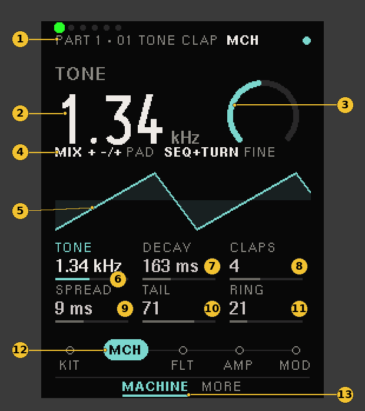

1. **Header:** the Part, the pad and `TONE CLAP`, and the page, MCH.
2. **The focused cell, large:** TONE.
3. **Its arc.**
4. **Hint line:** `MIX + -/+ PAD` and `SEQ+TURN FINE`.
5. **The picture band:** the Part's live output.
6. **TONE** (top left, encoder 1).
7. **DECAY** (top middle, encoder 2).
8. **CLAPS** (top right, encoder 3).
9. **SPREAD** (bottom left, encoder 4).
10. **TAIL** (bottom middle, encoder 5).
11. **RING** (bottom right, encoder 6).
12. **The chain map**, MCH lit.
13. **MCH's sub-pages:** MCH and MORE.

Several quick bursts of noise, then a tail.

| Cell | Range | Default | What it does |
|---|---|---|---|
| **TONE** | 500 Hz to 4.00 kHz | 1.33 kHz | The band-pass the bursts sound through |
| **DECAY** | 50 ms to 1.00 s | 163 ms | The tail's length |
| **CLAPS** | 1 to 8 | 4 | How many hands |
| **SPREAD** | 4 ms to 30 ms | 9 ms | The time between the claps |
| **TAIL** | 0 to 100 | 71 | The tail's level |
| **RING** | 0 to 90 | 21 | The band-pass's resonance |
| **HARDNESS** (MORE) (cell: HARD) | 0.80x to 0.15x | 0.34x | Each clap's fall as a share of SPREAD: higher on the knob, shorter and harder |
| **ROOM TONE** (MORE) (cell: ROOM) | 400 Hz to 24.0 kHz | 24.0 kHz | A low-pass on the tail: lower sounds further away |

### DRUM: TONE COWBELL


1. **Header:** the Part, the pad and `TONE COWBELL`, and the page, MCH.
2. **The focused cell, large:** PITCH.
3. **Its arc.**
4. **Hint line:** `MIX + -/+ PAD` and `SEQ+TURN FINE`.
5. **The picture band:** the Part's live output.
6. **PITCH** (top left, encoder 1).
7. **DECAY** (top middle, encoder 2).
8. **INTV (INTERVAL)** (top right, encoder 3).
9. **TONE** (bottom left, encoder 4).
10. **RING** (bottom middle, encoder 5).
11. **DRIVE** (bottom right, encoder 6).
12. **The chain map**, MCH lit.
13. **MCH's sub-pages:** MCH and MORE.

Two square waves through band-passes.

| Cell | Range | Default | What it does |
|---|---|---|---|
| **PITCH** | 300 Hz to 1.20 kHz | 547 Hz | The lower square |
| **DECAY** | 80 ms to 1.50 s | 254 ms | How long it rings |
| **INTERVAL** (cell: INTV) | 1.20x to 1.80x | 1.48x | The upper square over the lower |
| **TONE** | 600 Hz to 6.00 kHz | 2.13 kHz | The band-pass |
| **RING** | 0 to 85 | 27 | The band-pass's resonance |
| **DRIVE** | 0 to 100 | 24 | Saturation |
| **DAMP** (MORE) | 0 to 100 | 60 | Blends in a faster decay |
| **BUMP** (MORE) | 0.00 OCT to 1.00 OCT | 0.00 OCT | Starts the pitch up to an octave higher, falling in 6 ms. BUMP costs extra voice time while it sweeps (see [voice cost](#drum-voice-cost-per-machine)) |

### DRUM: TONE CYMBAL

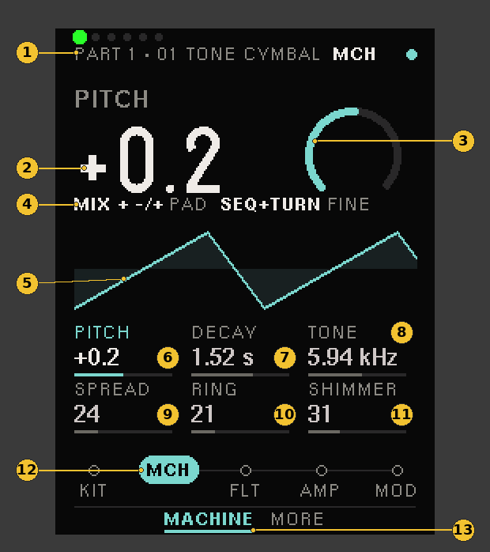

1. **Header:** the Part, the pad and `TONE CYMBAL`, and the page, MCH.
2. **The focused cell, large:** PITCH.
3. **Its arc.**
4. **Hint line:** `MIX + -/+ PAD` and `SEQ+TURN FINE`.
5. **The picture band:** the Part's live output.
6. **PITCH** (top left, encoder 1).
7. **DECAY** (top middle, encoder 2).
8. **TONE** (top right, encoder 3).
9. **SPREAD** (bottom left, encoder 4).
10. **RING** (bottom middle, encoder 5).
11. **SHIMMER** (bottom right, encoder 6).
12. **The chain map**, MCH lit.
13. **MCH's sub-pages:** MCH and MORE.

Six square waves through band-passes, with a separate top.

| Cell | Range | Default | What it does |
|---|---|---|---|
| **PITCH** | -24.0 to +24.0 | +0.2 | Tunes the squares, in semitones |
| **DECAY** | 200 ms to 5.00 s | 1.52 s | How long it rings |
| **TONE** | 2.50 kHz to 12.0 kHz | 5.94 kHz | The band-pass |
| **SPREAD** | 0 to 100 | 24 | Detunes the six squares away from their set ratios |
| **RING** | 0 to 90 | 21 | The band-pass's resonance |
| **SHIMMER** | 0 to 100 | 31 | Two slow LFOs detune the squares and sway their levels |
| **TOP** (MORE) | 0 to 50 | 30 | A second, higher band's level |
| **TOP TUNE** (MORE) (cell: TTUN) | 1.10x to 1.60x | 1.35x | That band over TONE |

### DRUM: METAL HAT

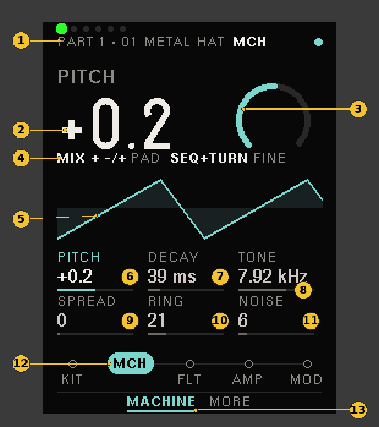

1. **Header:** the Part, the pad and `METAL HAT`, and the page, MCH.
2. **The focused cell, large:** PITCH.
3. **Its arc.**
4. **Hint line:** `MIX + -/+ PAD` and `SEQ+TURN FINE`.
5. **The picture band:** the Part's live output.
6. **PITCH** (top left, encoder 1).
7. **DECAY** (top middle, encoder 2).
8. **TONE** (top right, encoder 3).
9. **SPREAD** (bottom left, encoder 4).
10. **RING** (bottom middle, encoder 5).
11. **NOISE** (bottom right, encoder 6).
12. **The chain map**, MCH lit.
13. **MCH's sub-pages:** MCH and MORE.

| Cell | Range | Default | What it does |
|---|---|---|---|
| **PITCH** | -24.0 to +24.0 | +0.2 | Tunes the six squares, in semitones |
| **DECAY** | 20 ms to 1.50 s | 39 ms | Short for closed, long for open |
| **TONE** | 3.00 kHz to 14.0 kHz | 7.92 kHz | The band-pass |
| **SPREAD** | 0 to 100 | 0 | Detunes the squares |
| **RING** | 0 to 90 | 21 | The band-pass's resonance |
| **NOISE** | 0 to 50 | 6 | A noise layer |
| **HIGH PASS** (MORE) (cell: HP) | 0.25x to 1.00x | 0.50x | A high-pass, as a share of TONE |
| **LOW PASS** (MORE) (cell: LP) | 2.00 kHz to 20.0 kHz | 20.0 kHz | A low-pass; at the top it is off |

### DRUM: METAL JINGLE


1. **Header:** the Part, the pad and `METAL JINGLE`, and the page, MCH.
2. **The focused cell, large:** PITCH.
3. **Its arc.**
4. **Hint line:** `MIX + -/+ PAD` and `SEQ+TURN FINE`.
5. **The picture band:** the Part's live output.
6. **PITCH** (top left, encoder 1).
7. **DECAY** (top middle, encoder 2).
8. **JINGLES** (top right, encoder 3).
9. **SHAKE** (bottom left, encoder 4).
10. **TONE** (bottom middle, encoder 5).
11. **RING** (bottom right, encoder 6).
12. **The chain map**, MCH lit.
13. **MCH's sub-pages:** MCH and MORE.

A tambourine: the hat's squares, an octave up, gated by shaken particles. HEAD adds a frame drum's thump.

| Cell | Range | Default | What it does |
|---|---|---|---|
| **PITCH** | -12.0 to +24.0 | +6.1 | Tunes the jingles (and the head), in semitones |
| **DECAY** | 50 ms to 1.00 s | 163 ms | The shake's length |
| **JINGLES** | 300 Hz to 6.00 kHz | 1.56 kHz | How many jingle strikes a second at the shake's peak (shown in Hz) |
| **SHAKE** | 0 to 60 | 14 | Where in the shake its peak falls |
| **TONE** | 5.00 kHz to 14.0 kHz | 8.13 kHz | The band-pass |
| **RING** | 50 to 95 | 68 | The band-pass's resonance; held just under where it would ring on for good |
| **HEAD** (MORE) | 0 to 70 | 0 | The frame drum's thump |
| **SPREAD** (MORE) | 0 to 100 | 31 | Detunes the jingles |

### DRUM: BODY SHAKER

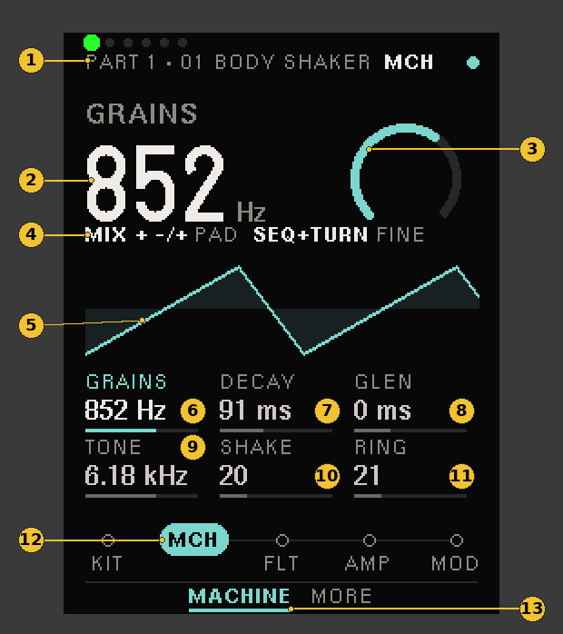

1. **Header:** the Part, the pad and `BODY SHAKER`, and the page, MCH.
2. **The focused cell, large:** GRAINS.
3. **Its arc.**
4. **Hint line:** `MIX + -/+ PAD` and `SEQ+TURN FINE`.
5. **The picture band:** the Part's live output.
6. **GRAINS** (top left, encoder 1).
7. **DECAY** (top middle, encoder 2).
8. **GLEN (GRAIN LENGTH)** (top right, encoder 3).
9. **TONE** (bottom left, encoder 4).
10. **SHAKE** (bottom middle, encoder 5).
11. **RING** (bottom right, encoder 6).
12. **The chain map**, MCH lit.
13. **MCH's sub-pages:** MCH and MORE.

A shaker: short grains of noise in a swell.

| Cell | Range | Default | What it does |
|---|---|---|---|
| **GRAINS** | 100 Hz to 3.00 kHz | 852 Hz | Grains a second at the shake's peak (shown in Hz) |
| **DECAY** | 30 ms to 500 ms | 91 ms | The shake's length |
| **GRAIN LENGTH** (cell: GLEN) | 0 ms to 3 ms | 0 ms | Each grain's ring, 0.2 ms to 3 ms (the cell shows whole ms) |
| **TONE** | 2.00 kHz to 12.0 kHz | 6.18 kHz | The band-pass |
| **SHAKE** | 5 to 70 | 20 | Where in the shake its peak falls |
| **RING** | 0 to 90 | 21 | The band-pass's resonance |
| **HARDNESS** (MORE) (cell: HARD) | 0 to 100 | 50 | Below the middle, darker grains; above, dry grains over the band |

BODY SHAKER has no eighth knob.

### DRUM: PLAIN SINE

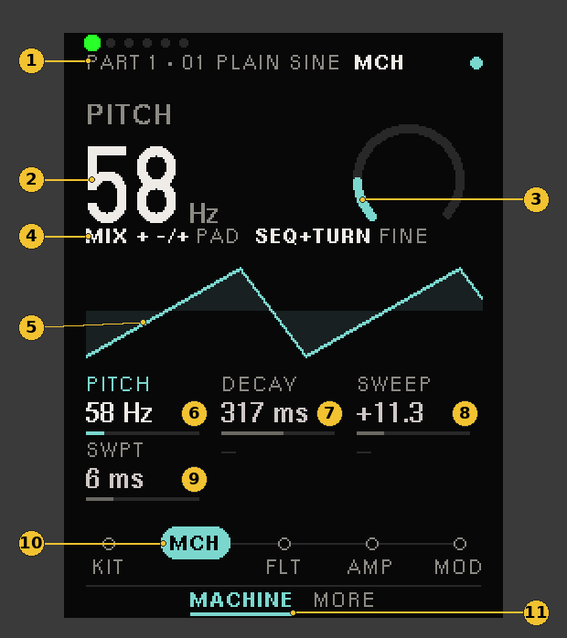

1. **Header:** the Part, the pad and `PLAIN SINE`, and the page, MCH.
2. **The focused cell, large:** PITCH.
3. **Its arc.**
4. **Hint line:** `MIX + -/+ PAD` and `SEQ+TURN FINE`.
5. **The picture band:** the Part's live output.
6. **PITCH** (top left, encoder 1).
7. **DECAY** (top middle, encoder 2).
8. **SWEEP** (top right, encoder 3).
9. **SWPT (SWEEP TIME)** (bottom left, encoder 4).
10. **The chain map**, MCH lit.
11. **MCH's sub-pages:** MCH and MORE.

| Cell | Range | Default | What it does |
|---|---|---|---|
| **PITCH** | 30 Hz to 2.00 kHz | 58 Hz | Where the sine settles |
| **DECAY** | 20 ms to 3.00 s | 317 ms | How long it rings |
| **SWEEP** | 0.0 to +48.0 | +11.3 | How far above PITCH it starts |
| **SWEEP TIME** (cell: SWPT) | 2 ms to 200 ms | 6 ms | How fast the sweep falls |

A plain swept sine: an 808-style bass on TONAL, a zap, a blip.

### DRUM: PLAIN NOISE

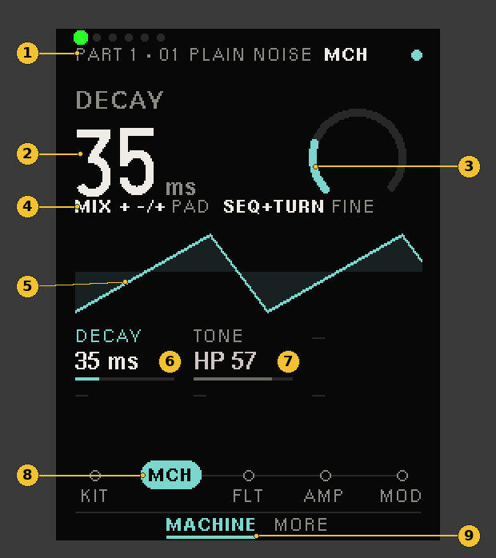

1. **Header:** the Part, the pad and `PLAIN NOISE`, and the page, MCH.
2. **The focused cell, large:** DECAY.
3. **Its arc.**
4. **Hint line:** `MIX + -/+ PAD` and `SEQ+TURN FINE`.
5. **The picture band:** the Part's live output.
6. **DECAY** (top left, encoder 1).
7. **TONE** (top middle, encoder 2).
8. **The chain map**, MCH lit.
9. **MCH's sub-pages:** MCH and MORE.

| Cell | Range | Default | What it does |
|---|---|---|---|
| **DECAY** | 10 ms to 2.00 s | 35 ms | How long it lasts |
| **TONE** | LP 100 to HP 100 | HP 57 | Below the middle a low-pass closing; above, a high-pass opening; FLAT in the middle |

### DRUM: PLAIN IMPULSE


1. **Header:** the Part, the pad and `PLAIN IMPULSE`, and the page, MCH.
2. **The focused cell, large:** PITCH.
3. **Its arc.**
4. **Hint line:** `MIX + -/+ PAD` and `SEQ+TURN FINE`.
5. **The picture band:** the Part's live output.
6. **PITCH** (top left, encoder 1).
7. **DECAY** (top middle, encoder 2).
8. **SWEEP** (top right, encoder 3).
9. **SWPT (SWEEP TIME)** (bottom left, encoder 4).
10. **The chain map**, MCH lit.
11. **MCH's sub-pages:** MCH and MORE.

A pulse wave under a decay: a rimshot, a click, a blip.

| Cell | Range | Default | What it does |
|---|---|---|---|
| **PITCH** | 30 Hz to 2.00 kHz | 113 Hz | The pulse's pitch |
| **DECAY** | 20 ms to 3.00 s | 65 ms | How long it lasts |
| **SWEEP** | 0.0 to +48.0 | 0.0 | How far above PITCH it starts |
| **SWEEP TIME** (cell: SWPT) | 2 ms to 200 ms | 2 ms | How fast the sweep falls |
| **WIDTH** (MORE) | 0 to 100 | 92 | The pulse's width |

PLAIN IMPULSE costs more voice time while SWEEP moves it, and at a high PITCH with WIDTH near the top (see [voice cost](#drum-voice-cost-per-machine)).

> **Design note:** The DRUM machines are built from parts the rest of Chimera already had: VA's noise and oscillators, the CLEAN filter's band-passes, the FX slot's SOFT and FOLD shapers. The metal machines tune their six squares to the 808-style ratios, the published values from that drum machine's circuit, with SPREAD to pull them apart. Nothing here is a sample. If your hi-hat sounds like a filing cabinet falling down the stairs, that is RING and SPREAD at the top, and it is working as intended.

### DRUM: NONE

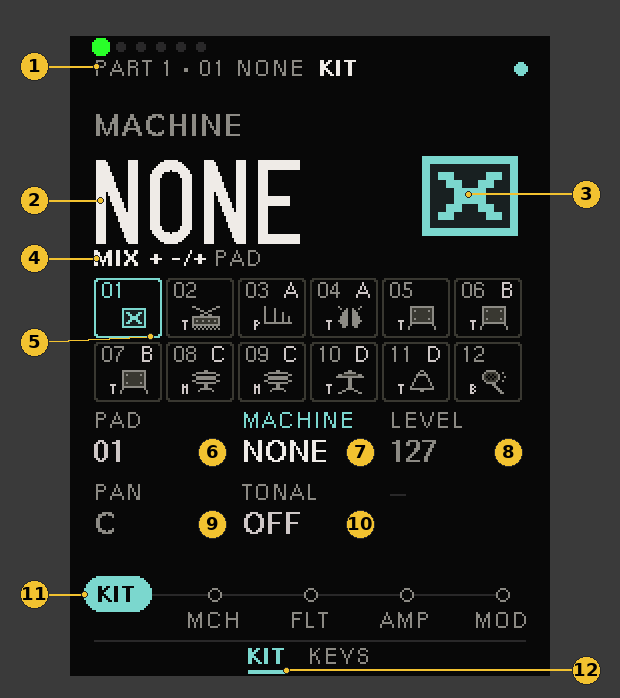

1. **Header:** the Part, the pad and `NONE`, and the page, KIT.
2. **The focused cell, large:** MACHINE, NONE.
3. **NONE's icon:** a box with an X.
4. **Hint line:** `MIX + -/+ PAD`.
5. **The twelve pads:** this pad shows NONE's box.
6. **PAD:** still live.
7. **MACHINE:** NONE; turn it to bring a machine back.
8. **LEVEL:** dimmed, its value kept.
9. **PAN:** dimmed, its value kept.
10. **TONAL:** still live.
11. **The chain map**, KIT lit.
12. **KIT's sub-pages.**

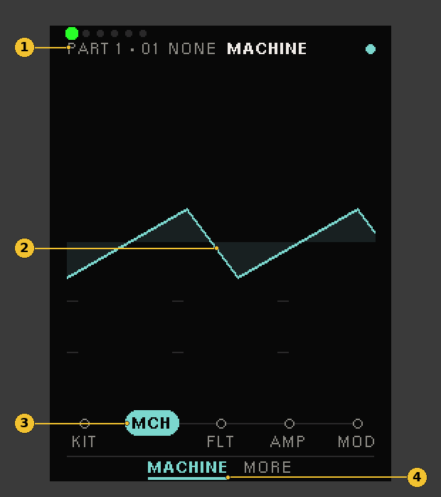

1. **Header:** the pad, NONE, and the page, MCH.
2. **The picture band.** Every knob cell is empty.
3. **The chain map**, MCH lit.
4. **MCH's sub-pages.**

NONE is MACHINE's last choice. A NONE pad plays nothing: a note on it books no voice, ends no other hit and chokes nothing. A live note on it still selects it on KIT (with PAD FOLLOW), so you can find the pad you hit.

- The pad's icon is a box with an X, and the header reads `· 01 NONE`.
- MCH and MORE are empty.
- Every other pad cell (LEVEL, PAN, CHOKE, RETRIG, the filter, AMP, GATE, PAD ENV, PAD LFO, ROUTE) is dimmed and ignores the encoder. Its values stay, so choosing a machine again brings back the pad's level, pan, chokes and sound. The machine's knobs come back at that machine's defaults.
- PAD, TONAL and the Part's FX and FX PLACE stay live.
- A hit already ringing when its pad turns NONE rings out.

**Why:** a kit is billed for its most expensive pad, every pad's filter shape, routes and gate included, even pads you never strike. NONE tells the instrument a pad is not in use, so a spare pad with a costly filter or routes no longer takes voices from the pads you play.

## DRUM: the FLT page (the pad's filter)

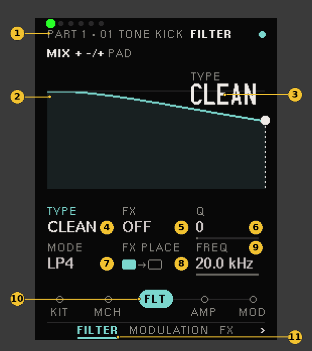

1. **Header:** the Part, the pad and its machine, and the page, FILTER.
2. **The pad's filter curve**, with the cutoff's dot. Hint line above it: `MIX + -/+ PAD`.
3. **The filter TYPE**, large.
4. **TYPE:** the pad's filter type.
5. **FX:** the Part's FX slot.
6. **Q:** the pad's resonance.
7. **MODE:** the pad's filter response.
8. **FX PLACE:** the FX slot before or after the filter (drawn as which box comes first).
9. **FREQ:** the pad's cutoff.
10. **The chain map**, FLT lit.
11. **FLT's sub-pages:** FLT, FMD and on.

FLT (FILTER on the row) puts the pad's filter and the Part's FX slot on one page. Its cells, encoders 1 to 6:

| Cell | Whose | What it does |
|---|---|---|
| **TYPE** | pad | CLEAN, 2040, DIRTY, LADDER or SEM. Default CLEAN |
| **FX** | Part | The FX slot: OFF, SOFT, FUZZ or FOLD. Default OFF |
| **Q** or **RES** | pad | Resonance (Q on CLEAN, DIRTY and LADDER; RES on 2040 and SEM). 0 to 127, default 0 |
| **MODE** or **VOICE** | pad | The response (below) |
| **FX PLACE** | Part | PRE or POST: the FX slot before or after the filter. Default PRE |
| **FREQ** or **CUTOFF** | pad | The cutoff, 20 Hz to 20.0 kHz, default 20.0 kHz (CUTOFF on 2040, FREQ on the others) |

The cells after TYPE follow it:

| TYPE | Resonance | Response | Cutoff |
|---|---|---|---|
| CLEAN | **Q** | **MODE**: LP1, LP2, LP4, BP2, BP4, HP4, NOTCH1, NOTCH2 (default LP4) | **FREQ** |
| 2040 | **RES** | **VOICE**: REV2 or EXPNDR | **CUTOFF** |
| DIRTY | **Q** | **MODE**: LP2, BP2, HP2, NOTCH1 | **FREQ** |
| LADDER | **Q** | **MODE**: LP2, LP4, BP2, BP4, HP4 | **FREQ** |
| SEM | **RES** | **MODE**: a sweep from low-pass through notch to high-pass, 0 to 127 | **FREQ** |

What each TYPE, MODE and VOICE sounds like is in [the voice chain](08-voice-chain.md). The FX slot's types are there too.

The hint line shows `MIX + -/+ PAD` on FLT's cells, the Part's FX and FX PLACE included: on this page MIX + MINUS / PLUS always steps the pad.

**Why:** each pad gets its own filter because a drum machine's pads each shape their own sound (a dark kick, a bright hat). The FX slot is the voice's costliest block and the Part's character, so it stays one per Part: a per-pad FX slot would cost up to twelve times as much.

## DRUM: the FMD, FX and JACK pages

These three sub-pages of FLT are the Part's, shared by every pad, with one exception: on SEM, **OUTPUT** is the pad's.

**FMD** (MODULATION on the row) holds the filter's modulation routes:

| Cell | What it does |
|---|---|
| **ENV AMT** | ENV1 into the cutoff |
| **KEYBOARD** | The note into the cutoff |
| **FREQ MOD** | The source picked on JACK as FREQ SRC into the cutoff |
| **FEEDBACK** (cell: FDBK) | The filter's output fed back into its cutoff |
| **RES MOD** | The source picked on JACK as RES SRC into the resonance |
| **OUTPUT** (SEM only, the pad's) | MODE (the MODE sweep's output) or BP (the band-pass output) |

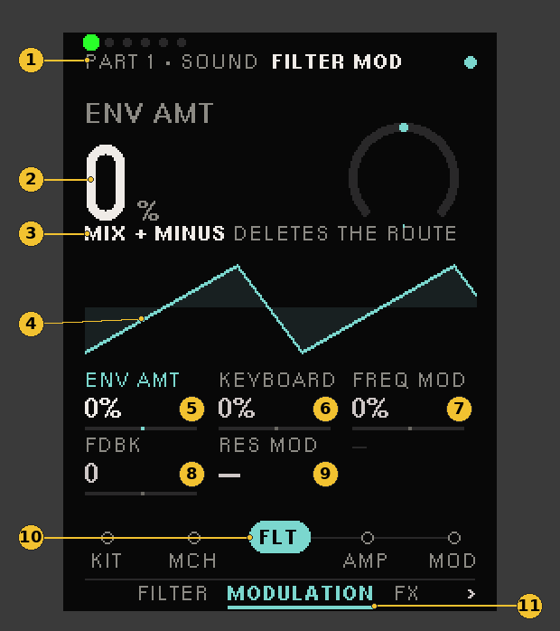

1. **Header:** `PART 1 · SOUND  FILTER MOD`: a Part page, shared by the pads.
2. **The focused cell, large:** ENV AMT, 0 %.
3. **Hint line:** `MIX + MINUS DELETES THE ROUTE`.
4. **The picture band:** the Part's live output.
5. **ENV AMT.**
6. **KEYBOARD.**
7. **FREQ MOD.**
8. **FDBK** (FEEDBACK).
9. **RES MOD.**
10. **The chain map**, FLT lit.
11. **FLT's sub-pages**, FMD lit.

**FX** holds the filter's **INPUT** level (default 64), the FX slot's **MIX** (shown −64 to +63, default +63), **STABILITY** on 2040, LADDER and SEM (default 64), and the FX slot's three knobs: **DRIVE**, **TONE**, **LEVEL** on SOFT; **SUSTAIN**, **TONE**, **VOLUME** on FUZZ; **FOLD**, **SYMMETRY**, **LEVEL** on FOLD.

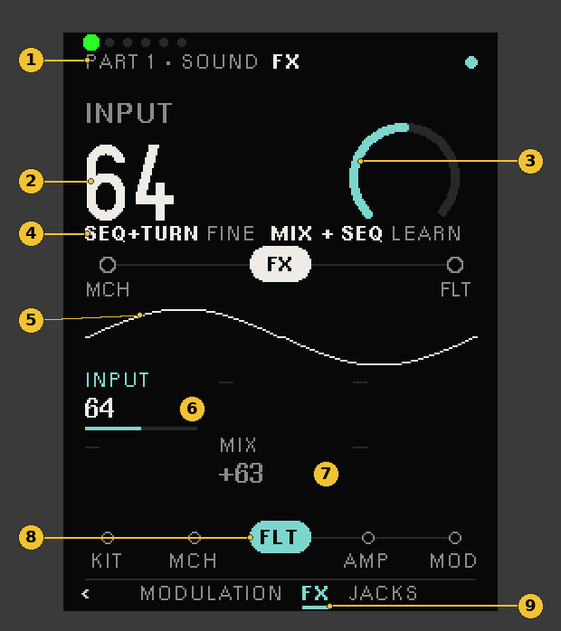

1. **Header:** `PART 1 · SOUND  FX`: a Part page.
2. **The focused cell, large:** INPUT, 64.
3. **Its arc.**
4. **Hint line:** `SEQ+TURN FINE` and `MIX + SEQ LEARN`.
5. **The FX slot's picture:** where the slot sits in the chain (here between MCH and FLT, PRE), over the live output.
6. **INPUT:** the level into the filter.
7. **MIX:** the FX slot's mix. With FX OFF, the slot's knobs are dashes.
8. **The chain map**, FLT lit.
9. **FLT's sub-pages**, FX lit.

**JACK** (JACKS on the row) picks **FREQ SRC** (LFO1, LFO2, LFO3, ENV2, ENV3, VELO, OP5, OP6) and **RES SRC** (ENV1, LFO1, ENV2, ENV3, LFO2, LFO3, VELO, NOTE, OP5, OP6).


1. **Header:** `PART 1 · SOUND  FILTER JACKS`: a Part page.
2. **The picture band:** the Part's live output.
3. **FREQ SRC:** what FREQ MOD reads.
4. **RES SRC:** what RES MOD reads.
5. **The chain map**, FLT lit.
6. **FLT's sub-pages**, JACK lit.

Every one of these is explained in [the voice chain](08-voice-chain.md); on DRUM they work the same, on whichever filter each pad plays. Which panel FMD, FX and JACK show follows the selected pad's TYPE.

## DRUM: the AMP page


1. **Header:** the Part, the pad and its machine, and the page, AMP. Hint line under it: `MIX + -/+ PAD`, `SEQ+TURN FINE`.
2. **The focused stage**, lit in the accent colour: here ATTACK.
3. **The rest of the envelope:** flat here, as DECAY is INF.
4. **The envelope's shape**, filled.
5. **ATTACK.**
6. **HOLD.**
7. **DECAY:** INF holds the level.
8. **SPEED:** FAST, MED or SLOW.
9. **VEL:** velocity's share of the hit's level.
10. **MODE:** 1-SHOT or GATED.
11. **The chain map**, AMP lit.
12. **AMP's sub-pages:** AMP, GATE, SENDS.

AMP is the pad's own amp envelope: attack, hold, decay. The band draws its shape.

| Cell | Range | Default | What it does |
|---|---|---|---|
| **ATTACK** | 0 to 127 | 0 | The rise |
| **HOLD** | 0 to 127 | 0 | How long it holds full after the rise |
| **DECAY** | 0 to 126, then INF | INF | The fall to silence; INF holds the level (the envelope is open) |
| **SPEED** | FAST, MED, SLOW | MED | The time range of all three stages, as the Part's envelope SPEED ([Envelopes and LFOs](09-envelopes-and-lfos.md)) |
| **VEL** | 0 to 127 | 127 | How much velocity sets the hit's level. 127: fully; 0: every hit plays as if at full velocity |
| **MODE** | 1-SHOT, GATED | 1-SHOT | 1-SHOT ignores note-off: the envelope plays out. GATED holds after HOLD until note-off, then falls over DECAY |

On GATED, a short note still plays its full attack and hold first. A DECAY of INF on GATED never falls.

The machine has its own decay (its DECAY knob). The AMP envelope shapes on top of it: with an open AMP (DECAY INF, the default), a hit rings its machine's full decay.

**VEL** acts on the machine itself, before the filter, so a soft hit also drives LADDER or DIRTY less. It is read at the strike.

**Why:** most drums ignore how long you hold a key, so 1-SHOT is the default. GATED, as on Elektron's AMP page, lets a held pad (a drone, a gated hat) end with its key. Note-off on 1-SHOT is still heard by the Part's VCA routes in the matrix (see [the mod matrix](10-mod-matrix.md)).

## DRUM: the GATE page

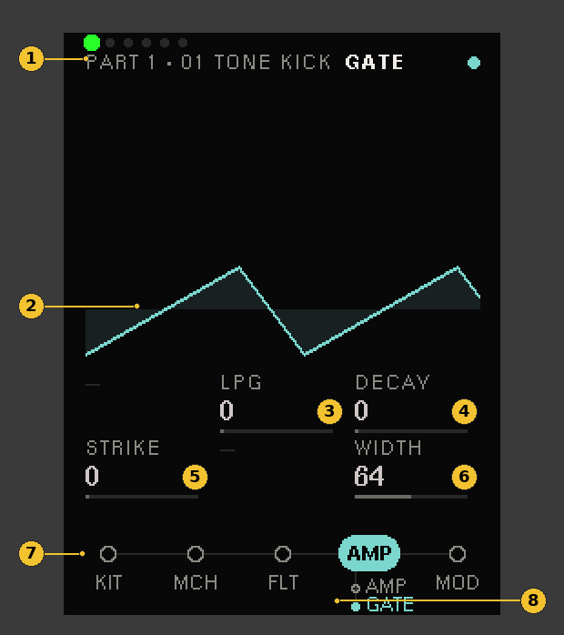

1. **Header:** the Part, the pad and its machine, and the page, GATE.
2. **The picture band:** the Part's live output.
3. **LPG:** the pad's low-pass gate amount.
4. **DECAY:** the gate's decay.
5. **STRIKE:** how hard the strike opens it.
6. **WIDTH:** the Part's stereo width.
7. **The chain map**, AMP lit.
8. **AMP's sub-pages**, GATE lit.

GATE (under AMP) is the pad's low-pass gate, and the Part's stereo width.

| Cell | Range | Default | Whose | What it does |
|---|---|---|---|---|
| **LPG** | 0 to 127 | 0 | pad | How much the low-pass gate closes the sound as it decays. 0: off |
| **DECAY** | 0 to 127 | 0 | pad | The gate's own decay |
| **STRIKE** | 0 to 127 | 0 | pad | How hard the strike opens the gate |
| **WIDTH** | 0 to 127 | 64 | Part | Spreads or narrows the kit's pans |

The low-pass gate is the one described under AMP in [the voice chain](08-voice-chain.md); on DRUM each pad has its own, replacing the Part's.

## DRUM: the PENV, PLFO and ROUTE pages

The first three sub-pages of MOD are the pad's own modulation: one envelope, one LFO and four routes. After them come the Part's ENV1, ENV2, ENV3, SPEED, LFO1, LFO2 and LFO3 ([Envelopes and LFOs](09-envelopes-and-lfos.md)); the MOD node itself is the Part's MATRIX ([the mod matrix](10-mod-matrix.md)).

### DRUM: PENV, the pad's mod envelope


1. **Header:** the Part, the pad and its machine, and the page, PENV.
2. **The focused stage**, lit in the accent colour: here ATTACK.
3. **HOLD and DECAY**, the rest of the shape.
4. **Hint line**, above the picture: `MIX + -/+ PAD`, `SEQ+TURN FINE`.
5. **The envelope's shape**, filled.
6. **ATTACK.**
7. **HOLD.**
8. **DECAY.**
9. **SPEED.**
10. **The chain map**, MOD lit.
11. **MOD's sub-pages**, PENV lit.

PENV (PAD ENV on the row) is an AHD envelope like AMP's, feeding the routes as MOD ENV.

| Cell | Range | Default |
|---|---|---|
| **ATTACK** | 0 to 127 | 0 |
| **HOLD** | 0 to 127 | 0 |
| **DECAY** | 0 to 126, then INF | 64 |
| **SPEED** | FAST, MED, SLOW | MED |

### DRUM: PLFO, the pad's LFO

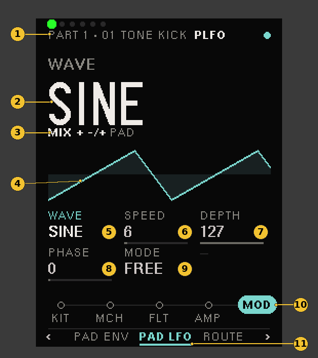

1. **Header:** the Part, the pad and its machine, and the page, PLFO.
2. **The focused cell, large:** WAVE, SINE.
3. **Hint line:** `MIX + -/+ PAD`.
4. **The picture band:** the Part's live output.
5. **WAVE.**
6. **SPEED.**
7. **DEPTH.**
8. **PHASE.**
9. **MODE:** FREE or RETRIG.
10. **The chain map**, MOD lit.
11. **MOD's sub-pages**, PLFO lit.

PLFO (PAD LFO on the row) feeds the routes as LFO.

| Cell | Range | Default | What it does |
|---|---|---|---|
| **WAVE** | SINE, TRI, SAW, SQUARE, RANDOM | SINE | The shape |
| **SPEED** | 0 to 127 | 6 | The rate |
| **DEPTH** | 0 to 127 | 127 | Its size |
| **PHASE** | 0 to 127 | 0 | Where in its cycle it starts on RETRIG |
| **MODE** | FREE, RETRIG | FREE | FREE runs on; RETRIG restarts at PHASE on every hit |

### DRUM: ROUTE, the pad's four routes


1. **Header:** the Part, the pad and its machine, and the page, ROUTE.
2. **The focused cell, large.**
3. **Hint line:** `MIX + -/+ PAD`.
4. **The picture band:** the Part's live output.
5. **ROUTE:** which of the four.
6. **SOURCE.**
7. **DEST.**
8. **AMOUNT.**
9. **The chain map**, MOD lit.
10. **MOD's sub-pages**, ROUTE lit.

ROUTE shows one route at a time. Turn **ROUTE** (1 to 4) to pick it.

| Cell | Range | Default | What it does |
|---|---|---|---|
| **ROUTE** | 1 to 4 | 1 | Which route the other cells edit |
| **SOURCE** | MOD ENV, LFO, VEL, LFO 1, LFO 2, LFO 3 | MOD ENV | MOD ENV, LFO and VEL are the pad's own; LFO 1 to 3 are the Part's LFOs |
| **DEST** | CUTOFF, RESO, VOLUME, LFO SPD, LFO DEP | CUTOFF | The pad's cutoff, resonance, volume, or its own LFO's speed or depth |
| **AMOUNT** | -100% to +100% | 0% | How far, and which way |

A route at 0% does nothing. CUTOFF and RESO routes move the filter at audio rate, as a Part's routes do.

**VOLUME** never boosts: a positive AMOUNT opens the volume as its source rises (full depth: silent at the source's bottom), a negative one ducks it as the source rises. Several VOLUME routes multiply.

Starting points: a snare that darkens as it decays, SOURCE MOD ENV, DEST CUTOFF, AMOUNT up, with a CLEAN LP cutoff part-way down. A hat that brightens with velocity, SOURCE VEL, DEST CUTOFF. A slow wobble on a long tom, SOURCE LFO, DEST CUTOFF, PLFO on TRI.

**Why:** a compact second layer of modulation. The Part's matrix still reaches each pad's filter and VCA; the pad's own routes give each drum movement of its own without a matrix per pad.

## DRUM: what a ringing hit follows

A hit is a copy of its pad, taken at the strike. Some of it follows your edits while the hit rings:

- **Set at the strike:** MACHINE and its knobs, LEVEL, PAN, VEL, CHOKE, RETRIG, the filter's TYPE and MODE (or VOICE), the PAD LFO's WAVE and MODE, each route's SOURCE and DEST, both envelopes' SPEED, AMP's MODE.
- **Follow a ringing hit, gliding:** CUTOFF / FREQ, Q / RES, SEM's MODE sweep, the AMP and PAD ENV times, LPG, the gate's DECAY and STRIKE, PAD LFO's SPEED, DEPTH and PHASE, each route's AMOUNT.

A long cymbal answers a filter sweep while it rings; a change of TYPE waits for the next hit.

**Why:** this is the Analog Rytm's split. Continuous values glide so a sweep sounds smooth on a hit already ringing; choices latch so a ringing hit never clicks or jumps.

## DRUM: the Part's own pages on a kit

The Part's Sound still runs on a DRUM Part, under every pad:

- **SENDS** (SND, under AMP): **CHORUS**, **DELAY** and **REVERB**, the Part's sends to the master effects. Every pad shares them. See [the voice chain](08-voice-chain.md) and [the MIXER](11-mixer-and-master-fx.md).
- **MATRIX** (MTX, the MOD node): the Part's mod matrix. Its routes reach every pad's filter and VCA. A route into VCA is the only thing on DRUM that hears note-off on a 1-SHOT pad.
- **ENV1 to ENV3, SPEED, LFO1 to LFO3** (E1 E2 E3 SPD L1 L2 L3): the Part's envelopes and LFOs. ENV1 drives FMD's ENV AMT on every pad; the LFOs feed JACK's sources and the pad routes' LFO 1 to 3.
- The Part's mixer channel (LEVEL, PAN, EQ, MAX VOICES, RESERVE) is on MIXER › PRT, as for any Part ([the MIXER](11-mixer-and-master-fx.md)).

The Part's own filter TYPE and its gate are not used on DRUM: each pad's replace them.

On a DRUM Part these pages look and work as on every engine; their header reads `PART 1 · SOUND` and the map is DRUM's.

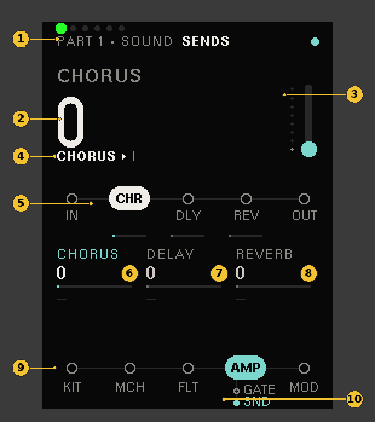

1. **Header:** `PART 1 · SOUND  SENDS`.
2. **The focused cell, large.**
3. **Its level bar.**
4. **Hint line.**
5. **The picture band:** the Part's live output.
6. **CHORUS:** the send to the chorus.
7. **DELAY:** the send to the delay.
8. **REVERB:** the send to the reverb.
9. **The chain map**, AMP lit.
10. **AMP's sub-pages**, SENDS lit.

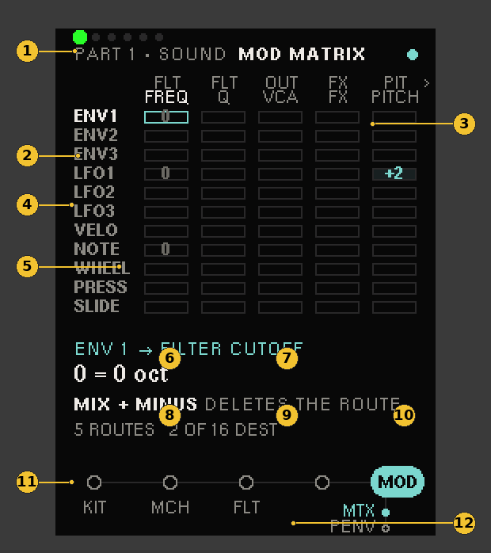

1. **Header:** `PART 1 · SOUND  MOD MATRIX`.
2. **The sources**, one a row (ENV1 to SLIDE).
3. **The destinations**, one a column (FLT FREQ, FLT Q, OUT VCA...); `>` means more.
4. **The source names**, the cursor's row bright.
5. **The grid:** a route's amount in its square.
6. **The cursor's route:** its source (ENV 1)...
7. ...**and its destination** (FILTER CUTOFF), with its amount under it.
8. **Hint line:** `MIX + MINUS`...
9. ...`DELETES THE ROUTE`.
10. **The count:** routes in use and destinations given a column.
11. **The chain map**, MOD lit.
12. **MOD's sub-pages**, MTX lit.


1. **Header:** `PART 1 · SOUND  ENV 1 / A`: ENV1, TYPE A.
2. **The envelope's rise**, the focused stage lit.
3. **The rest of the shape.**
4. **The rise's line.**
5. **The envelope's shape**, filled, its stages named under it (A H D S R).
6. **ATTACK.**
7. **DECAY.**
8. **SUSTAIN.**
9. **RELEASE.**
10. **HOLD.**
11. **TYPE:** A or B.
12. **The chain map**, MOD lit.
13. **MOD's sub-pages**, E1 lit.

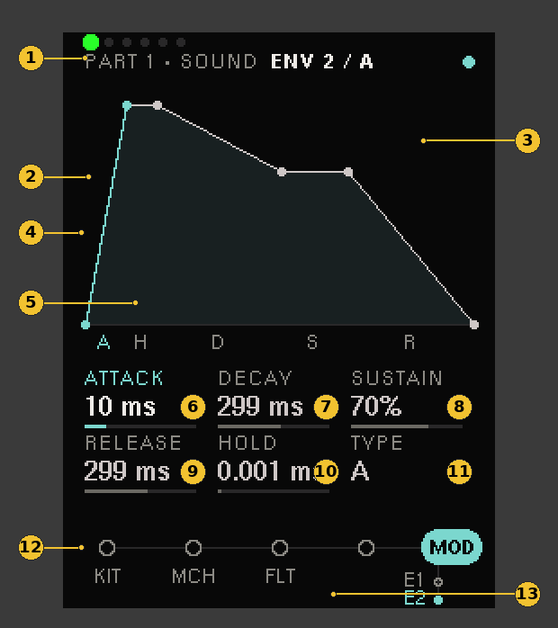

1. **Header:** `PART 1 · SOUND  ENV 2 / A`: ENV2, TYPE A.
2. **The envelope's rise**, the focused stage lit.
3. **The rest of the shape.**
4. **The rise's line.**
5. **The envelope's shape**, filled, its stages named under it (A H D S R).
6. **ATTACK.**
7. **DECAY.**
8. **SUSTAIN.**
9. **RELEASE.**
10. **HOLD.**
11. **TYPE:** A or B.
12. **The chain map**, MOD lit.
13. **MOD's sub-pages**, E2 lit.

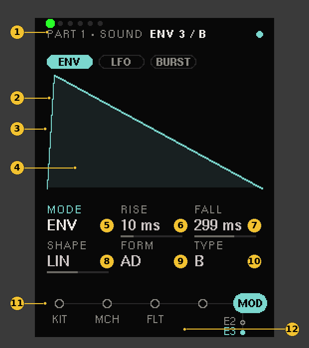

1. **Header:** `PART 1 · SOUND  ENV 3 / B`: ENV3, TYPE B.
2. **MODE's pills** (ENV, LFO, BURST) over the shape's rise.
3. **The rise.**
4. **The shape**, filled.
5. **MODE.**
6. **RISE.**
7. **FALL.**
8. **SHAPE.**
9. **FORM.**
10. **TYPE.**
11. **The chain map**, MOD lit.
12. **MOD's sub-pages**, E3 lit.

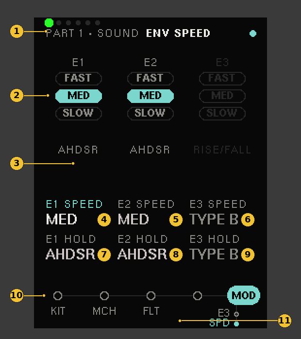

1. **Header:** `PART 1 · SOUND  ENV SPEED`.
2. **Each envelope's speed** as pills: FAST, MED, SLOW (dimmed where it does not apply).
3. **Each envelope's kind:** AHDSR, or RISE/FALL on TYPE B.
4. **E1 SPEED.**
5. **E2 SPEED.**
6. **E3 SPEED.**
7. **E1 HOLD.**
8. **E2 HOLD.**
9. **E3 HOLD.**
10. **The chain map**, MOD lit.
11. **MOD's sub-pages**, SPD lit.

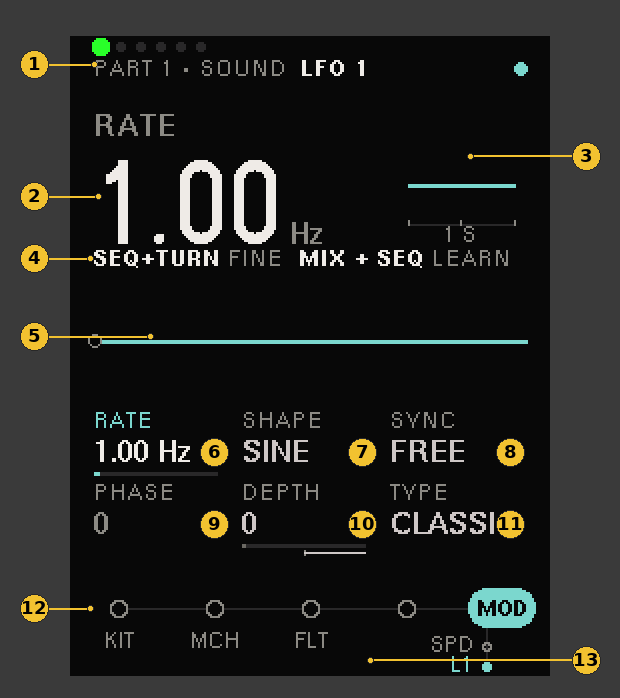

1. **Header:** `PART 1 · SOUND  LFO 1`.
2. **The focused cell, large:** RATE.
3. **Its glyph:** the rate as a period.
4. **Hint line:** `SEQ+TURN FINE`, `MIX + SEQ LEARN`.
5. **The LFO drawn**, one cycle.
6. **RATE.**
7. **SHAPE.**
8. **SYNC.**
9. **PHASE.**
10. **DEPTH.**
11. **TYPE:** CLASSIC or a function type.
12. **The chain map**, MOD lit.
13. **MOD's sub-pages**, L1 lit.

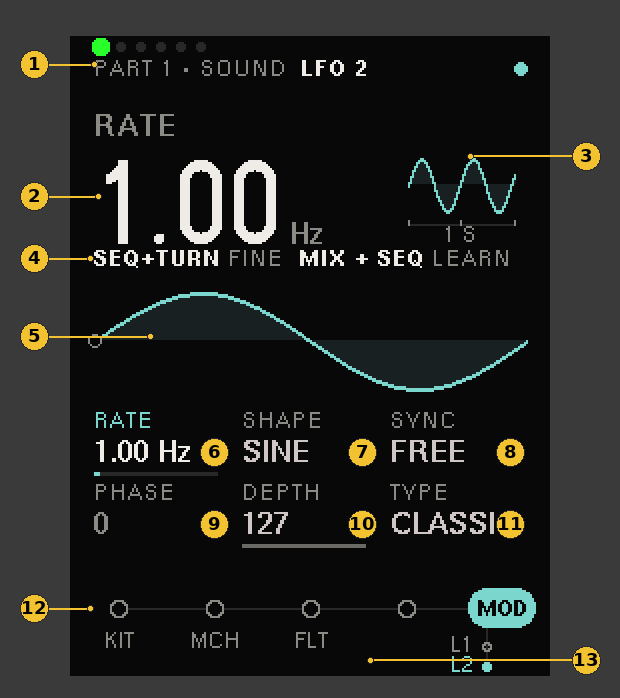

1. **Header:** `PART 1 · SOUND  LFO 2`.
2. **The focused cell, large:** RATE.
3. **Its glyph:** the rate as a period.
4. **Hint line:** `SEQ+TURN FINE`, `MIX + SEQ LEARN`.
5. **The LFO drawn**, one cycle.
6. **RATE.**
7. **SHAPE.**
8. **SYNC.**
9. **PHASE.**
10. **DEPTH.**
11. **TYPE:** CLASSIC or a function type.
12. **The chain map**, MOD lit.
13. **MOD's sub-pages**, L2 lit.


1. **Header:** `PART 1 · SOUND  LFO 3`.
2. **The focused cell, large:** RATE.
3. **Its glyph:** the rate as a period.
4. **Hint line:** `SEQ+TURN FINE`, `MIX + SEQ LEARN`.
5. **The LFO drawn**, one cycle.
6. **RATE.**
7. **SHAPE.**
8. **SYNC.**
9. **PHASE.**
10. **DEPTH.**
11. **TYPE:** CLASSIC or a function type.
12. **The chain map**, MOD lit.
13. **MOD's sub-pages**, L3 lit.

Every cell on these pages is explained in [Envelopes and LFOs](09-envelopes-and-lfos.md), [the mod matrix](10-mod-matrix.md) and [the voice chain](08-voice-chain.md).

## DRUM: PAD FOLLOW


1. **Header:** where you are in SETTINGS (`PERSONAL › FOLLOW`).
2. **The focused cell, large:** FOLLOW's value.
3. **The picture band.**
4. **FOLLOW:** OFF, IDLE or ALWAYS.
5. **Footer:** the project, and whether it has unsaved changes.
6. **Footer:** the keys this page answers to.

SETTINGS › PERSONALIZE › PAD FOLLOW decides whether a hit you play selects its pad on the DRUM pages. One cell, **FOLLOW**:

| Value | What a live hit does |
|---|---|
| OFF | Never moves the selection. Only PAD and MIX + MINUS / PLUS do |
| IDLE (default) | Selects its pad, unless you turned an encoder or stepped a pad on this Part's DRUM pages in the last 2 seconds |
| ALWAYS | Every hit on the shown Part selects its pad |

Hits still light their pads in every mode. FOLLOW is a unit setting, kept in SYSTEM, not the project. See [SETTINGS](13-settings.md).

**Why:** following is handy when you play to find a pad, and annoying when you are shaping one and a pattern pulls the page away. IDLE does both: it follows when your hands are off the encoders.

## DRUM: the kit and the library

Every Part has a kit, DRUM or not. Switching a Part to another engine and back keeps its kit.

- **A project** saves each Part's kit with the Part. Loading a project brings its kits back; NEW starts each Part on the INIT kit.
- **SAVE TO LIBRARY** on a DRUM Part saves the kit with the Sound. Loading that library Sound onto a Part brings its kit with it. A DRUM library Sound with no kit in its file loads the INIT kit.
- **Everything else that replaces a Sound leaves the kit:** loading a project slot, INIT, RELOAD FROM PROJ, an engine switch, a MIDI program change. They ask only about the Sound.
- **The one question about the kit:** loading a DRUM Sound from the library replaces the Part's kit. If the Part's kit is not the INIT kit and not a kit the library already holds, the browser asks first: `LOAD INTO P1?` / `KIT NOT IN LIBRARY`, with REPLACE and CANCEL (CANCEL highlighted). To keep the kit, cancel and SAVE TO LIBRARY first.
- If a DRUM Part's library save cannot write its kit (the firmware's second half is missing, as after an incomplete update), the save is refused and says `KIT NOT SAVED · NEEDS UPDATE`.

See [the SD card, Sounds and the library](16-card-sounds-library.md).

**Why:** the kit lives beside the Sound, not inside it, so the five Parts that are not DRUM pay nothing for one in every copy of their Sound. That makes a library load of a DRUM Sound the only thing that can lose a kit, and so the only place the instrument asks.

## DRUM: voice cost per machine

A DRUM hit costs its own machine plus the Part's pad chain (the filter, AMP, routes and gate). Machines differ by more than two to one. The Part's voice count is worked out from its costliest pad, every pad's filter shape, routes and gate included, so one expensive pad in a kit lowers how many hits it can sound at once.

| Cost | Machines |
|---|---|
| Lightest | TONE CLAP, PLAIN SINE, PLAIN NOISE, PLAIN IMPULSE |
| Light | TONE TOM, TONE COWBELL, BODY SHAKER |
| Medium | TONE KICK, TONE SNARE |
| Heavy (about two and a half times the lightest) | TONE CYMBAL, METAL HAT |
| Heaviest | METAL JINGLE |

Two machines cost more while they sweep: **TONE COWBELL** with BUMP up (about three times its plain cost for the few milliseconds of its sweep), and **PLAIN IMPULSE** with SWEEP up, or at a high PITCH with WIDTH near the top. A kit holding one of them is billed for that worst case.

To get more hits from a kit:

- Set unused pads to **NONE**: they leave the bill altogether.
- Keep the costly filters (LADDER, the 2040, moving routes) on the pads that need them.
- Put the metal machines in choke groups.
- Give the Part a RESERVE on MIXER › PRT › VOICES so other Parts cannot take its voices.

The numbers behind this, and what happens at the limit, are in [Limits](20-limits.md).

**Why:** one bill for every machine would either under-bill the metals (overloading the audio) or cost a light kit most of its voices. Billing each hit by its own machine keeps a kit of kicks and claps cheap and a kit of cymbals safe.

## DRUM: starting points

Each from INIT DRUM:

- **A tuned 808-style bass:** pad 01's MACHINE to PLAIN SINE, PITCH low, DECAY long, SWEEP a little; KIT's TONAL to 01; KEYS RETRIG to STACK if you want overlapping notes. Play from C1 up; middle C is the pad's tuned pitch.
- **A gated noise hat:** a pad on PLAIN NOISE, TONE well into HP; AMP MODE to GATED and DECAY short, so the key's length sets the hat's length.
- **A distant clap:** TONE CLAP, CLAPS up, SPREAD longer, TAIL up, ROOM TONE down on MORE; a little REVERB on SND.
- **A trashy kit:** FX to FUZZ on FLT, FX PLACE POST; every pad goes through it.
- **A tom that falls in pitch:** TONE TOM, SWEEP high, SWEEP TIME long; on a LADDER LP4 with a MOD ENV → CUTOFF route.
- **Open and closed hats that choke:** both METAL HAT pads in one CHOKE group, the closed one with a short DECAY.
