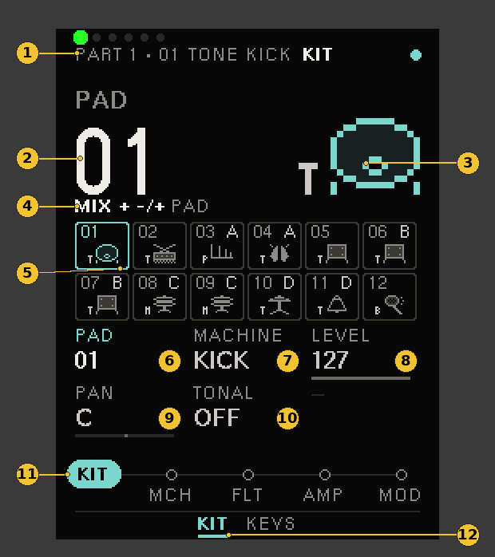
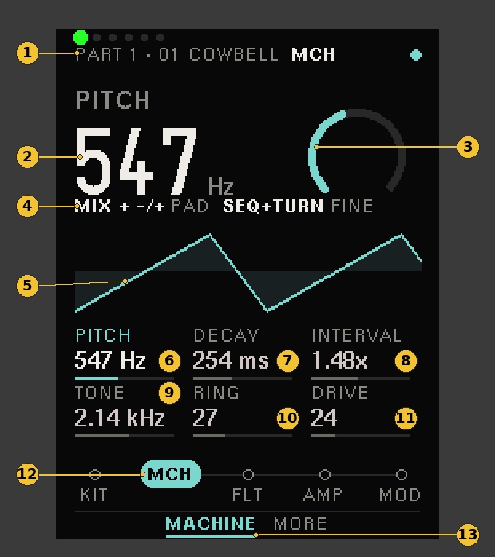
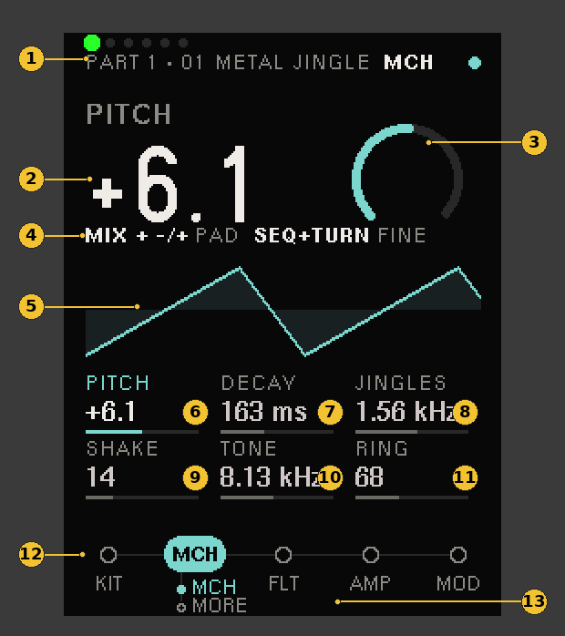
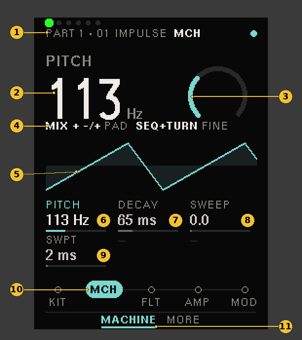
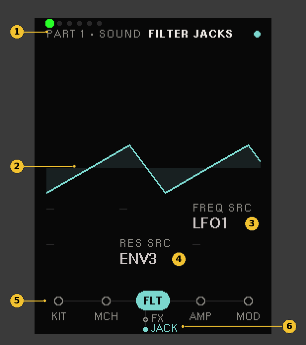
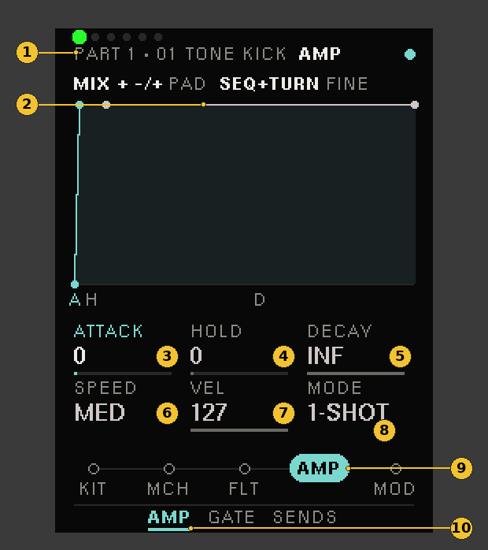
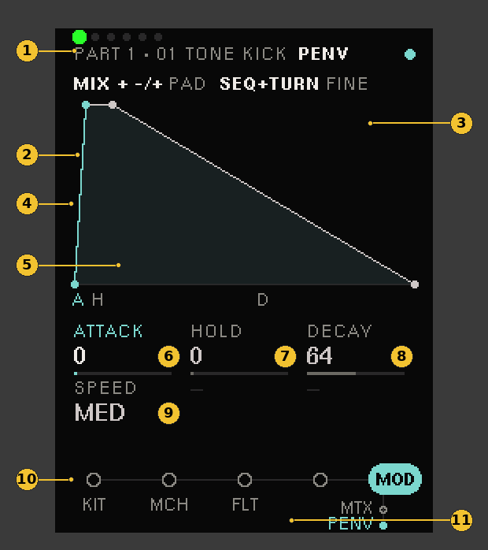
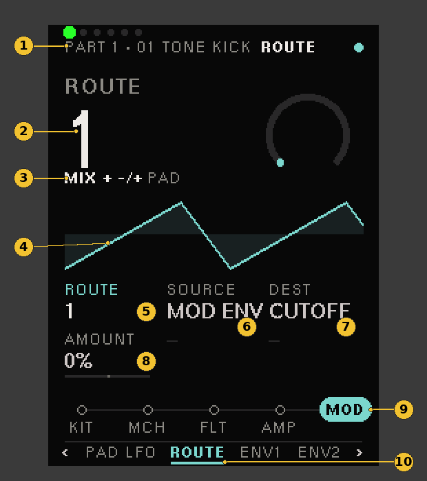
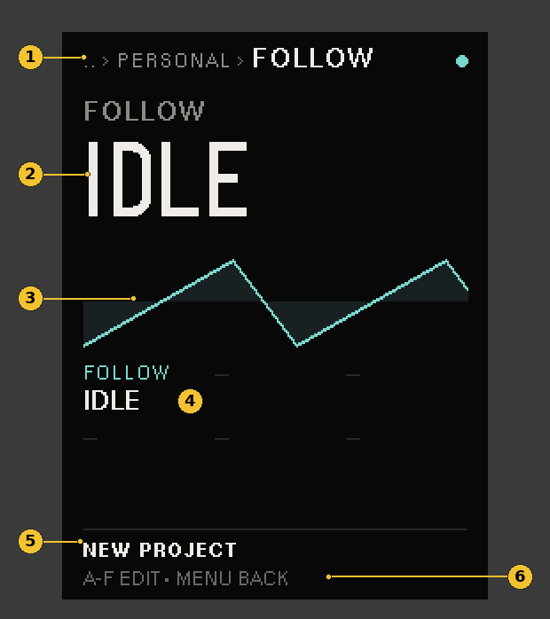

# DRUM, the kit engine

A DRUM Part plays a kit of twelve pads. Each pad is a drum machine of its own (a kick, a snare, a hat, a plain sine...) with its own knobs, level, pan, choke group, filter, amp envelope, mod envelope, LFO and four routes. This chapter covers the kit and its keymap, the pad pages, every MACHINE, choke and voice groups, saving kits, and voice cost. Filter TYPEs, the FX slot and the Part's modulation are explained once in [the voice chain](08-voice-chain.md), [envelopes and LFOs](09-envelopes-and-lfos.md) and [the mod matrix](10-mod-matrix.md).

## DRUM: what a kit is

Load **INIT DRUM** from the Sound browser (**EDIT + B*n***, the INIT rows at the top) and the Part becomes a kit, in two layers:

- **Twelve pads.** Each holds a MACHINE and its knobs, LEVEL, PAN, CHOKE, RETRIG, a filter, an AMP envelope with a gate, a mod envelope, an LFO and four routes.
- **The Part's Sound, shared by every pad:** the FX slot, filter modulation and jacks, envelopes, LFOs, matrix, WIDTH and sends.

A note strikes a pad; the hit takes a copy of the pad at that moment and plays it through the Part's chain.

**Why:** a full Sound per pad would take more memory than six Parts have. A compact pad, as on an Analog Rytm, gives each drum what makes it a different drum, while the costly parts of the chain (FX slot, matrix) stay one per Part.

> **Design note:** The pads' layout, the choke groups and the way notes reach pads follow the Elektron Analog Rytm. The machines' names and knob sets take their shape from the Elektron Machinedrum's machine reference, read from its manual only: no Elektron code, ROM or samples, and every algorithm is Chimera's own. Each machine was first built on a computer, auditioned by ear, then ported to the instrument line for line, so the firmware's output matches the prototype sample for sample. Think of it as a drum machine that grew up reading other drum machines' manuals, and never their diaries.

## DRUM: the chain map

```
   KIT ──────── MCH ──────── FLT ──────────── AMP ──────── MOD
    └ KEYS       └ MORE       ├ FMD             ├ GATE       ├ PENV  PLFO  ROUTE
                              ├ FX              └ SENDS      ├ E1  E2  E3  SPD
                              └ JACK                         └ L1  L2  L3
```

| Whose | Pages (full name on the row) |
|---|---|
| pad | **KIT**, **KEYS**, **MCH** (MACHINE), **MORE**, **AMP**, **PENV** (PAD ENV), **PLFO** (PAD LFO), **ROUTE** |
| pad and Part | **FLT** (FILTER: pad filter, Part FX), **GATE** (pad gate, Part WIDTH) |
| Part | **FMD** (MODULATION), **FX**, **JACK** (JACKS), **SND** (SENDS), **MTX** (MATRIX), **E1 E2 E3 SPD L1 L2 L3** (ENV1 ENV2 ENV3 SPEED LFO1 LFO2 LFO3) |

DRUM has no PITCH or STEREO page: each machine tunes itself. The header names the pad being edited: `PART 1 · 02 TONE SNARE  KIT`, or the machine's last word when it doesn't fit (`03 IMPULSE`).

## DRUM: the pad gestures

| Keys | Does |
|---|---|
| **MIX + MINUS / PLUS** | Previous / next pad, staying on the page. On FLT this includes the Part's FX and FX PLACE cells |
| Turn **PAD** (KIT, KEYS) | Pick a pad, 01 to 12 |
| Play a note | Strikes its pad and lights its tile; may select it ([PAD FOLLOW](#drum-pad-follow)) |

The hint line shows `MIX + -/+ PAD` on every pad cell. Pad cells have no MIDI-learn (**MIX + SEQ** does nothing) and no NRPN address; the Part's own cells learn as on any engine ([MIDI](14-midi.md)).

## DRUM: the KIT page



1. **Header:** Part, pad and machine (`01 TONE KICK`), page.
2. **Focused cell:** PAD.
3. **Machine icon**, large, with its family letter.
4. **Hint:** `MIX + -/+ PAD`.
5. **The twelve pads:** number, choke group, icon; the selected one framed.
6. **PAD.**
7. **MACHINE.**
8. **LEVEL.**
9. **PAN.**
10. **TONAL.**
11. Chain map, KIT lit.
12. Sub-pages: KIT, KEYS.

Family letters: **T** TONE, **M** METAL, **B** BODY, **P** PLAIN. A pad lights while it sounds.

| Cell | Range | Default | What it does |
|---|---|---|---|
| **PAD** | 01 to 12 | 01 | Which pad every pad page edits |
| **MACHINE** | twelve machines, NONE | per pad | What the pad plays ([every machine](#drum-every-machine)) |
| **LEVEL** | 0 to 127 | 127 | Pad level, before the filter |
| **PAN** | L64 to R63 | C | Pad position, constant power |
| **TONAL** | OFF, 01 to 12 | OFF | The kit's keymap ([below](#drum-the-kit-keymap-and-tonal)); the same whichever pad is selected |

A new MACHINE takes its own knob defaults; the pad's other settings stay.

**Why:** LEVEL acts before the filter so a quieter pad drives LADDER or DIRTY less, as on an analogue filter.

## DRUM: the KIT keymap and TONAL

**TONAL OFF** (default): every note strikes pad *note mod 12*; the kit repeats every octave.

| Note | C | C# | D | D# | E | F | F# | G | G# | A | A# | B |
|---|---|---|---|---|---|---|---|---|---|---|---|---|
| Pad | 01 | 02 | 03 | 04 | 05 | 06 | 07 | 08 | 09 | 10 | 11 | 12 |

**TONAL on a pad:** C0 to B0 (MIDI 0–11) still strike the twelve pads. From C1 up every note plays the TONAL pad, with middle C at its own pitch. A TONE TOM becomes a tom bass, a PLAIN SINE a sine bass.

- The note moves the machine's PITCH knob; the rest of the pad stays.
- The pad keeps RETRIG and CHOKE: set RETRIG to STACK for chords.
- Machines with no PITCH (TONE CLAP, BODY SHAKER, PLAIN NOISE) play the same hit everywhere: `NO PITCH ON CLAP`.
- TONAL on a NONE pad plays nothing from C1 up: `NONE PLAYS NOTHING`.


**Why:** a note's pad depends on the saved kit, never on the screen. OFF suits pad controllers, sequencers and General MIDI parts (notes from 36 up); TONAL puts the pad's pitch at middle C, where a keyboard plays.

## DRUM: the KEYS page


1. **Header**, page KEYS.
2. **Focused cell:** PAD.
3. **Machine icon.**
4. **Hint:** `MIX + -/+ PAD`; on CHOKE, `GROUPS n/8`.
5. **The twelve pads.**
6. **PAD.**
7. **CHOKE.**
8. **RETRIG.**
9. Chain map, KIT lit.
10. Sub-pages, KEYS lit.

KEYS (**SEQ** from KIT) sets how the pad's hits meet.

| Cell | Range | Default | What it does |
|---|---|---|---|
| **PAD** | 01 to 12 | | As on KIT |
| **CHOKE** | OFF, A, B, C, D | per pad | A hit ends every other pad in the group. OFF: chokes nothing |
| **RETRIG** | STACK, CUT | CUT | CUT: a hit ends the pad's own ringing hit. STACK: hits overlap |

An ended hit fades quickly, so a choke never clicks. Classic use: open and closed hats in one group.

## DRUM: choke groups and voice groups

A Part has eight voices. A choke group sounds one pad at a time; each group in use and each CHOKE OFF pad counts as one voice group. A kit holds at most **8 voice groups**; NONE pads count too.

- On CHOKE the hint reads `GROUPS n/8`; INIT DRUM reads `GROUPS 8/8`.
- A turn that would make a ninth lands dimmed with `9 GROUPS · KIT HOLDS 8`; nothing is written. From a controller, the reason shows as a toast.


A STACK pad short of a voice ends its own oldest hit, never another pad's. A CUT pad takes a voice as any note does.

**Why:** a steal is a choke nobody chose. Stealing from other pads sounded worse everywhere but the busiest breakbeat; eight groups in eight voices means a kit never steals from itself.

## DRUM: the INIT kit

Every pad on RETRIG CUT, LEVEL 127, PAN C:

| Pad | MACHINE | CHOKE | Set from defaults |
|---|---|---|---|
| 01 | TONE KICK | OFF | |
| 02 | TONE SNARE | OFF | |
| 03 | PLAIN IMPULSE | A | a rimshot |
| 04 | TONE CLAP | A | |
| 05 | TONE TOM | OFF | PITCH 30, about 82 Hz |
| 06 | TONE TOM | B | PITCH 50, 113 Hz |
| 07 | TONE TOM | B | PITCH 70, about 157 Hz |
| 08 | METAL HAT | C | DECAY 20 (39 ms): closed |
| 09 | METAL HAT | C | DECAY 80 (about 0.3 s): open |
| 10 | TONE CYMBAL | D | |
| 11 | TONE COWBELL | D | |
| 12 | BODY SHAKER | OFF | |

Every pad's sound starts as CLEAN LP4 at 20.0 kHz, Q 0; an open AMP (DECAY INF, 1-SHOT, VEL 127); no gate; PENV 0/0/64 at MED; PLFO SINE, SPEED 6, DEPTH 127; no routes.

## DRUM: the MCH and MORE pages

**MCH** (MACHINE on the row) holds the machine's first six knobs, as in the TONE KICK image below. **MORE** (**SEQ** from MCH) holds MACHINE and the last two. Values show in the machine's unit (Hz, ms, semitones, a ratio such as 1.47x, octaves such as 0.50 OCT, or an amount); labels over seven letters are shortened on the cell (SWEEP TIME as SWPT) and spelled out in the focus band. A knob the machine lacks is empty.


1. **Header**, page MORE.
2. **Focused cell:** MACHINE, full name.
3. **Machine icon.**
4. **Hint:** `MIX + -/+ PAD`.
5. **Picture band.**
6. **MACHINE.**
7. **Knob G:** here START.
8. **Knob H:** here HARM.
9. Chain map, MCH lit.
10. Sub-pages, MORE lit.

The knobs, LEVEL, PAN and VEL are read at the strike; the filter, envelopes, LFO and route amounts follow a ringing hit ([what a ringing hit follows](#drum-what-a-ringing-hit-follows)).

**Why:** the knobs set up the strike itself; latching them keeps every machine exact and cheap, while the filter and envelopes carry the movement.

## DRUM: every machine

Twelve machines in four families, and NONE. The letter is the badge on the pad's icon.

| Family | Machines | How it sounds |
|---|---|---|
| **TONE** (T) | TONE KICK, TONE SNARE, TONE TOM | A sine body swept down, noise, drive |
| **TONE** (T) | TONE CLAP | Noise bursts through a band-pass, then a tail |
| **TONE** (T) | TONE COWBELL, TONE CYMBAL | Square waves through band-passes |
| **METAL** (M) | METAL HAT | Six squares through band-passes, with noise |
| **METAL** (M) | METAL JINGLE | The squares rung higher, gated by shaken particles |
| **BODY** (B) | BODY SHAKER | Noise grains in a shake, through a band-pass |
| **PLAIN** (P) | PLAIN SINE, PLAIN NOISE, PLAIN IMPULSE | One source under one decay |
| | NONE | Plays nothing |

Knobs are listed in cell order: six on MCH, then MORE's. Each MCH image's hint reads `MIX + -/+ PAD`, `SEQ+TURN FINE`.

### DRUM: TONE KICK


1. Header.
2. Focused cell.
3. Arc.
4. Hint.
5. Picture band.
6. **PITCH.**
7. **DECAY.**
8. **SWEEP.**
9. **SWPT.**
10. **CLICK.**
11. **DRIVE.**
12. Chain map.
13. Sub-pages.

| Cell | Range | Default | What it does |
|---|---|---|---|
| **PITCH** | 30–120 Hz | 46 Hz | Where the body settles |
| **DECAY** | 80 ms–3.00 s | 785 ms | Body ring |
| **SWEEP** | 0.0 to +48.0 | +15.1 | Start, semitones above PITCH |
| **SWEEP TIME** (SWPT) | 2–120 ms | 7 ms | Sweep fall |
| **CLICK** | 0–120 | 19 | Attack click |
| **DRIVE** | 0–100 | 8 | Saturation |
| **START** (MORE) | 0–100 | 0 | Starts up to a quarter cycle in: harder edge |
| **HARMONICS** (MORE, HARM) | 0–100 | 0 | Folds in 2nd and 3rd partials |

Sub kick: DECAY past 1.5 s, SWEEP low, CLICK 0. Punchy: DECAY about 300 ms, SWEEP high, SWEEP TIME short, a little DRIVE.

### DRUM: TONE SNARE


1. Header.
2. Focused cell.
3. Arc.
4. Hint.
5. Picture band.
6. **PITCH.**
7. **DECAY.**
8. **BUMP.**
9. **SNAP.**
10. **SDEC.**
11. **TONE.**
12. Chain map.
13. Sub-pages.

| Cell | Range | Default | What it does |
|---|---|---|---|
| **PITCH** | 100–400 Hz | 173 Hz | Lower head |
| **DECAY** | 40–800 ms | 103 ms | Heads' decay |
| **BUMP** | 0.0 to +12.0 | +3.8 | Heads start this many semitones up |
| **SNAP** | 0–35 | 22 | Snare-wire noise level |
| **SNAP DECAY** (SDEC) | 30–600 ms | 98 ms | Noise length |
| **TONE** | 800 Hz–9.00 kHz | 3.04 kHz | Noise band-pass |
| **INTERVAL** (MORE, INTV) | 1.20x–1.77x | 1.47x | Upper head over lower |
| **DRIVE** (MORE) | 0–100 | 0 | Saturation |

### DRUM: TONE TOM


1. Header.
2. Focused cell.
3. Arc.
4. Hint.
5. Picture band.
6. **PITCH.**
7. **DECAY.**
8. **SWEEP.**
9. **SWPT.**
10. **NOISE.**
11. **DAMP.**
12. Chain map.
13. Sub-pages.

| Cell | Range | Default | What it does |
|---|---|---|---|
| **PITCH** | 50–400 Hz | 113 Hz | Where the body settles |
| **DECAY** | 80 ms–2.00 s | 472 ms | Ring |
| **SWEEP** | 0.0 to +24.0 | +5.7 | Start, semitones above PITCH |
| **SWEEP TIME** (SWPT) | 4–300 ms | 16 ms | Sweep fall |
| **NOISE** | 0–60 | 9 | Noise, low-passed at 4× PITCH (max 12 kHz) |
| **DAMP** | 0–100 | 16 | Blends in a faster decay: a damped head |
| **DRIVE** (MORE) | 0–100 | 0 | Saturation |
| **DRIVE TYPE** (MORE, DTYP) | 0–100 | 0 | Soft clip (0) to wavefolder (100) |

### DRUM: TONE CLAP


1. Header.
2. Focused cell.
3. Arc.
4. Hint.
5. Picture band.
6. **TONE.**
7. **DECAY.**
8. **CLAPS.**
9. **SPREAD.**
10. **TAIL.**
11. **RING.**
12. Chain map.
13. Sub-pages.

| Cell | Range | Default | What it does |
|---|---|---|---|
| **TONE** | 500 Hz–4.00 kHz | 1.33 kHz | Burst band-pass |
| **DECAY** | 50 ms–1.00 s | 163 ms | Tail length |
| **CLAPS** | 1–8 | 4 | How many hands |
| **SPREAD** | 4–30 ms | 9 ms | Time between claps |
| **TAIL** | 0–100 | 71 | Tail level |
| **RING** | 0–90 | 21 | Band-pass resonance |
| **HARDNESS** (MORE, HARD) | 0.80x–0.15x | 0.34x | Each clap's fall as a share of SPREAD: higher is harder |
| **ROOM TONE** (MORE, ROOM) | 400 Hz–24.0 kHz | 24.0 kHz | Tail low-pass: lower is further away |

### DRUM: TONE COWBELL



1. Header.
2. Focused cell.
3. Arc.
4. Hint.
5. Picture band.
6. **PITCH.**
7. **DECAY.**
8. **INTV.**
9. **TONE.**
10. **RING.**
11. **DRIVE.**
12. Chain map.
13. Sub-pages.

| Cell | Range | Default | What it does |
|---|---|---|---|
| **PITCH** | 300 Hz–1.20 kHz | 547 Hz | Lower square |
| **DECAY** | 80 ms–1.50 s | 254 ms | Ring |
| **INTERVAL** (INTV) | 1.20x–1.80x | 1.48x | Upper square over lower |
| **TONE** | 600 Hz–6.00 kHz | 2.13 kHz | Band-pass |
| **RING** | 0–85 | 27 | Resonance |
| **DRIVE** | 0–100 | 24 | Saturation |
| **DAMP** (MORE) | 0–100 | 60 | Blends in a faster decay |
| **BUMP** (MORE) | 0.00–1.00 OCT | 0.00 OCT | Starts up to an octave high, falling in 6 ms ([costs more](#drum-voice-cost-per-machine)) |

### DRUM: TONE CYMBAL


1. Header.
2. Focused cell.
3. Arc.
4. Hint.
5. Picture band.
6. **PITCH.**
7. **DECAY.**
8. **TONE.**
9. **SPREAD.**
10. **RING.**
11. **SHIMMER.**
12. Chain map.
13. Sub-pages.

| Cell | Range | Default | What it does |
|---|---|---|---|
| **PITCH** | -24.0 to +24.0 | +0.2 | Tunes the six squares, semitones |
| **DECAY** | 200 ms–5.00 s | 1.52 s | Ring |
| **TONE** | 2.50–12.0 kHz | 5.94 kHz | Band-pass |
| **SPREAD** | 0–100 | 24 | Detunes the squares from their ratios |
| **RING** | 0–90 | 21 | Resonance |
| **SHIMMER** | 0–100 | 31 | Slow LFOs sway tuning and levels |
| **TOP** (MORE) | 0–50 | 30 | A higher band's level |
| **TOP TUNE** (MORE, TTUN) | 1.10x–1.60x | 1.35x | That band over TONE |

### DRUM: METAL HAT


1. Header.
2. Focused cell.
3. Arc.
4. Hint.
5. Picture band.
6. **PITCH.**
7. **DECAY.**
8. **TONE.**
9. **SPREAD.**
10. **RING.**
11. **NOISE.**
12. Chain map.
13. Sub-pages.

| Cell | Range | Default | What it does |
|---|---|---|---|
| **PITCH** | -24.0 to +24.0 | +0.2 | Tunes the six squares, semitones |
| **DECAY** | 20 ms–1.50 s | 39 ms | Short closed, long open |
| **TONE** | 3.00–14.0 kHz | 7.92 kHz | Band-pass |
| **SPREAD** | 0–100 | 0 | Detunes the squares |
| **RING** | 0–90 | 21 | Resonance |
| **NOISE** | 0–50 | 6 | Noise layer |
| **HIGH PASS** (MORE, HP) | 0.25x–1.00x | 0.50x | High-pass, as a share of TONE |
| **LOW PASS** (MORE, LP) | 2.00–20.0 kHz | 20.0 kHz | Low-pass; off at the top |

### DRUM: METAL JINGLE



1. Header.
2. Focused cell.
3. Arc.
4. Hint.
5. Picture band.
6. **PITCH.**
7. **DECAY.**
8. **JINGLES.**
9. **SHAKE.**
10. **TONE.**
11. **RING.**
12. Chain map.
13. Sub-pages.

A tambourine: the hat's squares an octave up, gated by shaken particles.

| Cell | Range | Default | What it does |
|---|---|---|---|
| **PITCH** | -12.0 to +24.0 | +6.1 | Tunes jingles and head, semitones |
| **DECAY** | 50 ms–1.00 s | 163 ms | Shake length |
| **JINGLES** | 300 Hz–6.00 kHz | 1.56 kHz | Strikes a second at the peak |
| **SHAKE** | 0–60 | 14 | Where the peak falls |
| **TONE** | 5.00–14.0 kHz | 8.13 kHz | Band-pass |
| **RING** | 50–95 | 68 | Resonance, held just short of ringing on |
| **HEAD** (MORE) | 0–70 | 0 | A frame drum's thump |
| **SPREAD** (MORE) | 0–100 | 31 | Detunes the jingles |

### DRUM: BODY SHAKER


1. Header.
2. Focused cell.
3. Arc.
4. Hint.
5. Picture band.
6. **GRAINS.**
7. **DECAY.**
8. **GLEN.**
9. **TONE.**
10. **SHAKE.**
11. **RING.**
12. Chain map.
13. Sub-pages.

| Cell | Range | Default | What it does |
|---|---|---|---|
| **GRAINS** | 100 Hz–3.00 kHz | 852 Hz | Grains a second at the peak |
| **DECAY** | 30–500 ms | 91 ms | Shake length |
| **GRAIN LENGTH** (GLEN) | 0–3 ms | 0 ms | Each grain's ring, 0.2 to 3 ms |
| **TONE** | 2.00–12.0 kHz | 6.18 kHz | Band-pass |
| **SHAKE** | 5–70 | 20 | Where the peak falls |
| **RING** | 0–90 | 21 | Resonance |
| **HARDNESS** (MORE, HARD) | 0–100 | 50 | Below middle darker grains; above, dry grains over the band |

### DRUM: PLAIN SINE


1. Header.
2. Focused cell.
3. Arc.
4. Hint.
5. Picture band.
6. **PITCH.**
7. **DECAY.**
8. **SWEEP.**
9. **SWPT.**
10. Chain map.
11. Sub-pages.

An 808-style bass on TONAL, a zap, a blip.

| Cell | Range | Default | What it does |
|---|---|---|---|
| **PITCH** | 30 Hz–2.00 kHz | 58 Hz | Where the sine settles |
| **DECAY** | 20 ms–3.00 s | 317 ms | Ring |
| **SWEEP** | 0.0 to +48.0 | +11.3 | Start above PITCH |
| **SWEEP TIME** (SWPT) | 2–200 ms | 6 ms | Sweep fall |

### DRUM: PLAIN NOISE


1. Header.
2. Focused cell.
3. Arc.
4. Hint.
5. Picture band.
6. **DECAY.**
7. **TONE.**
8. Chain map.
9. Sub-pages.

| Cell | Range | Default | What it does |
|---|---|---|---|
| **DECAY** | 10 ms–2.00 s | 35 ms | Length |
| **TONE** | LP 100 to HP 100 | HP 57 | Low-pass below the middle, high-pass above, FLAT between |

### DRUM: PLAIN IMPULSE



1. Header.
2. Focused cell.
3. Arc.
4. Hint.
5. Picture band.
6. **PITCH.**
7. **DECAY.**
8. **SWEEP.**
9. **SWPT.**
10. Chain map.
11. Sub-pages.

A pulse under a decay: a rimshot, a click.

| Cell | Range | Default | What it does |
|---|---|---|---|
| **PITCH** | 30 Hz–2.00 kHz | 113 Hz | Pulse pitch |
| **DECAY** | 20 ms–3.00 s | 65 ms | Length |
| **SWEEP** | 0.0 to +48.0 | 0.0 | Start above PITCH |
| **SWEEP TIME** (SWPT) | 2–200 ms | 2 ms | Sweep fall |
| **WIDTH** (MORE) | 0–100 | 92 | Pulse width |

> **Design note:** The DRUM machines are built from parts the rest of Chimera already had: VA's noise and oscillators, the CLEAN filter's band-passes, the FX slot's SOFT and FOLD shapers. The metal machines tune their six squares to the 808-style ratios, the published values from that drum machine's circuit, with SPREAD to pull them apart. Nothing here is a sample. If your hi-hat sounds like a filing cabinet falling down the stairs, that is RING and SPREAD at the top, and it is working as intended.

### DRUM: NONE


1. **Header:** `NONE`, page KIT.
2. **Focused cell:** MACHINE, NONE.
3. **NONE's icon:** a box with an X.
4. Hint.
5. **The pads:** this one shows the box.
6. **PAD:** live.
7. **MACHINE:** turn to bring a machine back.
8. **LEVEL:** dimmed, kept.
9. **PAN:** dimmed, kept.
10. **TONAL:** live.
11. Chain map.
12. Sub-pages.


1. **Header**, NONE, page MCH.
2. **Picture band;** knob cells empty.
3. Chain map.
4. Sub-pages.

NONE, MACHINE's last choice, plays nothing: a note books no voice and chokes nothing, though with PAD FOLLOW it still selects the pad. MCH and MORE are empty; every other pad cell is dimmed but keeps its value, so a machine chosen again gets back the pad's level, pan, chokes and sound (knobs at that machine's defaults). PAD, TONAL, FX and FX PLACE stay live. A ringing hit rings out.

**Why:** a kit is billed for its costliest pad, unused ones included. NONE takes a spare pad out of the bill.

## DRUM: the FLT page (the pad's filter)


1. **Header**, page FILTER.
2. **Filter curve**, cutoff dot; hint above.
3. **TYPE**, large.
4. **TYPE.**
5. **FX** (Part).
6. **Q** (pad).
7. **MODE** (pad).
8. **FX PLACE** (Part).
9. **FREQ** (pad).
10. Chain map, FLT lit.
11. Sub-pages.

FLT holds the pad's filter and the Part's FX slot. The TYPEs, MODEs and the FX slot are described in [the voice chain](08-voice-chain.md); only the pad split is DRUM's.

| Cell | Whose | Default |
|---|---|---|
| **TYPE** (CLEAN, 2040, DIRTY, LADDER, SEM) | pad | CLEAN |
| **FX** | Part | OFF |
| **Q** (CLEAN, DIRTY, LADDER) or **RES** (2040, SEM) | pad | 0 |
| **MODE**, or **VOICE** on 2040 | pad | LP4 on CLEAN |
| **FX PLACE** | Part | PRE |
| **FREQ**, or **CUTOFF** on 2040 | pad | 20.0 kHz |

**MIX + MINUS / PLUS** steps the pad on every FLT cell, FX and FX PLACE included.

**Why:** each drum shapes its own sound (a dark kick, a bright hat), so the filter is per pad. The FX slot is the costliest block and the Part's character; per pad it would cost up to twelve times as much.

## DRUM: the FMD, FX and JACK pages

These are the Part's pages, shared by every pad and working as in [the voice chain](08-voice-chain.md); the panel shown follows the selected pad's TYPE. One exception: SEM's **OUTPUT** on FMD is the pad's.


1. **Header:** `PART 1 · SOUND  FILTER MOD`.
2. **Focused cell:** ENV AMT.
3. **Hint:** `MIX + MINUS DELETES THE ROUTE`.
4. **Picture band.**
5. **ENV AMT.**
6. **KEYBOARD.**
7. **FREQ MOD.**
8. **FDBK** (FEEDBACK).
9. **RES MOD.**
10. Chain map, FLT lit.
11. Sub-pages, FMD lit.


1. **Header:** `PART 1 · SOUND  FX`.
2. **Focused cell:** INPUT.
3. **Arc.**
4. **Hint:** `SEQ+TURN FINE`, `MIX + SEQ LEARN`.
5. **The slot's place** in the chain, over the output.
6. **INPUT.**
7. **MIX;** with FX OFF the slot's knobs are dashes.
8. Chain map, FLT lit.
9. Sub-pages, FX lit.



1. **Header:** `PART 1 · SOUND  FILTER JACKS`.
2. **Picture band.**
3. **FREQ SRC.**
4. **RES SRC.**
5. Chain map, FLT lit.
6. Sub-pages, JACK lit.

## DRUM: the AMP page



1. **Header**, page AMP; hint under it.
2. **Focused stage**, lit.
3. **The rest**, flat while DECAY is INF.
4. **The shape.**
5. **ATTACK.**
6. **HOLD.**
7. **DECAY.**
8. **SPEED.**
9. **VEL.**
10. **MODE.**
11. Chain map, AMP lit.
12. Sub-pages: AMP, GATE, SENDS.

The pad's own attack-hold-decay envelope, shaping on top of the machine's DECAY.

| Cell | Range | Default | What it does |
|---|---|---|---|
| **ATTACK** | 0–127 | 0 | Rise |
| **HOLD** | 0–127 | 0 | Hold at full |
| **DECAY** | 0–126, INF | INF | Fall; INF stays open, so the machine's decay rings in full |
| **SPEED** | FAST, MED, SLOW | MED | Time range, as [envelope SPEED](09-envelopes-and-lfos.md) |
| **VEL** | 0–127 | 127 | Velocity's share of level, applied before the filter at the strike; 0 plays all hits at full |
| **MODE** | 1-SHOT, GATED | 1-SHOT | 1-SHOT ignores note-off. GATED holds after HOLD until note-off, then falls over DECAY (never, at INF) |

**Why:** most drums ignore key length, so 1-SHOT is the default; GATED, as on Elektron's AMP page, lets a held pad end with its key. On 1-SHOT, note-off still reaches the Part's VCA routes in the matrix.

## DRUM: the GATE page


1. **Header**, page GATE.
2. **Picture band.**
3. **LPG.**
4. **DECAY.**
5. **STRIKE.**
6. **WIDTH.**
7. Chain map, AMP lit.
8. Sub-pages, GATE lit.

Each pad has its own low-pass gate (as described under AMP in [the voice chain](08-voice-chain.md)), replacing the Part's.

| Cell | Range | Default | Whose | What it does |
|---|---|---|---|---|
| **LPG** | 0–127 | 0 | pad | How far the gate closes as the sound decays; 0 off |
| **DECAY** | 0–127 | 0 | pad | The gate's decay |
| **STRIKE** | 0–127 | 0 | pad | How hard the strike opens it |
| **WIDTH** | 0–127 | 64 | Part | Spreads or narrows the kit's pans |

## DRUM: the PENV, PLFO and ROUTE pages

MOD's first three sub-pages are the pad's own modulation. After them come the Part's E1–E3, SPD and L1–L3; the MOD node is the Part's MATRIX.

### DRUM: PENV, the pad's mod envelope



1. **Header**, page PENV.
2. **Focused stage.**
3. **HOLD and DECAY.**
4. **Hint.**
5. **The shape.**
6. **ATTACK.**
7. **HOLD.**
8. **DECAY.**
9. **SPEED.**
10. Chain map, MOD lit.
11. Sub-pages, PENV lit.

An AHD envelope like AMP's (DECAY 0–126 or INF, default 64; SPEED default MED), feeding the routes as MOD ENV.

### DRUM: PLFO, the pad's LFO


1. **Header**, page PLFO.
2. **Focused cell:** WAVE.
3. **Hint.**
4. **Picture band.**
5. **WAVE.**
6. **SPEED.**
7. **DEPTH.**
8. **PHASE.**
9. **MODE.**
10. Chain map.
11. Sub-pages, PLFO lit.

Feeds the routes as LFO.

| Cell | Range | Default | What it does |
|---|---|---|---|
| **WAVE** | SINE, TRI, SAW, SQUARE, RANDOM | SINE | Shape |
| **SPEED** | 0–127 | 6 | Rate |
| **DEPTH** | 0–127 | 127 | Size |
| **PHASE** | 0–127 | 0 | Start point on RETRIG |
| **MODE** | FREE, RETRIG | FREE | RETRIG restarts at PHASE each hit |

### DRUM: ROUTE, the pad's four routes



1. **Header**, page ROUTE.
2. **Focused cell.**
3. **Hint.**
4. **Picture band.**
5. **ROUTE.**
6. **SOURCE.**
7. **DEST.**
8. **AMOUNT.**
9. Chain map.
10. Sub-pages, ROUTE lit.

| Cell | Range | Default | What it does |
|---|---|---|---|
| **ROUTE** | 1–4 | 1 | Which route the cells edit |
| **SOURCE** | MOD ENV, LFO, VEL, LFO 1, LFO 2, LFO 3 | MOD ENV | The pad's own, or the Part's LFOs |
| **DEST** | CUTOFF, RESO, VOLUME, LFO SPD, LFO DEP | CUTOFF | The pad's filter, volume, or own LFO |
| **AMOUNT** | -100% to +100% | 0% | How far, which way |

CUTOFF and RESO move at audio rate. **VOLUME** never boosts: positive opens with the source, negative ducks; several multiply.

**Why:** movement per drum without a matrix per pad; the Part's matrix still reaches every pad's filter and VCA.

## DRUM: what a ringing hit follows

- **Set at the strike:** MACHINE and knobs, LEVEL, PAN, VEL, CHOKE, RETRIG, filter TYPE and MODE/VOICE, PLFO WAVE and MODE, route SOURCE and DEST, both SPEEDs, AMP MODE.
- **Glide on a ringing hit:** CUTOFF/FREQ, Q/RES, SEM's MODE sweep, AMP and PENV times, LPG, gate DECAY and STRIKE, PLFO SPEED, DEPTH, PHASE, route AMOUNT.

**Why:** the Analog Rytm's split: continuous values glide so a sweep is smooth on a ringing cymbal; choices latch so nothing clicks.

## DRUM: the Part's own pages on a kit

These pages are the Part's, not the pad's: one set shared by every pad, with header `PART 1 · SOUND`. They look and work as on every engine; only the DRUM-specific part is listed here.

| Page | Where it is explained | On DRUM |
|---|---|---|
| **SND** (SENDS) | [the voice chain](08-voice-chain.md) | **CHORUS**, **DELAY**, **REVERB** for the whole kit |
| **MTX** (MATRIX) | [the mod matrix](10-mod-matrix.md) | Reaches every pad's filter and VCA; a VCA route is the only thing that hears note-off on a 1-SHOT pad |
| **E1 E2 E3 SPD** | [envelopes and LFOs](09-envelopes-and-lfos.md) | ENV1 drives FMD's ENV AMT on every pad |
| **L1 L2 L3** | [envelopes and LFOs](09-envelopes-and-lfos.md) | Feed JACK and the pad routes' LFO 1 to 3 |

The Part's own filter TYPE and gate are unused (each pad's replace them); its mixer channel is on MIXER › PRT.

## DRUM: PAD FOLLOW



1. **Header:** `PERSONAL › FOLLOW`.
2. **Focused cell.**
3. **Picture band.**
4. **FOLLOW.**
5. **Footer:** project, unsaved state.
6. **Footer:** keys.

SETTINGS › PERSONALIZE › PAD FOLLOW decides whether a played hit selects its pad. **FOLLOW** is a unit setting, kept in SYSTEM ([SETTINGS](13-settings.md)):

| Value | What a live hit does |
|---|---|
| OFF | Never selects; only PAD and MIX + MINUS / PLUS do |
| IDLE (default) | Selects, unless you edited this Part's DRUM pages in the last 2 seconds |
| ALWAYS | Always selects |

Hits light their pads in every mode.

**Why:** following helps you find a pad and gets in the way while shaping one; IDLE follows only when your hands are off the encoders.

## DRUM: the kit and the library

Every Part has a kit; switching engine and back keeps it.

- **A project** saves each Part's kit; NEW starts on the INIT kit.
- **SAVE TO LIBRARY** on a DRUM Part saves the kit with the Sound; loading it brings the kit. A DRUM Sound with no kit loads the INIT kit.
- **Everything else** that replaces a Sound (a project slot, INIT, RELOAD FROM PROJ, an engine switch, program change) leaves the kit.
- **Loading a DRUM library Sound** replaces the kit. If the kit is neither INIT nor already in the library, the browser asks `LOAD INTO P1?` / `KIT NOT IN LIBRARY`, REPLACE or CANCEL (highlighted).
- If the firmware's second half is missing, as after an incomplete update, a DRUM library save is refused: `KIT NOT SAVED · NEEDS UPDATE`.

See [the SD card, Sounds and the library](16-card-sounds-library.md).

**Why:** the kit lives beside the Sound, so non-DRUM Parts pay nothing for it; that makes a library load the only way to lose a kit, and the only place the instrument asks.

## DRUM: voice cost per machine

A hit costs its machine plus the pad chain (filter, AMP, routes, gate). The Part's voice count comes from its costliest pad, every pad's filter, routes and gate included.

| Cost | Machines |
|---|---|
| Lightest | TONE CLAP, PLAIN SINE, PLAIN NOISE, PLAIN IMPULSE |
| Light | TONE TOM, TONE COWBELL, BODY SHAKER |
| Medium | TONE KICK, TONE SNARE |
| Heavy (about 2.5× lightest) | TONE CYMBAL, METAL HAT |
| Heaviest | METAL JINGLE |

TONE COWBELL with BUMP (about 3× for its few-ms sweep) and PLAIN IMPULSE with SWEEP, or high PITCH with WIDTH near the top, are billed at that worst case.

More hits: set unused pads to **NONE**, keep costly filters (LADDER, 2040, moving routes) where needed, choke the metals, give the Part a RESERVE on MIXER › PRT › VOICES. See [Limits](20-limits.md).

**Why:** one bill for every machine would overload the audio on metals or starve a light kit; billing per machine keeps both right.

## DRUM: starting points

From INIT DRUM:

- **808-style bass:** pad 01 on PLAIN SINE, PITCH low, DECAY long, a little SWEEP; TONAL 01; RETRIG STACK to overlap. Play from C1 up.
- **Gated noise hat:** PLAIN NOISE, TONE well into HP; AMP MODE GATED, DECAY short.
- **Distant clap:** TONE CLAP, CLAPS and SPREAD up, TAIL up, ROOM TONE down; some REVERB.
- **Trashy kit:** FX FUZZ, FX PLACE POST.
- **Falling tom:** TONE TOM, SWEEP high, SWEEP TIME long, LADDER LP4 with MOD ENV → CUTOFF.
- **Choking hats:** both METAL HAT pads in one CHOKE group, the closed one short.
