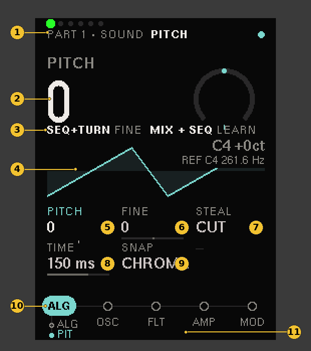
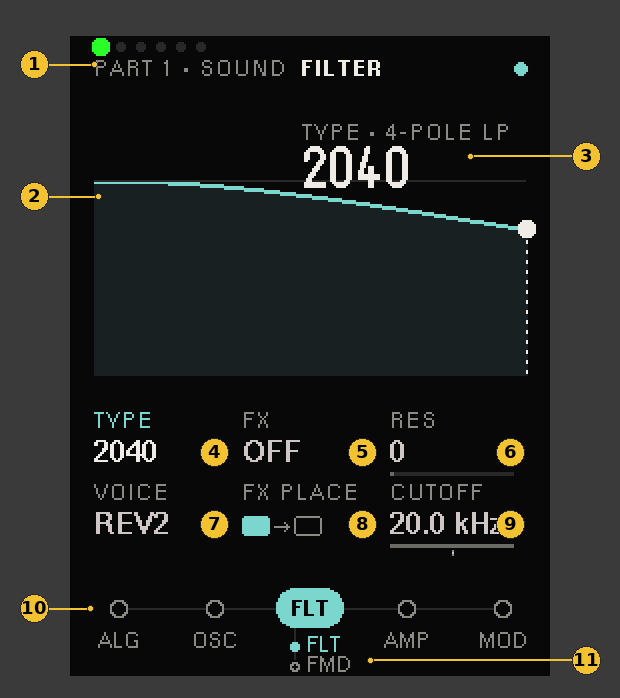
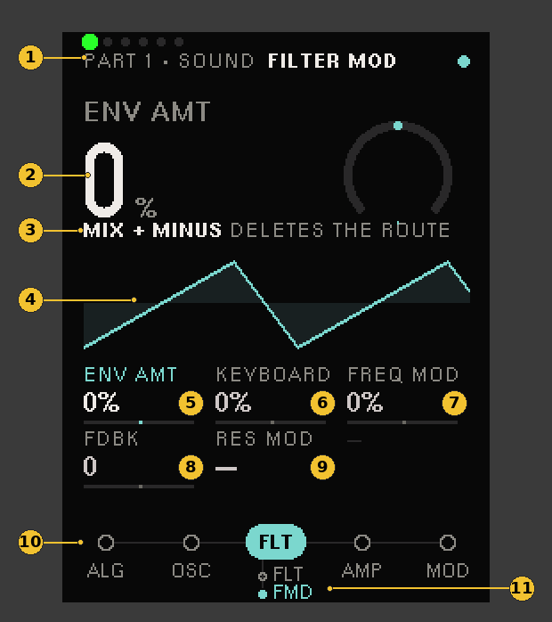
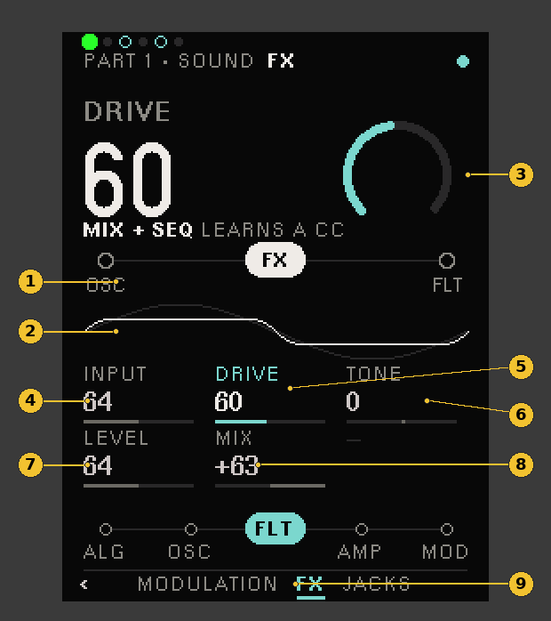
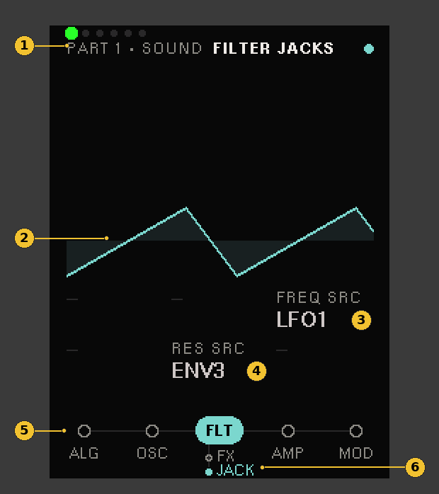

# The voice chain: pitch, filter, FX, amp, stereo and sends

Every melodic engine (ALGO, MODAL, VA and TAPE) runs its sound through the same voice pages after the engine's own: **PITCH**, the **FILTER** with its MODULATION, FX and JACKS sub-pages, **AMP** with STEREO and SENDS. This chapter covers each of them, cell by cell. The engines are in [ALGO](03-algo.md), [MODAL](04-modal.md), [VA](05-va.md) and [TAPE](06-tape.md); DRUM has its own pad pages, in [DRUM](07-drum.md). The envelopes and LFOs are in [Envelopes and LFOs](09-envelopes-and-lfos.md), and the routes that move these pages are in [the mod matrix](10-mod-matrix.md).

## Voice chain: the order of the signal

One voice plays this way:

```
engine ── [FX slot, PRE] ── FILTER ── [FX slot, POST] ── AMP (VCA / low-pass gate) ── STEREO ── SENDS
```

- The **FX slot** sits either before or after the filter, never both: **FX PLACE** chooses.
- **AMP** is the voice's VCA. Its three gate knobs turn it into a low-pass gate.
- **STEREO** places each note in the stereo field and sets how wide the Part is.
- **SENDS** feed the Part to the shared chorus, delay and reverb (see [the mixer and master FX](11-mixer-and-master-fx.md)).

On the chain map the pages sit under two nodes. FLT holds FILTER, MODULATION, FX and JACKS. AMP holds AMP, STEREO and SENDS. PITCH hangs under each engine's first node (see [PITCH: the pitch page](#pitch-the-pitch-page)). Press **SEQ** to step on through a node's sub-pages and **EDIT** to step back; **MINUS** and **PLUS** move along the chain. [The panel and navigation](02-panel-and-navigation.md) has the full tour.

Every value on these pages glides when you turn it, so a sweep of the cutoff, a send or the pan never steps.

**Why:** one chain for every engine means one set of habits. A filter sweep, a drive or a send works the same on an FM patch, a struck string, an analogue-style voice or a tape loop.

## Voice chain: page names on the map and on screen

| Short name (chain map) | Name in the sub-page row | Page title |
|---|---|---|
| **PIT** | PITCH | PITCH |
| **FLT** | FILTER | FILTER |
| **FMD** | MODULATION | FILTER MOD (DIRTY MOD, LADDER MOD or SEM MOD on those types) |
| **FX** | FX | FX |
| **JACK** | JACKS | FILTER JACKS |
| **AMP** | AMP | AMP |
| **STER** | STEREO | STEREO |
| **SND** | SENDS | SENDS |

With SETTINGS › PERSONALIZE › CHAIN MAP › PAGES set to STACK, the sub-pages show by their short names, stacked under the node.

## Voice chain: values and gestures on every page

- Continuous knobs read 0 to 127 unless the table says otherwise. A bipolar knob (FEEDBACK) reads −64 to +63, with 0 in the middle. Cutoffs read in Hz, times in ms or s.
- **Hold SEQ + turn** makes fine steps: one tick a detent, a tenth of a continuous value's step, with no acceleration. The hint line shows it as `SEQ+TURN FINE`.
- **MIX + turn** jumps the touched value to its next landmark: its minimum, its default, its maximum. On a route cell (ENV AMT, FREQ MOD, RES MOD) it jumps the amount to 0, then to full, in the direction you turn.
- **MIX + PLUS** on a cell primes it as a destination in the MOD matrix. The focus band says ADDED, ALREADY ROUTED, NOT MODULATABLE or MATRIX FULL. See [MOD: priming a destination](10-mod-matrix.md#mod-priming-a-destination).
- **MIX + MINUS** on a route cell deletes the route. On any other cell it takes that parameter out of the matrix, with its routes.
- **MIX + SEQ** learns a MIDI control for the touched cell (see [MIDI](14-midi.md)).
- Touch a cell and the hint line under the value shows the combos it answers to.

## PITCH: the pitch page

**PITCH** (PIT on the chain map) tunes the whole voice and sets what happens when a new note takes over a sounding voice. Every engine has it, under its first node:

| Engine | Where PITCH sits |
|---|---|
| ALGO | under ALG, after ALGORITHM |
| MODAL | under RES, after RESONATOR and the model page |
| VA | under VA, after OSC1, OSC2 and NOISE |
| TAPE | under DECK, after the machine's page |



1. **Header:** the Part, its Sound and the page, PITCH.
2. **The touched cell, large:** here PITCH at 0, with its arc beside it.
3. **The hint line:** hold SEQ and turn for fine steps; MIX + SEQ learns a MIDI control.
4. **The tuner:** the note the Part's last note sounds at and how far off it is in cents (`C4 +0ct`), and that pitch in Hz. Before the first note it reads `REF C4`.
5. **PITCH**, in semitones.
6. **FINE**, in cents.
7. **STEAL:** CUT or GLIDE.
8. **TIME:** the glide time.
9. **SNAP:** CHROMA or MUSICAL.
10. **The chain map**, on ALG.
11. **The sub-pages** of ALG: ALGORITHM, then PITCH, lit.

The tuner reads A4 = 440 Hz. On a Part in another tuning, it reads the note as that tuning plays it. It follows PITCH and FINE as they turn, with no note held. It is lit while the Part sounds and dim between notes.

| Cell | Range | Default | What it does |
|---|---|---|---|
| **PITCH** | −24 to +24 semitones | 0 | Transposes the voice. A matrix destination: a full route moves it 24 semitones |
| **FINE** | −100 to +100 cents | 0 | Fine tuning. A matrix destination |
| **STEAL** | CUT, GLIDE | CUT | What a note does when it takes over a voice of its own Part that is still sounding. CUT starts the new note at its own pitch; GLIDE slides from the pitch the voice had |
| **TIME** | 1 ms to 2 s | 150 ms | How long the glide takes to get there (95 % of the way). Used under GLIDE |
| **SNAP** | CHROMA, MUSICAL | CHROMA | How PITCH steps. CHROMA: a semitone a detent. MUSICAL: along a ladder of fifths and octaves (−24, −19, −12, −7, 0, +7, +12, +19, +24) |


1. **Header**, on PITCH.
2. **The touched cell, large:** STEAL, now GLIDE.
3. **The hint line** for STEAL.
4. **The tuner.**
5. **PITCH.**
6. **FINE.**
7. **STEAL** at GLIDE.
8. **TIME**, now in use: how long the glide takes.
9. **SNAP.**
10. **The chain map.**
11. **The sub-pages**, PITCH lit.

GLIDE only acts when a new note takes a sounding voice of the same Part. On a Part held to one voice (MAX VOICES 1 on the mixer's VOICES page, see [the mixer](11-mixer-and-master-fx.md)) every new note does that, so GLIDE becomes a legato portamento. A note on a free voice starts at its own pitch.

STEAL and TIME are read at the moment of the steal, so they are not matrix destinations.

**On TAPE** a source plays at the key you play, from its root. A source with no known pitch reads `ROOT ?` in the tuner, over its shift from the source's own speed.

**Why:** the tuner reads what the Part will really play (PITCH, FINE, the Part's tuning and the engine's own transposition), so you can tune a Sound by eye without holding a note. MUSICAL SNAP exists because most transpositions worth playing are fifths and octaves; it lets one encoder reach them in a few detents.

## FILTER: the filter page

**FILTER** (FLT on the chain map) is the same on every engine. Its sub-pages are MODULATION, FX and JACKS.


1. **Header:** the Part, its Sound and the page, FILTER.
2. **The response**, drawn from the filter's real response at the values you set, resonance peak included; the dot is the corner, at the cutoff.
3. **The readout** of the touched control, here TYPE: CLEAN.
4. **TYPE**, the kind of filter.
5. **FX**, the voice's FX slot.
6. **Q**, the resonance.
7. **MODE**, the response.
8. **FX PLACE**: the slot before the filter (PRE) or after it (POST). The cell draws the order.
9. **FREQ**, the cutoff. The thin line under its bar shows modulation reaching it.
10. **The chain map**, on FLT.
11. **The sub-pages** of FLT: FILTER lit, then MODULATION, FX and JACKS.

The page gives the whole band to the picture, so it has no focus band. The readout shows the value you set and stays still while an LFO or envelope moves the sound. When something modulates the cutoff, a faint band under the plot runs from the corner to where modulation has the cutoff now, with a tick at its end:


1. **The response.**
2. **The corner**, at the cutoff you set.
3. **The readout** of the touched control: here FREQ.
4. **The modulation mark:** from the corner to where modulation has the cutoff now.
5. **TYPE.**
6. **FX.**
7. **FX PLACE.**
8. **FREQ**, with Q and MODE beside it.
9. `>`: more sub-pages off the edge.

The front page reads **TYPE · FX · Q · MODE · FX PLACE · FREQ** on CLEAN, DIRTY and LADDER. Two types change the words:

- **2040:** **RES** in Q's place, **VOICE** in MODE's, **CUTOFF** in FREQ's.
- **SEM:** **RES** in Q's place, and **MODE** is a knob, not a list.

| Cell | Range | Default | What it does |
|---|---|---|---|
| **TYPE** | CLEAN, 2040, DIRTY, LADDER, SEM | CLEAN (VA: 2040) | Which filter. The other cells change with it |
| **FX** | OFF, SOFT, FUZZ, FOLD | OFF | The voice's FX slot (see [FX: the FX slot](#fx-the-fx-slot)) |
| **Q** / **RES** | 0 to 127 | 0 | Resonance |
| **MODE** | depends on TYPE | LP4 where the type has it | The response. On the 2040, **VOICE**; on SEM, a knob |
| **FX PLACE** | PRE, POST | follows FX | The slot before the filter (PRE: FX into FLT) or after it (POST: FLT into FX) |
| **FREQ** / **CUTOFF** | 20 Hz to 20.0 kHz | 20.0 kHz | The cutoff |

**FREQ** (and **CUTOFF**) ticks 1/24 of an octave a detent, so the whole range is ten octaves of even steps, and reads in Hz: whole Hz under 1 kHz, then kHz (`2.14 kHz`, `12.5 kHz`). A turn glides, and modulation is spread across each block, so a sweep by knob, envelope or LFO never steps.

Changing TYPE or MODE crossfades from the old setting to the new one over a few milliseconds, with no click. When you change TYPE, MODE stays if the new type has it; otherwise it takes the new type's default.

**Why:** every number shows the value you set, never the modulated one. A readout that jumped with every LFO cycle would be unreadable, and you could never set it back exactly. The faint band under the curve shows where modulation has the cutoff instead. The 1/24-octave tick makes every detent the same musical size, at 50 Hz and at 5 kHz.

### FILTER: CLEAN

A clean state-variable filter, in the manner of the Cascadia's VCF. It is the home filter of ALGO, MODAL and TAPE.

| MODE | Response |
|---|---|
| LP1 | Low-pass, one pole (6 dB an octave) |
| LP2 | Low-pass, two poles (12 dB) |
| LP4 | Low-pass, four poles (24 dB) |
| BP2 | Band-pass, two poles |
| BP4 | Band-pass, four poles |
| HP4 | High-pass, four poles |
| NOTCH1 | One notch, at twice FREQ |
| NOTCH2 | Two notches, below and above FREQ (a phaser-style response); Q deepens them, and it never self-oscillates |

At high Q, CLEAN self-oscillates (except in NOTCH2). LP4 fully open passes its input untouched. The NOTCH2 picture is a sketch of the response, not the filter's real response.

> **Design note:** CLEAN takes its controls and words from the Intellijel Cascadia's VCF: the modes are named by what they do (LP1, BP4, NOTCH2) rather than by a datasheet. Under it runs a zero-delay state-variable filter that can self-oscillate. NOTCH2 is four all-pass stages around the dry signal, after an application circuit in the SSM2040's own data sheet, which is a nice touch of family history for a filter that sits next to a 2040.

### FILTER: 2040



1. **Header**, on FILTER.
2. **The response** of the 2040, at the values you set.
3. **The readout**: TYPE, 2040.
4. **TYPE**: 2040.
5. **FX.**
6. **RES**, the resonance.
7. **VOICE**: REV2 or EXPNDR.
8. **FX PLACE.**
9. **CUTOFF.**
10. **The chain map**, on FLT.
11. **The sub-pages** of FLT.

A four-pole low-pass, modelled on the SSM2040 filter chip. It is VA's home filter. Touch TYPE and the readout names its one mode, 4-POLE LP. Its front page reads **TYPE · FX · RES · VOICE · FX PLACE · CUTOFF**.

**VOICE** picks the chip's surroundings:

- **REV2:** the chip as the Prophet-5 used it, its resonance linear and bounded by the chip's own clip.
- **EXPNDR:** the chip as the Kobol Expander uses it, with a CA3080 in the resonance loop. It squelches as resonance rises, keeps more of its bass than a plain four-pole would, and rings over its input at full RES.

On the 2040, INPUT drives the chip's stages directly: it is the filter's drive.

> **Design note:** the 2040 is a circuit model of the SSM2040, with each VOICE solving the loop through its own resonance part: the Prophet's linear one for REV2, the Kobol's CA3080 for EXPNDR. EXPNDR's bass and ring were then measured against a recording of a real Kobol Expander, swept at three resonance settings, and EXPNDR's make-up gain was fitted to match it. REV2 was left exactly as modelled.

### FILTER: DIRTY


1. **Header**, on FILTER.
2. **The response** of the DIRTY, at the values you set.
3. **The readout**: TYPE, DIRTY.
4. **TYPE**: DIRTY.
5. **FX.**
6. **Q.**
7. **MODE**: LP2, BP2, HP2 or NOTCH1.
8. **FX PLACE.**
9. **FREQ.**
10. **The chain map**, on FLT.
11. **The sub-pages** of FLT.

A Chamberlin state-variable filter that drives hard. It is the cheapest filter and the edgiest.

| MODE | Response |
|---|---|
| LP2 | Low-pass, two poles (default) |
| BP2 | Band-pass |
| HP2 | High-pass |
| NOTCH1 | One notch, at FREQ |

DIRTY uses CLEAN's words: **Q**, **MODE**, **FREQ**. Its FILTER MOD page is titled DIRTY MOD.

### FILTER: LADDER


1. **Header**, on FILTER.
2. **The response** of the LADDER, at the values you set.
3. **The readout**: TYPE, LADDER.
4. **TYPE**: LADDER.
5. **FX.**
6. **Q.**
7. **MODE**: LP2, LP4, BP2, BP4 or HP4.
8. **FX PLACE.**
9. **FREQ.**
10. **The chain map**, on FLT.
11. **The sub-pages** of FLT.

The Moog transistor ladder, four poles, with Xpander-style modes and INPUT as its drive. Like the original, it loses some bass as resonance rises. It uses CLEAN's words: **Q**, **MODE**, **FREQ**. Its FILTER MOD page is titled LADDER MOD.

| MODE | Response |
|---|---|
| LP2 | Low-pass, two poles |
| LP4 | Low-pass, four poles (default) |
| BP2 | Band-pass, two poles |
| BP4 | Band-pass, four poles |
| HP4 | High-pass, four poles |

> **Design note:** LADDER is Vadim Zavalishin's topology-preserving ladder from *The Art of VA Filter Design*, run at the base sample rate, with its feedback loop solved in closed form. Three published Moog models were weighed first. A benchmark paper against a transistor-level simulation tipped the choice of where the saturation goes: five saturators spread through the ladder, one at the input and one a stage, because distributed saturation matches the real circuit far better than a single clipper at the end.

### FILTER: SEM


1. **Header**, on FILTER.
2. **The response** of the SEM, at the values you set.
3. **The readout**: TYPE, SEM.
4. **TYPE**: SEM.
5. **FX.**
6. **RES.**
7. **MODE**, a knob: low-pass at 0, notch in the middle, high-pass at 127.
8. **FX PLACE.**
9. **FREQ.**
10. **The chain map**, on FLT.
11. **The sub-pages** of FLT.

The Oberheim SEM's 12 dB state-variable filter. Its front page reads **TYPE · FX · RES · MODE · FX PLACE · FREQ**.

- **MODE** is a knob, like the SEM's own pot: it sweeps the output from low-pass (0), through a notch at FREQ (the middle), to high-pass (127). It glides and can be modulated, so an LFO on MODE sweeps the response itself.
- **OUTPUT**, on the SEM MOD page, is the SEM's switch: **MODE** (the knob's sweep) or **BP** (band-pass).

The SEM does not self-oscillate, as the original doesn't: at full RES it rings, and the ring dies away.

> **Design note:** SEM was built twice. The first try was an existing filter with new labels, and it got sent back. The second started from the SEM-1A's schematic: every part of the VCF in one circuit simulation, using the nodal method and the measured CA3080 data of Köper, Holters, Esqueda and Parker's DAFx paper on the EDP Wasp filter. The filter you play is a much cheaper model with every constant taken from that simulation, and over 75 test renders it tracks the full circuit closely, down to how long the resonance rings at each frequency.

## FILTER MOD: the filter's modulation page

**FILTER MOD** (FMD on the chain map, MODULATION in the sub-page row) holds what moves the filter. Its title follows the type: DIRTY MOD, LADDER MOD or SEM MOD.



1. **Header:** the Part, its Sound and the page, FILTER MOD.
2. **The touched cell, large:** here ENV AMT at 0 %, with its arc.
3. **The hint line:** on a route cell, MIX + MINUS deletes the route.
4. **The picture band:** the live output's waveform.
5. **ENV AMT.**
6. **KEYBOARD.**
7. **FREQ MOD.**
8. **FDBK**, the filter's FEEDBACK.
9. **RES MOD**, reading a dash: no route yet.
10. **The chain map**, on FLT.
11. **The sub-pages** of FLT, MODULATION lit.

The hint line under the value shows the touched cell's combos, keys in bold, what they do beside them, while that cell is the touched one. Turn hints off at SETTINGS › PERSONALIZE › THEME › HINTS. On SEM a sixth cell, **OUTPUT**, takes the bottom right. A route cell that holds no route reads a dash; turn it to make the route.

| Cell | Range | Default | What it does |
|---|---|---|---|
| **ENV AMT** | −100 % to +100 % | 0 % | How far envelope 1 moves the cutoff. A route: ENV 1 into the FREQ column of the matrix |
| **KEYBOARD** | −100 % to +100 % (2040: OFF, HALF, FULL) | OFF | How far the cutoff follows the key. A route: NOTE into FREQ. At FULL the cutoff moves an octave for each octave you play |
| **FREQ MOD** | −100 % to +100 % | 0 % | How far the source on the FREQ SRC jack moves the cutoff. A route |
| **FEEDBACK** (FDBK on the cell) | −64 to +63 | 0 | The filter's own output fed back into its cutoff, positive or negative |
| **RES MOD** | −100 % to +100 % | 0 % | How far the source on the RES SRC jack moves the resonance. A route |
| **OUTPUT** | MODE, BP | MODE | SEM only: the knob's sweep, or band-pass |

A full route (100 %) moves the cutoff ten octaves. On FREQ MOD and RES MOD the focus band names the source the route reads, for example `FREQ MOD LFO1`.

On the 2040, **KEYBOARD** steps OFF, HALF and FULL, one step a detent, as a Prophet's keyboard switch does.

**FEEDBACK** (FDBK in the matrix's column header) works on every TYPE. Positive amounts make the filter open on its own peaks and snarl; negative ones pull the cutoff down as the output swings. It is a MOD matrix destination.

**Why:** ENV AMT, KEYBOARD, FREQ MOD and RES MOD are not separate controls with their own hidden wiring. Each is a cell of the MOD matrix, shown here where you think about the filter. Turn ENV AMT and the matrix's ENV1 → FREQ route changes with it, and **MIX + MINUS** on any of them deletes the route. See [MOD: route cells on other pages](10-mod-matrix.md#mod-route-cells-on-other-pages).

> **Design note:** FEEDBACK comes from a favourite patch on the Kobol Expander, which feeds the audio out back into the filter's frequency input. Here the output, one sample late and smoothed, bends the cutoff by up to eight octaves at full scale. On a pluck it sounds like the filter is arguing with the note. The 2040 gets an extra soft limit while FEEDBACK is on, so a full-feedback, full-resonance patch stays inside full scale.

### FILTER MOD: good starting points

- **Classic filter envelope:** on a VA Sound, CUTOFF around 400 Hz, RES around 40, ENV AMT +50 %. Then shape envelope 1's DECAY on the ENV1 page.
- **Keyboard tracking:** KEYBOARD at FULL (or +100 % on the other types) keeps the brightness even across the keyboard; HALF lets low notes sound darker.
- **Wah from the wheel:** on JACKS set FREQ SRC to LFO2, on FILTER MOD set FREQ MOD to +30 %. On the LFO2 page set DEPTH to 0, prime it with **MIX + PLUS**, and route WHEEL into it in the matrix. The wheel now brings the sweep in.

## FX: the FX slot

Every voice has one FX slot, before or after the filter. You pick its TYPE with **FX** and its place with **FX PLACE**, both on the FILTER page. The **FX** sub-page holds the effect's controls.


1. **Header:** the Part, its Sound and the page, FX.
2. **The touched cell, large:** here INPUT at 64.
3. **Its arc.**
4. **The hint line.**
5. **The signal path** (here OSC, FX, FLT: FX PLACE at PRE) over **the effect's curve**. With FX OFF the curve is the plain sine.
6. **INPUT.**
7. **MIX**, dimmed while FX is OFF. The pots' cells read dashes.
8. **The chain map**, on FLT.
9. **The sub-pages** of FLT, FX lit.

With an effect on, the pots fill in:



1. **The signal path**, in the order FX PLACE sets: here the oscillators into FX into the filter.
2. **The effect's curve:** a sine going in (faint), the shaped wave coming out.
3. The touched pot's arc.
4. **INPUT:** the level into the filter.
5. The FX TYPE's first pot …
6. … and its second: for SOFT, DRIVE and TONE.
7. Its third: LEVEL.
8. **MIX:** dry to wet. Dimmed when FX is OFF.
9. The sub-page row, on FX.

The page reads **INPUT · P1 · P2 / P3 · MIX · STABILITY**, where P1 to P3 are the TYPE's three pots:

| TYPE | First pot | Second pot | Third pot | Starts at |
|---|---|---|---|---|
| **OFF** | – | – | – | – |
| **SOFT** | **DRIVE**: how hard it clips | **TONE**: dark to bright | **LEVEL**: the wet level | PRE |
| **FUZZ** | **SUSTAIN**: the gain into the clipping stages | **TONE**: low-pass to high-pass, scooping the mids at noon | **VOLUME**: the wet level | PRE |
| **FOLD** | **FOLD**: how many times the wave folds | **SYMMETRY**: bends the fold off centre | **LEVEL**: the wet level | POST |

| Cell | Range | Default | What it does |
|---|---|---|---|
| **INPUT** | 0 to 127 | 64 | The level into the filter. 64 is unity; lower cuts, higher pushes the filter harder (up to four times). On the 2040 it is the chip's drive |
| **DRIVE**, **SUSTAIN**, **FOLD** | 0 to 127 | 0 | The effect's amount |
| **TONE**, **SYMMETRY** | 0 to 127 | 64 | The effect's colour |
| **LEVEL**, **VOLUME** | 0 to 127 | 64 | The wet level: 64 is unity, the range a quarter to four times |
| **MIX** | −64 to +63 | +63 | Dry (−64) to wet (+63) |
| **STABILITY** | 0 to 127 | 64 at INIT | 2040, LADDER and SEM only: how alike each voice's filter chip is |

- **SOFT** is symmetric soft clipping with a tone control: warmth at low DRIVE, crunch at the top.
- **FUZZ** is a fuzz pedal, modelled on the Big Muff's circuit: two diode clipping stages and its tone stack.
- **FOLD** is a wavefolder. A sine through it grows new harmonics as FOLD rises. Silence folds to silence, whatever SYMMETRY says.

The four TYPEs are level-matched. Changing TYPE or FX PLACE fades over 20 ms with no click. When you leave OFF, FX PLACE takes the new TYPE's starting place; after that, changing TYPE keeps the PLACE you set.

In PRE, INPUT and the effect's level stack: both push the filter. In POST, the effect shapes the filter's output, resonance included.

In the MOD matrix the FX column moves the effect's first pot (DRIVE, SUSTAIN or FOLD), whatever the TYPE. The other pots, INPUT, MIX and STABILITY are destinations you prime.

**Why:** one slot that goes either side of the filter does the work of a drive stage and a separate folder, at the cost of one. PRE gives the classic "overdriven oscillator into a filter"; POST gives "filter, then mangle", where a resonant peak gets folded or fuzzed.

> **Design note:** FUZZ is an Electro-Harmonix Big Muff Pi, the NYC reissue, modelled stage by stage from its published circuit values: the input transistor, two diode clipping stages and the tone stack. When the model's mid scoop at noon came out shallower than the plan said it should, the circuit won and the plan was corrected. Please do enjoy. Try not to lick the capacitors.

### FX: STABILITY

On the 2040, LADDER and SEM, the sixth cell of the FX page is **STABILITY**. It gives each voice its own slightly different filter chip: a cutoff offset, a slow drift, a tracking error across the keyboard and a spread in resonance. At 127 every voice is the same. Lower, they drift further apart. A new Sound starts at 64, a Prophet-like amount. Its glyph is a spirit level: the further the bubble from the middle, the more the voices differ. It is a matrix destination.

On CLEAN and DIRTY the cell is empty.

> **Design note:** a Prophet-5 has one SSM2040 per voice, and its own service manual warns that the filters will drift and never track as well as the oscillators. That is part of why a chord on one sounds the way it does. STABILITY puts that back, using the same law as VA's oscillator STABILITY, so the two read as one idea.

## JACKS: the filter's patch points

**FILTER JACKS** (JACK on the chain map, JACKS in the sub-page row) picks which sources FREQ MOD and RES MOD read.



1. **Header:** the Part, its Sound and the page, FILTER JACKS.
2. **The picture band:** the touched jack and the source plugged into it.
3. **FREQ SRC:** the source FREQ MOD reads.
4. **RES SRC:** the source RES MOD reads.
5. **The chain map**, on FLT.
6. **The sub-pages** of FLT, JACKS lit.

| Cell | Choices | Default |
|---|---|---|
| **FREQ SRC** | LFO1, LFO2, LFO3, ENV2, ENV3, VELO, OP5, OP6 | LFO1 |
| **RES SRC** | ENV1, LFO1, ENV2, ENV3, LFO2, LFO3, VELO, NOTE, OP5, OP6 | ENV3 |

- **OP5** and **OP6** are the audio of ALGO's operators 5 and 6: audio-rate modulation of the filter. They are offered on ALGO only.
- FREQ SRC has no ENV1, because ENV AMT already is ENV 1 into the cutoff.
- A jack skips any source whose route into the same column is already held by another cell; the focus band then says SOURCE IN USE.
- Moving a jack moves its route with it: the amount on FREQ MOD or RES MOD stays, and now reads the new source.

The jacks are patching, not sound, so they cannot be learned to a MIDI control or modulated.

**Why:** the matrix carries every source into the filter already. The jacks are a shortcut: two knobs on the filter's own pages that each pick a source, as patch cables would on a modular.

## AMP: the VCA and low-pass gate

**AMP** is the voice's VCA. **LPG**, **DECAY** and **STRIKE** turn it into a low-pass gate, in the manner of the one in Mutable Instruments' Plaits. With all three at 0 it is a plain VCA. **BASE** is where the routes into the VCA start.


1. **Header:** the Part, its Sound and the page, AMP.
2. **The touched cell, large.**
3. **The hint line.**
4. **The picture band:** the live output's waveform.
5. **VEL:** how far velocity scales what is routed into the VCA.
6. **LPG:** the darkening follows the level: the quieter the note, the darker it is.
7. **DECAY:** how slowly the gate closes: fast while bright, slower as it dims, like a vactrol.
8. **STRIKE:** each note-on strikes the gate, as hard as the note is played, and it rings out through DECAY.
9. **BASE:** where the routes into the VCA start.
10. **The chain map**, on AMP.
11. **The sub-pages** of AMP: AMP lit, then STEREO and SENDS.

The page reads **VEL · LPG · DECAY / STRIKE · BASE**.

| Cell | Range | Default | What it does |
|---|---|---|---|
| **VEL** | 0 to 127 | 127 | How much velocity scales the routes into the VCA. Dimmed until a route goes into VCA |
| **LPG** | 0 to 127 | 0 | How much the gate darkens with the level. At 0 the gate is a VCA; at 127 it is all filter |
| **DECAY** | 0 to 127 | 0 | How slowly the gate closes after its level falls |
| **STRIKE** | 0 to 127 | 0 | How hard each note-on strikes the gate |
| **BASE** | 0 to 127 | 0 | Where the sum of the routes into VCA starts. Dimmed, and reading `NEEDS A ROUTE INTO VCA`, until a route goes into VCA |

LPG, DECAY, STRIKE and BASE can be modulated in the MOD matrix and learned to a MIDI CC.

**STRIKE** adds to the envelope routed into VCA as an accent, and a held note falls back to the envelope. With nothing routed into VCA, the strike alone plays the note, which ends when the gate shuts, even with the key held.

Any filter TYPE plays in front of the gate. A sine through FX FOLD with LPG and STRIKE at full is a bongo.

> **Design note:** the low-pass gate is a port of Émilie Gillet's low-pass gate from Mutable Instruments Plaits, with its vactrol-style envelope and its decay and colour mapping. The three knobs were added so that with all three at 0 the voice runs the plain VCA, bit for bit: every Sound made before the gate existed still sounds exactly as it did. A full vactrol model, from a published study of the VTL5C3 part, also lives in the circuit lab as a reference.

### AMP: routes into VCA and BASE

The MOD matrix's **VCA** column (OUTPUT VCA in the readout) is the note's amp. What a route into it does depends on whether it is the first.

- **No route:** each engine shapes its own level. ALGO by its carriers' envelopes, MODAL by its decay, VA and TAPE by the key.
- **The first route replaces that contour.** Once any route goes into VCA, the routes are the amp. The gain is BASE plus each route's amount times its source, held between silence and full.

The engine still plays under that gain: ALGO's carriers and MODAL's resonator keep their own shape, scaled by it. On VA and TAPE the routes are the note's whole contour, which is why their INIT Sounds route ENV 1 into VCA at full.

BASE is 0 to begin with, so a lone PRESS route on VCA is silent until you lean into the key: there is just nothing under it. In the matrix an empty cell of the VCA column says so: `VCA: ROUTES REPLACE CONTOUR`, or `VCA: SUM STARTS AT AMP BASE` once an ENV is routed into VCA.

**Swell or duck a held note, keeping its attack** (ALGO and MODAL):

- **Duck under pressure:** BASE 127, PRESS at −64 into VCA. The note plays the engine's own contour, and pressing all the way halves it.
- **Swell under pressure:** BASE 64, PRESS at +63. The note plays at half, and pressing all the way brings it to full.
- **Pressure only:** BASE 0, PRESS alone. Silent until pressed.

On ALGO and MODAL, a BASE above 0 keeps the carriers' or the resonator's own tail after key up.

On VA and TAPE, ENV 1 already goes into VCA at +127, so leave BASE at 0: above 0 it would hold the gain up past ENV 1's attack and release. To duck, add PRESS at a negative amount. To swell, lower ENV 1's amount to leave room (+64, say) and add PRESS at a positive one.

Pressure is linear: a tenth of the pressure gives a tenth of the route's amount.

### AMP: the release gate

On ALGO and MODAL with nothing routed into VCA, a gate after the filter follows the engine's own tail once you let go of the key. A resonant filter then dies away with the sound that feeds it, instead of ringing on by itself. While the key is held, the gate stays open: a self-oscillating filter is a played tone. A normal release is untouched. There is nothing to set.

### AMP: good starting points

- **Plucked percussion:** FX FOLD, LPG 127, DECAY around 60, STRIKE 127, nothing routed into VCA. Play softly for a dull thud and harder for a bright one.
- **Vactrol-ish pluck on VA:** keep ENV 1 into VCA, set LPG around 90 and STRIKE around 60. The note keeps its envelope and gains a bright accent on each hit.

## STEREO: pan and width

**STEREO** (STER on the chain map) places each note in the stereo field and sets the Part's width.


1. **Header:** the Part, its Sound and the page, STEREO.
2. **The touched cell, large.**
3. **The hint line.**
4. **The picture band:** the live output's waveform.
5. **PAN.**
6. **WIDTH.**
7. **The chain map**, on AMP.
8. **The sub-pages** of AMP, STEREO lit.

| Cell | Range | Default | What it does |
|---|---|---|---|
| **PAN** | L64 to R63, C in the middle | C | Where each note of the Part sits, at constant power. A matrix destination: route NOTE into PAN to spread the keyboard across the field, or an LFO to move it |
| **WIDTH** | 0 to 127 | 64 | The Part's stereo width. 0 is mono, 64 plays the pans as set, 127 twice as wide |

PAN places each note as it plays, so two notes routed differently sit in different places. WIDTH acts on the whole Part afterwards. With the Part's own pan centred, WIDTH never changes the mono sum.

PAN is on ALGO, MODAL, VA and TAPE. A DRUM Part places each pad with the pad's own PAN instead.

**Why:** a voice's sides come only from panning, so a WIDTH that stops at "as set" could only narrow. Past 64 it spreads a NOTE-spread patch wider than its pans.

## SENDS: chorus, delay and reverb

**SENDS** (SND on the chain map) feeds the Part to the three shared effects.


1. **Header:** the Part, its Sound and the page, SENDS.
2. **The touched send's level, large.**
3. **Its level bar.**
4. **The effect it sends to**, and that effect's TYPE (`CHORUS ▸ I`).
5. **The effects chain**, the touched send's effect lit; the short bars under it are the three sends.
6. **CHORUS.**
7. **DELAY.**
8. **REVERB.**
9. **The chain map**, on AMP.
10. **The sub-pages** of AMP, SENDS lit.

| Cell | Range | Default | What it does |
|---|---|---|---|
| **CHORUS** | 0 to 127 | 0 | The Part's send to the chorus slot |
| **DELAY** | 0 to 127 | 0 | The Part's send to the delay |
| **REVERB** | 0 to 127 | 0 | The Part's send to the reverb |

This is the same page as SND in the Part's mixer. The sends belong to the Sound, so a Sound loaded on another Part brings its sends with it. The effects return wet only. The effects themselves are in [the mixer and master FX](11-mixer-and-master-fx.md).

The sends follow a squared taper: 64 is −12 dB, 32 is −24 dB, and the first step is far below hearing, so turning a send up from 0 fades the effect in.

**Why:** with a straight taper, the bottom of the knob jumped from nothing to an audible effect and the top half did little. On a squared taper the top half of the knob spans 12 dB, and the low end grows from silence.

## Voice chain: differences between engines

The voice pages are the same on every melodic engine. These are the differences:

| Where | ALGO | MODAL | VA | TAPE |
|---|---|---|---|---|
| PITCH sits under | ALG | RES | VA | DECK |
| Default TYPE | CLEAN, LP4 | CLEAN, LP4 | 2040 | CLEAN, LP4 |
| OP5, OP6 on the jacks and in the matrix | yes | no | no | no |
| INIT route into VCA | none | none | ENV 1 at +127 | ENV 1 at +127 |
| Release gate (no VCA route) | yes | yes | no | no |
| Tuner | the note | the note | the note, with OSC 1 | from the source's root; `ROOT ?` if unknown |

DRUM has its own filter, amp and FX pages per pad, built from the same filters and FX: see [DRUM](07-drum.md).
