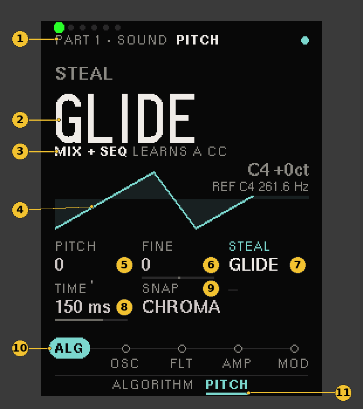
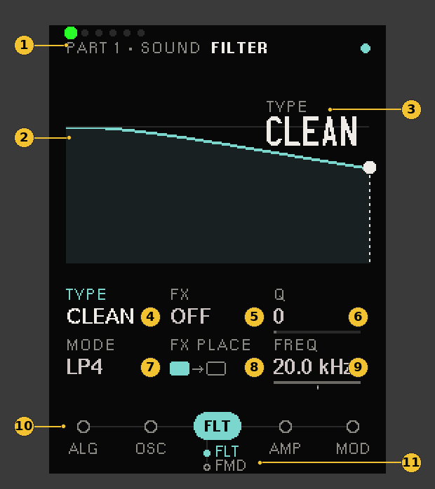
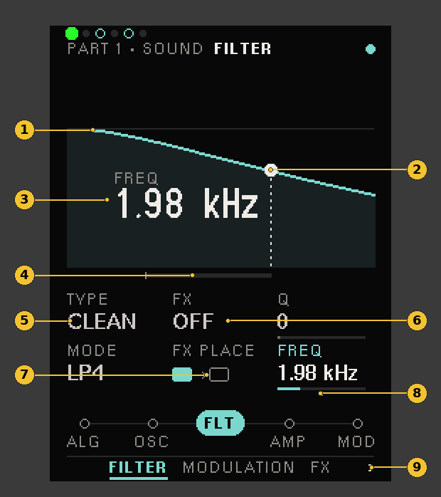
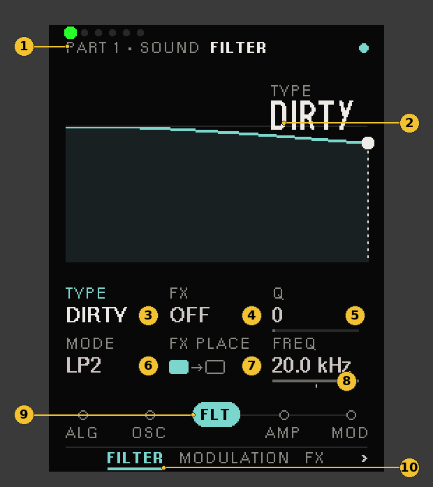
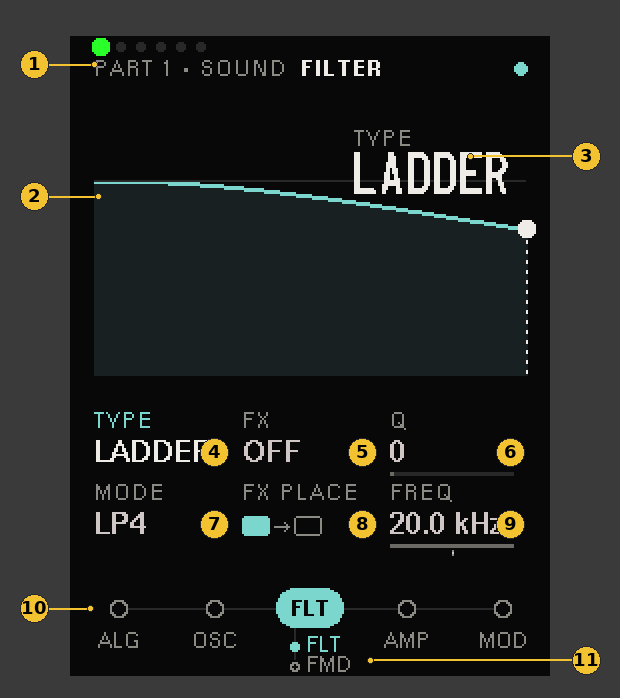
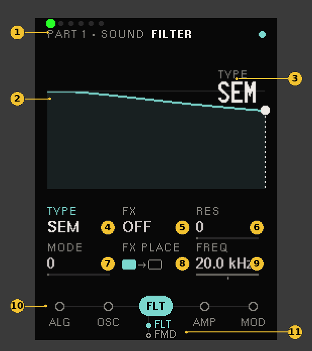
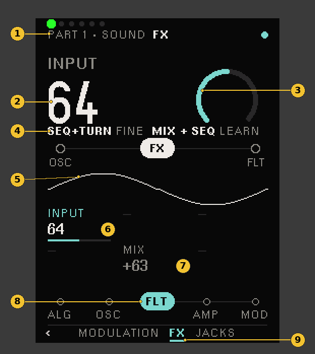
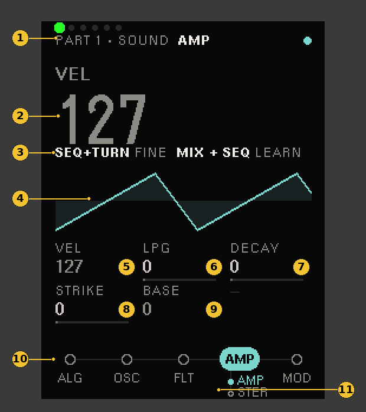
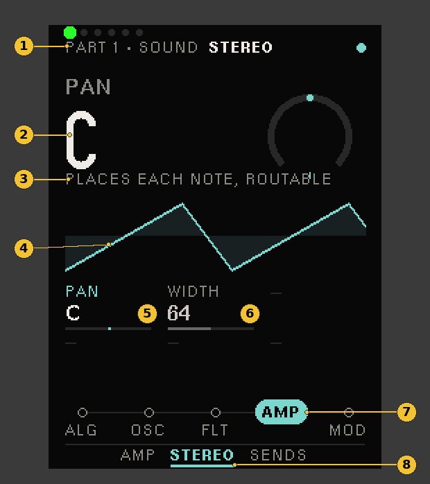
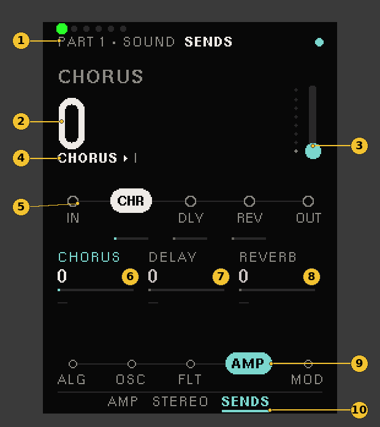

# The voice chain: pitch, filter, FX, amp, stereo and sends

ALGO, MODAL, VA and TAPE run their sound through the same voice pages: **PITCH**, **FILTER** with MODULATION, FX and JACKS, and **AMP** with STEREO and SENDS. This chapter is their one home; the engine chapters ([ALGO](03-algo.md), [MODAL](04-modal.md), [VA](05-va.md), [TAPE](06-tape.md), [DRUM](07-drum.md)) only add what differs. Envelopes and LFOs are in [Envelopes and LFOs](09-envelopes-and-lfos.md), routes in [the mod matrix](10-mod-matrix.md).

## Voice chain: the order of the signal

```
engine ── [FX slot, PRE] ── FILTER ── [FX slot, POST] ── AMP (VCA / low-pass gate) ── STEREO ── SENDS
```

- The **FX slot** sits before or after the filter, never both: **FX PLACE** chooses.
- **AMP** is the voice's VCA; three gate knobs turn it into a low-pass gate.
- **STEREO** places each note and sets the Part's width.
- **SENDS** feed the Part to the shared chorus, delay and reverb ([the mixer and master FX](11-mixer-and-master-fx.md)).

On the chain map, FLT holds FILTER, MODULATION, FX and JACKS; AMP holds AMP, STEREO and SENDS. PITCH hangs under each engine's first node. **SEQ** steps on through a node's sub-pages, **EDIT** steps back, **MINUS** and **PLUS** move along the chain ([the panel and navigation](02-panel-and-navigation.md)). Every value glides when you turn it, so a sweep of the cutoff, a send or the pan never steps.

**Why:** one chain for every engine means one set of habits. A filter sweep, a drive or a send works the same on an FM patch, a struck string, an analogue-style voice or a tape loop.

## Voice chain: page names on the map and on screen

| Chain map | Sub-page row | Page title |
|---|---|---|
| **PIT** | PITCH | PITCH |
| **FLT** | FILTER | FILTER |
| **FMD** | MODULATION | FILTER MOD (DIRTY MOD, LADDER MOD or SEM MOD on those types) |
| **FX** | FX | FX |
| **JACK** | JACKS | FILTER JACKS |
| **AMP** | AMP | AMP |
| **STER** | STEREO | STEREO |
| **SND** | SENDS | SENDS |

With SETTINGS › PERSONALIZE › CHAIN MAP › PAGES at STACK, sub-pages show by their short names, stacked under the node.

## Voice chain: values and gestures on every page

- Continuous knobs read 0 to 127 unless a table says otherwise; bipolar ones (FEEDBACK) −64 to +63. Cutoffs read in Hz, times in ms or s.
- **Hold SEQ + turn:** fine steps (one tick a detent, a tenth of a continuous step, no acceleration). Hint: `SEQ+TURN FINE`.
- **MIX + turn:** jump to the next landmark (minimum, default, maximum). On a route cell (ENV AMT, FREQ MOD, RES MOD), to 0 then full, in the direction you turn.
- **MIX + PLUS:** prime the cell as a matrix destination; the focus band says ADDED, ALREADY ROUTED, NOT MODULATABLE or MATRIX FULL ([MOD: priming a destination](10-mod-matrix.md#mod-priming-a-destination)).
- **MIX + MINUS:** on a route cell, delete the route; on any other cell, take the parameter out of the matrix with its routes.
- **MIX + SEQ:** learn a MIDI control ([MIDI](14-midi.md)).

The hint line under the value shows the combos the touched cell answers to (off at SETTINGS › PERSONALIZE › THEME › HINTS).

## PITCH: the pitch page

**PITCH** (PIT) tunes the whole voice and sets what a new note does when it takes over a sounding voice. It sits under ALG (after ALGORITHM), RES (after RESONATOR and the model page), VA (after OSC1, OSC2 and NOISE) or DECK (after the machine's page).


1. **Header:** Part, Sound, page.
2. **The touched cell**, large, with its arc.
3. **Hint line.**
4. **The tuner:** the note the Part's last note sounds at, its offset in cents (`C4 +0ct`), and its Hz. `REF C4` before the first note.
5. **PITCH**, in semitones.
6. **FINE**, in cents.
7. **STEAL:** CUT or GLIDE.
8. **TIME:** the glide time.
9. **SNAP:** CHROMA or MUSICAL.
10. **Chain map**, on ALG.
11. **Sub-pages** of ALG, PITCH lit.

| Cell | Range | Default | What it does |
|---|---|---|---|
| **PITCH** | −24 to +24 semitones | 0 | Transposes the voice. Destination: a full route moves it 24 semitones |
| **FINE** | −100 to +100 cents | 0 | Fine tuning. Destination |
| **STEAL** | CUT, GLIDE | CUT | When a note takes a still-sounding voice of its Part: CUT starts at its own pitch, GLIDE slides from the old one |
| **TIME** | 1 ms to 2 s | 150 ms | Glide time (to 95 %), under GLIDE |
| **SNAP** | CHROMA, MUSICAL | CHROMA | CHROMA: a semitone a detent. MUSICAL: −24, −19, −12, −7, 0, +7, +12, +19, +24 |

The tuner reads A4 = 440 Hz in the Part's tuning, including PITCH, FINE and the engine's transposition, and follows PITCH and FINE with no note held. It is dim between notes.



1. Header.
2. The touched cell: STEAL, GLIDE.
3. Hint line.
4. Tuner.
5. PITCH.
6. FINE.
7. **STEAL** at GLIDE.
8. **TIME**, now in use.
9. SNAP.
10. Chain map.
11. Sub-pages.

GLIDE acts only when a new note takes a sounding voice of the same Part. With MAX VOICES 1 ([the mixer](11-mixer-and-master-fx.md)) that is every note, so GLIDE becomes legato portamento. STEAL and TIME are read at the moment of the steal, so they are not destinations.

**On TAPE** a source plays at the key, from its root; with no known root the tuner reads `ROOT ?` over its shift from the source's own speed.

**Why:** the tuner shows what the Part will really play, so you can tune by eye without holding a note. MUSICAL SNAP is there because most transpositions worth playing are fifths and octaves.

## FILTER: the filter page

**FILTER** (FLT) is the same on every engine.



1. **Header:** Part, Sound, page.
2. **The response**, drawn from the filter's real response, resonance peak included; the dot is the corner, at the cutoff.
3. **Readout** of the touched control (TYPE: CLEAN).
4. **TYPE.**
5. **FX:** the voice's FX slot.
6. **Q:** resonance.
7. **MODE:** the response.
8. **FX PLACE:** PRE or POST; the cell draws the order.
9. **FREQ:** the cutoff; a thin line under its bar shows modulation reaching it.
10. **Chain map**, on FLT.
11. **Sub-pages:** FILTER, MODULATION, FX, JACKS.

The picture takes the whole band, so there is no focus band. The readout shows the value you set and stays still under modulation; a faint band under the plot runs from the corner to where modulation has the cutoff now, with a tick at its end:



1. The response.
2. The corner, at the cutoff you set.
3. Readout (FREQ).
4. **The modulation mark.**
5. TYPE.
6. FX.
7. FX PLACE.
8. FREQ, with Q and MODE beside it.
9. `>`: more sub-pages.

| Cell | Range | Default | What it does |
|---|---|---|---|
| **TYPE** | CLEAN, 2040, DIRTY, LADDER, SEM | CLEAN (VA: 2040) | Which filter; the cells follow it |
| **FX** | OFF, SOFT, FUZZ, FOLD | OFF | The FX slot ([FX: the FX slot](#fx-the-fx-slot)) |
| **Q** / **RES** | 0 to 127 | 0 | Resonance (RES on 2040 and SEM) |
| **MODE** / **VOICE** | per TYPE | LP4 where it exists | The response (VOICE on 2040; a knob on SEM) |
| **FX PLACE** | PRE, POST | follows FX | Slot before (FX into FLT) or after (FLT into FX) the filter |
| **FREQ** / **CUTOFF** | 20 Hz to 20.0 kHz | 20.0 kHz | The cutoff (CUTOFF on 2040) |

**FREQ** steps 1/24 octave a detent, ten even octaves, reading whole Hz under 1 kHz, then kHz (`2.14 kHz`). Turns glide and modulation is spread across each block, so knob, envelope and LFO sweeps never step. Changing TYPE or MODE crossfades over a few milliseconds; MODE stays if the new type has it, else takes its default.

**Why:** a readout that jumped with every LFO cycle would be unreadable and impossible to set back. The 1/24-octave tick makes every detent the same musical size at 50 Hz and at 5 kHz.

### FILTER: CLEAN

A clean state-variable filter in the manner of the Cascadia's VCF; the home filter of ALGO, MODAL and TAPE.

| MODE | Response |
|---|---|
| LP1 / LP2 / LP4 | Low-pass, 1, 2 or 4 poles (6, 12, 24 dB an octave) |
| BP2 / BP4 | Band-pass, 2 or 4 poles |
| HP4 | High-pass, 4 poles |
| NOTCH1 | One notch, at twice FREQ |
| NOTCH2 | Two notches around FREQ (phaser-style); Q deepens them, never self-oscillates |

At high Q, CLEAN self-oscillates (not in NOTCH2). LP4 fully open passes its input untouched. The NOTCH2 picture is a sketch, not the real response.

> **Design note:** CLEAN takes its controls and words from the Intellijel Cascadia's VCF: modes named by what they do (LP1, BP4, NOTCH2), not by a datasheet. Under it runs a zero-delay state-variable filter that can self-oscillate. NOTCH2 is four all-pass stages around the dry signal, after an application circuit in the SSM2040's own data sheet: a nice bit of family history for a filter that sits next to a 2040.

### FILTER: 2040


1. Header.
2. The 2040's response.
3. Readout: TYPE, 2040.
4. **TYPE.**
5. FX.
6. **RES.**
7. **VOICE:** REV2 or EXPNDR.
8. FX PLACE.
9. **CUTOFF.**
10. Chain map.
11. Sub-pages.

A four-pole low-pass modelled on the SSM2040 filter chip; VA's home filter. Its one mode reads 4-POLE LP. **INPUT** (on FX) drives the chip's stages directly. **VOICE** picks the chip's surroundings:

| VOICE | What it is |
|---|---|
| REV2 | The chip as the Prophet-5 used it: linear resonance, bounded by the chip's own clip |
| EXPNDR | The chip as the Kobol Expander uses it, a CA3080 in the resonance loop: squelches as RES rises, keeps more bass, rings over its input at full RES |

> **Design note:** the 2040 is a circuit model of the SSM2040, each VOICE solving the loop through its own resonance part. EXPNDR's bass and ring were then measured against a recording of a real Kobol Expander at three resonance settings, and its make-up gain fitted to match. REV2 was left exactly as modelled.

### FILTER: DIRTY



1. Header.
2. DIRTY's response.
3. Readout: TYPE, DIRTY.
4. **TYPE.**
5. FX.
6. **Q.**
7. **MODE:** LP2, BP2, HP2 or NOTCH1.
8. FX PLACE.
9. **FREQ.**
10. Chain map.
11. Sub-pages.

A Chamberlin state-variable filter that drives hard: the cheapest and edgiest. MODE is **LP2** (default), **BP2**, **HP2** or **NOTCH1** (one notch, at FREQ). Its modulation page is titled DIRTY MOD.

### FILTER: LADDER



1. Header.
2. LADDER's response.
3. Readout: TYPE, LADDER.
4. **TYPE.**
5. FX.
6. **Q.**
7. **MODE:** LP2, LP4, BP2, BP4 or HP4.
8. FX PLACE.
9. **FREQ.**
10. Chain map.
11. Sub-pages.

The Moog transistor ladder, four poles, with Xpander-style modes (**LP2**, **LP4** default, **BP2**, **BP4**, **HP4**) and INPUT as its drive. Like the original it loses some bass as resonance rises. Its modulation page is titled LADDER MOD.

> **Design note:** LADDER is Vadim Zavalishin's topology-preserving ladder from *The Art of VA Filter Design*, its feedback loop solved in closed form. Three published Moog models were weighed first. A benchmark paper against a transistor-level simulation settled where the saturation goes: five saturators, one at the input and one a stage, because distributed saturation matches the real circuit far better than one clipper at the end.

### FILTER: SEM



1. Header.
2. SEM's response.
3. Readout: TYPE, SEM.
4. **TYPE.**
5. FX.
6. **RES.**
7. **MODE**, a knob: low-pass at 0, notch mid-way, high-pass at 127.
8. FX PLACE.
9. **FREQ.**
10. Chain map.
11. Sub-pages.

The Oberheim SEM's 12 dB state-variable filter. **MODE** is a knob, like the SEM's pot: low-pass (0), a notch at FREQ (middle), high-pass (127). It glides and is a destination, so an LFO on MODE sweeps the response itself. **OUTPUT**, on SEM MOD, is the SEM's switch: MODE (the knob's sweep) or BP (band-pass). Like the original, it does not self-oscillate: at full RES it rings and the ring dies away.

> **Design note:** SEM was built twice. The first try was an existing filter with new labels, and it got sent back. The second started from the SEM-1A's schematic: the whole VCF in one nodal circuit simulation, using the measured CA3080 data of Köper, Holters, Esqueda and Parker's DAFx paper on the EDP Wasp filter. What you play is a much cheaper model with every constant taken from that simulation; over 75 test renders it tracks the full circuit closely, down to how long the resonance rings at each frequency.

## FILTER MOD: the filter's modulation page

**FILTER MOD** (FMD, MODULATION in the sub-page row) holds what moves the filter. Its title follows the type: DIRTY MOD, LADDER MOD or SEM MOD.


1. **Header.**
2. **The touched cell**, large: ENV AMT, 0 %.
3. **Hint:** on a route cell, MIX + MINUS deletes the route.
4. **Picture band:** the live output.
5. **ENV AMT.**
6. **KEYBOARD.**
7. **FREQ MOD.**
8. **FDBK:** FEEDBACK.
9. **RES MOD**, a dash: no route yet.
10. **Chain map**, on FLT.
11. **Sub-pages**, MODULATION lit.

| Cell | Range | Default | What it does |
|---|---|---|---|
| **ENV AMT** | −100 % to +100 % | 0 % | Route: ENV 1 into FREQ |
| **KEYBOARD** | −100 % to +100 % (2040: OFF, HALF, FULL) | OFF | Route: NOTE into FREQ. FULL moves the cutoff an octave per octave |
| **FREQ MOD** | −100 % to +100 % | 0 % | Route: the FREQ SRC jack's source into FREQ |
| **FEEDBACK** (FDBK) | −64 to +63 | 0 | The filter's output fed back into its cutoff |
| **RES MOD** | −100 % to +100 % | 0 % | Route: the RES SRC jack's source into the resonance |
| **OUTPUT** | MODE, BP | MODE | SEM only, bottom right: the knob's sweep, or band-pass |

A full route (100 %) moves the cutoff ten octaves. A dash means no route; turn the cell to make one. On FREQ MOD and RES MOD the focus band names the source (`FREQ MOD LFO1`). On the 2040, KEYBOARD steps OFF, HALF, FULL like a Prophet's keyboard switch.

**FEEDBACK** works on every TYPE and is a destination (FDBK in the matrix header). Positive amounts make the filter open on its own peaks and snarl; negative ones pull the cutoff down as the output swings.

**Why:** these four are not separate controls with hidden wiring; each is a matrix cell shown where you think about the filter. Turn ENV AMT and the matrix's ENV1 → FREQ route moves with it ([MOD: route cells on other pages](10-mod-matrix.md#mod-route-cells-on-other-pages)).

> **Design note:** FEEDBACK comes from a favourite Kobol Expander patch, audio out back into the filter's frequency input. Here the output, a sample late and smoothed, bends the cutoff by up to eight octaves. On a pluck it sounds like the filter is arguing with the note. The 2040 gets an extra soft limit while FEEDBACK is on, so full feedback at full resonance stays inside full scale.

### FILTER MOD: good starting points

- **Classic filter envelope:** on VA, CUTOFF about 400 Hz, RES about 40, ENV AMT +50 %; shape ENV1's DECAY.
- **Keyboard tracking:** KEYBOARD at FULL (+100 % on other types) keeps brightness even across the keys; HALF lets low notes sound darker.
- **Wah from the wheel:** JACKS FREQ SRC to LFO2, FREQ MOD +30 %; LFO2 DEPTH to 0, prime it with **MIX + PLUS**, route WHEEL into it.

## FX: the FX slot

Every voice has one FX slot, before or after the filter: its TYPE is **FX** and its place **FX PLACE**, both on FILTER. The **FX** sub-page holds its controls.



1. **Header.**
2. **The touched cell**, large: INPUT, 64.
3. **Its arc.**
4. **Hint line.**
5. **Signal path** (OSC, FX, FLT: PRE) over **the effect's curve**; with FX OFF, a plain sine.
6. **INPUT.**
7. **MIX**, dimmed while FX is OFF; the pots read dashes.
8. **Chain map**, on FLT.
9. **Sub-pages**, FX lit.

With an effect on, the pots fill in:


1. Signal path, in FX PLACE's order.
2. The effect's curve: sine in (faint), shaped wave out.
3. The touched pot's arc.
4. **INPUT.**
5. First pot (SOFT: DRIVE).
6. Second pot (TONE).
7. Third pot (LEVEL).
8. **MIX.**
9. Sub-page row, on FX.

The page reads **INPUT · P1 · P2 / P3 · MIX · STABILITY**:

| TYPE | P1 | P2 | P3 | Starts at |
|---|---|---|---|---|
| **OFF** | – | – | – | – |
| **SOFT** | **DRIVE**: how hard it clips | **TONE**: dark to bright | **LEVEL** | PRE |
| **FUZZ** | **SUSTAIN**: gain into the clippers | **TONE**: low-pass to high-pass, mids scooped at noon | **VOLUME** | PRE |
| **FOLD** | **FOLD**: how many folds | **SYMMETRY**: folds off centre | **LEVEL** | POST |

| Cell | Range | Default | What it does |
|---|---|---|---|
| **INPUT** | 0 to 127 | 64 | Level into the filter: 64 unity, up to four times; on the 2040 the chip's drive |
| **DRIVE**, **SUSTAIN**, **FOLD** | 0 to 127 | 0 | The effect's amount |
| **TONE**, **SYMMETRY** | 0 to 127 | 64 | The effect's colour |
| **LEVEL**, **VOLUME** | 0 to 127 | 64 | Wet level: 64 unity, a quarter to four times |
| **MIX** | −64 to +63 | +63 | Dry (−64) to wet (+63) |
| **STABILITY** | 0 to 127 | 64 | 2040, LADDER, SEM: how alike each voice's filter is |

- **SOFT:** symmetric soft clipping with tone: warmth low, crunch high.
- **FUZZ:** a Big Muff-style fuzz: two diode clipping stages and its tone stack.
- **FOLD:** a wavefolder; harmonics grow as FOLD rises. Silence folds to silence, whatever SYMMETRY says.

The TYPEs are level-matched; changing TYPE or FX PLACE fades over 20 ms. Leaving OFF sets FX PLACE to the new TYPE's start; after that TYPE keeps your PLACE. In PRE, INPUT and the effect's level stack, both pushing the filter; in POST the effect shapes the filter's output, resonance included.

The matrix's fixed FX column moves P1 (DRIVE, SUSTAIN or FOLD) whatever the TYPE; the other pots, INPUT, MIX and STABILITY are destinations you prime.

**Why:** one slot either side of the filter does the work of a drive and a folder at the cost of one: PRE overdrives into the filter, POST folds or fuzzes a resonant peak.

> **Design note:** FUZZ is an Electro-Harmonix Big Muff Pi, the NYC reissue, modelled stage by stage from its published circuit values. When the model's mid scoop came out shallower than the plan said it should, the circuit won and the plan was corrected. Turns out the circuit is always right.

### FX: STABILITY

On 2040, LADDER and SEM the sixth FX cell, **STABILITY**, gives each voice its own slightly different filter chip: cutoff offset, slow drift, keyboard tracking error and resonance spread. 127 makes every voice the same; lower, they drift apart. A new Sound starts at 64, a Prophet-like amount. Its glyph is a spirit level. It is a destination. On CLEAN and DIRTY the cell is empty. It is separate from VA's oscillator STABILITY but uses the same law.

> **Design note:** a Prophet-5 has one SSM2040 per voice, and its own service manual warns that the filters will drift and never track as well as the oscillators. That is part of why a chord on one sounds the way it does. STABILITY puts it back.

## JACKS: the filter's patch points

**FILTER JACKS** (JACK, JACKS in the sub-page row) picks the sources FREQ MOD and RES MOD read.


1. **Header.**
2. **Picture band:** the touched jack and its source.
3. **FREQ SRC.**
4. **RES SRC.**
5. Chain map, on FLT.
6. Sub-pages, JACKS lit.

| Cell | Choices | Default |
|---|---|---|
| **FREQ SRC** | LFO1, LFO2, LFO3, ENV2, ENV3, VELO, OP5, OP6 | LFO1 |
| **RES SRC** | ENV1, LFO1, ENV2, ENV3, LFO2, LFO3, VELO, NOTE, OP5, OP6 | ENV3 |

- **OP5**, **OP6** (ALGO only): the audio of operators 5 and 6, for audio-rate filter modulation.
- FREQ SRC has no ENV1: ENV AMT already is ENV 1 into the cutoff.
- A jack skips a source whose route into the same column another cell holds (SOURCE IN USE).
- Moving a jack moves its route: the FREQ MOD or RES MOD amount stays and reads the new source.
- Jacks are patching, not sound: they cannot be learned or modulated.

**Why:** the matrix already carries every source to the filter; the jacks are a shortcut, two knobs that pick a source as patch cables would.

## AMP: the VCA and low-pass gate

**AMP** is the voice's VCA. **LPG**, **DECAY** and **STRIKE** turn it into a low-pass gate in the manner of Plaits'; all three at 0 is a plain VCA. **BASE** is where routes into the VCA start.



1. **Header.**
2. **The touched cell**, large.
3. **Hint line.**
4. **Picture band:** the live output.
5. **VEL.**
6. **LPG.**
7. **DECAY.**
8. **STRIKE.**
9. **BASE.**
10. **Chain map**, on AMP.
11. **Sub-pages:** AMP, STEREO, SENDS.

| Cell | Range | Default | What it does |
|---|---|---|---|
| **VEL** | 0 to 127 | 127 | How much velocity scales the routes into VCA. Dimmed until a route goes into VCA |
| **LPG** | 0 to 127 | 0 | How much the gate darkens with level: the quieter, the darker. 0 is a VCA, 127 all filter |
| **DECAY** | 0 to 127 | 0 | How slowly the gate closes: fast while bright, slower as it dims, like a vactrol |
| **STRIKE** | 0 to 127 | 0 | How hard each note-on strikes the gate, by velocity; it rings out through DECAY |
| **BASE** | 0 to 127 | 0 | Where the sum of routes into VCA starts. Dimmed (`NEEDS A ROUTE INTO VCA`) until there is one |

LPG, DECAY, STRIKE and BASE are destinations and MIDI-learnable. **STRIKE** adds to the envelope routed into VCA as an accent; a held note falls back to the envelope. With nothing routed into VCA the strike alone plays the note, which ends when the gate shuts even with the key held. Any filter TYPE plays in front of the gate: a sine through FOLD with LPG and STRIKE at full is a bongo.

> **Design note:** the low-pass gate is a port of Émilie Gillet's low-pass gate from Mutable Instruments Plaits, vactrol-style envelope, decay and colour mapping included. With all three knobs at 0 the voice runs the plain VCA bit for bit, so every Sound made before the gate existed sounds exactly as it did. A full vactrol model, from a published study of the VTL5C3, lives in the circuit lab as a reference.

### AMP: routes into VCA and BASE

The matrix's **VCA** column (OUTPUT VCA) is the note's amp.

- **No route:** the engine shapes its own level: ALGO by its carriers' envelopes, MODAL by its decay, VA and TAPE by the key alone.
- **The first route replaces that contour.** The gain becomes BASE plus each route's amount times its source, held between silence and full.

ALGO's carriers and MODAL's resonator still play their own shape under that gain. On VA and TAPE the routes are the whole contour, which is why their INIT Sounds route ENV 1 into VCA at full. BASE starts at 0, so a lone PRESS route is silent until you lean in. An empty VCA cell in the matrix says `VCA: ROUTES REPLACE CONTOUR`, or `VCA: SUM STARTS AT AMP BASE` once an ENV is routed.

**Swell or duck a held note, keeping its attack** (ALGO, MODAL):

| Aim | BASE | PRESS into VCA |
|---|---|---|
| Duck under pressure (full press halves it) | 127 | −64 |
| Swell under pressure (half to full) | 64 | +63 |
| Pressure only (silent until pressed) | 0 | alone |

There, a BASE above 0 also keeps the carriers' or resonator's own tail after key up. On VA and TAPE leave BASE at 0 (above it holds the gain past ENV 1's attack and release): duck with a negative PRESS route; swell by lowering ENV 1's amount (+64) and adding a positive one. Pressure is linear.

### AMP: the release gate

On ALGO and MODAL with nothing routed into VCA, a gate after the filter follows the engine's own tail after key up: the voice may be no more than 12 dB louder than what the engine still puts out. A self-oscillating filter then dies with the note instead of ringing on, closing no faster than about 21 ms so a ring fades rather than cuts. While the key is held the gate stays open, so a self-oscillating filter is a played tone; a normal release is untouched. Nothing to set.

### AMP: good starting points

- **Plucked percussion:** FX FOLD, LPG 127, DECAY about 60, STRIKE 127, nothing into VCA. Soft is a dull thud, hard a bright one.
- **Vactrol-ish pluck on VA:** keep ENV 1 into VCA, LPG about 90, STRIKE about 60: the envelope gains a bright accent on each hit.

## STEREO: pan and width

**STEREO** (STER) places each note and sets the Part's width.



1. **Header.**
2. **The touched cell**, large.
3. **Hint line.**
4. **Picture band:** the live output.
5. **PAN.**
6. **WIDTH.**
7. Chain map, on AMP.
8. Sub-pages, STEREO lit.

| Cell | Range | Default | What it does |
|---|---|---|---|
| **PAN** | L64 to R63, C centre | C | Where each note sits, constant power. Destination: NOTE spreads the keys, an LFO moves it |
| **WIDTH** | 0 to 127 | 64 | Part width: 0 mono, 64 the pans as set, 127 twice as wide |

PAN acts per note; WIDTH on the whole Part afterwards, and with the Part's pan centred it never changes the mono sum. A DRUM Part pans each pad with the pad's own PAN.

**Why:** a voice's sides come only from panning, so a WIDTH that stopped at "as set" could only narrow; past 64 it spreads a NOTE-spread patch wider than its pans.

## SENDS: chorus, delay and reverb

**SENDS** (SND) feeds the Part to the three shared effects ([the mixer and master FX](11-mixer-and-master-fx.md)).



1. **Header.**
2. **The touched send's level**, large.
3. Its level bar.
4. **The effect** and its TYPE (`CHORUS ▸ I`).
5. **The effects chain**, the touched one lit, the three sends as short bars.
6. **CHORUS.**
7. **DELAY.**
8. **REVERB.**
9. Chain map, on AMP.
10. Sub-pages, SENDS lit.

| Cell | Range | Default | What it does |
|---|---|---|---|
| **CHORUS** | 0 to 127 | 0 | Send to the chorus slot |
| **DELAY** | 0 to 127 | 0 | Send to the delay |
| **REVERB** | 0 to 127 | 0 | Send to the reverb |

The same page is SND in the Part's mixer. Sends belong to the Sound, so they travel with it. Effects return wet only. The taper is squared: 64 is −12 dB, 32 is −24 dB, and the first step is far below hearing, so a send fades in from 0.

**Why:** on a straight taper the bottom of the knob jumped from nothing to audible and the top half did little; squared, the top half spans 12 dB and the low end grows from silence.

## Voice chain: differences between engines

| Where | ALGO | MODAL | VA | TAPE |
|---|---|---|---|---|
| PITCH sits under | ALG | RES | VA | DECK |
| Default TYPE | CLEAN, LP4 | CLEAN, LP4 | 2040 (REV2) | CLEAN, LP4 |
| OP5, OP6 on jacks and matrix | yes | no | no | no |
| INIT route into VCA | none | none | ENV 1 at +127 | ENV 1 at +127 |
| Release gate (no VCA route) | yes | yes | no | no |
| Tuner | the note | the note | the note, with OSC 1 | from the source's root; `ROOT ?` if unknown |

DRUM builds its per-pad filter, gate and amp pages from the same filters, FX slot and gate: see [DRUM](07-drum.md).
