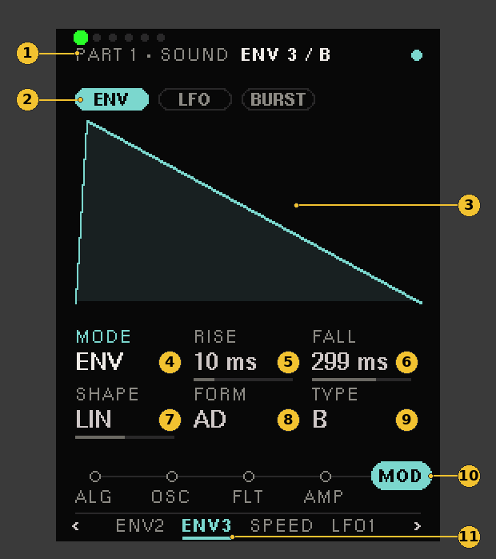
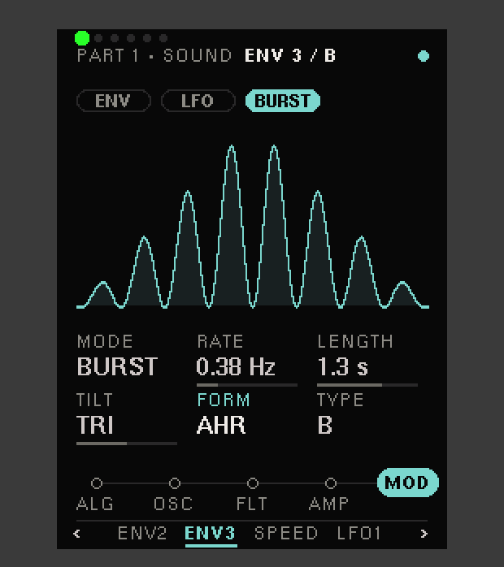
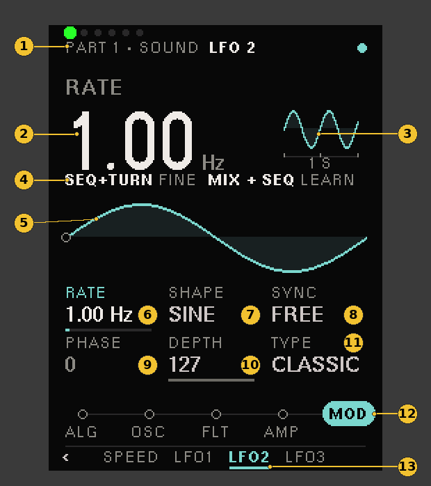
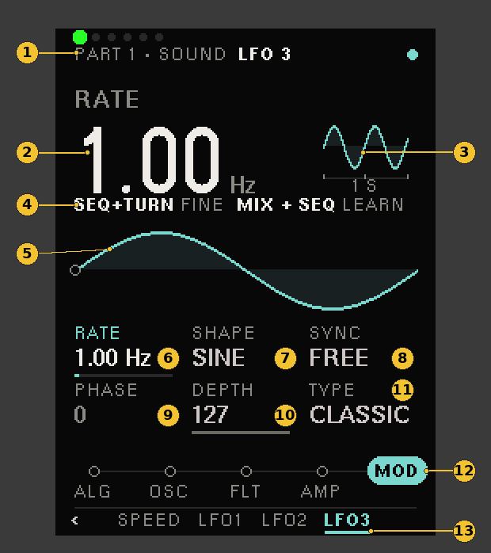

# Envelopes and LFOs

Every melodic Part has three envelope slots and three LFO slots, the same on ALGO, MODAL, VA and TAPE. They sit under the MOD node, after the matrix: **E1**, **E2**, **E3** (envelopes), **SPD** (their speeds) and **L1**, **L2**, **L3** (LFOs). What they move is set in [the mod matrix](10-mod-matrix.md); the filter's ENV AMT and the AMP page are in [the voice chain](08-voice-chain.md).

## Modulators: where the pages are

| Chain map | Sub-page row | Page title |
|---|---|---|
| **E1**, **E2**, **E3** | ENV1, ENV2, ENV3 | ENV 1 / A (or / B, after the slot's TYPE) |
| **SPD** | SPEED | ENV SPEED |
| **L1**, **L2**, **L3** | LFO1, LFO2, LFO3 | LFO 1, LFO 2, LFO 3 |

From MATRIX, **SEQ** steps on through ENV1 to LFO3 and wraps back to the matrix; **EDIT** steps back. The envelope pages and SPEED give the whole band to a picture and have no focus band; the LFO pages keep it, with a glyph for each control. The usual gestures apply ([Voice chain: values and gestures on every page](08-voice-chain.md#voice-chain-values-and-gestures-on-every-page)): **MIX + SEQ** learns, **hold SEQ + turn** is fine, **MIX + turn** jumps to a landmark, **MIX + PLUS** primes a destination where the cell is one ([Modulators: what can be modulated](#modulators-what-can-be-modulated)).

**Why:** instead of a fixed "filter envelope", "amp envelope" and "vibrato LFO", a Sound gets six slots, each a choice of kind, and any of them can drive anything through the matrix.

> **Design note:** the envelope slots follow the behaviour and ranges of the Intellijel Cascadia's Envelopes A and B, taken from its manual: no code, just the published ranges and how each mode behaves. A is its AHDSR with speed switch and hold position; B its function generator, which can be an envelope, an LFO or a burst of pulses. The stages charge like a capacitor toward a rail, which is why they sound like an analogue envelope rather than a ruler.

## Envelopes: the three slots

Each slot's **TYPE** is **A** (an AHDSR at one of three speeds) or **B** (a function generator: envelope, LFO or burst, by its **MODE**). A new Sound starts E1 and E2 on A at MED and E3 on B, MODE ENV. E1 is the envelope the filter's ENV AMT reads; on VA and TAPE it is also routed into the VCA at full.

Changing TYPE, MODE or FORM never jumps: the new shape takes over from the slot's current level. Outputs carry no velocity; velocity arrives as VELO in the matrix, through AMP's VEL, or through a route into an envelope's level ([Envelopes: modulating an envelope](#envelopes-modulating-an-envelope)).

## Envelopes: type A, the AHDSR

1. **Header:** PART 1 · SOUND, page ENV 1 / A.
2. **The picture:** the envelope as set, its stages drawn to scale, the touched stage (attack) lit.
3. **Stage letters:** A H D S R, the touched one lit.
4. **ATTACK**, 10 ms.
5. **DECAY**, 299 ms.
6. **SUSTAIN**, 70%.
7. **RELEASE**, 299 ms.
8. **HOLD**, 0.001 ms.
9. **TYPE:** A.
10. **Chain map**, MOD lit.
11. **Sub-page row:** MATRIX ENV1 ENV2 ENV3 `>`, ENV1 underlined.

E2 starts the same way:

1. Header: ENV 2 / A.
2. The envelope.
3. Stage letters.
4. ATTACK.
5. DECAY.
6. SUSTAIN.
7. RELEASE.
8. HOLD.
9. TYPE: A.
10. Chain map, MOD lit.
11. Sub-page row: `<` ENV1 ENV2 ENV3 SPEED `>`, ENV2 underlined.

| Cell | Range (at MED) | Default | What it does |
|---|---|---|---|
| **ATTACK** | 2 ms to 10 s | 10 ms | Rise to the peak |
| **DECAY** | 3.5 ms to 10 s | 299 ms | Fall from the peak to SUSTAIN |
| **SUSTAIN** | 0 to 100 % | 70 % | Level held while the key is down |
| **RELEASE** | 3.5 ms to 10 s | 299 ms | Fall to 0 after key up |
| **HOLD** | 0.001 ms to 10 s | 0.001 ms | Time at the peak, or the shortest gate (HOLD on SPEED) |
| **TYPE** | A, B | A (E3: B) | The slot's kind |

The ranges follow the slot's SPEED:

| SPEED | HOLD | ATTACK | DECAY and RELEASE |
|---|---|---|---|
| **FAST** | 0.001 ms to 2.5 s | 0.2 ms to 1.5 s | 0.6 ms to 2.5 s |
| **MED** | 0.001 ms to 10 s | 2 ms to 10 s | 3.5 ms to 10 s |
| **SLOW** | 0.001 ms to 60 s | 9.3 ms to 60 s | 30 ms to 60 s |

Time knobs are exponential (each detent the same ratio) and read in ms, then s. The stages curve like an analogue envelope's: the attack aims past the top and stops there, so it arrives firm; decay and release slow as they near their end.

## Envelopes: type B, the function generator

With TYPE **B** the page reads **MODE · (two times or rates) / (a shape) · FORM · TYPE**; labels follow MODE and FORM, and each MODE remembers its own FORM.

| MODE | What it is | FORM choices | Cells |
|---|---|---|---|
| **ENV** | Rises and falls | AD, AHR, CYCLE | **RISE**, **FALL**, **SHAPE** |
| **LFO** | A free-running wave | FREE, SYNC, LFV | **RATE**, **PHASE**, **TILT** (LFV: **RATE**, **DELTA**, **SLEW**) |
| **BURST** | A train of pulses | AD, AHR, CYCLE | **RATE**, **LENGTH**, **TILT** |

### Envelopes: B in ENV mode

1. **Header:** ENV 3 / B.
2. **MODE pills:** ENV, LFO, BURST; ENV lit.
3. **The shape:** up at RISE's time and SHAPE's curve, down at FALL's.
4. **MODE:** ENV.
5. **RISE**, 10 ms.
6. **FALL**, 299 ms.
7. **SHAPE:** LIN.
8. **FORM:** AD.
9. **TYPE:** B.
10. **Chain map**, MOD lit.
11. **Sub-page row:** `<` ENV2 ENV3 SPEED LFO1 `>`, ENV3 underlined.

| Cell | Range | Default | What it does |
|---|---|---|---|
| **MODE** | ENV, LFO, BURST | ENV | The slot's mode |
| **RISE** | 2 ms to 5 s | 10 ms | Rise time |
| **FALL** | 2 ms to 5 s | 299 ms | Fall time |
| **SHAPE** | LOG, LIN, EXP | LIN | Curve of both segments; reads `LOG 40`, `LIN`, `EXP 25` |
| **FORM** | AD, AHR, CYCLE | AD | AD: rise then fall on each note-on, whatever the key does (retriggers from where it is). AHR: holds at the top while the key is down. CYCLE: repeats while held, restarting at each note-on: an LFO with separate up and down times |
| **TYPE** | A, B | B on E3 | The slot's kind |

 

### Envelopes: B in LFO mode

| Cell | Range | Default | What it does |
|---|---|---|---|
| **RATE** | 0.05 Hz to 800 Hz | 1.00 Hz | The speed |
| **PHASE** | 0 to 360 | 230 | Where the wave starts (FREE, SYNC) |
| **TILT** | SAW, TRI, RAMP | TRI | Slope: falling saw, triangle, rising ramp |
| **DELTA** | 0 to 100 % | 64 % | LFV: how far each new random target may land from the last |
| **SLEW** | 0 to 100 % | 50 % | LFV: how smoothly it glides to each target |
| **FORM** | FREE, SYNC, LFV | FREE | FREE: never reset by notes. SYNC: restarts at PHASE on each note-on. LFV: a random walk that never passes the ends, for organic movement |

 

### Envelopes: B in BURST mode

| Cell | Range | Default | What it does |
|---|---|---|---|
| **RATE** | 0.05 Hz to 1 kHz | about 0.9 Hz | Pulse rate within the burst |
| **LENGTH** | 10 ms to 20 s | about 1.3 s | How long the burst lasts |
| **TILT** | SAW, TRI, RAMP | TRI | The burst's shape over its length |
| **FORM** | AD, AHR, CYCLE | AD | AD: one burst a note. AHR: goes on while held. CYCLE: repeats while held; on key up the running burst is the last |

A burst gives ratchets, flutters and bouncing balls from one note: into VCA for a stuttered note, into the cutoff for filter blips.

 

### Envelopes: B's top speed

A type B slot feeding the VCA runs every sample, at full range. Anywhere else it runs once a block and its rates stop at 93.75 Hz (LFO RATE, BURST's pulse RATE, the repeat of ENV CYCLE and BURST CYCLE); one-shot AD and AHR times are not limited.

**Why:** six modulators at audio rate would cost voices. Only the slot shaping the level needs that detail; elsewhere 93.75 Hz is faster than any sweep you hear as a sweep.

## SPEED: the envelopes' speeds

**SPEED** (SPD, ENV SPEED on screen) holds each type A slot's SPEED and HOLD, a column a slot.

1. **Header:** ENV SPEED.
2. **The picture:** speed pills, a column a slot (FAST, MED or SLOW lit), and the hold position under each (AHDSR); the type B column E3 is dimmed and reads RISE/FALL.
3. **E1 SPEED**, MED.
4. **E2 SPEED**, MED.
5. **E3 SPEED**, TYPE B, dimmed.
6. **E1 HOLD**, AHDSR.
7. **E2 HOLD**, AHDSR.
8. **E3 HOLD**, TYPE B, dimmed.
9. **Chain map**, MOD lit.
10. **Sub-page row:** `<` ENV3 SPEED LFO1 LFO2 `>`, SPEED underlined.

| Cell | Choices | Default | What it does |
|---|---|---|---|
| **E1 SPEED**, **E2 SPEED**, **E3 SPEED** | FAST, MED, SLOW | MED | The slot's time ranges ([Envelopes: type A, the AHDSR](#envelopes-type-a-the-ahdsr)) |
| **E1 HOLD**, **E2 HOLD**, **E3 HOLD** | OFF, AHDSR, GATE EXT | AHDSR | Where HOLD acts (below) |

| HOLD | What it does |
|---|---|
| **OFF** | No hold stage: a plain ADSR |
| **AHDSR** | Holds at the peak for HOLD's time, then decays |
| **GATE EXT** | HOLD is the shortest gate: shorter notes play as if held that long, so short sequencer gates and drum triggers still reach the sustain |

On a type B slot both cells read TYPE B, dimmed.

**Why:** SPEED changes the range under the knob, not its travel, so one shape can be a click at FAST or a minute-long swell at SLOW, with fine control at each.

## Envelopes: modulating an envelope

An envelope's controls are destinations, so velocity, the wheel or another modulator can reshape it as you play. Prime them with **MIX + PLUS** on the envelope page:

| On a type A slot, MIX + PLUS on | Primes | What a route into it does |
|---|---|---|
| ATTACK, DECAY, RELEASE or HOLD | the slot's **TIME** | Scales all its times; positive faster, negative slower |
| SUSTAIN | the slot's **LEVEL** | Sets the peak: once routed, the sum of the routes, 0 to full |

On type B, **RISE**, **FALL** and **SHAPE** are destinations each, under whatever names the MODE gives them (RATE, PHASE, DELTA, LENGTH, TILT, SLEW).

- **Velocity-sensitive envelope:** prime E2's LEVEL (MIX + PLUS on SUSTAIN), route VELO into it at +127.
- **Faster envelopes higher up:** prime E1's TIME, route NOTE into it at a positive amount, as acoustic notes shorten as they rise.

## LFOs: the three LFO slots

Each LFO slot's **TYPE** is **CLASSIC** (shape, rate in Hz, sync, phase, depth) or **FUNC** (envelope B locked to LFO mode: TILT, the random walk, rates to 93.75 Hz).

## LFOs: CLASSIC

1. **Header:** PART 1 · SOUND, page LFO 1.
2. **The touched cell**, large: RATE, 1.33 Hz.
3. **Its glyph:** RATE draws two seconds of the LFO over a one-second ruler; the other cells draw what they do.
4. **Hint line:** `SEQ+TURN FINE  MIX + SEQ LEARN`.
5. **The LFO:** one cycle as set. A dot rides the newest voice's place in the cycle, resting at the start while nothing plays.
6. **RATE.**
7. **SHAPE:** SINE.
8. **SYNC:** FREE.
9. **PHASE**, dimmed under FREE.
10. **DEPTH**, 127.
11. **TYPE:** CLASSIC or FUNC.
12. **Chain map**, MOD lit.
13. **Sub-page row:** `<` SPEED LFO1 LFO2 LFO3, LFO1 underlined.

LFO 2 and LFO 3 are laid out the same:

1. Header: LFO 2.
2. Touched cell: RATE, 1.00 Hz.
3. Glyph.
4. Hint line.
5. The LFO.
6. RATE.
7. SHAPE.
8. SYNC.
9. PHASE.
10. DEPTH, 127.
11. TYPE.
12. Chain map, MOD lit.
13. Sub-page row, LFO2 underlined.

1. Header: LFO 3.
2. Touched cell: RATE, 1.00 Hz.
3. Glyph.
4. Hint line.
5. The LFO.
6. RATE.
7. SHAPE.
8. SYNC.
9. PHASE.
10. DEPTH, 127.
11. TYPE.
12. Chain map, MOD lit.
13. Sub-page row, LFO3 underlined.

| Cell | Range | Default | What it does |
|---|---|---|---|
| **RATE** | 0.01 Hz to 20 Hz | 1.00 Hz | Speed, in Hz |
| **SHAPE** | SINE, TRI, SAW, SQR, S&H | SINE | The wave; S&H holds a new random value each cycle |
| **SYNC** | FREE, RETRIG | FREE | FREE: the Part's voices share one phase. RETRIG: each note restarts its own LFO at PHASE |
| **PHASE** | 0 to 127 | 0 | Where a RETRIG LFO starts; dimmed under FREE |
| **DEPTH** | 0 to 127 | LFO1: 0, LFO2, LFO3: 127 | How much comes out. A destination |
| **TYPE** | CLASSIC, FUNC | CLASSIC | The slot's kind |

Under **FREE** the Part keeps a running phase clock per slot, so a chord wobbles together whenever each note was struck, and changing RATE changes speed without jumping the phase. Under **RETRIG** each note's LFO starts the same way and a chord's notes drift apart.

> **Design note:** CLASSIC FREE works like the one LFO of a Prophet-5, shared by every voice: play a chord and the vibrato moves it as one. The clock is an accumulator, not "time since the start times RATE", so turning RATE mid-note speeds the wave up smoothly instead of teleporting it.

## LFOs: FUNC

TYPE **FUNC** is a type B function generator locked to LFO mode; its MODE cell reads LFO, dimmed, and does not turn.

| Cell | Range | Default | What it does |
|---|---|---|---|
| **MODE** | LFO (fixed) | LFO | Shown for its place |
| **RATE** | 0.05 Hz to 93.75 Hz | 1.00 Hz | The speed |
| **PHASE** | 0 to 360 | 0 | Where the wave starts (FREE, SYNC) |
| **TILT** | SAW, TRI, RAMP | TRI | The wave's slope |
| **DELTA** | 0 to 100 % | 0 % | LFV: how far each random step may go |
| **SLEW** | 0 to 100 % | 50 % | LFV: how smoothly it glides |
| **FORM** | FREE, SYNC, LFV | FREE | As in [B in LFO mode](#envelopes-b-in-lfo-mode) |
| **TYPE** | CLASSIC, FUNC | CLASSIC | The slot's kind |

FUNC has no DEPTH: the routes it feeds set its level. Its RATE stops at 93.75 Hz, the top speed of a once-a-block slot.

**Why:** FUNC gives the LFO slots envelope B's shapes (any slope, the LFV walk) without spending an envelope slot.

## LFOs: DEPTH as a destination

A CLASSIC LFO's **DEPTH** is a destination: touch it, press **MIX + PLUS**, route any source in. The route reaches the LFO one block (1.3 ms) after its source moves.

A new Sound comes with one: WHEEL into LFO 1's DEPTH at +127, with LFO 1 into PITCH and its DEPTH at 0. Wheel down, no vibrato; wheel up, full depth. Moving the wheel is playing, not editing: the Sound stays as saved ([MIDI](14-midi.md)).

- **Vibrato that fades in:** route ENV 2 (type A, slow ATTACK) into LFO 1's DEPTH instead of the wheel.
- **Pressure tremolo:** LFO 2's DEPTH to 0, prime it, route PRESS in, and route LFO 2 into VCA (or PAN, for an auto-pan you squeeze in).

## Modulators: what can be modulated

| Slot | Destinations |
|---|---|
| Envelope, type A | TIME (from ATTACK, DECAY, RELEASE or HOLD), LEVEL (from SUSTAIN) |
| Envelope, type B | RISE, FALL, SHAPE, under the MODE's names |
| LFO, CLASSIC | DEPTH |
| LFO, FUNC | none |

MODE, FORM, TYPE, SPEED, HOLD on SPEED, CLASSIC's SHAPE and SYNC, and the LFOs' RATE and PHASE are not destinations: **MIX + PLUS** says NOT MODULATABLE. Routes are explained in [the mod matrix](10-mod-matrix.md).
