# Envelopes and LFOs

Every melodic Part has three envelope slots and three LFO slots. They sit under the MOD node of the chain map, after the matrix: **E1**, **E2**, **E3** (the envelopes), **SPD** (their speeds) and **L1**, **L2**, **L3** (the LFOs). They are the same on ALGO, MODAL, VA and TAPE. This chapter covers every cell. What the envelopes and LFOs move is set in [the mod matrix](10-mod-matrix.md); the filter's ENV AMT and the AMP page are in [the voice chain](08-voice-chain.md).

## Modulators: where the pages are

| Short name (chain map) | Name in the sub-page row | Page title |
|---|---|---|
| **E1**, **E2**, **E3** | ENV1, ENV2, ENV3 | ENV 1 / A (or / B, after the slot's TYPE) |
| **SPD** | SPEED | ENV SPEED |
| **L1**, **L2**, **L3** | LFO1, LFO2, LFO3 | LFO 1, LFO 2, LFO 3 |

From the MOD node's own page (MATRIX), press **SEQ** to step on to ENV1, ENV2, ENV3, SPEED, LFO1, LFO2 and LFO3. **EDIT** steps back. On LFO3, SEQ wraps round to the matrix.

The envelope pages and SPEED give the whole band to a picture of the slot and have no focus band. The LFO pages keep the focus band, with a glyph for each control.

Every value here can be learned to a MIDI control with **MIX + SEQ**. **Hold SEQ + turn** makes fine steps: one tick a detent, a tenth of a continuous value's step, with no acceleration. **MIX + turn** jumps a value to its next landmark (minimum, default, maximum). **MIX + PLUS** on a cell primes it as a matrix destination where it is one (see [Modulators: what can be modulated](#modulators-what-can-be-modulated)).

**Why:** a Sound gets six modulators, each one a choice of kind, instead of a fixed "filter envelope", "amp envelope" and "vibrato LFO". Any slot can drive anything through the matrix.

> **Design note:** the envelope slots follow the behaviour and ranges of the Intellijel Cascadia's Envelopes A and B, taken from its manual: no code, just the published ranges and how each mode behaves. Envelope A is the Cascadia's AHDSR with its speed switch and hold position; Envelope B is its function generator, which can be an envelope, an LFO or a burst of pulses. The stages charge like a capacitor toward a rail, which is why they sound like an analogue envelope rather than a ruler.

## Envelopes: the three slots

Each envelope slot is one of two kinds, set by its **TYPE**:

- **A:** an AHDSR envelope (attack, hold, decay, sustain, release) at one of three speeds.
- **B:** a function generator: an envelope, an LFO or a burst, by its **MODE**.

A new Sound starts E1 and E2 on A at MED speed and E3 on B, MODE ENV. On VA and TAPE, E1 shapes the note's level from the start (it is routed into the VCA at full), and E1 is the envelope the filter's ENV AMT reads on every engine.

Changing TYPE, MODE or FORM never makes the output jump: the new shape takes over from the level the slot is at.

The outputs carry no velocity. Velocity reaches the sound as a source of its own (VELO in the matrix), through AMP's VEL, or through a route into an envelope's level (see [Envelopes: modulating an envelope](#envelopes-modulating-an-envelope)).

## Envelopes: type A, the AHDSR

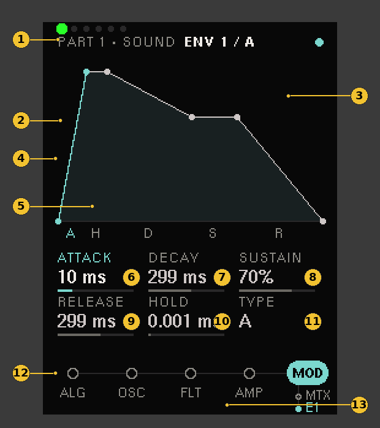

1. **Header:** the Part, its Sound and the page, ENV 1 / A.
2. **The picture:** the envelope at the values you set.
3. **Its stages**, left to right: attack, hold, decay, sustain, release.
4. **The touched stage**, lit.
5. **The stage letters**, A H D S R, under the picture.
6. **ATTACK.**
7. **DECAY.**
8. **SUSTAIN.**
9. **RELEASE.**
10. **HOLD.**
11. **TYPE:** A.
12. **The chain map**, on MOD.
13. **The sub-pages** of MOD, ENV1 lit.

E2 starts the same way:

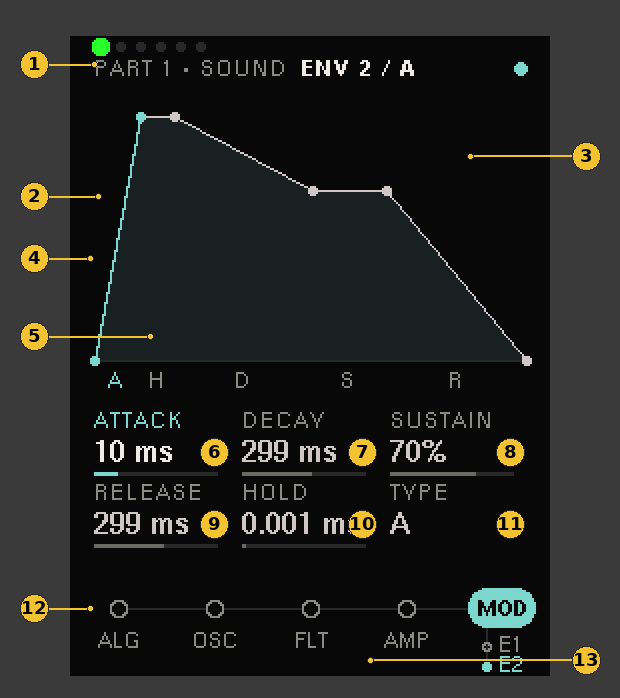

1. **Header:** the Part, its Sound and the page, ENV 2 / A.
2. **The picture:** the envelope at the values you set.
3. **Its stages**, left to right: attack, hold, decay, sustain, release.
4. **The touched stage**, lit.
5. **The stage letters**, A H D S R, under the picture.
6. **ATTACK.**
7. **DECAY.**
8. **SUSTAIN.**
9. **RELEASE.**
10. **HOLD.**
11. **TYPE:** A.
12. **The chain map**, on MOD.
13. **The sub-pages** of MOD, ENV2 lit.

The page reads **ATTACK · DECAY · SUSTAIN / RELEASE · HOLD · TYPE**.

| Cell | Range (at MED) | Default | What it does |
|---|---|---|---|
| **ATTACK** | 2 ms to 10 s | 10 ms | Time to rise to the peak |
| **DECAY** | 3.5 ms to 10 s | 299 ms | Time to fall from the peak to SUSTAIN |
| **SUSTAIN** | 0 to 100 % | 70 % | The level held while the key is down |
| **RELEASE** | 3.5 ms to 10 s | 299 ms | Time to fall to 0 after the key is let go |
| **HOLD** | 0.001 ms to 10 s | 0.001 ms | Time held at the peak, or the shortest gate (see HOLD on SPEED) |
| **TYPE** | A, B | A (E3: B) | The slot's kind |

The time ranges depend on the slot's SPEED (on the SPEED page):

| SPEED | HOLD | ATTACK | DECAY and RELEASE |
|---|---|---|---|
| **FAST** | 0.001 ms to 2.5 s | 0.2 ms to 1.5 s | 0.6 ms to 2.5 s |
| **MED** | 0.001 ms to 10 s | 2 ms to 10 s | 3.5 ms to 10 s |
| **SLOW** | 0.001 ms to 60 s | 9.3 ms to 60 s | 30 ms to 60 s |

Each time knob is exponential: every detent is the same ratio, so short times have as fine a control as long ones. Times read in ms, then in s from one second.

The stages are curved as an analogue envelope's are: the attack aims past the top and stops at it, so it rises fast and arrives firm; decay and release slow down as they near their end.

## Envelopes: type B, the function generator

Set TYPE to **B** and the slot becomes a function generator. Its page reads **MODE · (two times or rates) / (a shape) · FORM · TYPE**, and the labels follow MODE and FORM.

| MODE | What it is | FORM choices | Cells |
|---|---|---|---|
| **ENV** | An envelope that rises and falls | AD, AHR, CYCLE | **RISE**, **FALL**, **SHAPE** |
| **LFO** | A free-running wave | FREE, SYNC, LFV | **RATE**, **PHASE**, **TILT** (LFV: **RATE**, **DELTA**, **SLEW**) |
| **BURST** | A train of pulses under a burst | AD, AHR, CYCLE | **RATE**, **LENGTH**, **TILT** |

Each MODE remembers its own FORM, so switching MODE and back finds the FORM you left.

### Envelopes: B in ENV mode

1. **Header:** the Part, its Sound and the page, ENV 3 / B.
2. **The MODE pills** (ENV, LFO, BURST), the current one lit, over the picture.
3. **The rise**, drawn at RISE's time and SHAPE's curve.
4. **The fall**, at FALL's time.
5. **MODE.**
6. **RISE.**
7. **FALL.**
8. **SHAPE.**
9. **FORM:** AD.
10. **TYPE:** B.
11. **The chain map**, on MOD.
12. **The sub-pages** of MOD, ENV3 lit.

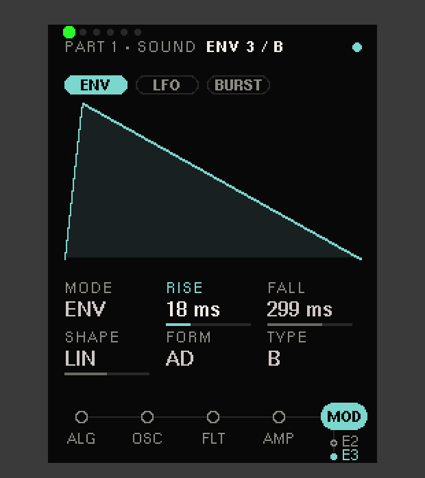

| Cell | Range | Default | What it does |
|---|---|---|---|
| **MODE** | ENV, LFO, BURST | ENV | The slot's mode |
| **RISE** | 2 ms to 5 s | 10 ms | Time to rise |
| **FALL** | 2 ms to 5 s | 299 ms | Time to fall |
| **SHAPE** | LOG, LIN, EXP | LIN | The curve of both segments: logarithmic below the middle, straight at it, exponential above. Reads `LOG 40`, `LIN`, `EXP 25` |
| **FORM** | AD, AHR, CYCLE | AD | See below |
| **TYPE** | A, B | B on E3 | The slot's kind |

- **AD:** each note-on rises then falls, whatever the key does. Played again, it rises from where it is.
- **AHR:** rises, holds at the top while the key is down, falls when it is let go.
- **CYCLE:** rises and falls over and over while the key is held, restarting its rise at each note-on. A looping envelope: an LFO whose up and down times you set apart.

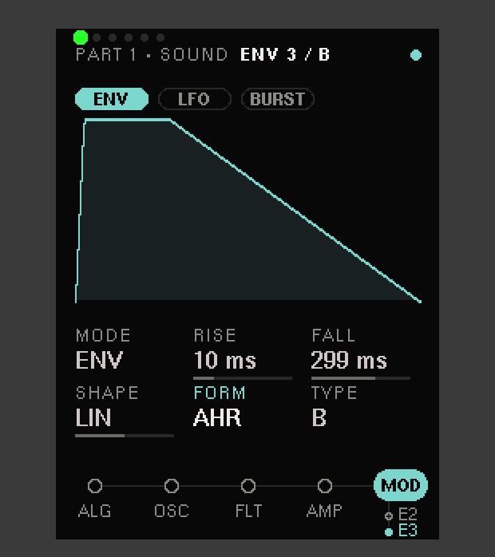 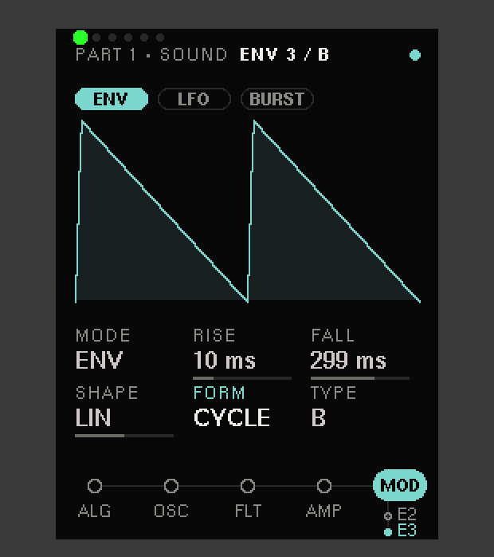

### Envelopes: B in LFO mode

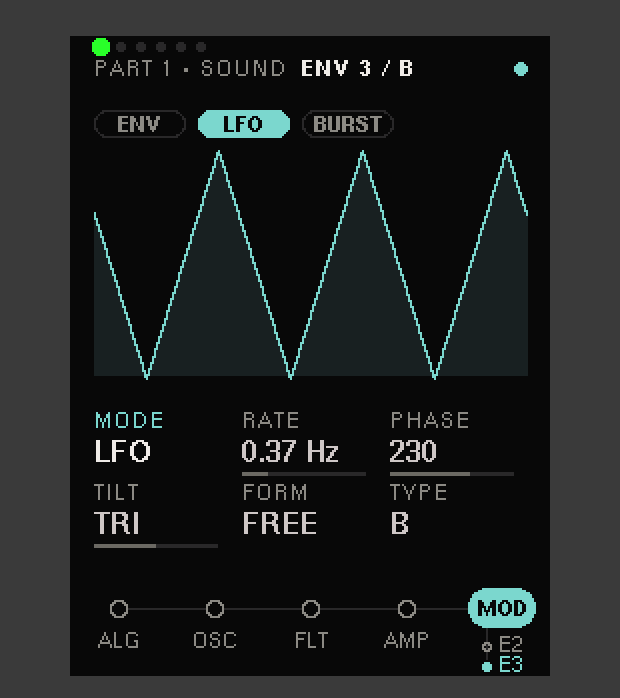

| Cell | Range | Default | What it does |
|---|---|---|---|
| **RATE** | 0.05 Hz to 800 Hz | 1.00 Hz | The speed. Reads in Hz |
| **PHASE** | 0 to 360 | 230 | Where the wave starts (FREE, SYNC) |
| **TILT** | SAW, TRI, RAMP | TRI | The wave's slope: a falling saw at one end, a triangle at the middle, a rising ramp at the other |
| **DELTA** | 0 to 100 % | 64 % | LFV only: how far each new random target may land from the last |
| **SLEW** | 0 to 100 % | 50 % | LFV only: how smoothly it glides to each target |
| **FORM** | FREE, SYNC, LFV | FREE | See below |

- **FREE:** runs on its own, never reset by notes.
- **SYNC:** restarts at PHASE on each note-on.
- **LFV:** a random walk. Each cycle it picks a new target near the last (DELTA says how near), and glides to it (SLEW says how smoothly). It never goes past the ends. For wandering, organic movement.

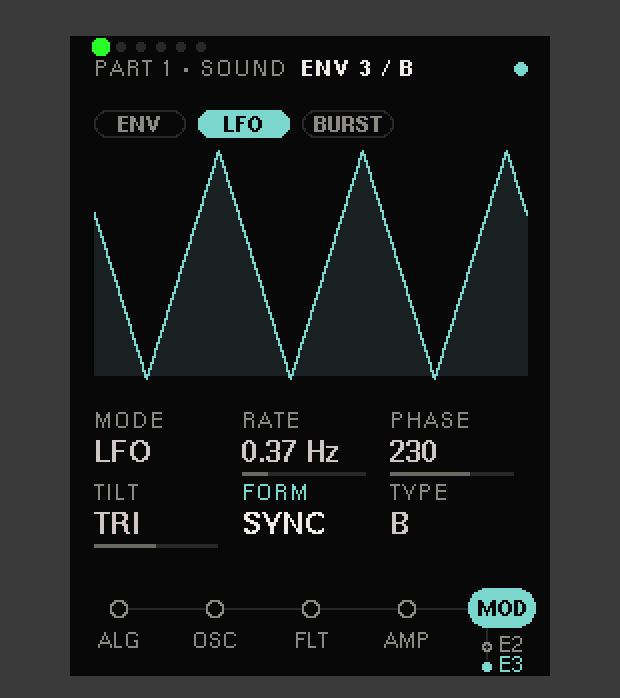 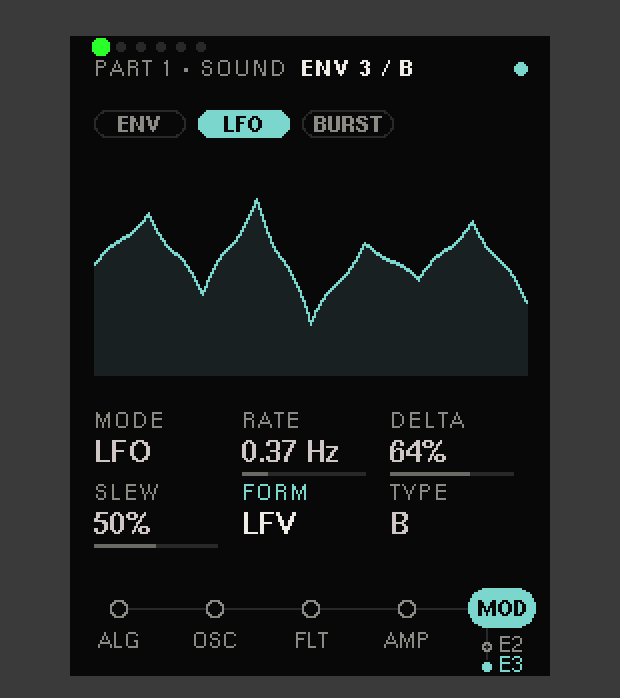

### Envelopes: B in BURST mode

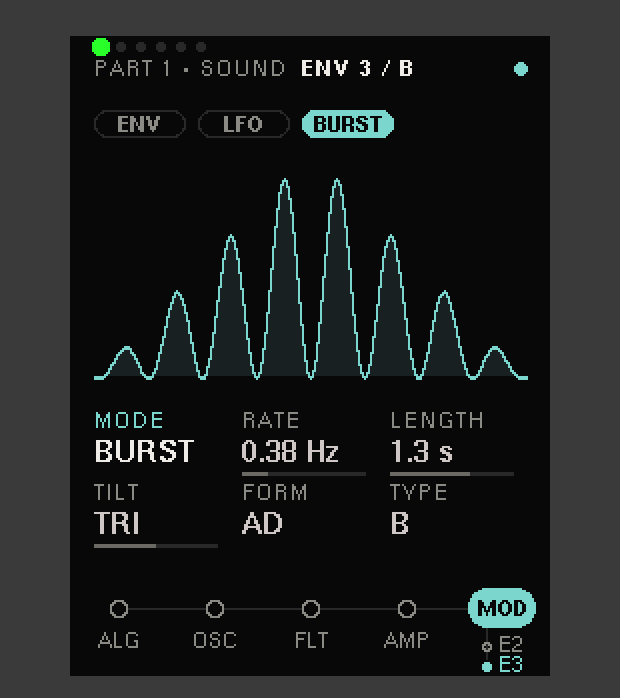

| Cell | Range | Default | What it does |
|---|---|---|---|
| **RATE** | 0.05 Hz to 1 kHz | about 0.9 Hz | The pulse rate within the burst |
| **LENGTH** | 10 ms to 20 s | about 1.3 s | How long the burst lasts |
| **TILT** | SAW, TRI, RAMP | TRI | The shape of the burst over its length |
| **FORM** | AD, AHR, CYCLE | AD | AD: one burst a note. AHR: the burst goes on while the key is down. CYCLE: bursts repeat while the key is held; when you let go the running burst is the last |

A burst is a quick way to get ratchets, flutters and bouncing-ball patterns from one note: route it into the VCA for a stuttered note, or into the cutoff for a burst of filter blips.

 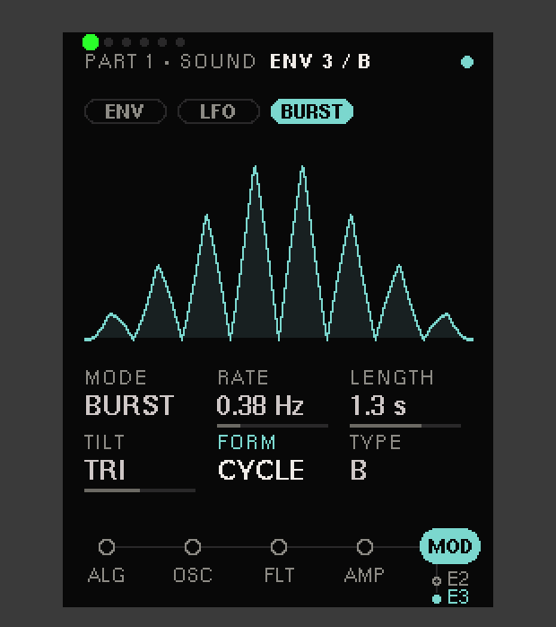

### Envelopes: B's top speed

A type B slot that feeds the VCA runs every sample, at its full range. Anywhere else it runs once a block, and its rates stop at 93.75 Hz: LFO RATE, BURST's pulse RATE and the repeat rates of ENV CYCLE and BURST CYCLE. One-shot AD and AHR times are not limited.

**Why:** six modulators running every sample would cost voices. Only the slot that shapes the note's level needs audio-rate detail; everywhere else 93.75 Hz is faster than any sweep you will hear as a sweep.

## SPEED: the envelopes' speeds

**SPEED** (SPD on the chain map, ENV SPEED on screen) holds each type A slot's SPEED and HOLD in one place, a column per slot.

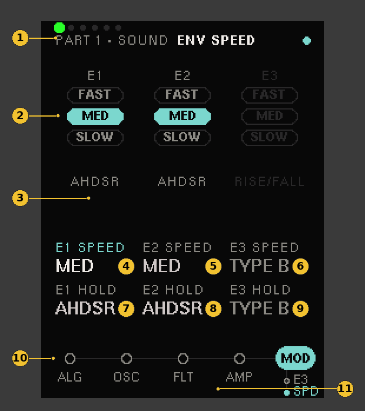

1. **Header:** the Part, its Sound and the page, ENV SPEED.
2. **The speed pills**, a column a slot (E1, E2, E3): FAST, MED or SLOW, the slot's speed lit.
3. **The hold position** under each column (AHDSR here). A type B slot's column is dimmed and reads RISE/FALL: SPEED and HOLD are type A's.
4. **E1 SPEED.**
5. **E2 SPEED.**
6. **E3 SPEED**, reading TYPE B, dimmed.
7. **E1 HOLD.**
8. **E2 HOLD.**
9. **E3 HOLD**, reading TYPE B, dimmed.
10. **The chain map**, on MOD.
11. **The sub-pages** of MOD, SPEED lit.

| Cell | Choices | Default | What it does |
|---|---|---|---|
| **E1 SPEED**, **E2 SPEED**, **E3 SPEED** | FAST, MED, SLOW | MED | The slot's time ranges (see [Envelopes: type A, the AHDSR](#envelopes-type-a-the-ahdsr)) |
| **E1 HOLD**, **E2 HOLD**, **E3 HOLD** | OFF, AHDSR, GATE EXT | AHDSR | Where the slot's HOLD acts |

- **OFF:** no hold stage. The envelope is a plain ADSR.
- **AHDSR:** after the attack, the envelope holds at the peak for HOLD's time, then decays.
- **GATE EXT:** HOLD becomes the shortest gate. A note shorter than HOLD plays as if the key were held for HOLD's time. Useful for short sequencer gates and drum triggers, which then still reach the sustain.

On a type B slot both cells read TYPE B and are dimmed.

**Why:** SPEED changes the range under the knob, not the knob's travel, so the same envelope shape can be a click at FAST or a minute-long swell at SLOW, with fine control at each.

## Envelopes: modulating an envelope

An envelope's own controls are matrix destinations, so velocity, the wheel or another modulator can reshape it as you play. Prime them with **MIX + PLUS** on the envelope page:

| On a type A slot, MIX + PLUS on | Primes | What a route into it does |
|---|---|---|
| ATTACK, DECAY, RELEASE or HOLD | the slot's **TIME** | Scales all its times together. Positive amounts make it faster, negative slower |
| SUSTAIN | the slot's **LEVEL** | Sets the envelope's peak. Once routed, the peak is the sum of the routes, between 0 and full |

On a type B slot, **RISE**, **FALL** and **SHAPE** are destinations each (whatever their labels read under the current MODE: RATE, PHASE, DELTA, LENGTH, TILT, SLEW).

Starting points:

- **Velocity-sensitive envelope:** on E2's page touch SUSTAIN and press **MIX + PLUS**; in the matrix, route VELO into the new column at +127. Softer notes now have a smaller envelope.
- **Faster envelopes higher up:** prime E1's TIME (MIX + PLUS on ATTACK) and route NOTE into it at a positive amount, as an acoustic instrument's notes get shorter as they rise.

## LFOs: the three LFO slots

Each LFO slot is one of two kinds, set by its **TYPE**:

- **CLASSIC:** a wave with a shape, a rate in Hz, a sync choice, a phase and a depth.
- **FUNC:** envelope B locked to LFO mode: TILT, the random walk, and rates up to 93.75 Hz.

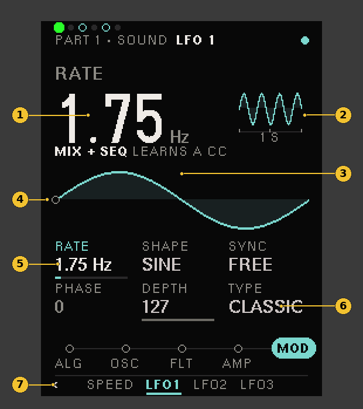

1. The touched control's value: CLASSIC's RATE reads in Hz.
2. **The control's own glyph.** RATE draws two seconds of the LFO; SHAPE, SYNC, PHASE, DEPTH and the others each draw what they do.
3. **The LFO itself:** one cycle at the values you set.
4. A dot rides the newest voice's place in the cycle. It rests at the start while nothing plays.
5. **RATE, SHAPE, SYNC** on the top row; **PHASE** (dimmed under SYNC FREE) and **DEPTH** below.
6. **TYPE:** CLASSIC or FUNC. FUNC has its own controls (TILT, DELTA, SLEW and others) and its RATE goes up to 93.75 Hz.
7. `<`: more sub-pages to the left (the envelopes and SPEED).

## LFOs: CLASSIC

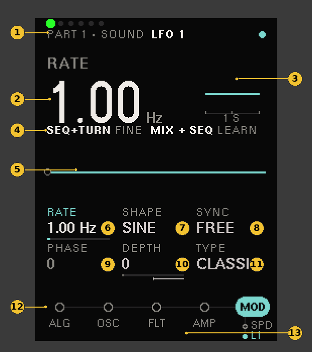

1. **Header:** the Part, its Sound and the page, LFO 1.
2. **The touched cell, large:** its name and value (RATE reads in Hz).
3. **Its glyph:** each control draws what it does; RATE draws two seconds of the LFO over a one-second ruler.
4. **The hint line:** hold SEQ and turn for fine steps; MIX + SEQ learns a MIDI control.
5. **The LFO itself:** one cycle at the values you set. A dot rides the newest voice's place in the cycle; it rests at the start while nothing plays.
6. **RATE.**
7. **SHAPE.**
8. **SYNC.**
9. **PHASE**, dimmed under SYNC FREE.
10. **DEPTH.**
11. **TYPE:** CLASSIC or FUNC.
12. **The chain map**, on MOD.
13. **The sub-pages** of MOD, LFO1 lit.

1. **Header:** the Part, its Sound and the page, LFO 2.
2. **The touched cell, large:** its name and value (RATE reads in Hz).
3. **Its glyph:** each control draws what it does; RATE draws two seconds of the LFO over a one-second ruler.
4. **The hint line:** hold SEQ and turn for fine steps; MIX + SEQ learns a MIDI control.
5. **The LFO itself:** one cycle at the values you set. A dot rides the newest voice's place in the cycle; it rests at the start while nothing plays.
6. **RATE.**
7. **SHAPE.**
8. **SYNC.**
9. **PHASE**, dimmed under SYNC FREE.
10. **DEPTH.**
11. **TYPE:** CLASSIC or FUNC.
12. **The chain map**, on MOD.
13. **The sub-pages** of MOD, LFO2 lit.

1. **Header:** the Part, its Sound and the page, LFO 3.
2. **The touched cell, large:** its name and value (RATE reads in Hz).
3. **Its glyph:** each control draws what it does; RATE draws two seconds of the LFO over a one-second ruler.
4. **The hint line:** hold SEQ and turn for fine steps; MIX + SEQ learns a MIDI control.
5. **The LFO itself:** one cycle at the values you set. A dot rides the newest voice's place in the cycle; it rests at the start while nothing plays.
6. **RATE.**
7. **SHAPE.**
8. **SYNC.**
9. **PHASE**, dimmed under SYNC FREE.
10. **DEPTH.**
11. **TYPE:** CLASSIC or FUNC.
12. **The chain map**, on MOD.
13. **The sub-pages** of MOD, LFO3 lit.

The page reads **RATE · SHAPE · SYNC / PHASE · DEPTH · TYPE**.

| Cell | Range | Default | What it does |
|---|---|---|---|
| **RATE** | 0.01 Hz to 20 Hz | 1.00 Hz | The speed, in Hz |
| **SHAPE** | SINE, TRI, SAW, SQR, S&H | SINE | The wave. S&H holds a new random value each cycle |
| **SYNC** | FREE, RETRIG | FREE | FREE: every voice of the Part shares one LFO phase. RETRIG: each note restarts its own LFO at PHASE |
| **PHASE** | 0 to 127 | 0 | Where a RETRIG LFO starts. Dimmed under FREE |
| **DEPTH** | 0 to 127 | LFO1: 0, LFO2 and LFO3: 127 | How much of the LFO comes out. A matrix destination |
| **TYPE** | CLASSIC, FUNC | CLASSIC | The slot's kind |

Under **FREE**, the Part keeps a phase clock for each LFO slot, running whether or not anything plays. Every voice of the Part reads it, so a chord's notes all wobble together, whenever each was struck, and a change of RATE changes the speed without jumping the phase.

Under **RETRIG**, each note runs its own LFO from PHASE. A chord's notes then move apart over time, and each note's vibrato or sweep starts the same way.

> **Design note:** CLASSIC FREE works like the one LFO of a Prophet-5, which every voice shares: play a chord and the vibrato moves the whole chord as one. The clock is an accumulator, not "time since the start times RATE", so turning RATE in the middle of a note speeds the wave up smoothly instead of teleporting it to a new place in its cycle.

## LFOs: FUNC

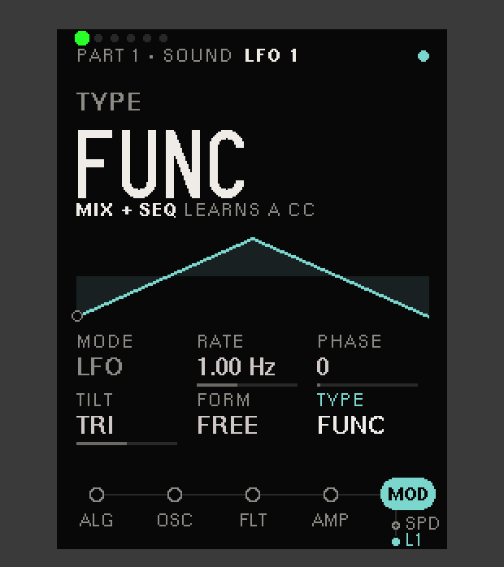

TYPE **FUNC** makes the slot a type B function generator locked to LFO mode. Its MODE cell is fixed: it reads LFO, dimmed, and does not turn.

| Cell | Range | Default | What it does |
|---|---|---|---|
| **MODE** | LFO (fixed) | LFO | Shown for its place; FUNC is always an LFO |
| **RATE** | 0.05 Hz to 93.75 Hz | 1.00 Hz | The speed |
| **PHASE** | 0 to 360 | 0 | Where the wave starts (FREE, SYNC) |
| **TILT** | SAW, TRI, RAMP | TRI | The wave's slope |
| **DELTA** | 0 to 100 % | 0 % | LFV only: how far each random step may go |
| **SLEW** | 0 to 100 % | 50 % | LFV only: how smoothly it glides |
| **FORM** | FREE, SYNC, LFV | FREE | FREE runs on; SYNC restarts at PHASE on each note-on; LFV is a random walk |
| **TYPE** | CLASSIC, FUNC | CLASSIC | The slot's kind |

FUNC has no DEPTH: its level is set by the routes it feeds. Its RATE stops at 93.75 Hz, the top speed of a slot that runs once a block.

**Why:** FUNC gives the LFO slots envelope B's shapes (any slope from saw to ramp, and the LFV random walk) without using an envelope slot for it.

## LFOs: DEPTH as a destination

Each CLASSIC LFO's **DEPTH** is a MOD matrix destination: on its LFO page, touch DEPTH and press **MIX + PLUS**, then route any source into it. A DEPTH route reaches its LFO one block (1.3 ms) after its source moves. The LFO's other controls (RATE, SHAPE and the rest) are not destinations.

A new Sound comes with one such route: WHEEL into LFO 1's DEPTH at +127, with LFO 1 into PITCH and its DEPTH at 0. With the wheel down there is no vibrato; with the wheel up it plays at full depth. Moving the wheel is playing, not editing: the Sound stays as it was saved. See [MIDI](14-midi.md) for the wheel and pressure.

Starting points:

- **Vibrato that fades in:** route ENV 2 (an A envelope with a slow ATTACK) into LFO 1's DEPTH instead of the wheel.
- **Pressure-controlled tremolo:** set LFO 2's DEPTH to 0, prime it, route PRESS into it, and route LFO 2 into the VCA (or into PAN for an auto-pan you squeeze in).

## Modulators: what can be modulated

| Slot | Destinations |
|---|---|
| Envelope, type A | TIME (primed from ATTACK, DECAY, RELEASE or HOLD) and LEVEL (primed from SUSTAIN) |
| Envelope, type B | RISE, FALL and SHAPE, under whatever names the MODE gives them |
| LFO, CLASSIC | DEPTH |
| LFO, FUNC | none |

MODE, FORM, TYPE, SPEED, HOLD (on SPEED), SHAPE and SYNC on CLASSIC, and the LFO's RATE and PHASE are not destinations: **MIX + PLUS** on them says NOT MODULATABLE. See [the mod matrix](10-mod-matrix.md) for how routes work.
