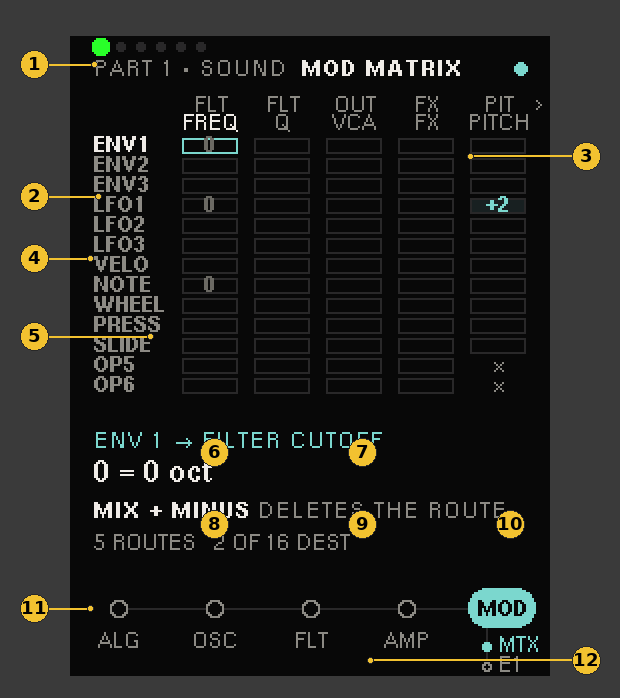
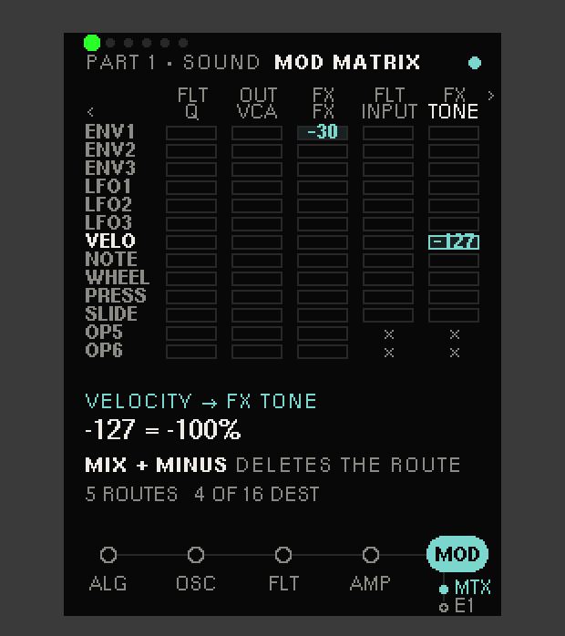
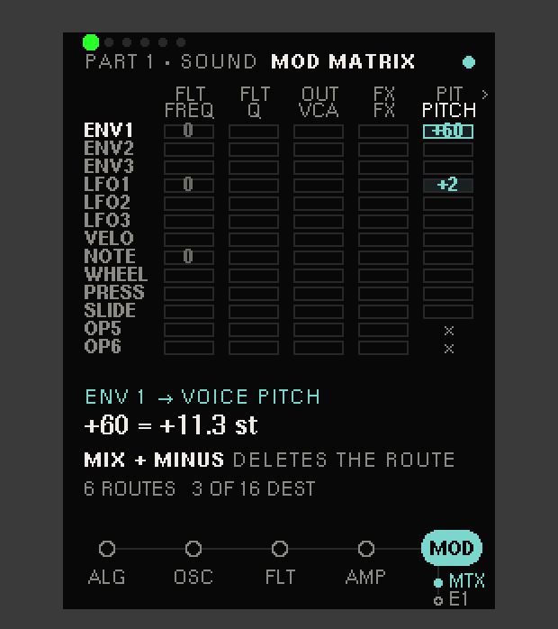
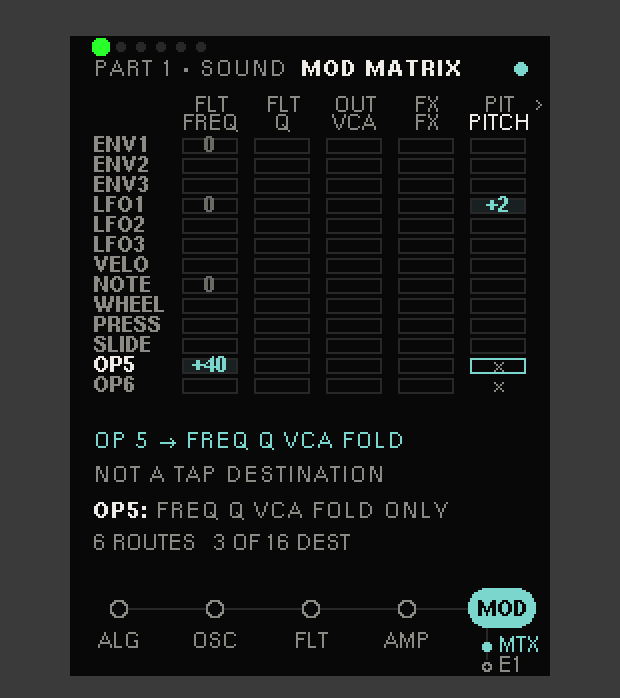

# The mod matrix and routes

Every connection from a modulator to the sound is a **route**: one cell of the MOD matrix, a source on its row and a destination in its column, with an amount. This chapter covers the matrix page (**MTX** on the chain map, MATRIX in the sub-page row, MOD MATRIX on screen), every source, every destination on each engine, and every gesture that makes, changes or deletes a route. The modulators themselves are in [Envelopes and LFOs](09-envelopes-and-lfos.md); the filter's route cells and the VCA are in [the voice chain](08-voice-chain.md); the wheel, pressure and MPE are in [MIDI](14-midi.md).

## MOD: every connection is a route

There is no hidden wiring. When an envelope opens the filter, an LFO adds vibrato or velocity makes a note louder, there is a route in the matrix that says so, with an amount you can see and change. Some routes also show on other pages as knobs (ENV AMT on the filter's MODULATION page, for one), but each of those is the same matrix cell seen from another place: turn it in either place and both move.

A route's amount runs from −127 to +127. The source's value times the amount is added to the destination's own setting. The parameter's number on its page never moves: it shows the value you set, and a thin line under its bar shows modulation reaching it.

**Why:** one place holds every connection, so a Sound can always be read. Nothing modulates the sound that the matrix doesn't show, and deleting a route always takes its effect away.

> **Design note:** only a parameter the voice reads afresh every block can be a destination. A knob that is read once at note-on, or that only picks a mode, can't follow a moving source, so it would accept a route and then ignore it. Rather than offer a connection that does nothing, those parameters say NOT MODULATABLE. The matrix only makes promises it keeps.

## MOD: the matrix page

The MOD node's own page is the matrix. **SEQ** steps on from it to the envelopes, SPEED and the LFOs.

1. **Header:** the Part, its Sound and the page, MOD MATRIX.
2. **Source rows:** the envelopes and LFOs (ENV1 to ENV3, LFO1 to LFO3).
3. **A primed column**, here PIT PITCH, holding LFO 1's +2 route: the INIT vibrato.
4. **VELO** and **NOTE**, the note's own sources.
5. **The hand rows** (WHEEL, PRESS, SLIDE), then ALGO's operator taps, **OP5** and **OP6**. Their `×` cells are columns a tap can't reach.
6. **The readout:** the route under the cursor, source to destination, in full words (`ENV 1 → FILTER CUTOFF`) …
7. … and under it the amount and what it means in the destination's terms (`0 = 0 oct`).
8. **The hint:** the keys for the cell under the cursor …
9. … and what they do: here MIX + MINUS deletes the route.
10. **The count:** routes in use, and destinations primed out of 16 (`5 ROUTES   2 OF 16 DEST`).
11. **The chain map**, on MOD.
12. **The sub-pages:** MTX lit, the envelopes below it.

The matrix page has no cells of its own. The encoders work the grid:

| Encoder | Does |
|---|---|
| 1 | Moves the cursor up and down the rows |
| 2 | Moves the cursor across the columns |
| 4 | Scrolls the columns sideways (the cursor comes along) |
| 5 | Sets the amount of the cell under the cursor, −127 to +127 |

Five columns show at once. `<` and `>` at the edges mean more columns are off screen. Each column header has two lines: the block on top (FLT, OUT, FX, PIT, LF1, E2, OP1 …) and the parameter under it.

In the grid, a cell with a route is lit and prints its amount; an empty cell is an outline; the cursor's cell is outlined in the accent colour. A route at 0 stays a route (it prints `0`): it is ready for an amount, and does nothing until it gets one.

## MOD: the sources

| Row | Readout name | What it is | Range |
|---|---|---|---|
| **ENV1**, **ENV2**, **ENV3** | ENV 1, ENV 2, ENV 3 | The three envelope slots | 0 to 1 (an LFO-mode slot −1 to 1) |
| **LFO1**, **LFO2**, **LFO3** | LFO 1, LFO 2, LFO 3 | The three LFO slots | −1 to 1 |
| **VELO** | VELOCITY | How hard the note was played | 0 to 1 |
| **NOTE** | NOTE | The key played, centred on middle C (C4) | −1 to 1 |
| **WHEEL** | MOD WHEEL | The mod wheel, CC 1, on the Part's channel | 0 to 1 |
| **PRESS** | PRESSURE | Aftertouch: channel pressure, or the note's own poly pressure, whichever is higher | 0 to 1 |
| **SLIDE** | SLIDE | CC 74 (an MPE controller's slide), on the Part's channel or the note's own | 0 to 1 |
| **OP5**, **OP6** | OP5, OP6 | ALGO only: the audio of operators 5 and 6 | audio |

- **NOTE** is scaled so that a route at +127 into the cutoff tracks one octave per octave played.
- **WHEEL**, **PRESS** and **SLIDE** glide, so a fast wheel throw or a sudden squeeze never steps the sound. The channel's wheel and pressure carry on across notes and Sound loads; a new note starts with no poly pressure of its own. Under MPE each note has its own PRESS and SLIDE. See [MIDI](14-midi.md).

## MOD: the four fixed columns

The first four columns are on every Sound and take no destination slot:

| Column | Readout name | What it moves |
|---|---|---|
| **FLT FREQ** | FILTER CUTOFF | The filter's cutoff (FREQ, or CUTOFF on the 2040). A full route moves it ten octaves |
| **FLT Q** | FILTER RESO | The filter's resonance (Q or RES) |
| **OUT VCA** | OUTPUT VCA | The note's amp. The first route into it replaces the engine's own level contour (see [AMP: routes into VCA and BASE](08-voice-chain.md#amp-routes-into-vca-and-base)) |
| **FX FX** | FX and the pot's name | The FX slot's first pot, whatever the FX TYPE: DRIVE, SUSTAIN or FOLD |

An empty cell of the VCA column says what a route there would do: `VCA: ROUTES REPLACE CONTOUR`, or `VCA: SUM STARTS AT AMP BASE` once an envelope is routed into VCA.

## MOD: priming a destination

Every other column is a destination you **prime**: you add it to the matrix from the page where the parameter lives.

1. On any page, touch the parameter (turn its encoder a little).
2. Press **MIX + PLUS**. The focus band says what happened.
3. Go to the matrix (PLUS along the chain to MOD). The new column is there, after the others.
4. Move the cursor to a source row under it and turn encoder 5 for the amount.

What **MIX + PLUS** can say:

| Message | Means |
|---|---|
| **ADDED** | A new column is in the matrix |
| **ALREADY ROUTED** | It is a column already (the fixed four always are) |
| **NOT MODULATABLE** | It can't be a destination, or its cell is dimmed in the current setting |
| **MATRIX FULL** | All 16 destination slots are taken; remove one first |

The message stays until your next input.

A few cells prime something other than themselves:

- On a type A envelope, **ATTACK**, **DECAY**, **RELEASE** and **HOLD** prime the slot's TIME, and **SUSTAIN** its LEVEL (see [Envelopes: modulating an envelope](09-envelopes-and-lfos.md#envelopes-modulating-an-envelope)).
- On AMP, **VEL** answers for the VCA column, which is always there.

## MOD: making, changing and deleting a route

- **Make a route:** put the cursor on an empty cell and turn encoder 5. The cell lights and takes the amount.
- **Change it:** turn encoder 5 on it. Amounts glide as you turn, so changing a route never steps the sound.
- **Delete it:** on the matrix, put the cursor on it and press **MIX + MINUS**. On another page, **MIX + MINUS** on a route cell (ENV AMT, KEYBOARD, FREQ MOD, RES MOD) deletes that route.
- **Remove a destination:** on the parameter's own page, touch it and press **MIX + MINUS**. Its column leaves the matrix with every route in it, and the slot is free again.

While the cursor is on a route, the hint reads `MIX + MINUS DELETES THE ROUTE`; on an empty cell it reads `MIX + PLUS ON A PARAM PRIMES IT`, as a reminder of where columns come from.

## MOD: what an amount means

The readout under the grid says what the amount does in the destination's own terms:

| Destination kind | Readout | Example |
|---|---|---|
| A cutoff | octaves | `+42 = +3.3 oct` |
| PITCH | semitones (a full route is 24) | `+32 = +6.0 st` |
| A tuning in cents | cents | `+32 = +25 ct` |
| Anything else | a share of the parameter's range | `+42 = +33%` |

A route adds to the setting, it does not replace it. A cutoff at 400 Hz with ENV 1 at +42 opens about three octaves above 400 Hz at the envelope's peak, then settles back. The result is held to the parameter's range.

## MOD: route cells on other pages

Some pages show matrix cells as knobs, where you think about them. Each is one route, shown in two places:

| Page | Cell | The route |
|---|---|---|
| FILTER MOD | **ENV AMT** | ENV 1 into FLT FREQ |
| FILTER MOD | **KEYBOARD** | NOTE into FLT FREQ (on the 2040 it steps OFF, HALF, FULL) |
| FILTER MOD | **FREQ MOD** | The FREQ SRC jack's source into FLT FREQ |
| FILTER MOD | **RES MOD** | The RES SRC jack's source into FLT Q |

On these cells the amount reads in percent (`+50%`), and the focus band names the source (`FREQ MOD LFO1`). **MIX + turn** jumps the amount to 0, then to full, in the direction you turn. **MIX + MINUS** deletes the route. Moving a jack on FILTER JACKS moves its route to the new source, amount and all. See [FILTER MOD: the filter's modulation page](08-voice-chain.md#filter-mod-the-filters-modulation-page).

## MOD: the destinations, shared by every engine

These can be routed on ALGO, MODAL, VA and TAPE:

| Page | Destinations |
|---|---|
| PITCH | **PITCH**, **FINE** |
| FILTER | FREQ / CUTOFF and Q / RES (fixed columns), SEM's **MODE** knob |
| FILTER MOD | **FEEDBACK** (FDBK in the header) |
| FX | DRIVE / SUSTAIN / FOLD (the fixed FX column), the second and third pots (TONE, SYMMETRY, LEVEL, VOLUME), **INPUT**, **MIX**, **STABILITY** |
| AMP | VCA (fixed column, through **BASE**), **LPG**, **DECAY**, **STRIKE** |
| STEREO | **PAN** |
| ENV1 to ENV3 | type A: TIME and LEVEL; type B: RISE, FALL, SHAPE |
| LFO1 to LFO3 | **DEPTH** (CLASSIC only) |

Not destinations: TYPE, MODE lists, VOICE, FX PLACE, the jacks, STEAL, TIME (glide), SNAP, VEL, WIDTH, the sends, every envelope and LFO choice, and the LFOs' RATE, SHAPE, SYNC and PHASE.

## MOD: the destinations of each engine

Each engine adds its own. The engine chapters say what each one does.

| Engine | Destinations of its own |
|---|---|
| [ALGO](03-algo.md) | ALGORITHM's **MORPH**, **VOWEL** and **VOL**; each operator's level (LVL page), formant (FRM page) and BW (operator pages) |
| [MODAL](04-modal.md) | RESONATOR's **BRIGHT**, **DAMP**, **POS** and **STRUCT** |
| [VA](05-va.md) | VA's **WAVE1**, **WAVE2**, **BLEND**, **SUB** and **STABILITY**; OSC1's and OSC2's **SHAPE**, **CRSE** and **FINE**; NOISE's **LEVEL** |
| [TAPE](06-tape.md) | SRC's **START** and **VOL**; DECK's continuous knobs (their labels follow the machine); the machine page's **AGE** and **TAPE** |

A column whose parameter does nothing in the current setting (ALGO's MORPH while ALG A and ALG B are the same, say) dims: its name and amounts turn grey, and its routes stay, waiting.

## MOD: ALGO's operator taps

On ALGO the matrix has two more rows, **OP5** and **OP6**: the audio of operators 5 and 6, as modulation sources. They reach only the four fixed columns (FREQ, Q, VCA and the FX pot), at audio rate. Their other cells show `×`, and the hint reads `OP5: FREQ Q VCA FOLD ONLY`. The operator's own level and envelope are the depth.

The same taps are on FILTER JACKS as OP5 and OP6 for FREQ SRC and RES SRC.

**Why:** an operator feeding the filter cutoff at audio rate gives the growl and sidebands of filter FM. The taps keep their place in the algorithm and lend their output to the filter as well.

## MOD: what a new Sound has

A new Sound (INIT) starts with these routes:

| Route | Amount | Why |
|---|---|---|
| ENV 1, LFO 1 and NOTE into FLT FREQ | 0 | Ready: turn ENV AMT or KEYBOARD and they work |
| LFO 1 into PIT PITCH | +2 | The vibrato, about ±0.4 semitone at full depth |
| WHEEL into LF1 DEPTH | +127 | The wheel brings the vibrato in; LFO 1's DEPTH rests at 0 |
| ENV 1 into OUT VCA (VA and TAPE only) | +127 | ENV 1 is the note's level, since a VA tone or a tape loop has no end of its own |

## MOD: limits

- 11 source rows (13 on ALGO, with OP5 and OP6).
- The four fixed columns, plus up to 16 primed destinations.
- Every cell can hold a route.

## MOD: good starting points

- **Velocity brightness:** VELO into FLT FREQ at +30. Hard notes open the filter.
- **Expression on pressure:** PRESS into FLT FREQ at +40, and PRESS into a primed FX second pot (TONE) for more bite as you lean in.
- **Stereo spread across the keys:** prime STEREO's PAN, route NOTE into it at +64. Low notes sit left, high notes right.
- **Wobble:** set LFO 2 to SQR or S&H, route it into FLT Q at +40 for a stepped resonance.
