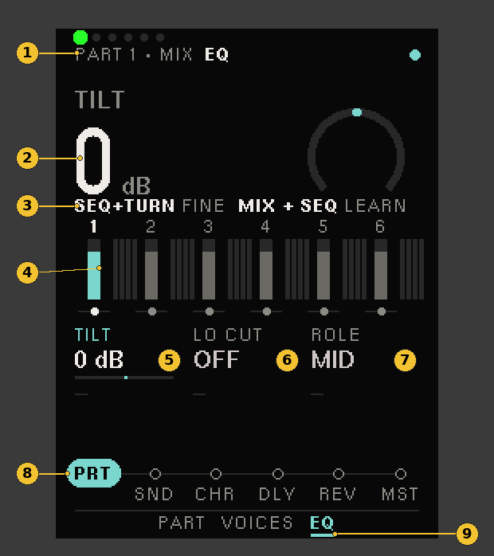
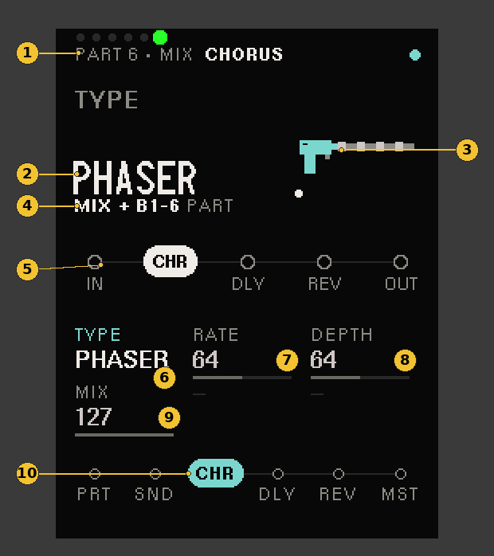
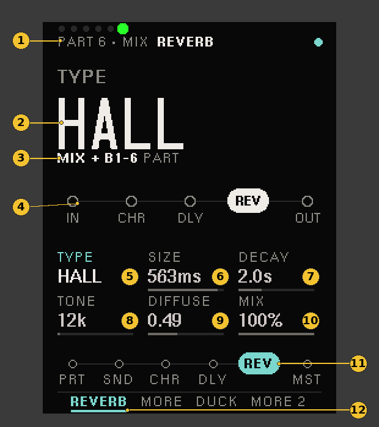
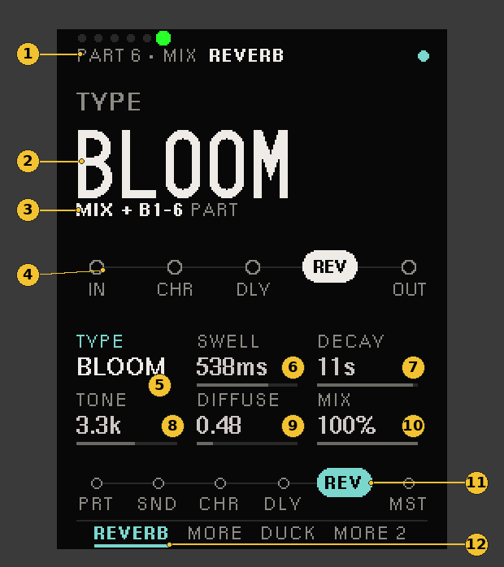
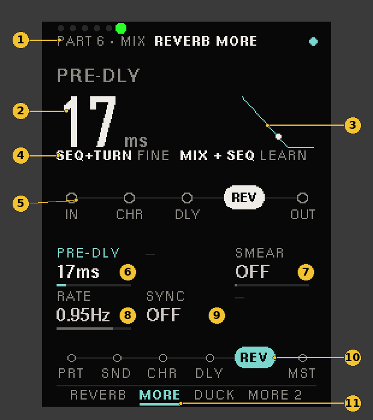
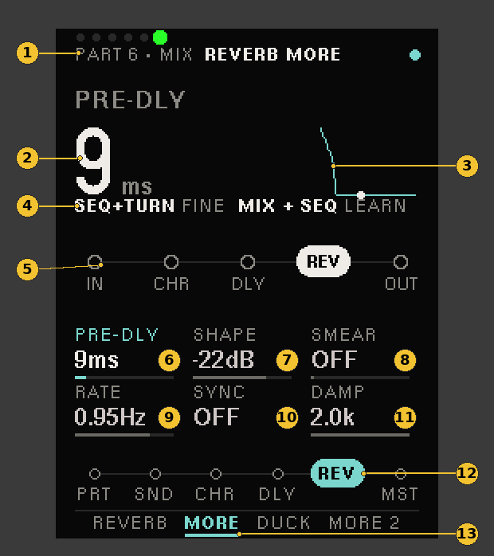
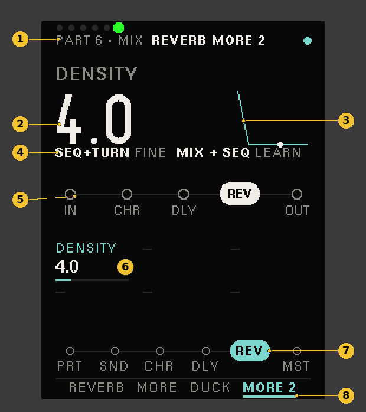
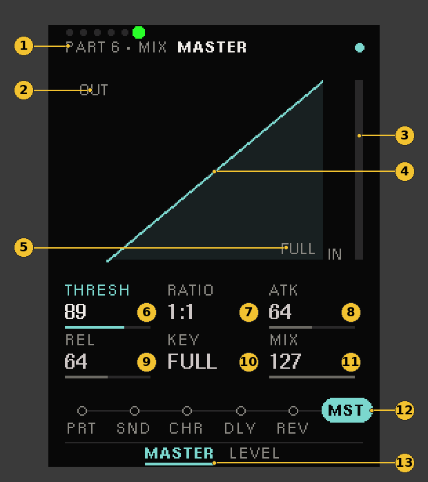

# The MIXER and the master effects

This chapter covers the MIXER: each Part's strip (level, pan, output, voices, EQ, sends), the three shared effects, the master compressor and the output stage. The voice's own effects (drive, fuzz, fold) are in [the voice chain](08-voice-chain.md); MIDI control of the mixer is in [MIDI](14-midi.md).

Continuous knobs read 0 to 127 unless the screen shows a unit (ms, Hz, dB, s, %).

## MIXER: opening it

| Keys | Does |
|---|---|
| **B*n*** again, from Part *n*'s pages | Flips to Part *n*'s mixer; B*n* once more flips back to the page you left |
| **MIX + B*n*** | Opens Part *n*'s mixer from anywhere; inside the mixer, jumps to that Part's mixer on the same page |
| **MIX + SEQ** | MIDI-learns the touched cell ([MIDI](14-midi.md)) |

The mixer opens on **SND**, then on the mixer page you last used this session. The header reads `PART 1 · MIX` and the page name (`PART 1 · MIX SENDS`).

**Why:** PRT's third cell is OUT; opening there, a stray turn could send the Part to a pair you are not listening to.

## MIXER: the chain

**PRT** · **SND** · **CHR** · **DLY** · **REV** · **MST**, walked with MINUS and PLUS.

| Node | Full name | Sub-pages |
|---|---|---|
| **PRT** | PART | **VOI** (VOICES), **EQ** |
| **SND** | SENDS | |
| **CHR** | CHORUS | |
| **DLY** | DELAY | **CHAR** (CHARACTER), **GRAIN** |
| **REV** | REVERB | **MORE**, **DUCK**, **MOR2** (MORE 2) |
| **MST** | MASTER | **LVL** (LEVEL) |

PRT, VOI, EQ and SND belong to the Part (PART1_PRT … PART6_SND in the schema); CHR, DLY, REV and MST are shared by all six Parts. Sub-pages work as on a Part ([the panel and navigation](02-panel-and-navigation.md)); from PRT or SND, **EDIT** goes down to the Part's Sound browser.

Every mixer page has the same frame: the header, the focused cell large (with its glyph), the focus band (hint), a picture band, six cells, the chain map and the sub-page row. On the effect pages the picture band is the effects flow (IN, CHR, DLY, REV, OUT, the current effect lit). The numbered lists below name the dots in that order.

## MIXER: the PRT page

**PART** (PRT) is the Part's channel strip.

1. Header: `PART 1 · MIX PART`.
2. Focused cell: LEVEL 94.
3. LEVEL's glyph: a fader.
4. Hint: `SEQ+TURN FINE`, `MIX + SEQ LEARN`.
5. The six Parts' levels and meters, this Part in accent.
6. **CH**.
7. **MODE**.
8. **OUT**.
9. **LEVEL**.
10. **PAN**.
11. **BEND**.
12. Chain map: PRT lit.
13. Sub-page row: PART underlined.

| Cell | Range | Default | What it does |
|---|---|---|---|
| **CH** | 1 to 16 | Part *n* on *n* | MIDI channel; same value as SETTINGS › MIDI CONFIG › CHANNELS |
| **MODE** | MONO, POLY | POLY | MONO retriggers one voice; POLY plays chords |
| **OUT** | P1, P2, P3 | P1 | Output pair; same value as SETTINGS › AUDIO ROUTING › OUTPUTS |
| **LEVEL** | 0 to 127 | 102 | The fader |
| **PAN** | L63, C, R63 | C | Left to right |
| **BEND** | 0 to 24 | 2 | Pitch-bend range in semitones |

Beside each LEVEL bar is a meter taken after the EQ and before LEVEL: −48 to 0 dBFS, 20 dB/s fall, a one-second peak mark, the top lit in the alert colour past full scale. A square by the Part number lights while a key is held on its channel (or its MPE zone). When OUT is not P1 the header shows `OUT P2` or `OUT P3`.

**Why:** a pre-fader meter answers "is this Part making sound?" even with LEVEL down. A lit key mark over an empty meter points at the Sound; an unlit one at the MIDI channel.

## MIXER: the VOICES sub-page

**VOICES** (VOI) sets the Part's share of the eight-voice pool.

1. Header: `PART 1 · MIX VOICES`.
2. Focused cell: MODE POLY.
3. Hint: `MIX + B1-6 PART` (on RESERVE it shows the total, `RESERVES 2/8`).
4. Levels and meters.
5. **MODE**.
6. **VOICES**.
7. **RESERVE**.
8. Chain map: PRT lit.
9. Sub-page row: VOICES underlined.

| Cell | Options | Default | What it does |
|---|---|---|---|
| **MODE** | MONO, POLY | POLY | Same cell as on PRT |
| **VOICES** | AUTO, 1 to 8 | AUTO | Cap: at it, the Part steals its own oldest tail, then oldest held note. Tails count |
| **RESERVE** | 0 to 8 | 0 | Floor: this many held notes (or sounding DRUM hits) no other Part may steal |

RESERVE may not pass the Part's VOICES, and all reserves together may not pass 8. A refused value shows dimmed with the reason (`RESERVE 2 · VOICES 1`, `RESERVES 9 · POOL HOLDS 8`) and nothing changes. Reserves never hold free voices back, released tails are never guarded, and a mono voice is never stolen.

**Why:** six Parts share eight voices. VOICES stops a pad hogging the pool; RESERVE keeps the bass and the drum tail safe. A cap of 1 steals instead of retriggering, so each note gets its own envelope. More in [limits](20-limits.md).

## MIXER: the EQ sub-page

**EQ** is the Part's channel EQ and its SMART EQ role.

1. Header: `PART 1 · MIX EQ`.
2. Focused cell: TILT 0 dB.
3. Hint: `SEQ+TURN FINE`, `MIX + SEQ LEARN`.
4. Levels and meters, with SMART EQ's four live cuts.
5. **TILT**.
6. **LO CUT**.
7. **ROLE**.
8. Chain map: PRT lit.
9. Sub-page row: EQ underlined.

| Cell | Range | Default | What it does |
|---|---|---|---|
| **TILT** | −10.0 to +9.8 dB | 0 dB | Tips the spectrum round 810 Hz: up brighter, down darker |
| **LO CUT** | OFF, ON | OFF | 6 dB/octave high-pass at 150 Hz, fades in over 20 ms |
| **ROLE** | FRONT, MID, BACK | MID | The Part's place for SMART EQ |

Order: LO CUT, TILT, then SMART EQ. Loading a Sound never changes the EQ; it belongs to the Part's place in the mix.

## MIXER: SMART EQ

SMART EQ stops Parts masking each other. Where a higher-ROLE Part is loud in a band, a lower-ROLE Part playing in that band is cut there, slowly. FRONT is never cut; equal roles never cut each other.

- **Bands:** LOW (100 Hz), LOW MID (400 Hz), HIGH MID (1.6 kHz), HIGH (6.4 kHz), after LO CUT and TILT.
- **Depth:** BACK under FRONT is cut most; one rank apart about two thirds as much.
- **Speed:** in over about half a second, out over about two.
- **The kick:** a higher-role DRUM Part dips lower Parts' LOW band fast (in a few ms, out over about 100 ms), like a sidechain.
- **The reverb** has its own role (**REV ROLE** on LVL = **SMART ROLE** on DUCK), BACK by default. It yields but never makes a Part yield.

**SMART EQ** (OFF, ON) and **AMOUNT** are on MST › LVL. Cuts for BACK under FRONT:

| AMOUNT | LOW, LOW MID | HIGH MID, HIGH | Kick dip |
|---|---|---|---|
| 64 (default) | 6 dB | 6 dB | 6 dB |
| 95 | 12 dB | 6 dB | 15 dB |
| 127 | 21 dB | 9 dB | 27 dB |

**Why:** one word per Part decides what matters, with no page of EQ. AMOUNT runs past the sweet spot (around 95) on purpose.

> **Design note:** the idea of groups comes from sonible's smart:EQ: say who leads and let the mix make room. Chimera's is far smaller, four fixed bands that only cut, because it runs beside the voices. It hears long ringing tails as the sustained energy they are, so a MODAL bell under a lead finally stops clouding it. Every rule for telling a kick from a snare failed somebody's groove, so the kick dip stayed an honest follower that wobbles with the beat.

## MIXER: the SND page

**SENDS** (SND) holds the Part's three sends; it is the same page as AMP › SENDS on the Part's chain.

1. Header: `PART 1 · MIX SENDS`.
2. Focused cell: CHORUS 0.
3. Glyph: a level bar.
4. Hint: the effect and its TYPE (`CHORUS ▸ I`).
5. Effects flow, the focused send's effect (CHR) lit.
6. **CHORUS**.
7. **DELAY**.
8. **REVERB**.
9. Chain map: SND lit (no sub-pages).

**CHORUS**, **DELAY** and **REVERB** run 0 to 127, default 0. Sends belong to the Sound and glide on load. They are taken after EQ and SMART EQ, **before** LEVEL and PAN: a Part at LEVEL 0 plays only through its effects. The taper is squared: 64 is −12 dB, so the top half covers 12 dB.

## MIXER: how the effects are wired

- Each effect sums all six Parts' sends and returns **wet only**; its **MIX** is the return level. Returns come back on P1.
- CHORUS and REVERB return in stereo; DELAY is mono on both sides.
- DLY's **REV** feeds the delay's return into the reverb.
- At MIX 0 an effect keeps running, so raising MIX never plays a stale tail.
- Every setting glides; a TYPE change crossfades.
- Effect settings belong to the project. A new project starts with every MIX at 127 and the chorus on I.

**Why:** wet-only returns let one reverb serve six Parts, and the Part's LEVEL stays its dry level.

## MIXER: the CHR page

**CHORUS** (CHR) is the shared modulation effect.

| Cell | Range | Default | What it does |
|---|---|---|---|
| **TYPE** | OFF, I, II, I+II, FLANGER, PHASER | I | Which effect |
| **RATE** | 0 to 127 | 64 | Sweep speed |
| **DEPTH** | 0 to 127 | 64 | Sweep depth |
| **MIX** | 0 to 127 | 127 | Return level |

| TYPE | What it is |
|---|---|
| **OFF** | No chorus |
| **I** | Bucket-brigade style line, slow and subtle |
| **II** | Faster and deeper |
| **I+II** | Both lines at once |
| **FLANGER** | Short delay on a slow triangle, fed back; right side sweeps the other way |
| **PHASER** | Six all-pass stages a side, fed back |

The right side reads on the inverted sweep, so it is wide in stereo and safe in mono. FLANGER's and PHASER's feedback is fixed; their notches come from the dry Part beside the return, so the CHORUS send sets their depth. The glyph for I, II and I+II is a braid; FLANGER draws a moiré comb, PHASER a ray gun, OFF a flat dry line.

1. Header: `PART 6 · MIX CHORUS`.
2. Focused cell: TYPE I.
3. Glyph: a braid.
4. Hint: `MIX + B1-6 PART`.
5. Effects flow, CHR lit.
6. **TYPE**.
7. **RATE**.
8. **DEPTH**.
9. **MIX**.
10. Chain map: CHR lit (no sub-pages).

1. Header: `PART 6 · MIX CHORUS`.
2. Focused cell: TYPE II.
3. Glyph: a tighter braid.
4. Hint: `MIX + B1-6 PART`.
5. Effects flow, CHR lit.
6. **TYPE**.
7. **RATE**.
8. **DEPTH**.
9. **MIX**.
10. Chain map: CHR lit (no sub-pages).

1. Header: `PART 6 · MIX CHORUS`.
2. Focused cell: TYPE I+II.
3. Glyph: a braid of both lines.
4. Hint: `MIX + B1-6 PART`.
5. Effects flow, CHR lit.
6. **TYPE**.
7. **RATE**.
8. **DEPTH**.
9. **MIX**.
10. Chain map: CHR lit (no sub-pages).

1. Header: `PART 6 · MIX CHORUS`.
2. Focused cell: TYPE FLANGER.
3. Glyph: a moiré comb.
4. Hint: `MIX + B1-6 PART`.
5. Effects flow, CHR lit.
6. **TYPE**.
7. **RATE**.
8. **DEPTH**.
9. **MIX**.
10. Chain map: CHR lit (no sub-pages).

1. Header: `PART 6 · MIX CHORUS`.
2. Focused cell: TYPE PHASER.
3. Glyph: a ray gun; the small dot under it marks TYPE as the focused cell.
4. Hint: `MIX + B1-6 PART`.
5. Effects flow, CHR lit.
6. **TYPE**.
7. **RATE**.
8. **DEPTH**.
9. **MIX**.
10. Chain map: CHR lit (no sub-pages).

1. Header: `PART 6 · MIX CHORUS`.
2. Focused cell: TYPE OFF (a flat dry line beside it).
3. Hint: `MIX + B1-6 PART`.
4. Effects flow, CHR lit.
5. **TYPE**.
6. **RATE**.
7. **DEPTH**.
8. **MIX**.
9. Chain map: CHR lit (no sub-pages).

> **Design note:** I, II and I+II are inspired by the Juno-60's chorus buttons: two bucket-brigade lines on triangles, I at 0.513 Hz and II at 0.863 Hz at the default RATE. FLANGER is the feedback comb from Jon Dattorro's "Effect Design Part 2" (1997); PHASER the all-pass phaser of Julius O. Smith's "An Allpass Approach to Digital Phasing and Flanging" (1984). Both borrow the chorus's own delay lines, so they cost no memory at all.

## MIXER: the DLY page

**DELAY** (DLY) is the shared echo.

1. Header: `PART 6 · MIX DELAY`.
2. Focused cell: TYPE TAPE.
3. Hint: `MIX + B1-6 PART`.
4. Effects flow, DLY lit.
5. **TYPE**.
6. **TIME** (95, the 375 ms default).
7. **FDBK**.
8. **TONE**.
9. **REV**.
10. **MIX**.
11. Chain map: DLY lit.
12. Sub-page row: DELAY underlined.

| Cell | Range | Default | What it does |
|---|---|---|---|
| **TYPE** | TAPE, GRAIN | TAPE | TAPE echo, or repeats built from grains of the last half second |
| **TIME** | 0 to 127 on screen, no unit: 10 to 500 ms (FREE); or a note (SYNC) | 95 (375 ms), 1/8D | Time between repeats; under GRAIN, how far behind the grains start |
| **FDBK** | 0 to 127 | 51 | How much of each repeat comes round again |
| **TONE** | 0 to 127 | 76 | Roll-off inside the loop: lower is darker each repeat |
| **REV** | 0 to 127 | 0 | Delay return into the reverb (squared taper) |
| **MIX** | 0 to 127 | 127 | Return level |

- **MIX + turn on TIME** switches SYNC: right SYNC, left FREE (`MIX+TURN SYNC` / `MIX+TURN FREE`). In FREE, **SEQ + turn** is fine.
- A TIME change crossfades two read heads over 20 ms: no pitch sweep, no click. A TYPE change crossfades too.

1. Header: `PART 6 · MIX DELAY`.
2. Focused cell: TYPE GRAIN.
3. Hint: `MIX + B1-6 PART`.
4. Effects flow, DLY lit.
5. **TYPE**.
6. **TIME**.
7. **FDBK**.
8. **TONE**.
9. **REV**.
10. **MIX**.
11. Chain map: DLY lit.
12. Sub-page row: DELAY underlined.

### DELAY: SYNC and the tempo

**SYNC** (FREE, SYNC; default FREE) sits on CHARACTER and GRAIN, one setting in two places.

- Under SYNC, TIME steps through 1/32T, 1/32, 1/16T, 1/32D, 1/16, 1/8T, 1/16D, 1/8, 1/4T, 1/8D, 1/4. 1/8D at 120 BPM is 375 ms, FREE's default, so a fresh switch sounds the same. The band reads `TIME TURNS NOTES OF THE TEMPO`.
- The tempo is the leading MIDI clock, otherwise the project's ([ORBIT](12-orbit.md)).
- A note over 500 ms plays halved, under 10 ms doubled, marked `▾1/8` or `▴` (`HALVED TO FIT 500 MS`, `DOUBLED TO FIT 10 MS`).
- FREE and SYNC keep their own TIME.
- On a tempo change TAPE glides to the new time like tape (a big jump crossfades); GRAIN's next grains start on the new time.

**Why:** gliding follows a DAW's tempo ramp the way tape would. Halving keeps a long note on the grid instead of drifting.

## MIXER: the CHAR sub-page

**CHARACTER** (CHAR) is TAPE's character.

1. Header: `PART 6 · MIX DELAY CHAR`.
2. Focused cell: MECHANICS 19.
3. MECHANICS' glyph: the reel, wobbling with the transport.
4. Hint: `SEQ+TURN FINE`, `MIX + SEQ LEARN`.
5. Effects flow, DLY lit.
6. **MECH**.
7. **SAT**.
8. **SYNC**.
9. Chain map: DLY lit.
10. Sub-page row: CHARACTER underlined.

| Cell | Range | Default | What it does |
|---|---|---|---|
| **MECHANICS** (reads MECH) | 0 to 127 | 19 | Wow (0.5 Hz) and flutter (9 Hz capstan, jitter). 0 is perfect, 127 a worn machine |
| **SAT** | 0 to 127 | 25 | Tape saturation in the loop; never fully off, so feedback never runs away |
| **SYNC** | FREE, SYNC | FREE | See above |

Under GRAIN, MECHANICS and SAT dim (`TAPE TYPE ONLY`) and keep their values.

1. Header: `PART 6 · MIX DELAY CHAR`.
2. Focused cell: MECHANICS 19, dimmed.
3. Hint band: `TAPE TYPE ONLY`.
4. Effects flow, DLY lit.
5. **MECH**, dimmed.
6. **SAT**, dimmed.
7. **SYNC**, live under both TYPEs.
8. Chain map: DLY lit.
9. Sub-page row: CHARACTER underlined.

## MIXER: the GRAIN sub-page

**GRAIN** holds the GRAIN TYPE's controls.

1. Header: `PART 6 · MIX DELAY GRAIN`.
2. Focused cell: SIZE 76.
3. SIZE's glyph: a dial.
4. Hint: `SEQ+TURN FINE`, `MIX + SEQ LEARN`.
5. Effects flow, DLY lit.
6. **SIZE**.
7. **DENSITY**.
8. **PITCH** (0 here; +12 with high FDBK is a shimmer).
9. **TEXTURE**.
10. **SYNC**.
11. Chain map: DLY lit.
12. Sub-page row: GRAIN underlined.

| Cell | Range | Default | What it does |
|---|---|---|---|
| **SIZE** | 0 to 127 on screen, no unit: 10 to 500 ms | 76 | Grain length |
| **DENSITY** | 1 to 128 a second | 76 | Grains started per second |
| **PITCH** | −24 to +24 | 0 | Shift in semitones |
| **TEXTURE** | 0 to 127 | 25 | 0: a regular train TIME behind; up: random starts scattered round TIME |
| **SYNC** | FREE, SYNC | FREE | Same as on CHARACTER |

Each grain reads the cells when it starts, through a smooth bell, so nothing zippers. FDBK sends grains round again; at PITCH +12 each pass climbs an octave. Under TAPE the four dim (`GRAIN TYPE ONLY`). After an incomplete update TYPE reads `NEEDS UPDATE` and GRAIN plays as TAPE ([updating](19-updating-and-recovery.md)).

1. Header: `PART 6 · MIX DELAY GRAIN`.
2. Focused cell: SIZE 76, dimmed.
3. Hint band: `GRAIN TYPE ONLY`.
4. Effects flow, DLY lit.
5. **SIZE**, dimmed.
6. **DENSITY**, dimmed.
7. **PITCH**, dimmed.
8. **TEXTURE**, dimmed.
9. **SYNC**, live.
10. Chain map: DLY lit.
11. Sub-page row: GRAIN underlined.

Starting points: shimmer, PITCH +12, FDBK high, TEXTURE low, some REV. Haze: DENSITY high, SIZE short, TEXTURE high.

> **Design note:** GRAIN uses code adapted from the grain engine in Émilie Gillet's Mutable Instruments Beads (MIT licence): the pulse-train clock, grains starting behind the write head, the bell, the grain-stealing fades and the four-point read. Chimera plays six grains, not thirty-two, from the delay's half-second line, so no freeze, reverse or stereo spray. TEXTURE does one job where Beads splits DENSITY in two, and grains are scaled by how many overlap, so FDBK under the top always dies away. We tried hard to make it not. The same core runs TAPE's STRETCH machine ([TAPE](06-tape.md)).

## MIXER: the REV page

**REVERB** (REV) is the shared reverb. **TYPE** picks a family; cells B to E change with it; **MIX** (0 to 100 %, default 100 %) stays put.

| TYPE | Sound | B | C | D | E |
|---|---|---|---|---|---|
| **QUAD** | Chimera's own four-stage ring, smooth and simple | **SIZE** | **TIME** | **DAMP** | **SMEAR** |
| **ROOM** | Small to medium rooms | **SIZE** | **DECAY** | **TONE** | **DIFFUSE** |
| **HALL** | Large halls; smallest SIZE reads PLATE | **SIZE** | **DECAY** | **TONE** | **DIFFUSE** |
| **BLOOM** | Swells in after the sound | **SWELL** | **DECAY** | **TONE** | **DIFFUSE** |
| **GATE** | Dense burst, cut sharply | **LENGTH** | **TAIL** | **TONE** | **DENSITY** |
| **REVERSE** | Burst rising to its end | **LENGTH** | **REGEN** | **TONE** | **DENSITY** |

| Control | Shows | What it does |
|---|---|---|
| **SIZE** | ms | Size of the space (QUAD steps a table) |
| **SWELL** | ms | BLOOM's swell time |
| **LENGTH** | ms | GATE's and REVERSE's burst |
| **TIME**, **DECAY** | s | Tail length to −60 dB |
| **TAIL** | s | What rings after GATE cuts; 0 is `OFF` |
| **REGEN** | s | REVERSE's regeneration; 0 is `OFF` |
| **DAMP** | kHz | Loop damping: lower darkens the tail |
| **TONE** | kHz | Input brightness (BLOOM: in-loop damper); ROOM's top and HALL's 0 read `OFF` |
| **DIFFUSE** | gain | How fast echoes smear to a wash |
| **DENSITY** | taps (GATE), gain (REVERSE) | How thick the burst is |
| **SMEAR** | ms | Slow random wander of the loops, no vibrato; 0 is `OFF` |

The first time you pick a TYPE its knobs jump to its starting setting; after that each TYPE keeps its own knobs while the unit is on. The switch crossfades.

**Why:** a DECAY on one TYPE means nothing on another, and remembering each lets you try spaces for free.

Starting points: drum room, ROOM, SIZE low, DECAY short. Pad, HALL or BLOOM, long DECAY, a little SMEAR. 80s snare, GATE.

### REVERB: the TYPEs one by one

1. Header: `PART 6 · MIX REVERB`.
2. Focused cell: TYPE QUAD.
3. Hint: `MIX + B1-6 PART`.
4. Effects flow, REV lit.
5. **TYPE**.
6. **SIZE** (663ms).
7. **TIME** (1.9s).
8. **DAMP** (6.1k).
9. **SMEAR** (OFF).
10. **MIX** (100%).
11. Chain map: REV lit.
12. Sub-page row: REVERB underlined.

1. Header: `PART 6 · MIX REVERB`.
2. Focused cell: TYPE ROOM.
3. Hint: `MIX + B1-6 PART`.
4. Effects flow, REV lit.
5. **TYPE**.
6. **SIZE** (117ms).
7. **DECAY** (1.0s).
8. **TONE** (OFF).
9. **DIFFUSE** (0.45).
10. **MIX** (100%).
11. Chain map: REV lit.
12. Sub-page row: REVERB underlined.

1. Header: `PART 6 · MIX REVERB`.
2. Focused cell: TYPE HALL.
3. Hint: `MIX + B1-6 PART`.
4. Effects flow, REV lit.
5. **TYPE**.
6. **SIZE** (563ms).
7. **DECAY** (2.0s).
8. **TONE** (12k).
9. **DIFFUSE** (0.49).
10. **MIX** (100%).
11. Chain map: REV lit.
12. Sub-page row: REVERB underlined.

1. Header: `PART 6 · MIX REVERB`.
2. Focused cell: TYPE BLOOM.
3. Hint: `MIX + B1-6 PART`.
4. Effects flow, REV lit.
5. **TYPE**.
6. **SWELL** (538ms).
7. **DECAY** (11s).
8. **TONE** (3.3k).
9. **DIFFUSE** (0.48).
10. **MIX** (100%).
11. Chain map: REV lit.
12. Sub-page row: REVERB underlined.

1. Header: `PART 6 · MIX REVERB`.
2. Focused cell: TYPE GATE.
3. Hint: `MIX + B1-6 PART`.
4. Effects flow, REV lit.
5. **TYPE**.
6. **LENGTH** (195ms).
7. **TAIL** (0.43s).
8. **TONE** (4.6k).
9. **DENSITY** (8.0).
10. **MIX** (100%).
11. Chain map: REV lit.
12. Sub-page row: REVERB underlined.

1. Header: `PART 6 · MIX REVERB`.
2. Focused cell: TYPE REVERSE.
3. Hint: `MIX + B1-6 PART`.
4. Effects flow, REV lit.
5. **TYPE**.
6. **LENGTH** (478ms).
7. **REGEN** (`OFF` at 0).
8. **TONE** (8.6k).
9. **DENSITY** (0.63).
10. **MIX** (100%).
11. Chain map: REV lit.
12. Sub-page row: REVERB underlined.

> **Design note:** ROOM, HALL, BLOOM, GATE and REVERSE were voiced and A/B-tuned against thement's open-source midiverb_emulator. ROOM's and BLOOM's structures and HALL's diffuser start from values in it; the engine, the knobs and everything between the reference settings are Chimera's. Each starting setting was fitted until decay per octave, pre-delay, early energy, echo density and brightness matched within a few percent. QUAD is Chimera's original ring; SMEAR is ours too, a wander bounded to a few cents. Fitting reverbs by octave-band decay is a strange way to spend an evening, but the GATE does sound right.

## MIXER: the MORE sub-page

**MORE** holds each TYPE's extras.

| TYPE | A | B | C | D | E | F |
|---|---|---|---|---|---|---|
| QUAD | | | | **RATE** | | |
| ROOM | **PRE-DLY** | **DAMP** | **SMEAR** | **RATE** | **SYNC** | **LOOPS** |
| HALL | **PRE-DLY** | **DAMP** | **SMEAR** | **RATE** | **SYNC** | **SPREAD** |
| BLOOM | **PRE-DLY** | | **SMEAR** | **RATE** | **SYNC** | |
| GATE | **PRE-DLY** | **SHAPE** | **SMEAR** | **RATE** | **SYNC** | **DAMP** |
| REVERSE | **ONSET** | **CURVE** | **SMEAR** | **RATE** | **SYNC** | |

| Control | Shows | What it does |
|---|---|---|
| **PRE-DLY** | ms | Silence before the reverb, so the attack stays clear |
| **ONSET** | ms | REVERSE's pre-delay |
| **SHAPE** | dB | GATE's burst envelope: falling, flat or rising |
| **CURVE** | dB | REVERSE's rising curve |
| **LOOPS** | 0 to 90° | ROOM's coupling: 0 four short loops, 90 two long |
| **SPREAD** | ms | HALL's diffuser: how far early echoes spread |
| **RATE** | 0.1 to 2 Hz | SMEAR's speed |
| **DAMP**, **SMEAR** | | As on REV (GATE's DAMP damps its TAIL) |
| **SYNC** | OFF, TIME, ALL | Tempo sync (below) |

### REVERB: MORE on each TYPE

1. Header: `PART 6 · MIX REVERB MORE`.
2. Effects flow, REV lit (no focused cell under QUAD: only RATE).
3. **RATE** (0.95Hz).
4. Chain map: REV lit.
5. Sub-page row: MORE underlined.

1. Header: `PART 6 · MIX REVERB MORE`.
2. Focused cell: PRE-DLY 4 ms.
3. Glyph: the reverb's envelope over time.
4. Hint: `SEQ+TURN FINE`, `MIX + SEQ LEARN`.
5. Effects flow, REV lit.
6. **PRE-DLY** (4ms).
7. **DAMP** (4.5k).
8. **SMEAR** (OFF).
9. **RATE** (0.95Hz).
10. **SYNC** (OFF).
11. **LOOPS** (57).
12. Chain map: REV lit.
13. Sub-page row: MORE underlined.

1. Header: `PART 6 · MIX REVERB MORE`.
2. Focused cell: PRE-DLY 7 ms.
3. Glyph: the reverb's envelope over time.
4. Hint: `SEQ+TURN FINE`, `MIX + SEQ LEARN`.
5. Effects flow, REV lit.
6. **PRE-DLY** (7ms).
7. **DAMP** (3.2k).
8. **SMEAR** (OFF).
9. **RATE** (0.95Hz).
10. **SYNC** (OFF).
11. **SPREAD** (107ms).
12. Chain map: REV lit.
13. Sub-page row: MORE underlined.

1. Header: `PART 6 · MIX REVERB MORE`.
2. Focused cell: PRE-DLY 17 ms.
3. Glyph: the reverb's envelope over time.
4. Hint: `SEQ+TURN FINE`, `MIX + SEQ LEARN`.
5. Effects flow, REV lit.
6. **PRE-DLY** (17ms).
7. **SMEAR** (OFF).
8. **RATE** (0.95Hz).
9. **SYNC** (OFF).
10. Chain map: REV lit.
11. Sub-page row: MORE underlined.

1. Header: `PART 6 · MIX REVERB MORE`.
2. Focused cell: PRE-DLY 9 ms.
3. Glyph: the reverb's envelope over time.
4. Hint: `SEQ+TURN FINE`, `MIX + SEQ LEARN`.
5. Effects flow, REV lit.
6. **PRE-DLY** (9ms).
7. **SHAPE** (-22dB).
8. **SMEAR** (OFF).
9. **RATE** (0.95Hz).
10. **SYNC** (OFF).
11. **DAMP** (2.0k).
12. Chain map: REV lit.
13. Sub-page row: MORE underlined.

1. Header: `PART 6 · MIX REVERB MORE`.
2. Focused cell: ONSET 89 ms.
3. Glyph: REVERSE's rising burst over time.
4. Hint: `SEQ+TURN FINE`, `MIX + SEQ LEARN`.
5. Effects flow, REV lit.
6. **ONSET** (89ms).
7. **CURVE** (33dB).
8. **SMEAR** (OFF).
9. **RATE** (0.95Hz).
10. **SYNC** (OFF).
11. Chain map: REV lit.
12. Sub-page row: MORE underlined.

### REVERB: tempo sync

| SYNC | What locks to the tempo |
|---|---|
| **OFF** | Nothing |
| **TIME** | PRE-DLY (GATE's and REVERSE's LENGTH) turns note values |
| **ALL** | As TIME, and HALL's and BLOOM's DECAY turns beats: 1, 2, 3, 4, 6, 8, 12, 16, 24, 32 (`4 BT`) |

ROOM offers OFF and TIME; QUAD has no SYNC. A time the reverb cannot reach is marked `▾` or `▴`.

## MIXER: the DUCK sub-page

**DUCK** turns the reverb's return down while its own input is loud, so the tail blooms in the gaps. Same under every TYPE.

1. Header: `PART 6 · MIX REVERB DUCK`.
2. Focused cell: AMOUNT 0 %.
3. Hint band: `DUCKS THE TAIL UNDER ITS INPUT`.
4. Effects flow, REV lit.
5. **AMOUNT** (0%).
6. **RELEASE** (299 ms).
7. **SMART ROLE** (BACK).
8. Chain map: REV lit.
9. Sub-page row: DUCK underlined.

| Cell | Range | Default | What it does |
|---|---|---|---|
| **AMOUNT** | 0 to 100 % | 0 % | Duck depth, up to 30 dB |
| **RELEASE** | 1 ms to 2 s | about 0.30 s | Return time (`HOW FAST THE TAIL RETURNS`); under 30 ms it pumps |
| **SMART ROLE** | FRONT, MID, BACK | BACK | Reverb's SMART EQ role, same as REV ROLE |

It listens to every REVERB send and the delay's REV, and ducks only the wet return. DUCK works by level; SMART EQ by band; they stack.

**Why:** the master compressor would duck the dry mix too. Keying the reverb on its own input does just the one job.

## MIXER: the MOR2 sub-page

**MORE 2** (MOR2) is HALL's alone: **DENSITY**, 3 to 8 taps a side, about 4 by default: more early echoes is denser. Under other TYPEs it is empty and skipped.

1. Header: `PART 6 · MIX REVERB MORE 2`.
2. Focused cell: DENSITY 4.0.
3. Glyph: the reverb's envelope over time.
4. Hint: `SEQ+TURN FINE`, `MIX + SEQ LEARN`.
5. Effects flow, REV lit.
6. **DENSITY**.
7. Chain map: REV lit.
8. Sub-page row: MORE 2 underlined.

## MIXER: the MST page

**MASTER** (MST) is the master compressor, the last effect before the output stage. Its curve takes the focus band's place.

1. Header: `PART 6 · MIX MASTER`.
2. OUT: the curve's output axis (IN runs along the bottom).
3. Gain-reduction meter, at the right.
4. The curve: input to output (a straight line at RATIO 1:1).
5. The KEY, named inside the graph: `FULL`.
6. **THRESH** (89).
7. **RATIO** (1:1).
8. **ATK**.
9. **REL**.
10. **KEY**.
11. **MIX**.
12. Chain map: MST lit.
13. Sub-page row: MASTER underlined.

| Cell | Range | Default | What it does |
|---|---|---|---|
| **THRESH** | 0 to 127 on screen, no unit: −40 to 0 dB | 89 (about −12 dB) | Where it starts working |
| **RATIO** | 1:1, 1.5:1, 2:1, 3:1, 4:1, 6:1, 10:1, 20:1, MAX | 1:1 | 1:1 is off; MAX is a limiter's slope |
| **ATK** | 0 to 127 on screen: 0.1 to 100 ms | 64 | Attack |
| **REL** | 0 to 127 on screen: 10 ms to 1 s | 64 | Release |
| **KEY** | FULL, LOW, HIGH, HIT, PART 1, PART 2, PART 3, PART 4, PART 5, PART 6 | FULL | What the detector hears |
| **MIX** | 0 to 127 | 127 | Parallel blend: 0 dry, 127 compressed |

It hears all three pairs and applies one gain to all, so the image never shifts. MIX 0, or RATIO 1:1 with MAKEUP 0, is an exact bypass. **MAKEUP** is on LVL.

### MASTER: the compressor's KEY

KEY changes only what the detector hears, never the audio.

| KEY | The page says | Detector hears |
|---|---|---|
| **FULL** | `HEARS THE WHOLE MIX` | Everything: bus glue |
| **LOW** | `THE KICK PUMPS THE MIX` | Below 150 Hz: pumping |
| **HIGH** | `HEARS ALL BUT THE BASS` | Above 150 Hz: lows never pump it |
| **HIT** | `EVERY HIT PUSHES IT ALIKE` | Loudness-weighted, so hits push by how loud they sound |
| **PART 1** … **PART 6** | `DUCKS ALL BUT ITSELF` | That Part, after EQ, before LEVEL |

Under PART *n*, the key Part passes unducked at full level (its effect returns still duck) and MAKEUP skips it. Its LEVEL does not change the pump; a silent key lets go at REL.

Starting points: pumping from a DRUM Part 1, KEY PART 1, RATIO 4:1+, THRESH low, ATK fast, REL with the tempo. Glue, KEY HIGH, RATIO 2:1, THRESH just under the loud parts.

> **Design note:** KEY is inspired by how Elektron's Analog Rytm keys its compressor: fixed curves on the detector, then the Parts themselves. LOW's and HIGH's 150 Hz are Chimera's own guess, since no manual publishes the corners. HIT is the K-weighting of ITU-R BS.1770, the curve broadcast loudness meters use, built from its analogue prototype so it holds at any sample rate.

## MIXER: the LVL sub-page

**LEVEL** (LVL) holds the master output and SMART EQ's master settings.

1. Header: `PART 6 · MIX LEVEL`.
2. Focused cell: VOL 127.
3. Glyph: a fader.
4. Hint: `SEQ+TURN FINE`, `MIX + SEQ LEARN`.
5. SMART EQ's bands for Parts 1 to 6 and REV, each role's letter (F, M, B) under it.
6. **VOL**.
7. **PAN**.
8. **MAKEUP**.
9. **SMART EQ**.
10. **AMOUNT**.
11. **REV ROLE**.
12. Chain map: MST lit.
13. Sub-page row: LEVEL underlined.

| Cell | Range | Default | What it does |
|---|---|---|---|
| **VOL** | 0 to 127 | 127 | Master volume, after the limiter |
| **PAN** | L63, C, R63 | C | Master balance |
| **MAKEUP** | 0 to +24 dB | 0 | Compressor makeup |
| **SMART EQ** | OFF, ON | OFF | SMART EQ for every Part |
| **AMOUNT** | 0 to 127 | 64 | SMART EQ depth ([SMART EQ](#mixer-smart-eq)) |
| **REV ROLE** | FRONT, MID, BACK | BACK | Same as SMART ROLE on DUCK |

## MIXER: signal flow and gain staging

1. A Part's voices sum into its bus ([the voice chain](08-voice-chain.md)).
2. **LO CUT**, **TILT**, SMART EQ's cuts.
3. The PRT meter reads here.
4. The sends are taken here.
5. **LEVEL** and **PAN**, then the output pair (OUT).
6. The effects: delay first, its REV into the reverb; the reverb return through DUCK and its SMART EQ bands; all returns join P1.
7. The master compressor, one gain on all three pairs.
8. The output stage: +1.94 dB and a linked peak limiter, exact below −6 dBFS, soft above, never past −1 dBFS, 1.33 ms look-ahead, 50 ms release. No page, always on.
9. **VOL** and **PAN**.
10. The computer's USB sound, at USB IN's level ([USB](17-usb.md)).

One ALGO INIT note peaks near −12 dBFS. Leave headroom with the Part LEVELs, not VOL: VOL comes after the limiter. If a dense mix sounds squashed, bring the LEVELs down.

**Why:** setting the gain at the very end means the delay's saturation, the reverb and the compressor's THRESH hear the same levels whatever the output gain.

> **Design note:** the output stage began as a 1/√8 trim and a hard limiter, and single notes came out 23 dB under full scale. The gain went up 11 dB and the limiter grew a soft knee, so a pluck is audible without cranking the amp and an eight-note chord leans into the knee instead of a wall, wobbling less than 0.15 dB.
