# The MIXER and the master effects

This chapter covers the MIXER: each Part's own strip (level, pan, output, voices, EQ and sends) and the effects and master section the six Parts share. It explains every page and cell, how the signal flows from a Part to the output jacks, and why it flows that way. The voice's own effects (drive, fuzz, fold) are in [the voice chain](08-voice-chain.md); MIDI control of the mixer is in [MIDI](14-midi.md).

Continuous knobs on these pages read 0 to 127 unless the screen shows a unit (ms, Hz, dB, s).

## MIXER: opening it

- **Press the Part's button again.** From Part *n*'s sound pages, B*n* flips to Part *n*'s mixer. Press B*n* once more and you are back on the sound page you left.
- **MIX + B*n*** opens Part *n*'s mixer from anywhere. Inside the mixer, MIX + B*n* jumps to another Part's mixer and keeps the page you are on, so you can balance LEVEL or PAN across Parts without walking back to PRT each time.
- The mixer opens on **SND**, then on whichever mixer page you last used this session. **PRT** is remembered only when you go from one mixer to another with MIX + B*n*.
- The header reads `PART 1 · MIX` while you are in Part 1's mixer.

**Why:** the mixer opens on SND, not on PRT, because PRT's third cell is OUT. A turn of the wrong encoder on arrival could send the Part to an output pair you are not listening to. Most mixer pages are the shared effects, so the last page you used is remembered once for every Part, not once per Part.

Every mixer cell that has no hint of its own shows `MIX + B1-6 PART` in the focus band, and `MIX + SEQ LEARN` beside it where a MIDI control can be learned ([MIDI](14-midi.md)). **MIX + turn** jumps a value to its next landmark (minimum, default, maximum), as everywhere.

## MIXER: the chain

The mixer is a chain like a Part's, walked with MINUS and PLUS:

**PRT** · **SND** · **CHR** · **DLY** · **REV** · **MST**

| Node | Full name on screen | Sub-pages (short name, full name) |
|---|---|---|
| **PRT** | PART | **VOI** (VOICES), **EQ** (EQ) |
| **SND** | SENDS | |
| **CHR** | CHORUS | |
| **DLY** | DELAY | **CHAR** (CHARACTER), **GRAIN** (GRAIN) |
| **REV** | REVERB | **MORE** (MORE), **DUCK** (DUCK), **MOR2** (MORE 2) |
| **MST** | MASTER | **LVL** (LEVEL) |

PRT, VOI, EQ and SND belong to the Part you opened the mixer from (one set of these pages per Part: PART1_PRT, PART1_VOI, PART1_EQ and PART1_SND for Part 1, up to PART6_PRT, PART6_VOI, PART6_EQ and PART6_SND for Part 6). CHR, DLY, REV and MST are shared by all six Parts, so they look the same whichever Part's mixer you are in.

Sub-pages work as on a Part ([the panel and navigation](02-panel-and-navigation.md)). With CHAIN MAP's PAGES at ROW (the default), **SEQ** goes on to the next sub-page and **EDIT** goes back one; from PRT or SND, **EDIT** goes down to the Sound browser for that Part. With PAGES at STACK, **EDIT** walks down PRT → VOICES → EQ → the Sound browser, and **SEQ** walks back up.

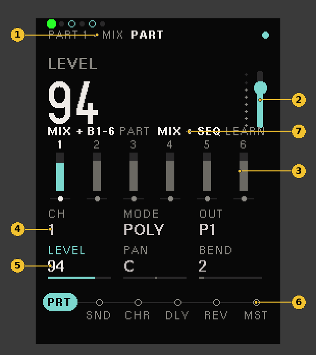

1. `PART 1 · MIX`: Part 1's mixer.
2. LEVEL's glyph, a level bar.
3. All six Parts' levels, the current Part's in accent.
4. **CH** (MIDI channel), **MODE** (MONO or POLY), **OUT** (output pair P1, P2 or P3).
5. **LEVEL**, **PAN**, and **BEND** (pitch-bend range in semitones).
6. The mixer's chain. EDIT from PRT or SND goes down to the Sound browser.
7. **The hint:** `MIX + B1-6 PART` jumps to that Part's mixer and keeps the page you are on. `MIX + SEQ LEARN` starts MIDI learn for the touched cell.

## MIXER: the PRT page

**PART** (PRT on the chain map) is the Part's channel strip.

| Cell | Range | Default | What it does |
|---|---|---|---|
| **CH** | 1 to 16 | Part *n* on channel *n* | The MIDI channel the Part listens on. The same value as SETTINGS › MIDI CONFIG › CHANNELS ([MIDI](14-midi.md)) |
| **MODE** | MONO, POLY | POLY | MONO plays one voice at a time and retriggers it; POLY plays chords |
| **OUT** | P1, P2, P3 | P1 | The output pair the Part plays out of. The same value as SETTINGS › AUDIO ROUTING › OUTPUTS |
| **LEVEL** | 0 to 127 | 102 | The Part's fader |
| **PAN** | L63 to C to R63 | C | Where the Part sits left to right. C is centre |
| **BEND** | 0 to 24 | 2 | Pitch-bend range in semitones |

The picture band shows all six Parts' LEVEL bars. Beside each bar is a live meter of what the Part plays, taken after its EQ and before its LEVEL: its foot is −48 dBFS and its top 0 dBFS. It rises at once and falls 20 dB a second; a thin mark holds the peak for a second. If a Part passes full scale, the top of its meter lights in the alert colour. A small square beside a Part's number lights while a key is held on that Part's MIDI channel (or on a member channel of an MPE zone that plays it).

**Why:** the meter reads before the fader, so it answers "is this Part making sound?" even with LEVEL down. The LEVEL bar beside it already shows the fader. The key mark shows held keys, not note flashes, so a Part that should be playing but is silent is easy to spot: a lit key mark over an empty meter points at the Sound, an unlit one at the MIDI channel.

When OUT is not P1, the header shows `OUT P2` or `OUT P3` on the Part's sound pages and in its mixer, as a warning: that Part is not on the main pair.

## MIXER: the VOICES sub-page

**VOICES** (VOI on the chain map) sets the Part's share of the eight-voice pool.

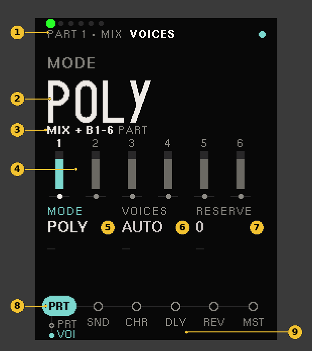

1. **Header:** `PART n · MIX` and the page's full name.
2. **The focused cell**, large: its name and value.
3. **The hint:** `MIX + B1-6 PART` (on RESERVE, the project's total, `RESERVES 2/8`).
4. **The picture band:** the six Parts' LEVEL bars and meters.
5. **MODE:** MONO or POLY.
6. **VOICES:** the Part's cap.
7. **RESERVE:** the Part's guarded voices.
8. **The chain map:** this page's place in the mixer's chain.
9. **The sub-pages:** PART, VOICES, EQ, the lit one is where you are.

| Cell | Options | Default | What it does |
|---|---|---|---|
| **MODE** | MONO, POLY | POLY | The same cell as on PRT, here beside the cap |
| **VOICES** | AUTO, 1, 2, 3, 4, 5, 6, 7, 8 | AUTO | The most voices the Part sounds at once. AUTO sets no cap |
| **RESERVE** | 0, 1, 2, 3, 4, 5, 6, 7, 8 | 0 | Voices no other Part may take from this one while they play |

- **VOICES (the cap).** A Part at its cap never takes a free voice from the pool: its next note takes one of its own voices instead (the oldest ringing tail first, then the oldest held note). Released tails count toward the cap, since they still sound.
- **RESERVE (the floor).** While a note's key is down, or while a DRUM hit's voice still sounds, that voice is guarded: another Part's note cannot steal it. A released note's tail is not guarded. A reserve does not hold free voices back; a Part with nothing sounding still gets a free voice first. RESERVE 0 guards nothing.
- **What is refused.** A Part's RESERVE may not pass its own VOICES, and the six Parts' reserves may not add up to more than the pool's 8. A turn onto a refused value lands on it dimmed, with the reason in the focus band (`RESERVE 2 · VOICES 1`, or `RESERVES 9 · POOL HOLDS 8`), and nothing changes. The RESERVE cell's focus band shows the project's total, `RESERVES 2/8`.
- A mono voice is never stolen, guarded or not.

**Why:** with six Parts sharing eight voices, a busy pad Part can take a drum hit's tail or a bass note from under you. VOICES keeps a Part from hogging the pool; RESERVE keeps the notes that matter safe from the others. A cap of 1 counts like MONO but steals rather than retriggers, so each note gets its own envelope. The voice limits and what happens at them are in [limits](20-limits.md).

## MIXER: the EQ sub-page

**EQ** (EQ on the chain map) is the Part's channel EQ, at the end of its strip, and its role for SMART EQ.

1. **Header:** `PART n · MIX` and the page's full name.
2. **The focused cell**, large: its name and value (TILT in dB).
3. **The hint:** `SEQ+TURN FINE` and `MIX + SEQ LEARN`.
4. **The picture band:** the six Parts' LEVEL bars and meters, with SMART EQ's four live cuts.
5. **TILT**.
6. **LO CUT**.
7. **ROLE:** FRONT, MID or BACK for SMART EQ.
8. **The chain map:** this page's place in the mixer's chain.
9. **The sub-pages:** PART, VOICES, EQ, the lit one is where you are.

| Cell | Range | Default | What it does |
|---|---|---|---|
| **TILT** | −10.0 dB to +9.8 dB | 0 dB | Tips the whole spectrum around 810 Hz: positive is brighter (highs up, lows down), negative darker. 0 dB is flat |
| **LO CUT** | OFF, ON | OFF | A gentle high-pass at 150 Hz (6 dB per octave), to clear low-end rumble from a Part that does not need it |
| **ROLE** | FRONT, MID, BACK | MID | The Part's place for SMART EQ (below) |

LO CUT runs first, then TILT, then SMART EQ's cuts. Switching LO CUT fades over 20 ms, so it never clicks; TILT glides as you turn it. Loading a Sound never changes the EQ: it belongs to the Part's place in the mix, not to the Sound.

The picture band shows the six Parts' LEVEL bars and meters, as on PRT, and under each the four bands SMART EQ listens to, each hanging down by its live cut. The edited Part is lit, with its deepest cut in dB.

**Why:** a tilt and a low cut fix most "this Part is too dull, too bright or too boomy for the mix" problems with two controls. TILT can be learned to a MIDI control and played; LO CUT is a setup switch and stays on the panel.

## MIXER: SMART EQ

SMART EQ stops Parts masking each other without any EQ by hand. Each Part has a **ROLE** (on its EQ page): FRONT, MID or BACK. Where a higher-role Part is loud in a band, a lower-role Part that is also playing in that band is cut there, slowly. FRONT is never cut, and Parts of the same role never cut each other.

- **The bands.** Four fixed bands per Part: LOW (100 Hz), LOW MID (400 Hz), HIGH MID (1.6 kHz) and HIGH (6.4 kHz). SMART EQ listens through them and cuts through them, after LO CUT and TILT.
- **How deep.** A BACK Part under a FRONT one is cut the most; one rank apart (MID under FRONT, BACK under MID) is cut about two thirds as much.
- **How fast.** A cut deepens over about half a second and lets go over about two seconds, so at moderate AMOUNTs it is heard as a cleaner mix, not as pumping.
- **The kick.** A DRUM Part of a higher role presses on lower Parts' LOW band through a fast dip instead: in within a few milliseconds, out over about 100 ms, as a sidechain ducker does. So a bass ducks under the kick and comes back between hits.
- **The reverb is a member.** The reverb's return has its own role (**REV ROLE** on MST › LVL, the same setting as **SMART ROLE** on REV › DUCK), BACK by default. It yields as a Part of that role would and never makes a Part yield.

The master switch and the depth are on MST › LVL: **SMART EQ** (OFF or ON) and **AMOUNT** (0 to 127). With SMART EQ OFF, or AMOUNT 0, nothing is cut.

| AMOUNT | LOW and LOW MID | HIGH MID and HIGH | The kick's dip |
|---|---|---|---|
| 64 (default, polite) | 6 dB | 6 dB | 6 dB |
| 95 (deep) | 12 dB | 6 dB | 15 dB |
| 127 | 21 dB | 9 dB | 27 dB |

These are BACK under FRONT; one rank apart takes two thirds. Up to about 64 the cuts are 4 to 6 dB and move over seconds. Past it the kick's dip is deep and fast enough to hear, on purpose.

**Why:** the mix stays clear without a page of EQ for every Part, and you decide what matters with one word per Part. AMOUNT runs past the good setting (around 95) toward too much, so there is always more to reach for.

> **Design note:** SMART EQ takes its idea of groups from sonible's smart:EQ: tell the mix who leads, and let it make room. Chimera's version is a much smaller thing, four fixed bands that only ever cut, because it runs beside the voices on a chip with no time to spare. It listens to long ringing tails as the sustained energy they are, which is why a MODAL bell held under a lead finally stops clouding it. The kick's dip was meant to hold steady between dense kicks; every rule for telling a kick from a snare on a kick's tail failed somebody's groove, so it stayed a plain follower that wobbles with the beat, like every honest sidechain.

## MIXER: the SND page

**SENDS** (SND on the chain map) holds the Part's three effect sends. It is the same page as AMP › SENDS on the Part's own chain: one value, two places.

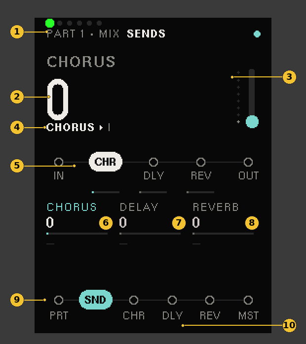

1. **Header:** `PART n · MIX` and the page's full name.
2. **The focused cell**, large: its name and value.
3. **Its glyph:** a level bar.
4. **The hint:** the effect this send feeds and its TYPE (`CHORUS ▸ I`).
5. **The picture band:** the effects flow, the effect of the focused send lit.
6. **CHORUS** send.
7. **DELAY** send.
8. **REVERB** send.
9. **The chain map:** this page's place in the mixer's chain.
10. **The sub-pages:** none on SND.

| Cell | Range | Default | What it does |
|---|---|---|---|
| **CHORUS** | 0 to 127 | 0 | How much of the Part goes to the chorus |
| **DELAY** | 0 to 127 | 0 | How much goes to the delay |
| **REVERB** | 0 to 127 | 0 | How much goes to the reverb |

- The sends belong to the Sound: a Sound saved with its sends brings them back when it loads. A Sound load glides the sends from the old values, never a jump.
- A send is taken after the Part's EQ and SMART EQ and **before** its LEVEL and PAN. Turning LEVEL down leaves the effects fed; a Part at LEVEL 0 with a send up plays only through the effect.
- The sends follow a squared taper: half way (64) is −12 dB, and the low steps rise from silence instead of jumping in.

**Why:** a squared taper spends the knob's travel where the ear hears a change. Half way at −12 dB is the usual audio-taper midpoint, so the top half of the knob covers 12 dB instead of 6.

## MIXER: how the effects are wired

The three effects are true send effects, as on a mixing desk:

- Each effect takes the sum of all six Parts' sends to it and returns **only its wet signal**. The dry sound reaches the outputs through the Parts alone. Each effect's **MIX** is its return level.
- The returns come back on output pair P1, the main pair.
- **CHORUS** and **REVERB** return in stereo. **DELAY** is mono, on both sides at the same level.
- The delay can feed the reverb: DLY's **REV** sends the delay's return into the reverb's input, in the same moment, so echoes gather a room.
- An effect runs whatever its MIX: at MIX 0 its return fades out, but it keeps taking its send. Bring MIX back up and you hear what the send is doing now, never a stale tail.
- Every effect setting glides; a TYPE change crossfades. Nothing clicks or steps.
- The effect settings belong to the project, not to a Sound. A new project starts with every MIX at 127 and the chorus on I.

**Why:** sends returning wet only means one reverb serves all six Parts with nothing doubled, and the Part's own LEVEL stays the dry level. The chorus and reverb return in stereo, where width matters most.

## MIXER: the CHR page

**CHORUS** (CHR on the chain map) is the shared modulation effect.

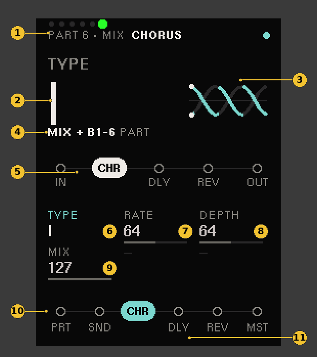

1. **Header:** `PART n · MIX` and the page's full name.
2. **The focused cell**, large: TYPE at I.
3. **Its glyph:** the braid, the chorus's sweep drawn.
4. **The hint:** `MIX + B1-6 PART`.
5. **The effects flow:** IN, CHR, DLY, REV, OUT, the effect you are on lit.
6. **TYPE**.
7. **RATE**.
8. **DEPTH**.
9. **MIX:** the return level.
10. **The chain map:** this page's place in the mixer's chain.
11. **The sub-pages:** none on CHR.

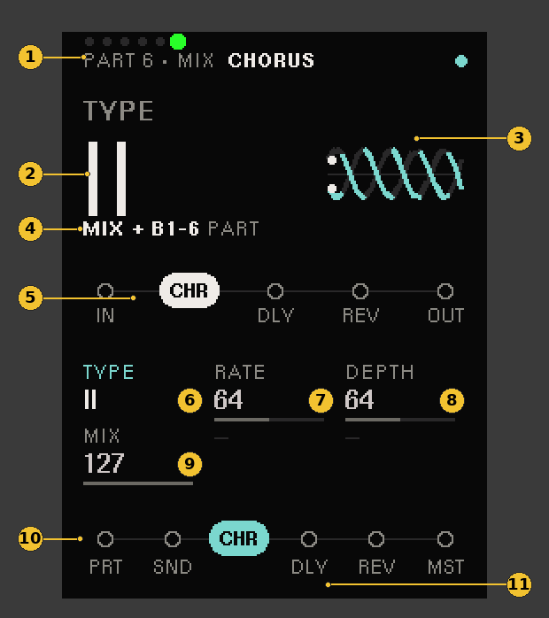

1. **Header:** `PART n · MIX` and the page's full name.
2. **The focused cell**, large: TYPE at II.
3. **Its glyph:** the braid, the chorus's sweep drawn.
4. **The hint:** `MIX + B1-6 PART`.
5. **The effects flow:** IN, CHR, DLY, REV, OUT, the effect you are on lit.
6. **TYPE**.
7. **RATE**.
8. **DEPTH**.
9. **MIX:** the return level.
10. **The chain map:** this page's place in the mixer's chain.
11. **The sub-pages:** none on CHR.

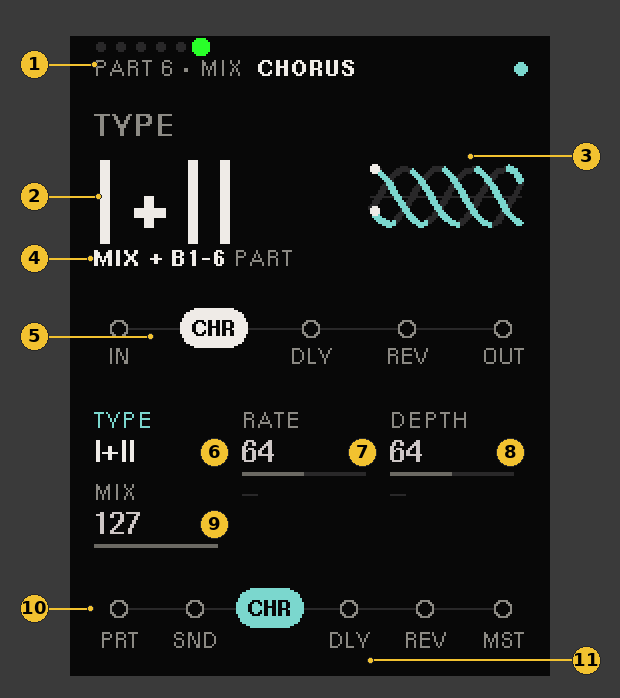

1. **Header:** `PART n · MIX` and the page's full name.
2. **The focused cell**, large: TYPE at I+II.
3. **Its glyph:** the braid, the chorus's sweep drawn.
4. **The hint:** `MIX + B1-6 PART`.
5. **The effects flow:** IN, CHR, DLY, REV, OUT, the effect you are on lit.
6. **TYPE**.
7. **RATE**.
8. **DEPTH**.
9. **MIX:** the return level.
10. **The chain map:** this page's place in the mixer's chain.
11. **The sub-pages:** none on CHR.

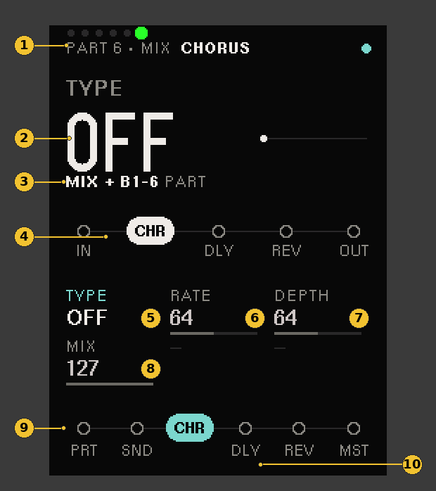

1. **Header:** `PART n · MIX` and the page's full name.
2. **The focused cell**, large: TYPE at OFF.
3. **The hint:** `MIX + B1-6 PART`.
4. **The effects flow:** IN, CHR, DLY, REV, OUT, the effect you are on lit.
5. **TYPE**.
6. **RATE**.
7. **DEPTH**.
8. **MIX:** the return level.
9. **The chain map:** this page's place in the mixer's chain.
10. **The sub-pages:** none on CHR.

| Cell | Range | Default | What it does |
|---|---|---|---|
| **TYPE** | OFF, I, II, I+II, FLANGER, PHASER | I | Which effect the slot plays |
| **RATE** | 0 to 127 | 64 | The sweep's speed |
| **DEPTH** | 0 to 127 | 64 | The sweep's depth |
| **MIX** | 0 to 127 | 127 | The return level |

- **I**, **II** and **I+II** are a bucket-brigade style chorus with two lines: I slow and subtle, II faster and deeper, I+II both at once. The right side reads its line on the inverted sweep, so the chorus is wide in stereo and does not cancel in mono.
- **FLANGER** is a short delay swept by a slow triangle and fed back on itself; the right side sweeps the other way.
- **PHASER** sweeps six all-pass stages a side, fed back.
- RATE and DEPTH set each TYPE's sweep. FLANGER's and PHASER's feedback is fixed, as on a one-knob pedal.
- All TYPEs return wet only. A flanger's or phaser's notches come from the Part's dry signal beside the return, so the Part's CHORUS send sets how deep they are (deepest at 127).

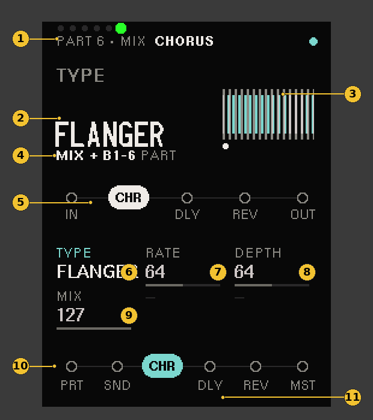

1. **Header:** `PART n · MIX` and the page's full name.
2. **The focused cell**, large: TYPE at FLANGER.
3. **Its glyph:** the braid, the chorus's sweep drawn.
4. **The hint:** `MIX + B1-6 PART`.
5. **The effects flow:** IN, CHR, DLY, REV, OUT, the effect you are on lit.
6. **TYPE**.
7. **RATE**.
8. **DEPTH**.
9. **MIX:** the return level.
10. **The chain map:** this page's place in the mixer's chain.
11. **The sub-pages:** none on CHR.

1. **Header:** `PART n · MIX` and the page's full name.
2. **The focused cell**, large: TYPE at PHASER.
3. **Its glyph:** the braid, the chorus's sweep drawn.
4. **The hint:** `MIX + B1-6 PART`.
5. **The effects flow:** IN, CHR, DLY, REV, OUT, the effect you are on lit.
6. **TYPE**.
7. **RATE**.
8. **DEPTH**.
9. **MIX:** the return level.
10. **The chain map:** this page's place in the mixer's chain.
11. **The sub-pages:** none on CHR.

The glyph draws the chorus as a braid; FLANGER and PHASER get two strands each.

> **Design note:** I, II and I+II are the Juno-60's chorus buttons: two bucket-brigade lines on triangle sweeps, I at 0.513 Hz and II at 0.863 Hz at the default RATE. FLANGER is the feedback comb described in Jon Dattorro's "Effect Design Part 2" (1997); PHASER is the all-pass phaser of Julius O. Smith's "An Allpass Approach to Digital Phasing and Flanging" (1984). Both share the chorus's own delay lines, so the two new TYPEs cost no extra memory at all. Moving from a chorus to a flanger crossfades every TYPE by its share, so you can switch mid-chord and nothing jumps.

## MIXER: the DLY page

**DELAY** (DLY on the chain map) is the shared echo.

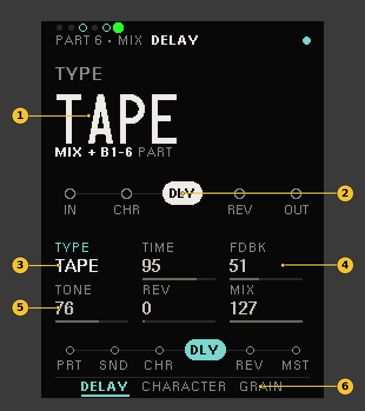

1. **TYPE**, large while touched: TAPE, a tape echo, or GRAIN, which builds its repeats from short grains of the last half second.
2. **The effects chain**, the delay lit.
3. TYPE's cell.
4. **TIME** and **FDBK** (feedback).
5. **TONE**, **REV** (the delay sent on into the reverb) and **MIX**.
6. DLY's sub-pages: DELAY, CHARACTER (TAPE's) and GRAIN (GRAIN's).

| Cell | Range | Default | What it does |
|---|---|---|---|
| **TYPE** | TAPE, GRAIN | TAPE | How the repeats are made |
| **TIME** | 0 to 127 for 10 to 500 ms (FREE), or a note value (SYNC) | 95 (375 ms), 1/8D | The time between repeats; under GRAIN, how far behind the input the grains start |
| **FDBK** | 0 to 127 | 51 | Feedback: how much of each repeat comes round again |
| **TONE** | 0 to 127 | 76 | The high-frequency roll-off inside the loop: lower is darker, each repeat duller than the last |
| **REV** | 0 to 127 | 0 | How much of the delay's return goes on into the reverb |
| **MIX** | 0 to 127 | 127 | The return level |

- A TIME change crossfades two read heads over 20 ms, so the pitch never sweeps and nothing clicks.
- **MIX + turn on TIME** switches SYNC: right for SYNC, left for FREE. The focus band says so: `MIX+TURN SYNC` in FREE, `MIX+TURN FREE` under SYNC. In FREE, **SEQ + turn** on TIME is a fine turn (`SEQ+TURN FINE`).
- REV feeds the reverb after the delay's MIX, on the same squared taper as the sends.
- A TYPE change crossfades over 20 ms, both running, so nothing steps.

The same page on GRAIN (its cells are the same five; GRAIN's own controls are on the GRAIN sub-page):

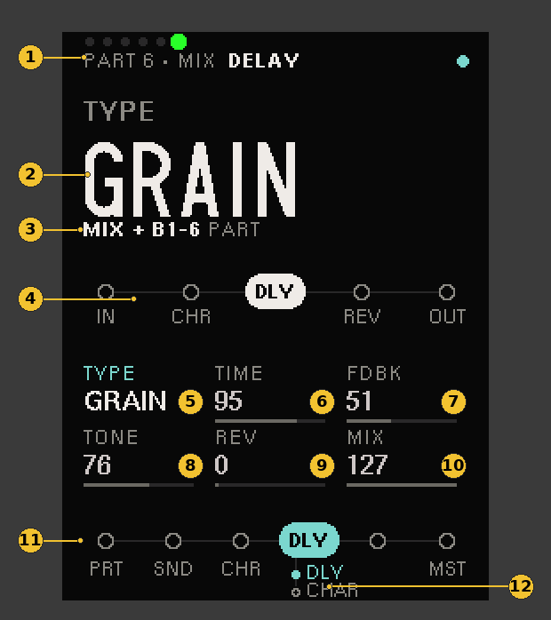

1. **Header:** `PART n · MIX` and the page's full name.
2. **The focused cell**, large: TYPE at GRAIN.
3. **The hint:** `MIX + B1-6 PART`.
4. **The effects flow:** IN, CHR, DLY, REV, OUT, the effect you are on lit.
5. **TYPE**.
6. **TIME**.
7. **FDBK**.
8. **TONE**.
9. **REV:** the delay into the reverb.
10. **MIX:** the return level.
11. **The chain map:** this page's place in the mixer's chain.
12. **The sub-pages:** DELAY, CHARACTER, GRAIN, the lit one is where you are.

### DELAY: SYNC and the tempo

**SYNC** (on CHARACTER and on GRAIN, cell E, the same setting on both) is FREE or SYNC, default FREE.

- Under **SYNC**, TIME turns note values of the tempo, one per detent: 1/32T, 1/32, 1/16T, 1/32D, 1/16, 1/8T, 1/16D, 1/8, 1/4T, 1/8D, 1/4. The default 1/8D is 375 ms at 120 BPM, the same as FREE's default, so switching a fresh project to SYNC sounds the same.
- The tempo is the external MIDI clock when one leads, otherwise the project's tempo, playing or stopped ([ORBIT](12-orbit.md), [MIDI](14-midi.md)).
- A note longer than 500 ms plays halved and stays on the grid; one shorter than 10 ms plays doubled. The cell then shows the note marked `▾1/8` (or `▴`), and the focus band says `HALVED TO FIT 500 MS` or `DOUBLED TO FIT 10 MS`.
- On the SYNC cell the band reads `TIME TURNS NOTES OF THE TEMPO`.
- FREE and SYNC remember their own values: back in FREE, TIME is the ms you left there.
- When the tempo moves, TAPE's head glides to the new time as a real tape would (a small pitch bend); a big jump crossfades instead. Under GRAIN, the grains playing finish where they are and the next ones start on the new time.

**Why:** a tape delay that follows a DAW's slow tempo change by gliding sounds like tape; a chain of crossfades would smear it. A note folded by halves stays in time with the music, where one held at the 500 ms limit would drift a little more each repeat.

## MIXER: the CHAR sub-page

**CHARACTER** (CHAR on the chain map) is TAPE's own character.

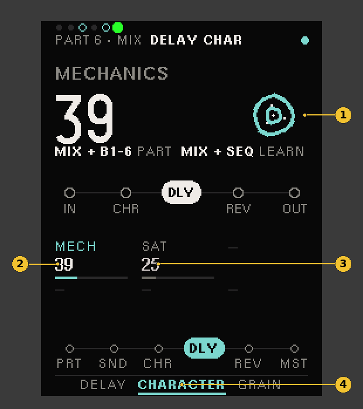

1. **MECHANICS'** glyph: the tape reel, wobbling as much as the transport does.
2. **MECH:** wow and flutter.
3. **SAT:** tape saturation.
4. The sub-page row, on CHARACTER.

| Cell | Range | Default | What it does |
|---|---|---|---|
| **MECHANICS** (the cell reads MECH) | 0 to 127 | 19 | Wow and flutter: a slow 0.5 Hz wow, plus an irregular flutter (a capstan's 9 Hz and random jitter). 0 is a perfect transport; 127 a worn machine, clearly heard and still musical |
| **SAT** | 0 to 127 | 25 | Tape saturation inside the feedback loop. Even at 0 the loop saturates gently, so high feedback never runs away |
| **SYNC** | FREE, SYNC | FREE | Whether TIME is ms or a note of the tempo (see above) |

MECHANICS and SAT are heard under TAPE. Under GRAIN they are dimmed, and the focus band says `TAPE TYPE ONLY`; they keep their values for when you switch back.

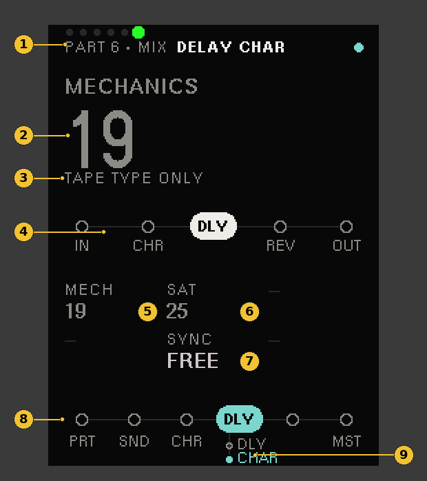

1. **Header:** `PART n · MIX` and the page's full name.
2. **The focused cell**, dimmed: its value kept for TAPE.
3. **The band:** `TAPE TYPE ONLY`.
4. **The effects flow:** IN, CHR, DLY, REV, OUT, the effect you are on lit.
5. **MECHANICS** (MECH), dimmed.
6. **SAT**, dimmed.
7. **SYNC**, which works under both TYPEs.
8. **The chain map:** this page's place in the mixer's chain.
9. **The sub-pages:** DELAY, CHARACTER, GRAIN, the lit one is where you are.

**Why:** SAT never reaches "none" because a loop with no saturation at all can build past full scale at high feedback. The gentlest curve keeps every repeat bounded.

## MIXER: the GRAIN sub-page

**GRAIN** (GRAIN on the chain map) holds the GRAIN TYPE's four controls.

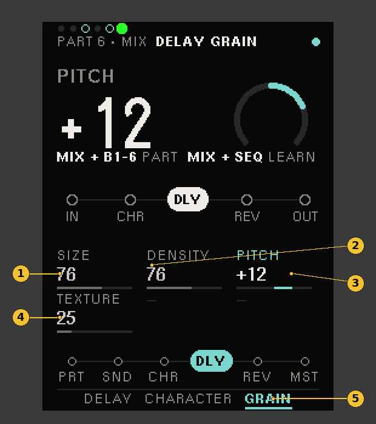

1. **SIZE:** a grain's length.
2. **DENSITY:** how many grains start each second.
3. **PITCH:** each grain's shift in semitones. +12 with a high FDBK is a shimmer.
4. **TEXTURE:** scatters where and when the grains start.
5. The sub-page row, on GRAIN.

| Cell | Range | Default | What it does |
|---|---|---|---|
| **SIZE** | 0 to 127 (10 to 500 ms) | 76 | A grain's length |
| **DENSITY** | 0 to 127 (1 to 128 grains a second) | 76 | How many grains start each second |
| **PITCH** | −24 to +24 | 0 | Each grain's pitch shift in semitones |
| **TEXTURE** | 0 to 127 | 25 | 0 is a regular train of grains, all TIME behind the input; up, the grains start at random intervals and scatter round TIME |
| **SYNC** | FREE, SYNC | FREE | The same cell as on CHARACTER |

Each grain is shaped by a smooth bell, and each reads SIZE, DENSITY, PITCH and TEXTURE when it starts, so a turn is heard grain by grain with nothing to zipper. FDBK sends the grains round again: with PITCH at +12, each pass climbs an octave, the shimmer. Under TAPE the four are dimmed and the focus band says `GRAIN TYPE ONLY`.

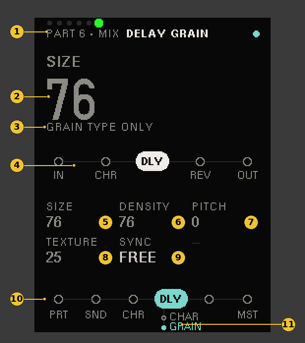

1. **Header:** `PART n · MIX` and the page's full name.
2. **The focused cell**, dimmed: its value kept for GRAIN.
3. **The band:** `GRAIN TYPE ONLY`.
4. **The effects flow:** IN, CHR, DLY, REV, OUT, the effect you are on lit.
5. **SIZE**, dimmed.
6. **DENSITY**, dimmed.
7. **PITCH**, dimmed.
8. **TEXTURE**, dimmed.
9. **SYNC**, which works under both TYPEs.
10. **The chain map:** this page's place in the mixer's chain.
11. **The sub-pages:** CHARACTER, GRAIN, the lit one is where you are.

After an incomplete update GRAIN plays as TAPE and TYPE reads `NEEDS UPDATE` ([updating](19-updating-and-recovery.md)).

Starting points: for a shimmer, GRAIN, PITCH +12, FDBK high, TEXTURE low and some REV. For a granular haze, DENSITY high, SIZE short, TEXTURE high.

> **Design note:** GRAIN is a port of the grain engine in Émilie Gillet's Mutable Instruments Beads: its pulse-train clock, the way a grain starts behind the write head, the smooth bell, the grain-stealing fades and the four-point read are hers. Chimera's differs where the delay asks it to. It plays six grains, not Beads' thirty-two, and reads from the delay's half-second line instead of a seconds-long buffer, so there are no time-stretched clouds, no freeze, no reverse grains and no stereo spray. TEXTURE does one job (how random the grains are) where Beads splits the DENSITY knob in two. And the level law is new: grains read from one place add up in phase, not in power, so each grain is scaled by how many overlap, and the feedback counts them too. The result is that FDBK under the top always dies away, which we checked by trying hard to make it not. The same grain core also runs TAPE's STRETCH machine ([TAPE](06-tape.md)).

## MIXER: the REV page

**REVERB** (REV on the chain map) is the shared reverb. Its **TYPE** picks a family of spaces; the four cells between TYPE and MIX change their names and jobs with the TYPE.

See each TYPE's picture below, in [REVERB: the TYPEs one by one](#reverb-the-types-one-by-one).

| Cell | Options or range | Default | What it does |
|---|---|---|---|
| **TYPE** | QUAD, ROOM, HALL, BLOOM, GATE, REVERSE | QUAD | The reverb's family |
| Cells B to E | depend on TYPE (below) | | |
| **MIX** | 0 to 100 % | 100 % | The return level, always in the same place |

The TYPEs:

- **QUAD:** Chimera's own four-stage ring, a smooth and simple reverb.
- **ROOM:** small to medium rooms, from tight and bright to soft.
- **HALL:** large halls; at its smallest SIZE it becomes a PLATE (the SIZE cell reads PLATE).
- **BLOOM:** a reverb that swells in after the sound, instead of starting with it.
- **GATE:** a dense burst that cuts off sharply, the gated drum sound.
- **REVERSE:** a burst that rises toward its end, as if played backwards.

What cells B to E are under each TYPE:

| TYPE | B | C | D | E |
|---|---|---|---|---|
| QUAD | **SIZE** | **TIME** | **DAMP** | **SMEAR** |
| ROOM | **SIZE** | **DECAY** | **TONE** | **DIFFUSE** |
| HALL | **SIZE** | **DECAY** | **TONE** | **DIFFUSE** |
| BLOOM | **SWELL** | **DECAY** | **TONE** | **DIFFUSE** |
| GATE | **LENGTH** | **TAIL** | **TONE** | **DENSITY** |
| REVERSE | **LENGTH** | **REGEN** | **TONE** | **DENSITY** |

What each control does, with the unit the cell shows:

| Control | Shows | What it does |
|---|---|---|
| **SIZE** | ms | How big the space is: the length of its loops. QUAD's SIZE steps through a table of fixed sizes |
| **SWELL** | ms | BLOOM's size: how long it takes to swell |
| **LENGTH** | ms | GATE's and REVERSE's burst length |
| **TIME**, **DECAY** | s | How long the tail lasts (to −60 dB) |
| **TAIL** | s | What rings on after GATE's burst cuts; at 0, `OFF`: a hard gate |
| **REGEN** | s | REVERSE's feedback: how long its bursts keep regenerating; 0 is `OFF` |
| **DAMP** | kHz | Damping inside the loops: lower is darker as the tail decays |
| **TONE** | kHz | The input's brightness (on BLOOM, the damper inside its loop). On ROOM the top of the knob opens the filter (`OFF`); on HALL, 0 does |
| **DIFFUSE** | a gain, 0.00 up | How quickly echoes smear into a smooth wash |
| **DENSITY** (GATE, REVERSE) | taps on GATE, a gain on REVERSE | How many echoes make up the burst, or how quickly they thicken |
| **SMEAR** | ms | A slow random wander of the loop lengths, so the tail smears into a wash with no vibrato. 0 is `OFF` |

Starting points: for a drum room, ROOM with SIZE low and DECAY short. For a pad, HALL or BLOOM with DECAY long and a little SMEAR. For an 80s snare, GATE.

### REVERB: the TYPEs one by one

**QUAD**

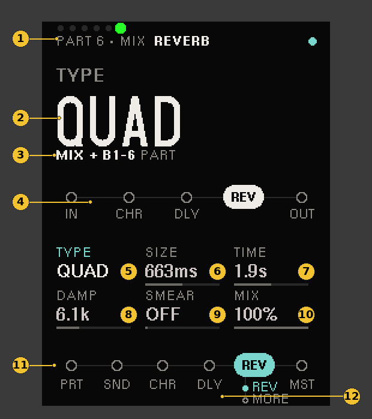

1. **Header:** `PART n · MIX` and the page's full name.
2. **The focused cell**, large: TYPE at QUAD.
3. **The hint:** `MIX + B1-6 PART`.
4. **The effects flow:** IN, CHR, DLY, REV, OUT, the effect you are on lit.
5. **TYPE**.
6. **SIZE**.
7. **TIME**.
8. **DAMP**.
9. **SMEAR**.
10. **MIX:** the return level, in %.
11. **The chain map:** this page's place in the mixer's chain.
12. **The sub-pages:** REVERB, MORE, DUCK and, on HALL, MORE 2, the lit one is where you are.

**ROOM**

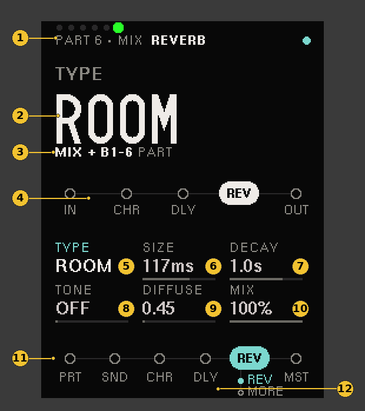

1. **Header:** `PART n · MIX` and the page's full name.
2. **The focused cell**, large: TYPE at ROOM.
3. **The hint:** `MIX + B1-6 PART`.
4. **The effects flow:** IN, CHR, DLY, REV, OUT, the effect you are on lit.
5. **TYPE**.
6. **SIZE**.
7. **DECAY**.
8. **TONE (OFF: the top of the knob opens it)**.
9. **DIFFUSE**.
10. **MIX:** the return level, in %.
11. **The chain map:** this page's place in the mixer's chain.
12. **The sub-pages:** REVERB, MORE, DUCK and, on HALL, MORE 2, the lit one is where you are.

**HALL**

1. **Header:** `PART n · MIX` and the page's full name.
2. **The focused cell**, large: TYPE at HALL.
3. **The hint:** `MIX + B1-6 PART`.
4. **The effects flow:** IN, CHR, DLY, REV, OUT, the effect you are on lit.
5. **TYPE**.
6. **SIZE**.
7. **DECAY**.
8. **TONE**.
9. **DIFFUSE**.
10. **MIX:** the return level, in %.
11. **The chain map:** this page's place in the mixer's chain.
12. **The sub-pages:** REVERB, MORE, DUCK and, on HALL, MORE 2, the lit one is where you are.

**BLOOM**

1. **Header:** `PART n · MIX` and the page's full name.
2. **The focused cell**, large: TYPE at BLOOM.
3. **The hint:** `MIX + B1-6 PART`.
4. **The effects flow:** IN, CHR, DLY, REV, OUT, the effect you are on lit.
5. **TYPE**.
6. **SWELL**.
7. **DECAY**.
8. **TONE**.
9. **DIFFUSE**.
10. **MIX:** the return level, in %.
11. **The chain map:** this page's place in the mixer's chain.
12. **The sub-pages:** REVERB, MORE, DUCK and, on HALL, MORE 2, the lit one is where you are.

**GATE**

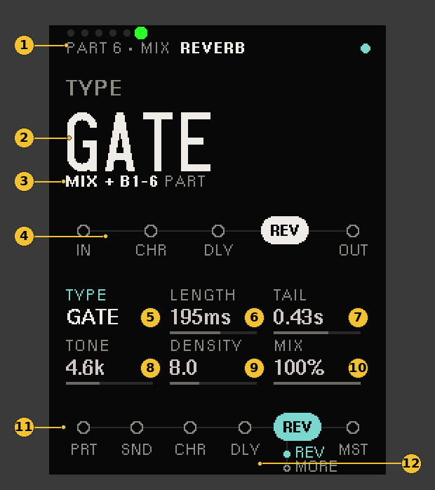

1. **Header:** `PART n · MIX` and the page's full name.
2. **The focused cell**, large: TYPE at GATE.
3. **The hint:** `MIX + B1-6 PART`.
4. **The effects flow:** IN, CHR, DLY, REV, OUT, the effect you are on lit.
5. **TYPE**.
6. **LENGTH**.
7. **TAIL**.
8. **TONE**.
9. **DENSITY (taps)**.
10. **MIX:** the return level, in %.
11. **The chain map:** this page's place in the mixer's chain.
12. **The sub-pages:** REVERB, MORE, DUCK and, on HALL, MORE 2, the lit one is where you are.

**REVERSE**

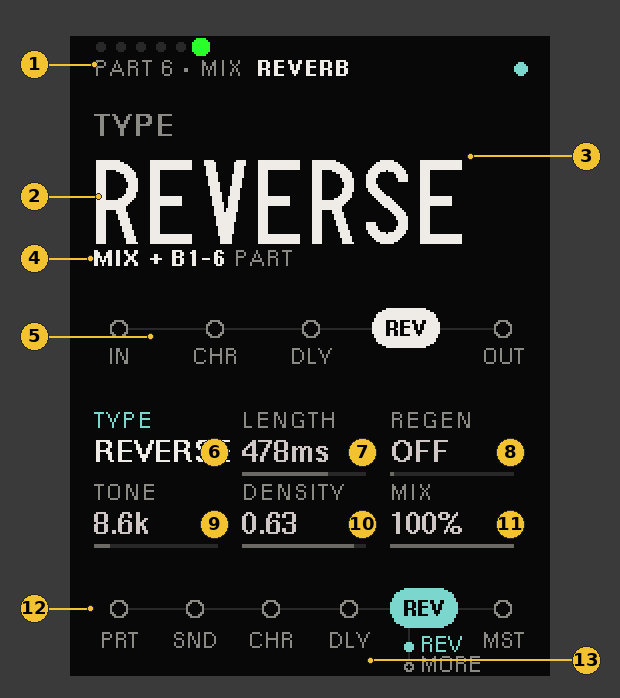

1. **Header:** `PART n · MIX` and the page's full name.
2. **The focused cell**, large: TYPE at REVERSE.
3. **Its glyph:** the TYPE's word, here too wide for the band beside it.
4. **The hint:** `MIX + B1-6 PART`.
5. **The effects flow:** IN, CHR, DLY, REV, OUT, the effect you are on lit.
6. **TYPE**.
7. **LENGTH**.
8. **REGEN (OFF at 0)**.
9. **TONE**.
10. **DENSITY**.
11. **MIX:** the return level, in %.
12. **The chain map:** this page's place in the mixer's chain.
13. **The sub-pages:** REVERB, MORE, DUCK and, on HALL, MORE 2, the lit one is where you are.

### REVERB: changing TYPE

The first time you pick a TYPE, its knobs jump to that TYPE's starting setting, each matched to a reference program (see the design note). Every TYPE then remembers its own knobs while the unit is on: go from HALL to GATE and back, and HALL is as you left it. The switch crossfades, with no click and no stale echo of the old space.

**Why:** each TYPE's cells mean different things, so one TYPE's DECAY would be nonsense on another. Remembering each TYPE's knobs means trying the other spaces costs you nothing.

> **Design note:** ROOM, HALL, BLOOM, GATE and REVERSE were derived from, and A/B-matched against, thement's open-source midiverb_emulator, which recreates a classic hardware reverb from its decompiled programs. ROOM's and BLOOM's structures (their delay lengths, all-pass and tap positions and gains) and HALL's diffuser start from numbers read out of it; the engine around them, the knobs and everything they do between the reference settings are Chimera's own. Each TYPE's starting setting was fitted until our render matched the emulator's on decay time in every octave, pre-delay, early energy, echo density and brightness, within a few percent. QUAD is the one TYPE with no reference: it is Chimera's original ring, kept exactly as it was. SMEAR is ours too, a wander instead of a wobble, bounded so a held note drifts by no more than a few cents. Fitting a reverb by octave-band decay times is a strange way to spend an evening, but the GATE does sound right.

## MIXER: the MORE sub-page

**MORE** (MORE on the chain map) holds each TYPE's extra controls.

The pictures for every TYPE are in [REVERB: MORE on each TYPE](#reverb-more-on-each-type).

| TYPE | A | B | C | D | E | F |
|---|---|---|---|---|---|---|
| QUAD | | | | **RATE** | | |
| ROOM | **PRE-DLY** | **DAMP** | **SMEAR** | **RATE** | **SYNC** | **LOOPS** |
| HALL | **PRE-DLY** | **DAMP** | **SMEAR** | **RATE** | **SYNC** | **SPREAD** |
| BLOOM | **PRE-DLY** | | **SMEAR** | **RATE** | **SYNC** | |
| GATE | **PRE-DLY** | **SHAPE** | **SMEAR** | **RATE** | **SYNC** | **DAMP** |
| REVERSE | **ONSET** | **CURVE** | **SMEAR** | **RATE** | **SYNC** | |

| Control | Shows | What it does |
|---|---|---|
| **PRE-DLY** (the cell reads PRE) | ms | Silence before the reverb starts, so the dry attack stays clear |
| **ONSET** | ms | REVERSE's pre-delay: where its rising ramp starts |
| **SHAPE** | dB | GATE's burst envelope, end to end: falling, flat or rising |
| **CURVE** | dB | REVERSE's rising curve, end to end |
| **LOOPS** | degrees, 0 to 90 | How ROOM's four loops couple: 0 is four short loops, 90 two long ones |
| **SPREAD** (the cell reads SPRD) | ms | HALL's diffuser length: how far the early echoes spread |
| **RATE** | Hz, 0.1 to 2 | SMEAR's speed |
| **DAMP** | kHz | As on REV (on GATE, the damping of its TAIL) |
| **SMEAR** | ms | As on REV |
| **SYNC** | OFF, TIME, ALL | Tempo sync (below) |

### REVERB: MORE on each TYPE

**QUAD**

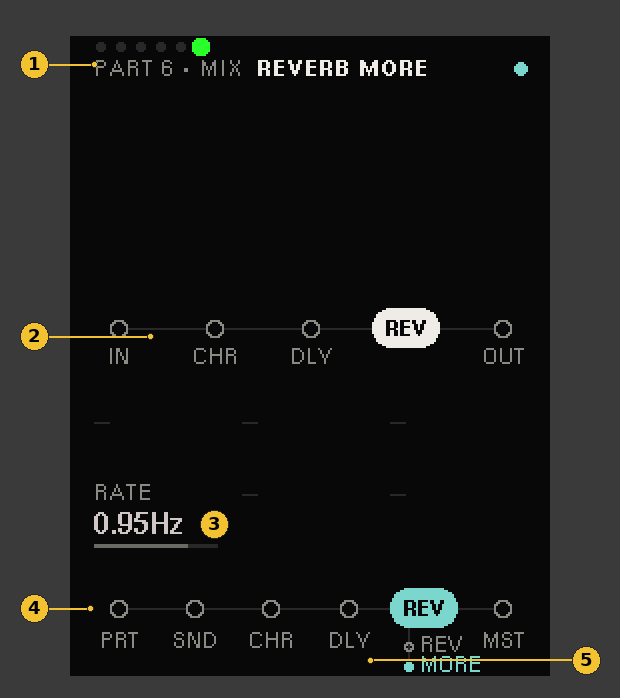

1. **Header:** `PART n · MIX` and the page's full name.
2. **The effects flow:** IN, CHR, DLY, REV, OUT, the effect you are on lit.
3. **RATE**, QUAD's only extra.
4. **The chain map:** this page's place in the mixer's chain.
5. **The sub-pages:** REVERB, MORE, DUCK, the lit one is where you are.

**ROOM**

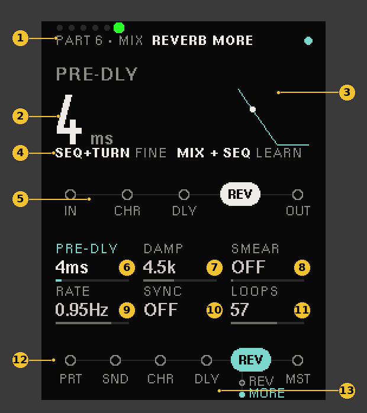

1. **Header:** `PART n · MIX` and the page's full name.
2. **The focused cell**, large: PRE-DLY in ms.
3. **Its glyph:** the reverb's decay shape.
4. **The hint:** `SEQ+TURN FINE` and `MIX + SEQ LEARN`.
5. **The effects flow:** IN, CHR, DLY, REV, OUT, the effect you are on lit.
6. **PRE-DLY**.
7. **DAMP**.
8. **SMEAR**.
9. **RATE**.
10. **SYNC**.
11. **LOOPS**.
12. **The chain map:** this page's place in the mixer's chain.
13. **The sub-pages:** REVERB, MORE, DUCK, the lit one is where you are.

**HALL**

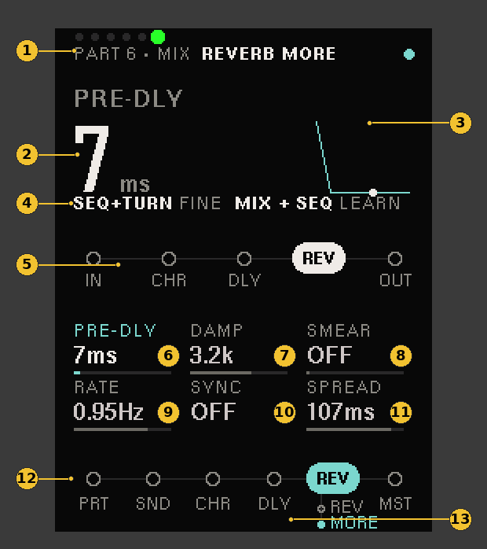

1. **Header:** `PART n · MIX` and the page's full name.
2. **The focused cell**, large: PRE-DLY in ms.
3. **Its glyph:** the reverb's decay shape.
4. **The hint:** `SEQ+TURN FINE` and `MIX + SEQ LEARN`.
5. **The effects flow:** IN, CHR, DLY, REV, OUT, the effect you are on lit.
6. **PRE-DLY**.
7. **DAMP**.
8. **SMEAR**.
9. **RATE**.
10. **SYNC**.
11. **SPREAD**.
12. **The chain map:** this page's place in the mixer's chain.
13. **The sub-pages:** REVERB, MORE, DUCK, the lit one is where you are.

**BLOOM**

1. **Header:** `PART n · MIX` and the page's full name.
2. **The focused cell**, large: PRE-DLY in ms.
3. **Its glyph:** the reverb's decay shape.
4. **The hint:** `SEQ+TURN FINE` and `MIX + SEQ LEARN`.
5. **The effects flow:** IN, CHR, DLY, REV, OUT, the effect you are on lit.
6. **PRE-DLY**.
7. **SMEAR**.
8. **RATE**.
9. **SYNC**.
10. **The chain map:** this page's place in the mixer's chain.
11. **The sub-pages:** REVERB, MORE, DUCK, the lit one is where you are.

**GATE**

1. **Header:** `PART n · MIX` and the page's full name.
2. **The focused cell**, large: PRE-DLY in ms.
3. **Its glyph:** the reverb's decay shape.
4. **The hint:** `SEQ+TURN FINE` and `MIX + SEQ LEARN`.
5. **The effects flow:** IN, CHR, DLY, REV, OUT, the effect you are on lit.
6. **PRE-DLY**.
7. **SHAPE**.
8. **SMEAR**.
9. **RATE**.
10. **SYNC**.
11. **DAMP**.
12. **The chain map:** this page's place in the mixer's chain.
13. **The sub-pages:** REVERB, MORE, DUCK, the lit one is where you are.

**REVERSE**

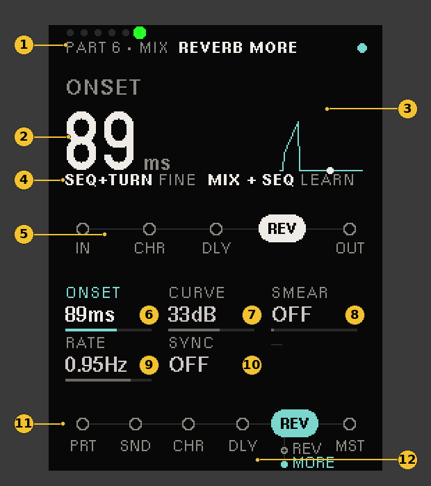

1. **Header:** `PART n · MIX` and the page's full name.
2. **The focused cell**, large: ONSET in ms.
3. **Its glyph:** the reverb's decay shape.
4. **The hint:** `SEQ+TURN FINE` and `MIX + SEQ LEARN`.
5. **The effects flow:** IN, CHR, DLY, REV, OUT, the effect you are on lit.
6. **ONSET**.
7. **CURVE**.
8. **SMEAR**.
9. **RATE**.
10. **SYNC**.
11. **The chain map:** this page's place in the mixer's chain.
12. **The sub-pages:** REVERB, MORE, DUCK, the lit one is where you are.

### REVERB: tempo sync

**SYNC** on MORE locks the reverb's times to the tempo (the same tempo as the delay's):

- **OFF:** times are free.
- **TIME:** PRE-DLY (or GATE's and REVERSE's LENGTH) turns note values instead of ms.
- **ALL:** as TIME, and HALL's and BLOOM's DECAY turns whole beats: 1, 2, 3, 4, 6, 8, 12, 16, 24 or 32 (the cell reads `4 BT`).

ROOM offers OFF and TIME only. QUAD has no SYNC. A synced time that the reverb cannot reach is marked `▾` or `▴`: it plays shorter or longer than it reads.

## MIXER: the DUCK sub-page

**DUCK** (DUCK on the chain map) turns the reverb's return down while its own input is loud, so a big reverb never smears an attack and the tail blooms in the gaps. It works the same under every TYPE.

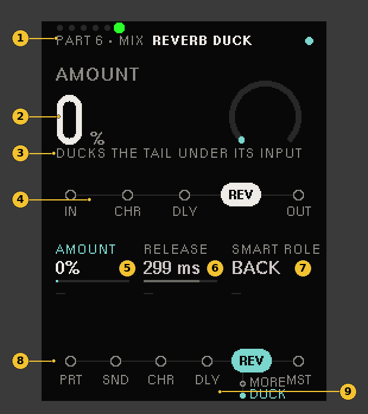

1. **Header:** `PART n · MIX` and the page's full name.
2. **The focused cell**, large: AMOUNT in %.
3. **The band's words** for the touched cell: `DUCKS THE TAIL UNDER ITS INPUT`.
4. **The effects flow:** IN, CHR, DLY, REV, OUT, the effect you are on lit.
5. **AMOUNT**.
6. **RELEASE**.
7. **SMART ROLE**.
8. **The chain map:** this page's place in the mixer's chain.
9. **The sub-pages:** MORE, DUCK, and on HALL MORE 2, the lit one is where you are.

| Cell | Range | Default | What it does |
|---|---|---|---|
| **AMOUNT** | 0 to 100 % | 0 % | How far the return goes down under its input, up to 30 dB at 100 %. 0 is no ducking. Band: `DUCKS THE TAIL UNDER ITS INPUT` |
| **RELEASE** | 1 ms to 2 s | about 0.30 s | How long the tail takes to come all the way back once the input stops. Band: `HOW FAST THE TAIL RETURNS` |
| **SMART ROLE** | FRONT, MID, BACK | BACK | The reverb return's SMART EQ role: the same setting as REV ROLE on MST › LVL |

- The duck listens to the reverb's own input: every Part's REVERB send, and the delay's REV.
- Only the wet return is ducked. The dry Parts are untouched.
- Below about 30 ms RELEASE follows the input closely: a gated, pumping effect.
- DUCK and SMART EQ stack: DUCK turns the whole return down by level; SMART EQ cuts it per band under Parts that outrank it.

**Why:** the master compressor would duck the dry mix too. Keying the reverb on its own input does just the one job: keep a long tail off the notes and let it out between them.

## MIXER: the MOR2 sub-page

**MORE 2** (MOR2 on the chain map) is HALL's alone:

| Cell | Range | Default | What it does |
|---|---|---|---|
| **DENSITY** (the cell reads DENS) | 3 to 8 taps a side | about 4 | How many early echoes HALL takes from its loop on each side: more is denser |

1. **Header:** `PART n · MIX` and the page's full name.
2. **The focused cell**, large: DENSITY.
3. **Its glyph:** the reverb's decay shape.
4. **The hint:** `SEQ+TURN FINE` and `MIX + SEQ LEARN`.
5. **The effects flow:** IN, CHR, DLY, REV, OUT, the effect you are on lit.
6. **DENSITY**.
7. **The chain map:** this page's place in the mixer's chain.
8. **The sub-pages:** DUCK, MORE 2, the lit one is where you are.

Under every other TYPE the page is empty, and going down the sub-pages skips it.

## MIXER: the MST page

**MASTER** (MST on the chain map) is the master compressor, the last effect before the output stage. The page gives most of the screen to the compressor's curve.

1. **Header:** `PART n · MIX` and the page's full name.
2. **OUT:** the output level, up the side of the curve. This page has no focus band: the curve takes its place.
3. **The gain-reduction meter**, on the right.
4. **The curve's area:** the compressor's response at the current THRESH and RATIO.
5. **The curve:** input (IN) along the bottom; the KEY in use (here FULL) is named under it.
6. **THRESH**.
7. **RATIO**.
8. **ATK**.
9. **REL**.
10. **KEY**.
11. **MIX:** parallel compression.
12. **The chain map:** this page's place in the mixer's chain.
13. **The sub-pages:** MASTER, LEVEL, the lit one is where you are.

| Cell | Range | Default | What it does |
|---|---|---|---|
| **THRESH** | 0 to 127 (−40 dB to 0 dB) | 89 (about −12 dB) | The level above which the compressor works |
| **RATIO** | 1:1, 1.5:1, 2:1, 3:1, 4:1, 6:1, 10:1, 20:1, MAX | 1:1 | How hard it presses on what passes THRESH. 1:1 is off; MAX takes off everything over THRESH, a limiter's slope |
| **ATK** | 0 to 127 (0.1 ms to 100 ms) | 64 | Attack: how fast it starts pressing |
| **REL** | 0 to 127 (10 ms to 1 s) | 64 | Release: how fast it lets go |
| **KEY** | FULL, LOW, HIGH, HIT, PART 1, PART 2, PART 3, PART 4, PART 5, PART 6 | FULL | What the compressor listens to (below) |
| **MIX** | 0 to 127 | 127 | Parallel compression: 0 is the dry mix, 127 all compressed, between a blend |

- The compressor hears all three output pairs and applies one gain to all of them, so the stereo image and the pairs never shift against each other.
- The picture shows the curve: input (IN) along the bottom, output (OUT) up the side. The bar on the right is the gain reduction. The KEY in use is named under the curve.
- MIX 0, or RATIO 1:1 with MAKEUP 0, is an exact bypass.
- **MAKEUP** (the gain after compression) is on MST › LVL.

### MASTER: the compressor's KEY

KEY picks what the compressor's detector hears. The audio itself is only ever turned up and down; the KEY changes what decides how far. While KEY is touched, the page says what the choice does:

| KEY | The page says | What the detector hears |
|---|---|---|
| **FULL** | `HEARS THE WHOLE MIX` | The whole mix: classic bus glue |
| **LOW** | `THE KICK PUMPS THE MIX` | Only the lows, below 150 Hz: the kick and bass drive it, for pumping |
| **HIGH** | `HEARS ALL BUT THE BASS` | Everything above 150 Hz, so the low end never makes it pump |
| **HIT** | `EVERY HIT PUSHES IT ALIKE` | The mix through a loudness weighting (the curve broadcast loudness meters use), so each hit pushes it by how loud it sounds |
| **PART 1** … **PART 6** | `DUCKS ALL BUT ITSELF` | That Part alone, after its EQ and before its LEVEL |

Under PART *n*, the keying Part always passes unducked: the compressor turns the rest of the mix down under it and adds the key Part back at full level. Its effect returns still duck with the mix, and MAKEUP lifts the rest but not it. The Part's LEVEL does not change how hard it pumps; a Part turned all the way down still pumps the rest. A silent key Part lets the compressor go at REL.

Starting points: for sidechain pumping from a DRUM Part on Part 1, KEY PART 1, RATIO 4:1 or higher, THRESH low, ATK fast, REL to taste with the tempo. For gentle glue, KEY HIGH, RATIO 2:1, THRESH just under the loud parts.

**Why:** a compressor keyed from the whole mix glues, but never gives the pump of a kick-keyed one. Letting the key Part through unducked means the kick keeps its punch while everything else breathes round it.

> **Design note:** KEY follows how Elektron's Analog Rytm keys its compressor: a few fixed curves on what the compressor hears (never on the audio), then, after the ranges, the Parts themselves, as a Digitakt picks a track. No manual publishes the curves' corners, so LOW's and HIGH's 150 Hz are Chimera's own starting points. HIT is the K-weighting from the ITU-R BS.1770 loudness standard, the curve broadcast meters use to guess how loud things sound, built from its analogue prototype so it is the same curve at any sample rate. FULL is the old compressor bit for bit, so nothing you saved changed its sound.

## MIXER: the LVL sub-page

**LEVEL** (LVL on the chain map) holds the master output and SMART EQ's master settings.

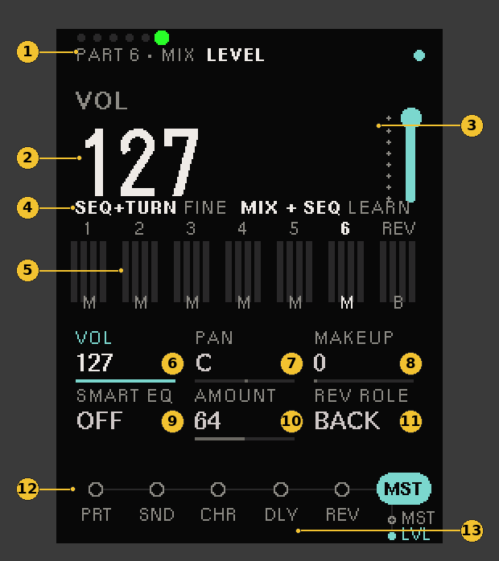

1. **Header:** `PART n · MIX` and the page's full name.
2. **The focused cell**, large: its name and value.
3. **Its glyph:** a level bar.
4. **The hint:** `SEQ+TURN FINE` and `MIX + SEQ LEARN`.
5. **The picture band:** SMART EQ's bands for Parts 1 to 6 and the reverb return (REV), each role's letter under it.
6. **VOL**.
7. **PAN**.
8. **MAKEUP**.
9. **SMART EQ**.
10. **AMOUNT**.
11. **REV ROLE**.
12. **The chain map:** this page's place in the mixer's chain.
13. **The sub-pages:** MASTER, LEVEL, the lit one is where you are.

| Cell | Range | Default | What it does |
|---|---|---|---|
| **VOL** | 0 to 127 | 127 | The master volume, after the limiter |
| **PAN** | L63 to C to R63 | C | The master balance |
| **MAKEUP** | 0 to 127 (0 to +24 dB) | 0 | The compressor's makeup gain |
| **SMART EQ** | OFF, ON | OFF | SMART EQ on or off for every Part |
| **AMOUNT** | 0 to 127 | 64 | How deep SMART EQ cuts (see [SMART EQ](#mixer-smart-eq)) |
| **REV ROLE** | FRONT, MID, BACK | BACK | The reverb return's SMART EQ role (the same setting as SMART ROLE on DUCK) |

The picture band shows every Part's four SMART EQ bands, small, under its number, with its role's letter below (F, M or B), and the reverb return's under REV. The Part you came from is lit.

## MIXER: signal flow and gain staging

From a voice to the jacks, in order:

1. **The voices** of a Part are summed into the Part's bus (each voice's own chain is in [the voice chain](08-voice-chain.md)).
2. **LO CUT**, then **TILT**, then **SMART EQ's** cuts (EQ page).
3. **The meter** on PRT reads here.
4. **The sends** are taken here, before LEVEL: CHORUS, DELAY and REVERB.
5. **LEVEL** and **PAN**, then the Part goes to its output pair (OUT).
6. **The effects** run on the summed sends. The delay runs first, and its REV feeds the reverb. The reverb's return passes DUCK and its SMART EQ bands. All returns, wet only, join pair P1.
7. **The master compressor** hears all three pairs and turns them all by one gain (MST, with MAKEUP on LVL).
8. **The output stage:** a fixed gain of +1.94 dB and a peak limiter, linked across every pair and side. It is exact below −6 dBFS, bends softly above it, and never lets a sample past −1 dBFS. It looks 1.33 ms ahead, so its attack is done before the peak arrives, and lets go over 50 ms.
9. **VOL** and **PAN** (LVL), after the limiter.
10. Your computer's sound from USB, at USB IN's level, is mixed into the main out after the synth ([USB](17-usb.md)).

The limiter is not a page: it has no controls and is always on.

- A single ALGO INIT note peaks near −12 dBFS on the main out. Sounds with more punch land hotter, and chords and dense scenes are caught by the limiter's soft knee.
- Leave headroom with the Part LEVELs, not with VOL: VOL comes after the limiter, so turning it down only makes the output quieter. Six Parts playing loud chords with effects on can still take the limiter 15 dB or more into its knee; if a mix sounds squashed, bring the LEVELs down.

**Why:** the gain is set at the very end, inside the limiter, so every stage before it (the delay's saturation, the reverb, the compressor's threshold) hears the same levels whatever the output gain. A saturating delay keeps its character, and the compressor fires where its THRESH says. VOL comes after the limiter so the fader never changes how the limiter behaves.

> **Design note:** the output stage started life as a 1/√8 trim, so eight voices summed at random phase would land where one voice did, and a hard limiter. It was too polite: single notes came out 23 dB under full scale and you had to turn your amp up to hear a pluck. The gain went up 11 dB and the limiter grew a soft knee, so now one note sits at a healthy −12 dBFS and a held eight-note chord leans gently into the knee instead of slamming into a wall. We checked a sustained chord does not pump: its level wobbles less than 0.15 dB.
