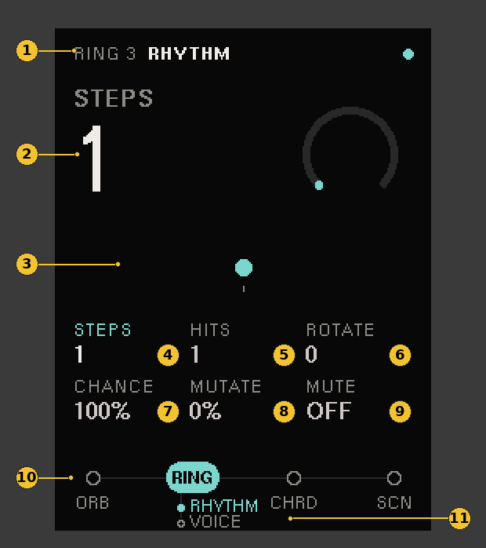
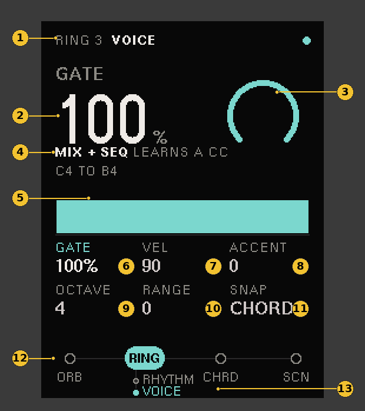
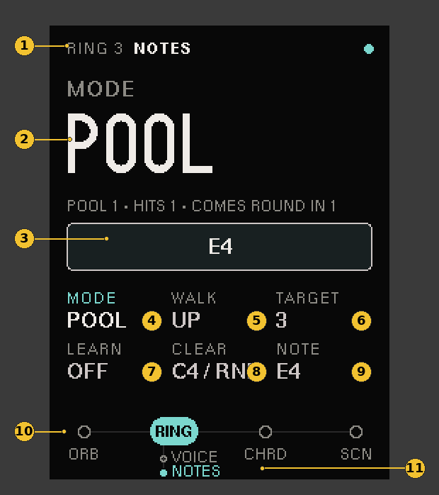
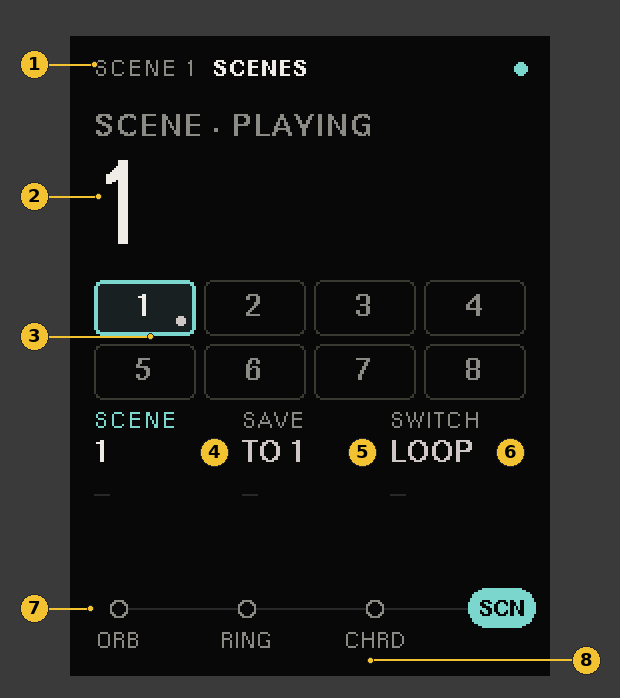

# ORBIT, the ring sequencer

ORBIT plays Chimera by itself while you shape sounds. A chord progression turns round the outside of five rhythm rings. Each ring divides the bar into its own number of steps, so the rings run as polyrhythms, and each plays a Part, fitting its notes to the key, the scale or the chord playing. Eight scenes hold whole setups. This chapter covers every ORBIT page and gesture, the clock and MIDI sync, and how ORBIT is saved. Sync and the SEQUENCER control channel are also in [MIDI](14-midi.md); the SETTINGS › ORBIT list is in [SETTINGS](13-settings.md).

## ORBIT: getting in and out

| Keys | Does |
|---|---|
| **hold SEQ** (from anywhere) | Enter ORBIT |
| **MENU** | Leave ORBIT, back where you were |
| **B6** | Play / stop |
| **B1–B5** | Open ring 1–5 on the RING page (on RING, the sub-page you are on stays) |
| **hold B1–B5** | Go to the pages of the Part that ring plays |
| **MIX + B1–B5** | Mute / unmute that ring |
| **MINUS / PLUS** | Previous / next page along ORBIT's chain |
| **SEQ / EDIT** | Up / down a sub-page, as on every chain |
| **EDIT** on SCN | Save the playing scene to SAVE's slot (see [SCN](#orbit-the-scn-page-scenes)) |
| **MIX + SEQ** | Learn a MIDI control for the touched ring amount (see [ORBIT under MIDI control](#orbit-under-midi-control)) |

ORBIT keeps playing when you leave it: go to a Part, shape its Sound, and hold SEQ to come back.

A second dot left of the sounding dot, top right, pulses ORBIT's beat while it runs, on every page of the instrument.

**Why:** B1 to B5 are the five rings and B6 the transport, so ORBIT needs no new buttons; holding a ring's button is the quickest way to the Part it plays. MIX + PLUS and MIX + MINUS are left free in ORBIT, as on the Part pages.

## ORBIT: the chain

ORBIT has its own chain: **ORB · RING · CHRD · SCN**.

| Map | Full name | Sub-pages | What it holds |
|---|---|---|---|
| **ORB** | ORBIT | CUSTOM | The overview: every ring at once; RING, KEY, SCALE, BARS, SCENE, BPM |
| **RING** | RING | RHYTHM, VOICE, NOTES | The selected ring: its rhythm, how its hits sound, its notes and its Part |
| **CHRD** | CHORDS | | The progression: SEGS, DEGREE, PLAY |
| **SCN** | SCENES | | The eight scenes: SCENE, SAVE, SWITCH |

The RING node's own page is RHYTHM; VOICE and NOTES sit under it. The header names the ring or the scene: `RING 3  RHYTHM`, `SCENE 1  CHORDS`.

## ORBIT: the ORB page

1. **Header:** the playing scene and the page, ORBIT. Top right, ORBIT's beat dot (while it runs) and the sounding dot.
2. **The frame line:** key, scale, loop length in bars, and the tempo with its source: `INT` is ORBIT's own clock, `MIDI` a MIDI clock it follows.
3. **The chord progression**, round the outside; the playing segment lit, with the sweep showing where the bar is while it runs.
4. **The rings:** each ring's steps round its own circle, a hit filled, an accent ringed, the step playing lit; each ring's Part number at its first step. A muted ring goes dark.
5. **RING:** the selected ring and its Part (`3 › P3`).
6. **KEY.**
7. **SCALE.**
8. **BARS.**
9. **SCENE.**
10. **BPM.**
11. **The chain map:** ORB · RING · CHRD · SCN, ORB lit.
12. **ORB's sub-pages:** ORB and CUSTOM.

Ring 1 is the outermost circle, ring 5 the innermost. ORB gives the whole band to its picture, so it has no focus band.

| Cell | Range | Default | What it does |
|---|---|---|---|
| **RING** | 1 to 5 | 1 | The selected ring, shown with its Part (`3 › P3`). The RING pages edit this ring |
| **KEY** | C, C#, D, D#, E, F, F#, G, G#, A, A#, B | C | The key's tonic |
| **SCALE** | MAJOR, MINOR, DORIAN, PHRYGIAN, LYDIAN, MIXOLYD, LOCRIAN, HARM MIN, PENT MAJ, PENT MIN, CUSTOM | MAJOR | The scale. CUSTOM is your own set of notes ([CUSTOM](#orbit-the-custom-page)) |
| **BARS** | 1 to 8 | 1 | The loop's length in bars: the progression spans it, scenes switch at its end, MUTATE draws at its end |
| **SCENE** | 1 to 8 | 1 | The scene playing; a turn queues another, which switches at the loop's end. The same cell as SCN's SCENE |
| **BPM** | 30 to 300 | 120 | ORBIT's tempo. While a MIDI clock leads, BPM dims and the header shows the clock's tempo |

MAJOR, MINOR, DORIAN, PHRYGIAN, LYDIAN, MIXOLYD (Mixolydian), LOCRIAN, HARM MIN (harmonic minor), PENT MAJ and PENT MIN (the pentatonics) are the named scales.

A new project's scene 1 is a short groove in A minor: four bars, i–VI–VII–i, a bar each. Ring 1 plays the roots on Part 1, ring 2 an arpeggio on Part 2, rings 3 and 4 a held pad on Part 3, and ring 5 (Part 5) is muted, ready to bring in.

**Why:** ORB holds what a player changes while the rings run (the key, the scale, the loop's length, the scene and the tempo), on the page where they are watching it all.

## ORBIT: the CUSTOM page

1. **Header:** the playing scene and the page, CUSTOM.
2. **The circle of the twelve notes**, the tonic at the top.
3. **A note out of the scale:** an outline.
4. **A note in the scale:** filled.
5. **The centre:** the scale's name and how many notes it holds.
6. **NOTE:** the cursor, ringed on the circle.
7. **IN SCALE:** ON or OFF for the cursor's note; `ROOT` on the tonic, which always stays in.
8. **The chain map**, ORB lit.
9. **ORB's sub-pages**, CUSTOM lit.

CUSTOM (under ORB: **EDIT** from ORB opens it, and EDIT again comes back) shows the scale's notes round a circle of the twelve, the tonic at the top. A note in the scale is filled, one out of it is an outline, and the cursor ringed. The centre names the scale and how many notes it holds.

| Cell | Range | What it does |
|---|---|---|
| **NOTE** | the twelve notes | Moves the cursor round the circle (it wraps) |
| **IN SCALE** | OFF, ON (ROOT on the tonic) | Turn right to put the cursor's note in the scale, left to take it out |

Changing a note of a named scale makes it CUSTOM, starting from that scale's notes. The tonic always stays in. Turning SCALE to CUSTOM on ORB opens this page too.

Tip: with every one of the twelve notes IN SCALE, nothing a ring plays is moved, which is how a ring reaches every pad of a DRUM kit (see [rings and DRUM kits](#orbit-rings-and-drum-kits)).

## ORBIT: how a ring makes a rhythm

Each ring divides one bar (four beats) into **STEPS** equal steps and spreads **HITS** of them as evenly as it can: 4 hits in 16 steps is four on the floor; 3 in 8 is the tresillo; 5 in 16, 7 in 12 and so on give the rhythms found in music round the world. **ROTATE** turns the pattern round the ring.

Because each ring has its own STEPS, rings run in different subdivisions of the same bar: a ring of 16 plays sixteenths, a ring of 12 triplet eighths, a ring of 5 quintuplets. They meet again on every bar's downbeat.

Each hit then:

1. draws **CHANCE**: whether it sounds this time;
2. takes its note: the next note of the ring's pool (POOL) or the step's own note (STEP);
3. snaps the note to the key's scale or to the chord playing (**SNAP**);
4. plays it on the ring's Part, for **GATE** of a step, at **VEL** (more on an accent).

A hit that does not sound (CHANCE, or MUTE) still moves the walk on, so the ring stays in phase when it comes back.

At the end of each loop, **MUTATE** may change the ring a little: one hit nudged a step earlier or later, or one note swapped for another note of the key in the ring's register.

> **Design note:** The even spread is the Euclidean rhythm: k hits as evenly as possible over n steps, worked out with Bjorklund's algorithm, the way Godfried Toussaint showed that the same spread generates traditional rhythms from Cuba to Bulgaria. MUTATE is in the spirit of the Turing Machine Eurorack module: a loop that drifts a little each time round, locked when MUTATE is 0. Five rings at five step counts make polyrhythms the easy way. The hard way is still available: practise.

## ORBIT: the RHYTHM page

1. **Header:** the ring and the page, `RING 3  RHYTHM`.
2. **The focused cell, large:** STEPS.
3. **The ring's steps** along a line, a tick under step 1.
4. **STEPS.**
5. **HITS.**
6. **ROTATE.**
7. **CHANCE.**
8. **MUTATE.**
9. **MUTE.**
10. **The chain map**, RING lit.
11. **RING's sub-pages:** RHYTHM, VOICE, NOTES.

RHYTHM is the RING node's page. The band shows the ring's steps along a line: a hit filled (as far as CHANCE lets it sound), an accent ringed, the step under the clock lit, a tick at step 1 so ROTATE reads. A muted ring is drawn dark. HITS shows as hits over steps (`1/1`).

| Cell | Range | Default | What it does |
|---|---|---|---|
| **STEPS** | 1 to 32 | 16 | The steps in a bar |
| **HITS** | 0 to 32 (up to STEPS) | 4 | How many steps are hits, spread evenly |
| **ROTATE** | 0 to 31 (up to STEPS − 1) | 0 | Turns the pattern by this many steps |
| **CHANCE** | 0% to 100% | 100% | Each hit's chance of sounding |
| **MUTATE** | 0% to 100% | 0% | The chance, at each loop's end, that the ring changes a little. 0% locks it |
| **MUTE** | OFF, ON | OFF | Silences the ring; it keeps running. Same as MIX + B*n* |

A new STEPS, HITS or ROTATE lays the hits out afresh, dropping MUTATE's nudges.

## ORBIT: the VOICE page

1. **Header:** `RING 3  VOICE`.
2. **The focused cell, large:** GATE, 100 %.
3. **Its arc.**
4. **Hint line:** `MIX + SEQ LEARNS A CC`; under it the ring's register (`C4 TO B4`).
5. **The hits as bars:** as long as GATE, as tall as their velocity.
6. **GATE.**
7. **VEL.**
8. **ACCENT.**
9. **OCTAVE.**
10. **RANGE.**
11. **SNAP.**
12. **The chain map**, RING lit.
13. **RING's sub-pages**, VOICE lit.

VOICE (under RING) sets how the ring's hits sound. The band draws each hit as a bar as long as GATE and as tall as its velocity; an accented hit is taller and in the second ink colour; a rest is a dot. The line above reads the ring's register and the accent's boost: `C4 TO B4 · ACCENT +30 VEL`.

| Cell | Range | Default | What it does |
|---|---|---|---|
| **GATE** | 0% to 100% | 50% | Each note's length, as a share of one step |
| **VEL** | 1 to 127 | 100 | The notes' velocity |
| **ACCENT** | 0 to 32 | 0 | How many of the hits are accented, spread evenly over them. An accent plays 30 velocity higher (at most 127) |
| **OCTAVE** | 0 to 8 | 4 | The ring's register: OCTAVE 4 starts at C4 (middle C) |
| **RANGE** | 0, 1, 2, 3 | 0 | Extra octaves above OCTAVE: the pool walks up through them, and MUTATE and CLEAR draw notes from them |
| **SNAP** | SCALE, CHORD | SCALE | What every note is fitted to: the key's scale, or the tones of the chord playing |

A note is never played out of key: SCALE snaps it to the nearest note of the scale, CHORD to the nearest tone of the chord in its segment. A bass ring on CHORD plays the progression's roots and fifths; a melody ring on SCALE moves freely over the chords.

## ORBIT: the NOTES page

1. **Header:** `RING 3  NOTES`.
2. **The focused cell, large:** MODE, POOL. Under it the line `POOL 1 · HITS 1 · COMES ROUND IN 1`.
3. **The chips:** the ring's notes (here a pool of one, E4).
4. **MODE:** POOL or STEP.
5. **WALK.**
6. **TARGET:** the Part the ring plays.
7. **LEARN.**
8. **CLEAR:** `C4 / RND`, with MIX held.
9. **NOTE:** the selected chip's pitch.
10. **The chain map**, RING lit.
11. **RING's sub-pages**, NOTES lit.

NOTES (under VOICE) holds the ring's notes and the Part it plays. The band shows the notes as chips; the chip NOTE edits is outlined. The line above them reads, on a POOL ring, `POOL 8 · HITS 1 · COMES ROUND IN 8`: the pool's size, the hits, and how many hits until the walk and the rhythm line up again (`-` on RANDOM, which never comes round). On a STEP ring it reads `STEPS 8 · HITS 3`.

| Cell | Range | Default | What it does |
|---|---|---|---|
| **MODE** | STEP, POOL | POOL | POOL: a pool of 1 to 8 notes, walked one note a hit. STEP: one note for each step, as on a step sequencer |
| **WALK** | UP, DOWN, RANDOM, PING-PG | UP | How a POOL ring walks its pool: up, down, at random, or up and back down (PING-PG, ping-pong) |
| **TARGET** | 1 to 6 | the ring's number | The Part the ring plays |
| **LEARN** | OFF, ON | OFF | Turn up to capture notes from your keyboard into the ring; turn down to cancel |
| **CLEAR** | `C4 / RND` | | With MIX held only: up resets, down rolls random notes |
| **NOTE** | C-1 to G9 | | The selected chip's note, a semitone a detent |

The pool is kept in pitch order; after a NOTE edit the selection follows the note to its new place. The walk goes up through the pool, then repeats it RANGE more octaves up.

On a STEP ring the chips are the ring's steps: a hit's chip filled, a rest's outlined, the step under the clock lit. They show eight at a time; a longer ring scrolls, with a line under them showing where you are.

### ORBIT: NOTES gestures

| Keys | Does |
|---|---|
| Turn **NOTE** | The selected chip's pitch, a semitone a detent |
| **MIX + NOTE** | Pick the chip: a pool note (POOL) or a step (STEP). The hint reads `MIX + NOTE ◂▸ PICK` or `◂▸ STEP` |
| **MIX + CLEAR** up | Reset: one note at OCTAVE's C (on a STEP ring, every step) |
| **MIX + CLEAR** down | Roll a full pool of 8 random notes of the key in the ring's register (on a STEP ring, every step). Each turn rolls new ones |
| Plain turn on **CLEAR** | Nothing |
| **LEARN** up, then play | Capture (below) |

**Why CLEAR needs MIX:** both ways lose notes you set by hand, there is no undo, and CLEAR sits right beside NOTE, the cell you turn most on this page. A slip on the way to NOTE does nothing.

### ORBIT: capturing notes with LEARN

Turn **LEARN** up (it reads ON) and play:

- **A POOL ring** takes the notes you hold, up to 8, each once, in the order played. The capture ends when you let go of the last key.
- **A STEP ring** takes one note per key-down, repeats included, across key-ups, one for each hit (at most 8): play a melody a note at a time. Hits past the eighth cycle the notes. Each rest takes the note of the hit before it.

Either way, OCTAVE moves to the octave of the lowest note you played, and LEARN turns itself OFF. A key already held when you armed is not taken. The capture goes into the scene that was playing when it ended.

## ORBIT: rings and Parts

Each ring plays one Part, set by **TARGET** on NOTES. A new project points ring *n* at Part *n*. Several rings may play the same Part (the new project's pad uses rings 3 and 4 on Part 3).

A ring sends notes into its Part as your keyboard would, so the Part's Sound decides everything else: its envelopes, its voices, its glide. ORBIT never turns its notes off for you: STOP ends only ORBIT's own notes, and a ring's note-off never releases a key you are holding or another ring's note.

### ORBIT: rings and DRUM kits

A ring can play a DRUM Part. Each note picks a pad by its note name, as on a keyboard ([the KIT keymap](07-drum.md#drum-the-kit-keymap-and-tonal)): with the kit's TONAL OFF, C plays pad 01, C# pad 02 and so on up to B, pad 12.

The notes are still snapped to the scale or chord first, so in C major only the pads on C, D, E, F, G, A and B are reached. To reach any pad, use a **CUSTOM** scale holding all twelve notes, set SNAP to SCALE, and set the ring's notes with **NOTE** on a STEP ring: each step then plays exactly the pad you set. With a kit on TONAL, notes from C1 up play the TONAL pad as a melody, so a ring makes a tuned drum line.

## ORBIT: the CHRD page

1. **Header:** the playing scene and the page, `SCENE 1  CHORDS`.
2. **The focused cell, large:** SEGS, 4.
3. **Its arc.**
4. **The segments:** a chip each, the degree's numeral over its chord (`i` over `Am`); the selected one outlined. Under them, the loop's bars.
5. **SEGS.**
6. **DEGREE:** here `i Am`.
7. **PLAY:** `-`, no chord played in.
8. **The chain map**, CHRD lit.
9. CHRD has no sub-pages.

CHRD (CHORDS on the row) is the progression that turns round ORB's outside. The loop (BARS long) is cut into **SEGS** equal segments, each holding one chord. The band shows a chip a segment: the degree's numeral over its chord, the segment playing lit, the one DEGREE edits outlined, a played chord dotted. Under them, the loop's bars and where the clock is.

| Cell | Range | Default | What it does |
|---|---|---|---|
| **SEGS** | 1 to 8 | 1 | How many chord segments the loop holds |
| **DEGREE** | the scale's degrees (I, II... VII) | I | The selected segment's chord: the scale's triad on that degree. The cell names it (`VI F`) |
| **PLAY** | `-`, `HOLD`, or a chord's name | `-` | A chord you played into the segment, which wins over its degree |

| Keys | Does |
|---|---|
| Turn **DEGREE** | The selected segment's degree |
| **MIX + DEGREE** | Pick the segment. The hint reads `MIX + DEGREE ◂▸ SEGMENT` |
| **PLAY** up | Arm: PLAY reads `HOLD`. Play a chord (at least two different notes) and let go: it becomes the segment's chord, named on its chip (`Bm7b5`) |
| **PLAY** down | Disarm, keeping any played chord |
| **MIX + PLAY** down | Drop the played chord: the degree plays again. The hint reads `MIX + PLAY ▾ DROPS THE CHORD` |

A played chord is kept with its lowest note as the bass. A capture of fewer than two different notes is ignored and PLAY stays armed. DEGREE always names the degree's own triad, which plays once PLAY is cleared.

The chord playing is what SNAP CHORD rings fit to, and its segment lights on ORB's outer ring.

**Why a plain PLAY down only disarms:** encoder detents arrive over several frames, so a quick two-detent flick to cancel a re-capture would otherwise disarm on one frame and drop the chord on the next.

## ORBIT: the SCN page (scenes)

1. **Header:** the playing scene and the page, `SCENE 1  SCENES`.
2. **The focused cell, large:** SCENE, here `SCENE · PLAYING` 1; a queued one reads `SCENE · ON THE LOOP`.
3. **The eight slots:** a saved scene filled, an empty one an outline, the playing one ringed, SAVE's slot dotted.
4. **SCENE.**
5. **SAVE:** `TO 1`.
6. **SWITCH:** LOOP.
7. **The chain map**, SCN lit.
8. SCN has no sub-pages.

SCN (SCENES on the row) holds eight scenes. A scene is a whole setup: the five rings, the progression, the key and scale, BARS. The band shows the eight slots, two rows of four: a saved scene filled, an empty one an outline, the playing one ringed, a queued one filling up as the loop runs out, and SAVE's slot dotted.

| Cell | Range | What it does |
|---|---|---|
| **SCENE** | 1 to 8 | The scene playing. Turn to queue another: it switches at the end of the loop (`SCENE · ON THE LOOP`). Turn back to the playing scene to cancel. The same cell as ORB's SCENE |
| **SAVE** | 1 to 8 (`TO 3`) | Where **EDIT** saves the playing scene. Starts on the playing scene's slot |
| **SWITCH** | LOOP | When a switch lands: at the loop's end. Read-only |

**EDIT** on SCN saves the playing scene to SAVE's slot: at once over its own slot or an empty one; over another saved scene it asks first, `SAVE OVER SCENE n?` with SAVE OVER and CANCEL. While a switch is queued, a save is refused with `SWITCH PENDING`: what lands stays what you queued.

With ORBIT stopped, a scene switch lands at once.

### ORBIT: edits, drift and saving a scene

- **Your edits stay with their scene.** Every turn you make goes into the playing scene. Switch to another scene and back, and your edits are still there.
- **MUTATE's drift does not.** What MUTATE changed is heard while the scene plays; when the scene is switched away and back, it restarts from your edits.
- **SAVE keeps the drift.** EDIT on SCN, or SETTINGS › ORBIT › SAVE TO PROJ, writes the scene as it plays now, drift included, over a slot. That is the deliberate way to keep a variation you like.
- **RELOAD FROM PROJ** (SETTINGS › ORBIT) restarts the playing scene from its slot at the loop's end: its drift is dropped, its edits stay. The prompt says `RELOAD SCENE n?` / `ITS DRIFT RESTARTS, ITS EDITS STAY`. It is dimmed when there is no drift.
- **CLEAR** (SETTINGS › ORBIT) empties the playing scene's slot, landing at the loop's end.

**Why:** this follows hardware sequencers such as Elektron's and the Cirklon: edits to a pattern persist in the working project until you reload it, while machine-made variation (probability, conditions) is playback only and never rewrites what you made. Writing a variation in is something you choose to do.

## ORBIT: the clock and transport

**B6** starts and stops ORBIT. A start plays from bar 1, the loop's start. Stop ends every note ORBIT is holding, and only those.

SETTINGS › MIDI CONFIG › **SYNC** decides who leads:

| SYNC | What happens |
|---|---|
| **EXT** (default) | A DAW or MIDI clock drives ORBIT. MIDI Start plays from bar 1 (no B6 needed); Stop stops; Continue plays on from where ORBIT is. ORBIT follows the incoming clock's tempo; the header shows it with `MIDI`. If the clock stops arriving for half a second, ORBIT's own clock takes over from that point, at BPM |
| **INT** | ORBIT always runs on its own clock at BPM. Incoming Clock, Start, Continue and Stop are ignored; notes still play |

- A clock alone never starts ORBIT; only B6 or a Start does.
- B6 and the DAW share one transport: the last word wins. B6 with a stopped DAW plays ORBIT on its own clock from bar 1.
- Changing SYNC never jumps or stops ORBIT: it carries on from where it is under the new leader.
- SYNC is a unit setting, kept in SYSTEM, not in the project: it says how the unit is wired into your studio, so a project taken to another setup does not bring a SYNC that fights it.

Notes land within a fraction of a millisecond of their step under either clock.

**Why EXT is the default:** a DAW works out of the box, and with no clock arriving ORBIT still runs free on B6, so EXT costs a player with no DAW nothing. INT is for a rig whose clock is meant for something else.

See [MIDI](14-midi.md) for the clock and the SEQUENCER control channel.

## ORBIT: under MIDI control

- **Learn:** on any ORBIT page, touch a ring amount and press **MIX + SEQ** to learn a MIDI control for it, as on a Part's page. The ring amounts that learn are HITS, ROTATE, CHANCE, MUTATE, GATE, VEL, ACCENT and OCTAVE. STEPS, MUTE, a ring's choices (RANGE, SNAP, MODE, WALK, TARGET), the progression and BPM stay on the panel. The binding lives in the Part you are on and listens on its channel; the MIDI MAP names it with its ring, `RING 1 CHANCE`. A fader on HITS or ROTATE covers the ring as it is (0 to STEPS) over its whole travel. A controller move changes the playing scene as a turn would.
- **SEQUENCER channel:** SETTINGS › MIDI CONFIG › CONTROL CHANNELS › SEQ gives ORBIT a channel of its own, with CCs for PLAY/STOP, each ring's ON/OFF, CHANCE and STEPS, KEY and SCALE; a note on that channel sets KEY to its note name.

Both are described in full in [MIDI](14-midi.md).

## ORBIT: saved with the project

ORBIT is part of the project: the eight scenes, the scene playing, and BPM. Saving the project (hold **MENU**, or SETTINGS › PROJECT) writes it after the six Parts; loading a project brings it back, stopped, on its playing scene. A switch still queued when you save is saved as if it had landed.

Saving a scene on SCN keeps it in the project in memory; only a project save writes it to the card.

A damaged ORBIT part of a project file never costs you the Parts: the Parts load, and ORBIT takes what it can read.

## ORBIT: what it costs

While ORBIT plays, the instrument keeps a little processing time aside for it, so the rings are never late; the Parts have a little less to share. See [Limits](20-limits.md).

## ORBIT: starting points

- **Hear it now:** start a new project, hold **SEQ**, press **B6**. Press **B5**, then **MIX + B5** to bring in ring 5.
- **A polyrhythm:** ring 1 on 16 STEPS, 4 HITS (four on the floor); ring 2 on 12 STEPS, 5 HITS; ring 3 on 7 STEPS, 3 HITS. Turn ROTATE on each until it grooves.
- **A living arpeggio:** a POOL ring with WALK PING-PG, RANGE 1, SNAP CHORD, a few notes LEARNed from a chord; MUTATE at 20%.
- **A bass that follows the chords:** a POOL ring with one note at OCTAVE 2, SNAP CHORD: it plays each chord's nearest tone.
- **Sparser hats:** a ring on a hat Part, 16 STEPS, 16 HITS, CHANCE 60%, ACCENT 4.
- **A drum pattern:** ring 1 on a DRUM Part, MODE STEP, SCALE CUSTOM with all twelve notes; set each step's NOTE to the pad you want (C for pad 01, D for pad 03...).
