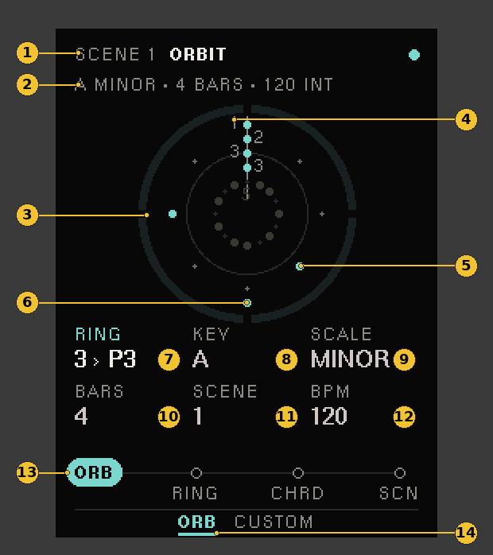
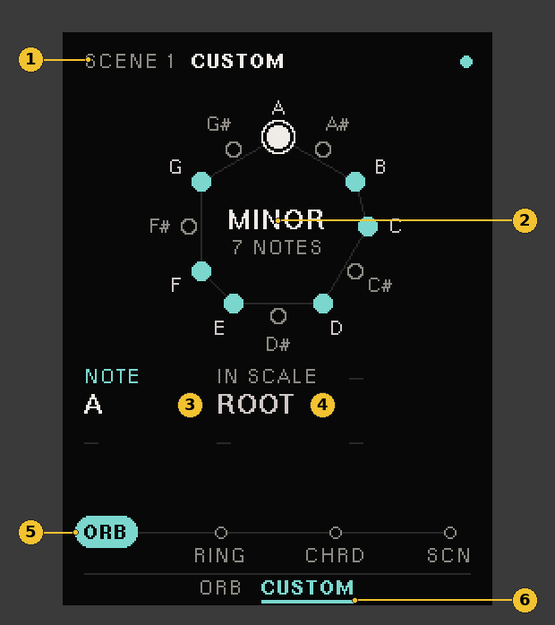
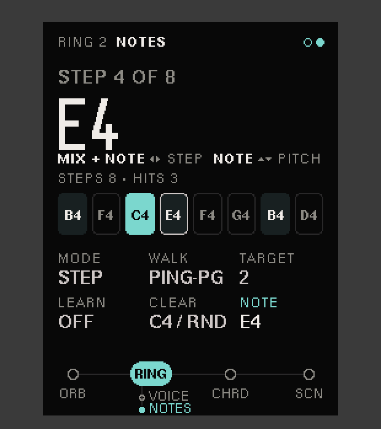
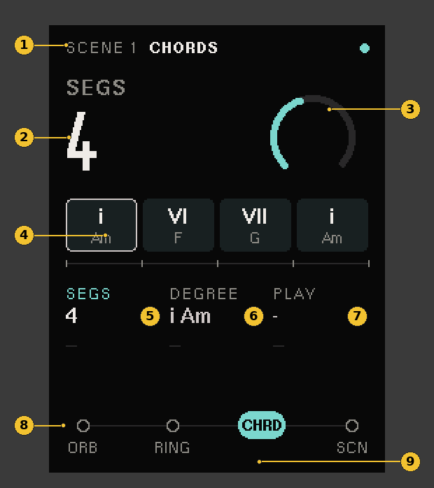
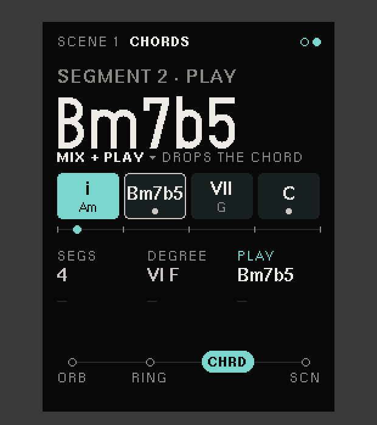

# ORBIT, the ring sequencer

ORBIT plays Chimera by itself while you shape sounds. A chord progression turns round five rhythm rings; each ring divides the bar into its own number of steps, plays a Part, and fits its notes to the key or the chord. Eight scenes hold whole setups. This chapter covers every ORBIT page and gesture, the clock and how ORBIT is saved. Sync and the SEQUENCER control channel are also in [MIDI](14-midi.md); SETTINGS › ORBIT is in [SETTINGS](13-settings.md).

## ORBIT: getting in and out

| Keys | Does |
|---|---|
| **hold SEQ** | Enter ORBIT, from anywhere |
| **MENU** | Leave ORBIT, back where you were; it keeps playing |
| **B6** | Play / stop |
| **B1–B5** | Open ring 1–5 on the RING page (the sub-page stays) |
| **hold B1–B5** | Go to the Part that ring plays |
| **MIX + B1–B5** | Mute / unmute that ring |
| **MINUS / PLUS** | Along ORBIT's chain |
| **SEQ / EDIT** | Up / down a sub-page |
| **EDIT** on SCN | Save the playing scene ([SCN](#orbit-the-scn-page-scenes)) |
| **MIX + SEQ** | Learn a MIDI control for the touched ring amount |

While ORBIT runs, a second dot left of the sounding dot (top right) pulses its beat on every page.

**Why:** B1 to B5 are the rings and B6 the transport, so ORBIT needs no new buttons.

## ORBIT: the chain

**ORB · RING · CHRD · SCN**

| Map | Full name | Sub-pages | Holds |
|---|---|---|---|
| **ORB** | ORBIT | CUSTOM | The overview; RING, KEY, SCALE, BARS, SCENE, BPM |
| **RING** | RING | RHYTHM, VOICE, NOTES | The selected ring |
| **CHRD** | CHORDS | | The progression: SEGS, DEGREE, PLAY |
| **SCN** | SCENES | | The eight scenes: SCENE, SAVE, SWITCH |

The header names the ring or scene: `RING 3  RHYTHM`, `SCENE 1  CHORDS`.

## ORBIT: the ORB page

1. Header: the playing scene, ORBIT, the beat and sounding dots.
2. Frame line: key, scale, bars, tempo with its source (`INT` own clock, `MIDI` followed clock).
3. The chord progression round the outside, the playing segment lit, the sweep showing the bar.
4. The rings, ring 1 outermost: hits filled, accents ringed, the playing step lit, each Part number at step 1; a muted ring dark.
5. **RING** (`3 › P3`).
6. **KEY**.
7. **SCALE**.
8. **BARS**.
9. **SCENE**.
10. **BPM**.
11. Chain map.
12. Sub-pages: ORB, CUSTOM.

| Cell | Range | Default | What it does |
|---|---|---|---|
| **RING** | 1 to 5 | 1 | The ring the RING pages edit |
| **KEY** | C, C#, D, D#, E, F, F#, G, G#, A, A#, B | C | The tonic |
| **SCALE** | MAJOR, MINOR, DORIAN, PHRYGIAN, LYDIAN, MIXOLYD, LOCRIAN, HARM MIN, PENT MAJ, PENT MIN, CUSTOM | MAJOR | The scale; CUSTOM is your own ([CUSTOM](#orbit-the-custom-page)) |
| **BARS** | 1 to 8 | 1 | Loop length: the progression spans it, scenes switch and MUTATE draws at its end |
| **SCENE** | 1 to 8 | 1 | The playing scene; a turn queues another for the loop's end |
| **BPM** | 30 to 300 | 120 | ORBIT's tempo; dims while a MIDI clock leads |

A new project's scene 1 is a four-bar A minor groove, i–VI–VII–i: ring 1 roots on Part 1, ring 2 an arpeggio on Part 2, rings 3 and 4 a pad on Part 3, ring 5 muted on Part 5.

## ORBIT: the CUSTOM page

**EDIT** from ORB opens CUSTOM (so does turning SCALE to CUSTOM); EDIT again returns.

1. Header.
2. The twelve notes round a circle, tonic at the top.
3. A note out of the scale: outline.
4. A note in the scale: filled.
5. Centre: the scale's name and size.
6. **NOTE**: the cursor.
7. **IN SCALE**: `ROOT` on the tonic.
8. Chain map.
9. Sub-pages, CUSTOM lit.

| Cell | Range | What it does |
|---|---|---|
| **NOTE** | the twelve notes | Moves the cursor (wraps) |
| **IN SCALE** | OFF, ON | Right puts the note in, left takes it out; the tonic stays in |

Editing a named scale makes it CUSTOM, starting from its notes. With all twelve IN SCALE, nothing a ring plays is moved: the way to reach every pad of a DRUM kit ([rings and DRUM kits](#orbit-rings-and-drum-kits)).

## ORBIT: how a ring makes a rhythm

Each ring divides one bar into **STEPS** and spreads **HITS** as evenly as it can: 4 in 16 is four on the floor, 3 in 8 the tresillo. **ROTATE** turns the pattern. Rings with different STEPS run different subdivisions (16 sixteenths, 12 triplet eighths, 5 quintuplets) and meet on every downbeat.

Each hit draws **CHANCE**, takes its note (next in the POOL, or the step's own), snaps it (**SNAP**) and plays it on the ring's Part for **GATE** at **VEL**. A silent hit (CHANCE, MUTE) still moves the walk on, so the ring stays in phase. At each loop's end **MUTATE** may nudge one hit a step or swap one note for another in the key.

> **Design note:** the even spread is the Euclidean rhythm, worked out with Bjorklund's algorithm; Godfried Toussaint showed the same spread generates traditional rhythms from Cuba to Bulgaria. MUTATE is in the spirit of the Turing Machine module: a loop that drifts, locked at 0. Five rings make polyrhythms the easy way. The hard way is still available: practise.

## ORBIT: the RHYTHM page

RHYTHM is the RING node's own page.

1. Header: `RING 3  RHYTHM`.
2. Focused cell: STEPS.
3. The ring's steps on a line, a tick under step 1.
4. **STEPS**.
5. **HITS**.
6. **ROTATE**.
7. **CHANCE**.
8. **MUTATE**.
9. **MUTE**.
10. Chain map.
11. Sub-pages: RHYTHM, VOICE, NOTES.

| Cell | Range | Default | What it does |
|---|---|---|---|
| **STEPS** | 1 to 32 | 16 | Steps in a bar |
| **HITS** | 0 to STEPS | 4 | Hits, spread evenly (`1/1` reads hits over steps) |
| **ROTATE** | 0 to STEPS − 1 | 0 | Turns the pattern |
| **CHANCE** | 0 to 100 % | 100 % | Each hit's chance to sound |
| **MUTATE** | 0 to 100 % | 0 % | Chance of a small change at each loop's end; 0 locks it |
| **MUTE** | OFF, ON | OFF | Silences the ring; it keeps running. Same as MIX + B*n* |

A new STEPS, HITS or ROTATE lays the hits out afresh, dropping MUTATE's nudges.

## ORBIT: the VOICE page

1. Header: `RING 3  VOICE`.
2. Focused cell: GATE.
3. Its arc.
4. Hint `MIX + SEQ LEARNS A CC`, and the register (`C4 TO B4 · ACCENT +30 VEL`).
5. Hits as bars, GATE long and velocity tall; accents taller in the second ink.
6. **GATE**.
7. **VEL**.
8. **ACCENT**.
9. **OCTAVE**.
10. **RANGE**.
11. **SNAP**.
12. Chain map.
13. Sub-pages.

| Cell | Range | Default | What it does |
|---|---|---|---|
| **GATE** | 0 to 100 % | 50 % | Note length, as a share of a step |
| **VEL** | 1 to 127 | 100 | Velocity |
| **ACCENT** | 0 to 32 | 0 | Hits accented, spread evenly; +30 velocity |
| **OCTAVE** | 0 to 8 | 4 | Register: 4 starts at C4 |
| **RANGE** | 0 to 3 | 0 | Extra octaves the pool walks, and MUTATE and CLEAR draw from |
| **SNAP** | SCALE, CHORD | SCALE | Fits notes to the key's scale or the playing chord |

No note plays out of key. A bass ring on CHORD plays roots and fifths; a melody on SCALE moves freely over the chords.

## ORBIT: the NOTES page

1. Header: `RING 3  NOTES`.
2. Focused cell: MODE, with `POOL 1 · HITS 1 · COMES ROUND IN 1`.
3. The chips: the ring's notes.
4. **MODE**.
5. **WALK**.
6. **TARGET**.
7. **LEARN**.
8. **CLEAR** (`C4 / RND`, with MIX).
9. **NOTE**.
10. Chain map.
11. Sub-pages.

| Cell | Range | Default | What it does |
|---|---|---|---|
| **MODE** | STEP, POOL | POOL | POOL walks 1 to 8 notes a hit at a time; STEP has a note per step |
| **WALK** | UP, DOWN, RANDOM, PING-PG | UP | How a POOL ring walks (PING-PG: up and back) |
| **TARGET** | 1 to 6 | ring's number | The Part the ring plays |
| **LEARN** | OFF, ON | OFF | Capture notes from your keyboard |
| **CLEAR** | `C4 / RND` | | With MIX only: up resets, down rolls random notes |
| **NOTE** | C-1 to G9 | | The selected chip's note |

On a POOL ring the line reads the pool size, the hits, and how many hits until walk and rhythm line up (`-` on RANDOM). The pool stays in pitch order and repeats RANGE octaves up.

On a STEP ring the chips are the steps (hit filled, rest outlined, playing step lit), eight at a time, scrolling; the line reads `STEPS 8 · HITS 3`.

### ORBIT: NOTES gestures

| Keys | Does |
|---|---|
| **MIX + NOTE** | Pick the chip (`MIX + NOTE ◂▸ PICK` or `◂▸ STEP`) |
| **MIX + CLEAR** up | Reset to one note at OCTAVE's C (STEP: every step) |
| **MIX + CLEAR** down | Roll 8 random notes of the key in the register; each turn rolls anew |
| **LEARN** up, then play | Capture |

A plain turn on CLEAR does nothing: both ways lose hand-set notes, with no undo, and CLEAR sits beside NOTE.

### ORBIT: capturing notes with LEARN

Turn **LEARN** ON and play. A POOL ring takes the notes you hold, up to 8, each once, ending when the last key lifts. A STEP ring takes one note per key-down, repeats included, one per hit (up to 8, then cycling); rests take the hit before. OCTAVE moves to the lowest note played and LEARN turns OFF. Keys held before arming are ignored. The capture goes into the scene playing when it ended.

## ORBIT: rings and Parts

A ring plays the Part set by **TARGET** (a new project: ring *n* on Part *n*); several rings may share one. It sends notes as your keyboard would, so the Sound decides envelopes, voices and glide. STOP ends only ORBIT's notes, and a ring's note-off never releases your keys or another ring's note.

### ORBIT: rings and DRUM kits

On a DRUM Part each note picks a pad by note name ([the KIT keymap](07-drum.md#drum-the-kit-keymap-and-tonal)): with TONAL OFF, C is pad 01 up to B, pad 12. Notes are snapped first, so to reach any pad use a **CUSTOM** scale of all twelve notes, SNAP SCALE, and a STEP ring with each step's NOTE set. With TONAL on, notes from C1 play the TONAL pad as a tuned drum line.

## ORBIT: the CHRD page

**CHORDS** (CHRD) is the progression round ORB's outside. The loop is cut into **SEGS** equal segments, one chord each.

1. Header: `SCENE 1  CHORDS`.
2. Focused cell: SEGS.
3. Its arc.
4. A chip per segment, numeral over chord (`i` over `Am`), the selected one outlined; the bars under them.
5. **SEGS**.
6. **DEGREE** (`i Am`).
7. **PLAY** (`-`).
8. Chain map.
9. No sub-pages.

| Cell | Range | Default | What it does |
|---|---|---|---|
| **SEGS** | 1 to 8 | 1 | Chord segments in the loop |
| **DEGREE** | I to VII | I | The segment's triad on that degree (`VI F`) |
| **PLAY** | `-`, `HOLD`, a chord name | `-` | A played chord, which wins over DEGREE |

| Keys | Does |
|---|---|
| **MIX + DEGREE** | Pick the segment (`MIX + DEGREE ◂▸ SEGMENT`) |
| **PLAY** up | Arm (`HOLD`); play two or more notes and let go: it becomes the segment's chord (`Bm7b5`), lowest note as bass |
| **PLAY** down | Disarm, keeping the chord |
| **MIX + PLAY** down | Drop the played chord (`MIX + PLAY ▾ DROPS THE CHORD`) |

The playing chord is what SNAP CHORD fits to.

**Why** plain PLAY down only disarms: detents arrive over several frames, so a quick flick would disarm and then drop.

## ORBIT: the SCN page (scenes)

A scene is the five rings, the progression, key, scale and BARS.

1. Header: `SCENE 1  SCENES`.
2. Focused cell: `SCENE · PLAYING`, or `SCENE · ON THE LOOP` when queued.
3. Eight slots: saved filled, empty outlined, playing ringed, queued filling, SAVE's dotted.
4. **SCENE**.
5. **SAVE** (`TO 1`).
6. **SWITCH**: LOOP.
7. Chain map.
8. No sub-pages.

| Cell | Range | What it does |
|---|---|---|
| **SCENE** | 1 to 8 | Queue a scene for the loop's end; turn back to cancel. Stopped, it switches at once |
| **SAVE** | 1 to 8 | Where **EDIT** saves the playing scene |
| **SWITCH** | LOOP | When a switch lands. Read-only |

**EDIT** saves at once over its own or an empty slot; over another it asks `SAVE OVER SCENE n?`. While a switch is queued it is refused (`SWITCH PENDING`).

### ORBIT: edits, drift and saving a scene

- Your edits stay with their scene, across switches.
- MUTATE's drift does not: switch away and back and it restarts from your edits.
- SAVE (EDIT on SCN, or SETTINGS › ORBIT › SAVE TO PROJ) writes the scene drift and all: the way to keep a variation.
- SETTINGS › ORBIT › **RELOAD FROM PROJ** drops the drift and keeps the edits; **CLEAR** empties the slot. Both land at the loop's end.

**Why:** as on Elektron sequencers and the Cirklon, your edits persist and machine-made variation stays playback until you choose to write it in.

## ORBIT: the clock and transport

**B6** starts from bar 1 and stops; stop ends only ORBIT's notes. SETTINGS › MIDI CONFIG › **SYNC** decides who leads:

| SYNC | What happens |
|---|---|
| **EXT** (default) | A MIDI clock drives ORBIT: Start plays from bar 1, Stop stops, Continue plays on; the header shows `MIDI`. If the clock stops for half a second, ORBIT's own clock takes over at BPM |
| **INT** | ORBIT always runs at BPM; clock and transport messages are ignored |

A clock alone never starts ORBIT. B6 and a DAW share one transport: the last word wins. Changing SYNC never jumps or stops playback. SYNC is a unit setting, not a project one, so a project taken to another studio does not bring a clock that fights it. Notes land within a fraction of a millisecond of their step.

**Why EXT:** a DAW works out of the box, and with no clock ORBIT still runs on B6.

## ORBIT: under MIDI control

- **Learn:** touch a ring amount (HITS, ROTATE, CHANCE, MUTATE, GATE, VEL, ACCENT, OCTAVE) and press **MIX + SEQ**. The binding lives in the current Part's map, on its channel, named `RING 1 CHANCE`. A fader on HITS or ROTATE spans 0 to STEPS.
- **SEQUENCER channel:** SETTINGS › MIDI CONFIG › CONTROL CHANNELS › SEQ gives ORBIT CCs for PLAY/STOP, each ring's ON/OFF, CHANCE and STEPS, KEY and SCALE; a note sets KEY.

Both are in [MIDI](14-midi.md).

## ORBIT: saved with the project

The eight scenes, the playing scene and BPM are part of the project: a project save (hold **MENU**, or SETTINGS › PROJECT) writes them; a load brings ORBIT back stopped. A queued switch is saved as landed. Saving on SCN keeps a scene in memory only until the project is saved. A damaged ORBIT section never costs you the Parts.

While ORBIT plays it keeps a little processing time aside so it is never late ([Limits](20-limits.md)).

## ORBIT: starting points

- **Hear it now:** new project, hold **SEQ**, **B6**; then **MIX + B5** brings in ring 5.
- **Polyrhythm:** rings on 16/4, 12/5 and 7/3 STEPS/HITS; turn ROTATE until it grooves.
- **Living arpeggio:** POOL, WALK PING-PG, RANGE 1, SNAP CHORD, notes LEARNed from a chord, MUTATE 20 %.
- **Bass on the chords:** one POOL note at OCTAVE 2, SNAP CHORD.
- **Sparser hats:** 16 STEPS, 16 HITS, CHANCE 60 %, ACCENT 4.
- **Drum pattern:** a DRUM Part, MODE STEP, SCALE CUSTOM with all twelve notes, each step's NOTE set to its pad.
