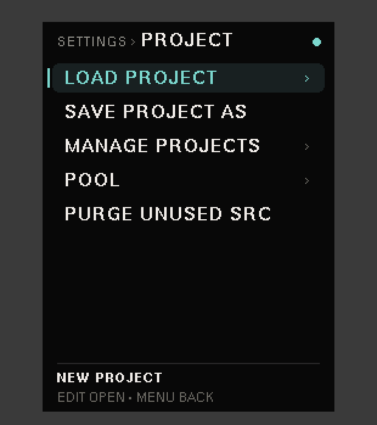
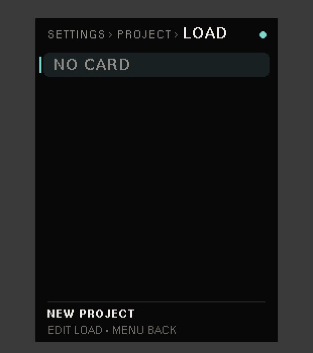
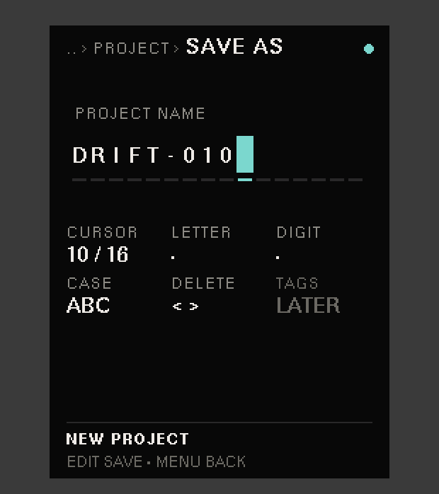
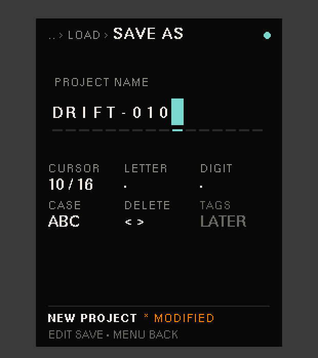
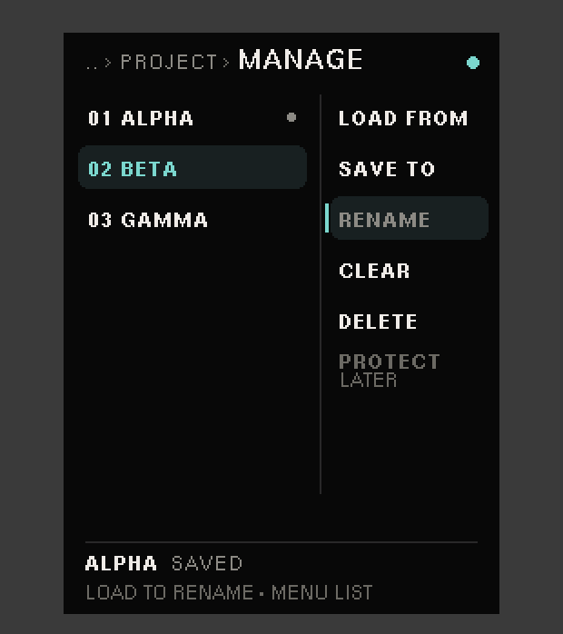
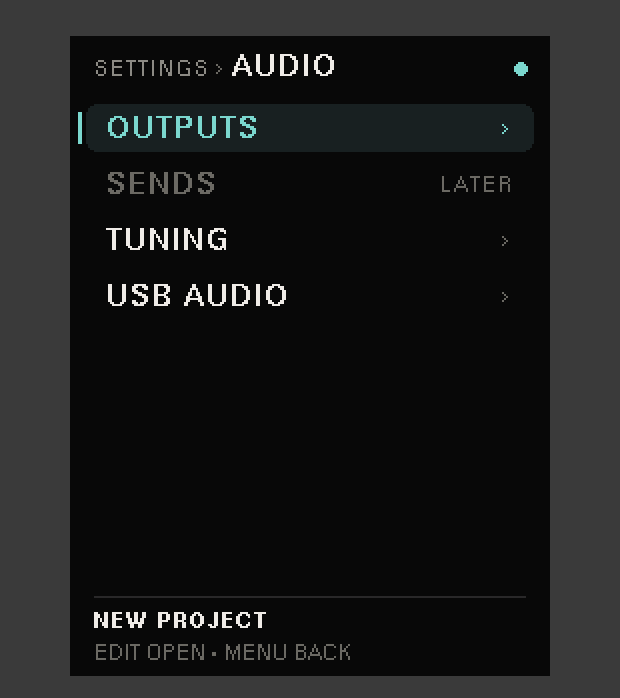
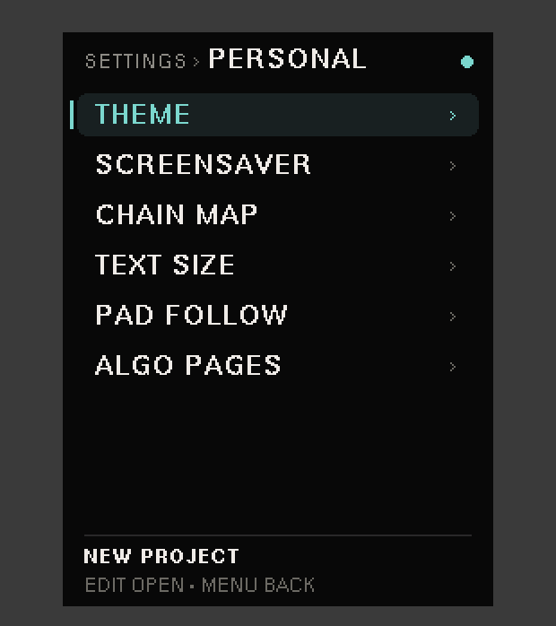
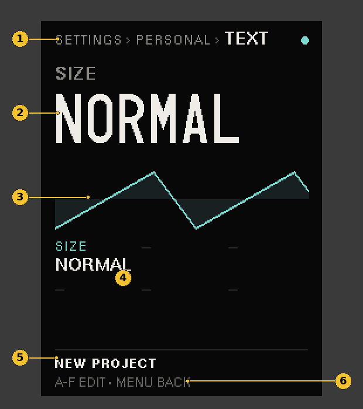
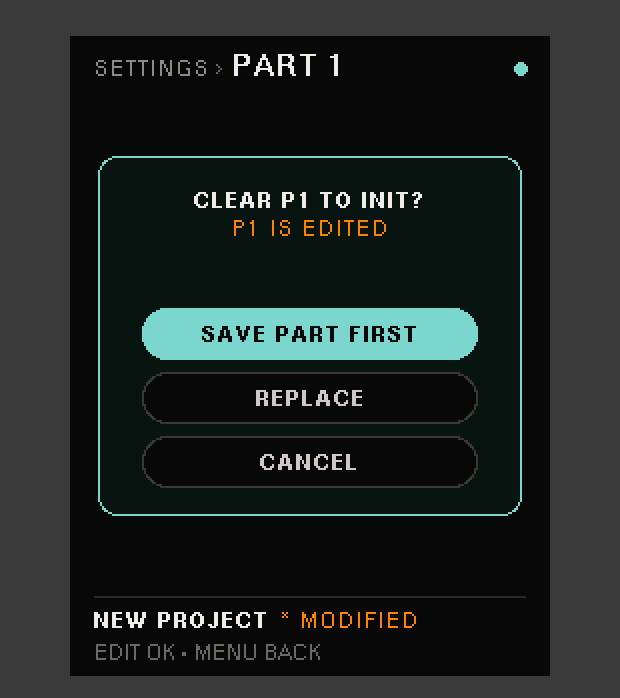
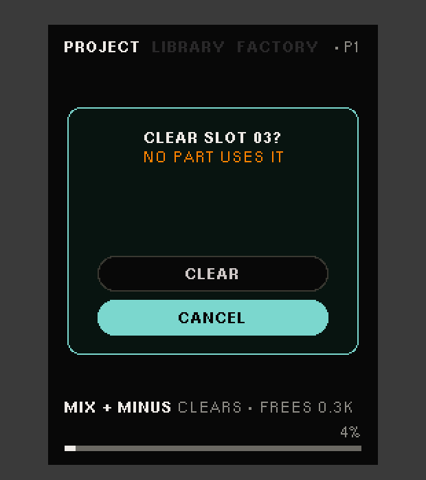

# SETTINGS

This chapter covers the SETTINGS menu: moving in it, every list and page, and every question it asks before it changes a file. MIDI's pages are in [MIDI](14-midi.md), tuning in [tuning](15-tuning.md), the card and its files in [the SD card, Sounds and the library](16-card-sounds-library.md), ORBIT's scenes in [ORBIT](12-orbit.md).

## SETTINGS: opening and moving

| Keys | Does |
|---|---|
| **MENU** | Opens SETTINGS from anywhere; inside, steps back one level, and at the top closes it |
| **hold MENU** | Quick-saves the project, from anywhere ([quick save](#settings-quick-save-with-a-menu-hold)) |
| **MINUS / PLUS**, any encoder | Move the bar |
| **EDIT** | Opens the row (list, page, screen) or runs it (action) |
| **SEQ** | Back |
| **B1–B6** | Leave SETTINGS for that Part's pages, from any depth |

SETTINGS has its own look: whole-width lists with a highlight bar, a growing breadcrumb, a footer with the project and the keys, no chain map. Leaf pages use the six-cell grid inside that frame.

1. Breadcrumb (`SETTINGS › PROJECT`).
2. The bar.
3. A chevron: the row opens a list or page.
4. `LATER`: not built yet; dimmed and skipped.
5. The project's name and state: `SAVED`, `* MODIFIED` (warning colour; any turn or RANDOMIZE roll counts), or the name alone for an unsaved `NEW PROJECT`.
6. The keys: `EDIT OPEN · MENU CLOSE`, `EDIT RUN · MENU BACK`, `A-F EDIT · MENU BACK`, `EDIT OK · MENU BACK`.

**Why:** each row opens one page and nothing more: no SETTINGS page has sub-pages, so nothing hides behind EDIT or PLUS. Planned rows stay as `LATER` so the list never reshuffles.

## SETTINGS: the top list

| Row | Breadcrumb | What it holds |
|---|---|---|
| **PROJECT** | PROJECT | Load, save, manage and clean up projects |
| **PART** | `PART 1` | The active Part's Sound |
| **ORBIT** | `SCENE 3` | The playing scene |
| **MIDI CONFIG** | MIDI | See [MIDI](14-midi.md) |
| **SYSEX DUMP** | | `LATER` |
| **AUDIO ROUTING** | AUDIO | Output pairs, tuning, USB audio |
| **PERSONALIZE** | PERSONAL | Screen and page behaviour |
| **SYSTEM** | SYSTEM | Update entry, diagnostics, push encoders, ABOUT |

## SETTINGS: quick save with a MENU hold

Hold **MENU** to save the project over its own file at once. A never-saved project asks for a name first; a different card in the slot asks `CARD CHANGED` before writing anything.

**Why:** saving mid-performance should never take a trip through menus.

## SETTINGS: PROJECT

| Row | What it does |
|---|---|
| **LOAD PROJECT** | Lists the card's projects; EDIT loads one. **+ CREATE NEW** starts a fresh one |
| **SAVE PROJECT AS** | Saves a copy under a new name (proposed, e.g. `DRIFT-002`) |
| **MANAGE PROJECTS** | Projects on the left, commands on the right |
| **POOL** | How the project's Sound memory is used (read-only) |
| **PURGE UNUSED SRC** | Frees memory held by TAPE sources no Part uses; the card keeps the files (`NO UNUSED SOURCES` when none) |

Projects live in `/CHIMERA/PROJECTS/` ([the SD card, Sounds and the library](16-card-sounds-library.md)). In LOAD PROJECT the loaded row reads `● LOADED`; rows may also read `FILE DAMAGED`, `NEWER FIRMWARE`, `NO PROJECTS`, `MORE ON CARD` or `NO CARD` (EDIT re-reads the card).

### PROJECT: MANAGE PROJECTS

EDIT on a project moves into its commands (`EDIT COMMANDS · MENU BACK`); EDIT runs one (`EDIT RUN · MENU LIST`).

| Command | What it does |
|---|---|
| **LOAD FROM** | Loads that project |
| **SAVE TO** | Saves the open project over that file |
| **RENAME** | Renames the loaded project only (`LOAD TO RENAME` on others) |
| **CLEAR** | Empties that project to a new one |
| **DELETE** | Deletes the file; dimmed on the loaded project |
| **PROTECT** | `LATER` |

**Why:** a name never changes under a file you are not looking at, and you cannot delete the project you are standing in; CLEAR it instead.

### PROJECT: POOL

1. Breadcrumb.
2. **USED**, large.
3. Its arc.
4. The pool as a bar.
5. **SOUNDS**: count and memory.
6. **SOURCES**: TAPE sources and memory.
7. **FREE**.
8. Footer: project and state.
9. Footer: `MENU BACK`.

**PENDING** shows only while freed memory waits to be reclaimed.

## SETTINGS: the naming screen

One screen names a project, a Sound or a MIDI map (`PROJECT NAME`, `SOUND NAME`, `MAP NAME`), up to 16 characters.

| Encoder | Cell | What it does |
|---|---|---|
| 1 | **CURSOR** | Moves the cursor (`3 / 16`) |
| 2 | **LETTER** | A to Z |
| 3 | **DIGIT** | A digit, space or dash |
| 4 | **CASE** | `ABC` / `abc` at the cursor |
| 5 | **DELETE** | Right deletes under the cursor, left the one before |
| 6 | **TAGS** | `LATER` |

**EDIT** saves (`EDIT SAVE · MENU BACK`); **MENU** or **SEQ** cancels.

## SETTINGS: PART

PART acts on the active Part. A strip under the breadcrumb names its Sound (`P1 · TX BASS`) and state: `CLEAN`, `* EDITED · FROM SLOT 03`, `* EDITED · FROM INIT`, or `◦ SLOT 03 MOVED` (the slot changed since).

| Row | What it does |
|---|---|
| **RENAME** | Names the Sound |
| **CLEAR** | Clears the Part to its engine's INIT |
| **SAVE TO PROJ** | Saves into a Sound slot: `OVER SLOT 03` or `TO NEW SLOT 07`; then `SAVED TO SLOT 03`, or `POOL FULL` |
| **RELOAD FROM PROJ** | Drops edits and reloads from the slot; dimmed with nothing to drop |
| **LIVE SNAP** | Snaps your keys to ORBIT's harmony |
| **SAVE TO LIBRARY** | Names the Sound and saves it to the card's library |
| **RANDOMIZE** | Rolls a new Sound |
| **MIDI MAP** | The Part's control map ([MIDI](14-midi.md)) |

**Why:** every action that would replace an edited Part offers to save it first, and a save over a shared slot asks whether the other Parts should follow.

### PART: LIVE SNAP

**LIVE SNAP** (SNP in the editor) snaps the notes you play on this Part to ORBIT's harmony while ORBIT runs (or follows a running clock). Saved with the project.

1. Breadcrumb.
2. Focused cell.
3. The live output's waveform.
4. **SNAP**.
5. **HELD**.
6. Footer: project and state.
7. Footer: `A-F EDIT · MENU BACK`.

| Cell | Options | Default | What it does |
|---|---|---|---|
| **SNAP** | OFF, SCALE, CHORD | OFF | To the nearest note of ORBIT's scale, or of the playing chord |
| **HELD** | STAY, RE-SNAP | STAY | On a harmony change, a held key keeps its note or glides (about 40 ms, no restrike) to the new one |

Two keys snapping to one note share a voice. RE-SNAP works from the key held, so a held chord follows the progression without drifting.

### PART: RANDOMIZE

**RANDOMIZE** (RND in the editor) rolls a new Sound inside musical bounds: pitch kept, envelopes from a chosen family, modulation bounded, levels near INIT. The same seed and amounts on the same Sound always give the same roll.

1. Breadcrumb: the Part being rolled.
2. The focused value.
3. Hint: `TURN ROLLS THE SOUND`.
4. The amounts: OSC, ENV, TONE, MOD (`OFF` leaves that part alone).
5. **SEED**: each detent a new Sound; turn back and it returns.
6. The project reads `* MODIFIED`.

| Cell | Values | Default | What it rolls |
|---|---|---|---|
| **OSC** | OFF, PURE, RICH, WILD | RICH | ALGO: algorithm, ratios (carriers in octaves), waves; WILD may MORPH. VA: MODE, waves, OSC 2 interval, detune, SUB, SHAPE, NOISE. MODAL: STRUCT, POS, MODEL from RICH. TAPE: nothing |
| **ENV** | OFF, PLUCK, PAD, ANY | ANY | Amp envelope family. ALGO: every operator. VA, TAPE: ENV 1. MODAL: DAMP |
| **TONE** | OFF, SOFT, BRIGHT, WILD | BRIGHT | CUTOFF and RESO. ALGO: modulator depth, FEEDBACK, VEL. MODAL: BRIGHT, BODY, COLOR, BURST |
| **MOD** | OFF, SUBTLE, MOVING, WILD | SUBTLE | LFO 2 and 3, ENV 2 and their depths to CUTOFF and RESO; MODAL's ensemble |
| **SEED** | 0 to 255 | 0 | Which roll |

Each amount draws on its own stream. A roll never touches LEVEL, PITCH, sends, LFO 1, ENV 1's VCA route, the filter TYPE and MODE, or a TAPE source. ENV 2 only opens the filter. The five cells are not stored. To undo, **RELOAD FROM PROJ**. After an incomplete update they read `NEEDS UPDATE`.

Starting points: plucks, ENV PLUCK, MOD OFF, turn SEED. Pads, ENV PAD, MOD MOVING. New envelopes on the same oscillators, OSC OFF.

> **Design note:** the four amounts come from the stock PreenFM3 randomizer (OPER, ENV, IM, MODL), renamed for what they do. Behind them is a pure function, the Sound and five numbers in, a Sound out. ALGO carriers drop a little for each extra, so a six-carrier stack sums like one. A dice cup that never lands on a dead patch, which is more than most dice manage.

## SETTINGS: ORBIT

Acts on the playing scene ([ORBIT](12-orbit.md)).

| Row | What it does |
|---|---|
| **RENAME** | `LATER` |
| **CLEAR** | Empties the scene at the loop's end |
| **SAVE TO PROJ** | A row per slot: `OVER SCENE 2` or `SCENE 5` |
| **RELOAD FROM PROJ** | Drops the drift, keeps edits; dimmed with no drift |

CLEAR and RELOAD are refused while a switch waits (`SWITCH PENDING`).

## SETTINGS: MIDI CONFIG

Rows **SYNC**, **PORT CONFIG** (`LATER`), **CHANNELS**, **CONTROL CHANNELS**, **ECHO** and **MPE**: all in [MIDI](14-midi.md). They belong to the unit, except CHANNELS, which are each Part's.

## SETTINGS: AUDIO ROUTING

| Row | What it holds |
|---|---|
| **OUTPUTS** | Each Part's output pair |
| **SENDS** | `LATER` |
| **TUNING** | See [tuning](15-tuning.md) |
| **USB AUDIO** | USB IN level |

### AUDIO ROUTING: OUTPUTS

**OUTPUTS** (OUT in the editor): each Part's pair in one place, the same value as OUT on the mixer's [PRT page](11-mixer-and-master-fx.md#mixer-the-prt-page).

1. Breadcrumb.
2. Focused cell.
3. Waveform.
4. **P1**.
5. **P2**.
6. **P3**.
7. **P4**.
8. **P5**.
9. **P6**.
10. Footer: project and state.
11. Footer: keys.

**P1** to **P6**: P1, P2 or P3, default P1. Effects return on P1 only ([signal flow](11-mixer-and-master-fx.md#mixer-signal-flow-and-gain-staging)); a Part on P2 or P3 shows `OUT P2` / `OUT P3` in its header.

### AUDIO ROUTING: USB AUDIO

**USB AUDIO** (USB in the editor) sets how loud your computer plays through Chimera's main out.

1. The breadcrumb.
2. **USB IN** (A).
3. The hint: `A-F EDIT · MENU BACK`.

**USB IN**: OFF, -24dB, -18dB, -12dB, -9dB, -6dB, -3dB, 0dB; default 0dB. Changes fade in. At 0dB a loud track over a loud patch can clip, so turn one down. It is mixed in after the synth, so recording Chimera over USB never records it back ([USB](17-usb.md)).

## SETTINGS: PERSONALIZE

Unit settings, kept in the SYSTEM file on the card across projects. Every page here has the same frame: breadcrumb, focused cell (some with a glyph), waveform, the cells, and the footer's project and keys.

| Row | Editor | Cells |
|---|---|---|
| **THEME** | THM | BRIGHT, GAMMA, ACCENT, BLACK, HINTS, INVERT |
| **SCREENSAVER** | SAV | SAVER |
| **CHAIN MAP** | MAP | PAGES |
| **TEXT SIZE** | TXT | SIZE |
| **PAD FOLLOW** | FOL | FOLLOW |
| **ALGO PAGES** | ALG | FIRST |

### PERSONALIZE: THEME

1. Breadcrumb.
2. Focused cell.
3. Glyph: an arc.
4. Waveform.
5. **BRIGHT**.
6. **GAMMA**.
7. **ACCENT**.
8. **BLACK**.
9. **HINTS**.
10. **INVERT**.
11. Footer: project and state.
12. Footer: keys.

| Cell | Options | Default | What it does |
|---|---|---|---|
| **BRIGHT** | 10, 15, 20, 25, 30, 35, 40, 45, 50, 55, 60, 65, 70, 75, 80, 85, 90, 95, 100 | 70 | Backlight, % |
| **GAMMA** | PANEL, SOFT, PUNCH | PUNCH | PANEL the screen's own; PUNCH deeper blacks; SOFT between |
| **ACCENT** | TEAL, AMBER, ROSE, LIME, ICE | TEAL | The one accent colour |
| **BLACK** | -2, -1, 0, +1, +2, +3, +4 | -2 | Lifts black toward grey (in light mode, softens the white) |
| **HINTS** | OFF, ON | ON | Gesture hints in the focus band; gestures work either way |
| **INVERT** | OFF, ON | OFF | Light mode |

In light mode accents darken only as far as they must. The boot splash keeps its own colours. Without a SYSTEM file the unit starts at 70, PUNCH, TEAL, -2.

> **Design note:** the backlight runs at 20 kHz, above hearing, so dimming never whines into the audio. Colours are swapped on their way to the screen after drawing, so a theme costs the drawing code nothing. And yes, you can have a rose-pink synthesizer. We won't tell.

### PERSONALIZE: SCREENSAVER

1. Breadcrumb.
2. Focused cell.
3. Waveform.
4. **SAVER**.
5. Footer: project and state.
6. Footer: keys.

**SAVER**: OFF, 5 S, 7 S, 10 S, 30 S, 60 S, 2 MIN, 5 MIN, 10 MIN; default 5 MIN. The screensaver is an oscilloscope of the main out, with the last note received, the note it sounds as (after LIVE SNAP and pitch), the measured pitch above about 300 Hz, and the keys held with their chord. A button wakes it and does its job; a turn loses its first detent. MIDI never wakes it.

### PERSONALIZE: CHAIN MAP

1. Breadcrumb.
2. Focused cell.
3. Waveform.
4. **PAGES**.
5. Footer: project and state.
6. Footer: keys.

**PAGES**: ROW (default; full words under the map, **SEQ** on, **EDIT** back) or STACK (a list under the node, **EDIT** down, **SEQ** up). See [the panel and navigation](02-panel-and-navigation.md).

### PERSONALIZE: TEXT SIZE

1. Breadcrumb.
2. Focused cell.
3. Glyph.
4. Waveform.
5. **SIZE**.
6. Footer: project and state.
7. Footer: keys.

**SIZE**: NORMAL (default) or LARGE, which draws cell labels and values, the focus label, hints, SETTINGS lists and Sound names a size up wherever they fit. Header, breadcrumbs, chain map, the big value, pictures, dialogs, ORBIT's rings and MANAGE's columns stay.

### PERSONALIZE: PAD FOLLOW

1. Breadcrumb.
2. Focused cell.
3. Waveform.
4. **FOLLOW**.
5. Footer: project and state.
6. Footer: keys.

**FOLLOW** sets whether a hit on a DRUM Part selects its pad: OFF (only MIX + MINUS / PLUS and the PAD cell do), ALWAYS, or IDLE (default: only once 2 seconds have passed since you last edited that Part's DRUM pages).

**Why:** following hits finds a pad by playing it, and is maddening while you tweak one pad. IDLE follows until you start editing. See [DRUM](07-drum.md).

### PERSONALIZE: ALGO PAGES

1. Breadcrumb.
2. Focused cell.
3. Glyph.
4. Waveform.
5. **FIRST**.
6. Footer: project and state.
7. Footer: keys.

**FIRST** orders ALGO's OSC sub-pages: PARAMS (default; one parameter across six operators first) or OPS (OPERATOR 1 to 6 first). No page is ever skipped, even a silent operator's, since LEVEL 0 is exactly the page you open to turn it up ([ALGO](03-algo.md)).

## SETTINGS: SYSTEM

| Row | What it does |
|---|---|
| **OS UPGRADE** | Restarts into the chip's DFU loader for an update ([updating and recovery](19-updating-and-recovery.md)); silent until flashed or power-cycled |
| **STORAGE**, **FORMAT CARD**, **USB CONFIG** | `LATER` |
| **DIAGNOSTICS** | AUDIO LOAD; TEST TONE and INPUT TEST are `LATER` |
| **PUSH ENCODERS** | For control boards whose encoders push |
| **ABOUT** | Firmware, chip and card |

### SYSTEM: DIAGNOSTICS

**AUDIO LOAD** is the audio engine's health, useful in a glitch report.

1. Breadcrumb.
2. LOAD, large, in %.
3. Its arc.
4. Chip revision, clock, last reset, and load against its 75 % budget.
5. **LOAD**: share of each audio block's time used.
6. **PEAK**.
7. **OVER**: blocks that ran over.
8. **DROPS**: blocks dropped, by source.
9. **DESYNC**: times the audio lost step.
10. **STACK**.
11. Footer: project and state.
12. Footer: `MENU BACK`.

### SYSTEM: PUSH ENCODERS

Some PreenFM3 control boards have push encoders; nothing says so, so **PUSH** (OFF, ON; default OFF) is a setting (PSH in the editor).

1. Breadcrumb.
2. Focused cell.
3. Glyph.
4. Waveform.
5. **PUSH**.
6. Footer: project and state.
7. Footer: keys.

With PUSH ON, push and turn is a fine turn; push and release jumps to the default (`PUSH DEFAULT  PUSH + TURN FINE`). Every push gesture has another path (SEQ + turn, MIX + turn), so a board without pushes misses nothing.

### SYSTEM: ABOUT

Read-only; reads nothing new from the card.

1. Breadcrumb.
2. The name, large.
3. Its picture.
4. Version and build.
5. The firmware's label, and whether its second part needs an update.
6. **VERSION**.
7. **BUILD**.
8. **CHIP**: revision and board package.
9. **CLOCK**.
10. **RESET**: why the unit last restarted.
11. **CARD**: label or serial as last seen, `NO CARD` or `ERROR`.
12. Footer: project and state.
13. Footer: `MENU BACK`.

## SETTINGS: every question it asks

A question is a panel: the question, what will happen, the answers. Any encoder moves, **EDIT** answers, **MENU** or **SEQ** cancels (`EDIT OK · MENU BACK`). DELETE, CLEAR and SAVE OVER open on CANCEL. Every question but the scene ones offers CANCEL; the table lists the other answers.

| Prompt (second line) | When it appears | Answers |
|---|---|---|
| `LOAD BETA?` / `START A NEW PROJECT?` | Loading, or + CREATE NEW, over unsaved changes | **SAVE THEN LOAD** saves first (naming if needed); **LOAD ANYWAY** discards |
| `NAME EXISTS` (`SLOT 02 IS NAMED BETA`) | SAVE PROJECT AS onto a taken name | **KEEP BOTH** saves beside it; **OVERWRITE THAT ONE** replaces it (no CANCEL) |
| `CARD CHANGED` (`SAVE AS A NEW PROJECT ON THIS CARD?`) | A save to a card the project did not come from | **SAVE AS** writes a new project on this card |
| `SAVE OVER BETA?` (`ITS CONTENTS ARE REPLACED`) | MANAGE › SAVE TO | **SAVE OVER** replaces that file |
| `CLEAR BETA?` (`IT BECOMES A NEW PROJECT`) | MANAGE › CLEAR | **CLEAR** empties it (the loaded one: its file too) |
| `DELETE BETA?` (`THIS CANNOT BE UNDONE`) | MANAGE › DELETE | **DELETE** removes the file |
| `PURGE 3 SOURCES? FREES 61K` (`THE CARD KEEPS THEM`) | PURGE UNUSED SRC | **PURGE** frees the memory |
| `CLEAR P1 TO INIT?` | PART › CLEAR on an edited Part | **SAVE PART FIRST**; **REPLACE** clears |
| `REPLACE P1 SOUND?` | Browser load into an edited Part | **SAVE PART FIRST**; **REPLACE** loads |
| `LOAD INTO P1?` | Library load into an edited Part | **SAVE PART FIRST**; **REPLACE** loads |
| `LOAD INTO P1?` (`KIT NOT IN LIBRARY`) | Loading over an unsaved DRUM kit | **REPLACE** loads |
| `RELOAD P1 FROM SLOT 03?` | PART › RELOAD FROM PROJ | **SAVE PART FIRST**; **RELOAD** drops edits |
| `ALSO USES SLOT 03` (`IT KEEPS THE OLD SOUND`) | Saving over a slot other Parts play | **UPDATE P4** / **UPDATE ALL** move them to the new Sound; **LEAVE** keeps the old until they reload |
| `CLEAR SLOT 03?` (`NO PART USES IT`) | MIX + MINUS in the Sound browser ([the SD card](16-card-sounds-library.md)) | **CLEAR** empties the slot |
| `CLEAR SCENE 3?` (`IT GOES SILENT ON THE LOOP`) | ORBIT › CLEAR | **CLEAR** |
| `SAVE OVER SCENE 2?` (`ITS SAVED SCENE IS REPLACED`) | ORBIT › SAVE TO PROJ, or EDIT on SCN, over a saved scene | **SAVE OVER** |
| `RELOAD SCENE 3?` (`ITS DRIFT RESTARTS, ITS EDITS STAY`) | ORBIT › RELOAD FROM PROJ | **RELOAD** |
| `ENTER DFU?` (`PLAY STOPS UNTIL FLASHED OR POWER-CYCLED`) | SYSTEM › OS UPGRADE | **ENTER DFU** restarts into the loader |
| `DELETE MAP?` / `DELETE CC 74?` | PART › MIDI MAP ([MIDI](14-midi.md)) | **DELETE** |

**Why:** everything that changes or removes a file, or throws away an edit, asks first, and nothing else does. EDIT is always OK and MENU always backs out.
