# SETTINGS

This chapter covers the SETTINGS menu: how to move in it, every list and page in it, and every question it asks before it changes a file. MIDI's pages are documented in [MIDI](14-midi.md), tuning in [tuning](15-tuning.md), the card and its files in [the SD card, Sounds and the library](16-card-sounds-library.md), and ORBIT's scenes in [ORBIT](12-orbit.md).

## SETTINGS: opening and moving

- **MENU** opens SETTINGS, from anywhere. Inside, **MENU** steps back one level; at the top it closes SETTINGS and returns you to where you pressed it.
- **Hold MENU**, from anywhere, to quick-save the project to the card (see [quick save](#settings-quick-save-with-a-menu-hold)).
- **MINUS** and **PLUS**, or any encoder, move the bar.
- **EDIT** opens the row under the bar (a list, a page or a screen) or runs it (an action).
- **SEQ** or **MENU** goes back.
- **B1 to B6** leave SETTINGS at once for that Part's sound pages, from any depth.

SETTINGS has its own visual language: whole-width lists with a highlight bar, a breadcrumb that grows as you go in, and a footer with the project and the keys. It has no chain map. A row's leaf page uses the usual six-cell grid but keeps the breadcrumb and the footer.

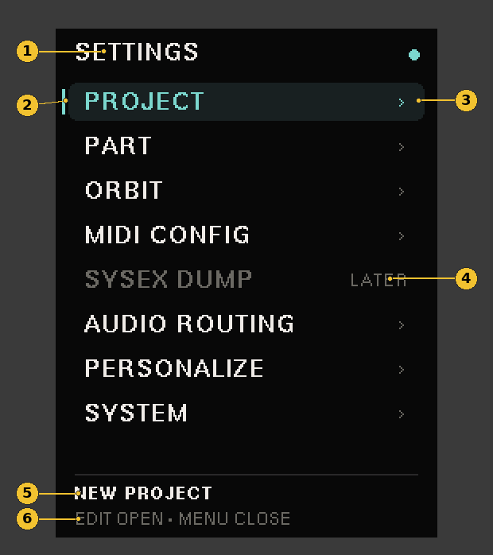

1. **Breadcrumb:** where you are in SETTINGS (`SETTINGS › PROJECT`, and so on).
2. The bar: the selected row.
3. A chevron: this row opens a list or a page.
4. `LATER`: not built yet. Dimmed rows are skipped, and EDIT does nothing on them.
5. The loaded project's name, then its state: `SAVED`, or `* MODIFIED` once you change anything. A new project shows its name alone (`NEW PROJECT`).
6. What the keys do here, for example `EDIT OPEN · MENU CLOSE` at the top, `EDIT RUN · MENU BACK` on an action, `A-F EDIT · MENU BACK` on a page of cells, `EDIT OK · MENU BACK` in a question.

**Why:** each row opens one page and nothing more: no page inside SETTINGS has sub-pages, so no key steps sideways and nothing hides behind EDIT or PLUS. A screen with more to show is a list of pages. Rows that are planned but not built stay in the list as `LATER`, so the list never reshuffles when they arrive.

## SETTINGS: the top list

| Row | What it holds |
|---|---|
| **PROJECT** | Load, save, manage and clean up projects |
| **PART** | The active Part's Sound: rename, clear, save, reload, LIVE SNAP, the library, RANDOMIZE and its MIDI map |
| **ORBIT** | The playing scene: clear, save, reload |
| **MIDI CONFIG** | Clock, program change, channels, control channels, echo and MPE |
| **SYSEX DUMP** | `LATER` |
| **AUDIO ROUTING** | Output pairs, tuning and USB audio |
| **PERSONALIZE** | How the screen and the pages look and behave |
| **SYSTEM** | Firmware update entry, diagnostics, push encoders and ABOUT |

Breadcrumbs use short names: PROJECT, `PART 1` (the active Part), `SCENE 3` (the playing scene), MIDI, AUDIO, PERSONAL and SYSTEM.

## SETTINGS: quick save with a MENU hold

Hold **MENU** anywhere to save the project to the card at once, over its own file. A project that has never been saved asks for a name first (SAVE PROJECT AS's naming screen). If the card in the slot is not the one the project came from, the question `CARD CHANGED` / `SAVE AS A NEW PROJECT ON THIS CARD?` offers **SAVE AS** or **CANCEL**, so nothing is written over a file on a different card.

**Why:** saving should never take a trip through menus in the middle of playing. A save that could land on the wrong card asks first.

## SETTINGS: the footer and the project state

The footer always names the loaded project and its state:

- `SAVED`: the project matches its file.
- `* MODIFIED` (in the warning colour): something changed since it was loaded or saved. A turn of any knob counts, and so does a RANDOMIZE roll.
- No state: a new project (`NEW PROJECT`), never saved.

## SETTINGS: PROJECT

| Row | What it does |
|---|---|
| **LOAD PROJECT** | Lists the projects on the card. EDIT loads the one under the bar |
| **SAVE PROJECT AS** | Saves a copy under a new name: opens the naming screen |
| **MANAGE PROJECTS** | Lists the projects with commands for each |
| **POOL** | How the project's Sound memory is used (read-only) |
| **PURGE UNUSED SRC** | Frees the memory held by TAPE sources no Part uses |

Projects live on the card in `/CHIMERA/PROJECTS/`. The card, the file layout and the pool are in [the SD card, Sounds and the library](16-card-sounds-library.md).

### PROJECT: LOAD PROJECT

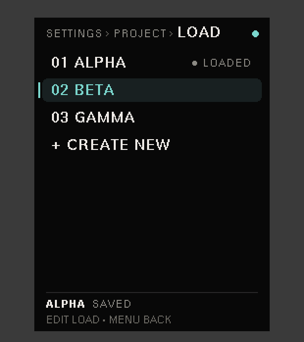

Each project is a row, numbered by its slot on the card. The loaded one is marked `● LOADED`. The **+ CREATE NEW** row starts a fresh project.

- If the current project has unsaved changes, loading asks first: `LOAD BETA?` (or `START A NEW PROJECT?` for + CREATE NEW), with **SAVE THEN LOAD**, **LOAD ANYWAY** or **CANCEL**. SAVE THEN LOAD saves the current one first (naming it first if it has no file).
- Rows can also read `FILE DAMAGED` (the file cannot be read), `NEWER FIRMWARE` (saved by a newer Chimera), `NO PROJECTS`, `MORE ON CARD` (more files than the list holds) or `NO CARD`. On `NO CARD`, EDIT reads the card again.

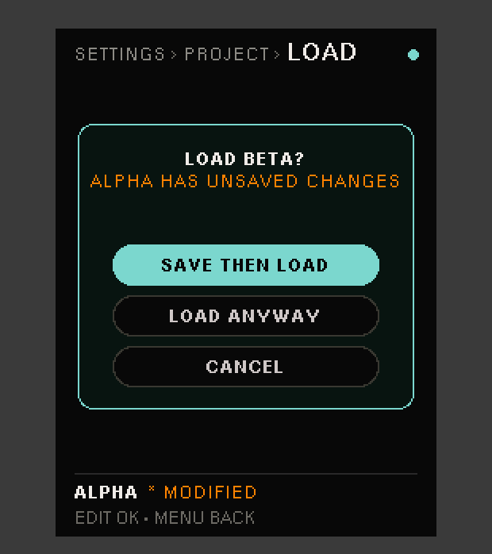

### PROJECT: SAVE PROJECT AS

Opens the naming screen with a proposed name (a word and a number, such as `DRIFT-002`). Change it or keep it, then EDIT saves. If a project of that name is already on the card, the question `NAME EXISTS` / `SLOT 02 IS NAMED BETA` offers **KEEP BOTH** (save as a new file beside it) or **OVERWRITE THAT ONE**.

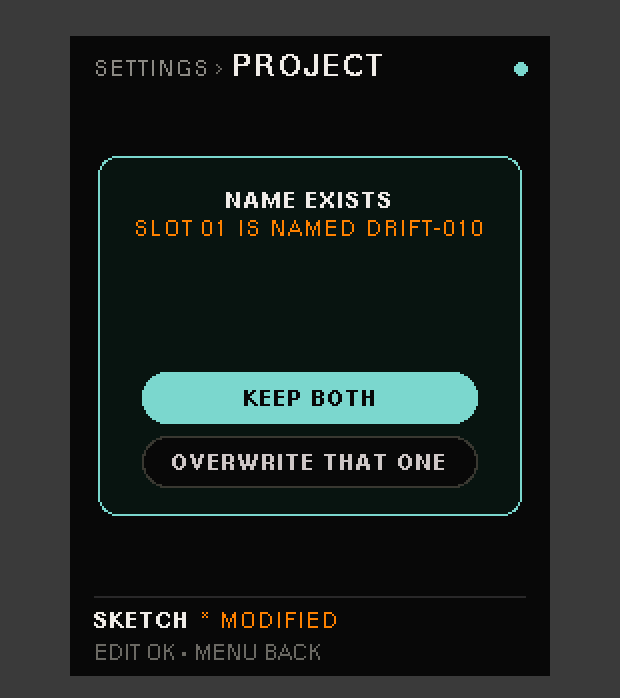

### PROJECT: MANAGE PROJECTS

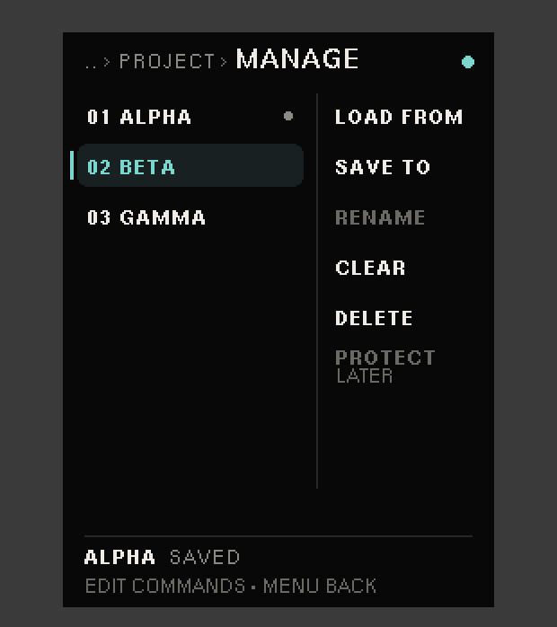

The projects on the left, the commands for the one under the bar on the right. EDIT on a project moves the bar into its commands (`EDIT COMMANDS · MENU BACK`); EDIT then runs the command (`EDIT RUN · MENU LIST`) and MENU goes back to the list.

| Command | What it does |
|---|---|
| **LOAD FROM** | Loads that project, as LOAD PROJECT does |
| **SAVE TO** | Saves the project you have open over that file. Asks `SAVE OVER BETA?` / `ITS CONTENTS ARE REPLACED`: **SAVE OVER** or **CANCEL** |
| **RENAME** | Renames the loaded project (naming screen). Dimmed on any other, with `LOAD TO RENAME` in the footer |
| **CLEAR** | Empties that project to a new one. Asks `CLEAR BETA?` / `IT BECOMES A NEW PROJECT`: **CLEAR** or **CANCEL**. On the loaded project, its own file is saved over with a new project |
| **DELETE** | Deletes that project's file. Asks `DELETE BETA?` / `THIS CANNOT BE UNDONE`: **DELETE** or **CANCEL**. Dimmed on the loaded project |
| **PROTECT** | `LATER` |

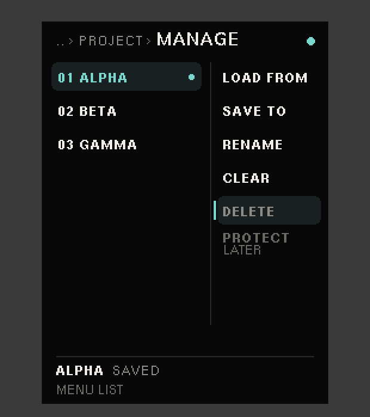

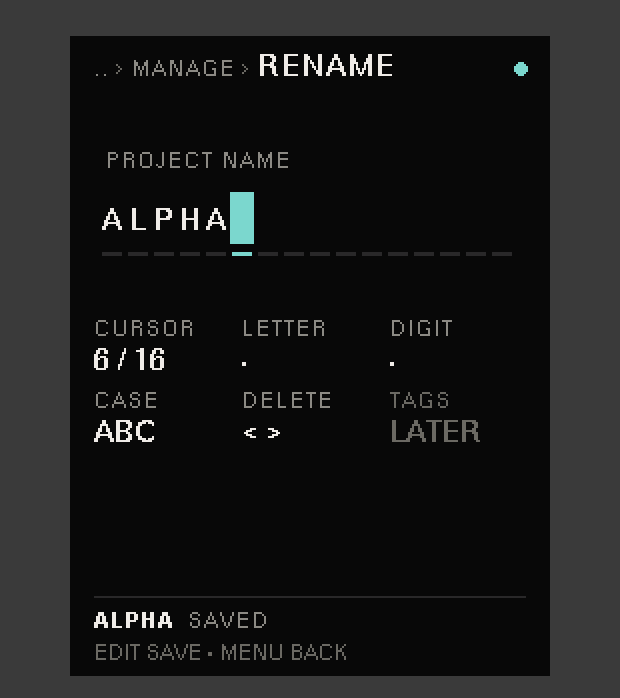

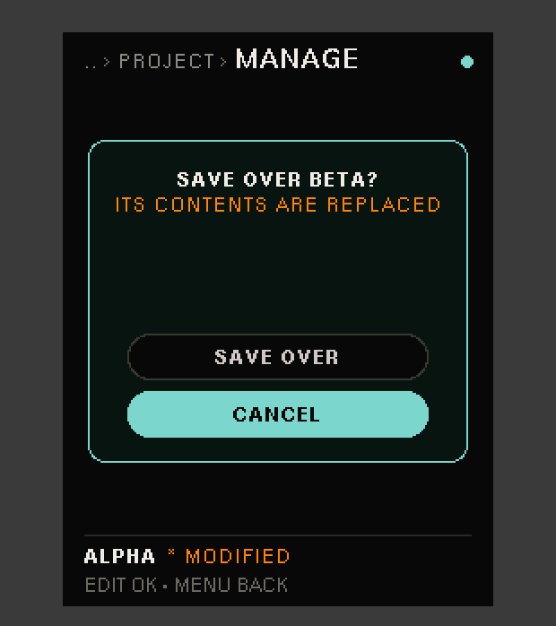

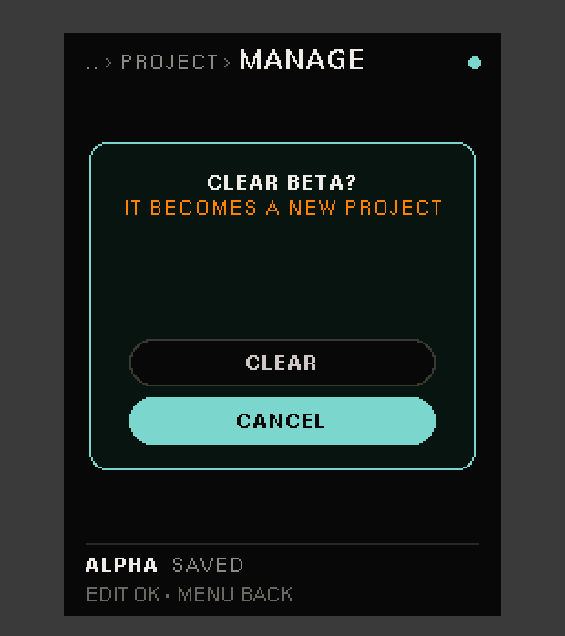

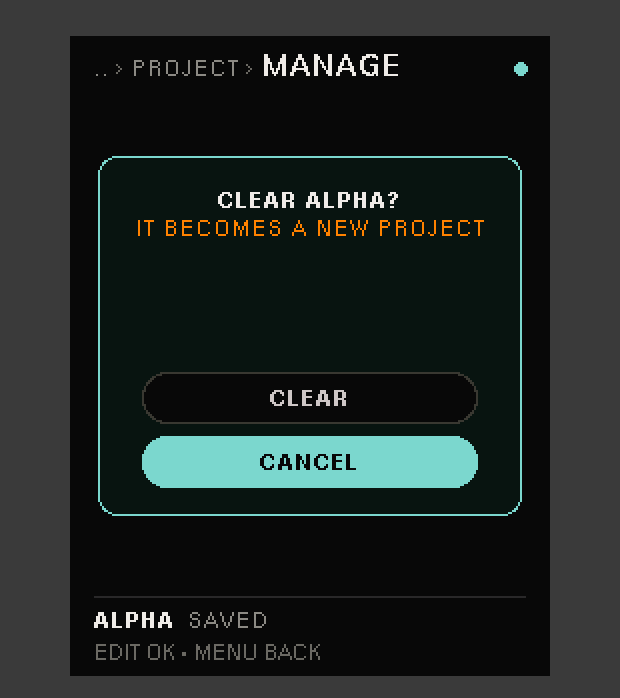

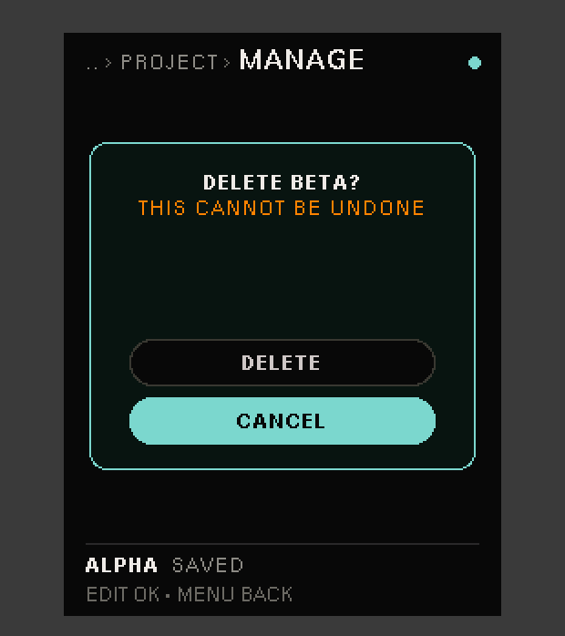

**Why:** RENAME works on the loaded project only, so a name never changes under a file you are not looking at. DELETE refuses the loaded project because you are standing in it; CLEAR it instead.

### PROJECT: POOL

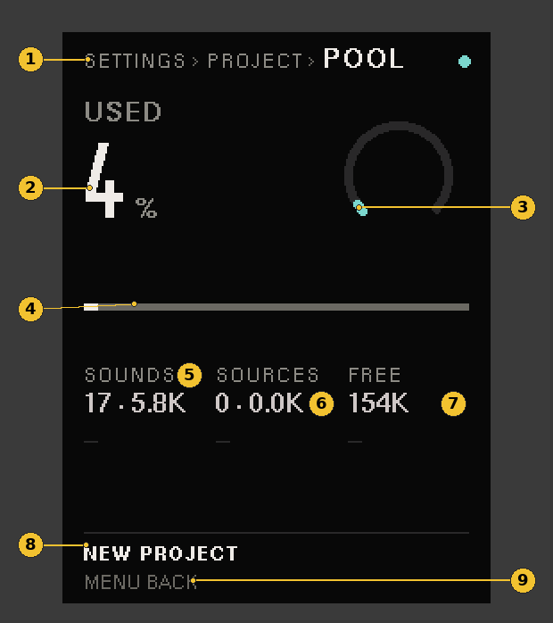

1. **Breadcrumb:** where you are in SETTINGS.
2. **USED**, large: how full the pool is.
3. **Its glyph:** an arc, the same share.
4. **The picture band:** the pool as a bar.
5. **SOUNDS:** how many Sounds and their memory.
6. **SOURCES:** TAPE sources and their memory.
7. **FREE:** what is left.
8. **Footer:** the project and its state.
9. **Footer:** the keys this page answers to (`MENU BACK`: nothing to edit).

A read-only page: how full the project's Sound memory is (`USED 64%`, with its arc), and what fills it. **SOUNDS** (how many Sounds and the memory they take), **SOURCES** (TAPE sources and their memory), **FREE** (what is left) and **PENDING** (shown only while freed memory waits to be reclaimed). See [the SD card, Sounds and the library](16-card-sounds-library.md) for the pool.

### PROJECT: PURGE UNUSED SRC

Counts the TAPE sources held in memory that no Part uses, and asks `PURGE 3 SOURCES? FREES 61K` / `THE CARD KEEPS THEM`: **PURGE** or **CANCEL**. The files on the card stay. With none to purge, it says `NO UNUSED SOURCES`.

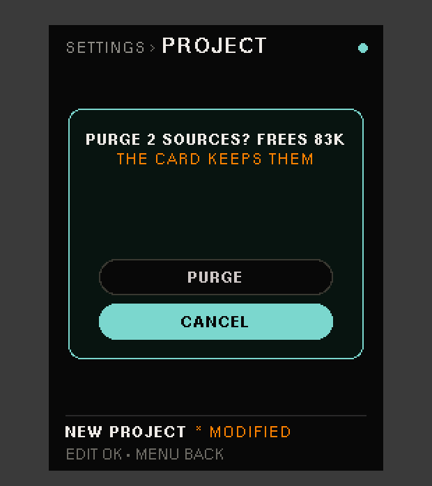

## SETTINGS: the naming screen

Every name (a project, a Sound, a MIDI map) is edited on one screen. Its title says what you are naming (`PROJECT NAME`, `SOUND NAME`, `MAP NAME`). A name holds up to 16 characters.

| Encoder | Cell | What it does |
|---|---|---|
| 1 | **CURSOR** | Moves the cursor (`3 / 16`) |
| 2 | **LETTER** | Picks a letter A to Z at the cursor |
| 3 | **DIGIT** | Picks a digit, a space or a dash at the cursor |
| 4 | **CASE** | Switches the character at the cursor between capital and small (`ABC`, `abc`) |
| 5 | **DELETE** | Right deletes the character under the cursor; left deletes the one before it |
| 6 | **TAGS** | `LATER` |

**EDIT** saves (`EDIT SAVE · MENU BACK`); **MENU** or **SEQ** cancels.

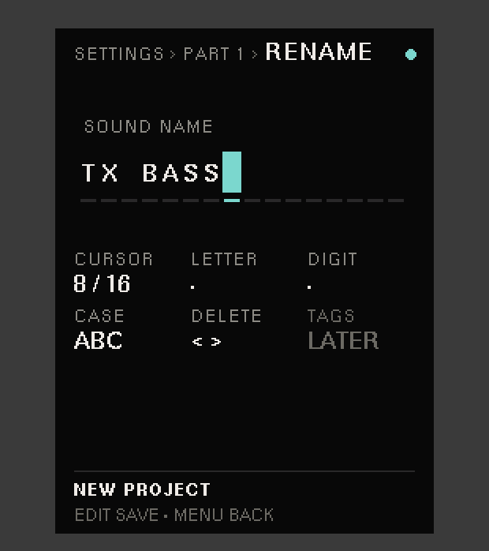

## SETTINGS: PART

PART acts on the active Part (the one whose pages you came from). Its breadcrumb is `PART 1`, and a strip under it names the Part's Sound and its state.

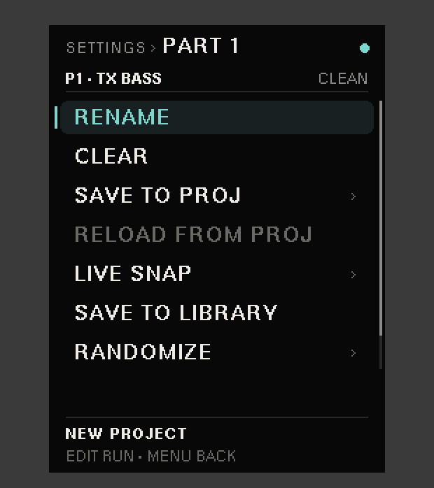

The strip: `P1 · TX BASS` on the left and, on the right, `CLEAN` (as saved), `* EDITED · FROM SLOT 03` or `* EDITED · FROM INIT` (changed since it was loaded or saved), or `◦ SLOT 03 MOVED` (the slot it came from has changed since).

| Row | What it does |
|---|---|
| **RENAME** | Names the Part's Sound (naming screen) |
| **CLEAR** | Clears the Part to its engine's INIT Sound |
| **SAVE TO PROJ** | Saves the Part's Sound into one of the project's Sound slots |
| **RELOAD FROM PROJ** | Throws away the Part's edits and reloads its Sound from its slot. Dimmed with nothing to drop |
| **LIVE SNAP** | Snaps the keys you play on this Part to ORBIT's scale or chord |
| **SAVE TO LIBRARY** | Names the Part's Sound and saves it to the card's library, for any project |
| **RANDOMIZE** | Rolls a new Sound on the Part |
| **MIDI MAP** | The Part's MIDI control map ([MIDI](14-midi.md)) |

### PART: CLEAR, SAVE TO PROJ and RELOAD FROM PROJ

- **CLEAR** on an edited Part asks `CLEAR P1 TO INIT?`: **SAVE PART FIRST**, **REPLACE** or **CANCEL**.
- **SAVE TO PROJ** opens a list: `OVER SLOT 03` (the slot the Sound came from) or `TO NEW SLOT 07` (the next free one). After a save the screen says `SAVED TO SLOT 03`. If the pool has no room, it says `POOL FULL` or how much it needs.
- If other Parts also play the slot you save over, the question `ALSO USES SLOT 03` / `IT KEEPS THE OLD SOUND` offers **UPDATE P4** (or **UPDATE ALL** when several do) or **LEAVE**. LEAVE lets them keep playing the old Sound until they reload.
- **RELOAD FROM PROJ** asks `RELOAD P1 FROM SLOT 03?`: **SAVE PART FIRST**, **RELOAD** or **CANCEL**.
- Loading a Sound into an edited Part from the browser asks the same way: `REPLACE P1 SOUND?` or, from the library, `LOAD INTO P1?`, each with **SAVE PART FIRST**, **REPLACE** or **CANCEL**. For a DRUM kit that is not in the library the second line reads `KIT NOT IN LIBRARY`, with **REPLACE** or **CANCEL**.

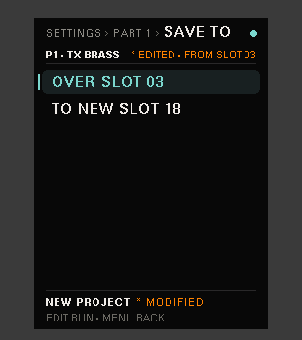

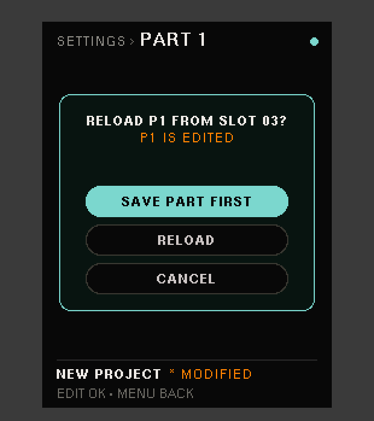

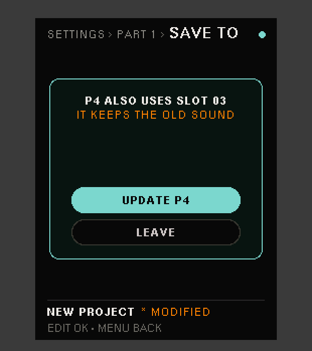

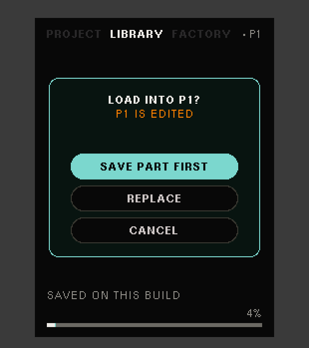

The Sound browser asks one more: MIX + MINUS on a slot no Part plays asks `CLEAR SLOT 03?` / `NO PART USES IT`: **CLEAR** or **CANCEL** ([the SD card, Sounds and the library](16-card-sounds-library.md)).

**Why:** a Sound you have shaped is never thrown away by a slip. Every action that would replace an edited Part offers to save it first. Several Parts can share one slot; a save over it asks whether they should follow, because one of them may be playing a part you want to keep.

### PART: LIVE SNAP

**LIVE SNAP** (SNP in the editor's list) snaps the notes you play live on this Part to ORBIT's harmony while ORBIT runs. It is the active Part's own setting, saved with the project.

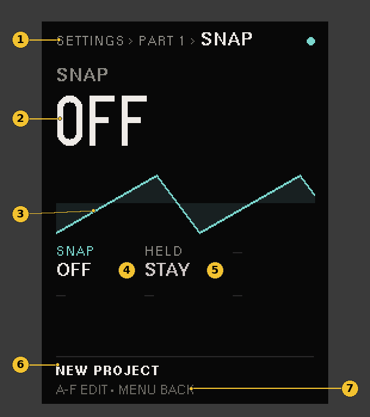

1. **Breadcrumb:** where you are in SETTINGS.
2. **The focused cell**, large: its name and value.
3. **The picture band:** the live output's waveform.
4. **SNAP**.
5. **HELD**.
6. **Footer:** the project and its state.
7. **Footer:** the keys this page answers to (`A-F EDIT · MENU BACK`).

| Cell | Options | Default | What it does |
|---|---|---|---|
| **SNAP** | OFF, SCALE, CHORD | OFF | OFF plays the keys as they are. SCALE moves each note to the nearest note of ORBIT's scale; CHORD to the nearest note of the chord playing now |
| **HELD** | STAY, RE-SNAP | STAY | What a held key does when the harmony changes. STAY keeps its note; RE-SNAP glides it to the new chord's note |

- Snapping happens only while ORBIT plays (or follows a running external clock). With ORBIT stopped, keys play as they are.
- RE-SNAP moves a held note with a short glide (about 40 ms), without restriking it. Its envelopes run on.
- Two keys that snap to the same note share one voice; it is let go when the last of them is up.

**Why:** with SNAP, anyone can play along with ORBIT without wrong notes. RE-SNAP re-snaps from the key you hold, never from where the note last sounded, so a held chord follows the progression and never drifts. See [ORBIT](12-orbit.md).

### PART: RANDOMIZE

**RANDOMIZE** (RND in the editor's list) rolls a new Sound on the active Part. Each roll stays inside ranges that keep it musical: the note keeps its pitch, the envelopes come from a family you pick, modulation is bounded, and levels stay close to the engine's INIT. A roll is never silent and never blasts. The same seed and amounts on the same Sound always roll the same result, so a Sound you like is easy to find again.

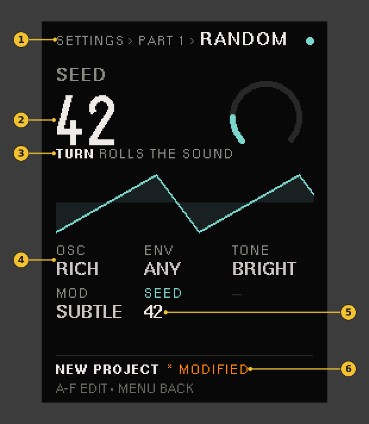

1. **Breadcrumb:** the Part being rolled.
2. **The focused cell's value.**
3. **The hint:** `TURN ROLLS THE SOUND`. Every cell on this page rolls when you turn it.
4. **The amounts:** OSC (the oscillators or operators), ENV (the envelopes), TONE (brightness and depth) and MOD (movement). `OFF` leaves that part of the Sound as it is.
5. **SEED**, 0 to 255. Each detent rolls a new Sound. Turn back to a seed and its Sound comes back.
6. **The project reads `* MODIFIED`.** The Part's strip in SETTINGS › PART reads `* EDITED`.

| Cell | Values | Default | What it rolls |
|---|---|---|---|
| **OSC** | OFF, PURE, RICH, WILD | RICH | ALGO: the algorithm and each operator's ratio and wave. Carriers stay in octaves, so the note keeps its pitch; WILD can blend two algorithms with MORPH. VA: MODE, the waves and OSC 2's interval (octaves, then fifths and fourths), with detune, SUB, SHAPE and NOISE. MODAL: STRUCT and POS, and from RICH the MODEL. TAPE: nothing (the source's pitch is its own) |
| **ENV** | OFF, PLUCK, PAD, ANY | ANY | The amp envelope's family: PLUCK strikes and decays, PAD swells and holds, ANY can be either or between. ALGO: every operator's envelope (modulators decay a little quicker). VA and TAPE: ENV 1. MODAL: DAMP, how long it rings |
| **TONE** | OFF, SOFT, BRIGHT, WILD | BRIGHT | The filter's CUTOFF and RESO (its TYPE and MODE stay). ALGO: the modulators' depth, FEEDBACK and VEL. MODAL: BRIGHT, BODY, COLOR and BURST |
| **MOD** | OFF, SUBTLE, MOVING, WILD | SUBTLE | LFO 2 and LFO 3's rate and shape, ENV 2, and how far ENV 2 and LFO 2 move CUTOFF and LFO 3 moves RESO. MODAL: the ensemble too |
| **SEED** | 0 to 255 | 0 | Which roll. Each detent is a new Sound |

- Each amount draws on its own, so changing one leaves what the others rolled. On ALGO, an operator that OSC turns from a modulator into a carrier (or back) takes the envelope and depth of its new role.
- A roll never touches the Part's LEVEL, PITCH or sends, LFO 1 (the mod wheel's vibrato), ENV 1's route to the VCA, the filter's TYPE and MODE, or a TAPE Sound's source, MODEL and place.
- ENV 2 only ever opens the filter: closing a dark CUTOFF would be silence.
- The five settings are not stored: they are the page's, for rolling.

**Undo.** A roll is an edit like a turn of any knob: the Sound glides to it while you play. To get the Part's saved Sound back, use **RELOAD FROM PROJ**. Nothing is saved until you save the Part (SAVE TO PROJ or SAVE TO LIBRARY). After an incomplete update the five cells read `NEEDS UPDATE` and turning them rolls nothing.

Starting points: for a bank of plucks, ENV PLUCK, MOD OFF, and turn SEED. For evolving pads, ENV PAD, MOD MOVING. To keep a Sound's oscillators and try new envelopes on them, OSC OFF and turn SEED.

**Why:** a seed makes randomness reproducible: a Sound you heard at seed 42 is there again at 42. The amounts are named for what they do rather than numbered, and the ranges are bounded, so a roll is a starting point you can play, not noise.

> **Design note:** the four amounts come from the stock PreenFM3 firmware's randomizer (its OPER, ENV, IM and MODL), renamed for what they do. Behind them is a pure function: the Sound and five numbers in, a Sound out, every dimension drawing from its own seeded stream so OSC never nudges what ENV rolled. On ALGO the carriers stay in octaves and drop a little in level for each extra carrier, so a six-carrier stack sums about where one does. The result is a dice cup that never lands on a dead patch, which is more than can be said for most dice.

## SETTINGS: ORBIT

ORBIT acts on the scene that is playing; its breadcrumb is `SCENE 3`.

| Row | What it does |
|---|---|
| **RENAME** | `LATER` |
| **CLEAR** | Asks `CLEAR SCENE 3?` / `IT GOES SILENT ON THE LOOP`: **CLEAR** or **CANCEL** |
| **SAVE TO PROJ** | A row per scene slot: `OVER SCENE 2` for a saved one, `SCENE 5` for an empty one. Saving over asks `SAVE OVER SCENE 2?` / `ITS SAVED SCENE IS REPLACED`: **SAVE OVER** or **CANCEL** |
| **RELOAD FROM PROJ** | Asks `RELOAD SCENE 3?` / `ITS DRIFT RESTARTS, ITS EDITS STAY`: **RELOAD** or **CANCEL**. Dimmed with nothing to drop |

CLEAR and RELOAD are refused while a scene switch waits (`SWITCH PENDING`). Scenes are explained in [ORBIT](12-orbit.md).

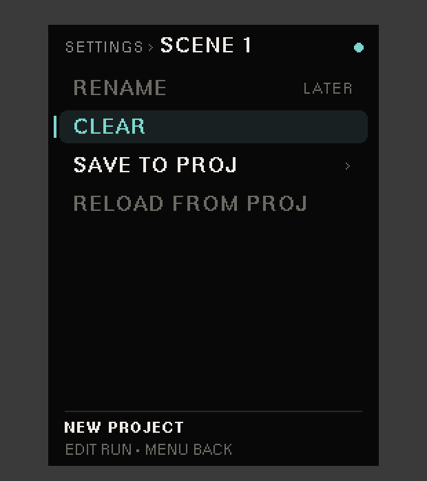

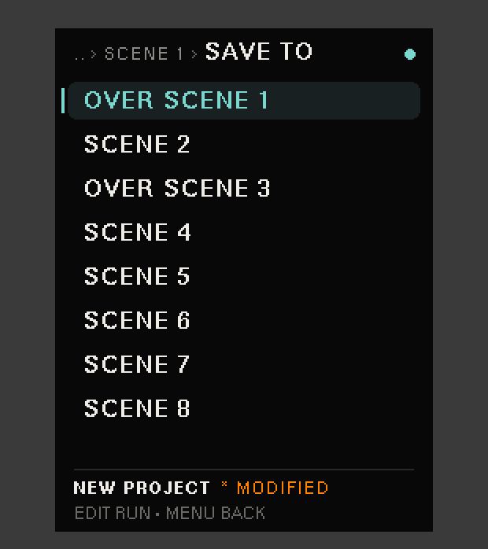

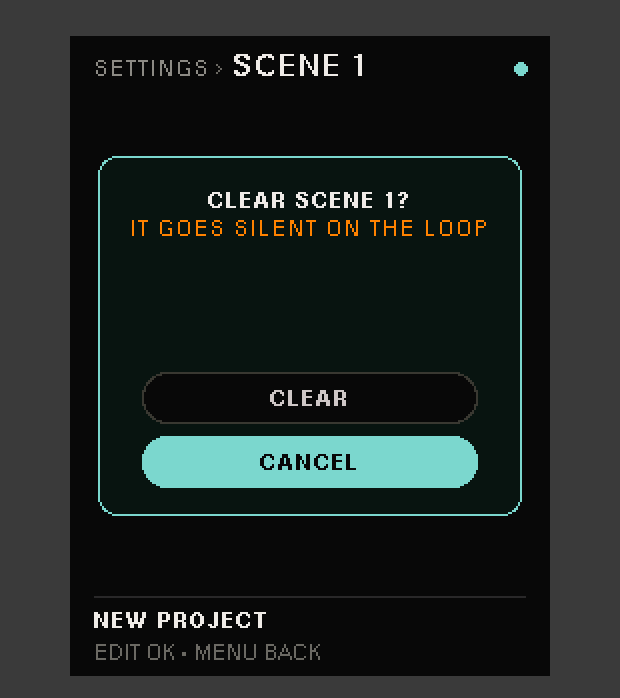

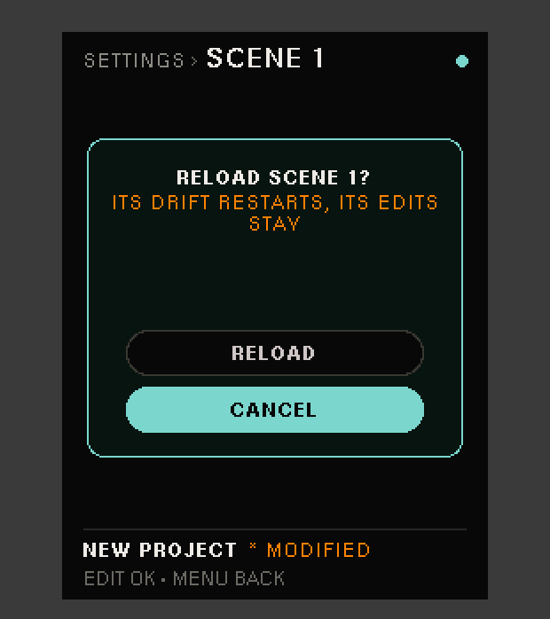

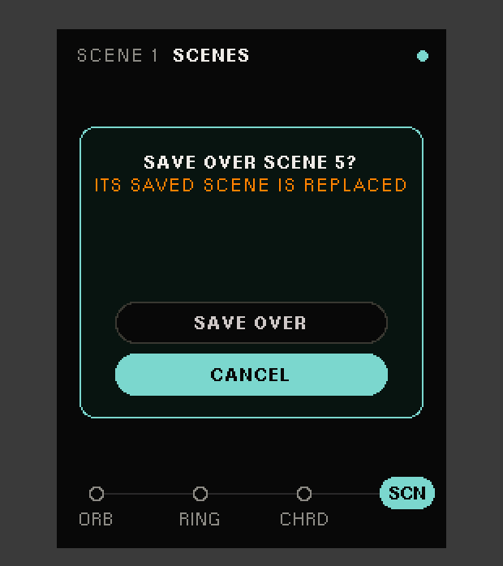

## SETTINGS: MIDI CONFIG

| Row | Page | See |
|---|---|---|
| **SYNC** | SYNC (INT or EXT clock) and PROGRAM (program changes load Sounds) | [MIDI](14-midi.md) |
| **PORT CONFIG** | `LATER` | |
| **CHANNELS** | P1 to P6: each Part's MIDI channel, the same value as the mixer's CH | [MIDI](14-midi.md) |
| **CONTROL CHANNELS** | MIXER, SEQUENCER, AUTO and BUILT-IN | [MIDI](14-midi.md) |
| **ECHO** | ECHO (MIDI thru to DIN OUT) and PARAM OUT | [MIDI](14-midi.md) |
| **MPE** | The MPE zones | [MIDI](14-midi.md) |

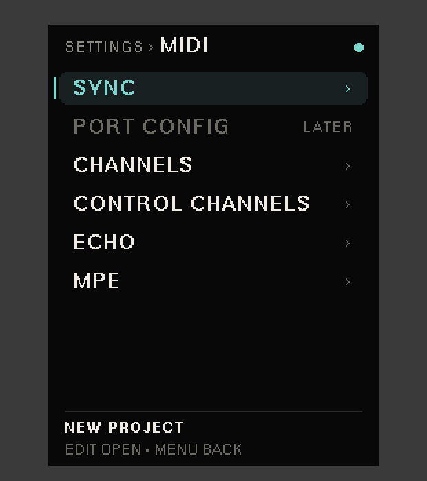

These settings belong to the unit, not to a project, except CHANNELS, which are each Part's own.

## SETTINGS: AUDIO ROUTING

| Row | What it holds |
|---|---|
| **OUTPUTS** | Each Part's output pair |
| **SENDS** | `LATER` |
| **TUNING** | TUNE, and the active Part's TUNING and MAPPING ([tuning](15-tuning.md)) |
| **USB AUDIO** | USB IN: how loud your computer plays through Chimera |

### AUDIO ROUTING: OUTPUTS

**OUTPUTS** (OUT in the editor's list) sets each Part's output pair in one place: the same value as OUT on each Part's mixer PRT page ([the MIXER](11-mixer-and-master-fx.md#mixer-the-prt-page)).

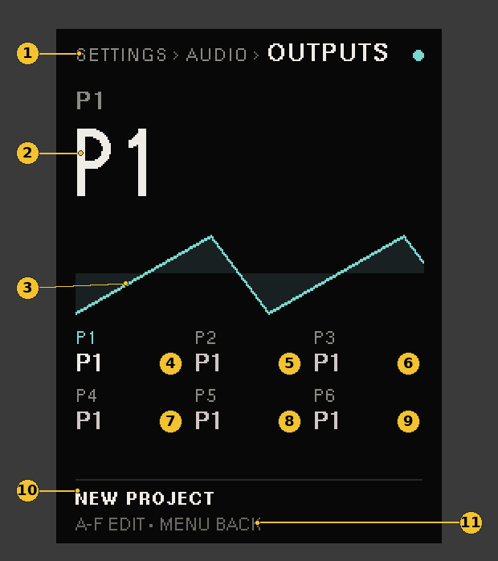

1. **Breadcrumb:** where you are in SETTINGS.
2. **The focused cell**, large: its name and value.
3. **The picture band:** the live output's waveform.
4. **P1:** Part 1's output pair.
5. **P2:** Part 2's.
6. **P3:** Part 3's.
7. **P4:** Part 4's.
8. **P5:** Part 5's.
9. **P6:** Part 6's.
10. **Footer:** the project and its state.
11. **Footer:** the keys this page answers to (`A-F EDIT · MENU BACK`).

| Cell | Options | Default | What it does |
|---|---|---|---|
| **P1**, **P2**, **P3**, **P4**, **P5**, **P6** | P1, P2, P3 | P1 | The output pair that Part plays out of. P1 is the main pair |

The shared effects return on P1 only, and the master section treats all three pairs as one ([signal flow](11-mixer-and-master-fx.md#mixer-signal-flow-and-gain-staging)). A Part sent to P2 or P3 is silent on the main pair; its header then shows `OUT P2` or `OUT P3`.

### AUDIO ROUTING: USB AUDIO

**USB AUDIO** (USB in the editor's list) sets how loud your computer's sound joins the main out when Chimera is the computer's audio output.

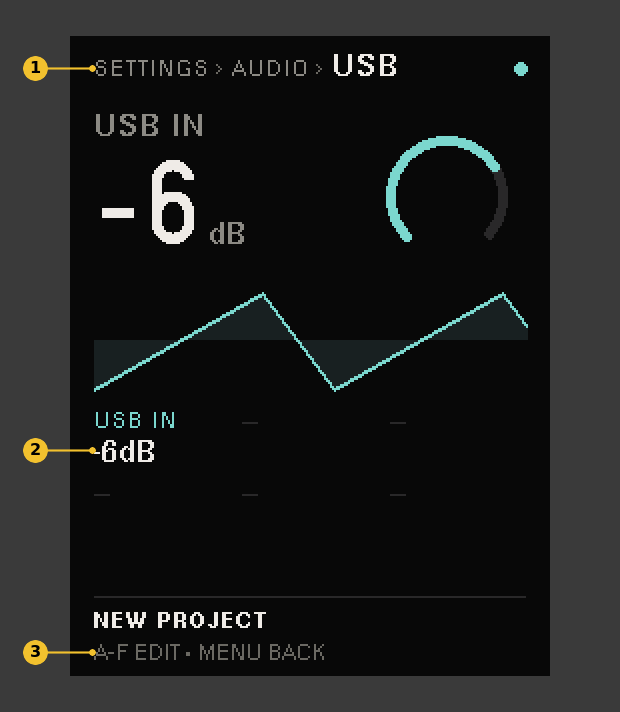

1. **SETTINGS › AUDIO ROUTING › USB AUDIO.**
2. **USB IN** (A): how loud your computer's sound joins the main out.
3. **The hint:** `A-F EDIT · MENU BACK`. MENU goes back.

| Cell | Options | Default | What it does |
|---|---|---|---|
| **USB IN** | OFF, -24dB, -18dB, -12dB, -9dB, -6dB, -3dB, 0dB | 0dB | The computer's level into the main out. OFF keeps the output there for your computer but silent |

A change fades in over a few milliseconds, never with a click. At `0dB` a loud computer track on top of a loud patch can pass full scale: the main out then clips hard, so turn one of them down. The computer's sound is mixed in after the synth's, so recording Chimera over USB never records it back. See [USB](17-usb.md).

## SETTINGS: PERSONALIZE

How the screen looks and how some pages behave. Every setting here belongs to the unit, not to a project: it is stored in the SYSTEM file on the card and survives loading any project.

| Row | Page |
|---|---|
| **THEME** | BRIGHT, GAMMA, ACCENT, BLACK, HINTS, INVERT |
| **SCREENSAVER** | SAVER |
| **CHAIN MAP** | PAGES |
| **TEXT SIZE** | SIZE |
| **PAD FOLLOW** | FOLLOW |
| **ALGO PAGES** | FIRST |

### PERSONALIZE: THEME

**THEME** (THM in the editor's list).

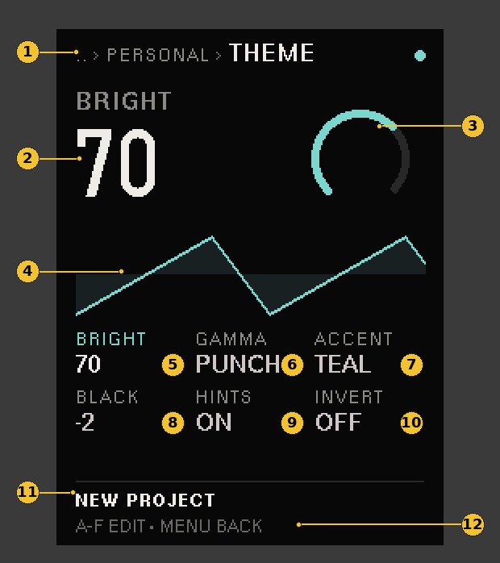

1. **Breadcrumb:** where you are in SETTINGS.
2. **The focused cell**, large: its name and value.
3. **Its glyph:** an arc for BRIGHT.
4. **The picture band:** the live output's waveform.
5. **BRIGHT**.
6. **GAMMA**.
7. **ACCENT**.
8. **BLACK**.
9. **HINTS**.
10. **INVERT**.
11. **Footer:** the project and its state.
12. **Footer:** the keys this page answers to (`A-F EDIT · MENU BACK`).

| Cell | Options | Default | What it does |
|---|---|---|---|
| **BRIGHT** | 10, 15, 20, 25, 30, 35, 40, 45, 50, 55, 60, 65, 70, 75, 80, 85, 90, 95, 100 | 70 | The backlight, in percent |
| **GAMMA** | PANEL, SOFT, PUNCH | PUNCH | The display's gamma. PANEL is the screen's own power-on look; PUNCH gives deeper blacks and more contrast; SOFT is halfway between |
| **ACCENT** | TEAL, AMBER, ROSE, LIME, ICE | TEAL | The one accent colour: the focused cell, the bar, the pictures |
| **BLACK** | -2, -1, 0, +1, +2, +3, +4 | -2 | Lifts the black ground: -2 is pure black, +4 a dark grey. In light mode it takes the edge off the white instead |
| **HINTS** | OFF, ON | ON | The gesture hints in the focus band. Off, the band shows the cell alone; the gestures still work |
| **INVERT** | OFF, ON | OFF | Light mode: white ground, dark ink |

In light mode each accent is darkened only as far as it needs to stay readable on white; the warning and alert colours follow the same rule. The boot splash keeps its own colours in both modes.

Without a card or a SYSTEM file, the unit starts at 70, PUNCH, TEAL, -2.

> **Design note:** BRIGHT drives the backlight with a 20 kHz signal, above hearing, so dimming the screen never whines into the audio. GAMMA sends the display chip one of three gamma curves: its own factory curve, a punchier one with deeper blacks, or the midpoint of the two, field by field. The colours themselves are swapped on their way to the screen, after everything is drawn, so a theme costs the drawing code nothing. And yes, you can have a rose-pink synthesizer. We won't tell.

### PERSONALIZE: SCREENSAVER

**SCREENSAVER** (SAV in the editor's list).

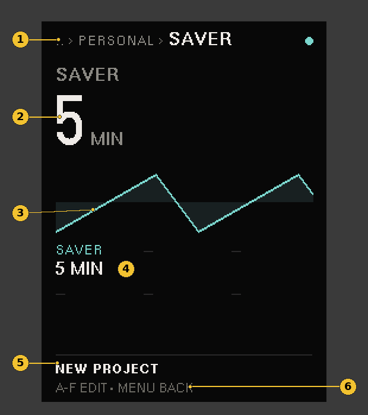

1. **Breadcrumb:** where you are in SETTINGS.
2. **The focused cell**, large: its name and value.
3. **The picture band:** the live output's waveform.
4. **SAVER**.
5. **Footer:** the project and its state.
6. **Footer:** the keys this page answers to (`A-F EDIT · MENU BACK`).

| Cell | Options | Default | What it does |
|---|---|---|---|
| **SAVER** | OFF, 5 S, 7 S, 10 S, 30 S, 60 S, 2 MIN, 5 MIN, 10 MIN | 5 MIN | How long the panel waits, untouched, before the screensaver. OFF never starts it |

The screensaver is an oscilloscope: the main output's waveform large in the accent colour, with the last note received (its velocity and Part), the note it sounds as (after LIVE SNAP and the Part's pitch, as a note and cents), the pitch measured off the scope (for notes above about 300 Hz), and the keys held on every Part with their chord.

- Any button or encoder wakes it. A button also does its job, so one press both wakes and acts. A turn loses its first detent, so you never change a value you could not see.
- MIDI never wakes it: a sequencer playing does not keep the screen lit.

### PERSONALIZE: CHAIN MAP

**CHAIN MAP** (MAP in the editor's list).

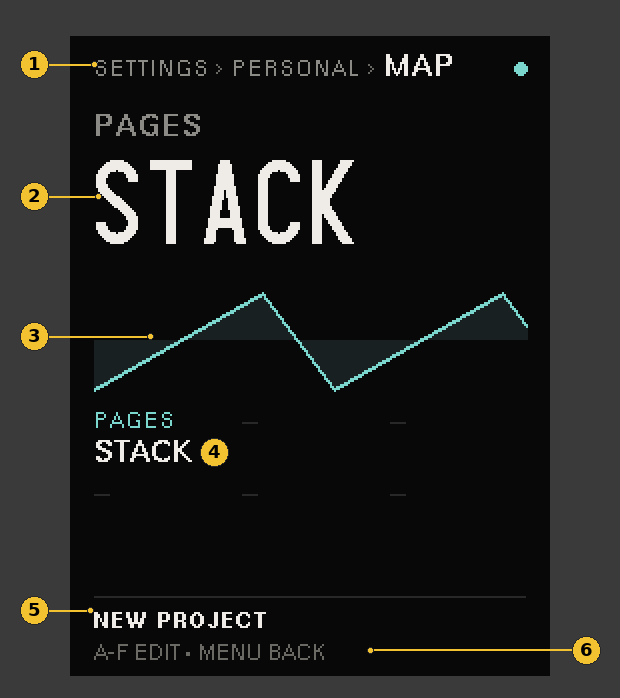

1. **Breadcrumb:** where you are in SETTINGS.
2. **The focused cell**, large: its name and value.
3. **The picture band:** the live output's waveform.
4. **PAGES**.
5. **Footer:** the project and its state.
6. **Footer:** the keys this page answers to (`A-F EDIT · MENU BACK`).

| Cell | Options | Default | What it does |
|---|---|---|---|
| **PAGES** | ROW, STACK | ROW | How a node's sub-pages show on the chain map. ROW: a line of full words under the map; **SEQ** goes on one, **EDIT** back one. STACK: a list hung under the node; **EDIT** goes down one, **SEQ** back up |

See [the panel and navigation](02-panel-and-navigation.md).

### PERSONALIZE: TEXT SIZE

**TEXT SIZE** (TXT in the editor's list).

1. **Breadcrumb:** where you are in SETTINGS.
2. **The focused cell**, large: its name and value.
3. **Its glyph**.
4. **The picture band:** the live output's waveform.
5. **SIZE**.
6. **Footer:** the project and its state.
7. **Footer:** the keys this page answers to (`A-F EDIT · MENU BACK`).

| Cell | Options | Default | What it does |
|---|---|---|---|
| **SIZE** | NORMAL, LARGE | NORMAL | LARGE draws the cell labels and values, the focus label, the hints, the SETTINGS lists and the Sound names a size up, wherever each fits whole |

The header, the breadcrumbs and footer, the chain map, the big focus value and the pictures, dialogs, ORBIT's rings and MANAGE's two columns stay as they are. A text that does not fit at LARGE draws at NORMAL.

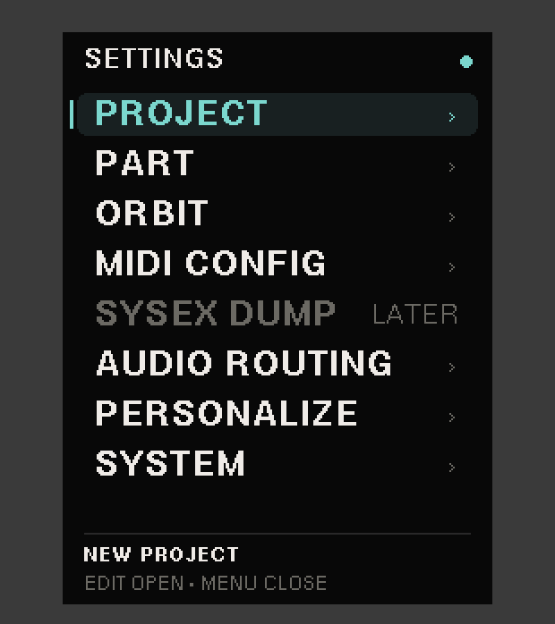

### PERSONALIZE: PAD FOLLOW

**PAD FOLLOW** (FOL in the editor's list) sets whether hitting a pad on a DRUM Part selects that pad on its pages.

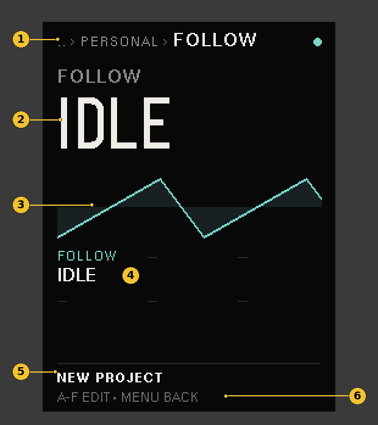

1. **Breadcrumb:** where you are in SETTINGS.
2. **The focused cell**, large: its name and value.
3. **The picture band:** the live output's waveform.
4. **FOLLOW**.
5. **Footer:** the project and its state.
6. **Footer:** the keys this page answers to (`A-F EDIT · MENU BACK`).

| Cell | Options | Default | What it does |
|---|---|---|---|
| **FOLLOW** | OFF, IDLE, ALWAYS | IDLE | OFF: hits never move the selected pad; only MIX + MINUS / PLUS and the PAD cell do. ALWAYS: every live hit on the shown Part selects its pad. IDLE: a hit selects its pad only once 2 seconds have passed since you last turned an encoder or stepped a pad on that Part's DRUM pages |

**Why:** following hits is handy for finding a pad by playing it, and maddening while you are tweaking one pad and the drummer keeps playing. IDLE gives you both: the pages follow your hits until you start editing, then hold still. The hold is per Part. See [DRUM](07-drum.md).

### PERSONALIZE: ALGO PAGES

**ALGO PAGES** (ALG in the editor's list).

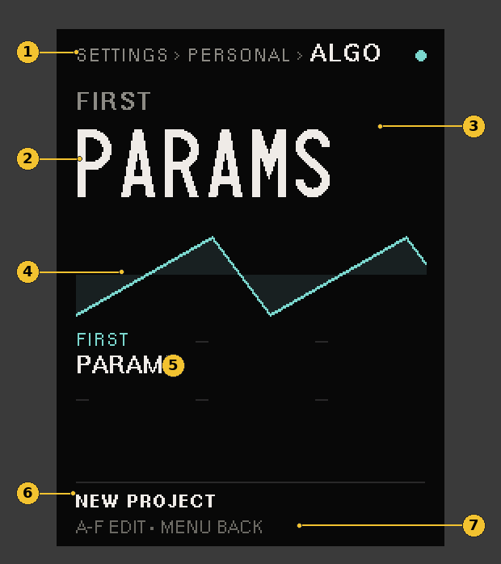

1. **Breadcrumb:** where you are in SETTINGS.
2. **The focused cell**, large: its name and value.
3. **Its glyph**.
4. **The picture band:** the live output's waveform.
5. **FIRST**.
6. **Footer:** the project and its state.
7. **Footer:** the keys this page answers to (`A-F EDIT · MENU BACK`).

| Cell | Options | Default | What it does |
|---|---|---|---|
| **FIRST** | PARAMS, OPS | PARAMS | The order of ALGO's OSC sub-pages. PARAMS: one parameter across the six operators first (WAVE, COARSE …), then each operator's page. OPS: each operator's own page first (OPERATOR 1 to 6), then the parameter pages |

Every page is there either way; only the order changes. See [ALGO](03-algo.md).

**Why:** some players think "all the ratios", others "operator 3". Neither page is skipped or dimmed, even for a silent operator, because an operator at LEVEL 0 is exactly the page you open to turn it up.

## SETTINGS: SYSTEM

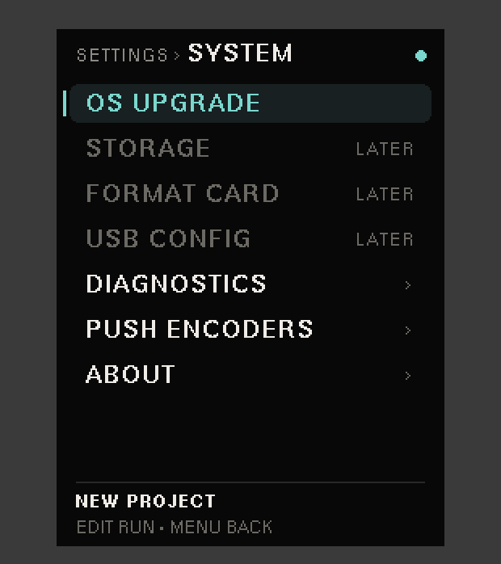

| Row | What it does |
|---|---|
| **OS UPGRADE** | Restarts the unit into the chip's firmware loader, for an update |
| **STORAGE** | `LATER` |
| **FORMAT CARD** | `LATER` |
| **USB CONFIG** | `LATER` |
| **DIAGNOSTICS** | AUDIO LOAD, and TEST TONE and INPUT TEST (`LATER`) |
| **PUSH ENCODERS** | For control boards whose encoders push |
| **ABOUT** | The firmware, the chip and the card |

### SYSTEM: OS UPGRADE

Asks `ENTER DFU?` / `PLAY STOPS UNTIL FLASHED OR POWER-CYCLED`: **ENTER DFU** or **CANCEL**. ENTER DFU restarts into the chip's DFU loader, where the update tool can write new firmware. Until it is flashed or switched off and on, the unit makes no sound. How to update is in [updating and recovery](19-updating-and-recovery.md).

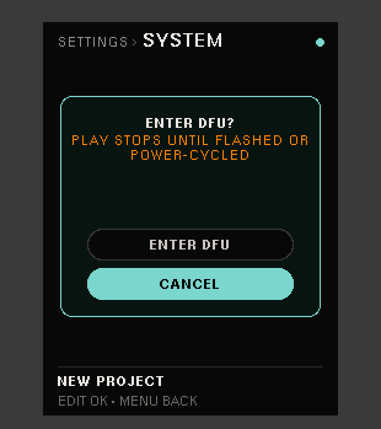

### SYSTEM: DIAGNOSTICS

**AUDIO LOAD** is a read-only page of the audio engine's health: **LOAD** (how much of each audio block's time it uses), **PEAK**, **OVER**, **DROPS**, **DESYNC** and **STACK**. Useful when reporting a glitch. **TEST TONE** and **INPUT TEST** are `LATER`.

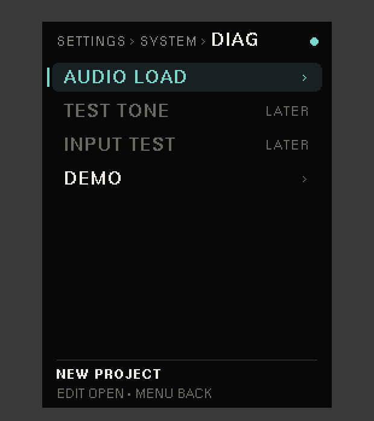

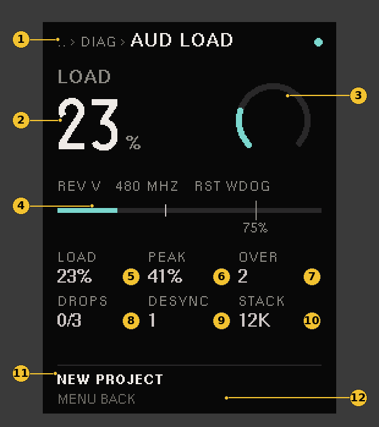

1. **Breadcrumb:** where you are in SETTINGS.
2. **The focused cell**, large: LOAD in %.
3. **Its glyph:** an arc.
4. **The picture band:** the chip revision, clock and last reset, and the load against its 75 % budget.
5. **LOAD:** how much of each audio block's time is used.
6. **PEAK:** the highest load seen.
7. **OVER:** blocks that ran over.
8. **DROPS:** audio blocks dropped, by source.
9. **DESYNC:** times the audio lost step.
10. **STACK:** the audio's stack use.
11. **Footer:** the project and its state.
12. **Footer:** the keys this page answers to (`MENU BACK`: nothing to edit).

### SYSTEM: PUSH ENCODERS

**PUSH ENCODERS** (PSH in the editor's list). Some PreenFM3 control boards have encoders that push; nothing on the board says so, so it is a setting.

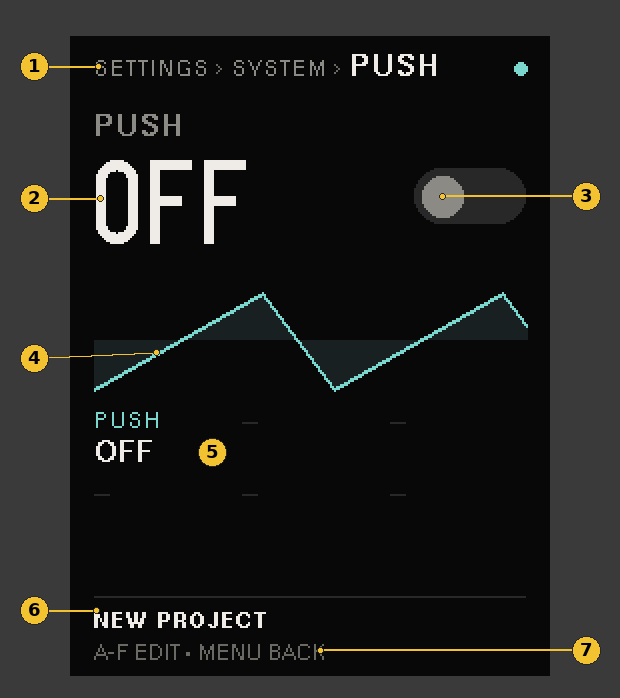

1. **Breadcrumb:** where you are in SETTINGS.
2. **The focused cell**, large: its name and value.
3. **Its glyph**.
4. **The picture band:** the live output's waveform.
5. **PUSH**.
6. **Footer:** the project and its state.
7. **Footer:** the keys this page answers to (`A-F EDIT · MENU BACK`).

| Cell | Options | Default | What it does |
|---|---|---|---|
| **PUSH** | OFF, ON | OFF | ON reads the encoders' pushes |

With PUSH ON, on a cell with a value:

- **push and turn:** a fine turn, one small step per detent.
- **push and let go without turning:** the cell jumps to its default.
- MIX + turn still jumps to landmarks, pushed or not.

The focus band then shows `PUSH DEFAULT  PUSH + TURN FINE` on cells with no hint of their own. ON with a board that has no pushes does nothing. Every push gesture has another way to do it (SEQ + turn for fine, MIX + turn for the default), so a board without pushes misses nothing.

### SYSTEM: ABOUT

A read-only page: **VERSION** and **BUILD** (the firmware, as quoted in a bug report), **CHIP** (the processor's revision and board package), **CLOCK**, **RESET** (why the unit last restarted) and **CARD** (the card's label or serial as last seen, `NO CARD` or `ERROR`). It reads nothing new from the card. ABOUT also says whether the firmware's second part needs an update ([updating and recovery](19-updating-and-recovery.md)).

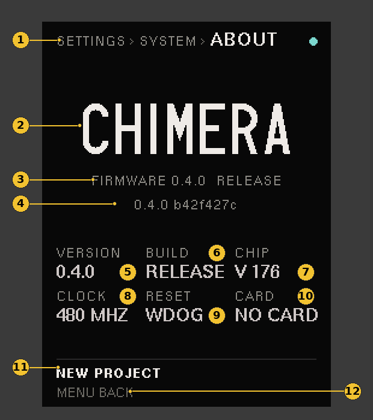

1. **Breadcrumb:** where you are in SETTINGS.
2. **The name**, large.
3. **Its picture:** the firmware's name.
4. **The firmware line:** the version and build.
5. **The firmware's own label**, and whether its second part needs an update.
6. **VERSION**.
7. **BUILD**.
8. **CHIP:** the processor's revision and board package.
9. **CLOCK**.
10. **RESET:** why the unit last restarted.
11. **CARD:** the card as last seen.
12. **Footer:** the project and its state.
13. **Footer:** the keys this page answers to (`MENU BACK`: nothing to edit).

## SETTINGS: every question it asks

Each question is a panel over the screen: the question, a line saying what will happen, and the answers. Any encoder moves the highlight, **EDIT** answers, **MENU** or **SEQ** cancels; the hint reads `EDIT OK · MENU BACK`. The risky ones (DELETE, CLEAR, SAVE OVER) open on CANCEL, so a quick EDIT does no harm.

| Question | Second line | Answers | Where |
|---|---|---|---|
| `LOAD BETA?` / `START A NEW PROJECT?` | | SAVE THEN LOAD, LOAD ANYWAY, CANCEL | Loading over unsaved changes |
| `NAME EXISTS` | `SLOT 02 IS NAMED BETA` | KEEP BOTH, OVERWRITE THAT ONE | SAVE PROJECT AS |
| `CARD CHANGED` | `SAVE AS A NEW PROJECT ON THIS CARD?` | SAVE AS, CANCEL | A save on a different card |
| `SAVE OVER BETA?` | `ITS CONTENTS ARE REPLACED` | SAVE OVER, CANCEL | MANAGE › SAVE TO |
| `CLEAR BETA?` | `IT BECOMES A NEW PROJECT` | CLEAR, CANCEL | MANAGE › CLEAR |
| `DELETE BETA?` | `THIS CANNOT BE UNDONE` | DELETE, CANCEL | MANAGE › DELETE |
| `PURGE 3 SOURCES? FREES 61K` | `THE CARD KEEPS THEM` | PURGE, CANCEL | PURGE UNUSED SRC |
| `CLEAR P1 TO INIT?` | | SAVE PART FIRST, REPLACE, CANCEL | PART › CLEAR on an edited Part |
| `REPLACE P1 SOUND?` | | SAVE PART FIRST, REPLACE, CANCEL | Loading a Sound into an edited Part |
| `LOAD INTO P1?` | | SAVE PART FIRST, REPLACE, CANCEL | Loading a library Sound into an edited Part |
| `LOAD INTO P1?` | `KIT NOT IN LIBRARY` | REPLACE, CANCEL | Loading over an unsaved DRUM kit |
| `RELOAD P1 FROM SLOT 03?` | | SAVE PART FIRST, RELOAD, CANCEL | PART › RELOAD FROM PROJ |
| `ALSO USES SLOT 03` | `IT KEEPS THE OLD SOUND` | UPDATE P4 (or UPDATE ALL), LEAVE | Saving over a slot other Parts play |
| `CLEAR SLOT 03?` | `NO PART USES IT` | CLEAR, CANCEL | MIX + MINUS in the Sound browser |
| `CLEAR SCENE 3?` | `IT GOES SILENT ON THE LOOP` | CLEAR, CANCEL | ORBIT › CLEAR |
| `SAVE OVER SCENE 2?` | `ITS SAVED SCENE IS REPLACED` | SAVE OVER, CANCEL | ORBIT › SAVE TO PROJ |
| `RELOAD SCENE 3?` | `ITS DRIFT RESTARTS, ITS EDITS STAY` | RELOAD, CANCEL | ORBIT › RELOAD FROM PROJ |
| `ENTER DFU?` | `PLAY STOPS UNTIL FLASHED OR POWER-CYCLED` | ENTER DFU, CANCEL | SYSTEM › OS UPGRADE |
| `DELETE MAP?` / `DELETE CC 74?` | | DELETE, CANCEL | PART › MIDI MAP ([MIDI](14-midi.md)) |

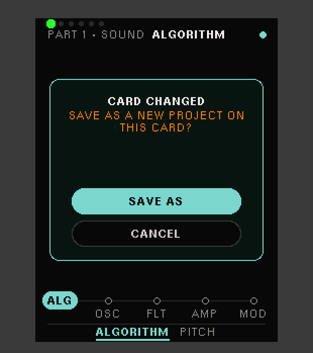

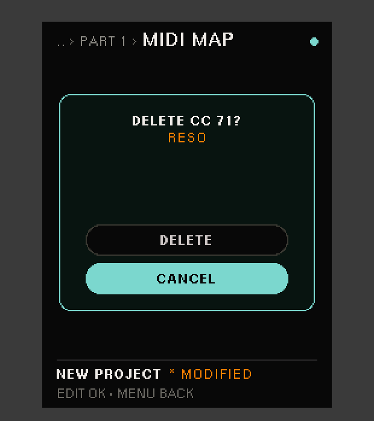

**Why:** every action that changes or removes a file, or throws away an edit, asks first, and nothing else does. EDIT is always OK and MENU always backs out, in a question as everywhere in SETTINGS, so your hands never have to learn a second set of keys.
