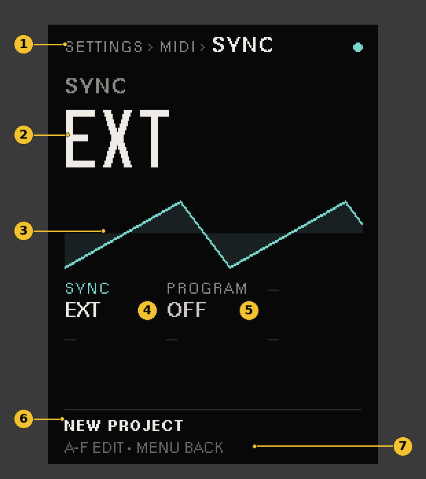
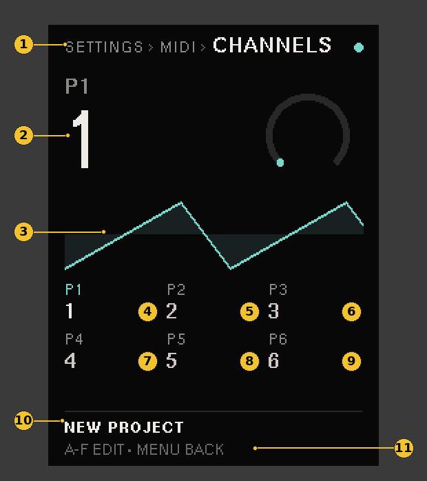
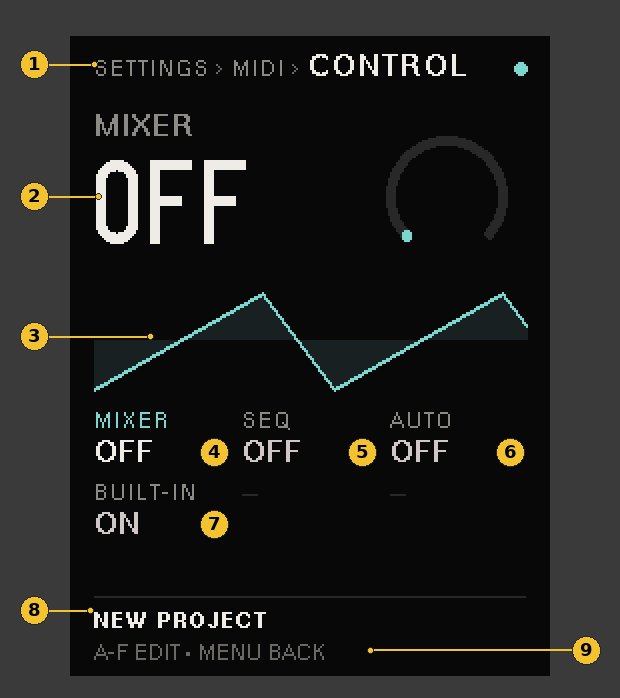
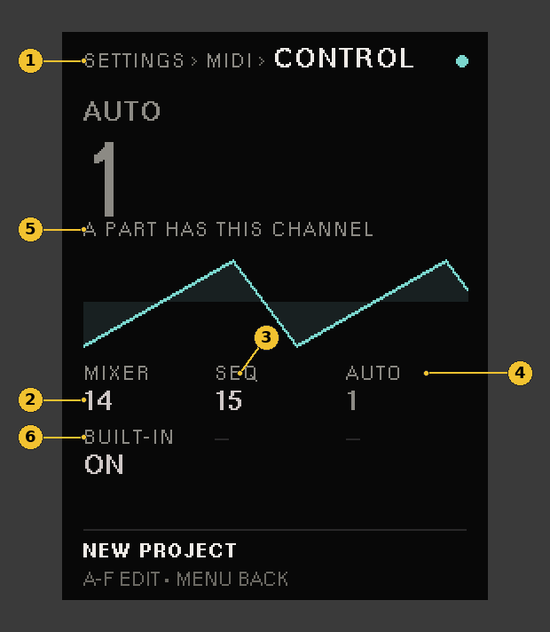
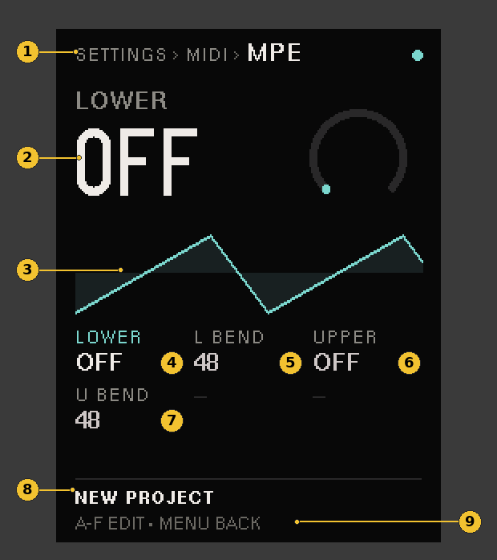
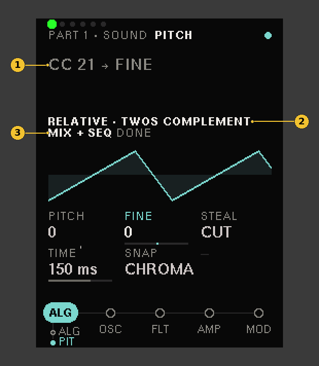
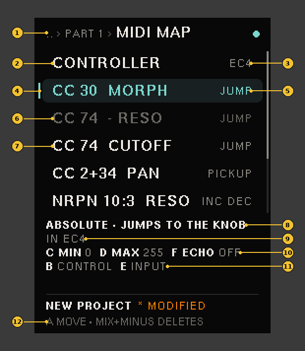
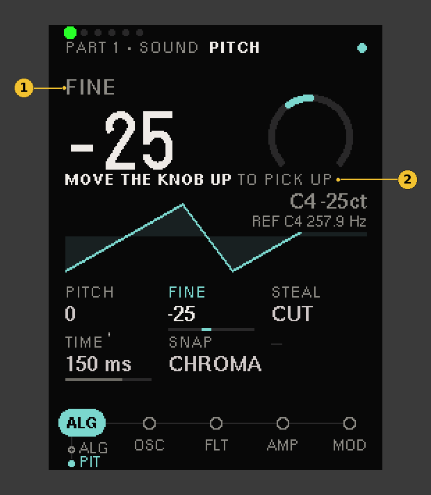
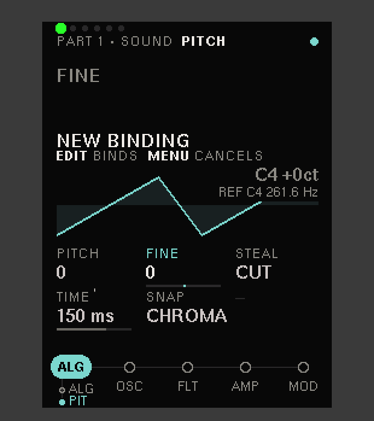
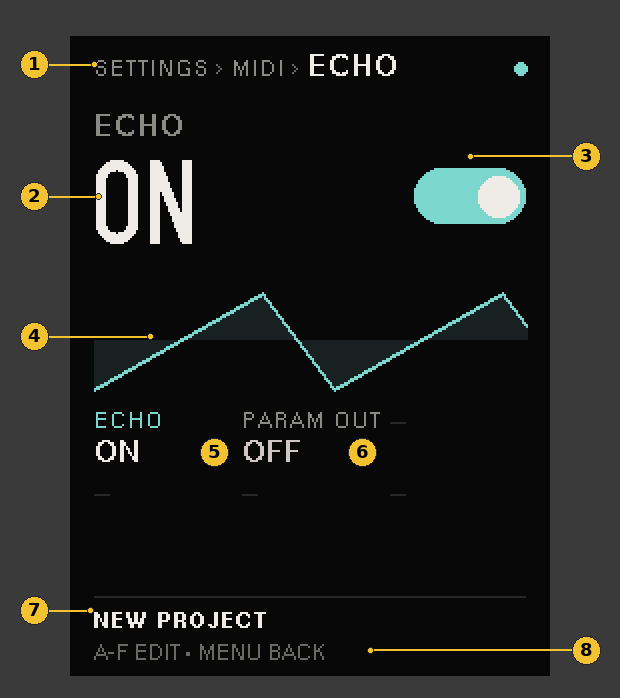

# MIDI, channels, maps and controllers

This chapter covers how Chimera listens and talks over MIDI, on the DIN ports and over USB: each Part's channel, the CONTROL CHANNELS, SYNC and program change, MPE, the built-in CCs, learn, the MIDI MAP page and controller maps, NRPN addresses, SysEx controllers, ECHO and PARAM OUT. The USB side (the port, audio, the console) is in [USB](17-usb.md); per-Part tunings and MIDI Tuning Standard are in [Tuning](15-tuning.md). On SETTINGS pages and on MIDI MAP, the letters **A** to **F** are encoders 1 to 6.

## MIDI: how Chimera listens

Chimera has six Parts. Each Part is its own instrument and listens on its own MIDI channel. Out of the box, Part *n* listens on channel *n*, over DIN and USB alike. Every Part on a channel plays what comes on it, so two Parts on one channel layer.

A Part answers, on its channel:

- notes, velocity, pitch bend, the sustain pedal, the mod wheel, channel and poly pressure;
- the [built-in CCs](#midi-the-built-in-ccs) (the General MIDI controllers), with no setup;
- the bindings in its [MIDI map](#midi-the-midi-map-page): the Sound's own rows and the Part's controller map;
- every stored cell's fixed [NRPN address](#midi-nrpn-addresses);
- program changes, when PROGRAM is on (see [program change](#midi-program-change-sounds-from-a-sequencer)).

Three more channels can be given a job of their own (MIXER, SEQUENCER and AUTO, see [CONTROL CHANNELS](#midi-control-channels-mixer-sequencer-and-auto)). MPE controllers play in zones (see [MPE](#midi-mpe-zones)).

**Why per Part, and no global CC chart:** each Part can play a different engine, and each engine has its own cells. A fixed chart for the whole unit could only name the cells every engine shares. So control lives with the Part: the General MIDI controllers work on every Part at once, a Sound carries the knobs it was voiced with, and a controller map set up once follows the Part through every Sound and every project.

The MIDI settings live in **SETTINGS › MIDI CONFIG**. Its rows are SYNC, PORT CONFIG (dimmed, marked LATER: not built), CHANNELS, CONTROL CHANNELS, ECHO and MPE. Everything on these pages is kept with the rest of SETTINGS on the unit, not in the project: it says how the unit is wired into your studio, which stays the same whichever project you load.

## MIDI: the SYNC page

**SETTINGS › MIDI CONFIG › SYNC** (SYN on the settings chain) holds two cells.



1. Header: `SETTINGS › MIDI › SYNC`.
2. The focused cell, large: its name and value.
3. The picture band.
4. **SYNC** (A): INT or EXT.
5. **PROGRAM** (B): OFF or ON.
6. Footer: the project's name and whether it has unsaved changes.
7. Footer: the keys this page answers to, `A-F EDIT · MENU BACK`.

| Cell | Options | Default | What it does |
|---|---|---|---|
| **SYNC** (A) | INT, EXT | EXT | Who drives ORBIT's transport: its own clock (INT) or a MIDI clock (EXT) |
| **PROGRAM** (B) | OFF, ON | OFF | Whether a program change loads a Sound (see [program change](#midi-program-change-sounds-from-a-sequencer)) |

**SYNC at EXT** lets a DAW or a sequencer drive [ORBIT](12-orbit.md):

- **Start** goes to bar 0 and plays. **Stop** stops. **Continue** plays on from where ORBIT is.
- ORBIT follows the clock's ticks. A clock alone never starts ORBIT; it only moves it once it plays.
- **B6** still plays and stops ORBIT. The last word wins: a B6 press or the DAW's Start, Continue or Stop.
- If the ticks stop for half a second, ORBIT's own clock takes over from where it is, at the tempo it had, so nothing jumps or stops.
- With no clock arriving at all, ORBIT runs free on B6, as under INT.

**SYNC at INT** ignores MIDI clock, Start, Continue and Stop: ORBIT keeps its own tempo. Notes still play. Use it when your rig's clock is meant for something else.

Switching SYNC forgets the other mode's clock and carries on from where ORBIT is, without a jump.

**Why EXT by default:** a DAW works out of the box, and with no clock arriving ORBIT still runs free on B6, so EXT costs a player with no DAW nothing. **Why SYNC is not in the project:** a project carried to a friend's unit, or loaded with the DAW off, must not bring a clock setting that fights the room.

## MIDI: the CHANNELS page

**SETTINGS › MIDI CONFIG › CHANNELS** (CHN on the settings chain) sets each Part's MIDI channel.



1. Header: `SETTINGS › MIDI › CHANNELS`.
2. The focused cell, large: its name and value.
3. The picture band.
4. **P1** (A): Part 1's channel.
5. **P2** (B): Part 2's channel.
6. **P3** (C): Part 3's channel.
7. **P4** (D): Part 4's channel.
8. **P5** (E): Part 5's channel.
9. **P6** (F): Part 6's channel.
10. Footer: the project's name and whether it has unsaved changes.
11. Footer: the keys this page answers to, `A-F EDIT · MENU BACK`.

| Cell | Range | Default | What it does |
|---|---|---|---|
| **P1** (A) | 1 to 16 | 1 | The channel Part 1 listens on, and echoes and sends on |
| **P2** (B) | 1 to 16 | 2 | The channel Part 2 listens on, and echoes and sends on |
| **P3** (C) | 1 to 16 | 3 | The channel Part 3 listens on, and echoes and sends on |
| **P4** (D) | 1 to 16 | 4 | The channel Part 4 listens on, and echoes and sends on |
| **P5** (E) | 1 to 16 | 5 | The channel Part 5 listens on, and echoes and sends on |
| **P6** (F) | 1 to 16 | 6 | The channel Part 6 listens on, and echoes and sends on |

These are the same values as each Part's channel on the mixer's Part page (see [the mixer](11-mixer-and-master-fx.md)): editing either edits both. The channels are saved in the project, as part of its mix.

To layer two Parts, put them on one channel. To play an MPE zone, put the Part on the zone's master channel (1 or 16, see [MPE](#midi-mpe-zones)).

## MIDI: CONTROL CHANNELS, MIXER, SEQUENCER and AUTO

**SETTINGS › MIDI CONFIG › CONTROL CHANNELS** (CTL on the settings chain) gives three channels a job of their own, beside the Parts' channels, and holds the switch for the built-in CCs.



1. Header: `SETTINGS › MIDI › CONTROL`.
2. The focused cell, large: its name and value.
3. The picture band.
4. **MIXER** (A): the mixer chart's channel, or OFF.
5. **SEQ** (B): SEQUENCER's channel, ORBIT's chart, or OFF. The big readout and the focus band name it SEQUENCER.
6. **AUTO** (C): the channel that plays the Part you are on, or OFF.
7. **BUILT-IN** (D): whether each Part answers the built-in CCs.
8. Footer: the project's name and whether it has unsaved changes.
9. Footer: the keys this page answers to, `A-F EDIT · MENU BACK`.

Here AUTO is set to Part 1's channel, so it reads dimmed and the band says why:



1. **Breadcrumb:** `SETTINGS › MIDI › CONTROL`.
2. **MIXER** (A), here 14.
3. **SEQ** (B), here 15.
4. **AUTO** (C): here `1`, Part 1's channel, so it reads dimmed: it does nothing.
5. **Why it is dimmed:** on a dimmed cell the band says which job has the channel: `A PART HAS THIS CHANNEL`, `MIXER HAS THIS CHANNEL`, `SEQUENCER HAS THIS CHANNEL` or `MPE HAS THIS CHANNEL`.
6. **BUILT-IN** (D): `ON` or `OFF`, whether each Part answers the [built-in CCs](#midi-the-built-in-ccs) on its own channel.

| Cell | Options | Default | What it does |
|---|---|---|---|
| **MIXER** (A) | OFF, 1 to 16 | OFF | The mixer and master FX chart's channel |
| **SEQUENCER** (B) | OFF, 1 to 16 | OFF | ORBIT's chart's channel |
| **AUTO** (C) | OFF, 1 to 16 | OFF | Plays the Part you are on |
| **BUILT-IN** (D) | OFF, ON | ON | Each Part answers the General MIDI CCs on its own channel |

A Part's own channel always wins: a CONTROL channel that a Part also listens on belongs to the Part, and its cell reads dimmed until you move one of them. When two CONTROL channels share a channel, MIXER wins over SEQUENCER, and SEQUENCER over AUTO. If you use MPE, keep these channels off its zones' channels.

The MIXER and SEQUENCER charts are fixed: learn does not bind on their channels, and a controller map does not apply there.

**Why all OFF by default:** a channel taken by default would steal notes from a setup that already used it, and MPE uses channel 16 as its upper zone's master and channels 2 to 15 as the lower zone's note channels.

> **Design note:** the split of track channels, an effects channel and an "auto" channel that follows the selected track comes straight from Elektron's Digitakt and Digitone, where AUTO CHANNEL and FX CONTROL CH have earned their keep on a lot of stages. Chimera adds a SEQUENCER channel for ORBIT, because a ring sequencer you can't drive from a footswitch is just a very pretty clock.

### MIDI: the AUTO channel

Notes, CCs, bend, pressure and the pedal sent on AUTO's channel play the Part you are on, as if you had sent them on that Part's channel: every Part on that channel plays them, and the Part's map answers the CCs, the built-in CCs included. Change Part and AUTO follows. A note you are holding, or the pedal, stays with the Part that started it until you let go, so nothing hangs.

**Why:** one keyboard set to one channel can play every Part in turn: pick the Part on the panel, and the keyboard follows.

### MIDI: the MIXER channel chart

On MIXER's channel these CCs move the mixer and the master FX, gliding as a knob does. They are plain 7-bit CCs (0 to 127); for finer steps on the FX, send their NRPNs. An NRPN of the FX's (CHORUS, DELAY, REVERB or COMP, by the [NRPN chart](https://joegiralt.github.io/chimera-releases/guides/nrpn)) moves it too, so you reach their other cells. Notes on MIXER's channel are ignored.

| CC | Part | Parameter |
|---|---|---|
| 20 | Part 1 | PART LEVEL |
| 21 | Part 2 | PART LEVEL |
| 22 | Part 3 | PART LEVEL |
| 23 | Part 4 | PART LEVEL |
| 24 | Part 5 | PART LEVEL |
| 25 | Part 6 | PART LEVEL |
| 26 | Part 1 | PART PAN |
| 27 | Part 2 | PART PAN |
| 28 | Part 3 | PART PAN |
| 29 | Part 4 | PART PAN |
| 30 | Part 5 | PART PAN |
| 31 | Part 6 | PART PAN |
| 41 | Part 1 | OUT CHORUS |
| 42 | Part 2 | OUT CHORUS |
| 43 | Part 3 | OUT CHORUS |
| 44 | Part 4 | OUT CHORUS |
| 45 | Part 5 | OUT CHORUS |
| 46 | Part 6 | OUT CHORUS |
| 47 | Part 1 | OUT DELAY |
| 48 | Part 2 | OUT DELAY |
| 49 | Part 3 | OUT DELAY |
| 50 | Part 4 | OUT DELAY |
| 51 | Part 5 | OUT DELAY |
| 52 | Part 6 | OUT DELAY |
| 53 | Part 1 | OUT REVERB |
| 54 | Part 2 | OUT REVERB |
| 55 | Part 3 | OUT REVERB |
| 56 | Part 4 | OUT REVERB |
| 57 | Part 5 | OUT REVERB |
| 58 | Part 6 | OUT REVERB |
| 70 | FX | CHORUS RATE |
| 71 | FX | CHORUS DEPTH |
| 72 | FX | CHORUS MIX |
| 73 | FX | DELAY TIME |
| 74 | FX | DELAY FDBK |
| 75 | FX | DELAY MECHANICS |
| 76 | FX | DELAY SAT |
| 77 | FX | DELAY TONE |
| 78 | FX | DELAY MIX |
| 79 | FX | DELAY REV |
| 80 | FX | DELAY SIZE |
| 81 | FX | DELAY DENSITY |
| 82 | FX | DELAY PITCH |
| 83 | FX | DELAY TEXTURE |
| 84 | FX | REVERB TIME |
| 85 | FX | REVERB DAMP |
| 86 | FX | REVERB SIZE |
| 87 | FX | REVERB MIX |
| 88 | FX | REVERB TONE |
| 89 | FX | REVERB DIFFUSE |
| 90 | FX | REVERB PRE-DLY |
| 91 | FX | REVERB SHAPE |
| 92 | FX | REVERB SMEAR |
| 93 | FX | REVERB RATE |
| 94 | FX | REVERB DENSITY |
| 102 | FX | COMP THRESH |
| 103 | FX | COMP ATK |
| 104 | FX | COMP REL |
| 105 | FX | COMP MAKEUP |
| 106 | FX | COMP MIX |
| 107 | FX | COMP VOL |
| 108 | FX | COMP PAN |

OUT CHORUS, OUT DELAY and OUT REVERB are the Part's Sound's sends. MIXER uses no CC that MIDI keeps for itself (bank select, data entry and its increment and decrement, RPN and NRPN select, the sustain pedal).

### MIDI: the SEQUENCER channel chart

On SEQUENCER's channel these CCs drive [ORBIT](12-orbit.md). PLAY/STOP and a ring's ON/OFF act as **B6** and **MIX + B*n*** do, each time the value rises past 63: a button that sends 127 and then 0 is one press. CHANCE, STEPS, KEY and SCALE step through their values across 0 to 127. A note on SEQUENCER's channel sets KEY to its pitch class: play an E and ORBIT's chords move to E.

| CC | Parameter |
|---|---|
| 20 | PLAY/STOP |
| 21 | RING1 ON/OFF |
| 22 | RING2 ON/OFF |
| 23 | RING3 ON/OFF |
| 24 | RING4 ON/OFF |
| 25 | RING5 ON/OFF |
| 26 | RING1 CHANCE |
| 27 | RING2 CHANCE |
| 28 | RING3 CHANCE |
| 29 | RING4 CHANCE |
| 30 | RING5 CHANCE |
| 102 | RING1 STEPS |
| 103 | RING2 STEPS |
| 104 | RING3 STEPS |
| 105 | RING4 STEPS |
| 106 | RING5 STEPS |
| 107 | ORBIT KEY |
| 108 | ORBIT SCALE |

## MIDI: MPE zones

An MPE controller (LinnStrument, Seaboard, Osmose and the like) sends each note on a channel of its own, so each finger bends, presses and slides its own note. Chimera plays MPE in zones:

- The **lower zone**: master channel 1, its notes on channels 2 and up.
- The **upper zone**: master channel 16, its notes on channels 15 and down.

A zone's notes play the Parts on its master channel: set a Part's channel to 1 for the lower zone (Part 1 is there already) or 16 for the upper. Parts on the zone's other channels don't hear them while the zone is on.

Each note's own pitch bend bends that note alone, over the zone's bend range. Its own pressure feeds PRESS and its own CC 74 feeds SLIDE in the [mod matrix](10-mod-matrix.md), for that note only. What comes on the master channel reaches every note of the zone: its bend on top of each note's (over the Part's BEND), its mod wheel, pressure and CC 74, and its sustain pedal and All Notes Off.

Most MPE controllers set the zones themselves when they start: their configuration message (RPN 6) turns a zone on with its channel count and sets its bend range to 48. You can also set them by hand on **SETTINGS › MIDI CONFIG › MPE** (MPE on the settings chain, the last row of MIDI CONFIG):



1. Header: `SETTINGS › MIDI › MPE`.
2. The focused cell, large: its name and value.
3. The picture band.
4. **LOWER** (A): the lower zone's note channels.
5. **L BEND** (B): the lower zone's note bend range.
6. **UPPER** (C): the upper zone's note channels.
7. **U BEND** (D): the upper zone's note bend range.
8. Footer: the project's name and whether it has unsaved changes.
9. Footer: the keys this page answers to, `A-F EDIT · MENU BACK`.

| Cell | Options | Default | What it does |
|---|---|---|---|
| **LOWER** (A) | OFF, 1 to 15 | OFF | How many note channels the lower zone has, counting up from channel 2; they play the Parts on channel 1 |
| **L BEND** (B) | 0 to 96 semitones | 48 | The lower zone's per-note bend range, each way |
| **UPPER** (C) | OFF, 1 to 15 | OFF | How many note channels the upper zone has, counting down from channel 15; they play the Parts on channel 16 |
| **U BEND** (D) | 0 to 96 semitones | 48 | The upper zone's per-note bend range, each way |

The zones never overlap: growing one shrinks the other. RPN 0 on a note channel sets its zone's bend range; on the master channel it sets the Part's BEND, as on any channel. With both zones OFF every channel is its own, as with any keyboard.

**Why zones play the master channel's Parts:** a Part already listens on one channel. Under MPE the master channel names the instrument, and the note channels are only how the controller carries each finger, so the Parts on the master channel play them all.

> **Design note:** the zones follow the MIDI Polyphonic Expression 1.0 specification to the letter: masters on 1 and 16, members growing inwards, CC 74 as the third dimension, 48 semitones of member bend unless told otherwise. Nothing clever, on purpose. MPE controllers are expensive, and nobody wants theirs to be the one that "almost works".

## MIDI: the mod wheel, pressure and slide

The [mod matrix](10-mod-matrix.md) has three rows for your hands, after NOTE:

- **WHEEL** (MOD WHEEL in the readout): the mod wheel, CC 1, on the Part's channel. At rest it is 0, fully up it is 1.
- **PRESS** (PRESSURE in the readout): aftertouch. Channel pressure moves every note on the Part's channel; poly pressure moves only the note whose key you press harder. Each note follows the higher of the two.
- **SLIDE**: CC 74 on the Part's channel, 0 to 1. Under MPE each note also has its own; each note follows the higher of the two.

They glide, so a fast wheel throw or a sudden squeeze never steps the sound. A new note starts with no poly pressure of its own; the channel's wheel and pressure carry on across notes, Sound loads and project loads.

A new Sound (INIT) comes with the wheel's vibrato as a route: WHEEL into LFO 1's DEPTH at +127, and LFO 1 into PITCH. LFO 1 rests at DEPTH 0, so the wheel down plays no vibrato and the wheel up plays it at full depth. Moving the wheel is playing, not editing: the Sound stays as it was saved. Factory Sounds that move LFO 1 keep the wheel they were voiced with, as a MIDI map row of CC 1 on LFO 1's DEPTH: there the wheel sets DEPTH itself, and the Sound shows as edited.

The wheel, CC 74 and channel pressure reach the MIDI map as well, so a binding on CC 1, CC 74 or PRESSURE keeps working beside a route.

## MIDI: the built-in CCs

Every Part answers the General MIDI controllers on its own channel, with no binding and no setup, so a DAW's mixer lanes, a GM sequence or a keyboard's sliders work at once:

| CC | Name | Moves |
|---|---|---|
| 7 | Volume | The Part's LEVEL |
| 10 | Pan | The Part's PAN |
| 11 | Expression | A swell on top of LEVEL (below) |
| 71 | Resonance | The filter's RESO |
| 72 | Release | Shifts the release from the Sound's own (64 is the Sound). ALGO: every operator's RR. VA and TAPE: ENV 1's REL. MODAL: DAMP |
| 73 | Attack | Shifts the attack from the Sound's own (64 is the Sound). ALGO: every operator's AR. VA and TAPE: ENV 1's ATK. MODAL: nothing |
| 74 | Brightness | The filter's CUTOFF |
| 91 | Reverb | The Sound's REVERB send |
| 93 | Chorus | The Sound's CHORUS send |
| 94 | Delay | The Sound's DELAY send |

- **Each glides** to its value as a knob does. A 0 to 127 sweep covers the cell's whole range. ATTACK and RELEASE are the exception.
- **ATTACK and RELEASE** shift the envelope that shapes the Part's loudness: 64 is the Sound as it is, above 64 is longer, below is shorter. They move each cell from its own value, so an ALGO patch keeps the shape of its six operators' envelopes. On VA and TAPE that is ENV 1's ATK and REL, 1/127 of the range a step. On ALGO it is every operator's AR or RR, turned round (a higher rate is a shorter time): 64 to 127 is 15 AR steps slower and 7 RR steps longer, and AR never reaches 0, which never rises. MODAL rings until DAMP stops it, so RELEASE shifts DAMP; its strike has no attack. The cells on the page show the shifted values, and saving the Sound keeps them as they sound; from then on 64 is the Sound as saved. A Sound load starts again from that Sound, and Reset All Controllers (CC 121) takes the shifts back to 64.
- **Expression** (CC 11) turns the whole Part down from its LEVEL, its sends to the master FX too: 127 is the Part as set, 64 about 12 dB under it, 0 silent. It is playing, not editing: it is never saved, leaves no `*`, and is back at 127 after a project load, NEW, or a Reset All Controllers.
- **Your bindings come first.** When the Sound's own rows or the Part's controller map bind a CC, that binding moves and the built-in CC does nothing. Bind CC 74 to MORPH and CC 74 drives MORPH.
- **With MPE**, CC 74 on a zone's master channel is SLIDE only and leaves CUTOFF alone; the other built-in CCs still answer there. On a zone's note channels every CC is the note's own.
- **AUTO** plays the Part you are on, so built-in CCs sent there move that Part. MIXER's and SEQUENCER's channels are never a Part's, so their charts never meet these.

To turn the built-in CCs off (when a controller sends CC 7 or CC 74 for something else and you'd rather not bind it), set **BUILT-IN** to OFF on [CONTROL CHANNELS](#midi-control-channels-mixer-sequencer-and-auto).

**Why these numbers:** they are the numbers General MIDI and the MIDI sound-controller recommendation give volume, pan, expression, resonance, release, attack, brightness and the effect sends. Any gear that speaks General MIDI reaches the same controls on Chimera without setup.

## MIDI: what a binding can drive

A binding ties one control on your controller to one cell. It can drive:

- **The Sound's cells:** every engine, filter, envelope, LFO, FX slot and output cell, but the patching jacks.
- **The Part's LEVEL and PAN.**
- **The master FX's knobs:** CHORUS, DELAY, REVERB and MASTER, each continuous cell (RATE, TIME, MIX…). Their TYPE and MODE switches stay on the panel, and so does the delay's SYNC. The delay's TIME is two cells, its ms under FREE and its note under SYNC, and each takes its own binding: learn TIME while SYNC is on to turn the notes from a controller.
- **ORBIT's ring amounts**, per ring: HITS, ROTATE, CHANCE, MUTATE, GATE, VEL, ACCENT and OCTAVE. STEPS, MUTE, a ring's choices and the chord ring stay on the panel.

The MOD MATRIX's routes are not cells a control may drive, and neither are a DRUM kit's pad cells.

The master FX and ORBIT are shared by every Part, but a binding to them still lives in one Part's map and listens on that Part's channel: the Part you learned it on owns it. If two Parts bind the same cell, both move it, and the last message wins. A ring amount moves the playing scene and its saved slot, as a turn on its page does. A fader on HITS or ROTATE covers the ring as it is now, 0 to STEPS or 0 to STEPS − 1, once over its travel.

A binding's control can be:

- a **CC** (`CC 74`): a knob, fader, endless encoder or button;
- a **14-bit CC pair** (`CC 2+34`): a fine control that sends CC *n* and then CC *n* + 32 (CC 1 to 31 with their partners);
- an **NRPN** (`NRPN 10:3`): a sequencer lane or a high-resolution control;
- **PRESSURE**: channel aftertouch;
- a **SysEx message** (`SYSEX 9`): a knob on an old programmer that edits a synth by SysEx (see [SysEx controllers](#midi-sysex-controllers)).

## MIDI: learn

Learn binds the control you move to the cell you touched.

1. Touch the cell you want to control (turn its encoder a notch), on a Part's page, a master FX page or an ORBIT page.
2. Hold **MIX** and press **SEQ**. The value line reads `MOVE A KNOB · CUTOFF` (the cell's name).
3. Move the control on your controller. The binding is written at once, and Chimera listens on to tell what kind of control it is.
4. Turn it right, then left. Chimera guesses the kind and shows the guess in words.
5. Press **MIX + SEQ** again to keep the guess. A page change, a nav key or a turn of one of Chimera's own encoders also ends learn.

While learn listens, the control you are teaching moves nothing. A learned row goes into the Sound's own rows.



1. **The binding:** the control heard and the cell it drives (`CC 21 → FINE`).
2. **The guess**, in the value's place: `TURN IT RIGHT, THEN LEFT` until Chimera is sure, then the kind it heard (`RELATIVE · TWOS COMPLEMENT`).
3. **The hint:** `MIX + SEQ  DONE` once the guess is sure. Press it to finish.

The guesses are `ABSOLUTE` (a knob or fader), `RELATIVE · TWOS COMPLEMENT`, `RELATIVE · BINARY OFFSET` and the other relative encodings (an endless encoder), `BUTTON`, `14-BIT CC` and `INC DEC` (NRPN increment and decrement). A wrong guess is fixed on MIDI MAP with **E**.

Learn refuses, and says why:

- `NOT MAPPABLE`: the cell can't be mapped;
- `CC 21 ON CH 3, PART ON CH 1`: the control came in on another channel than the Part's;
- `CC 64 RESERVED`: a CC Chimera keeps for itself (the sustain pedal, bank select, data entry, NRPN and RPN select, and the channel mode messages);
- `MAP FULL`: the Sound already holds 16 rows.

Learning a relative encoder or a 14-bit control turns its **ECHO** on, so a controller with LED rings shows the value. Knobs, faders, buttons and pressure learn with ECHO off.

**Why learn guesses:** controllers send endless encoders in four different relative codes and rarely say which. Turning right then left is enough for Chimera to tell them apart, so you never have to look up your controller's manual.

## MIDI: SysEx controllers

Old programmers and hardware editors made to edit another synth by SysEx can drive Chimera's cells too. They send one message a parameter, with the value in one byte (or two) and often a checksum at the end.

1. Touch the cell and press **MIX + SEQ**, as for any learn.
2. Move the knob on the box slowly, so it sends at least two different values. Chimera compares two of its messages to find the byte the value sits in and maps the cell to it.
3. Keep turning: a box that sends a 14-bit value (two bytes) shows it when the knob crosses from one coarse step to the next, and Chimera then reads both bytes. Press **MIX + SEQ** to finish.

From then on, that message moves the cell from its lowest to its highest value, gliding as a CC does. A message for another parameter of the box (another address) moves nothing. SysEx bindings listen on every Part whose Sound holds them, whatever the channel, since a box addresses a synth, not a channel.

On MIDI MAP a SysEx binding reads `SYSEX` and the byte its value is in, counting F0 as the first (`SYSEX 9`). It is always absolute and JUMP, and has no ECHO: Chimera can't send the box its message back.

Messages up to 32 bytes are heard. A box that splits one value over two bytes as two 4-bit halves (nibbles) is read as a 14-bit value and won't reach the whole range.

> **Design note:** learn finds the value by diffing two messages from the same knob and skipping a Roland-style checksum at the end. It means a programmer built for a synth from decades ago can drive a filter it has never heard of. The box is none the wiser, and frankly, it's had a long career and deserves a gentle retirement gig.

## MIDI: the MIDI MAP page

**SETTINGS › PART › MIDI MAP** (MAP in the editor's schemas) shows the current Part's bindings, one a row:

1. **`CONTROLLER`**, the first row: the Part's [controller map](#midi-controller-maps), or `NONE`.
2. The controller map's rows, each spelled out `IN <map name>`.
3. The Sound's own rows (up to 16).
4. **`+ NEW BINDING`**, the last row: [adds a row by pointing](#midi-adding-a-row-by-pointing).

With no bindings the page reads `NO CCS · MIX+SEQ ON A CELL` under the first rows.

Here Part 1 plays the controller map `EC4`, with two rows, above its Sound's own rows.



1. **Breadcrumb:** the Part whose map this is.
2. **`CONTROLLER`:** the first row, the Part's controller map.
3. **The map's name**, or `NONE`.
4. **The bar**, here on the controller map's first row: `CC 30`, the control, then `MORPH`, the cell it drives. **A** moves the bar. A control reads `CC 74`, `CC 2+34`, `NRPN 10:3`, `PRESSURE` or `SYSEX 9`. A master FX or ORBIT cell names its block first: `REVERB MIX`, `RING 1 CHANCE`.
5. **How it moves**, in short: the INPUT kind, such as `JUMP`.
6. **A dimmed row** does nothing now. A controller map's row is dimmed when the Sound binds the same control (here CC 74, the Sound's CUTOFF). Any row is dimmed when it drives a cell the Part's engine doesn't have (`- STRUCT`, a MODAL cell on an ALGO Sound); it works again when the Part plays that engine.
7. **The Sound's own rows**, after the controller map's.
8. **The bar's binding, spelled out:** its kind in full words. For a relative encoding, the line below gives the bytes it sends for one step right and one step left, as controller manuals print them.
9. **`IN EC4`:** the row belongs to the controller map, not the Sound.
10. **C MIN** and **D MAX**: the part of the cell's range the control sweeps, 0 to 255 places; MAX below MIN turns the control round. **F ECHO**: `ON` sends the cell's value back to the controller.
11. **B CONTROL** and **E INPUT**: the keys for the control's number and how it moves the cell. Current firmware also shows **EDIT TARGET** here (see [pointing](#midi-adding-a-row-by-pointing)).
12. **The footer:** `A MOVE · MIX+MINUS DELETES`.

### MIDI: the keys on a MIDI MAP row

| Key | On a binding row | On `CONTROLLER` |
|---|---|---|
| **A** | Moves the bar | Moves the bar |
| **B** | CONTROL: the CC number. An NRPN, PRESSURE or SysEx control is fixed (`B FIXED`): learn it again to change it | PICK: steps through the maps on the card and `NONE` |
| **C** | MIN, 0 to 255 | |
| **D** | MAX, 0 to 255 | |
| **E** | INPUT, the response kind (below) | |
| **F** | ECHO, OFF or ON | |
| **EDIT** | TARGET: points the row at another cell | SAVE ROWS TO MAP (see [saving a map](#midi-saving-a-controller-map)) |
| **MIX + C** or **MIX + D** | FINE: MIN or MAX one place a frame, however fast you turn | |
| **MIX + MINUS** | DELETE: asks `DELETE CC 74?` over the cell's name, then removes the row | DELETE: asks `DELETE MAP?`, then deletes the picked map from the card |
| **MIX + PLUS** | | KEEP MAP on or off (see [KEEP MAP](#midi-keep-map-keeping-the-parts-rows)) |
| **MIX + EDIT** | | RENAME the picked map |

Each row's hint line names only the keys it answers: `B CONTROL  E INPUT  EDIT TARGET`, or `B FIXED  E INPUT  EDIT TARGET` on a fixed control. With **MIX** held on a binding row it reads `MIX+C/D FINE  MIX+MINUS DELETE`. On `CONTROLLER` it reads `B PICK  EDIT SAVE ROWS TO MAP`, or with a map picked `EDIT SAVE  MIX+MINUS DELETE`, with `MIX+EDIT RENAME` on the line under the row.

A Sound row's edit is an edit of the Sound: the Sound shows `*`, and saving or reverting the Sound keeps or drops it. A controller map row's edit changes the map on the card (see [changing map rows](#midi-changing-and-deleting-map-rows)); the Sound is not changed.

**Why MIN and MAX have 256 places:** that is already twice a 7-bit control's resolution, so more would not be heard from a CC. The FINE gesture is there because an accelerated turn jumps several places at once, which made a range hard to set exactly.

### MIDI: the INPUT response kinds

**E INPUT** steps through the kinds the control can be. The row shows the short form; the line under the rows spells it out.

| Row | Spelled out | Line below | For |
|---|---|---|---|
| `JUMP` | `ABSOLUTE · JUMPS TO THE KNOB` | | A knob or fader. The cell glides to the knob's place at once. The default |
| `PICKUP` | `ABSOLUTE · WAITS TO PICK UP` | | A knob or fader. Nothing moves until the knob reaches the cell's value |
| `SCALE` | `ABSOLUTE · SCALES TO MEET` | | A knob or fader. The cell moves at once, scaled so knob and value meet at the ends |
| `TWOS COMP` | `RELATIVE · TWOS COMPLEMENT` | `+1 = 1  -1 = 127` | Endless encoders that send 1 for right and 127 for left |
| `OFFSET` | `RELATIVE · BINARY OFFSET` | `+1 = 65  -1 = 63` | 65 for right, 63 for left |
| `SIGNED` | `RELATIVE · SIGNED BIT` | `+1 = 1  -1 = 65` | 1 for right, 65 for left |
| `SIGNED 2` | `RELATIVE · SIGNED BIT 2` | `+1 = 65  -1 = 1` | 65 for right, 1 for left |
| `INC DEC` | `RELATIVE · NRPN` | `INCREMENT AND DECREMENT` | An NRPN sent as data increment and decrement |
| `MOMENTARY` | `BUTTON · HELD IS MAX` | | A button: held is MAX, let go is MIN |
| `TOGGLE` | `BUTTON · EACH PRESS FLIPS` | | A button: each press flips between MIN and MAX |

Which kinds each control offers (the editor's schema spells them TWOS-COMP, SIGNED-2 and INC-DEC):

| Control | Kinds |
|---|---|
| CC | JUMP, PICKUP, SCALE, TWOS COMP, OFFSET, SIGNED, SIGNED 2, MOMENTARY, TOGGLE |
| 14-bit CC pair (CC14) | JUMP, PICKUP, SCALE |
| NRPN | JUMP, PICKUP, SCALE, TWOS COMP, OFFSET, SIGNED, SIGNED 2, INC DEC, MOMENTARY, TOGGLE |
| PRESSURE (PRESS) | JUMP, PICKUP, SCALE |
| SysEx (SYSEX) | JUMP |

A relative encoder turns the cell exactly as Chimera's own encoder does, a step a detent.

### MIDI: pickup

A binding on PICKUP waits for the knob. While it waits, the touched cell's value line says which way to move it.



1. **The touched cell**, FINE, bound to a PICKUP knob that sits below its value.
2. **The hint:** `MOVE THE KNOB UP TO PICK UP` (or `DOWN`). It clears as soon as the knob reaches the value; from then on the knob moves the cell.

The hint shows while HINTS is on at SETTINGS › PERSONALIZE › THEME.

**Why PICKUP exists:** after a Sound load the knob on your controller and the cell rarely agree. JUMP moves the cell to the knob at once (smoothly, never a step); PICKUP leaves the sound alone until you reach it, as many hardware synths do; SCALE moves at once but meets the knob at its ends. Pick the one that suits how you play.

### MIDI: adding a row by pointing

You can add a binding without the controller in hand, and choose its CC by number afterwards.



1. On MIDI MAP, put the bar on the last row, `+ NEW BINDING` (its lines read `POINT AT A CELL` and `ITS CC IS SET ON ITS ROW`), and press **EDIT**.
2. Chimera opens the page you came to SETTINGS from (or the Part's engine page). The value line reads `NEW BINDING`, the hint `A-F POINT  MENU CANCELS`.
3. Walk the pages with **EDIT** as usual, through the Part's pages, the mixer, the FX and ORBIT. Turn the encoder of the cell you want: the turn points at it and changes nothing. The hint becomes `EDIT BINDS  MENU CANCELS`.
4. Press **EDIT**. MIDI MAP opens again, the bar on the new row.
5. Set its CC with **B**, then MIN, MAX, INPUT and ECHO as on any row.

With a controller map picked, the new row joins the map; with `NONE`, the Sound. Its control is the first free CC that is not CC 1 (the wheel), not a [built-in CC](#midi-the-built-in-ccs), and not on any other row of the Part, so a new row never hides another.

**EDIT** on any binding row points at a new cell for it the same way (the value line reads `NEW TARGET`): only its cell changes, and its control, MIN, MAX, INPUT and ECHO stay.

While pointing:

- A cell that can't be mapped reads `NOT MAPPABLE  MENU CANCELS`; a cell another row already drives reads `ALREADY BOUND  MENU CANCELS`. **EDIT** then walks on instead of binding. The MOD MATRIX's routes can't be bound.
- **MENU** cancels, tapped or held (held, it does not quick-save while pointing), and opens MIDI MAP again.
- **MIX + SEQ** does nothing; learn can't start.
- Loading a Sound into the Part (by the Sound rung, the library or a program change), going to another Part, or opening SETTINGS ends pointing.
- If the bind can't happen, a message says why and MIDI MAP opens: `BINDING GONE` (the row went while you pointed) or `NO FREE CC`.
- When the list the new row would join is full, `+ NEW BINDING` reads dimmed, `MAP FULL` and `DELETE A ROW FIRST`, and **EDIT** does nothing.

**Why EDIT binds only when the hint says so:** EDIT also walks the pages, so it binds only when you have turned a cell's encoder on the page you are looking at. A stray EDIT never binds the wrong cell.

## MIDI: controller maps

A controller map is a named list of bindings on the card (FADERFOX, CIRKLON, LCXL3…), up to 90 rows, kept apart from any Sound or project. A Part picks one on MIDI MAP's first row, so a controller is set up once and works in every project.

- **Any map plays on any engine.** A row for a cell the Part's engine doesn't have (MORPH on a VA Part) is dimmed and does nothing, and comes alive when the Part switches to that engine.
- **Parts can share a map.** They play the same rows, and a change to the map reaches all of them at once.
- **The Sound's own rows win:** when the Sound and the map both bind a control, the Sound's row moves and the map's row is dimmed.
- **The project remembers each Part's map by name.** It is read from the card when the project loads or the Part picks it, and it stays with the Part through every Sound load.
- **A Part plays 16 of a map's rows at a time.** A map's ECHO rows take the Part's 16 binding slots first when the Part picks it, then its other rows in order. A control you move whose row has no slot takes the slot heard least recently, so the knobs being played always play. A row taking a slot starts fresh: a PICKUP row waits to pick up again.

**Why maps are files on the card and not in the project:** a controller is part of your studio, not of a song. Kept on the card, one map serves every project, and an edit to it reaches every project that uses it.

> **Design note:** a controller map is a sequencer's instrument definition run in reverse: the Hapax or the Cirklon says "this knob sends that", and Chimera says "that message moves this". The per-track maps on Elektron's boxes showed how comfortable it is when the knobs simply stay put.

### MIDI: picking a controller map

1. Go to **SETTINGS › PART › MIDI MAP**. The bar is on `CONTROLLER`; the row names the Part's map, or `NONE`.
2. Turn **B** to step through the maps on the card and `NONE`. The Part plays the map at once, and its rows show below the first row.

MIDI MAP lists up to 16 maps: the five factory maps and 11 of your own. With more on the card and no map picked, `CARD HOLDS MORE: 16 SHOWN` shows under the first row.

### MIDI: saving a controller map

1. Learn the controls you want on the Part with **MIX + SEQ**. They become the Sound's own rows.
2. On MIDI MAP, with the bar on `CONTROLLER`, press **EDIT** (`SAVE ROWS TO MAP`). NAMING opens on the Part's map's name (`CONTROLLER` if it has none).
3. Keep the name to update that map, or type a new one, and press **EDIT**.

The Sound's rows move into the map, each replacing the map row on its control or cell, and go after the map's other rows. The Part then plays the saved map, and its Sound's own rows are empty, so the Sound shows `*` until you save or revert it. Saving under a new name copies the Part's map first, then adds the rows.

- A save past 90 rows is refused with `MAP FULL`, and nothing is written.
- Two names can share a file pair (see [maps on the card](#midi-controller-maps-on-the-card)): a save whose files hold another map is refused with `NAME TAKEN`, and that map stays as it was.

To add another engine's cells to a map, switch the Part's engine, learn them and save under the same name.

### MIDI: KEEP MAP, keeping the Part's rows

A controller map already stays with the Part through any Sound load. The Sound's own rows don't: they belong to the Sound, so loading another Sound brings that Sound's rows. To browse Sounds with the rows you learned, turn on KEEP MAP:

1. On MIDI MAP, with the bar on `CONTROLLER`, press **MIX + PLUS**. The line under the row reads `MIX + PLUS KEEP MAP ON`.
2. Load Sounds into the Part as usual. Each one plays the Part's rows, not its own.

Kept rows don't count as an edit: a Sound loaded this way shows no `*`, and the next load asks nothing. Any other change to the Sound still shows `*` and asks. Rows learned or changed while KEEP MAP is on are kept from then on; they show `*` like any edit, so the next load asks once (REPLACE keeps them). A revert keeps the rows too.

Press **MIX + PLUS** again to turn it off (`MIX + PLUS KEEP MAP OFF`). If the Part's rows differ from its Sound's, the Sound then shows `*`: save it to keep the rows in the Sound, or revert it to take the Sound's own. KEEP MAP is not saved: it is off for every Part after a project loads or the unit starts.

**Why kept rows are not an edit:** if they were, every load after the first would stop at the "save first?" question, and browsing would mean answering a prompt at every step.

> **Design note:** this is the same idea as locking a control surface to a device in a DAW, so the knobs stay yours while the presets change underneath them. It's also the cure for the classic "I spent ten minutes mapping, loaded one preset, and now I'm sad" experience.

### MIDI: changing and deleting map rows

- **To change a map row**, put the bar on it and turn **B** to **F**, as on a Sound's row. The row changes at once, for every Part on the map, and is written to the map on the card a moment later. Or learn the same control on the Part (it hides the map's row), then save.
- **To point a map row at another cell**, press **EDIT** on it and point, as in [pointing](#midi-adding-a-row-by-pointing).
- **To delete a map row**, put the bar on it and press **MIX + MINUS**. Chimera asks, then removes the row, and the card's copy follows.

If the map has left the card since it was read, Chimera says `FILE NOT FOUND` and writes nothing.

### MIDI: renaming and deleting a controller map

With the bar on `CONTROLLER` and a map picked:

- **To rename the map**, press **MIX + EDIT**. NAMING opens on the map's name (`RENAME MAP`). Type the new name and press **EDIT**. Every Part playing the map plays it under its new name. A name another map already has is refused with `NAME TAKEN`, and nothing changes.
- **To delete the map**, press **MIX + MINUS**. Chimera asks `DELETE MAP?` with the map's name, then deletes it from the card. Every Part that played it plays `NONE`.

### MIDI: controller maps on the card

Maps live in `/CHIMERA/MAPS`, one pair of files a map (`FADE3C04.A` and `.B`): up to four letters of the name, then four characters made from the whole name. The map's full name is inside the file, so MIDI MAP lists it by that name whatever the file is called.

The card is inside the case. To copy maps to and from a computer, use the bootloader's SD card access (hold **MENU** at power-on, then button 3), or Chimera's `chimera-usb.py` tool over the USB console (see [USB](17-usb.md) and [the card](16-card-sounds-library.md)):

```
python3 chimera-usb.py ls maps
python3 chimera-usb.py get /CHIMERA/MAPS/FADE3C04 faderfox.map
python3 chimera-usb.py put faderfox.map /CHIMERA/MAPS/
```

`ls maps` lists the files. `get` copies a map off the card into a file on the computer; it never writes over a file already there. `put` copies a map file onto the card under its name's files, replacing a map of the same name; a Part playing that map plays the new one at once.

### MIDI: the factory maps

The factory set's `CHIMERA/MAPS` holds one map an engine, named after it: **ALGO**, **MODAL**, **VA**, **TAPE** and **DRUM**. Each is a starting point for a box of knobs or faders: set them to send these CCs on the Part's channel, and pick the map on MIDI MAP.

- The cells every engine has (both ENV TYPEs' cells, the LFOs, the filter, the voice and the output) sit on the same CCs in every map; then the engine's own cells follow.
- The CCs avoid the [built-in CCs](#midi-the-built-in-ccs), the wheel, breath, foot and the pedals (CC 1, 2, 4, 64 to 69, 84), and CC 16 to 19, which factory Sounds' own rows use. CUTOFF, RESONANCE and the sends are left to the built-in CCs.
- Every row is absolute, `JUMP`, with ECHO off; change one to PICKUP with **E**.
- DRUM's pads have no mappable cells, so DRUM's own rows are the master FX.

To change a factory map, save it under a new name first (**EDIT** on `CONTROLLER`), then edit that copy: copying the factory set onto the card again puts the factory maps back over any edit.

Every engine's map holds these rows:

| CC | Cell |
|---|---|
| 3 | ENV 1 ATK |
| 9 | ENV 1 DEC |
| 14 | ENV 1 SUS |
| 15 | ENV 1 REL |
| 20 | ENV 1 RISE |
| 21 | ENV 1 FALL |
| 22 | ENV 1 SHAPE |
| 23 | ENV 1 TIME |
| 24 | ENV 1 LEVEL |
| 25 | ENV 2 ATK |
| 26 | ENV 2 DEC |
| 27 | ENV 2 SUS |
| 28 | ENV 2 REL |
| 29 | ENV 2 RISE |
| 30 | ENV 2 FALL |
| 31 | ENV 2 SHAPE |
| 85 | ENV 2 TIME |
| 86 | ENV 2 LEVEL |
| 87 | LFO 1 RATE |
| 88 | LFO 1 DEPTH |
| 89 | LFO 1 OFST |
| 90 | LFO 1 RISE |
| 102 | LFO 1 FALL |
| 103 | LFO 2 RATE |
| 104 | LFO 2 DEPTH |
| 105 | LFO 2 OFST |
| 106 | LFO 2 RISE |
| 107 | LFO 2 FALL |
| 108 | LFO 3 RATE |
| 109 | LFO 3 DEPTH |
| 110 | LFO 3 OFST |
| 111 | LFO 3 RISE |
| 112 | LFO 3 FALL |
| 113 | FILTER INPUT LEVEL |
| 114 | FILTER STAB |
| 115 | FILTER FEEDBACK |
| 116 | FILTER SEM MODE |
| 117 | FX AMOUNT |
| 118 | FX SHAPE |
| 119 | FX LEVEL |
| 5 | FX MIX |
| 8 | VOICE FINE |
| 12 | VOICE TIME |
| 13 | OUTPUT LEVEL |
| 33 | OUTPUT PAN |
| 34 | OUTPUT VCA |
| 35 | OUTPUT VEL |
| 36 | OUTPUT LPG |
| 37 | OUTPUT DECAY |
| 39 | OUTPUT STRIKE |
| 40 | OUTPUT WIDTH |

ALGO (`ALGODE32.A`, 86 rows), after those:

| CC | Cell |
|---|---|
| 41 | ALG A |
| 42 | ALG B |
| 43 | MORPH |
| 44 | TRNSP |
| 45 | VOWEL |
| 46 | OPERATOR 1 WAVE |
| 47 | OPERATOR 2 WAVE |
| 48 | OPERATOR 3 WAVE |
| 49 | OPERATOR 4 WAVE |
| 50 | OPERATOR 5 WAVE |
| 51 | OPERATOR 6 WAVE |
| 52 | OPERATOR 1 CRSE |
| 53 | OPERATOR 2 CRSE |
| 54 | OPERATOR 3 CRSE |
| 55 | OPERATOR 4 CRSE |
| 56 | OPERATOR 5 CRSE |
| 57 | OPERATOR 6 CRSE |
| 58 | OPERATOR 1 FINE |
| 59 | OPERATOR 2 FINE |
| 60 | OPERATOR 3 FINE |
| 61 | OPERATOR 4 FINE |
| 62 | OPERATOR 5 FINE |
| 63 | OPERATOR 6 FINE |
| 70 | OPERATOR 1 DETUN |
| 75 | OPERATOR 2 DETUN |
| 76 | OPERATOR 3 DETUN |
| 77 | OPERATOR 4 DETUN |
| 78 | OPERATOR 5 DETUN |
| 79 | OPERATOR 6 DETUN |
| 80 | OPERATOR 1 LEVEL |
| 81 | OPERATOR 2 LEVEL |
| 82 | OPERATOR 3 LEVEL |
| 83 | OPERATOR 4 LEVEL |
| 92 | OPERATOR 5 LEVEL |
| 95 | OPERATOR 6 LEVEL |

MODAL (`MODA3D52.A`, 77 rows), after those:

| CC | Cell |
|---|---|
| 41 | MODEL |
| 42 | EXCITE |
| 43 | BRIGHT |
| 44 | POS |
| 45 | BODY |
| 46 | ENS.D |
| 47 | ENS.R |
| 48 | ENS.M |
| 49 | DAMP |
| 50 | STRUCT |
| 51 | COUPLE |
| 52 | HALO |
| 53 | MODES |
| 54 | FORCE |
| 55 | SPEED |
| 56 | COLOR |
| 57 | BURST |
| 58 | ENV 3 ATK |
| 59 | ENV 3 DEC |
| 60 | ENV 3 SUS |
| 61 | ENV 3 REL |
| 62 | ENV 3 RISE |
| 63 | ENV 3 FALL |
| 70 | ENV 3 SHAPE |
| 75 | ENV 3 TIME |
| 76 | ENV 3 LEVEL |

VA (`VA2B02.A`, 74 rows), after those:

| CC | Cell |
|---|---|
| 41 | WAVE1 |
| 42 | WAVE2 |
| 43 | MODE |
| 44 | AMNT |
| 45 | SUB |
| 46 | STAB |
| 47 | CRSE1 |
| 48 | FINE1 |
| 49 | SHAPE1 |
| 50 | CRSE2 |
| 51 | FINE2 |
| 52 | SHAPE2 |
| 53 | KIND |
| 54 | NOISE |
| 55 | ENV 3 ATK |
| 56 | ENV 3 DEC |
| 57 | ENV 3 SUS |
| 58 | ENV 3 REL |
| 59 | ENV 3 RISE |
| 60 | ENV 3 FALL |
| 61 | ENV 3 SHAPE |
| 62 | ENV 3 TIME |
| 63 | ENV 3 LEVEL |

TAPE (`TAPE2C4E.A`, 84 rows), after those:

| CC | Cell |
|---|---|
| 41 | MODEL |
| 42 | START |
| 43 | END |
| 44 | POSITION (WALK POSITION, STRCH POSITION, SCRUB FINGER, WAVE FRAME) |
| 45 | MOTION (STRCH SPEED, SCRUB SPEED, WAVE SCAN) |
| 46 | TAPE |
| 47 | AGE |
| 48 | SIZE (WALK LENGTH, STRCH D-TIME, SCRUB LENGTH, WAVE RANGE) |
| 49 | XFADE (WALK XFADE, SCRUB XFADE) |
| 50 | DRAG (WALK FADE, SCRUB DRAG) |
| 51 | TYPE (STRCH TYPE) |
| 52 | ROOT |
| 53 | PERIOD |
| 54 | SLICE |
| 55 | WOW |
| 56 | DIRECTION (WALK DIRECTION) |
| 57 | RETRIG (WALK RETRIG) |
| 58 | TRON (WALK TRON) |
| 59 | DRIFT (WALK DRIFT) |
| 60 | KEY (SCRUB KEY) |
| 61 | LENGTH (STRCH LENGTH) |
| 62 | GRAIN (STRCH GRAIN) |
| 63 | SPRAY (STRCH SPRAY) |
| 70 | FINISH (STRCH END) |
| 75 | ENV 3 ATK |
| 76 | ENV 3 DEC |
| 77 | ENV 3 SUS |
| 78 | ENV 3 REL |
| 79 | ENV 3 RISE |
| 80 | ENV 3 FALL |
| 81 | ENV 3 SHAPE |
| 82 | ENV 3 TIME |
| 83 | ENV 3 LEVEL |

DRUM (`DRUME1A7.A`, 86 rows), after those:

| CC | Cell |
|---|---|
| 41 | CHORUS RATE |
| 42 | CHORUS DEPTH |
| 43 | CHORUS MIX |
| 44 | DELAY TIME |
| 45 | DELAY FDBK |
| 46 | DELAY MECHANICS |
| 47 | DELAY SAT |
| 48 | DELAY TONE |
| 49 | DELAY MIX |
| 50 | DELAY REV |
| 51 | DELAY SIZE |
| 52 | DELAY DENSITY |
| 53 | DELAY PITCH |
| 54 | DELAY TEXTURE |
| 55 | DELAY NOTE |
| 56 | REVERB TIME |
| 57 | REVERB DAMP |
| 58 | REVERB SIZE |
| 59 | REVERB MIX |
| 60 | REVERB TONE |
| 61 | REVERB DIFFUSE |
| 62 | REVERB PRE-DLY |
| 63 | REVERB SHAPE |
| 70 | REVERB SMEAR |
| 75 | REVERB RATE |
| 76 | REVERB DENSITY |
| 77 | REVERB DUCK |
| 78 | REVERB RELEASE |
| 79 | COMP THRESH |
| 80 | COMP ATK |
| 81 | COMP REL |
| 82 | COMP MAKEUP |
| 83 | COMP MIX |
| 92 | COMP VOL |
| 95 | COMP PAN |

## MIDI: NRPN addresses

Every stored cell has a fixed NRPN address of its own, which works on the Part's channel with no binding at all, gliding as a knob does. The addresses never change from one firmware to the next, so a sequencer's instrument definition (a Cirklon instrument, a Hapax definition, a DAW's NRPN lane) made once keeps working.

- **The message:** CC 99 (the address MSB), CC 98 (the address LSB), then CC 6 (the value MSB) and, for a 14-bit value, CC 38 (the value LSB).
- **The address:** the MSB names the block (an engine, an operator, the filter, an envelope, a master effect…), the LSB the cell within it. The chart writes it as MSB:LSB, and also as one 14-bit number (MSB × 128 + LSB): `2:2 (258)` is ALGO's MORPH.
- **The value:** a continuous cell takes 14 bits, its whole range over 0 to 16383 (a 7-bit sender's CC 6 alone covers the range too). A stepped cell takes a step count in CC 6 alone. A choice takes a fixed code in CC 6; the codes never change and are not the choices' order on screen.
- An engine's cells move only on a Part playing that engine. The master FX's NRPNs work on any Part's channel. ORBIT's ring cells move the playing scene. Addresses not on the chart are reserved and do nothing.
- A binding in the Part's map on the same NRPN number wins over the address.

The full list of addresses, by engine and block, is the [NRPN chart](https://joegiralt.github.io/chimera-releases/guides/nrpn). Each release also carries it as `NRPN.json`, for a script that builds a controller template.

**Why frozen addresses:** an address comes from the cell's identity in the file format, not from its place on a page, so moving a cell on screen never moves its address, and a template built once stays good.

## MIDI: program change, Sounds from a sequencer

A program change on a Part's channel loads a Sound into that Part, so a sequencer can change Sounds with its patterns. Turn it on with **PROGRAM** on [SYNC](#midi-the-sync-page). With it OFF, Chimera ignores program changes and bank selects.

| Bank | Program 0 to 127 loads |
|---|---|
| 0 (the default) | The project's Sound slots: program 0 is SLOT 01, program 127 is SLOT 128 |
| 1 | An INIT Sound: 0 ALGO, 1 MODAL, 2 TAPE, 3 VA, 4 DRUM |

Select the bank with **CC 0** (bank select MSB) before the program change; if your sequencer sends only **CC 32** (the LSB), or CC 0 at 0 and then CC 32, Chimera reads CC 32. The bank stays selected on that channel until the next bank select. A program change to an empty slot, to a program past the last INIT, or in bank 2 or higher does nothing. LIBRARY and FACTORY Sounds can't be loaded by program change: save them into the project first.

- **Every Part on the channel** loads the Sound. Parts on other channels keep theirs.
- **A Part already playing that Sound** keeps it, edits and all, so a sequencer that sends the same program change on every pattern costs nothing. A Part marked `◦` (its slot was saved over since) loads the slot's new Sound.
- **A Part with unsaved edits** (`*`) loads the new Sound without asking. Its edits are kept: a program change back to the Sound you edited brings them back, still marked `*`. Each Part keeps one set of edits this way, the last one it left. Loading anything into the Part another way (RELOAD, the Sound rung, a library load) or loading a project lets them go. To keep edits for good, save the Sound.
- **The notes that follow** a program change on its channel wait for the new Sound, up to 40 ms, so a pattern's first note plays the new Sound.
- **While Chimera is busy** loading from the card, or a prompt, learn or the Part's Sound rung is open, the last program change on each channel waits and loads when it closes.
- **On the Part you are editing**, the pages follow the new Sound's engine. Other Parts change without moving the page.

**Why only the project's slots:** the order of the LIBRARY and FACTORY lists shifts as files are added to the card, so a program number would not keep pointing at the same Sound. The project's slots stay put.

## MIDI: ECHO, values back to the controller

**SETTINGS › MIDI CONFIG › ECHO** (ECH on the settings chain) is the switch for everything Chimera sends from MIDI OUT, and where PARAM OUT sends your edits.



1. Header: `SETTINGS › MIDI › ECHO`.
2. The focused cell, large: its name and value.
3. The focused cell's glyph: its switch.
4. The picture band.
5. **ECHO** (A): MIDI OUT on or off.
6. **PARAM OUT** (B): OFF or NRPN.
7. Footer: the project's name and whether it has unsaved changes.
8. Footer: the keys this page answers to, `A-F EDIT · MENU BACK`.

| Cell | Options | Default | What it does |
|---|---|---|---|
| **ECHO** (A) | OFF, ON | ON | Chimera's MIDI OUT on or off: value echo, identity replies, the parameter dump and PARAM OUT |
| **PARAM OUT** (B) | OFF, NRPN | OFF | Each cell you turn goes out as its NRPN |

With ECHO on, each binding whose own ECHO is on sends its cell's value on the Part's channel, on its own control: a CC sends the value, a 14-bit pair both halves, an NRPN its full address and value, a button MIN or MAX as 0 or 127, and a relative encoder the absolute value on its CC, so its LED ring follows. Chimera sends a value when it changes, whatever changed it: Chimera's encoders, a Sound or project load, another binding, ORBIT. It holds a binding's echo for a quarter second after that binding's control last moved, so it never fights your hand. A Part change, a Sound load, a map change and a project load send the Part's values all at once. Of a controller map's rows, the ones holding the Part's binding slots echo; ECHO rows take those slots first.

When two Parts share a channel and bind the same control, the lower-numbered Part echoes. With ECHO off, MIDI OUT stays silent, PARAM OUT included.

If your setup sends Chimera's MIDI OUT back into its MIDI IN (a DAW track with MIDI thru on, an interface's soft thru, a controller that merges its input), ECHO can stay on: an echo that comes back within that quarter second is not taken as a turn, so a relative encoder's cell never walks.

### MIDI: PARAM OUT, recording your edits

With PARAM OUT at NRPN, every cell you turn on Chimera goes out of MIDI OUT and USB as its [NRPN](#midi-nrpn-addresses), on the Part's channel, so a sequencer or DAW can record your knob moves and play them back. A cell with no NRPN (a jack, a mod route, a SETTINGS cell) sends nothing.

- Only your hands on the panel send: a value that came in over MIDI, a Sound or project load, ORBIT's playing and the modulation never go out, so a MIDI thru loop never feeds back.
- A fast turn sends the latest value, as often as MIDI OUT has room, never a backlog: DIN carries about 300 NRPNs a second.
- A continuous cell sends 14 bits (CC 99, 98, 6 and 38); a stepped cell or a choice sends its MSB alone (CC 99, 98 and 6).
- The master FX and ORBIT's ring cells send on the channel of the Part you are on.

**Why NRPN and not CC:** every cell already has a frozen NRPN address, so what PARAM OUT records plays back into the same cell, on any Chimera, with no map in between.

### MIDI: the parameter dump

A controller with LED rings or a screen, or an editor, can ask Chimera what a Part's Sound is set to, so it shows the right values after a Sound or project load.

**The request** is a SysEx of seven bytes, `F0 7D 43 48 01 pp F7`, with `pp` saying whose values:

| `pp` | Answers with |
|---|---|
| `00` to `05` | Part 1 to Part 6 |
| `10` to `1F` | The Part on MIDI channel 1 to 16 (with several, the lowest, as with ECHO) |
| `7F` | The Part you are editing |

**The answer** goes out of the port that asked (DIN or USB), on the Part's channel: one NRPN for each of the Sound's cells that its engine reads, in the NRPN chart's order, the same message PARAM OUT sends; then `F0 7D 43 48 02 pp F7`, with `pp` the Part that answered, to say it is complete. The values are the knobs' own, as stored.

On DIN an ALGO Sound takes about half a second, the other engines about 0.3 s; on USB, under a tenth of a second. A request while ECHO is off, or naming no Part, gets no answer. If the Part loads another Sound mid-dump, the dump starts again. The dump carries the cells' values only: not the routes, the map, the name, the Part's LEVEL and PAN, or the project's effects.

## MIDI: what else Chimera answers

- **Pitch bend** bends the Part over its BEND range. **RPN 0** sets the Part's BEND range in semitones (0 to 24). **RPN 6** on channel 1 or 16 sets an MPE zone.
- **The sustain pedal** (CC 64) holds the Part's notes.
- **MIDI clock, Start, Continue and Stop** drive ORBIT under SYNC EXT.
- **Identity request** (`F0 7E 7F 06 01 F7`): Chimera answers with its identity and firmware version, while ECHO is on.
- **Parameter dump request** (above).
- **All Notes Off** (CC 123), and the Omni and Mono/Poly messages (CC 124 to 127): the notes of every Part on that channel are released. **All Sound Off** (CC 120) silences them. **Reset All Controllers** (CC 121) resets the pedal, the bend, the mod wheel, pressure, CC 74, expression and the ATTACK and RELEASE shifts.
- **System Reset** (`FF`): every sound stops and every controller resets.
- **Active Sensing:** once a controller sends it, a pulled cable releases every held note within a third of a second, and the screen shows `DIN MIDI LOST`. A USB host that resets or sleeps while you hold a note or the pedal does the same, with `USB MIDI LOST`.
- **MIDI Tuning Standard** SysEx retunes every Part whose TUNING is MTS: see [Tuning](15-tuning.md).

When SETTINGS › SYSTEM › ABOUT reads `NEEDS UPDATE` (the firmware's second half is not installed), Chimera ignores MIDI in, notes and clock too, until the update is installed: MIDI MAP reads `NEEDS UPDATE`, and **MIX + SEQ** says `NEEDS UPDATE` instead of starting learn. See [Updating](19-updating-and-recovery.md).

## MIDI: over USB

Over USB, Chimera shows up as one MIDI port called **Chimera**, both ways: every channel, as on DIN, each Part on its own channel. Clock, SysEx, the identity reply, the parameter dump, ECHO and PARAM OUT use this port. DIN and USB work side by side. See [USB](17-usb.md) for the port, USB audio and host notes.
