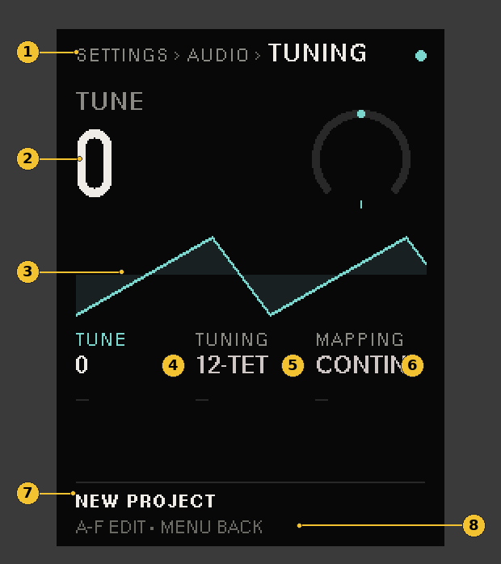
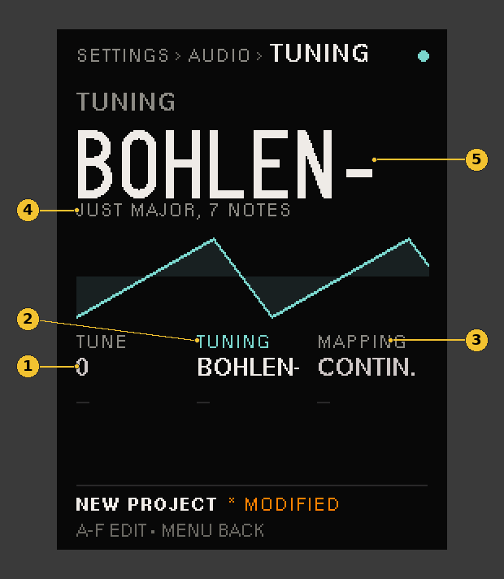

# Tuning, temperaments, Scala files and MTS

Each Part plays in a tuning of its own: equal temperament, a historical temperament, a Scala file from the card, or a tuning sent over MIDI. This chapter covers the TUNING page, the built-in temperaments, Scala files and keyboard maps on the card, MIDI Tuning Standard, and how tuning meets SNAP. For MIDI in general see [MIDI](14-midi.md); for getting files onto the card see [the card](16-card-sounds-library.md) and [USB](17-usb.md). On SETTINGS pages the letters **A** to **F** are encoders 1 to 6.

## Tuning: the TUNING page

**SETTINGS › AUDIO ROUTING › TUNING** (TUN on the settings chain; the breadcrumb reads `SETTINGS › AUDIO › TUNING`) holds three cells. TUNE is the whole unit's; TUNING and MAPPING are the active Part's. To set another Part's tuning, make that Part active (press its Part button) and come back.



1. Header: `SETTINGS › AUDIO › TUNING`.
2. The focused cell, large: its name and value.
3. The picture band.
4. **TUNE** (A): the whole unit, in cents.
5. **TUNING** (B): the active Part's tuning.
6. **MAPPING** (C): how a Scala file lies on the keys.
7. Footer: the project's name and whether it has unsaved changes.
8. Footer: the keys this page answers to, `A-F EDIT · MENU BACK`.

With a Scala file picked, the page shows the file and its scale:



1. **TUNE** (A): the whole unit, in cents.
2. **TUNING** (B): the Part's tuning. Turn past MTS and it steps through the Scala files on the card, by file name. The cell shows a name's first 7 characters.
3. **MAPPING** (C): how a Scala file lies on the keys, `CONTIN.` (continuous) or `KEYBD` (keyboard).
4. The Scala file's own name for its scale (its description line), or the file's name if it has none.
5. While TUNING has focus, a longer file name scrolls here and in the cell: it holds still, runs to its end, holds, and starts again.

| Cell | Range or options | Default | What it does |
|---|---|---|---|
| **TUNE** (A) | −100 to +100 cents | 0 | Moves the whole unit's reference: A4 = 440 Hz shifted by this many cents. Every Part follows |
| **TUNING** (B) | 12-TET, JUST, PYTHAG, MEANTONE, WERCK, MTS, then each Scala file by name | 12-TET | The active Part's tuning |
| **MAPPING** (C) | CONTIN., KEYBD | CONTIN. | How the active Part's Scala file lies on the keys (below) |

A new note plays the tuning; a note already sounding keeps its pitch. TUNE is kept with the rest of SETTINGS on the unit. TUNING and MAPPING are each Part's, saved in the project.

The focus band explains the choice under the cursor: on MTS it reads `FOLLOWS MTS SYSEX FROM MIDI IN`; on a Scala file it names the `.SCL` file and, when one is beside it, the `.KBM` file (`.KBM MAPS THE KEYS`); on MAPPING it reads `EACH KEY THE NEXT STEP` for CONTIN. and `EACH C STARTS THE SCALE` for KEYBD, or `FOR SCALA FILES` when the Part plays no Scala file.

The PITCH page's tuner (see [the voice chain](08-voice-chain.md)) reads the note as the Part's tuning plays it.

**Why per Part:** one Part can play a just-intoned drone while another plays equal-tempered chords against it, and a project keeps each Part's choice. **Why TUNE is the unit's:** it matches Chimera to the room (a piano, a band, a recording), which stays the same whichever project is loaded.

## Tuning: the built-in temperaments

| TUNING | What it plays |
|---|---|
| `12-TET` | Equal temperament, every semitone 100 cents |
| `JUST` | 5-limit just intonation on C: pure thirds and fifths in C's keys |
| `PYTHAG` | Pythagorean on C: pure fifths, bright wide thirds |
| `MEANTONE` | Quarter-comma meantone: pure major thirds, a wolf fifth on G♯–E♭ |
| `WERCK` | Werckmeister III: a well temperament, every key playable, each its own colour |
| `MTS` | The tuning a DAW or editor sends as MIDI Tuning Standard SysEx (see [MTS](#tuning-midi-tuning-standard)) |
| a file name, such as `PELOG` | A Scala file from the card (the schema calls this choice SCALA) |

C stays at its usual pitch in every named temperament, so a Part in JUST plays in tune with one in 12-TET on C.

**Why named temperaments first:** most players want to hear a temperament, not edit one. The five built-ins are picked by ear with one encoder; Scala files are there for the rest.

## Tuning: Scala files

A Scala file (`.scl`) holds a scale: up to 128 steps, in cents or as ratios. Thousands are in the Scala archive (huygens-fokker.org). Files up to 4 KB are read.

Scala files live on the card in **/CHIMERA/TUNINGS**. Chimera only reads that folder; it never writes to it.

> **Design note:** the `.scl` and `.kbm` formats are Manuel Op de Coul's, from his Scala program, and they have quietly become the lingua franca of microtonal music. The KEYBD and CONTIN. mappings behave the way the stock PreenFM3 firmware lays a Scala file on the keys, so a tuning you loved on stock plays the same here. We read how it behaves, not its code. And yes, you can now play Bohlen–Pierce at a dinner party. Results may vary.

### Tuning: putting Scala files on the card

The card is inside the case, so a Scala file reaches it over USB, in one of two ways.

**With the bootloader's SD card access** (no tools needed):

1. Turn the PreenFM3 off. Hold **MENU** and turn it on.
2. Press **button 3 (SD card access)**. The card shows up on your computer like a USB drive.
3. Open the **CHIMERA** folder. If it has no **TUNINGS** folder, make one there.
4. Copy the `.scl` file into **TUNINGS**. To map it to the keys yourself, copy a `.kbm` file of the same name beside it (`bohlen-pierce.kbm` with `bohlen-pierce.scl`).
5. Eject the drive, press **MENU** to leave SD card access, and turn the PreenFM3 off and on.

Files keep the names they have: `bohlen-pierce.scl` shows as `BOHLEN-PIERCE`, in capitals (letters outside A–Z show as `?`, and the first 32 characters are shown). The hidden files a Mac leaves beside the ones you copy (`._bohlen-pierce.scl`, `.DS_Store`) are harmless: they are never listed.

**With `chimera-usb.py`**, Chimera's tool (Python 3, Linux or macOS), with Chimera connected and running (see [USB](17-usb.md)):

```
python3 chimera-usb.py tuning pelog.scl
python3 chimera-usb.py tuning pelog.scl java.kbm
```

The file keeps its own name: `pelog.scl` lands as `PELOG.SCL` in **CHIMERA/TUNINGS**, and a `.kbm` sent with it lands beside it under the same name (`PELOG.KBM`). The tool only takes names of 1 to 8 letters and digits, so rename `bohlen-pierce.scl` to, say, `bohlen.scl` for it, or copy it with SD card access under its own name. Sending a file of the same name again replaces it, and every Part playing it plays the new one at once. A new `.scl` also clears its old `.kbm`, so send the map with the scale, as the second command does.

To take a file off the card, move it out of the folder with SD card access. Every Part playing it then plays 12-TET (or, with only the `.kbm` gone, the scale by its MAPPING).

### Tuning: picking a Scala file

On TUNING, turn **B** past MTS: it steps through the `.scl` files in the folder, and the cell shows the file's name; the line under the big readout shows the scale's own name. The first 128 `.scl` files in the folder are reached, in the order they were copied; turning past the last of them when the folder holds more says `FIRST 128 FILES ONLY`.

A file is read when you pick it, when a project using it loads, and when a new one is sent over USB. If it is missing or can't be read, the Part plays 12-TET and the screen says why: `PELOG.SCL NOT FOUND`, `PELOG.SCL NOT SCALA`, `PELOG.SCL TOO BIG` or `PELOG.SCL NOT READ`.

The project keeps the file's name, not its place in the list: a file added later moves nothing, a file copied onto the card again under the same name is still the one it plays, and a changed `PELOG.SCL` on the card changes every project that plays `PELOG`.

**Why by name:** a list position would move every time a file is added, and a project would wake up in the wrong tuning.

### Tuning: MAPPING, the scale on the keys

- **CONTIN.** (continuous): middle C plays the scale's first step at its usual pitch, and each key up plays the next step, whatever the scale's size. Use it for scales that don't repeat at the octave, or that you want to play as one long row of keys.
- **KEYBD** (keyboard): each scale starts on a C. The scale's steps go on the keys from C up; the octave is rounded up to whole octaves of keys (a 7-step scale takes 12 keys, a 19-step scale 24), and the keys left over are silent. Use it to keep a scale's octave under your hand's octave.

A 12-step scale plays the same either way.

A `.kbm` file of the same name, if present, maps keys to the scale's steps and sets the reference pitch, in place of MAPPING. Keys it leaves out (`x`), or outside its range, play equal temperament.

## Tuning: MIDI Tuning Standard

A Part on MTS plays the tuning received over MIDI, on DIN or USB. Chimera takes:

- **single-note tuning changes** (real-time, and the bank form);
- **bulk tuning dumps** (all 128 keys);
- **scale/octave tuning**, one-byte and two-byte (each pitch class in every octave).

Messages for device 7F (all) or 0 are taken. Every Part on MTS follows one MTS tuning; the tuning program and channel bits in a message are ignored. A received tuning lasts until the unit is turned off: it isn't saved with the project.

**Why one shared MTS tuning:** a DAW or tuning editor that sends MTS retunes the instrument as a whole. Any Part you set to MTS joins it; the others keep their own tuning.

## Tuning: how SNAP and tuning meet

A Part's LIVE SNAP (SETTINGS › PART › LIVE SNAP, see [Settings](13-settings.md)) and ORBIT's scale fitting work in semitones, on the keys. The tuning then tunes the key that SNAP chose:

1. A note comes in.
2. SNAP (if on) moves it to a key of the scale or chord, in semitones.
3. The Part's tuning gives that key its pitch.

So SNAP to a C major scale on a Part in JUST plays C major's keys, justly tuned. Under KEYBD, a key the mapping leaves silent stays silent after SNAP. A held note that RE-SNAPs to a new key glides to that key's tuned pitch, never a step; if it RE-SNAPs onto a silent key, it keeps sounding at equal temperament.

**Why SNAP works in semitones:** SNAP's scales and chords are built from the twelve keys you play. Tuning them afterwards keeps both tools simple, and each does one thing.
