# The SD card, projects, Sounds and the library

This chapter covers everything Chimera keeps on the PreenFM3's SD card: the folders, projects, the Sound browser with its PROJECT, LIBRARY and FACTORY tabs, the INIT Sounds, the sound pool and its memory, putting files onto the card from a computer, and what each card message means. The SETTINGS › PROJECT list itself is in [the SETTINGS menu](13-settings.md); TAPE sources and how they play are in [TAPE](06-tape.md); controller maps are in [MIDI](14-midi.md); tunings are in [Tuning](15-tuning.md).

## Card: the SD card inside the PreenFM3

The PreenFM3's SD card sits inside the case. You never need to take it out for routine work: files reach it over USB, through the bootloader's SD card access (see [Card: copying files from a computer](#card-copying-files-from-a-computer)).

- The card must be formatted **FAT32** (FAT16 also reads). An exFAT card shows **CARD IS EXFAT: FORMAT FAT32** and Chimera can't use it.
- Chimera reads and writes only inside the `/CHIMERA/` folder. Your stock PreenFM3 patches and settings elsewhere on the card are left alone.
- At power-on Chimera waits up to about a second for the card to wake, then reads it (the screen says **BUSY** meanwhile). It loads the project you had last, or starts a new one and shows **NEW PROJECT**.
- SETTINGS › SYSTEM › ABOUT shows the card in its **CARD** cell: the card's volume label, its serial number if it has no label, **NO CARD**, or **ERROR**.

**Why:** the card is inside a closed case, so taking it out means opening the synth. Everything Chimera needs from a computer comes over the USB cable instead, and Chimera stays out of the stock firmware's files so you can switch back at any time.

> **Design note:** Chimera talks to the card through its own small FAT layer, written for this synth: it knows only short 8.3 names, never renames a file, and never trusts a write to finish. That sounds like a list of limitations, and it is. Each one is a corner that couldn't go wrong because it wasn't there. The card controller still does its own thing at its own pace, which is why boot gives the card a full second to clear its throat.

## Card: the folders under /CHIMERA

| Folder or file | What it holds |
|---|---|
| `/CHIMERA/PROJECTS/` | Projects, one pair of files each: `P0000001.A` and `P0000001.B` |
| `/CHIMERA/SOUNDS/` | The LIBRARY and the FACTORY Sounds, one pair each: `S0000001.A` and `.B`. Factory Sounds have numbers from `S9000001` up |
| `/CHIMERA/TAPES/` | TAPE sources, `<checksum>.SRC`. The name is a checksum of what is inside |
| `/CHIMERA/MAPS/` | Controller maps, such as the factory SUGGEST map, as `.A` and `.B` pairs |
| `/CHIMERA/TUNINGS/` | Scala tuning files, `.SCL` and `.KBM` |
| `/CHIMERA/SYSTEM.A`, `SYSTEM.B` | The unit's own settings: theme, MIDI setup, the last project |
| `/CHIMERA/SYSTEM/` | Where the second half of the firmware waits while it installs (see [Updating: the install screen](19-updating-and-recovery.md#updating-the-install-screen)) |

A file's name is a number, not its display name. The name you give a project or Sound is stored inside the file, so two Sounds can share a name.

The `SOUNDS` folder is made the first time you save a Sound to the library.

**Why the names are numbers and every file comes in pairs:** the card uses short 8.3 names (eight letters, a dot, three), which leave no room for a real name, so the name lives inside the file. Every file is written as two sides, `.A` and `.B`, each with a generation counter. A save writes the older side and leaves the newer one alone. If the power goes off in the middle of a save, the side being written is damaged, but the other side is still whole, and Chimera loads the newest side that reads correctly. Every file ends in a checksum, so a damaged side is always noticed and never half-loaded.

## Card: copying files from a computer

The same steps add factory Sounds, TAPE sources, projects, maps, tunings or library Sounds, and are the ones the [README](https://joegiralt.github.io/chimera-releases/install) uses for installing.

1. Connect the PreenFM3 to your computer with a USB cable that carries data (some only charge).
2. Turn the PreenFM3 off. Hold **MENU** and turn it on, and keep holding until the bootloader screen appears.
3. Press **button 3 (SD card access)**. The card appears on your computer like a USB drive.
4. Copy the files into the right folder under `CHIMERA` (see the table above). Library Sounds go in `CHIMERA/SOUNDS` and show up on the LIBRARY tab.
5. Safely eject the drive from your computer.
6. Press **MENU** on the PreenFM3 to leave SD card access, and turn it off and on.

**Copying the factory set onto a card that already has a `CHIMERA` folder:** copy folder by folder, not the whole `CHIMERA` folder. Open **SOUNDS**, **TAPES**, **PROJECTS** and **MAPS** in the unzipped factory set and copy the files inside each into the folder of the same name on the card. On a Mac, replacing a whole folder throws away what was in it, which would take your own Sounds and projects with it.

- **SOUNDS** and **PROJECTS**: choose **Replace** for files with the same name.
- **MAPS**: if the card has no **MAPS** folder, copy the whole folder. If it has one, choose **Replace**: that puts back the factory SUGGEST map and leaves your own maps alone.
- **TAPES**: if the card has no **TAPES** folder, copy the whole folder. If it has one, choose **Skip** for any `.SRC` file already there. A source's name is the checksum of what it holds, so the one on the card is the same file, and Chimera keeps sources read-only, so replacing one may ask for permission or stop the copy.
- The four demo projects take the first four project numbers. If you saved your own projects there (`P0000001.A` to `P0000004.A` in **PROJECTS**), copy them to your computer first.

To take a file off the unit, copy it from the card to your computer the same way. To get rid of a project, use SETTINGS › PROJECT › MANAGE PROJECTS › **DELETE** on the unit (see [the SETTINGS menu](13-settings.md)).

**Why:** the card is never meant to fill up with junk. Chimera checks every file it reads, so a file copied by hand that is damaged or of the wrong kind is refused with a message, never loaded wrongly.

## Projects on the card

A project is a whole setup: the six Parts and their Sounds, the project's own Sound pool (the PROJECT tab), its TAPE sources, the mixer and effects, and ORBIT. Each project is one pair of files in `/CHIMERA/PROJECTS/`.

- **Quick save: hold MENU**, from anywhere. It saves over the project's own file. A project that has never been saved (NEW PROJECT) opens the naming screen first.
- **Save a copy under a new name:** SETTINGS › PROJECT › **SAVE PROJECT AS**.
- **Load, or start a new one:** SETTINGS › PROJECT › **LOAD PROJECT**, then **EDIT** on a project, or on **+ CREATE NEW**. If the current project has unsaved changes, it asks first (**SAVE THEN LOAD** saves it, then loads).
- **Rename, copy, clear or delete:** SETTINGS › PROJECT › **MANAGE PROJECTS** (**LOAD FROM**, **SAVE TO**, **RENAME**, **CLEAR**, **DELETE**). You can't delete or clear the project that is loaded.
- When the save finishes, the screen shows **SAVED**.

The footer of every SETTINGS page names the project, with **MODIFIED** beside it when there are unsaved changes.

At power-on Chimera loads the project you had last. If there is none, or it is gone, it starts a new one.

**A save shows `SAVED: P1 DIFFERS FROM SLOT 03`.** The project saved. Part 1 plays an edited version of the Sound in slot 03 of the PROJECT tab, and the project keeps both: the Part's edited Sound and the slot as it was. To make the slot match, save the Part's Sound over its slot (see [Sounds: saving to the project](#sounds-saving-to-the-project)). With more than one, it reads `SAVED: 3 PARTS DIFFER FROM SLOTS`.

**A quick save on another card.** If the card was changed since the project was loaded, holding MENU asks **CARD CHANGED · SAVE AS A NEW PROJECT ON THIS CARD?** with **SAVE AS** and **CANCEL**, so it never writes over a different project that happens to have the same number on the new card.

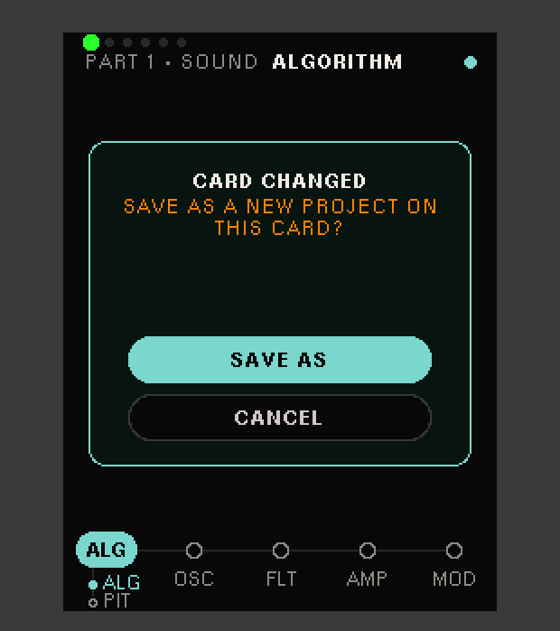

**Why projects own their Sounds:** loading a Sound into a Part copies it, from the library into the project, and from the project's pool into the Part. A later change to a library Sound, or to a slot, never changes a Part that is already playing it. A project you load next year sounds the way you left it, whatever happened to your library meanwhile.

## Sounds: the Sound browser

Hold **EDIT** and press **B1** to **B6** to open the Sound browser for that Part. It opens on the PROJECT tab, on the Part's own Sound.

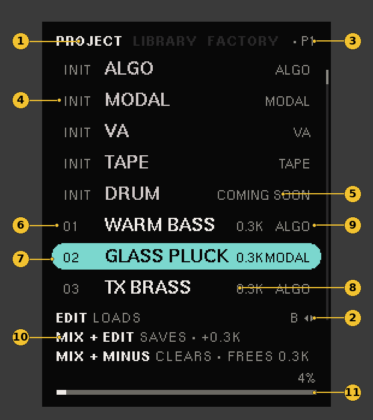

1. The tab: **PROJECT**, **LIBRARY** or **FACTORY**. The bright one is shown.
2. **B ◂▸**: turn encoder 2 (B) to change tab.
3. The Part the browser loads into (**P1**).
4. The INIT rows, one per engine: **INIT ALGO**, **INIT MODAL**, **INIT VA**, **INIT TAPE**, **INIT DRUM**. Each loads that engine's clean starting Sound.
5. The engine tag of an INIT row.
6. The slot number in the project's pool, 01 to 128.
7. The selected row.
8. What the Sound costs in the pool's memory, in kilobytes.
9. The Sound's engine.
10. The keys and what they do here, with the memory each one moves: **EDIT LOADS**, **MIX + EDIT SAVES · +0.3K**, **MIX + MINUS CLEARS · FREES 0.3K**.
11. The pool meter: how full the project's memory is, as a percentage.

In the browser:

- Turn encoder 1 (or any encoder but B) to move the bar. **SEQ** goes back to the page you came from.
- **EDIT** loads the selected Sound into the Part. If the Part has edits you haven't saved, it asks first.
- **MIX + EDIT** saves the Part's Sound. On PROJECT it saves into the project's pool; on LIBRARY it saves to the card (see [Sounds: the LIBRARY tab](#sounds-the-library-tab)). FACTORY is read-only: **MIX + EDIT** does nothing there.
- **MIX + MINUS** clears the selected slot, on the PROJECT tab only. It asks before clearing. A slot a Part is playing can't be cleared.

Empty slots are dimmed. A Sound's name has up to 16 characters; where a long name meets the cost column it is cut short on screen.

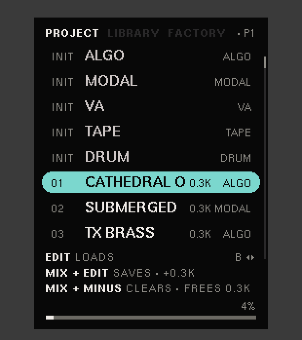

## Sounds: INIT, the clean start for each engine

The top rows of the PROJECT tab, above slot 01, are the INIT Sounds: **INIT ALGO**, **INIT MODAL**, **INIT VA**, **INIT TAPE** and **INIT DRUM**. Each one is a plain, working Sound for its engine, at a level matched to the factory Sounds. Loading one is how you change a Part's engine from scratch.

- INIT TAPE has no source, so it is silent until you pick one on SRC (see [TAPE](06-tape.md)).
- To reset a Part to the INIT of its own engine: SETTINGS › PART › **CLEAR**.
- INIT rows cost nothing in the pool.

## Sounds: the PROJECT tab and the pool

The PROJECT tab lists the project's own Sounds: 128 numbered slots. Every new project starts with a set of factory Sounds in them (TX BASS, TX EPIANO, TX BRASS, TX BELL, SAW LEAD, SQR BASS, MORPH PAD, MORPH KEYS, CHOIR, TALK BASS, BREATH and VOX). To get those back, start a new project.

### Sounds: saving to the project

- **MIX + EDIT** on the PROJECT tab saves the Part's Sound over its own slot, or to a new slot if it has none. The hint shows how much memory it takes (**SAVES · +0.3K**), or **WON'T FIT**.
- SETTINGS › PART › **SAVE TO PROJ** gives you the choice: **OVER SLOT** or **TO NEW SLOT**.
- SETTINGS › PART › **RELOAD FROM PROJ** puts the Part back to its saved slot.

A Sound saved to the project lives in the project's memory. **Hold MENU** to write the project to the card, or the Sound is lost at power-off.

### Sounds: the pool and its memory

The project's Sounds and the TAPE sources it holds in memory share one memory, the pool: 160 KB. A typical Sound takes 0.2 to 0.4 KB. TAPE sources take far more.

- The meter at the bottom of the browser shows how full it is.
- SETTINGS › PROJECT › **POOL** shows it in detail: **USED** as a percentage, then **SOUNDS** (how many, and their size), **SOURCES** (how many, and their size) and **FREE**.
- SETTINGS › PROJECT › **PURGE UNUSED SRC** frees the memory of sources no Part uses. The files on the card stay.

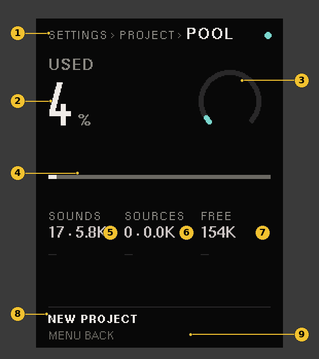

When a save or load doesn't fit, the browser says so in red: **POOL FULL** and what it needs, for example **NEEDS 2.0K, 0.2K FREE**. Nothing changes. Clear a slot you don't use (**MIX + MINUS**) or purge unused sources, and try again.

A project loaded from the card that doesn't all fit loads what it can and says what it left out: `LOADED · 2 SOUNDS, 1 SRC DIDN'T FIT`.

**Why one memory for Sounds and sources:** a project can be mostly Sounds or mostly recordings. With one shared budget and one meter, you spend the memory the way your project needs, and you always see what a save or load will cost before you make it.

## Sounds: the LIBRARY tab

The LIBRARY is your own collection of Sounds on the card, in `/CHIMERA/SOUNDS/`, which any project can load. Turn encoder 2 to the LIBRARY tab.

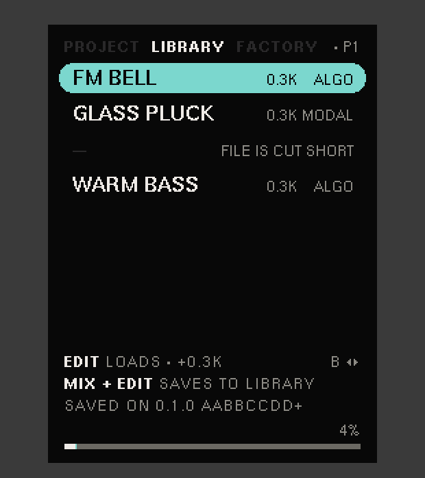

- The newest saves are first. The tab shows 48 Sounds a page: **OLDER ›** at the bottom goes to the next page, **‹ NEWER** at the top goes back.
- **EDIT** loads the selected Sound into the Part. The hint shows what it adds to the pool (**EDIT LOADS · +0.3K**), or **WON'T FIT**. The Sound is copied into a free slot of the project's pool and the toast says where: `LOADED TO SLOT 12`. A Sound the pool already holds is not copied twice.
- **MIX + EDIT** saves the Part's Sound to the library. It opens the naming screen; **EDIT** saves and the toast says **SAVED TO LIBRARY**.
- SETTINGS › PART › **SAVE TO LIBRARY** does the same from SETTINGS.

A save to the library always makes a new file. It never overwrites a library Sound, even one of the same name.

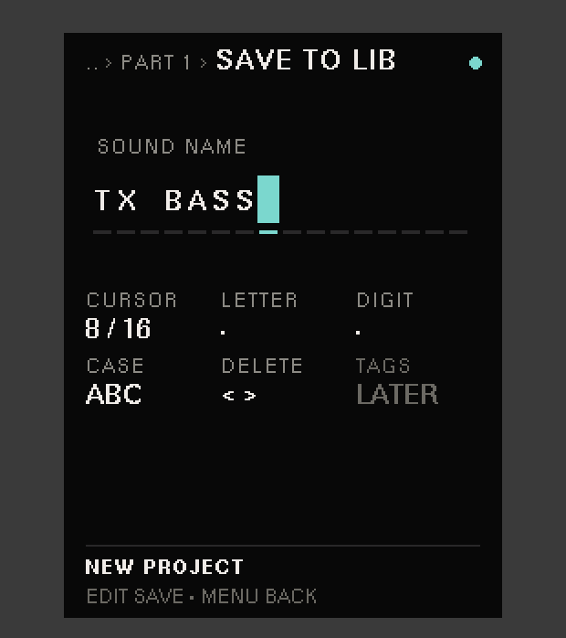

On the naming screen: encoder 1 moves the **CURSOR**, 2 picks a **LETTER**, 3 a **DIGIT**, space or dash, 4 switches **CASE**, 5 deletes (**DELETE**). **TAGS** reads LATER: it isn't built. **EDIT** saves; **MENU** or **SEQ** cancels.

A library Sound that plays a TAPE source loads with its source, if the source is on the card. A DRUM Part's kit is saved with its Sound and comes back with it.

| On the LIBRARY tab | What it means |
|---|---|
| **NO SOUNDS YET** | The library is empty: nothing saved yet |
| **NO CARD** | No card in the slot |
| A row reading `—` and **FILE IS CUT SHORT** (or another file message) | A file in the folder that can't be read: it is listed so you know it is there, but **EDIT** does nothing on it |
| **LOADED · SOME PARAMS SKIPPED** | The Sound loaded, but its file holds settings this firmware doesn't know, and they were left out |

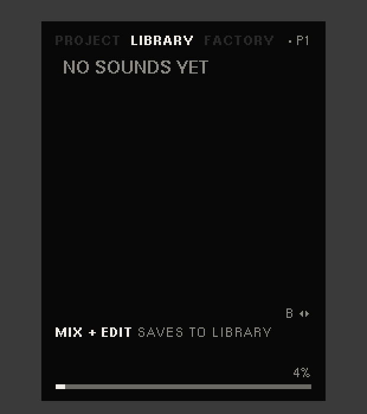
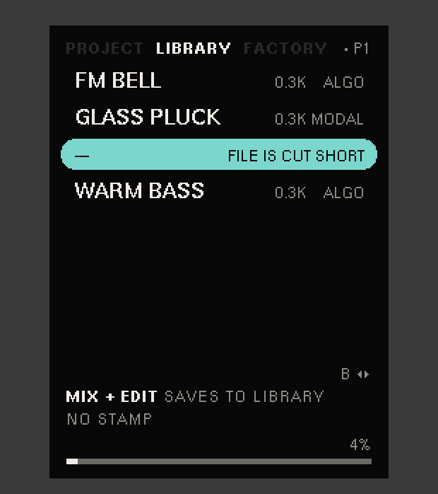

### Sounds: build stamps

Every library Sound carries the version and build of the firmware that saved it. The third hint line shows it for the selected Sound:

- **SAVED ON THIS BUILD**: saved by the firmware you are running.
- **SAVED ON 0.1.0 AABBCCDD**: saved by another version (a `+` after the build number marks a developer's build).
- **NO STAMP**: the file has no stamp.

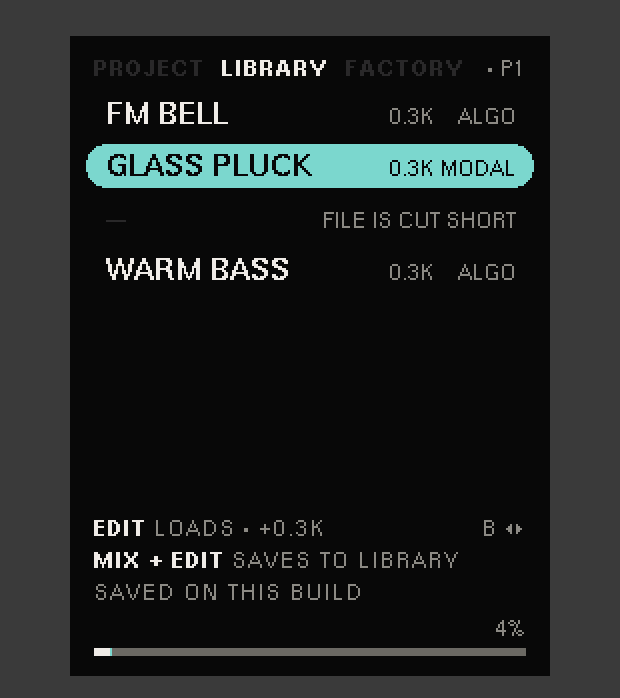

The stamp is only information. It never stops a Sound from loading.

**Why:** a Sound saved on an older firmware should still load after an update, and you should be able to tell two saves of the same name apart. Chimera has no users with years of old patches yet, so it makes one promise about old files: they always load safely. A Sound from another version loads, skips what it doesn't understand and says so, but it may not sound exactly as it did. A file that needs a newer firmware than yours is refused with **NEEDS NEWER FIRMWARE**, never loaded half-understood.

### Sounds: the LIBRARY when the pool is full

A library Sound that doesn't fit in the project's pool reads **EDIT WON'T FIT** in its hint, and **EDIT** shows **POOL FULL** with what it needs. Free some memory (see [Sounds: the pool and its memory](#sounds-the-pool-and-its-memory)) and load again.

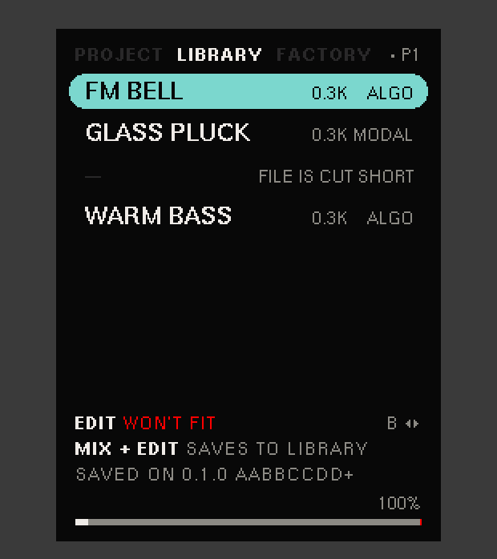
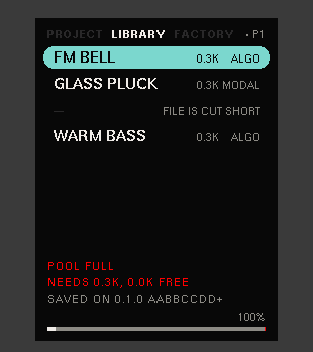

## Sounds: the FACTORY tab

The FACTORY tab lists the factory Sounds, read-only: 128 Sounds across ALGO, MODAL, VA and TAPE, in three pages. **NEXT ›** at the bottom goes to the next page and **‹ PREVIOUS** at the top goes back.

- The second hint line is the Sound's one-line description, for example `A PAD SOFT, BRASS PLAYED HARD`.
- The third line names the factory set and the build it came from: `FACTORY · 0.1.0 1A2B3C4D`.
- **EDIT** loads it into the Part (copied into the project's pool, like a library Sound).
- **MIX + EDIT** does nothing here: the factory Sounds can't be changed. To keep your edits of a factory Sound, save it to the LIBRARY (**MIX + EDIT** on the LIBRARY tab, or SETTINGS › PART › **SAVE TO LIBRARY**), or to the project.
- The factory TAPE Sounds play the sources of the factory TAPE set, which the factory zip copies into `/CHIMERA/TAPES/`.

The factory Sounds come in the factory zip on the releases page (`factory-v1.zip`), with the TAPE sources they play, four demo projects and the SUGGEST controller map. Copy them onto the card as in [Card: copying files from a computer](#card-copying-files-from-a-computer). Until you do, the tab reads **NO FACTORY SOUNDS** (or **NO CARD** with no card).

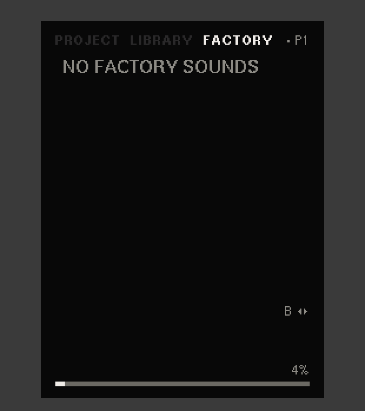
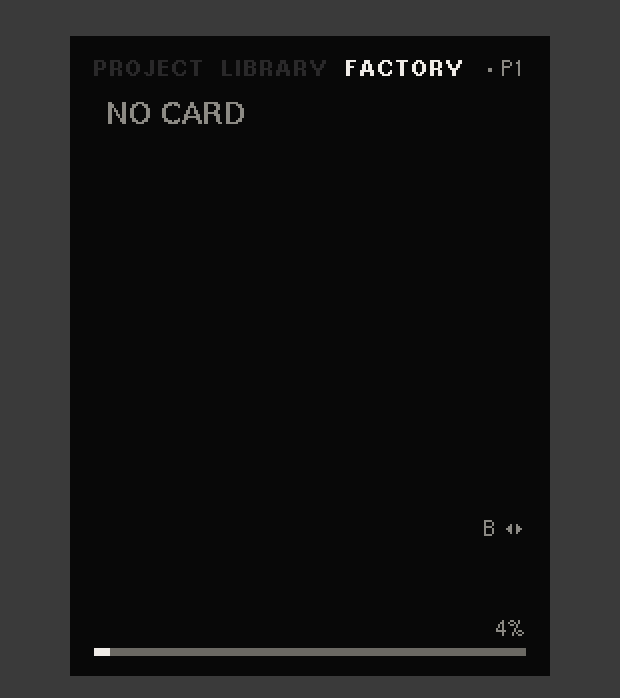

**Why read-only:** the factory set is a shared reference. Keeping it read-only means a factory Sound is always the same everywhere, and your own version lives beside it in the library under a name you choose.

> **Design note:** sixteen of the factory ALGO Sounds are ports in the spirit of the Yamaha TX81Z's classic presets, rebuilt by hand for Chimera's six operators and then left to wander. The rest are original. Each factory Sound starts life as a small text file, is built and checked on a computer, and arrives on the card as the same kind of file your own Sounds are. No secret factory format, no back door: the only special thing about them is that the unit refuses to let you spill coffee on them.

## Card messages and what to do

Messages about the card and its files appear as toasts in the middle of the screen. Where a file is involved, the toast ends with its number, such as `P0000007`.

| Message | What happened | What to do |
|---|---|---|
| **NO CARD** | No card answered at power-on | Check the card is seated in its slot inside the case. Chimera plays without a card, but can't save or load |
| **CARD IS EXFAT: FORMAT FAT32** | The card is formatted exFAT | Copy anything you want to keep off the card, format it FAT32 on a computer, and copy the files back |
| **CARD IS NOT FAT16/FAT32**, **CARD HAS NO PARTITION TABLE**, **CARD FORMAT IS DAMAGED**, **CARD FAT NOT MIRRORED: FORMAT IT** | The card's format isn't one Chimera reads | As above: format it FAT32 on a computer |
| **CARD CHANGED** | The card was swapped since the list was read | Open the list again. A quick save on another card asks before saving as a new project |
| **FILE CHECKSUM FAILED** | The file's checksum doesn't match: it is damaged, or it isn't a Chimera file | Chimera loads the other side of the pair if it is whole. If both are damaged, the file can't be loaded. Copy a backup over it from your computer |
| **FILE IS CUT SHORT** | The file ends early, for example after a copy that was cut off | As above |
| **FILE IS DAMAGED**, **FILE DATA OUT OF BOUNDS** | The file's contents don't make sense | As above |
| **NOT A CHIMERA FILE**, **WRONG FILE TYPE**, **FILE NAME IS INVALID** | A file in Chimera's folders that isn't the kind expected there | Move it off the card on your computer |
| **NEEDS NEWER FIRMWARE** | The file was saved by a newer Chimera | Update the firmware (see [Updating and recovery](19-updating-and-recovery.md)) |
| **LOAD FAILED** | A project load failed partway | The unit is left on a new project. Try the load again; if it fails again, the file is damaged |
| **PROJECT NOT FOUND** | The project's file is gone from the card | Copy it back, or load another |
| **AUDIO BUSY, NOT LOADED** | A voice still held a TAPE source when the load would start | Nothing loaded. Try again |
| **CARD FULL** | No room left on the card for the file | Make room on the card from your computer, or delete a project you don't need |
| **FILE IS READ-ONLY** | The file is marked read-only on the card | TAPE sources are kept read-only on purpose. For another file, clear the read-only mark on a computer |
| **CARD TIMEOUT**, **CARD ERROR**, **CARD BUSY**, **CARD READ FAILED** | The card didn't answer in time, or a read or write failed | Try again. If it keeps happening, turn the unit off and on |
| **CHANGED SINCE ASKED: TRY AGAIN** | Something changed between the question and your answer | Nothing was written. Do it again |
| **NO PROJECT IDS LEFT**, **NO SOUND IDS LEFT** | Every file number is in use | Delete projects or Sounds you don't need |

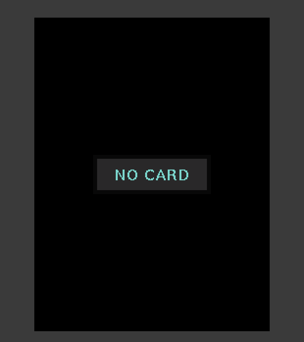
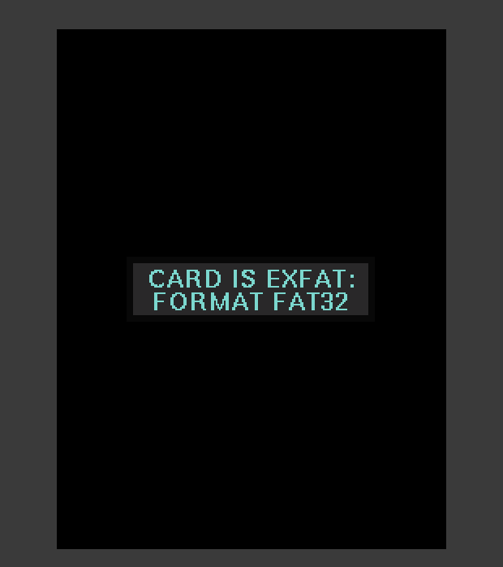
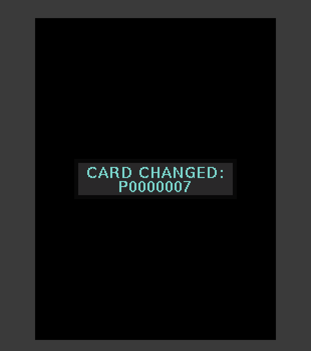
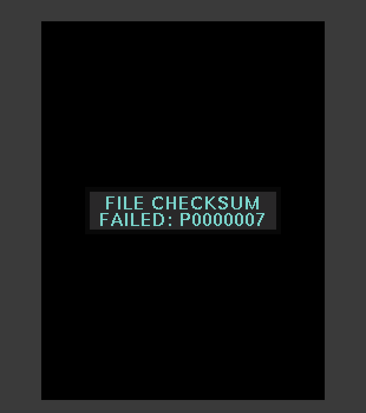
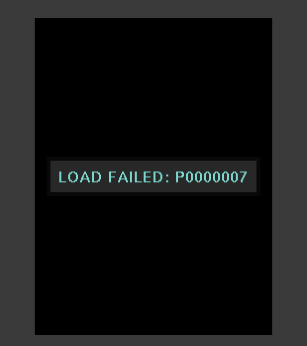
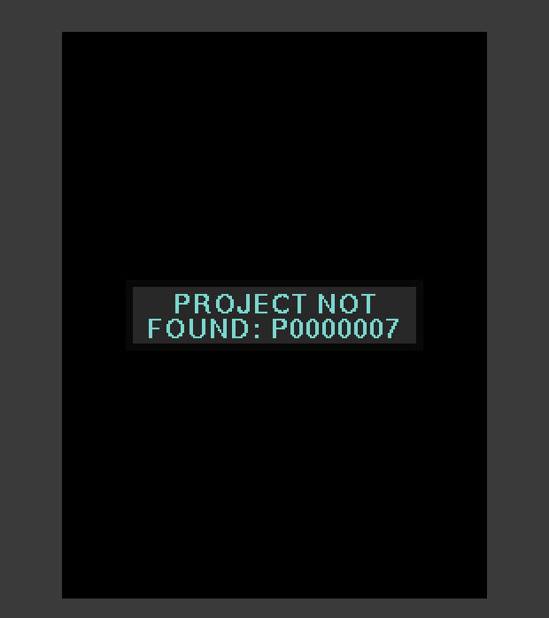
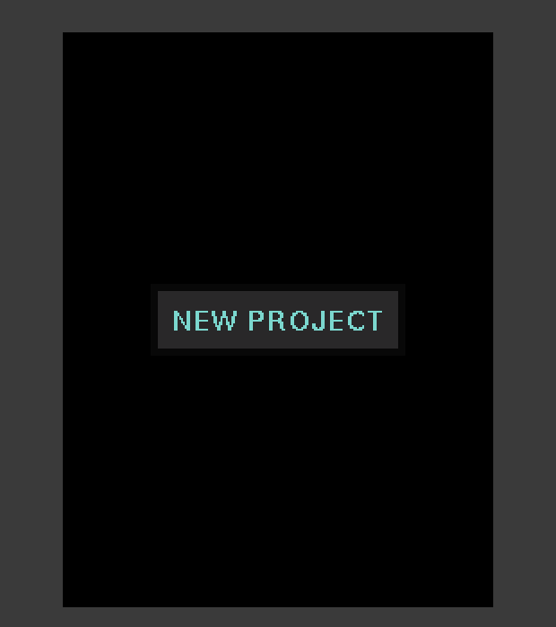
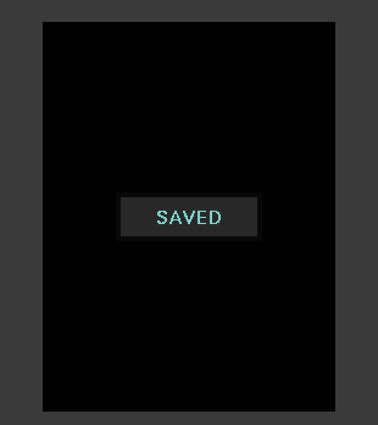
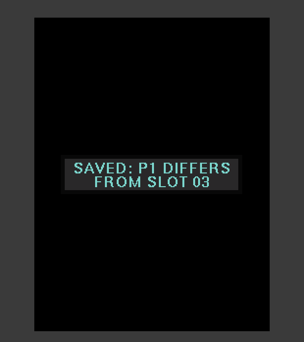

**Why Chimera refuses rather than guesses:** every file is checked in full before any of it is used. A load either happens whole or not at all, so a damaged file can never leave a Part half-changed or a project half-loaded.
