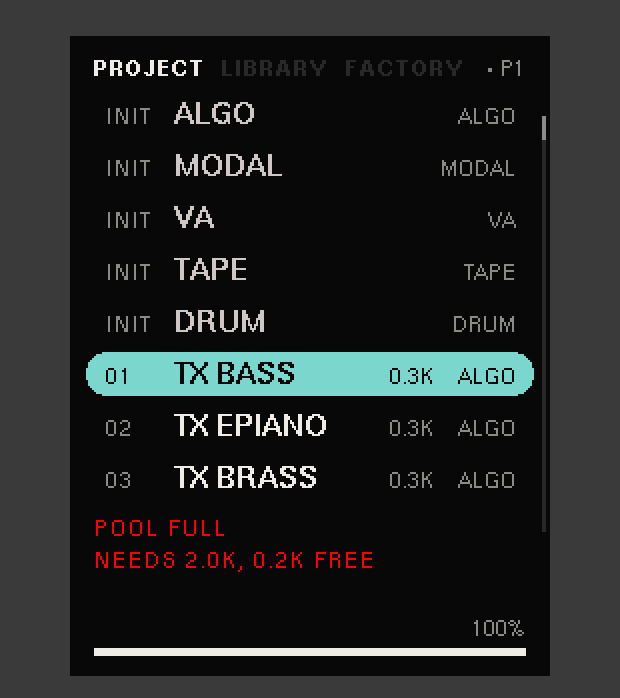
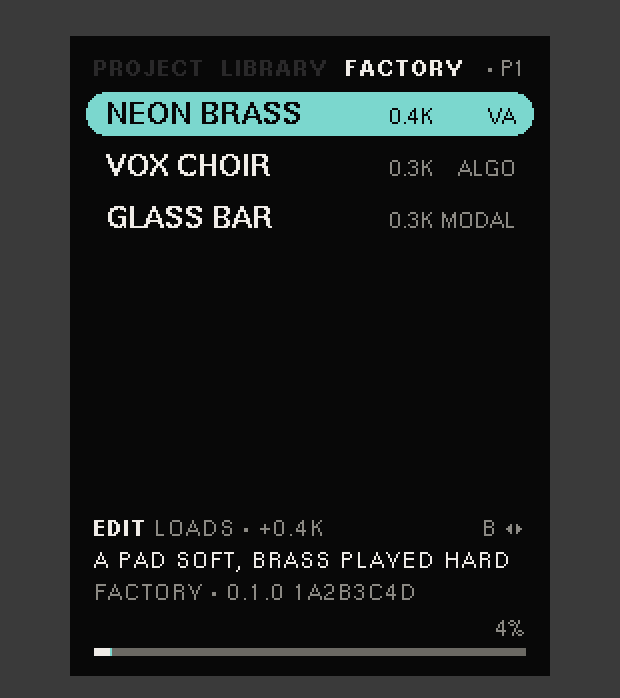
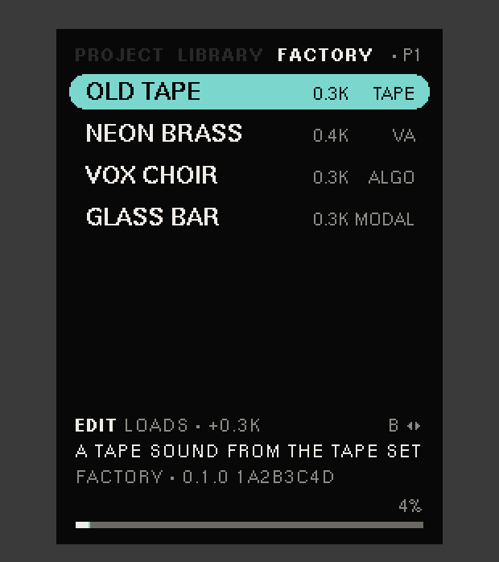

# The SD card, projects, Sounds and the library

This chapter covers what Chimera keeps on the PreenFM3's SD card: the folders, projects, the Sound browser with its PROJECT, LIBRARY and FACTORY tabs, the INIT Sounds, the pool, copying files from a computer, and the card messages. The SETTINGS › PROJECT list is in [the SETTINGS menu](13-settings.md); TAPE sources in [TAPE](06-tape.md); controller maps in [MIDI](14-midi.md); tunings in [Tuning](15-tuning.md).

## Card: the SD card inside the PreenFM3

The card sits inside the case; files reach it over USB through the bootloader ([Card: copying files from a computer](#card-copying-files-from-a-computer)).

- It must be **FAT32** (FAT16 also reads). An exFAT card shows **CARD IS EXFAT: FORMAT FAT32**.
- Chimera reads and writes only inside `/CHIMERA/`; stock PreenFM3 files are left alone.
- At power-on Chimera gives the card up to a second to wake (**BUSY**), then loads the last project, or starts one and shows **NEW PROJECT**.
- SETTINGS › SYSTEM › ABOUT › **CARD** shows the card's volume label, its serial number if unlabelled, **NO CARD** or **ERROR**.

**Why:** opening the case to swap a card is no way to work, so everything comes over the USB cable, and staying out of the stock files lets you switch back at any time.

> **Design note:** Chimera talks to the card through its own small FAT layer, written for this synth: it knows only short 8.3 names, never renames a file, and never trusts a write to finish. That sounds like a list of limitations, and it is. Each one is a corner that couldn't go wrong because it wasn't there.

## Card: the folders under /CHIMERA

| Folder or file | What it holds |
|---|---|
| `/CHIMERA/PROJECTS/` | Projects, a pair each: `P0000001.A` and `.B` |
| `/CHIMERA/SOUNDS/` | LIBRARY and FACTORY Sounds, a pair each (`S0000001.A`, `.B`); factory numbers start at `S9000001`. Made at the first library save |
| `/CHIMERA/TAPES/` | TAPE sources, `<checksum>.SRC` |
| `/CHIMERA/MAPS/` | Controller maps, `.A` and `.B` pairs, including the factory maps ALGO, MODAL, VA, TAPE and DRUM |
| `/CHIMERA/TUNINGS/` | Scala tunings, `.SCL` and `.KBM` |
| `/CHIMERA/SYSTEM.A`, `SYSTEM.B` | The unit's settings: theme, MIDI setup, the last project |
| `/CHIMERA/SYSTEM/` | The second half of the firmware while it installs ([Updating: the install screen](19-updating-and-recovery.md#updating-the-install-screen)) |

A file's name is a number; the name you give it is stored inside, so two Sounds can share a name.

**Why numbers and pairs:** 8.3 names leave no room for a real name. Each file is written as two sides, `.A` and `.B`, with a generation counter: a save writes the older side, so a power cut mid-save damages only that side, and Chimera loads the newest side that reads correctly. Every file ends in a checksum, so a damaged side is noticed and never half-loaded.

## Card: copying files from a computer

The same steps add factory Sounds, TAPE sources, projects, maps, tunings or library Sounds, as in the [install guide](https://joegiralt.github.io/chimera-releases/install).

1. Connect the PreenFM3 with a USB cable that carries data.
2. Turn it off, hold **MENU** and turn it on, holding until the bootloader screen appears.
3. Press **button 3 (SD card access)**. The card appears as a USB drive.
4. Copy the files into the right folder under `CHIMERA` (library Sounds into `CHIMERA/SOUNDS`).
5. Safely eject the drive.
6. Press **MENU** to leave SD card access, and turn the unit off and on.

**The factory set onto a card that already has `CHIMERA`:** copy folder by folder, not the whole `CHIMERA` folder (on a Mac, replacing a folder throws away what was in it, your own Sounds and projects included). Copy the files inside **SOUNDS**, **TAPES**, **PROJECTS** and **MAPS** into the folders of the same name:

| Folder | On a clash |
|---|---|
| **SOUNDS**, **PROJECTS** | **Replace** |
| **MAPS** | **Replace**: puts back the factory maps, leaves yours alone. No MAPS folder yet: copy the whole folder |
| **TAPES** | **Skip** any `.SRC` already there: same name means same contents, and sources are read-only. No TAPES folder yet: copy the whole folder |

The four demo projects take project numbers 1 to 4: if `P0000001.A` to `P0000004.A` are your own, copy them off first.

To take a file off the unit, copy it to your computer the same way. To remove a project, use SETTINGS › PROJECT › MANAGE PROJECTS › **DELETE**.

**Why:** Chimera checks every file it reads, so a damaged or wrong file copied by hand is refused with a message, never loaded wrongly.

## Projects on the card

A project is the six Parts and their Sounds, its own Sound pool (the PROJECT tab), its TAPE sources, the mixer and effects, and ORBIT: one file pair in `/CHIMERA/PROJECTS/`.

| To | Do |
|---|---|
| Quick save over its own file | **Hold MENU**. A never-saved project (NEW PROJECT) asks for a name first |
| Save a copy | SETTINGS › PROJECT › **SAVE PROJECT AS** |
| Load or start one | SETTINGS › PROJECT › **LOAD PROJECT**, **EDIT** on a project or **+ CREATE NEW**; unsaved changes are asked about (**SAVE THEN LOAD**) |
| Rename, copy, clear, delete | SETTINGS › PROJECT › **MANAGE PROJECTS**: **LOAD FROM**, **SAVE TO**, **RENAME**, **CLEAR**, **DELETE** (not the loaded project) |

A save ends on **SAVED**; SETTINGS footers show **MODIFIED** while changes are unsaved. At power-on the last project loads, or a new one starts.

**`SAVED: P1 DIFFERS FROM SLOT 03`** means the project saved, and Part 1 plays an edited version of slot 03: the project keeps both. To make the slot match, save the Part's Sound over it ([Sounds: saving to the project](#sounds-saving-to-the-project)). With several: `SAVED: 3 PARTS DIFFER FROM SLOTS`.

**A quick save on another card** asks **CARD CHANGED · SAVE AS A NEW PROJECT ON THIS CARD?** (**SAVE AS**, **CANCEL**), so it never overwrites a different project with the same number.

**Why projects own their Sounds:** each load is a copy, so a project you open next year sounds as you left it, whatever happened to your library.

## Sounds: the Sound browser

Hold **EDIT** and press **B1**–**B6** to open the browser for that Part, on the PROJECT tab and the Part's own Sound.

1. **PROJECT**: the lit tab (then **LIBRARY**, **FACTORY**).
2. **P1**: the Part it loads into.
3. **INIT**: the INIT rows: **INIT ALGO**, **INIT MODAL**, **INIT VA**, **INIT TAPE**, **INIT DRUM**.
4. **DRUM**: an INIT row's engine tag.
5. **01**: the slot number, 01 to 128.
6. **0.3K**: the Sound's cost in the pool.
7. **02 GLASS PLUCK**: the selected row.
8. **EDIT LOADS**: the load key.
9. **MIX + EDIT SAVES · +0.3K**: the save key and what it adds.
10. **MIX + MINUS CLEARS · FREES 0.3K**: the clear key and what it frees.
11. **4%**: the pool meter.

**B ◂▸** at the right of the keys: encoder 2 changes tab.

Any encoder but B moves the bar; **SEQ** goes back. **EDIT** loads (asking if the Part has unsaved edits); **MIX + EDIT** saves (to the pool on PROJECT, to the card on LIBRARY, nothing on FACTORY); **MIX + MINUS** clears a PROJECT slot after asking, unless a Part plays it. Empty slots are dimmed. Names have up to 16 characters and are cut short at the cost column.

## Sounds: INIT, the clean start for each engine

The INIT rows above slot 01 are plain, working Sounds, one per engine, at factory level. Loading one is how you change a Part's engine from scratch. INIT TAPE has no source and is silent until you pick one on SRC ([TAPE](06-tape.md)). SETTINGS › PART › **CLEAR** resets a Part to its own engine's INIT. INIT rows cost nothing.

## Sounds: the PROJECT tab and the pool

The PROJECT tab lists the project's 128 slots. A new project starts with factory Sounds in them (TX BASS, TX EPIANO, TX BRASS, TX BELL, SAW LEAD, SQR BASS, MORPH PAD, MORPH KEYS, CHOIR, TALK BASS, BREATH, VOX); start a new project to get them back.

### Sounds: saving to the project

- **MIX + EDIT** on PROJECT saves over the Part's own slot, or a new one; the hint shows the cost (**SAVES · +0.3K**) or **WON'T FIT**.
- SETTINGS › PART › **SAVE TO PROJ** offers **OVER SLOT** or **TO NEW SLOT**; **RELOAD FROM PROJ** puts the Part back to its slot.

A Sound saved to the project lives in memory until you **hold MENU** to write the project to the card.

### Sounds: the pool and its memory

The project's Sounds and in-memory TAPE sources share one 160 KB pool. A Sound takes 0.2 to 0.4 KB; sources far more. The browser's meter shows it; SETTINGS › PROJECT › **POOL** details **USED**, **SOUNDS**, **SOURCES** and **FREE** ([Limits](20-limits.md#limits-the-sound-pool-the-projects-memory)). **PURGE UNUSED SRC** frees sources no Part uses; the files stay on the card.

When something doesn't fit, the browser says **POOL FULL** and what it needs (**NEEDS 2.0K, 0.2K FREE**), and nothing changes. A project that doesn't fully fit loads what it can: `LOADED · 2 SOUNDS, 1 SRC DIDN'T FIT`.

**Why one memory:** a project can be mostly Sounds or mostly recordings; one budget and one meter let you spend it either way and see the cost before you commit.

## Sounds: the LIBRARY tab

The LIBRARY is your own Sounds on the card, in `/CHIMERA/SOUNDS/`, loadable from any project.

- Newest first, 48 a page: **OLDER ›** at the bottom, **‹ NEWER** at the top.
- **EDIT** copies the Sound into a free project slot and loads it (`LOADED TO SLOT 12`); the hint shows the cost (**EDIT LOADS · +0.3K**) or **WON'T FIT**. A Sound already in the pool isn't copied twice.
- **MIX + EDIT**, or SETTINGS › PART › **SAVE TO LIBRARY**, opens the naming screen; **EDIT** saves (**SAVED TO LIBRARY**). A library save always makes a new file, never overwriting one.
- A Sound's TAPE source loads with it if it is on the card; a DRUM kit is saved with its Sound.

The naming screen is as in [Panel: naming](02-panel-and-navigation.md#panel-naming); its **TAGS** row reads LATER.

| On the LIBRARY tab | Meaning |
|---|---|
| **NO SOUNDS YET** | Nothing saved yet |
| **NO CARD** | No card |
| `—` and **FILE IS CUT SHORT** (or another file message) | An unreadable file, listed so you know it is there; **EDIT** does nothing |
| **LOADED · SOME PARAMS SKIPPED** | Loaded, minus settings this firmware doesn't know |
| **EDIT WON'T FIT**, then **POOL FULL** | The pool has no room; free some ([the pool](#sounds-the-pool-and-its-memory)) |

### Sounds: build stamps

Every library Sound carries the firmware version and build that saved it, on the third hint line: **SAVED ON THIS BUILD**, **SAVED ON 0.1.0 AABBCCDD** (a `+` marks a developer build), or **NO STAMP**. The stamp never stops a load.

**Why:** Chimera promises one thing about old files: they load safely. A Sound from another version loads, skips what it doesn't understand and says so, though it may not sound exactly the same. A file that needs newer firmware is refused with **NEEDS NEWER FIRMWARE**.

## Sounds: the FACTORY tab

The FACTORY tab lists the read-only factory Sounds: 128 across ALGO, MODAL, VA and TAPE, in three pages (**NEXT ›**, **‹ PREVIOUS**).

- The second hint line is the Sound's description (`A PAD SOFT, BRASS PLAYED HARD`), the third the set and build (`FACTORY · 0.1.0 1A2B3C4D`).
- **EDIT** loads it, copied into the pool. **MIX + EDIT** does nothing: save your edit to the LIBRARY or the project instead.
- Factory TAPE Sounds play the factory sources in `/CHIMERA/TAPES/`.

The factory zip (`factory-v1.zip`) on the releases page holds the Sounds, their TAPE sources, four demo projects and the five factory controller maps (ALGO, MODAL, VA, TAPE, DRUM). Copy it as in [Card: copying files from a computer](#card-copying-files-from-a-computer); until then the tab reads **NO FACTORY SOUNDS** (or **NO CARD**).

**Why read-only:** a factory Sound is the same everywhere, and your version lives beside it under your own name.

> **Design note:** sixteen of the factory ALGO Sounds are ports in the spirit of the Yamaha TX81Z's classic presets, rebuilt by hand for six operators and then left to wander. Each factory Sound starts life as a small text file and arrives on the card as the same kind of file your own Sounds are. No secret factory format: the only special thing about them is that the unit refuses to let you spill coffee on them.

## Card messages and what to do

Card messages appear as toasts; where a file is involved, the toast ends with its number (`P0000007`).

| Message | What happened | What to do |
|---|---|---|
| **NO CARD** | No card answered at power-on | Check it is seated. Chimera plays, but can't save or load |
| **CARD IS EXFAT: FORMAT FAT32**, **CARD IS NOT FAT16/FAT32**, **CARD HAS NO PARTITION TABLE**, **CARD FORMAT IS DAMAGED**, **CARD FAT NOT MIRRORED: FORMAT IT** | A format Chimera can't read | Copy off what you need, format FAT32 on a computer, copy back |
| **CARD CHANGED** | The card was swapped since the list was read | Open the list again |
| **FILE CHECKSUM FAILED**, **FILE IS CUT SHORT**, **FILE IS DAMAGED**, **FILE DATA OUT OF BOUNDS** | The file is damaged (Chimera uses the other side if whole) | Copy a backup over it |
| **NOT A CHIMERA FILE**, **WRONG FILE TYPE**, **FILE NAME IS INVALID** | A stray file in Chimera's folders | Move it off the card |
| **NEEDS NEWER FIRMWARE** | Saved by a newer Chimera | [Update](19-updating-and-recovery.md) |
| **LOAD FAILED** | A project load failed partway; the unit is on a new project | Try again; twice means a damaged file |
| **PROJECT NOT FOUND** | The project's file is gone | Copy it back, or load another |
| **AUDIO BUSY, NOT LOADED** | A voice still held a TAPE source | Try again |
| **CARD FULL** | No room on the card | Make room, or delete a project |
| **FILE IS READ-ONLY** | Marked read-only (TAPE sources are, on purpose) | Clear the mark on a computer |
| **CARD TIMEOUT**, **CARD ERROR**, **CARD BUSY**, **CARD READ FAILED** | The card didn't answer, or a read or write failed | Try again; if it persists, power-cycle |
| **CHANGED SINCE ASKED: TRY AGAIN** | Something changed before you answered; nothing written | Do it again |
| **NO PROJECT IDS LEFT**, **NO SOUND IDS LEFT** | Every file number is used | Delete what you don't need |

**Why Chimera refuses rather than guesses:** every file is checked in full before use, so a load happens whole or not at all and never leaves a Part half-changed.
