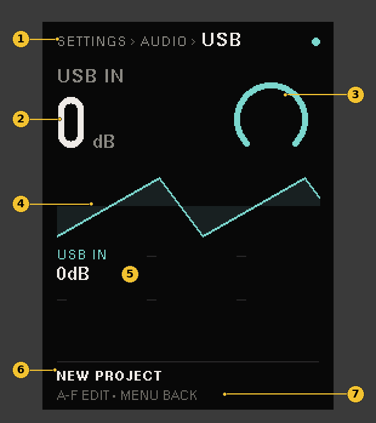

# USB, MIDI, audio and the console over one cable

One USB cable between the PreenFM3 and a computer carries MIDI both ways, Chimera's main out as an audio input, the computer's sound into Chimera's main out, and a console that the update tool and the browser editor talk through. This chapter covers each, how Chimera shows up on a computer, and notes for each operating system. MIDI itself is in [MIDI](14-midi.md); putting files on the card is in [the card](16-card-sounds-library.md); the editor in [the browser editor](18-browser-editor.md); updating in [Updating and recovery](19-updating-and-recovery.md).

## USB: what the cable carries

Connect the PreenFM3 to a computer with a USB cable that carries data (some cables only charge). While Chimera runs, it shows up as one device called **Chimera**, with:

| Part of the device | Shows up as | What it is for |
|---|---|---|
| MIDI | a MIDI port **Chimera**, in and out | Playing and controlling Chimera, as on DIN (see [USB MIDI](#usb-midi)) |
| Audio input | an input **Chimera**, stereo | Recording Chimera's main out (see [USB audio](#usb-audio)) |
| Audio output | an output **Chimera**, stereo | Playing the computer's sound through Chimera's main out |
| Console | a serial port | The update tool, the browser editor and file transfers (see [the console](#usb-the-console)) |

Chimera is class compliant: MIDI and audio need no driver on Linux, macOS or Windows. DIN MIDI and the jacks keep working while USB is in use.

## USB MIDI

Over USB, Chimera is one MIDI port, **Chimera**, both ways. It carries every channel, as DIN does: each Part plays from its own channel, the CONTROL CHANNELS and MPE zones work the same, and clock, SysEx, MIDI Tuning Standard, the identity reply, the parameter dump, ECHO and PARAM OUT all use it. Everything in [MIDI](14-midi.md) applies to USB as to DIN.

USB and DIN are heard side by side. A controller on DIN and a DAW on USB can play at once. ECHO and PARAM OUT go out of both.

If the computer resets or goes to sleep while USB holds a note or the sustain pedal, Chimera lets go of them and the screen shows `USB MIDI LOST`, so nothing hangs.

**Why one port and not one per Part:** the description a USB device gives the computer of itself has to fit a fixed space. With the audio streams in it, there is room for one MIDI port. Six Part ports and audio together do not fit, and the audio was chosen. Each Part still plays from its own channel on the one port, as on DIN.

> **Design note:** a USB device introduces itself with a descriptor, a little block of bytes that the USB library on the chip expects to fit in a 256-byte box. Once, an early build sent a descriptor bigger than its box, and the unit stopped talking to the computer until it was put back by hand. Since then every USB layout is enumerated by a test on the computer before it is ever flashed, and the box has been fitted with a shoehorn and a very stern note.

## USB audio

Chimera's USB audio is stereo, 24-bit, 48 kHz, both ways.

**The audio input** (Chimera to the computer) carries the main out: what the synth plays into the main out jacks, after the master bus. Record it in your DAW like any interface's input. The jacks keep playing while it streams.

**The audio output** (the computer to Chimera) is mixed into the main out jacks. Pick **Chimera** as your DAW's or your system's output and Chimera plays it beside its own sound. Chimera sets the pace and the computer follows its clock, so the sound never drifts or clicks over a long session.

- Chimera plays your computer's sound at the computer's own scale: a full-scale sample is as loud as the synth at full scale. Your computer's own output volume for Chimera still applies.
- The computer's sound is mixed in after the point the audio input records, so the input never records it back: a DAW recording Chimera while it plays a backing track through Chimera records only Chimera.
- If you monitor Chimera's input in your DAW while also playing out through Chimera, you hear Chimera twice. Turn the DAW's input monitoring off.

### USB: the USB AUDIO page

**SETTINGS › AUDIO ROUTING › USB AUDIO** (USB on the settings chain) sets how loud the computer plays through Chimera.

1. Header: `SETTINGS › AUDIO › USB`.
2. The focused cell, large: its name and value.
3. The focused cell's glyph: its knob.
4. The picture band.
5. **USB IN** (A): how loud the computer's sound joins the main out.
6. Footer: the project's name and whether it has unsaved changes.
7. Footer: the keys this page answers to, `A-F EDIT · MENU BACK`. **MENU** goes back.

| Cell | Options | Default | What it does |
|---|---|---|---|
| **USB IN** (A) | OFF, -24dB, -18dB, -12dB, -9dB, -6dB, -3dB, 0dB | 0dB | The level of the computer's sound in the main out |

- A change fades in over a few milliseconds, never with a click, and a stream starting fades in from silence.
- At 0dB a loud computer track on top of a loud patch can pass full scale: the main out then clips cleanly at full scale, so turn one of them down.
- OFF keeps the output there for your computer, but silent.
- USB IN is kept with the rest of SETTINGS on the unit, not in the project.

**Why 0dB by default:** the computer plays as soon as it sends, as any class-compliant interface's output does, with nothing to find in a menu first.

> **Design note:** USB IN is Chimera's version of the USB-to-main control on Elektron's boxes: the computer becomes one more voice in the mix, after the synth's own effects. Recording deliberately leaves it out, the way a class-compliant interface does with loopback off, so a DAW monitoring its input never builds a feedback loop. Nobody needs to discover the sound of infinite gain at 2 a.m.

## USB: the console

The console is a serial port on the same cable. A player rarely types into it: the tools use it.

- **The update tool.** `chimera-usb.py update` installs a new firmware over the cable in one go: it checks both halves first, puts the second half on the card, writes the first half, and the unit installs the rest after it restarts. See [Updating and recovery](19-updating-and-recovery.md).
- **The browser editor.** The editor on Chimera's site reaches the unit through the console with the browser's Web Serial, in Chrome, Edge or another Chromium browser. See [the browser editor](18-browser-editor.md).
- **Files onto the card.** The card is inside the case. `chimera-usb.py` copies files onto it and off it while Chimera runs, with no trip to the bootloader: project files, library Sounds, TAPE sources, controller maps (see [MIDI](14-midi.md#midi-controller-maps-on-the-card)) and Scala tunings (see [Tuning](15-tuning.md#tuning-putting-scala-files-on-the-card)). Each file goes over in checked pieces and is written through Chimera's own save. See [the card](16-card-sounds-library.md).
- **Bug reports.** `chimera-usb.py status` prints the unit's state and version, and `chimera-usb.py shot` saves a screenshot of the screen as a PNG, both useful in a bug report.

`chimera-usb.py` is one Python 3 file, with no other parts but Python's own. It runs on Linux and macOS, not Windows. Run `python3 chimera-usb.py help` for its commands. On Windows, use the bootloader's SD card access to move files, and the card steps to install.

**Why a console as well as MIDI:** files and the editor's traffic are large and need answers. A serial port carries them without disturbing the MIDI port your music is on.

## USB: how Chimera shows up on a computer

While Chimera runs, the device has the USB ID **0483:5740**, the one the stock PreenFM3 firmware uses, and the name **Chimera**. The serial port is listed under the same ID.

The ID stays the PreenFM3's because Chimera is software on the PreenFM3's hardware: the computer sees the same instrument, running different firmware. The device's version number changes when its USB layout changes, so Windows sets up its driver afresh instead of reusing an old one.

Two other modes belong to the PreenFM3's bootloader, not to Chimera:

- **SD card access:** hold **MENU** while turning the unit on, then press **button 3**. The card shows up as a USB drive. While in this mode, Chimera is not running, and there is no MIDI or audio.
- **DFU mode**, for installing over USB: the unit shows up as the chip's own loader, USB ID **0483:df11**. **SETTINGS › SYSTEM › OS UPGRADE** restarts Chimera into it. See [Updating and recovery](19-updating-and-recovery.md).

SETTINGS › SYSTEM › USB CONFIG is a placeholder (dimmed, marked LATER): there are no USB settings to change.

> **Design note:** Chimera is a guest in someone else's beautifully built house. The PreenFM3's hardware and its bootloader are left as they are; Chimera uses the instrument's own USB identity, so as far as your computer is concerned, it is still a PreenFM3, now with opinions.

## USB: notes for Linux, macOS and Windows

USB MIDI and USB audio have been tried on Linux. macOS and Windows should work without a driver, since Chimera is class compliant, but they have not been tried yet. If you use either, the project's known issues page says how to report what you find.

**Linux**

- PipeWire may start the new **Chimera** output at 40 % (about −24 dB). Set Chimera's output to 100 % in your sound settings.
- If `chimera-usb.py` says "no access" to the console, either add yourself to the `dialout` group (then log out and in again), or run once the `sudo tee` line it prints.
- If `dfu-util` cannot access the unit in DFU mode, see the udev line in the install guide's troubleshooting section.

**macOS**

- `chimera-usb.py` needs `pyserial` to find the PreenFM3, and the update needs `dfu-util`. The install page on the site walks through both for a Mac user who has never opened Terminal.
- When you copy files to the card with SD card access, macOS leaves small hidden files beside them (`._name`). Chimera never lists them.

**Windows**

- The first time you connect the unit after an update, Windows may set up its driver again, because the unit's USB layout changed. Let it finish, then pick **Chimera** again in your music software.
- `chimera-usb.py` does not run on Windows. Use SD card access to move files, and the card steps to install.

**Every system**

- The browser editor needs Chrome, Edge or another Chromium browser; Safari, Firefox and phones have no Web Serial.
- A faint buzz or whine when the PreenFM3 is powered over USB from the same computer as your audio interface is a ground loop, not a fault. Power the PreenFM3 from its 9 V supply, or use a USB isolator, and it goes away.
- Computer sleep, and unplugging and replugging the cable while Chimera runs, have not been tried yet with USB audio. Starting and stopping USB audio recording works.
