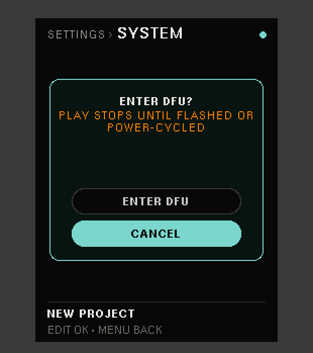
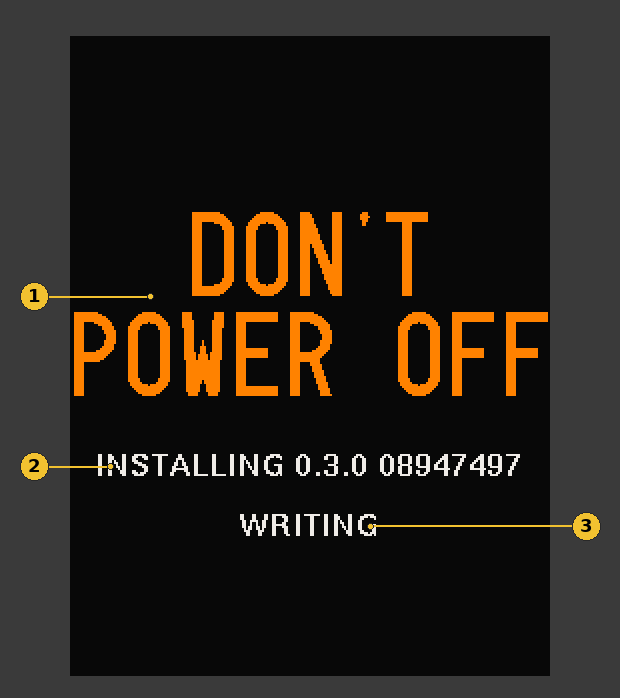
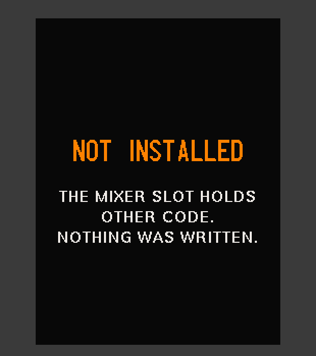
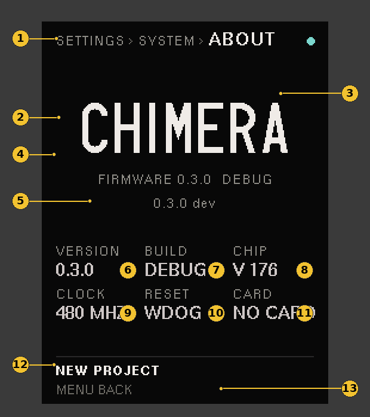

# Updating and recovery

This chapter covers installing and updating Chimera, the install screen, the stock bootloader it relies on, DFU mode, going back to the stock PreenFM3 firmware, getting a unit back when something goes wrong, and what to put in a bug report. Copying files to the card is also in [the SD card chapter](16-card-sounds-library.md#card-copying-files-from-a-computer); the USB port is in [USB](17-usb.md).

## Updating: the two halves of the firmware

Chimera comes as two files, and needs both:

- `CHIMERA.BIN`, the first half. The bootloader writes it.
- `CHIMERA.BK2`, the second half. Chimera installs it itself when it starts and finds one on the card (or from the update tool) that it hasn't installed yet.

The release also has the factory zip (`factory-v1.zip`): the factory Sounds, the TAPE sources they play, four demo projects and the SUGGEST controller map. And it has the update tool, `chimera-usb.py`.

The file names never carry a version. The version is in the release title, on the boot splash, and at SETTINGS › SYSTEM › ABOUT. Keep the names exactly as they are. If your browser saved a second copy as `CHIMERA (1).BIN` (or `CHIMERA (1).BK2`), rename it back to `CHIMERA.BIN` in Finder or Explorer. Rename it; don't delete it.

There are three ways to install. All of them end on the same install screen.

| Way | When to use it |
|---|---|
| [The update tool over USB](#updating-with-the-update-tool-over-usb) | The unit already runs Chimera 0.3 or later, and the computer is a Mac or runs Linux. One command |
| [The SD card](#updating-from-the-sd-card) | A first install, any computer, Windows, or if the tool stops |
| [USB DFU with dfu-util](#updating-over-usb-dfu-with-dfu-util) | When the card method can't be used, on macOS or Linux |

Your projects and Sounds on the card stay through an update.

**Why two halves:** the first part of the chip's flash, which the bootloader writes, is too small for everything Chimera does. The rest lives in a second area the bootloader doesn't reach, so Chimera writes it itself. The update tool and the install screen make the two halves one step for you.

## Updating with the update tool over USB

A PreenFM3 running Chimera 0.3 or later updates with the update tool, `chimera-usb.py`, over the USB cable. You type the command once, the tool puts both halves on the unit, and you see one install screen. The tool runs on macOS and Linux. On Windows, use [the SD card](#updating-from-the-sd-card).

You'll need:

- Your PreenFM3, running Chimera.
- A USB cable that carries data.
- Three files from the release: `CHIMERA.BIN`, `CHIMERA.BK2` and `chimera-usb.py`, saved in your Downloads folder with their names exactly as they are.

**Once, on a Mac: open Terminal and add two helpers.**

1. Open Terminal: press **Command + Space**, type **Terminal** and press **Return**. Each command below is typed (or pasted) on the line ending in `%` or `$`, then run with Return. When the line comes back, the command has finished.
2. If you don't have Homebrew yet, install it with the one command shown on brew.sh. When it asks for your password, type your Mac's password: nothing shows as you type, which is normal.
3. Install dfu-util, which the tool uses to write the firmware:

   ```bash
   brew install dfu-util
   ```

4. Install pyserial, which the tool uses to find the PreenFM3:

   ```bash
   python3 -m pip install --user pyserial
   ```

   If the Mac offers to install the command line developer tools, press Install, wait for it to finish, and run the command again.

On Linux, install `dfu-util` with your distribution's package manager (for example `sudo apt install dfu-util`).

**The update:**

1. Save your project on the PreenFM3 (**hold MENU**). The tool won't start while the project has unsaved changes: it says so and changes nothing.
2. Connect the PreenFM3 to the computer and turn it on as usual, so it plays Chimera (not the bootloader screen).
3. In Terminal, go to your Downloads folder:

   ```bash
   cd ~/Downloads
   ```

4. Run the update:

   ```bash
   python3 chimera-usb.py update CHIMERA.BIN CHIMERA.BK2
   ```

5. Wait. The tool checks both files first, then writes the firmware. The PreenFM3 restarts and shows **DON'T POWER OFF** while it installs the second half. Leave the cable in, the power on and the Terminal window open until Terminal prints `OK updated` and the version. That can take a few minutes. Never stop the tool or pull the cable while it runs.

The tool updates the firmware only. To add the factory Sounds, copy the factory zip's folders onto the card as in [the SD card chapter](16-card-sounds-library.md#card-copying-files-from-a-computer).

**If it stops:**

- Before the PreenFM3 restarts, nothing on the unit has changed. Read the tool's last line, fix what it names (an unsaved project, a missing file, the cable), and run the update again.
- After the restart, the bootloader is untouched: Chimera never writes it. Turn the PreenFM3 off, hold **MENU** while you turn it on, and install with [the SD card](#updating-from-the-sd-card).

While the tool runs, nothing else can use the unit's USB port: close the [browser editor](18-browser-editor.md) first.

**Why one command:** an update should be one package, one command and one install screen, never two separate jobs you could do in the wrong order or half-finish.

## Updating from the SD card

This way needs no software on the computer. The card stays inside the PreenFM3: your computer reaches it over USB.

**Step 1: check the bootloader.**

1. Turn off the PreenFM3.
2. Hold **MENU** and turn it on. Keep holding until the screen lights up.
3. The screen shows the bootloader's version at the top. It must say `pfm3 BootLoader 1.09`. If it shows an older version, [update the bootloader](#updating-an-older-bootloader) first, once. If nothing happens, see [Recovery: the bootloader screen doesn't appear](#recovery-the-bootloader-screen-doesnt-appear).

**Step 2: download** `CHIMERA.BIN`, `CHIMERA.BK2` and the factory zip from the releases page, and unzip the factory zip. It unzips to a folder called **CHIMERA**.

**Step 3: copy the files to the card.**

1. Connect the PreenFM3 to the computer with a USB cable.
2. Enter the bootloader (hold **MENU** while turning it on).
3. Press **button 3 (SD card access)**. The card appears on the computer like a USB drive.
4. Copy `CHIMERA.BIN` and `CHIMERA.BK2` into the drive's main folder (not inside another folder). If older copies are already there, choose **Replace**.
5. Copy the factory set from the unzipped **CHIMERA** folder, as [the SD card chapter](16-card-sounds-library.md#card-copying-files-from-a-computer) describes (whole folder on a new card, folder by folder on a card that already has one).
6. Safely eject the drive.
7. Press **MENU** on the PreenFM3 to leave SD card access.

**Step 4: flash and install.**

1. Under **Firmware to flash**, press **−** and **+** to step through the files on the card until it shows `CHIMERA.BIN`.
2. Press **button 1 (flash)**.
3. When Chimera starts, it finds `CHIMERA.BK2` on the card and installs it (see [Updating: the install screen](#updating-the-install-screen)). Leave the power on until it's done.

**Pick `CHIMERA.BIN`, the big file.** The bootloader shows every `.bin` on the card, one at a time, and Chimera's may not be the first. On a Mac, copying also leaves a small hidden twin, `._CHIMERA.BIN`, which the bootloader lists as `CHIMER~1.BIN`. It isn't firmware: flashing it leaves a black screen. You can leave it on the card; just pick the real one. Copying from Windows or Linux doesn't make the twin.

You can leave `CHIMERA.BIN` and `CHIMERA.BK2` on the card. The next release uses the same two names: copy the new ones over them and choose **Replace**.

**On Windows**, the first time you connect the unit over USB after an update, Windows may set up its driver again. Let it finish, then pick **Chimera** again in your music software.

## Updating over USB DFU with dfu-util

If you can't use the SD card, `CHIMERA.BIN` can go over USB with `dfu-util`, on macOS or Linux. On Windows, use the SD card.

1. Install `dfu-util` (`brew install dfu-util` on a Mac, your package manager on Linux).
2. Put the PreenFM3 in DFU mode: connect it with a USB cable, turn it off, hold **MENU** while turning it on, and when the bootloader appears press **button 2 (DFU Mode)**. From Chimera itself, SETTINGS › SYSTEM › **OS UPGRADE** does the same (see [Updating: DFU from SETTINGS](#updating-dfu-from-settings)).
3. In a terminal, in the folder with the firmware, run exactly:

   ```bash
   dfu-util -a 0 -d 0483:df11 -D CHIMERA.BIN -s 0x08020000:leave
   ```

   The PreenFM3 restarts into Chimera. `Error during download get_status` after the transfer is normal if the unit has already restarted.

4. Then add `CHIMERA.BK2` and the factory set: hold **MENU** while powering on, press **button 3 (SD card access)**, copy them onto the card as in [Updating from the SD card](#updating-from-the-sd-card), eject, press **MENU**, and turn the PreenFM3 off and on. Chimera installs `CHIMERA.BK2` on that start.

**Only ever use that command.** Chimera always goes to address `0x08020000`. Never write it to `0x08000000` (that's the bootloader), and never use `-a 1` (that writes the chip's option bytes, which can lock the chip for good).

If Linux says it can't access the DFU device, run the command with `sudo`, or allow your user once:

```bash
echo 'SUBSYSTEM=="usb", ATTRS{idVendor}=="0483", ATTRS{idProduct}=="df11", TAG+="uaccess"' | sudo tee /etc/udev/rules.d/70-stm32-dfu.rules && sudo udevadm control --reload
```

Then unplug the PreenFM3 and plug it back in.

## Updating: DFU from SETTINGS

SETTINGS › SYSTEM › **OS UPGRADE** restarts the unit into DFU mode, ready for `dfu-util`, without the power-on MENU hold. It asks first: **ENTER DFU? PLAY STOPS UNTIL FLASHED OR POWER-CYCLED**, with **ENTER DFU** and **CANCEL**. The bar starts on **CANCEL**, so a quick **EDIT** does no harm.



In DFU mode nothing plays. Flash with the command above, or turn the unit off and on to go back to Chimera unchanged.

## Updating: the install screen

When Chimera starts with a new second half to install, it shows the install screen.



1. **DON'T POWER OFF.** Chimera is writing the second half of its firmware. Your sound keeps playing, but leave the power on.
2. The version it is installing, with its build number.
3. What it is doing: **ERASING**, then **WRITING**, then **SEALING**. When it's done, Chimera carries on by itself.

The panel's buttons and knobs wait until the install ends.

If the power does go off during the install, nothing is lost: the next start installs it again, from the beginning. The bootloader and the first half are never touched by it.

**Why it can survive a power cut:** the install writes the second half first and its seal last. Until the seal is written, Chimera treats the second half as not there and installs it again on the next start. A half-written install is never run.

> **Design note:** Chimera rides on the stock PreenFM3 bootloader, Ixox's, version 1.09, and never writes a byte of it. That is a deliberate act of humility: the bootloader is the one program that can always bring the synth back, so Chimera treats it like a landlord's wiring. Look, admire, do not rewire. Everything that can go wrong during an update happens in Chimera's own rooms.

### Updating: when the install is refused



If the screen shows **NOT INSTALLED · THE MIXER SLOT HOLDS OTHER CODE. · NOTHING WAS WRITTEN.** (or **THE EDIT SLOT**), Chimera found another program in a flash area the bootloader keeps for optional extra programs, the ones it starts when **MIXER** or **EDIT** is held at power-on. Chimera writes nothing over someone else's program. The screen stays for 5 seconds or until you press a button, then Chimera starts without its second half: Parts and effects that need it stay silent and say **UPDATE**, and SETTINGS › SYSTEM › ABOUT reads **SLOT IN USE**. Please [report it](#recovery-reporting-a-bug), with the version you were installing.

### Updating: a Part or effect says UPDATE or NEEDS UPDATE

`CHIMERA.BK2` isn't installed, or it's from another version than `CHIMERA.BIN`. Without it, the engines, effects, ORBIT and most of MIDI stay silent, and Chimera ignores MIDI in. Copy the `CHIMERA.BK2` from the same release as your `CHIMERA.BIN` to the main folder of the card (hold **MENU** at power-on, then button 3), eject, and restart. The screen says **DON'T POWER OFF** while it installs.

## Updating an older bootloader

Chimera needs the stock PreenFM3 bootloader **1.09**. Chimera never changes the bootloader, so a unit that already has 1.09 keeps it.

If yours is older, update it once, before installing Chimera. The bootloader is Ixox's, from the stock PreenFM3 firmware: `p3_boot_1_09.bin` is inside `pfm3_firmware_1_03.zip`, on the PreenFM3 v1.03 release page, with Ixox's instructions.

1. Put the unit in DFU mode (see [Updating over USB DFU with dfu-util](#updating-over-usb-dfu-with-dfu-util), step 2).
2. Run:

   ```bash
   dfu-util -a 0 -d 0483:df11 -D p3_boot_1_09.bin -s 0x08000000
   ```

   This is the only time you ever write to `0x08000000`, and only with this file.

3. Don't disconnect the synth or turn off its power while it runs: an interrupted bootloader update can stop the PreenFM3 from starting normally.
4. Restart, hold **MENU**, and check the screen says 1.09. Then install Chimera as usual.

**Why 1.09:** Chimera is software on someone else's hardware. It uses the bootloader every PreenFM3 owner already has, so installing and leaving Chimera are the same steps as for the stock firmware, and the stock bootloader is always there to take you back.

## Going back to the stock PreenFM3 firmware

You can return to the original firmware whenever you like.

1. Download the stock PreenFM3 v1.03 firmware and find `p3_1_03.bin`.
2. Enter the bootloader by holding **MENU** while powering on.
3. Install it with the SD card method (copy it to the card, pick it with **−** / **+**, press button 1) or the USB DFU method above, with `p3_1_03.bin` in place of `CHIMERA.BIN`.

Your stock patches and settings were never touched: Chimera keeps its files in `/CHIMERA/` on the card. They stay there for when you come back.

## Recovery: never interrupt an update

- Don't turn the power off or pull the USB cable while `dfu-util` or the update tool is writing, or while the screen says **DON'T POWER OFF**.
- Never stop the update tool or `dfu-util` part way: let it finish.
- If the power does go off anyway: during the install screen, the next start installs again. During a `CHIMERA.BIN` write, the bootloader is untouched, so hold **MENU** at power-on and flash again.

## Recovery: the BOOT0 jumper stays in NORMAL

Inside the PreenFM3 is a BOOT0 jumper. Leave it in its **NORMAL** position. Bridged, or left hanging on a single pin, it can make the unit start in the chip's own DFU mode at power-on (a dark screen, and the computer sees a DFU device) instead of starting the bootloader and Chimera. If your unit starts dark every time, check the jumper is fully on its NORMAL pins.

## Recovery: black screen after flashing

The bootloader is never touched by a Chimera install, so it is always there. Turn the unit off, hold **MENU** while powering on, and flash again, making sure you pick `CHIMERA.BIN` (the big file) and not `CHIMER~1.BIN` or another `.bin`.

## Recovery: the bootloader screen doesn't appear

Turn the PreenFM3 off completely. Hold **MENU** before turning it back on, and keep holding until the bootloader screen appears. If it still doesn't, check the BOOT0 jumper (above), then [open an issue](#recovery-reporting-a-bug) before trying anything else.

## Recovery: the computer doesn't see the SD card

Check the USB cable (some only carry power) and that you pressed **button 3 (SD card access)** in the bootloader.

## Recovery: the unit starts in DFU again after a flash

If the unit was flashed with the BOOT0 jumper bridged, it can go back into DFU mode once after the flash. Leave DFU a second time, flashing nothing:

```bash
dfu-util -a 0 -d 0483:df11 -s 0x08020000:leave
```

`dfu-util` may report an error as it exits, because the unit restarts under it. That is expected. Then put the jumper back in NORMAL.

## Recovery: a damaged bootloader

A Chimera install never writes the bootloader, so this should never happen. If the bootloader is ever lost (for example after an interrupted bootloader update), the chip's own DFU mode, which lives in memory that can't be written, can still bring the unit back:

1. Bridge the BOOT0 jumper and plug the unit in. The computer sees it as a DFU device (`dfu-util -l` lists `0483:df11`).
2. Write the stock bootloader back from Ixox's v1.03 release:

   ```bash
   dfu-util -a 0 -d 0483:df11 -D p3_boot_1_09.bin -s 0x08000000
   ```

3. Write Chimera, and leave DFU:

   ```bash
   dfu-util -a 0 -d 0483:df11 -D CHIMERA.BIN -s 0x08020000:leave
   ```

4. Put the BOOT0 jumper back in NORMAL and turn the unit off and on. The bootloader runs and starts Chimera, which installs `CHIMERA.BK2` from the card.

Never write with `-a 1`: that alternate setting is the chip's option bytes, and a bad write there can lock the chip for good. Every command in this chapter uses `-a 0`.

## Recovery: reporting a bug

Check [Known issues](https://joegiralt.github.io/chimera-releases/guides/known-issues) first: it lists what is known and being worked on. Then open **Issues › New issue › Bug report** on the releases page. The form asks for:

- **Which build are you on?** From SETTINGS › SYSTEM › ABOUT or the boot splash, for example `0.4.0 a1b2c3d4`.
- **Board.** The **CHIP** cell on SETTINGS › SYSTEM › ABOUT, for example `V 176`.
- **What were you doing when you first noticed it?** Which Part and engine, which Sound or project, what you were playing or turning.
- **How can we make it happen?** Steps in order, from a fresh start if you can. If you can't make it happen again, say so.
- **What did you expect to happen?** and **What actually happened?** What you heard or saw.
- **How often?** Every time, sometimes, or once so far.
- **Your setup** (optional): MIDI controller or sequencer, how it's powered (9 V supply or USB), anything else connected.
- **Attachments** (optional): a recording, a photo of the screen, or the project file. A short recording or phone video helps a lot.



A faint buzz with the unit powered over USB from the computer your audio interface is on is a ground loop, not a bug: power the PreenFM3 from its 9 V supply instead.
