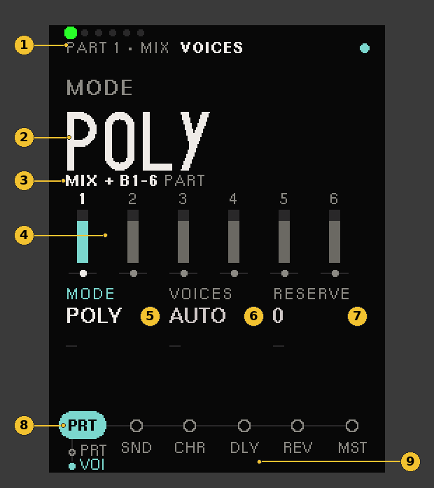
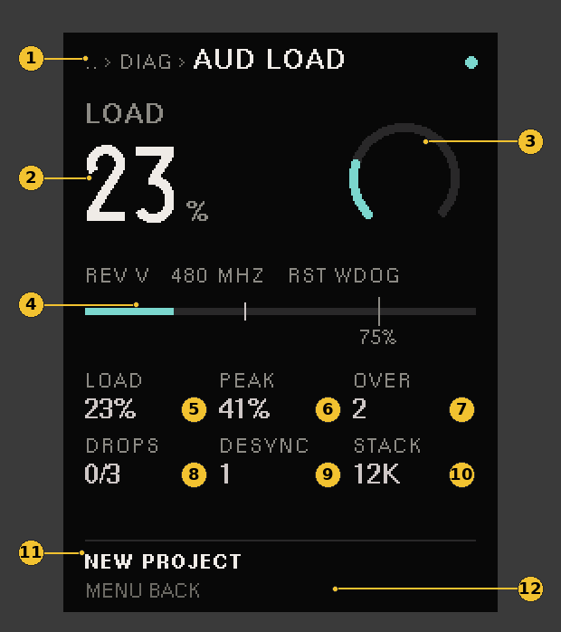
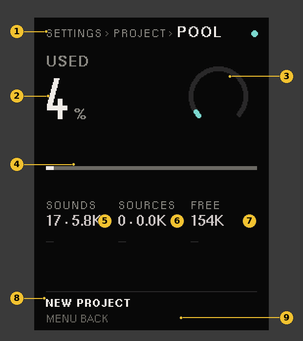
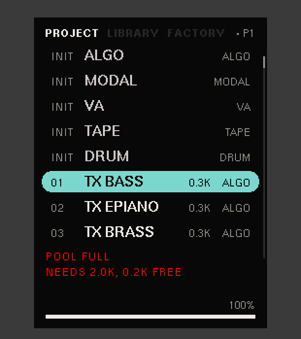

# Limits: voices, CPU and memory

This chapter explains the instrument's ceilings and what happens when you reach one: how many notes can sound, how a voice is chosen when there aren't enough, what a Part's **VOICES** and **RESERVE** do, the CPU readout and the AUDIO LOAD page, the project's sound memory (the pool) and TAPE streaming, and the sizes of lists, maps and names. Each section says why the limit is where it is. The ideas behind Parts and Sounds are in [Concepts](01-concepts.md); the mixer page that holds VOICES and RESERVE is in [The MIXER and the master effects](11-mixer-and-master-fx.md).

## Limits: the voice pool

Chimera has **eight voices**, shared by all six Parts. A voice plays one note (or one DRUM hit). Any Part can use any free voice; a Part on MONO uses one at a time.

Eight is the most that ever sound at once. How many a Sound actually gets depends on how much work each of its voices is (see [the voice budget](#limits-the-voice-budget-why-rich-sounds-get-fewer-voices)). A light Sound can use all eight; a rich one gets fewer.

**Why eight:** every voice keeps its own state in the chip's fastest memory, close to the processor, and a MODAL voice needs room for a whole string's worth of delay line, down to the low G of a bass guitar. Eight voices of that size are what that memory holds.

## Limits: the voice budget, why rich Sounds get fewer voices

Every block of sound (64 samples, 1.33 ms) has to be computed before the next one is due. About three quarters of the chip's time goes to audio; the rest keeps the screen, the controls, MIDI and the card running.

Each Sound has a **cost**: the sum of what its parts take, measured on the unit. An ALGO Sound costs more with more operators and more links between them; any Sound costs more with a moving filter, a FUZZ or FOLD in the FX slot, the low-pass gate, many routes, or a costly filter TYPE. Before a note starts, Chimera checks that its cost fits beside the voices already sounding, the shared effects and, while it plays, ORBIT. If it fits, the note gets a voice. If not, a voice is stolen for it (see [Voice stealing](#limits-voice-stealing)).

So the number of voices is not fixed per Sound: a Part playing a simple Sound beside a heavy one gets fewer notes than it would alone. Typical figures:

- Simple Sounds (a single-oscillator VA, a light ALGO patch) can use all eight voices.
- Rich Sounds (two morphing ALGO algorithms with six operators, a modelled filter, a fuzz) get around six.
- The costliest ALGO Sound still gets at least four voices, three with a formant operator.

ALGO's formant (FRMT) and noise (NOIS) operators are the one place where Chimera refuses a choice for cost: a WAVE or ALG choice that would push the Sound under that floor is shown dimmed with `OVER BUDGET` (or `BUDGET FULL · OTHER FORMANTS`) in the focus band, and nothing changes until you land on one that fits. See [ALGO](03-algo.md).

**Why:** a voice in Chimera is more than an oscillator: each note runs its own engine, filter model, FX slot, amp and low-pass gate, stereo placement and modulation. A plain synth on the same chip plays more notes because each note does far less. Chimera spends the chip on making each voice rich, and accepts six to eight voices of a typical patch as the price. Billing each Sound by what it really uses gives light Sounds every voice there is.

> **Design note:** every cost in Chimera was measured on a real PreenFM3 with a cycle counter, worst block first, then rounded up. When a reading came back higher than its bill, the bill went up. When it came back lower, it stayed put until a second reading agreed. Accountants would approve; synth players mostly just notice that nothing glitches.

The chip itself matters too. PreenFM3 units are built with one of two revisions of the processor: revision V runs at 480 MHz, revision Y at 400 MHz. A revision Y unit has less time per block, so its Sounds get a voice or so fewer. SETTINGS › SYSTEM › DIAGNOSTICS › AUDIO LOAD shows which one yours has (`REV V  480 MHZ`).

## Limits: voice stealing

When a note needs a voice and none is free, or the budget has no room, Chimera takes one from a note already sounding:

1. **A Part re-playing its own key** reuses that key's voice. A MONO Part always reuses its one voice.
2. Otherwise **the oldest released note**, a tail still ringing after its key was let go, is taken first.
3. Only if no tail is left, **the oldest held note** is taken.
4. **A MONO Part's voice is never stolen** by another Part.

A Part's **VOICES** and **RESERVE** change who may be taken (see the next section). A stolen voice fades out over about 3 ms on its own Part's sound, then the new note starts clean. Within a Part, PITCH's **STEAL** decides whether the new note cuts in or glides from the old pitch ([The voice chain](08-voice-chain.md)).

**Why:** a tail is the least missed. Taking held notes last keeps what you are still playing.

## Limits: VOICES and RESERVE per Part

Each Part has two voice limits on its mixer's VOICES page (MIXER › PRT, then SEQ to VOICES; VOI on the chain map). They are part of the project's mix, not the Sound.

1. **Header:** `PART 1 · MIX`, the VOICES page.
2. **The focused cell**, large: MODE and its value.
3. **The hint:** `MIX + B1-6 PART` opens another Part's VOICES page.
4. **The picture:** all six Parts' levels, the current one in accent.
5. **MODE** (encoder 1): MONO or POLY.
6. **VOICES** (encoder 2): the Part's cap, AUTO or 1–8.
7. **RESERVE** (encoder 3): voices guarded for the Part, 0–8.
8. **The chain map:** PRT, the mixer's Part page.
9. **The sub-pages:** PRT and VOI (VOICES), with EQ after it.

| Cell | Range | Default | What it does |
|---|---|---|---|
| **MODE** | MONO, POLY | POLY | One voice at a time, or one a note |
| **VOICES** | AUTO, 1–8 | AUTO | The most voices the Part sounds at once. AUTO caps nothing |
| **RESERVE** | 0–8 | 0 | Voices other Parts can't take from this Part while its keys are held |

**VOICES, the cap.** A Part never sounds more voices than its cap, tails included. A new note on a Part at its cap takes one of the Part's own voices (its oldest tail, else its oldest held note), even when other voices are free. Use it to stop a pad with a long release from eating the whole pool, or to make a Part play like a three-voice synth.

**RESERVE, the floor.** A Part's held notes, up to its reserve, are guarded: another Part's note can't steal them. A DRUM hit is guarded until it finishes sounding. Tails are not guarded, and a reserve never holds free voices back: a Part with nothing playing still gets a free voice first. A reserve of 0 guards nothing. Use it to keep a bass line or a lead intact while a busy Part plays chords around it. Touch RESERVE and the focus band shows the reserves booked across all Parts, `RESERVES 3/8`.

**The rule.** A Part's RESERVE can't be more than its VOICES, and all six reserves together can't be more than the eight voices. A turn past the rule is held dimmed with the reason, and nothing changes: `RESERVE 3 · VOICES 2` (the reserve is over this Part's cap) or `RESERVES 9 · POOL HOLDS 8` (the reserves would add up past the pool). A MIDI CC or the editor asking for the same is refused with that message as a toast.

**Why:** with one pool shared by six Parts, the Part playing most would otherwise always win. The cap stops one Part from taking everything; the reserve promises another Part what it needs. Both are off by default, so a project that doesn't need them plays as before.

## Limits: when the CPU is full, shedding

Sometimes the voices already sounding no longer fit: you turned a filter TYPE to a costlier one, added a FUZZ, or ORBIT started. Then Chimera **sheds** voices until the rest fit:

- **Tails go first**, oldest first, then the newest held note. Voices other Parts reserve go last.
- **A shed voice fades out** over two blocks (about 3 ms), on the sound it had before the change, so the edit that caused it is never heard as a click on the way out.
- **A new note waits** for a fading voice rather than cutting a held one: it starts at most about 3 ms late.

As a last safety net, if a block of sound ever takes more than 95 % of its time (a cost that was underestimated), Chimera sheds one more voice before the next block, and keeps doing so until the load is back under. A shed voice always fades; it is never cut.

**Why:** a block that isn't ready in time is a glitch in every Part at once. Losing the quietest note, faded, is far less noticeable than a dropout, and the rule "tails before held notes" keeps what you are playing.

## Limits: CPU and the load readout

The right of the header shows the audio load as `CPU 23%` when nothing else needs that place (see [The panel and navigation](02-panel-and-navigation.md#panel-the-cpu-readout-in-the-header)): grey up to 60 %, amber from 61 % to 80 %, red above 80 %. It is the share of each block's time the audio took, averaged over a few frames.

High numbers are normal: the voice budget fills the audio's share on purpose, and a busy, correctly billed block can read in the 80s. Glitches are not normal; if you hear one, check the AUDIO LOAD page.

### Limits: the AUDIO LOAD page

SETTINGS › SYSTEM › DIAGNOSTICS › AUDIO LOAD (AUD LOAD) shows the audio's health.

1. **Header:** where you are in SETTINGS.
2. **The focused cell**, large: LOAD, the load now.
3. **Its glyph**, an arc of the load.
4. **The picture band:** the chip's revision and clock (`REV V  480 MHZ`), why it last restarted (`RST WDOG` for the watchdog; a plain power-on reads differently), and a bar of the load with the 75 % mark, the audio's share of the chip.
5. **LOAD** (encoder 1): the average load, in % of the block's time.
6. **PEAK** (encoder 2): the worst block since power-on.
7. **OVER** (encoder 3): blocks that missed their deadline since power-on. Each is a glitch; it should stay at 0.
8. **DROPS** (encoder 4): notes and MIDI events dropped because the incoming queue was full, one count for each note source, joined by `/`.
9. **DESYNC** (encoder 5): a timing count kept for diagnosis; it should stay at or near 0.
10. **STACK** (encoder 6): the most working memory the audio has used, in K.
11. **Footer:** the project and its state.
12. **Footer:** the keys: MENU goes back.

The numbers are read-only. If OVER or DROPS climb in normal playing, note what was playing and report it ([Updating and recovery](19-updating-and-recovery.md) says where).

**Timing.** Notes land on block edges, every 1.33 ms. While ORBIT plays, part of the budget is set aside for its own work and for up to five notes starting in the same block, so a project with ORBIT running has a little less room for voices.

## Limits: the sound pool, the project's memory

A project's Sounds and TAPE sources share one block of memory, the **pool**: 160 KB. It holds:

- **the project's Sounds**: up to 128 slots. A Sound is stored by what differs from its engine's INIT, so most take 0.1K to 0.5K, and none more than about 3K;
- **TAPE sources**: up to 32. A short source is held whole; a long one keeps only its first tenth of a second here and streams the rest from the card (see [TAPE streaming](#limits-tape-sources-and-streaming)).

The six Parts' current Sounds don't count: a Part plays its own copy. What fills the pool is what you keep in the project.

SETTINGS › PROJECT › POOL shows it.

1. **Header:** SETTINGS › PROJECT › POOL.
2. **The focused cell**, large: USED, how full the pool is, in %.
3. **Its glyph**, an arc of the same.
4. **The picture band:** the pool meter, Sounds in white, sources in grey, then a faint part for space being freed, then free space.
5. **SOUNDS** (encoder 1): how many Sounds, and the memory they take (`17 · 5.8K`).
6. **SOURCES** (encoder 2): how many sources, and their memory.
7. **FREE** (encoder 3): the memory left.
8. **Footer:** the project and its state.
9. **Footer:** the keys: MENU goes back.

The same meter sits at the bottom of the Sound browser, and each row there shows what its Sound costs. The browser's hints say what saving or clearing would take or free (`MIX + EDIT SAVES · +0.3K`, `MIX + MINUS CLEARS · FREES 0.3K`).

### Limits: when the pool is full

When something doesn't fit, Chimera says so and changes nothing:

- **Saving a Sound** to the project: `POOL FULL`, then what it needs and what is free, `NEEDS 2.0K, 0.2K FREE`. A full set of 128 slots also refuses a new one.
- **Loading a card source** on TAPE's SRC page: the hint reads `WON'T FIT · NEEDS 41K, 12K FREE`, and the meter previews the source in red.
- **Loading a library Sound** whose source won't fit: the library says so before loading.

To make room: clear Sounds you don't need from the PROJECT tab (MIX + MINUS), or free the memory of sources no Part uses with SETTINGS › PROJECT › PURGE UNUSED SRC (the files stay on the card). A Sound in use by a Part can't be cleared.

**Why:** the pool is the memory left after the voices, the effects' delay lines and the rest of the instrument. Budgeting Sounds and sources together in one meter means one number tells you how full the project is, whatever it holds, and a sparse Sound means a project holds many more Sounds than a fixed slot size would allow.

## Limits: TAPE sources and streaming

A source is stored as 12-bit audio at its own rate, 4 to 48 kHz (24 kHz is usual). At 24 kHz, the whole pool would hold only about four and a half seconds. So:

- **A short source** is loaded whole into the pool. Every machine and direction plays it.
- **A long source** streams from the card while it plays. Only its first tenth of a second is kept in the pool, so a note starts at once. SOURCE's readout then shows how many notes of it can stream at once at its root pitch, for example `24K · 30.0 S · 7 STREAMS`. A note played higher reads faster and takes more of the card's speed.
- **What a stream can't do:** play backwards or jump around. REVERSE, PING, STRETCH, SCRUB and WAVE need the whole source in memory. On a streamed source they are dimmed, with the reason (`REVERSE NEEDS RAM`, `STRETCH NEEDS RAM`, `… NEEDS RAM · STREAMED`).
- **When the card can't keep up:** a new streamed note can stop a streamed tail (a released note) to free card time, but never a held note another Part reserves. If nothing can be freed, the note doesn't play, and the source reads `STREAMS FULL`.
- **A damaged file** reads `BAD FILE · DROPS OUT`: only the notes reading it drop out.

The machines and their pages are in [TAPE](06-tape.md).

**Why:** the card is large and the memory small. Streaming lets a TAPE Part play recordings far longer than memory holds, at the cost of the machines that need to read anywhere in the source at once.

## Limits: lists, maps and names

| What | Limit | What happens past it |
|---|---|---|
| Sound slots in a project | 128 | Saving to a new slot is refused |
| TAPE sources in a project | 32 | Loading another is refused; purge unused ones |
| Projects listed in LOAD PROJECT and MANAGE PROJECTS | 48 | The rest don't show |
| Sources listed from the card on SRC | 64 | The rest don't show |
| Rows a page of the Sound browser shows | 48 | `NEXT ›` / `OLDER ›` turn to the next page |
| Scala tuning files TUNING walks | The first 128 | The rest don't show ([Tuning](15-tuning.md)) |
| Controller maps listed on MIDI MAP | 16 | `CARD HOLDS MORE: 16 SHOWN` |
| Rows in a controller map | 90 | `MAP FULL` |
| A Sound's own MIDI rows | 16 | `MAP FULL`; delete a row first |
| SysEx controls in one map | 16 | `MAP FULL` |
| MOD matrix destinations a Sound | 16 | `MATRIX FULL` ([The mod matrix](10-mod-matrix.md)) |
| Voice groups in a DRUM kit | 8 | A CHOKE that makes a ninth is held dimmed ([DRUM](07-drum.md)) |
| A name (project, Sound, map) | 16 characters | The cursor stops |
| A factory Sound's description | 40 characters | |
| Incoming MIDI events waiting to play | 64 | Counted in DROPS; note-offs keep room of their own, so a note never hangs |

**Why the lists stop:** a listing is read from the card into a fixed amount of memory. Chimera never allocates memory while it plays, so every list has a fixed size, chosen to cover normal use.

## Limits: the firmware's size, and NEEDS UPDATE

The chip's built-in program memory is small. Chimera fills it and keeps the rest of itself, most of the engines, the effects, ORBIT and much of MIDI, in a second part that installs from the file `CHIMERA.BK2` on the card. Without that second part, or with one from another version, those parts stay silent and their screens say **UPDATE** or **NEEDS UPDATE**. The fix is to copy the matching `CHIMERA.BK2` to the card and restart: see [Updating and recovery](19-updating-and-recovery.md).

**Why:** the chip was chosen for its speed, not its program memory, and a multi-engine synth doesn't fit in what it has built in. The two halves always come from the same release and install as one update.
