# Chimera 0.4 manual for the PreenFM3

<!-- Generated by `just manual` from the chapters beside this file. Edit those, not this. -->

The complete reference for Chimera 0.4, multi-engine firmware for the PreenFM3 synthesizer. It explains every page, cell and gesture, and why the instrument works the way it does. Labels are written as the screen shows them.

New to Chimera? The [quick start](https://joegiralt.github.io/chimera-releases/guides/quick-start) gets you playing in a few minutes, and the [FAQ](https://joegiralt.github.io/chimera-releases/guides/faq) answers short "how do I" questions. This manual is the full reference behind both.

The whole manual is also one file, [manual.md](manual.md), for reading offline or for handing to an LLM. [llms.txt](llms.txt) points to it.

## Manual: chapters

**Getting around**

1. [Concepts: Parts, Sounds, projects and the voice chain](#concepts-parts-sounds-projects-and-the-voice-chain)
2. [The panel and navigation](#the-panel-and-navigation)

**The engines**

3. [ALGO](#algo-the-six-operator-engine)
4. [MODAL](#modal-the-physical-modelling-engine)
5. [VA](#va-the-variable-wave-engine)
6. [TAPE](#tape-the-sample-engine)
7. [DRUM](#drum-the-kit-engine)

**Shaping the voice**

8. [The voice chain: pitch, filter, FX, amp, stereo and sends](#the-voice-chain-pitch-filter-fx-amp-stereo-and-sends)
9. [Envelopes and LFOs](#envelopes-and-lfos)
10. [The mod matrix](#the-mod-matrix-and-routes)

**The whole instrument**

11. [The MIXER and the master effects](#the-mixer-and-the-master-effects)
12. [ORBIT, the ring sequencer](#orbit-the-ring-sequencer)
13. [SETTINGS](#settings)
14. [MIDI](#midi-channels-maps-and-controllers)
15. [Tuning](#tuning-temperaments-scala-files-and-mts)

**Files, connections and care**

16. [The SD card, Sounds and the library](#the-sd-card-projects-sounds-and-the-library)
17. [USB: audio, MIDI and the console](#usb-midi-audio-and-the-console-over-one-cable)
18. [The browser editor](#the-browser-editor)
19. [Updating and recovery](#updating-and-recovery)
20. [Limits: voices, CPU and memory](#limits-voices-cpu-and-memory)
21. [Glossary](#glossary)

## Manual: how to read it

- Each chapter covers one subject. Each section covers one topic, and its heading is unique in the whole manual, so a link to it stays put.
- Cells and pages are in bold capitals, as on the screen: **CUTOFF**, **FX PLACE**. Option values are in capitals: LP4, FUZZ.
- A page has a short name on the chain map (FLT) and a full name on its tab (FILTER). The manual gives both.
- Continuous knobs read 0 to 127 unless the screen shows a unit (Hz, ms, dB, %).
- Paragraphs headed **Why:** give the reasoning behind a design choice.
- This manual describes the firmware version in its title. Each release has its own copy.

# Concepts: Parts, Sounds, projects and the voice chain

This chapter explains the ideas the rest of the manual builds on: what Chimera is, the six Parts, Sounds, projects and the library, the path a note takes from the engine to the output jacks, how modulation works, the five engines, and the design rules behind the controls. For the buttons and the screen, read [The panel and navigation](#the-panel-and-navigation) next. For the ceilings (voices, CPU, memory), see [Limits](#limits-voices-cpu-and-memory).

## Concepts: what Chimera is

Chimera is firmware for the PreenFM3. It runs on the PreenFM3's own hardware (its chip, screen, six encoders, buttons, output jacks, MIDI ports, USB port and SD card) and replaces the stock FM synthesizer with a different instrument:

- **Multi-engine.** Five sound engines: ALGO, MODAL, VA, TAPE and DRUM. Each Part can use any of them.
- **Multitimbral.** Six Parts play at once, each with its own engine, Sound and MIDI channel.
- **One voice chain for all engines.** Whatever the engine, its sound goes through the same filter, FX slot, amp, stereo and sends, and the same modulation matrix moves it.
- **A ring sequencer**, [ORBIT](#orbit-the-ring-sequencer), plays the Parts by itself.

Chimera is software on someone else's hardware. It keeps the PreenFM3's identity where that helps you: the same USB identity, the same SD card, the same bootloader. Your stock PreenFM3 files on the card are left alone: Chimera reads and writes only inside the card's `/CHIMERA/` folder. Going back to the stock firmware is covered in [Updating and recovery](#updating-and-recovery).

> **Design note:** Chimera started as an idea of a boutique, Eurorack-flavoured instrument squeezed into a box built for FM. The PreenFM3 has a fast chip, a colour screen and six encoders, which is plenty, provided you are prepared to count every cycle. The rest of this manual is, in a sense, the story of that counting. Please do enjoy. Try not to lick the capacitors and get high on LSD.

## Concepts: Parts

A **Part** is one instrument inside Chimera. There are six, numbered 1 to 6, one for each of the buttons **B1** to **B6**.

Each Part has:

- **its own Sound**, and so its own engine (see [Sounds](#concepts-sounds));
- **its own MIDI channel**: out of the box, Part *n* listens on channel *n*. Set it with **CH** on the Part's mixer page, or all six at once in SETTINGS › MIDI CONFIG › CHANNELS ([MIDI](#midi-channels-maps-and-controllers));
- **its own mix settings**: **LEVEL**, **PAN**, **MODE** (MONO or POLY), **OUT** (output pair P1, P2 or P3), **BEND** (pitch-bend range), its voice limits (**VOICES** and **RESERVE**), its EQ (**TILT**, **LO CUT**, **ROLE**). These live in the [MIXER](#the-mixer-and-the-master-effects), not in the Sound.

Press **B*n*** to see Part *n*'s sound pages. Press it again to flip to its mixer. All six Parts draw their voices from one shared pool of eight voices (see [Limits](#limits-the-voice-pool)).

Two Parts on the same MIDI channel both play when that channel plays. That is how you layer two Sounds.

**Why:** six Parts match the six B buttons, so every Part is one press away, and a Part's button is also the way into its mixer.

## Concepts: Sounds

A **Sound** is a Part's patch: everything that makes the Part sound the way it does. It holds:

- **the engine** (ALGO, MODAL, VA, TAPE or DRUM) and all the engine's settings;
- **the voice chain**: PITCH, the filter, the FX slot, AMP, STEREO;
- **the modulation**: the three envelopes, three LFOs and the MOD matrix routes;
- **the sends** to the shared CHORUS, DELAY and REVERB;
- **its MIDI rows**: controls learned to its cells ([MIDI](#midi-channels-maps-and-controllers));
- for a TAPE Sound, **which source** it plays; for a DRUM Sound, **its kit**.

The engine belongs to the Sound. There is no separate engine switch: to change a Part's engine, load a Sound that uses another engine. Each engine has a clean starting Sound, its **INIT** row in the Sound browser (INIT ALGO, INIT MODAL, INIT VA, INIT TAPE, INIT DRUM). The Part's pages change to match the new engine.

What a Sound does **not** hold: the Part's MIDI channel, LEVEL, PAN, MODE, OUT, BEND, voice limits and EQ. Those belong to the Part, in the project's mix, so loading a Sound never moves your mix.

**Why:** choosing the engine by loading a Sound means a Part is never left half set up for one engine and half for another. Every Sound you load is complete and plays as saved.

## Concepts: projects

A **project** is the whole musical state of the instrument, saved as one file on the card. It owns:

- **its Sounds**: up to 128 numbered Sound slots, the PROJECT tab of the Sound browser;
- **its TAPE sources**: the recordings its TAPE Sounds play, held in the project's memory (see [the sound pool](#limits-the-sound-pool-the-projects-memory));
- **the six Parts**: which Sound each one plays and its mix settings;
- **the shared effects and the master**: CHORUS, DELAY, REVERB, the compressor and the master level;
- **ORBIT**: its rings, chords and eight scenes.

**Hold MENU** from anywhere to save the project to the card (a new project asks for a name first). Load, create, rename, copy and delete projects in SETTINGS › PROJECT ([SETTINGS](#settings), [the SD card](#the-sd-card-projects-sounds-and-the-library)).

A new project starts with a set of factory Sounds in its PROJECT tab, and Parts 1 to 5 start on some of them.

### Concepts: copies, not links

Every step from the library to a Part is a copy:

```
   LIBRARY (card)  ──copy──▶  PROJECT slot  ──copy──▶  Part
```

- Loading a Sound into a Part copies it. Editing the Part edits only the Part's copy.
- Saving the Part's Sound (MIX + EDIT in the browser, or SETTINGS › PART › SAVE TO PROJ) copies it back into a project slot.
- A later change to a library Sound, or to a slot, never changes a Part that was loaded from it.

The screen keeps track for you. A Part whose Sound differs from where it came from reads `* EDITED` in SETTINGS › PART. A project with unsaved changes reads `* MODIFIED` at the bottom of SETTINGS. Before anything would throw away unsaved work (loading a Sound over an edited Part, loading another project), Chimera asks first.

**Why:** the project is what you play live and come back to. If a Part only pointed at a library Sound, editing that Sound for another song would quietly change this one. Copies keep each project as you left it.

## Concepts: the library and factory Sounds

Besides the project's own Sounds, there are two more places to load from, both on the card:

- **LIBRARY**: Sounds you saved from any project (SETTINGS › PART › SAVE TO LIBRARY, or MIX + EDIT on the browser's LIBRARY tab). Use it to carry a Sound from one project to another.
- **FACTORY**: the factory Sounds, read-only. An edited factory Sound is saved to your project or library, never over the factory one.

Open the Sound browser with **EDIT + B*n*** and turn encoder 2 to switch between the PROJECT, LIBRARY and FACTORY tabs. The full story, including how the factory set gets onto the card, is in [The SD card, Sounds and the library](#the-sd-card-projects-sounds-and-the-library).

## Concepts: the voice chain

Every note a Part plays runs through the same path, whatever its engine:

```
  one voice (a note)                                 one Part (all its voices)
 ┌───────────────────────────────────────────┐     ┌──────────────────────────────┐
 │ ENGINE ─▶ FX slot ─▶ FILTER ─▶ FX slot ─▶  │     │                              │
 │           (PRE)               (POST)       │     │  sum ─▶ EQ ─▶ LEVEL / PAN ──┼──▶ OUT pair
 │   ─▶ AMP (VCA / LPG) ─▶ STEREO ───────────┼────▶│        (LO CUT,   │          │
 └───────────────────────────────────────────┘     │         TILT)     └─ sends ──┼──▶ CHORUS
                                                   └──────────────────────────────┘    DELAY
                                                                                        REVERB
                                                                                          │
   main pair P1 ◀── effect returns ◀────────────────────────────────────────────────────────┘
      │
      └─▶ MASTER compressor (MST) ─▶ master level (LVL) ─▶ output jacks (and USB audio)
```

In words:

1. **The engine** makes the raw sound of one note: operators (ALGO), a resonator (MODAL), two oscillators (VA), a recording (TAPE) or a drum machine (DRUM).
2. **The FX slot** shapes it: OFF, SOFT (drive), FUZZ or FOLD (a wavefolder). **FX PLACE** puts it before the filter (PRE) or after it (POST).
3. **The filter**: CLEAN, 2040, DIRTY, LADDER or SEM, each with its own modes.
4. **AMP**: the voice's VCA, which **LPG**, **DECAY** and **STRIKE** can turn into a low-pass gate.
5. **STEREO** places each note in the stereo field.
6. The Part's voices are summed, then run through **the Part's EQ** (**LO CUT**, then **TILT**).
7. **LEVEL** and **PAN** set the Part in the mix, and the Part's three **sends** feed the shared CHORUS, DELAY and REVERB. The delay can also feed the reverb.
8. The Part plays out of the output pair its **OUT** picks: P1 (the main pair), P2 or P3. The effects return on P1 only. The master section, the compressor (**MST**) and the master level (**LVL**), comes last. USB audio records the main pair.

Every engine's chain map ends in the same pages, **FLT** (FILTER), **AMP** and **MOD**, and every engine has a **PITCH** sub-page. The shared pages are explained once, in [The voice chain](#the-voice-chain-pitch-filter-fx-amp-stereo-and-sends). The Part's EQ, sends and the shared effects are in [The MIXER and the master effects](#the-mixer-and-the-master-effects).

**Why:** one chain for every engine means one set of pages to learn. A filter sweep, a drive or a low-pass gate works the same on an FM bell, a plucked string or a recording.

> **Design note:** the voice chain reads like a Eurorack row: oscillator, wavefolder or fuzz, filter, low-pass gate. Some of those modules have well-known parents. The low-pass gate is a port of the one in Émilie Gillet's Mutable Instruments Plaits; FUZZ is modelled from the circuit of a Big Muff pedal; SEM is the SEM-1A filter, from a published circuit-model paper; 2040 models the SSM2040 chip. The chapters on each say more. No soldering iron was harmed.

## Concepts: modulation

Everything that moves a setting over time is a **route** in the Part's **MOD matrix**. The rows are sources: the three envelopes (ENV1–ENV3), three LFOs (LFO1–LFO3), velocity (VELO), the note (NOTE), the mod wheel (WHEEL), aftertouch (PRESS), MPE slide (SLIDE) and, on ALGO, the audio of operators 5 and 6 (OP5, OP6). The columns are destinations: the filter's frequency and resonance, the VCA, the FX slot, and any other parameter you add. To add one, touch the parameter on its page and press **MIX + PLUS**; it becomes a column. Cells like the filter's **ENV AMT**, **FREQ MOD** and **RES MOD** are routes too, shown where you would look for them. Even the envelope into the amp is a route. The whole story is in [The mod matrix](#the-mod-matrix-and-routes), and the envelopes and LFOs are in [Envelopes and LFOs](#envelopes-and-lfos).

**Why:** one way to connect anything to anything, as on a patch bay. Nothing is hard-wired that you can't see or change.

## Concepts: the five engines

### Concepts: ALGO

Six-operator phase modulation (FM). Two algorithms, **ALG A** and **ALG B**, with **MORPH** blending from one to the other. Each operator has its own wave, ratio, level and envelope; operators can also be formant (FRMT) or noise (NOIS) operators for voices and breath. See [ALGO](#algo-the-six-operator-engine).

### Concepts: MODAL

Physical models: struck, plucked and bowed resonators. An exciter (the EXC page) hits, plucks or bows a resonator (RES); **MODEL** picks STRING, BANK, BOWED or SYMP (sympathetic strings). A MODAL note rings on after you let go of the key, as a real string does. See [MODAL](#modal-the-physical-modelling-engine).

### Concepts: VA

Two oscillators whose waves morph from sine through triangle and saw to pulse, combined by **MODE** (MIX, SYNC, RING, FM and more), with a sub-oscillator (**SUB**), a noise source (NOISE) and **STABILITY**, which lets each voice drift as analogue oscillators do. See [VA](#va-the-variable-wave-engine).

### Concepts: TAPE

Plays recordings, called sources, held in the project's memory or streamed from the card. A machine on the DECK page decides how a source plays: **WALK** (one-shot, loop, ping-pong or Mellotron-style tape), **STRETCH** (stretched in time at the key's pitch), **SCRUB** (by hand, like a reel under a finger) or **WAVE** (wavetables). See [TAPE](#tape-the-sample-engine).

### Concepts: DRUM

A drum kit on one Part: twelve pads, each with its own machine (TONE KICK, TONE SNARE, METAL HAT, PLAIN NOISE and more), its own filter, amp and modulation, and its own keys. One DRUM Part plays a whole kit from one MIDI channel. See [DRUM](#drum-the-kit-engine).

> **Design note:** the engines have known ancestors, and none of them is a copy. MODAL builds on the maths of Émilie Gillet's Mutable Instruments Rings and Elements. ALGO's factory set includes Sounds ported from Yamaha TX81Z patches, which then wander off on six operators instead of four. TAPE's STRETCH follows the way a classic Akai S950 sampler stretched time, and its GRAIN type ports the grain engine of Mutable Instruments Beads. VA is Chimera's own clean-room design, meant to feel analogue while still able to go West Coast or East Coast. DRUM borrows the shape of an Elektron Analog Rytm kit and the structure of the Machinedrum's machines, from their manuals only: the algorithms and names are Chimera's own.

## Concepts: design ideas you will meet everywhere

These rules hold across the whole instrument. Knowing them makes the rest of the manual shorter.

### Concepts: changes glide, never snap

Turn a knob and the sound glides to the new value: a continuous control (a level, a cutoff, a send, MORPH) eases there over about 20 to 30 ms. A choice that changes the sound's structure (a filter TYPE, a WAVE, an algorithm, a machine) crossfades or waits for the next note, rather than jumping in the middle of one. The number on screen shows the new value at once; the arc or bar under it eases there.

**Why:** an instant jump in a level or a filter is heard as a click. Gliding every change makes turning a knob, a MIDI CC, RANDOMIZE or a program change sound clean while you play.

### Concepts: numbers show what you set

A value on screen is always the value you set. Modulation never moves the number. Where modulation matters, the screen draws it separately: a thin line under a cell's bar, or a faint band on the filter's picture from the cutoff you set to where modulation has it now.

**Why:** a number that jumps around while an LFO runs can't be read or set. You set the base; the picture shows the movement.

### Concepts: one D-pad everywhere

The same four keys move you everywhere: **MINUS** and **PLUS** go along (pages, Parts, rows), **EDIT** and **SEQ** go between a page and its sub-pages. This holds on a Part's pages, the mixer, the Sound browser, ORBIT and every SETTINGS list. See [The D-pad](#panel-the-d-pad).

**Why:** a key that means up on one screen and save on another can't be learned by hand. One meaning per key, everywhere.

### Concepts: hidden gestures always show a hint

The PreenFM3 has few buttons, so some actions are combos (MIX + a key) or holds. None of them is a secret: touch a cell, and the focus band shows the combos that cell answers to, with what they do. See [Hints](#panel-hints-in-the-focus-band).

**Why:** a combo nobody can find doesn't exist. A hint only for the cell you touched keeps the screen quiet the rest of the time.

### Concepts: labelled modules

Each page is one module of the instrument (an oscillator, a filter, an envelope, an effect) with up to six labelled controls, one per encoder, in a fixed place. Labels are full words where they fit (**REVERB**, **DELAY**, **CHORUS**) and are abbreviated only where they truly don't.

**Why:** like a Eurorack module, a page should be readable at a glance: what it is, what each knob does, and where that knob sits.

### Concepts: pages show what they do to the sound

The middle of the screen draws what the page does: the filter's real response, the algorithm's diagram, the LFO's cycle, the machine of a TAPE Sound, the reverb's cube. Each control has its own picture in the focus band (an arc, a crossfader, a level bar, a spirit level for STABILITY). A cell that does nothing in the current setting is dimmed, and touching it says why.

**Why:** you shape a sound by ear, but the picture tells you what you just changed and why a knob seems to do nothing.

### Concepts: safe by default

A dialog that could lose work (DELETE, CLEAR, SAVE OVER) opens on CANCEL, so a reflex press of EDIT does nothing harmful. A choice the instrument can't play (a formant operator past the CPU budget, a machine a streamed source can't feed) is shown dimmed with its reason, and nothing changes until you land on one it can.

**Why:** you should be able to explore without fear of losing a Sound or a project.

# The panel and navigation

This chapter covers every control on the panel, the layout of the screen, how the four D-pad keys move you around, every key combo and hold, the hints that name them, dialogs and naming, lists, the chain map, the screensaver and text size. It does not explain the engine or effect pages themselves; each has its own chapter, linked from [the chapter list](README.md). The ideas behind Parts, Sounds and projects are in [Concepts](#concepts-parts-sounds-projects-and-the-voice-chain).

## Panel: the controls

| Control | What it does |
|---|---|
| **Encoders 1–6** | Each turns the cell above it on screen: 1 2 3 on the top row of cells, 4 5 6 on the row below. Some hints name them by letter, A to F (A is encoder 1, F is encoder 6) |
| **B1–B6** | The six Parts. Press B*n* for Part *n*'s sound pages; press it again for its mixer. In ORBIT, B1–B5 are the rings and B6 is play / stop |
| **MINUS / PLUS** | Along: the previous / next page of the chain, the previous / next row of a list, the previous / next Part in the Sound browser |
| **EDIT** | Down or back between a page and its sub-pages (see [The D-pad](#panel-the-d-pad)); opens or runs the selected row in a list; **OK** in a dialog |
| **SEQ** | The other way between a page and its sub-pages; back one level in SETTINGS; cancels a dialog. Held, it enters ORBIT |
| **MIX** | A shift key: held, it turns other keys and turns into secondary actions (MIX + …) |
| **MENU** | Opens SETTINGS; inside it, steps back out one level at a time. Held, it saves the project |

The front-panel LED pulses ORBIT's beat while ORBIT runs: a short blink on each beat, a long one on the first beat of the bar.

A button acts when you press it, except where it also has a hold: SEQ, MENU and, in ORBIT, B1–B5 act when you let go, or at the hold after half a second.

### Panel: encoders that push

The encoders on most PreenFM3 units only turn. Some control boards have encoders that also push. Chimera never needs a push: every push is a shortcut for something you can also do without it.

If your encoders push, turn on SETTINGS › SYSTEM › PUSH ENCODERS › **PUSH**: ON (OFF by default). Then:

- **PUSH** (press and let go without turning) sets the cell to its default.
- **PUSH + TURN** steps the value finely.

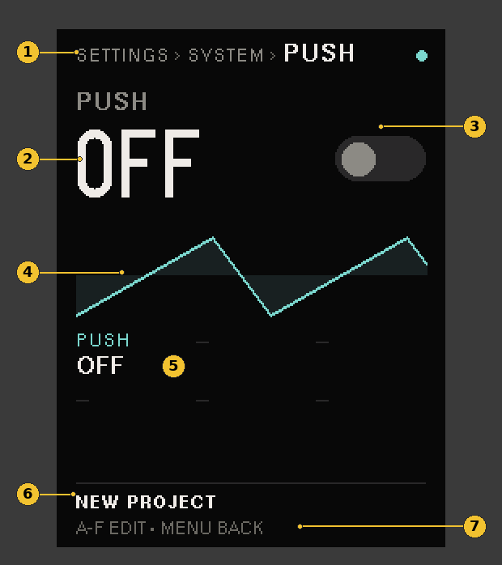

1. **Header:** SETTINGS › SYSTEM › PUSH.
2. **The focused cell**, large: PUSH and its value.
3. **Its glyph**, a switch.
4. **The picture band**, the live output.
5. **Cell A** (encoder 1): **PUSH**, OFF or ON.
6. **Footer:** the project and its state.
7. **Footer:** the keys this page answers to.

With PUSH on, a cell's hint reads `PUSH DEFAULT  PUSH/SEQ FINE`. Without push encoders, use **SEQ + turn** for fine steps (see [Panel: fine steps](#panel-fine-steps-with-seq-and-turn)) and **MIX + turn** to reach the default (see [Panel: landmarks](#panel-jumping-to-a-landmark-with-mix-and-turn)).

## Panel: the screen


1. **Header.** Above the text, one dot a Part, B1 to B6: the current Part is the bright green dot, and a Part that is playing has a ring round its dot. Then the place, `PART 1 · SOUND` (a Part's sound pages; `PART 1 · MIX` is its mixer), and the page's full name, VA. The dot on the right is the sounding dot, lit while the instrument makes sound; a second dot beside it pulses ORBIT's beat while it runs. If the Part plays out of output pair 2 or 3, an `OUT P2` or `OUT P3` warning shows on the right of this line.
2. **Focus band: the touched cell**, its label (WAVE1) and its value, large. A unit (Hz, kHz, ms, %) is set small after the number. The number is the value you set: it shows as soon as you turn, and modulation never moves it.
3. **Focus band: the glyph**, a picture of the value: here WAVE1's wave.
4. **Focus band: the hint line**, the combos the touched cell answers to: `SEQ+TURN FINE` and `MIX + SEQ LEARN` (see [Hints](#panel-hints-in-the-focus-band)).
5. **The picture band** (the viz band): what the page does. Pages without a picture of their own, like this one, show the live output's waveform.
6. **Cell 1** (encoder 1), WAVE1. The focused cell's label is in the accent colour, and the bar under it shows where the value sits in its range.
7. **Cell 2** (encoder 2), WAVE2.
8. **Cell 3** (encoder 3), MODE. A choice has no bar.
9. **Cell 4** (encoder 4), BLEND.
10. **Cell 5** (encoder 5), SUB.
11. **Cell 6** (encoder 6), STABILITY. A thin line under a cell's bar shows modulation reaching it; a dash in a cell means the slot is empty; a dimmed cell does nothing in the current setting.
12. **The chain map**: the page you are on is the filled pill (VA); the other nodes (FLT, AMP, MOD) are MINUS / PLUS away.
13. **The sub-page row** under the node: VA (the page itself, lit) and its sub-pages, OSC1 and on. `<` and `>` at the ends of a long row mean more sub-pages are off the edge.

What each VA cell does is in [VA](#va-the-variable-wave-engine).

From top to bottom, every Part, mixer and ORBIT page has the same five bands: the **header** (1), the **focus band** (2–4), the **viz band** (5), the **six cells** (6–11) and the **chain map** (12–13). Some pages (FILTER, MASTER, the envelopes and LFO speeds, ORBIT's ORB) give the focus band and viz band together to one larger picture.

SETTINGS uses the same header, with a breadcrumb in place of the Part line (`SETTINGS › PROJECT › POOL`), and puts the project's name and state at the bottom in place of the chain map (see [SETTINGS](#settings)).

### Panel: the CPU readout in the header

When nothing else needs the right of the header, it shows the audio load, `CPU 23%`: grey up to 60 %, amber from 61 % to 80 %, red above 80 %. A long page name or the `OUT P2` / `OUT P3` warning takes its place. What the number means, and what happens near 100 %, is in [Limits: CPU](#limits-cpu-and-the-load-readout).

### Panel: the boot screen

At power-on the screen shows the Yellow Sign on a yellow ground, with the firmware's version under it. If the second half of the firmware needs installing, the screen says DON'T POWER OFF while it does (see [Updating and recovery](#updating-and-recovery)). Then Chimera opens on Part 1's home page.

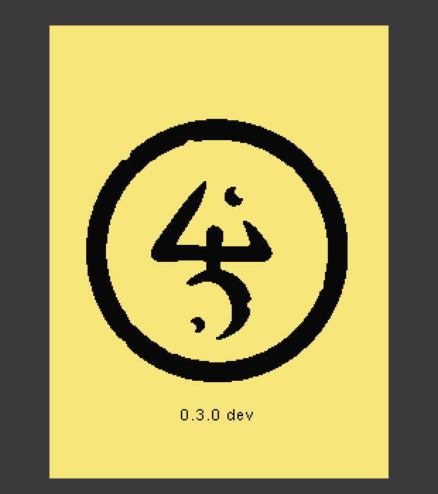

> **Design note:** the sign on the boot screen is the Yellow Sign, designed by Christian Knutsson for Pelgrane Press, who released it into the public domain. It is the emblem of the King in Yellow, a play that, in the old stories, drives its readers mad. Carcosa, where the King holds court, is never far from this project. You have been warned; the manual, at least, is safe to read.

## Panel: the focus band

The focus band is the strip under the header. It reads the cell you last touched: turning an encoder touches its cell, and the band keeps showing it, with no timer, until you touch another. Each page remembers its own focused cell.

It shows:

- **the label and the value**, large, with its unit;
- **a glyph**, a picture of what the value does. Most knobs draw an arc (filled from 12 o'clock when the value runs both ways). Blends draw a crossfader with what each end gives written under it (MORPH, VA's BLEND). Levels and sends draw a level bar, switches a switch, wave choices a scope, STABILITY a spirit level, FX PLACE a picture of the order, the filter's FEEDBACK a loop, each LFO control the LFO, TAPE's knobs the machine, and the effects their own animated pictures. Word choices (MODEL, the filter's MODE, STEAL) have no glyph: the word takes the band;
- **a note** where one helps: the source a route reads (`FREQ MOD LFO1`), the ratio an operator's coarse and fine come to, the reserves booked on **RESERVE** (`RESERVES 3/8`);
- **the reason** a dimmed cell or a refused choice can't be used, in place of the hint (`GRAIN TYPE ONLY`, `OVER BUDGET`, `REVERSE NEEDS RAM`);
- **the hint line** (see [Hints](#panel-hints-in-the-focus-band)).

**Why:** six cells leave little room for long names and units. The focus band gives the one control you are working on the room to explain itself.

## Panel: the cells and how values move

Each page has up to six cells, one per encoder, laid out as the encoders are. Turning an encoder changes its cell at once on screen and touches it (it becomes the focus). An empty slot (a dash) does nothing and doesn't take the focus.

- **Turn speed.** A quick turn moves a value further each detent. A list or a choice of names (a TYPE, a MODEL, a source) moves more gently, one row a detent for the first few, so it doesn't overshoot.
- **Gliding.** The sound glides to the new value; the cell's bar eases there at the same speed. A MIDI CC or the browser editor moving a cell shows on screen the same way.
- **Dimmed cells.** A cell the current setting doesn't use is dimmed. You can still turn it; it has no effect until the setting that uses it is on. The focus band says why it is dimmed.
- **Refused choices.** Some choices can't always be played: an ALGO operator WAVE or algorithm past the formant budget, a TAPE machine or direction a streamed source can't feed, a DRUM pad's CHOKE that would need a ninth voice group, a Part's VOICES or RESERVE that the other Parts' reserves don't leave room for. Turning onto one shows it dimmed with its reason, and nothing changes; turn on to one that can be played, or touch another cell to drop it.

**Why:** a refused choice is shown rather than skipped so you can see that it exists and what stands in its way, and is never applied so the sound never breaks under you.

## Panel: the D-pad

Four keys move you everywhere, as a D-pad:

| Key | Does |
|---|---|
| **MINUS / PLUS** | Along: the previous / next page of the chain (the nodes on the chain map), the previous / next row of a list, the previous / next Part in the Sound browser |
| **SEQ** | With the chain map on ROW (the default): on to the next sub-page. From the last sub-page it wraps round to the page itself |
| **EDIT** | With ROW: back to the previous sub-page. On the page itself it does nothing on a Part's pages |
| **MENU** | Leave: open SETTINGS, step back out of it a level at a time, leave ORBIT |

The same keys work on a Part's pages, in the mixer and the effects, in the Sound browser, in ORBIT and in every SETTINGS list.

```
   MINUS (previous page)  ◀  page  ▶  PLUS (next page)

   EDIT (previous sub-page)  ◀  sub-page  ▶  SEQ (next sub-page, wraps)

   An ALGO Part's chain (ALG is its home):

   ALG ──── OSC ─────────── FLT ──────── AMP ──────── MOD
    └ PIT    ├ CRS … FBK     ├ FMD        ├ STER       ├ E1  E2  E3
             └ OP1 … OP6     ├ FX         └ SND        ├ SPD
                             └ JACK                    └ L1  L2  L3
```

MINUS on the first page and PLUS on the last do nothing: the chain doesn't wrap along, only down through the sub-pages.

**Why:** the panel has no arrow keys, so these four stand in for them. One meaning per key, everywhere, so your hand learns it once. See [Concepts: one D-pad everywhere](#concepts-one-d-pad-everywhere).

### Panel: the chain map and its STACK option

The strip at the bottom of every Part, mixer and ORBIT page is the map of the chain you are in.


1. **A node:** one page of the chain. MINUS / PLUS step to the neighbours.
2. **The line** joins the chain's pages in order, left to right.
3. **The pill:** the page you are on.
4. **Node labels** are the pages' short names (ALG, OSC, FLT, AMP, MOD).
5. **The sub-page row** under the map: the node's own page first, then its sub-pages, each in a full word. The underlined one is where you are.
6. A long row scrolls: `<` and `>` show that more pages are off the edge (OSC has 18).

The chain changes with the engine and the place:

| Where | Chain |
|---|---|
| ALGO Part | ALG · OSC · FLT · AMP · MOD |
| MODAL Part | EXC · RES · FLT · AMP · MOD |
| VA Part | VA · FLT · AMP · MOD |
| TAPE Part | SRC · DECK · FLT · AMP · MOD |
| DRUM Part | KIT · MCH · FLT · AMP · MOD |
| A Part's mixer | PRT · SND · CHR · DLY · REV · MST |
| ORBIT | ORB · RING · CHRD · SCN |

The map shows short names (FLT); the sub-page row and the header show full names (FILTER, MODULATION, JACKS). Each engine's chapter lists both.

**STACK.** If you prefer the sub-pages as a vertical list, set SETTINGS › PERSONALIZE › CHAIN MAP › **PAGES** to STACK (ROW is the default). With STACK the sub-pages hang under the node, and the keys follow the picture: **EDIT** goes down a sub-page (wrapping from the last to the first) and **SEQ** goes back up.


1. **Header:** SETTINGS › PERSONAL › MAP.
2. **The focused cell**, large: PAGES and its value.
3. **The picture band**, the live output.
4. **Cell A** (encoder 1): **PAGES**, ROW or STACK.
5. **Footer:** the project and its state.
6. **Footer:** `A-F EDIT · MENU BACK`.

**Why:** on ROW the sub-pages run left to right, and EDIT sits left of SEQ on the panel, so EDIT goes left and SEQ goes right. On STACK they run top to bottom, so EDIT, the lower key in the stack's sense, goes down. Either way the key moves the way the picture does.

### Panel: Part buttons

| Where you are | B*n* does |
|---|---|
| Part *n*'s sound pages | Flips to Part *n*'s mixer (SENDS, or the effect page you last left in the mixer) |
| Part *n*'s mixer | Flips back to Part *n*'s sound pages, on the page you left |
| Another Part's sound pages | Opens Part *n*'s sound pages on the same page, when its chain has it (FLT stays FLT), else the nearest match, else its home |
| Anywhere else (another Part's mixer, the browser, SETTINGS) | Opens Part *n*'s home page |
| ORBIT | B1–B5 open ring 1–5; B6 plays / stops (see [ORBIT](#orbit-the-ring-sequencer)) |

**Why:** a Part's button is the way into everything about that Part. Keeping the page when you switch Parts lets you compare one page across Parts with one press.

### Panel: the mixer's own moves

In a Part's mixer, MINUS and PLUS walk PRT · SND · CHR · DLY · REV · MST. PRT has two sub-pages, VOICES and EQ (SEQ on ROW, EDIT on STACK). **EDIT** on PRT or SND goes down to the Sound browser for that Part, and **SEQ** in the browser comes back up. The mixer is the top of its chain: SEQ on SND does nothing. **MIX + B*n*** opens Part *n*'s mixer on the same page (its hint reads `MIX + B1-6 PART`). The mixer itself is in [The MIXER and the master effects](#the-mixer-and-the-master-effects).

### Panel: the Sound browser's moves

Open it with **EDIT + B*n***, or EDIT from the mixer's PRT or SND. Encoder 1 moves the bar through the rows, and only encoder 2 switches tab (PROJECT, LIBRARY, FACTORY). MINUS / PLUS switch Part. **EDIT** loads the selected Sound; **MIX + EDIT** saves the Part's Sound (to the project on the PROJECT tab, to the card on the LIBRARY tab; FACTORY is read-only); **MIX + MINUS** clears the selected project slot, after asking. SEQ goes back up to the mixer. See [The SD card, Sounds and the library](#the-sd-card-projects-sounds-and-the-library).

### Panel: SETTINGS moves

MENU opens SETTINGS on its top list. In a list, MINUS / PLUS or any encoder move the bar; **EDIT** opens the row (or runs it); **SEQ** or **MENU** go back a level. On the top list SEQ does nothing and MENU closes SETTINGS, back where you were. A row marked LATER isn't built yet and is skipped. On a settings page with cells (CHANNELS, THEME, CHAIN MAP, AUDIO LOAD), the encoders turn the cells, as the footer's `A-F EDIT` says. See [SETTINGS](#settings).


1. **Header:** the breadcrumb, where you are in SETTINGS (SETTINGS › MIDI › CHANNELS).
2. **The focused cell**, large: its name (P1) and value (channel 1), with its glyph.
3. **The picture band.** A settings page with no picture of its own shows the live output.
4. **Cell A** (encoder 1): P1, Part 1's MIDI channel.
5. **Cell B** (encoder 2): P2.
6. **Cell C** (encoder 3): P3.
7. **Cell D** (encoder 4): P4.
8. **Cell E** (encoder 5): P5.
9. **Cell F** (encoder 6): P6.
10. **Footer:** the loaded project's name and its state (`SAVED`, `* MODIFIED`); nothing after the name means a project not yet saved.
11. **Footer:** the keys this page answers to, `A-F EDIT · MENU BACK`: the encoders edit, MENU goes back.

## Panel: key combos and holds

Every combo and hold, in one place. Each also has a hint on the cells where it applies (see [Hints](#panel-hints-in-the-focus-band)).

| Keys | Where | Does |
|---|---|---|
| B*n* | anywhere but ORBIT | Part *n*'s pages; again for its mixer (see [Part buttons](#panel-part-buttons)) |
| **MIX + B*n*** | anywhere but ORBIT | Part *n*'s mixer; inside the mixer, the same page for Part *n* |
| **EDIT + B*n*** | anywhere but ORBIT | The Sound browser for Part *n* |
| **MIX + turn** | a cell | Jump the value to its next landmark: minimum, default, maximum |
| **SEQ + turn** | a value cell on a Part's, mixer or effect page | Fine steps (see [below](#panel-fine-steps-with-seq-and-turn)) |
| **MIX + PLUS** | a parameter | Prime it as a MOD matrix destination: it gets a column in the matrix. The focus band says ADDED, ALREADY ROUTED, NOT MODULATABLE or MATRIX FULL |
| **MIX + MINUS** | a parameter | Take it out of the MOD matrix |
| **MIX + MINUS** | a route amount (the filter's ENV AMT, FREQ MOD, RES MOD; the matrix's cursor) | Delete the route |
| **MIX + SEQ** | a cell | MIDI learn for the touched cell; press again to finish ([MIDI](#midi-channels-maps-and-controllers)) |
| **MIX + MINUS / PLUS** | a DRUM pad's pages | The previous / next pad (hint `MIX + -/+ PAD`; see [DRUM](#drum-the-kit-engine)) |
| **MIX + EDIT** | the Sound browser | Save the Part's Sound |
| **MIX + MINUS** | the Sound browser, PROJECT tab | Clear the selected slot |
| **MIX + turn** | TAPE's START and END | Snap to the next onset in the source (hint `MIX + TURN NEXT ONSET`; see [TAPE](#tape-the-sample-engine)) |
| **hold SEQ** | anywhere but SETTINGS | Enter ORBIT. A turn while SEQ is down cancels this |
| **hold MENU** | anywhere | Quick-save the project to the card. A new project asks for a name first |
| **MENU** | ORBIT | Leave ORBIT, back where you were |
| **B6** | ORBIT | Play / stop |
| **B1–B5** | ORBIT | Open ring 1–5 |
| **hold B1–B5** | ORBIT | Go to the Part that ring plays |
| **MIX + B1–B5** | ORBIT | Mute / unmute that ring |

Pages have combos of their own as well, each with its hint on the cell: the matrix's cursor, ORBIT's NOTES, CHRD and RHYTHM cells, the delay's SYNC, RANDOMIZE, MIDI MAP and the TAPE machines. They are described with their pages; the hint always names them.

**Why:** the PreenFM3 has twelve buttons and six encoders. MIX turns a few buttons into many, and holds give the two most-used jumps (ORBIT and saving) a key of their own without taking one away.

### Panel: jumping to a landmark with MIX and turn

Hold **MIX** and turn a cell: the value jumps to its next landmark in that direction, its minimum, its default or its maximum. Use it to get back to a cell's default quickly, or to throw a value to an end. On a list of names it jumps to the end of the list that way.

### Panel: fine steps with SEQ and turn

Hold **SEQ** and turn a value cell on a Part's, mixer or effect page: the value moves one small step a detent, with no speed-up, so you can set it exactly. The hint `SEQ+TURN FINE` shows on every cell that takes it. Choices, SETTINGS and ORBIT don't take it.

A turn while SEQ is down cancels SEQ's own press: SEQ then neither changes sub-page nor opens ORBIT.

**Why:** most units have no push encoders, so the fine turn needed another key. SEQ is the one held key that otherwise only waits half a second before opening ORBIT, so a turn tells Chimera you meant fine, not ORBIT.

### Panel: quick save with MENU held

Hold **MENU** for half a second, from anywhere, to save the project to the card. A project that has never been saved asks for a name first. A toast confirms it. Tapping MENU (shorter than half a second) opens or backs out of SETTINGS as usual. Quick save writes the project file only: TAPE sources are already on the card.

## Panel: hints in the focus band

Touch a cell, and the bottom line of the focus band lists the combos that cell answers to: the keys in bold, what they do beside them, for example `MIX + SEQ LEARNS A CC` or `MIX + MINUS DELETES THE ROUTE`. Arrows in a hint show which way to turn: `◂▸` along, `▴▾` up and down.

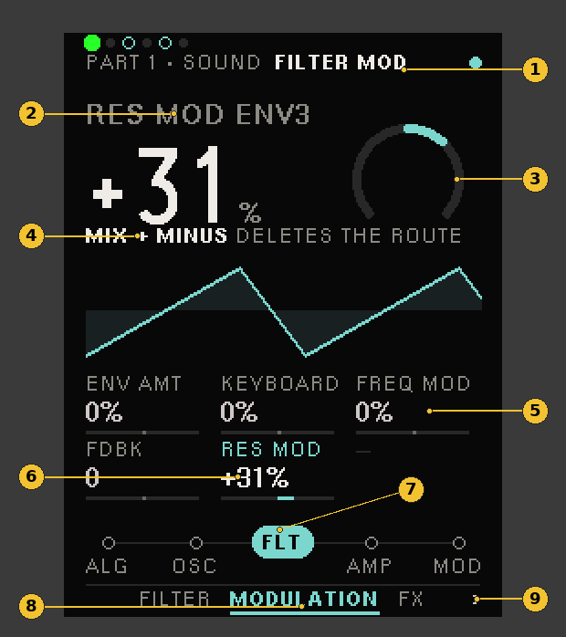

1. The page name is the sub-page's: FILTER MOD.
2. The touched cell, RES MOD, and the source that drives it (ENV3).
3. Its arc, bipolar here, so it fills from 12 o'clock.
4. **The hint line.** Under the value, the touched cell's combos: keys in bold, what they do beside them. It shows only while that cell is the touched one.
5. A route amount (FREQ MOD). The source it reads is set on JACKS.
6. The touched cell, RES MOD, with its amount.
7. The node, FLT, still lit on the map.
8. Its sub-pages in a row: FILTER (the page itself), MODULATION (underlined because you are on it), FX …
9. … and `>`: more sub-pages (JACKS) off the edge.

A hint shows only while its cell is the touched one and goes when you touch another. Where a cell has words of its own (a reason it is dimmed, a note), they take the line.

Some hints you will see often:

| Hint | Where |
|---|---|
| `MIX + SEQ LEARNS A CC` (or `LEARN`) | Every cell a MIDI control can be learned to |
| `SEQ+TURN FINE` | Every value cell that takes the fine turn |
| `MIX + B1-6 PART` | Mixer cells |
| `MIX + MINUS DELETES THE ROUTE` | Route amounts and the matrix's cursor on a route |
| `MIX + PLUS ON A PARAM PRIMES IT` | The matrix's cursor on an empty cell |
| `MIX + -/+ PAD` | A DRUM pad's cells |
| `EDIT LOADS`, `MIX + EDIT SAVES`, `MIX + MINUS CLEARS` | The Sound browser, with the memory each takes or frees |
| `MOVE THE KNOB UP TO PICK UP` | A cell bound to a MIDI knob that is waiting to catch the value ([MIDI](#midi-channels-maps-and-controllers)) |

To turn hints off: SETTINGS › PERSONALIZE › THEME › **HINTS**: OFF. The combos still work.

**Why:** with few buttons, combos stand in for the ones the panel lacks, and a combo you can't discover may as well not exist. A hint that appears only for the cell you touch tells you what you need at that moment and keeps the screen quiet otherwise.

## Panel: lists

SETTINGS, the Sound browser, project lists, MIDI MAP and the dialogs are lists with a bar on one row.

- **Any encoder moves the bar** (in the Sound browser, encoder 2 is kept for the tabs). MINUS / PLUS move it a row too.
- **EDIT** opens or runs the row under the bar.
- A list turn starts gently, one row a detent, and speeds up only after several detents, so it doesn't overshoot.
- A long list scrolls; a scrollbar on the right shows where you are. The Sound browser's tabs come in pages of 48 rows, with `NEXT ›` and `‹ PREVIOUS` rows at the ends (`OLDER ›` and `‹ NEWER` on LIBRARY).
- A name too long for its cell scrolls sideways while its row is selected.

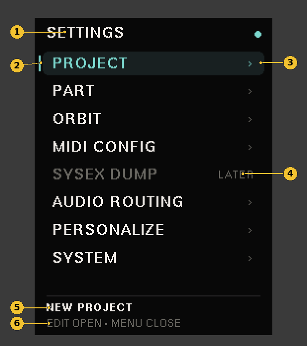

1. **Breadcrumb:** where you are in SETTINGS.
2. The bar: the selected row.
3. A chevron: this row opens a list.
4. LATER: not built yet. Dimmed rows are skipped.
5. The loaded project's name, then its state (`SAVED`, `* MODIFIED`).
6. What the keys do here.

## Panel: dialogs

When an action needs a decision (load over unsaved work, delete a project, save over a slot), a dialog opens over the page: a question, the reason in colour under it, and two or three answers as pills.

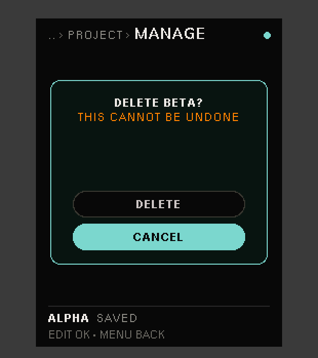

- **Any encoder** moves the highlight between the pills.
- **EDIT** confirms the highlighted pill. It acts only on its own: EDIT pressed together with MIX or a B key confirms nothing.
- **MENU** or **SEQ** cancels.
- The bottom line reads `EDIT OK · MENU BACK`.
- A dialog opens on its safe answer. The destructive ones (DELETE, CLEAR, SAVE OVER, PURGE, ENTER DFU, a map's delete, and CLEAR or RELOAD on a scene) open on CANCEL. Others lead with the answer that keeps your work: SAVE THEN LOAD, SAVE PART FIRST, KEEP BOTH, UPDATE, SAVE AS.

**Why:** a dialog uses the same keys as everything else (EDIT goes in, MENU leaves, SEQ goes back), so it needs no keys of its own. Opening on the safe answer means a reflex press of EDIT never loses work.

### Panel: naming

Naming a project, a library Sound, a Part or a controller map opens the naming screen.

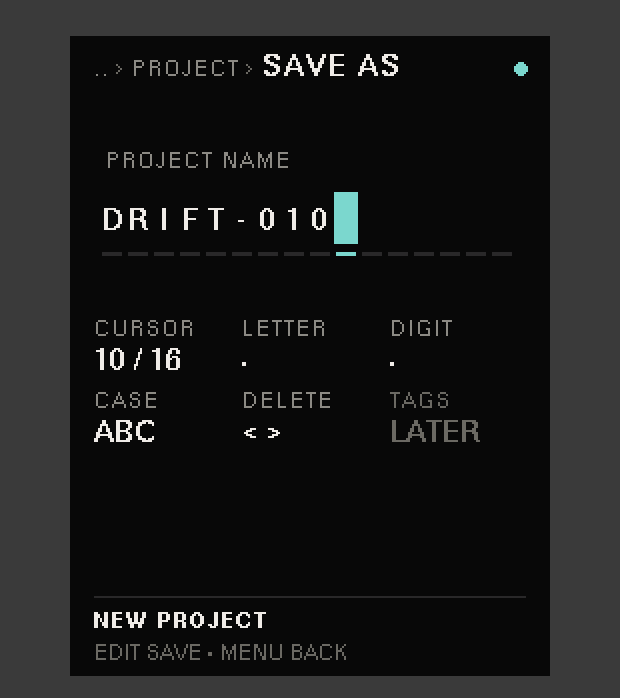

| Encoder | Cell | Does |
|---|---|---|
| 1 | **CURSOR** | Moves the cursor along the name (up to 16 characters) |
| 2 | **LETTER** | Picks a letter at the cursor |
| 3 | **DIGIT** | Picks a digit, a space or a dash |
| 4 | **CASE** | Upper or lower case |
| 5 | **DELETE** | Deletes at the cursor |

**EDIT** saves; **MENU** or **SEQ** cancels. The bottom line reads `EDIT SAVE · MENU BACK`.

### Panel: toasts and BUSY

A **toast** is a short message in a box over the screen: SAVED, a card error, a refusal. It blocks nothing and goes by itself; any key or turn dismisses it. While a card operation that has to finish first is running (at boot), the screen shows **BUSY**. While a Sound or a source is being read from the card, other keys wait; MENU cancels the read.

## Panel: the screensaver

After a while with no key or encoder touched, the screen shows a large oscilloscope of the output, with the last note played, the pitch it sounds at, the pitch measured off the scope, and the keys held with their chord. Set the wait at SETTINGS › PERSONALIZE › SCREENSAVER › **SAVER**: OFF, 5 S, 7 S, 10 S, 30 S, 60 S, 2 MIN, 5 MIN (the default) or 10 MIN.

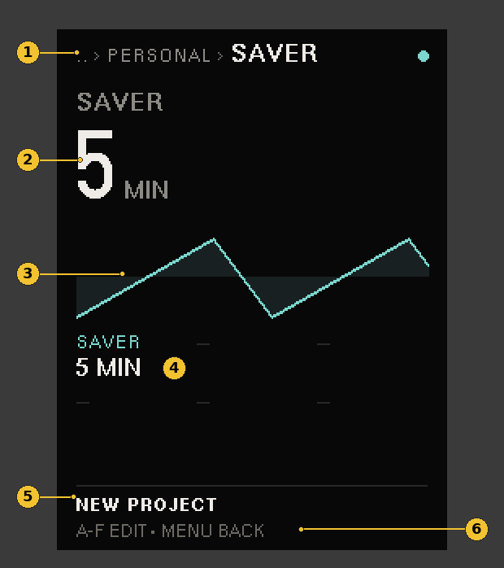

1. **Header:** SETTINGS › PERSONAL › SAVER.
2. **The focused cell**, large: SAVER and its value.
3. **The picture band**, the live output.
4. **Cell A** (encoder 1): **SAVER**, the wait.
5. **Footer:** the project and its state.
6. **Footer:** the keys this page answers to.

Any button or encoder wakes it; MIDI does not. A button that wakes the screen also does its job. A turn that wakes it loses its first detent.

**Why:** a turn you make before you can see the screen shouldn't change a value you couldn't see. A button press is deliberate, so it acts.

## Panel: text size

SETTINGS › PERSONALIZE › TEXT SIZE › **SIZE**: NORMAL (the default) or LARGE. LARGE draws the cell labels and values, the focus label, the hints, the SETTINGS lists and the Sound names a size up, where they fit. The header, the chain map, the big value and the pictures stay as they are. This setting belongs to the unit, not to a project.

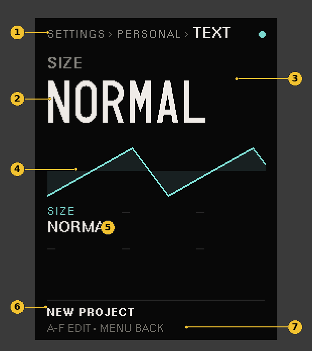

1. **Header:** SETTINGS › PERSONAL › TEXT.
2. **The focused cell**, large: SIZE and its value.
3. **Its glyph.**
4. **The picture band**, the live output.
5. **Cell A** (encoder 1): **SIZE**, NORMAL or LARGE.
6. **Footer:** the project and its state.
7. **Footer:** the keys this page answers to.


The rest of PERSONALIZE (THEME's colours and HINTS, PAD FOLLOW, ALGO PAGES) is in [SETTINGS](#settings).

# ALGO, the six-operator engine

ALGO is Chimera's operator engine: six phase-modulation operators wired by one of 32 algorithms, with MORPH blending between two algorithms. This chapter covers the ALGORITHM page, the OSC page with its twelve group pages, the FORMANT page and the six operator pages, the operator envelopes, formant and noise operators, what a patch costs in voices, and some starting points. The pages every engine shares (PIT, FLT, FMD, FX, JACK, AMP, STER, SND, MTX, E1–E3, SPD, L1–L3) are in [the voice chain](#the-voice-chain-pitch-filter-fx-amp-stereo-and-sends), [envelopes and LFOs](#envelopes-and-lfos) and [the mod matrix](#the-mod-matrix-and-routes); this chapter says only what is different about them on ALGO.

## ALGO: what the engine is

An ALGO Sound has six operators. Each operator is an oscillator with its own wave, frequency ratio, level and envelope. An **algorithm** says which operators modulate which, and which ones you hear:

- A **carrier** is an operator you hear. Its LEVEL sets how loud it is.
- A **modulator** feeds another operator. Its LEVEL sets how much it changes that operator's tone: more LEVEL, more harmonics.
- An operator can also feed itself back, set by **FDBK**: a sine with feedback turns towards a saw.

Two algorithms are stored in every Sound, **ALG A** and **ALG B**. **MORPH** blends one into the other, so a single knob (or an envelope, or an LFO) can move a sound between two wirings.

Each operator can be one of three kinds: a **table** operator playing one of 16 waves, a **formant** operator (FRMT) that makes a vowel-like resonance, or a **noise band** (NOISE). The kind is set by the operator's **WAVE**.

**Why:** one algorithmic engine does the work of several. One or two operators play a plain wave or a simple bell; four to six play full FM tones; formants and noise bands sing and breathe; MORPH moves between them. There is one set of pages to learn, and every Sound is billed for the operators it really uses (see [ALGO: voices and what a patch costs](#algo-voices-and-what-a-patch-costs)).

**Why phase modulation:** the operators modulate each other's **phase**, not their frequency. The pitch of a carrier stays centred however deep the modulation goes, so a modulator never drags the note out of tune. The stock PreenFM3 firmware does true frequency modulation; Chimera's engine is phase modulation throughout.

> **Design note:** ALGO grew out of a faithful four-operator TX81Z engine that turned out to cost more than the whole chip had to spend on a single voice: every FM note was refused. Rather than trim it, it was replaced with one six-operator engine written from scratch in single-precision maths. The TX81Z is still in its bones. The 64 COARSE ratios, the FINE targets, the 0.75 dB LEVEL step, the 3 dB DECAY 1 LEVEL step, the four-rate envelope and the eight feedback steps were all re-entered by hand from the TX81Z owner's manual, and the first eight algorithms, T1 to T8, are the TX81Z's eight on operators 1 to 4. The waves W1 to W8 were redrawn from their shapes as formulas, rendered into tables when the unit boots. No code from any earlier FM engine came along. The other 24 algorithms are Chimera's own, because six operators deserve more than eight ways to meet.

## ALGO: the chain and its pages

An ALGO Part's chain map reads **ALG · OSC · FLT · AMP · MOD**. ALG is the home: entering the chain lands there.

```
ALG ──── OSC ─────────── FLT ──────── AMP ──────── MOD
 └ PIT    ├ FRM (only with a formant or noise operator)
          ├ CRS FIN DET LVL VEL
          ├ AR D1R D1L D2R RR RS FBK
          └ OP1 … OP6
```

| Node | Its pages, short name (full word on the sub-page row) |
|---|---|
| ALG | **ALG** (ALGORITHM), **PIT** (PITCH) |
| OSC | **OSC** (WAVE), **FRM** (FORMANT), **CRS** (COARSE), **FIN** (FINE), **DET** (DETUNE), **LVL** (LEVEL), **VEL** (VELOCITY), **AR** (ATTACK RATE), **D1R** (DECAY 1 RATE), **D1L** (DECAY 1 LEVEL), **D2R** (DECAY 2 RATE), **RR** (RELEASE RATE), **RS** (RATE SCALE), **FBK** (FEEDBACK), **OP1**, **OP2**, **OP3**, **OP4**, **OP5**, **OP6** (OPERATOR 1 to OPERATOR 6) |
| FLT | FILTER, MODULATION, FX, JACKS: see [the voice chain](#the-voice-chain-pitch-filter-fx-amp-stereo-and-sends) |
| AMP | AMP, STEREO, SENDS: see [the voice chain](#the-voice-chain-pitch-filter-fx-amp-stereo-and-sends) |
| MOD | MATRIX, ENV1–ENV3, SPEED, LFO1–LFO3: see [envelopes and LFOs](#envelopes-and-lfos) and [the mod matrix](#the-mod-matrix-and-routes) |

The page header shows the full name (ATTACK RATE, OPERATOR 2; DECAY 1 LEVEL reads DECAY 1 LVL in the header, where the full word does not fit). The chain map's sub-page row shows the full words. MINUS and PLUS move between nodes; SEQ goes on to the next sub-page (wrapping from the last to the first) and EDIT goes back one. With SETTINGS › PERSONALIZE › CHAIN MAP › PAGES set to STACK, EDIT goes down and SEQ goes up instead (see [the panel and navigation](#the-panel-and-navigation)).

The OSC node has 18 sub-pages after its home, 19 when the FORMANT page is shown. The row scrolls, with `<` and `>` at its ends when there is more.

## ALGO: ALG PAGES FIRST, parameters or operators first

SETTINGS › PERSONALIZE › ALGO PAGES › **FIRST** picks the order of the OSC node's pages:

- **PARAMS** (the default): OSC opens on WAVE, then the group pages (each holds one parameter for all six operators), then OP1 to OP6.
- **OPS**: OSC opens on OP1, then OP2 to OP6, then WAVE and the group pages in their usual order. With a formant or noise operator, FORMANT follows WAVE.

No page is added, removed or dimmed by this setting; only the order changes. The node still reads OSC on the map. The setting belongs to the unit, not to a Sound. See [SETTINGS](#settings).

**Why:** some players work a parameter at a time across the operators (all the ratios, then all the levels); others work an operator at a time, as on many software FM synths. Both orders hold the same pages, so a Sound looks the same either way.

## ALGO: the ALGORITHM page (ALG)

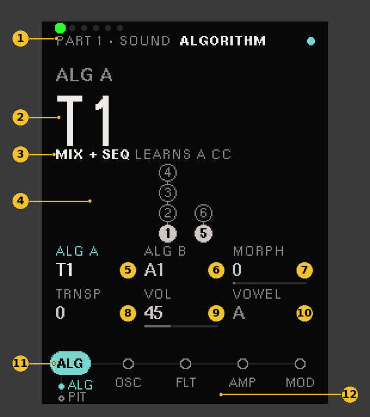

1. **Header:** the Part (PART 1 · SOUND) and the page, ALGORITHM.
2. **Focus band:** the touched cell, large: ALG A, T1.
3. **Hint:** the gestures the touched cell answers to: MIX + SEQ learns a MIDI control.
4. **Picture:** the algorithm chart: carriers filled on the bottom row, modulators above what they feed, loops on operators with feedback.
5. **ALG A:** the algorithm at MORPH 0.
6. **ALG B:** the algorithm at MORPH 127.
7. **MORPH:** blends ALG A into ALG B.
8. **TRNSP:** transposes the Sound in semitones.
9. **VOL:** the Sound's output level.
10. **VOWEL:** moves the formant and noise operators along U O A E I (dimmed without one).
11. **Chain map:** the ALG node lit.
12. **Sub-pages:** the node's sub-pages, the current one lit.

The home page. Its band draws the algorithm chart: carriers on the bottom row, each modulator above what it feeds. A carrier is drawn filled. An operator with FDBK above 0 wears a small loop beside its node: MID colour while FDBK is under 4.0, the accent colour from 4.0 up, where a sine starts to break towards a saw.

| Cell | Range | Default | What it does |
|---|---|---|---|
| **ALG A** | T1–T8, A1–A24 | T1 | The algorithm at MORPH 0 |
| **ALG B** | T1–T8, A1–A24 | A1 | The algorithm at MORPH 127 |
| **MORPH** | 0–127 | 0 | Blends ALG A (0) into ALG B (127) |
| **TRNSP** | −24 to +24 | 0 | Transposes the whole Sound in semitones |
| **VOL** | 0–127 | 45 | The Sound's output level |
| **VOWEL** | U, O, A, E, I | A | Moves every formant and noise operator along the vowels |

- While **ALG A** or **ALG B** is the touched cell, the chart shows that one algorithm on its own (a dimmed, refused choice too), whatever MORPH holds. On any other cell the chart shows A blending into B as MORPH sets it.
- **MIX + turn** on ALG A or ALG B runs to the end of the list.
- **MORPH** is dimmed while ALG A and ALG B are the same algorithm: there is nothing to blend. Its encoder is ignored, and **MIX + PLUS** on it reports NOT MODULATABLE. A route into MORPH set up earlier stays in the matrix, drawn as inert (see [the mod matrix](#the-mod-matrix-and-routes)).
- **MORPH** glides about 30 ms with each turn, as the other knobs do. It is a mod destination: **MIX + PLUS** on it primes it for a route.
- **VOWEL** is dimmed until at least one operator is a formant (FRMT) or noise band (NOISE). The value shows the nearest vowel; the arc under it shows the exact place, which moves smoothly between vowels. VOWEL is a mod destination. See [ALGO: VOWEL and the slots](#algo-vowel-and-the-slots).
- A change of ALG A or ALG B while a note sounds ducks the output for a moment, swaps the wiring, and brings it back, so there is no click.
- **MIX + SEQ** learns a MIDI control for the touched cell, as on every page (see [MIDI](#midi-channels-maps-and-controllers)).

**Why MORPH blends the links:** each link between two operators has a weight, 1 if the algorithm has it and 0 if not. MORPH moves every weight from ALG A's value to ALG B's. Halfway, a link that only A has plays at half depth. Each end sounds exactly like its algorithm alone. One evaluation order serves both algorithms (modulators are always numbered above what they feed), so the whole sweep is smooth.

**Why INIT is T1 into A1:** with operators 5 and 6 silent, T1 is one stack of four operators (4 into 3 into 2 into 1). A1 is the same four operators with no links, all heard: the stack's clean additive twin. So on INIT, MORPH works as an FM-depth macro: turning it up lowers every link and the sound goes from bright to clean.

**Why the output is scaled by the carriers:** the more carriers sound at once, the louder an algorithm would be. ALGO scales its output by the stored carrier levels, so the 32 algorithms play at a closer loudness. The scale only changes when you change a stored LEVEL, ALG A, ALG B or MORPH; a route into one carrier's LEVEL (velocity, an envelope, an LFO) never makes another carrier louder or softer. The scale never boosts.

## ALGO: the 32 algorithms

Operators are numbered 1 to 6. In every algorithm a higher-numbered operator modulates a lower-numbered one, never the reverse. "4→3" means operator 4 modulates operator 3.

| Algorithm | Links | Carriers (heard) |
|---|---|---|
| T1 | 4→3, 3→2, 2→1, 6→5 | 1, 5 |
| T2 | 4→2, 3→2, 2→1, 6→5 | 1, 5 |
| T3 | 3→2, 2→1, 4→1, 6→5 | 1, 5 |
| T4 | 4→3, 3→1, 2→1, 6→5 | 1, 5 |
| T5 | 4→3, 2→1, 6→5 | 1, 3, 5 |
| T6 | 4→1, 4→2, 4→3, 6→5 | 1, 2, 3, 5 |
| T7 | 4→3, 6→5 | 1, 2, 3, 5 |
| T8 | 6→5 | 1, 2, 3, 4, 5 |
| A1 | none | 1, 2, 3, 4, 5, 6 |
| A2 | 6→1 | 1, 2, 3, 4, 5 |
| A3 | 6→1, 6→2 | 1, 2, 3, 4, 5 |
| A4 | 6→1, 5→2 | 1, 2, 3, 4 |
| A5 | 6→1, 6→2, 6→3, 6→4 | 1, 2, 3, 4, 5 |
| A6 | 6→5, 5→1 | 1, 2, 3, 4 |
| A7 | 4→1, 5→2, 6→3 | 1, 2, 3 |
| A8 | 4→1, 5→1, 6→1 | 1, 2, 3 |
| A9 | 6→5, 5→4, 4→1 | 1, 2, 3 |
| A10 | 6→4, 6→5, 4→1, 5→2 | 1, 2, 3 |
| A11 | 5→4, 6→4, 4→1, 4→2, 4→3 | 1, 2, 3 |
| A12 | 5→3, 3→1, 6→4, 4→2 | 1, 2 |
| A13 | 3→1, 4→1, 5→2, 6→2 | 1, 2 |
| A14 | 3→1, 3→2, 4→1, 4→2, 5→3, 6→4 | 1, 2 |
| A15 | 6→5, 5→3, 3→1, 4→2 | 1, 2 |
| A16 | 3, 4, 5 and 6 each into both 1 and 2 | 1, 2 |
| A17 | 6→5, 5→4, 4→3, 3→2, 2→1 | 1 |
| A18 | 2, 3, 4, 5 and 6 each into 1 | 1 |
| A19 | 4→2, 4→3, 2→1, 3→1, 6→5, 5→1 | 1 |
| A20 | 3→2, 2→1, 5→4, 4→1, 6→1 | 1 |
| A21 | 6→5, 5→4, 4→1, 3→2, 2→1 | 1 |
| A22 | 6→4, 6→5, 4→2, 5→3, 2→1, 3→1 | 1 |
| A23 | 6 into 2, 3, 4 and 5; 2, 3, 4 and 5 each into 1 | 1 |
| A24 | 6→5; 5 into 2, 3 and 4; 2, 3 and 4 each into 1 | 1 |

- **T1–T8** are the TX81Z's eight four-operator algorithms on operators 1 to 4, plus a two-operator pair, 6 into 5, heard beside them. With operators 5 and 6 at LEVEL 0 they play as the TX81Z's do.
- **A1** has no links: six sine (or any wave) partials, an additive organ.
- **A17** is the deepest stack: six operators in one chain.
- **A16**, **A18** and **A23** pile many modulators onto one or two carriers, for dense, bright tones. A16 together with A17 is the costliest pair to morph between (see [ALGO: voices and what a patch costs](#algo-voices-and-what-a-patch-costs)).

## ALGO: the OSC node and the group pages

The OSC node's pages hold the operators. The first fourteen are **group pages**: one parameter on each, for all six operators. Their six cells are labelled **OP1**, **OP2**, **OP3**, **OP4**, **OP5** and **OP6**, one per encoder, in the same places on every group page. The focus band names the page's parameter over the value (ATTACK RATE, not OP1), and the lit cell names the operator.

| Page (row word) | Cells | Range | INIT | What it sets |
|---|---|---|---|---|
| **OSC** (WAVE) | OP1–OP6 | W1–W8, TRI, SAW, SQR, P25, P12, TSAW, RSQR, SSAW, FRMT, NOISE | W1 on all | The operator's wave or kind |
| **FRM** (FORMANT) | OP1–OP6 | 100 Hz to 12.8 kHz | 734 Hz, 1.10 kHz, 2.47 kHz, 3.49 kHz, 3.49 kHz, 3.49 kHz | A formant's centre (a noise band's CENTRE) |
| **CRS** (COARSE) | OP1–OP6 | 0.50 to 25.95 | 1.00 | Frequency ratio to the note |
| **FIN** (FINE) | OP1–OP6 | 0–15 | 0 | Raises the ratio towards the next |
| **DET** (DETUNE) | OP1–OP6 | −3 to +3 | 0 | Detune, 1.5 cents a step |
| **LVL** (LEVEL) | OP1–OP6 | 0–99 | 99, 72, 72, 72, 0, 0 | Output level, 0.75 dB a step |
| **VEL** (VELOCITY) | OP1–OP6 | 0–7 | 0 | Velocity sensitivity |
| **AR** (ATTACK RATE) | OP1–OP6 | 0–31 | 31 | Attack rate |
| **D1R** (DECAY 1 RATE) | OP1–OP6 | 0–31 | 0 | First decay rate |
| **D1L** (DECAY 1 LEVEL) | OP1–OP6 | 0–15 | 15 | Where the first decay stops |
| **D2R** (DECAY 2 RATE) | OP1–OP6 | 0–31 | 0 | Second decay rate, while held |
| **RR** (RELEASE RATE) | OP1–OP6 | 1–15 | 5 | Release rate after key up |
| **RS** (RATE SCALE) | OP1–OP6 | 0–3 | 0 | Faster envelopes on higher notes |
| **FBK** (FEEDBACK) | OP1–OP6 | 0.0–7.0 | 0.0 | The operator feeding itself back |

The envelope pages (AR to RS) draw the touched operator's envelope in the band. FBK's page shows the live output, so you can watch feedback bend the wave.

### ALGO: WAVE and the operator kinds

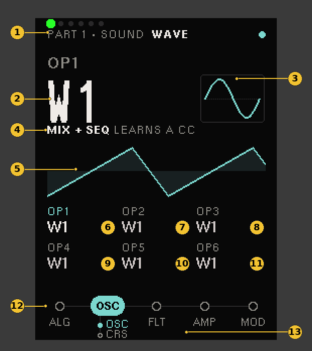

1. **Header:** the Part (PART 1 · SOUND) and the page, WAVE.
2. **Focus band:** the touched cell, large: OP1 and its wave, W1.
3. **Glyph:** a scope of the touched operator's wave.
4. **Hint:** the gestures the touched cell answers to.
5. **Picture:** the live output's waveform.
6. **OP1:** operator 1's wave or kind.
7. **OP2:** operator 2's wave or kind.
8. **OP3:** operator 3's wave or kind.
9. **OP4:** operator 4's wave or kind.
10. **OP5:** operator 5's wave or kind.
11. **OP6:** operator 6's wave or kind.
12. **Chain map:** the OSC node lit.
13. **Sub-pages:** the node's sub-pages, the current one lit.

The OSC page's cells set each operator's **WAVE**:

| WAVE | What it is |
|---|---|
| **W1** | Sine |
| **W2** | A sharpened sine: each half bulges towards a square |
| **W3** | Half-wave sine: the positive half of W1, silence for the negative half |
| **W4** | Half-wave W2 |
| **W5** | W1 squeezed into the first half of the cycle, silence for the second |
| **W6** | W2 squeezed into the first half of the cycle |
| **W7** | Two positive humps of W1 in the first half of the cycle, silence for the second |
| **W8** | The same with W2 |
| **TRI** | Triangle |
| **SAW** | Saw |
| **SQR** | Square |
| **P25** | Pulse, 25 % |
| **P12** | Pulse, 12.5 % |
| **TSAW** | Trisaw: a slow rise over three quarters of the cycle and a fast fall |
| **RSQR** | Rounded square |
| **SSAW** | Soft saw |
| **FRMT** | A formant operator (the cell reads FRMT; the band spells FORMANT) |
| **NOISE** | A noise band |

W1 to W8 are the TX81Z's eight waves, drawn from their shapes. W3, W4, W7 and W8 keep their DC offset, as on the TX81Z; every other wave is centred. All tables are band-limited, so high notes and bright modulation do not alias.

- **MIX + turn** on a WAVE cell runs to the end of the list.
- **FRMT** and **NOISE** change the operator's page and turn on the FORMANT page (see [ALGO: formant and noise operators](#algo-formant-and-noise-operators)). Some choices can be refused by the formant budget: the cell shows the name dimmed and nothing is written until you turn on to a choice that fits. The focus band says why (see [ALGO: the formant budget](#algo-the-formant-budget)).
- A WAVE change under a held note crossfades, so it does not click.

### ALGO: COARSE, FINE and DETUNE, the ratio

An operator plays at the note's frequency times its **ratio**. **COARSE** picks the ratio from the TX81Z's 64:

| | | | | | | | |
|---|---|---|---|---|---|---|---|
| 0.50 | 0.71 | 0.78 | 0.87 | 1.00 | 1.41 | 1.57 | 1.73 |
| 2.00 | 2.82 | 3.00 | 3.14 | 3.46 | 4.00 | 4.24 | 4.71 |
| 5.00 | 5.19 | 5.65 | 6.00 | 6.28 | 6.92 | 7.00 | 7.07 |
| 7.85 | 8.00 | 8.48 | 8.65 | 9.00 | 9.42 | 9.89 | 10.00 |
| 10.38 | 10.99 | 11.00 | 11.30 | 12.00 | 12.11 | 12.56 | 12.72 |
| 13.00 | 13.84 | 14.00 | 14.10 | 14.13 | 15.00 | 15.55 | 15.57 |
| 15.70 | 16.96 | 17.27 | 17.30 | 18.37 | 18.84 | 19.03 | 19.78 |
| 20.41 | 20.76 | 21.20 | 21.98 | 22.49 | 23.55 | 24.22 | 25.95 |

- Whole numbers (1.00, 2.00, 3.00 …) give harmonic tones. The others (1.41, 3.14, 6.28 …) give inharmonic, bell-like and metallic ones. 3.14 and 6.28 are TX81Z ratios, not π and 2π.
- **FINE** (0–15) raises the ratio in 16 even steps towards the next region, as on the TX81Z. Below 1.00 (the four lowest COARSE values) FINE has 8 steps: FINE 8 to 15 hold the top.
- **DETUNE** (−3 to +3) shifts the operator by 1.5 cents a step, up to ±4.5 cents. Detuned carriers beat slowly against each other.
- On CRS, FIN and DET (and on an operator's own COARSE and FINE cells) the focus band shows where the operator ended up: `RATIO 1.41`, and with DETUNE off 0, `RATIO 1.41, DETUNE +4.5 CENTS`. A noise band has no pitch and shows none.
- COARSE steps; FINE and DETUNE glide when turned.

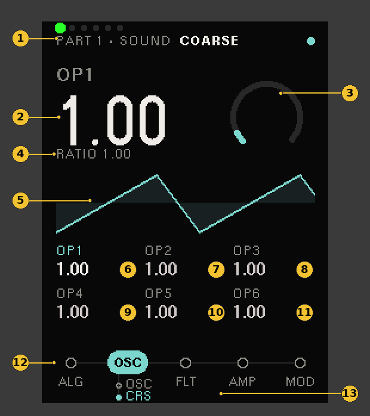

1. **Header:** the Part (PART 1 · SOUND) and the page, COARSE.
2. **Focus band:** the touched cell, large: OP1 and its ratio.
3. **Glyph:** the touched value's glyph.
4. **Hint:** the gestures, or the ratio the operator comes to (`RATIO 1.00`).
5. **Picture:** the live output's waveform.
6. **OP1:** operator 1's frequency ratio.
7. **OP2:** operator 2's frequency ratio.
8. **OP3:** operator 3's frequency ratio.
9. **OP4:** operator 4's frequency ratio.
10. **OP5:** operator 5's frequency ratio.
11. **OP6:** operator 6's frequency ratio.
12. **Chain map:** the OSC node lit.
13. **Sub-pages:** the node's sub-pages, the current one lit.

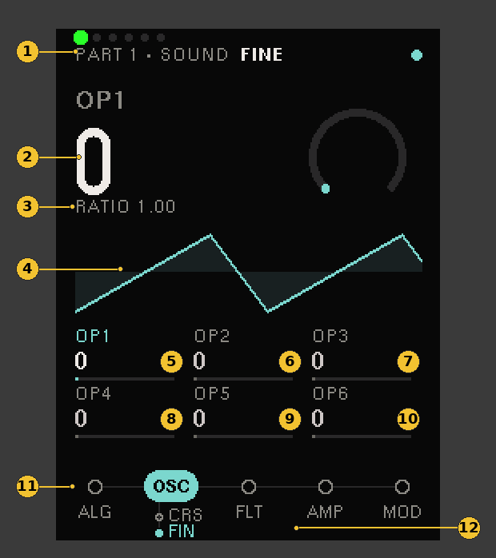

1. **Header:** the Part (PART 1 · SOUND) and the page, FINE.
2. **Focus band:** the touched cell, large: OP1 and its FINE.
3. **Hint:** the gestures, or the ratio the operator comes to.
4. **Picture:** the live output's waveform.
5. **OP1:** operator 1's FINE step towards the next ratio.
6. **OP2:** operator 2's FINE step towards the next ratio.
7. **OP3:** operator 3's FINE step towards the next ratio.
8. **OP4:** operator 4's FINE step towards the next ratio.
9. **OP5:** operator 5's FINE step towards the next ratio.
10. **OP6:** operator 6's FINE step towards the next ratio.
11. **Chain map:** the OSC node lit.
12. **Sub-pages:** the node's sub-pages, the current one lit.


1. **Header:** the Part (PART 1 · SOUND) and the page, DETUNE.
2. **Focus band:** the touched cell, large: OP1 and its DETUNE.
3. **Hint:** the gestures, or the ratio and detune the operator comes to.
4. **Picture:** the live output's waveform.
5. **OP1:** operator 1's detune, 1.5 cents a step.
6. **OP2:** operator 2's detune, 1.5 cents a step.
7. **OP3:** operator 3's detune, 1.5 cents a step.
8. **OP4:** operator 4's detune, 1.5 cents a step.
9. **OP5:** operator 5's detune, 1.5 cents a step.
10. **OP6:** operator 6's detune, 1.5 cents a step.
11. **Chain map:** the OSC node lit.
12. **Sub-pages:** the node's sub-pages, the current one lit.

### ALGO: LEVEL and VELOCITY

- **LEVEL** (0–99) is the operator's output level, 0.75 dB a step: LEVEL 91 is 6 dB under 99. On a carrier it is loudness; on a modulator it is brightness, how deep it modulates. LEVEL 0 is silent, and a silent operator that nothing routes into costs nothing.
- Each LEVEL is a mod destination, so an envelope or LFO can open a modulator over time. A route into LEVEL moves smoothly between steps.
- **VELOCITY** (0–7) is how far the key's velocity scales the operator's level. At 0 every velocity plays the LEVEL as set. Each step takes up to 3 dB off at the softest velocity: at VEL 7 a very soft note plays that operator about 21 dB lower. On a modulator, VELOCITY makes harder notes brighter.

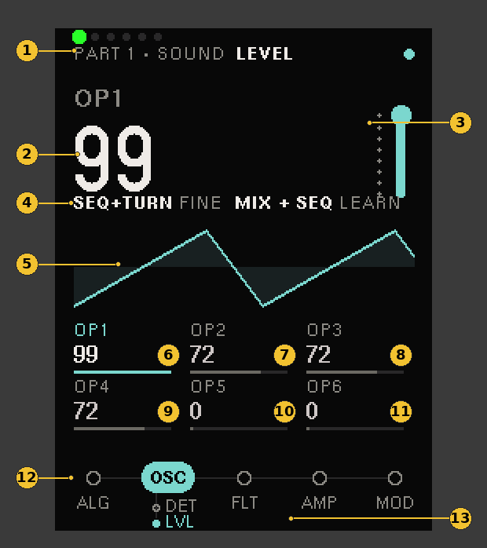

1. **Header:** the Part (PART 1 · SOUND) and the page, LEVEL.
2. **Focus band:** the touched cell, large: OP1 and its LEVEL.
3. **Glyph:** a level bar.
4. **Hint:** the gestures the touched cell answers to.
5. **Picture:** the live output's waveform.
6. **OP1:** operator 1's output level, 0–99.
7. **OP2:** operator 2's output level, 0–99.
8. **OP3:** operator 3's output level, 0–99.
9. **OP4:** operator 4's output level, 0–99.
10. **OP5:** operator 5's output level, 0–99.
11. **OP6:** operator 6's output level, 0–99.
12. **Chain map:** the OSC node lit.
13. **Sub-pages:** the node's sub-pages, the current one lit.

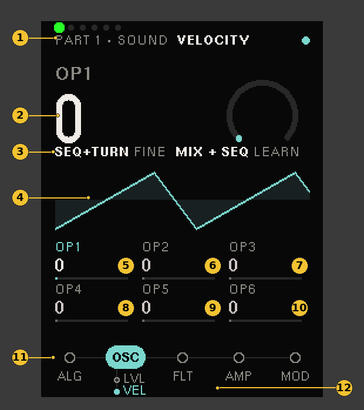

1. **Header:** the Part (PART 1 · SOUND) and the page, VELOCITY.
2. **Focus band:** the touched cell, large: OP1 and its VELOCITY.
3. **Hint:** the gestures the touched cell answers to.
4. **Picture:** the live output's waveform.
5. **OP1:** operator 1's velocity sensitivity, 0–7.
6. **OP2:** operator 2's velocity sensitivity, 0–7.
7. **OP3:** operator 3's velocity sensitivity, 0–7.
8. **OP4:** operator 4's velocity sensitivity, 0–7.
9. **OP5:** operator 5's velocity sensitivity, 0–7.
10. **OP6:** operator 6's velocity sensitivity, 0–7.
11. **Chain map:** the OSC node lit.
12. **Sub-pages:** the node's sub-pages, the current one lit.

### ALGO: FEEDBACK

**FDBK** (0.0 to 7.0) feeds the operator's output back into its own phase. A sine with rising feedback gains harmonics and turns towards a saw; at the top it breaks up into noise-like grit.

- The whole numbers are the TX81Z's eight steps. From step 1 each step doubles the swing.
- One encoder detent is a tenth of a step, so there are 71 settings: ten under what step 1 was, nine between each pair above.
- **MIX + turn** jumps to the next whole number. **SEQ + turn** steps by tenths. The focus band shows both: `MIX+TURN WHOLE` and `SEQ+TURN FINE`.
- Each operator with FDBK above 0 wears a loop on the ALGORITHM chart: MID under 4.0, accent from 4.0.
- A noise band ignores FDBK and wears no loop.

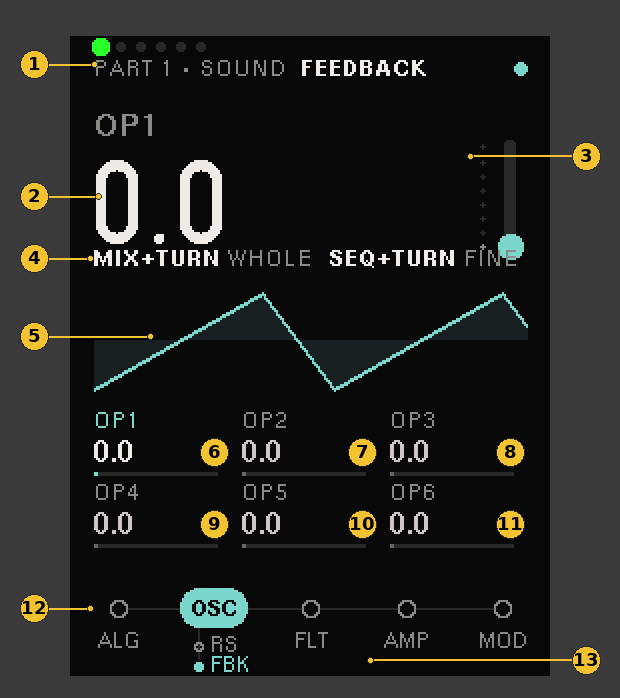

1. **Header:** the Part (PART 1 · SOUND) and the page, FEEDBACK.
2. **Focus band:** the touched cell, large: OP1 and its FDBK.
3. **Glyph:** a level bar.
4. **Hint:** `MIX+TURN WHOLE` and `SEQ+TURN FINE`.
5. **Picture:** the live output's waveform, where feedback is seen bending the wave.
6. **OP1:** operator 1's feedback, 0.0–7.0.
7. **OP2:** operator 2's feedback, 0.0–7.0.
8. **OP3:** operator 3's feedback, 0.0–7.0.
9. **OP4:** operator 4's feedback, 0.0–7.0.
10. **OP5:** operator 5's feedback, 0.0–7.0.
11. **OP6:** operator 6's feedback, 0.0–7.0.
12. **Chain map:** the OSC node lit.
13. **Sub-pages:** the node's sub-pages, the current one lit.

With feedback set, the ALGORITHM chart wears a loop beside each feeding operator:

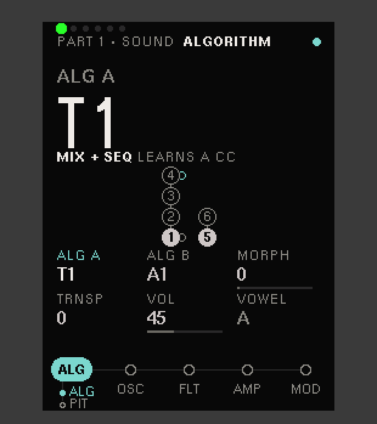

**Why tenths:** the TX81Z's steps double, so the jump from 0 to 1 and between the low steps was coarse for subtle colour. Tenths fill the gaps; a whole number plays exactly as the same step did.

## ALGO: the operator envelopes

Every operator has its own envelope, in the classic Yamaha four-rate shape:

1. **AR** (attack rate) rises from silence to full.
2. **D1R** (first decay rate) falls to the level **D1L** sets.
3. **D2R** (second decay rate) falls on from there while the key is held.
4. **RR** (release rate) falls to silence after key up.

**RS** (rate scaling) makes every rate faster on higher notes.

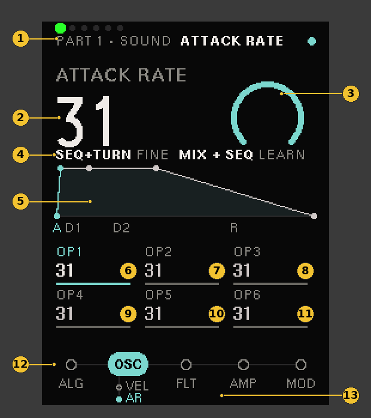

1. **Header:** the Part (PART 1 · SOUND) and the page, ATTACK RATE.
2. **Focus band:** the touched cell, large: ATTACK RATE over the value.
3. **Glyph:** an arc for the rate.
4. **Hint:** the gestures the touched cell answers to.
5. **Picture:** the touched operator's envelope, its stages marked.
6. **OP1:** operator 1's attack rate, 0–31.
7. **OP2:** operator 2's attack rate, 0–31.
8. **OP3:** operator 3's attack rate, 0–31.
9. **OP4:** operator 4's attack rate, 0–31.
10. **OP5:** operator 5's attack rate, 0–31.
11. **OP6:** operator 6's attack rate, 0–31.
12. **Chain map:** the OSC node lit.
13. **Sub-pages:** the node's sub-pages, the current one lit.

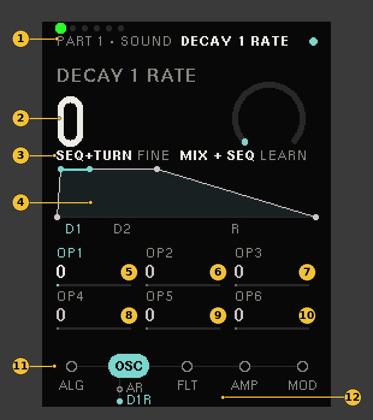

1. **Header:** the Part (PART 1 · SOUND) and the page, DECAY 1 RATE.
2. **Focus band:** the touched cell, large: DECAY 1 RATE over the value.
3. **Hint:** the gestures the touched cell answers to.
4. **Picture:** the touched operator's envelope, its stages marked.
5. **OP1:** operator 1's first decay rate, 0–31.
6. **OP2:** operator 2's first decay rate, 0–31.
7. **OP3:** operator 3's first decay rate, 0–31.
8. **OP4:** operator 4's first decay rate, 0–31.
9. **OP5:** operator 5's first decay rate, 0–31.
10. **OP6:** operator 6's first decay rate, 0–31.
11. **Chain map:** the OSC node lit.
12. **Sub-pages:** the node's sub-pages, the current one lit.


1. **Header:** the Part (PART 1 · SOUND) and the page, DECAY 1 LVL.
2. **Focus band:** the touched cell, large: DECAY 1 LEVEL over the value.
3. **Glyph:** an arc for the level.
4. **Hint:** the gestures the touched cell answers to.
5. **Picture:** the touched operator's envelope, its stages marked.
6. **OP1:** operator 1's first decay level, 0–15.
7. **OP2:** operator 2's first decay level, 0–15.
8. **OP3:** operator 3's first decay level, 0–15.
9. **OP4:** operator 4's first decay level, 0–15.
10. **OP5:** operator 5's first decay level, 0–15.
11. **OP6:** operator 6's first decay level, 0–15.
12. **Chain map:** the OSC node lit.
13. **Sub-pages:** the node's sub-pages, the current one lit.

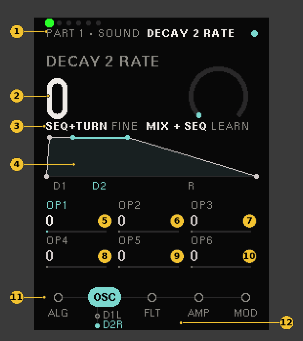

1. **Header:** the Part (PART 1 · SOUND) and the page, DECAY 2 RATE.
2. **Focus band:** the touched cell, large: DECAY 2 RATE over the value.
3. **Hint:** the gestures the touched cell answers to.
4. **Picture:** the touched operator's envelope, its stages marked.
5. **OP1:** operator 1's second decay rate, 0–31.
6. **OP2:** operator 2's second decay rate, 0–31.
7. **OP3:** operator 3's second decay rate, 0–31.
8. **OP4:** operator 4's second decay rate, 0–31.
9. **OP5:** operator 5's second decay rate, 0–31.
10. **OP6:** operator 6's second decay rate, 0–31.
11. **Chain map:** the OSC node lit.
12. **Sub-pages:** the node's sub-pages, the current one lit.


1. **Header:** the Part (PART 1 · SOUND) and the page, RELEASE RATE.
2. **Focus band:** the touched cell, large: RELEASE RATE over the value.
3. **Glyph:** an arc for the rate.
4. **Hint:** the gestures the touched cell answers to.
5. **Picture:** the touched operator's envelope, its stages marked.
6. **OP1:** operator 1's release rate, 1–15.
7. **OP2:** operator 2's release rate, 1–15.
8. **OP3:** operator 3's release rate, 1–15.
9. **OP4:** operator 4's release rate, 1–15.
10. **OP5:** operator 5's release rate, 1–15.
11. **OP6:** operator 6's release rate, 1–15.
12. **Chain map:** the OSC node lit.
13. **Sub-pages:** the node's sub-pages, the current one lit.

The cells are **rates, not times: a higher number is faster.** AR, D1R and D2R run 0 to 31, RR 1 to 15, D1L 0 to 15 and RS 0 to 3.

At 0, a rate stops its stage:

- **AR 0** never rises, so the operator stays silent.
- **D1R 0** holds at full while the key is down. D1L then does nothing; touch a DECAY 1 LEVEL cell whose operator has D1R 0 (and D1L under 15) and the band says `DECAY 1 RATE 0: NEVER REACHED`.
- **D2R 0** holds at D1L: D1L is then the sustain level.
- **D1L 0** makes D1R fall all the way to silence. **D1L 15** is full level, so D2R starts at once.

Each D1L step below 15 is 3 dB down. An operator's LEVEL sets how loud it is, not how long its stages take.

**Why the TX81Z's names:** the tabs keep the TX81Z's AR, D1R, D1L, D2R and RR, so a patch sheet or a TX81Z manual reads straight across, while the headers and the row spell out ATTACK RATE, DECAY 1 RATE and so on. D1L is not called sustain: it is where decay 1 ends, and it only acts as a sustain while D2R is 0.

### ALGO: envelope rates in seconds

Two steps of AR, D1R or D2R make a stage twice as fast; one step of RR does. The times below have no rate scaling.

- **Attack** rises in a straight line from silence to full.
- **Decays and the release** fall at a steady number of dB a second. The table gives the time to fall from full to −80 dB, where a note ends. A stage that starts lower, or stops at D1L, takes its share of that time: D1R falls from full to D1L 11 (−12 dB) in 12/80 of its time.

| Rate | AR: full attack | D1R or D2R: full to −80 dB |
|---|---|---|
| 1 | 8.2 s | 55 s |
| 2 | 5.8 s | 39 s |
| 4 | 2.9 s | 19 s |
| 6 | 1.45 s | 9.7 s |
| 8 | 725 ms | 4.8 s |
| 10 | 363 ms | 2.4 s |
| 12 | 181 ms | 1.2 s |
| 14 | 91 ms | 604 ms |
| 16 | 45 ms | 302 ms |
| 18 | 23 ms | 151 ms |
| 20 | 11 ms | 76 ms |
| 22 | 5.7 ms | 38 ms |
| 24 | 2.8 ms | 19 ms |
| 26 | 1.4 ms | 9.4 ms |
| 28 | 0.7 ms | 4.7 ms |
| 30 | 0.4 ms | 2.4 ms |
| 31 | 0.25 ms | 1.7 ms |

| RR | Full to −80 dB after key up |
|---|---|
| 1 | 27 s |
| 2 | 14 s |
| 3 | 6.8 s |
| 4 | 3.4 s |
| 5 | 1.7 s |
| 6 | 854 ms |
| 7 | 427 ms |
| 8 | 214 ms |
| 9 | 107 ms |
| 10 | 53 ms |
| 11 | 27 ms |
| 12 | 13 ms |
| 13 | 6.7 ms |
| 14 | 3.3 ms |
| 15 | 1.7 ms |

### ALGO: RATE SCALE

**RS** makes every rate of the operator, the release too, faster on higher keys, as the keyboard rate scaling of Yamaha's FM synths does: a high piano or bell note dies sooner than a low one. While an RS cell is touched, the band reads `HIGH NOTES, FASTER ENVELOPES`.

Each note adds steps to every rate, counted from the bottom of the keyboard (A0), and every 4 added steps make a stage twice as fast. **RS 0 is not off**: it still adds up to 3 steps across the keyboard, a gentle tilt, as on the TX81Z.

| RS | C2 | C4 | C6 | C8 | Per octave |
|---|---|---|---|---|---|
| 0 | 1.00× | 1.19× | 1.41× | 1.68× | about 1.1× |
| 1 | 1.19× | 1.68× | 2.4× | 3.4× | about 1.2× |
| 2 | 1.41× | 2.8× | 5.7× | 11× | about 1.4× |
| 3 | 2.4× | 9.5× | 38× | 152× | 2× |

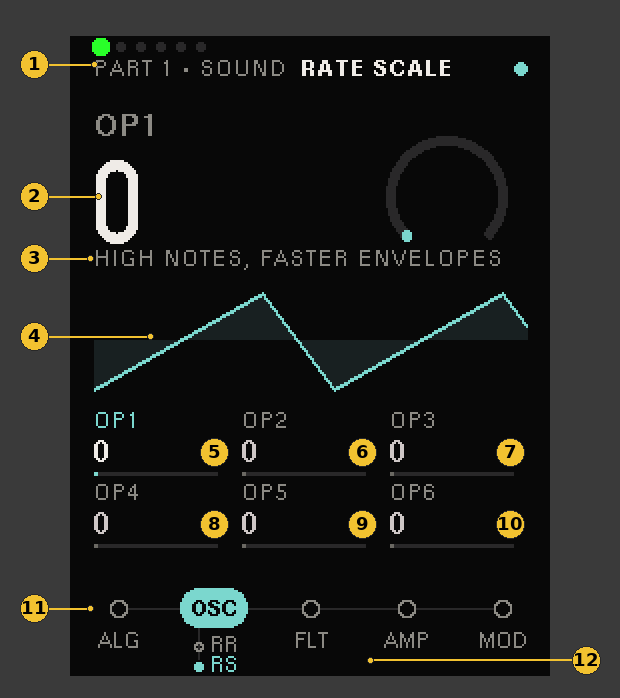

1. **Header:** the Part (PART 1 · SOUND) and the page, RATE SCALE.
2. **Focus band:** the touched cell, large: OP1 and its RATE SCALE.
3. **Hint:** in the hint's place, `HIGH NOTES, FASTER ENVELOPES`.
4. **Picture:** the live output's waveform.
5. **OP1:** operator 1's rate scaling, 0–3.
6. **OP2:** operator 2's rate scaling, 0–3.
7. **OP3:** operator 3's rate scaling, 0–3.
8. **OP4:** operator 4's rate scaling, 0–3.
9. **OP5:** operator 5's rate scaling, 0–3.
10. **OP6:** operator 6's rate scaling, 0–3.
11. **Chain map:** the OSC node lit.
12. **Sub-pages:** the node's sub-pages, the current one lit.

Each figure in the RS table is how much faster every stage runs on that key than in the rate tables. At RS 3, a D1R of 12 (1.2 s from full to −80 dB) takes about 127 ms on C4 and 32 ms on C6. Every rate tops out at the fastest, so AR 31 and RR 15 barely speed up.

### ALGO: longer than the operator envelopes

For a swell or sweep over minutes, use a MOD envelope (ENV1–ENV3) on a SLOW speed range (see [envelopes and LFOs](#envelopes-and-lfos)). To open a sound over a minute: take a modulator's LEVEL down to where the sound is dull, prime it with **MIX + PLUS** on its LEVEL cell, and route a SLOW envelope into it with a positive amount, ATTACK long and SUSTAIN full. The brightness then rises over the whole attack. A negative amount from a full LEVEL closes the sound instead. Routes into a carrier's LEVEL change its loudness the same way.

**Why the operators shape the note:** ALGO does not need the amp envelope. Each carrier's own envelope is the note's loudness contour, and each modulator's is its brightness contour, as on a Yamaha FM synth. So a release rings out on the operators' RR. ENV1 still runs as a mod source. See [ALGO: the shared pages](#algo-the-shared-pages-on-an-algo-part) for how a route into VCA changes this.

## ALGO: the operator pages OP1 to OP6

Each operator has its own page with its six most-used settings. Its band draws the operator's envelope with an inset at the top right: the wave for a table operator, the grain for a formant, the band's bell for a noise band. The cells follow the operator's kind:

| Kind | Cells |
|---|---|
| Table (W1 … SSAW) | **WAVE**, **COARSE**, **FINE**, **LEVEL**, **FDBK**, **VELOCITY** |
| Formant (FRMT) | **WAVE**, **FORMANT**, **BW**, **SKIRT**, **KEY**, **SLOT** |
| Noise band (NOISE) | **WAVE**, **CENTRE**, **WIDTH**, **RES**, **SLOT**, **LEVEL** |

These are the same settings as on the group pages; changing one in either place changes both. FDBK is spelled FEEDBACK in the focus band. A formant operator's COARSE, FINE, LEVEL, FDBK and VELOCITY stay on their group pages.

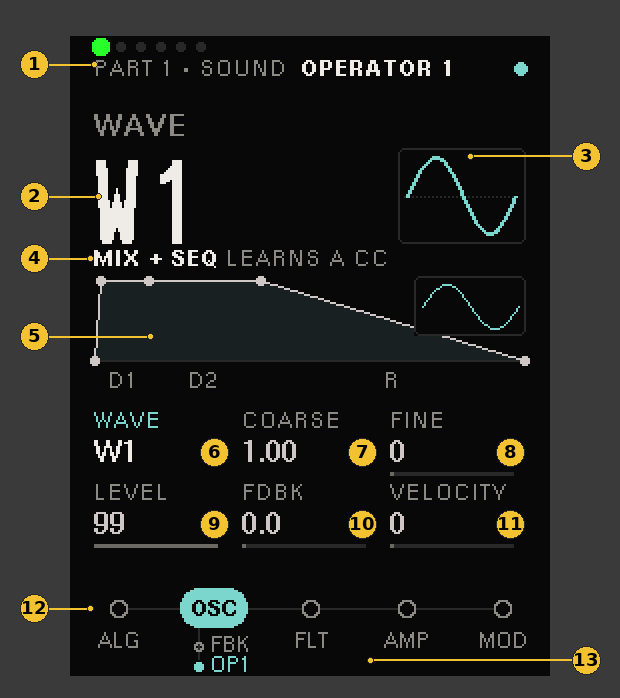

1. **Header:** the Part (PART 1 · SOUND) and the page, OPERATOR 1.
2. **Focus band:** the touched cell, large: WAVE and its value.
3. **Glyph:** a scope of the operator's wave.
4. **Hint:** the gestures the touched cell answers to.
5. **Picture:** the operator's envelope (D1, D2 and R marked) with an inset of its wave.
6. **WAVE:** the operator's wave or kind.
7. **COARSE:** its frequency ratio.
8. **FINE:** its FINE step.
9. **LEVEL:** its output level.
10. **FDBK:** its feedback.
11. **VELOCITY:** its velocity sensitivity.
12. **Chain map:** the OSC node lit.
13. **Sub-pages:** the node's sub-pages, the current one lit.


1. **Header:** the Part (PART 1 · SOUND) and the page, OPERATOR 2.
2. **Focus band:** the touched cell, large: WAVE and its value.
3. **Glyph:** a scope of the operator's wave.
4. **Hint:** the gestures the touched cell answers to.
5. **Picture:** the operator's envelope (D1, D2 and R marked) with an inset of its wave.
6. **WAVE:** the operator's wave or kind.
7. **COARSE:** its frequency ratio.
8. **FINE:** its FINE step.
9. **LEVEL:** its output level.
10. **FDBK:** its feedback.
11. **VELOCITY:** its velocity sensitivity.
12. **Chain map:** the OSC node lit.
13. **Sub-pages:** the node's sub-pages, the current one lit.

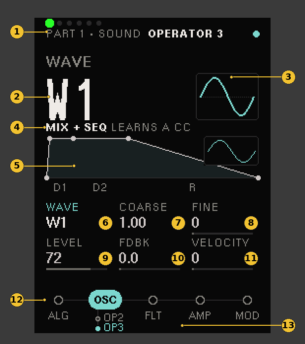

1. **Header:** the Part (PART 1 · SOUND) and the page, OPERATOR 3.
2. **Focus band:** the touched cell, large: WAVE and its value.
3. **Glyph:** a scope of the operator's wave.
4. **Hint:** the gestures the touched cell answers to.
5. **Picture:** the operator's envelope (D1, D2 and R marked) with an inset of its wave.
6. **WAVE:** the operator's wave or kind.
7. **COARSE:** its frequency ratio.
8. **FINE:** its FINE step.
9. **LEVEL:** its output level.
10. **FDBK:** its feedback.
11. **VELOCITY:** its velocity sensitivity.
12. **Chain map:** the OSC node lit.
13. **Sub-pages:** the node's sub-pages, the current one lit.


1. **Header:** the Part (PART 1 · SOUND) and the page, OPERATOR 4.
2. **Focus band:** the touched cell, large: WAVE and its value.
3. **Glyph:** a scope of the operator's wave.
4. **Hint:** the gestures the touched cell answers to.
5. **Picture:** the operator's envelope (D1, D2 and R marked) with an inset of its wave.
6. **WAVE:** the operator's wave or kind.
7. **COARSE:** its frequency ratio.
8. **FINE:** its FINE step.
9. **LEVEL:** its output level.
10. **FDBK:** its feedback.
11. **VELOCITY:** its velocity sensitivity.
12. **Chain map:** the OSC node lit.
13. **Sub-pages:** the node's sub-pages, the current one lit.

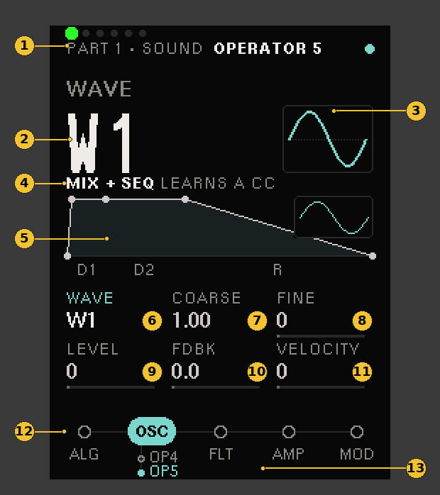

1. **Header:** the Part (PART 1 · SOUND) and the page, OPERATOR 5.
2. **Focus band:** the touched cell, large: WAVE and its value.
3. **Glyph:** a scope of the operator's wave.
4. **Hint:** the gestures the touched cell answers to.
5. **Picture:** the operator's envelope (D1, D2 and R marked) with an inset of its wave.
6. **WAVE:** the operator's wave or kind.
7. **COARSE:** its frequency ratio.
8. **FINE:** its FINE step.
9. **LEVEL:** its output level.
10. **FDBK:** its feedback.
11. **VELOCITY:** its velocity sensitivity.
12. **Chain map:** the OSC node lit.
13. **Sub-pages:** the node's sub-pages, the current one lit.


1. **Header:** the Part (PART 1 · SOUND) and the page, OPERATOR 6.
2. **Focus band:** the touched cell, large: WAVE and its value.
3. **Glyph:** a scope of the operator's wave.
4. **Hint:** the gestures the touched cell answers to.
5. **Picture:** the operator's envelope (D1, D2 and R marked) with an inset of its wave.
6. **WAVE:** the operator's wave or kind.
7. **COARSE:** its frequency ratio.
8. **FINE:** its FINE step.
9. **LEVEL:** its output level.
10. **FDBK:** its feedback.
11. **VELOCITY:** its velocity sensitivity.
12. **Chain map:** the OSC node lit.
13. **Sub-pages:** the node's sub-pages, the current one lit.

An operator set to FRMT shows the formant cells instead (OPERATOR 2 here):


**Why both views:** the group pages compare one setting across the operators (are the ratios harmonic? which carriers are loud?); the operator pages show one operator whole. See [ALGO: ALG PAGES FIRST, parameters or operators first](#algo-alg-pages-first-parameters-or-operators-first) to open OSC on the operators.

## ALGO: formant and noise operators

Set an operator's WAVE to **FRMT** or **NOISE** and it stops being an oscillator at a ratio and becomes a resonance at a fixed place in the spectrum, as the formants of a voice are. A formant operator is voiced: it fires short grains at the note's pitch, each holding a tone at the formant frequency. A noise band is unvoiced: noise shaped into a band around its centre. Both work as carriers or modulators, in every algorithm and in MORPH.

While any operator is a FRMT or NOISE, the **FORMANT** page (**FRM**) joins the OSC row right after WAVE, and VOWEL on the ALGORITHM page wakes up.

### ALGO: the formant operator's cells

| Cell | Range | INIT | What it does |
|---|---|---|---|
| **FORMANT** | 100 Hz to 12.8 kHz | per operator: 734 Hz, 1.10 kHz, 2.47 kHz, then 3.49 kHz | The formant's centre frequency, at vowel A |
| **BW** | 20 Hz to 10.2 kHz | 160 Hz | Bandwidth: how wide the formant is |
| **SKIRT** | 0–3 | 1 | The shape of the formant's sides: 0 is the softest window, with audible side lobes; 1 is clean; 2 and 3 push the side lobes lower still |
| **KEY** | 0–100 | 0 | How far the formant follows the note, in %. 0 keeps it still, as a real formant is; 100 moves it with the keys |
| **SLOT** | AUTO, F1, F2, F3, OFF | AUTO | Which vowel formant VOWEL moves it as |

- FORMANT and BW step 50 cents (a quarter tone) a detent; the value reads in Hz or kHz.
- BW, SKIRT and the noise band's WIDTH change the tone only, never the level: a formant at full LEVEL sits about 12 dB under a sine's level and never clips on its own.
- FORMANT, BW and VOWEL are mod destinations and move smoothly. SKIRT, KEY, SLOT and RES are taken at each note-on, so turning them changes the next note, not a sounding one.
- Above about A2, a floor set by the note's pitch takes over from a narrow BW: the formant cannot be narrower than that.
- A formant has no RES; on its operator page the cells it does not read are not there, and on the group pages they are dimmed.

### ALGO: the noise band's cells

| Cell | Range | INIT | What it does |
|---|---|---|---|
| **CENTRE** | 100 Hz to 12.8 kHz | as FORMANT | The band's centre |
| **WIDTH** | 20 Hz to 10.2 kHz | 160 Hz | The band's width: down at 20 Hz it is nearly a tone; at 10 kHz a full breath |
| **RES** | 0–100 | 0 | Blends the band noise into a pure tone at the centre, in %. 0 is pure band noise |
| **SLOT** | AUTO, F1, F2, F3, OFF | AUTO | As for a formant |
| **LEVEL** | 0–99 | as the operator's LEVEL | Its level |

CENTRE and FORMANT are the same setting, shown under the name that fits the kind; so are WIDTH and BW. A noise band has no pitch, so it ignores COARSE, FINE, DETUNE, FDBK, SKIRT and KEY; those cells are dimmed for it.

### ALGO: VOWEL and the slots

**VOWEL** (ALGORITHM page) moves every formant and noise operator together along **U, O, A, E, I**, from dark to bright. Each operator's FORMANT (or CENTRE) is its place at vowel A; VOWEL shifts it from there to where that vowel's formant sits. The vowel targets are average adult male formant frequencies from a published 1952 measurement study (Peterson and Barney).

Each operator's **SLOT** says which formant of the vowel it follows:

| SLOT | What it does |
|---|---|
| **AUTO** | Takes F1, F2, F3 in order among the AUTO operators (lowest-numbered first); a fourth AUTO operator follows none |
| **F1** | Follows the vowel's first formant |
| **F2** | Follows the second |
| **F3** | Follows the third |
| **OFF** | Ignores VOWEL |

- Two operators can share a slot, for a detuned choir.
- An explicit slot does not shift the AUTO ones: with operators 1 and 2 on F1, AUTO operators 3 and 4 still take F1 and F2.
- The slots are taken at note-on, so a SLOT or WAVE change never makes a sounding formant jump.

**Why three slots:** the first two formants carry a vowel's identity and the third adds clarity. Higher formants barely move from vowel to vowel; they colour the voice instead, so a fourth operator is better left on a fixed FORMANT.

### ALGO: the formant budget

A formant operator costs several times what a table operator does, more again when another operator modulates it. To keep every Sound playable, a Sound with a formant always keeps at least three voices (every other ALGO Sound keeps at least four), and ALGO refuses an edit that would break that:

- Up to three formant operators fit when nothing modulates them, or one modulated formant beside one that is not. Noise bands are cheap: a Sound can hold several.
- WAVE and ALG A / ALG B list every choice. A turn onto a choice the budget cannot pay for shows it dimmed and writes nothing; the next turn goes on from there, so a refused FRMT never blocks NOISE beyond it.
- The focus band says why, shown even with HINTS off:
  - `OP 1 MODULATED · OVER BUDGET`: that operator has a modulator in the algorithm and would only fit unmodulated.
  - `BUDGET FULL · OTHER FORMANTS`: the other formants have used the budget.
  - `LINKS A FORMANT · OVER BUDGET`: that algorithm would make an operator modulate a formant the budget cannot carry.
- The hold ends at any button press, a turn on another cell, a page change or a load. Nothing in the Sound changes.
- A MIDI control or a load that lands on a refused choice shows the toast `FORMANT BUDGET FULL` instead.
- With MORPH, an operator counts as modulated if either algorithm modulates it.

**Why a budget and not fewer voices:** the alternative was a patch that plays one voice, or none, after a single turn. The budget keeps the promise that any Sound you can build plays chords.

> **Design note:** the formant operators follow the structure of an expired Yamaha patent, the approach behind the FS1R's formant synthesis: grains fired at the note's pitch, a carrier at the formant frequency restarted in each grain, two overlapping lanes, and noise low-passed and ring-modulated up to a centre for the unvoiced bands. Everything else is Chimera's own: the window, the width floor, the level law that keeps BW from changing loudness (an FS1R would get louder; this does not), the VOWEL macro and its slots. The vowel table is measurement data, Peterson and Barney's 1952 averages, which means somewhere in the firmware a committee of mid-century American men is still saying "hod", "head" and "hid" on your behalf.

## ALGO: the shared pages on an ALGO Part

The shared pages work as on every engine (see [the voice chain](#the-voice-chain-pitch-filter-fx-amp-stereo-and-sends), [envelopes and LFOs](#envelopes-and-lfos), [the mod matrix](#the-mod-matrix-and-routes)). On ALGO:

- **PIT** (PITCH) hangs under ALG. TRNSP on the ALGORITHM page and PITCH on PIT both shift the Sound in semitones; the tuner on PIT reads the result.
- **JACK** (JACKS): FREQ SRC and RES SRC also take the audio of operator 5 or 6 (**OP5**, **OP6**). The filter's cutoff or resonance then moves at audio rate with that operator, for growls and vocal buzzes. In the mod matrix, OP5 and OP6 are sources too (see [the mod matrix](#the-mod-matrix-and-routes)).
- **AMP**: with no route into VCA, the carriers' envelopes shape the note. AMP's **VEL** and **BASE** are dimmed until a route goes into VCA. Once one does, the routes are the amp: BASE plus the routes, scaling the carriers, which keep their own shape. A BASE above 0 keeps the carriers' own tail after key up.
- **The amp gate.** After key up, an ALGO voice with no route into VCA may be no louder than four times (12 dB over) what its operators are still putting out. A filter left self-oscillating therefore dies with the note's tail instead of ringing on; a normal release is untouched. It closes no faster than about 21 ms, so a ring fades rather than cuts. It costs nothing while the key is held.
- **E1** (ENV1) is not on the VCA on ALGO. It runs as a mod source for anything you route it to.

## ALGO: voices and what a patch costs

Chimera has 8 voices shared by the six Parts. Each ALGO note is billed for what its Sound really uses:

- an operator costs only if its LEVEL is above 0 or something is routed into its LEVEL;
- each link in the algorithm costs a little, and with MORPH both algorithms' links count;
- feedback costs a little;
- formant operators cost much more, and more again when modulated; noise bands cost little.

A note gets a voice only if its cost fits in what is left. Some figures, for one Part alone on the rev V chip beside the TAPE delay and the QUAD reverb:

| Sound type | Example | Voices |
|---|---|---|
| One or two operators | DRIFT ORGAN | 8 |
| Typical | AIR RAID | 7 |
| Heaviest | SOFT HORNS | 3 |
| With formants | NULL CHOIR | 4 |

**Why:** a flat worst-case bill would give a one-operator organ the voice count of a six-operator morphing pad. Billing by the patch's shape lets light Sounds play full chords. INIT routes four operators, not six, so that INIT plays all eight voices. See [limits](#limits-voices-cpu-and-memory).

## ALGO: starting points

All of these start from INIT ALGO (in the Sound browser's INIT rows, or SETTINGS › PART › CLEAR). INIT is T1 into A1, MORPH 0; operator 1 at LEVEL 99, operators 2–4 at 72, 5 and 6 silent; every ratio 1.00 on W1; AR 31, D1R 0, D1L 15, D2R 0, RR 5.

- **Hear the stack open and close:** on INIT, turn MORPH. At 0 it is a bright four-deep stack; at 127 the same four sines play side by side, clean.
- **Organ (as DRIFT ORGAN):** ALG A and B T8. Operators 1–4 W1 at COARSE 1.00, 2.00, 4.00 and 8.00, LEVEL 90 each, AR 28, D1R 31, D1L 15, RR 10. DETUNE −3, 0, +1, +3 for a slow beat. Slow LFOs into a couple of LEVELs make the drawbars drift.
- **Punchy bass (as SOLID BASS):** ALG T3. Operators 1–3 at COARSE 0.50, operator 4 at 1.00. Operator 1 LEVEL 99 with a slow D2R (3); operators 2–4 at LEVEL 50–62 with D1R 12–13 and D1L 10–12, so the brightness falls after the attack. FDBK 4.0 on operator 4 for bite; VEL 1–3 on the modulators so harder notes bark.
- **Electric piano (as TINE PIANO):** ALG T5 (three carriers). Ratios near 1.41 with FINE 1 and a little DETUNE, D1R around 12, RS 2 so high notes decay faster, VEL 3 for the tine's bark when played hard.
- **Bells:** take a modulator to an inharmonic ratio (3.46, 4.24 or 6.28), give the carrier a long D1R to D1L 0 and RS 2 or 3.
- **Morphing bass (as MORPH BASS):** ALG A T4, ALG B T5; a W7 modulator at COARSE 5.00 with FDBK 5.0; route ENV2 into MORPH so each note morphs from one wiring into the other.
- **A choir (as NULL CHOIR):** ALG A A1 (no links), two FRMT operators on F1 and F2 (FORMANT around 566 Hz and 1.17 kHz, BW around 270–360 Hz), a NOISE band at 1.80 kHz for breath, two table operators at 1.00 for the pitch. Sweep VOWEL with a slow LFO.
- **A filter growl (as VOWEL BUZZ):** a SAW carrier into the 2040 filter, operator 5 audible at a low LEVEL and chosen as FREQ SRC on JACKS, so it sweeps the cutoff at audio rate.

The factory Sounds named above ship in the factory set (see [the card, Sounds and the library](#the-sd-card-projects-sounds-and-the-library)); load one and open its pages to see the rest of its settings.

# MODAL, the physical-modelling engine

MODAL plays resonators: strings that are plucked, a bank of tuned modes that is struck, a string that is bowed, and a string that sets seven others ringing. This chapter covers MODAL's own pages: **EXC** (the exciter), **RES** (the resonator) and **MDL2** (the model's second page). The pages MODAL shares with the other engines (PIT, FLT, FMD, FX, JACK, AMP, STER, SND, the MOD matrix, the envelopes and the LFOs) are explained in [the voice chain](#the-voice-chain-pitch-filter-fx-amp-stereo-and-sends), [envelopes and LFOs](#envelopes-and-lfos) and [the mod matrix](#the-mod-matrix-and-routes); this chapter says only how they behave on MODAL. For how pages, cells and gestures work in general, see [the panel and navigation](#the-panel-and-navigation).

## MODAL: what it is and how it plays

A MODAL Part's chain is **EXC · RES · FLT · AMP · MOD**, and a MODAL Part opens on EXC. A note has two halves, as a real instrument does:

- **The exciter** puts energy in: a pluck, a strike or a bow. Its cells are on EXC.
- **The resonator** rings: the string or the bank of modes. **MODEL** picks it, and its four main controls, **STRUCT**, **BRIGHT**, **DAMP** and **POS**, are on RES. Each model's extra controls are on MDL2.

**MODEL** has four choices:

| MODEL | Exciter (EXC's header) | What it is |
|---|---|---|
| STRING | PLUCK | A plucked string. STRUCT makes it stiffer, like piano wire. |
| BANK | STRIKE | A bank of 16 to 48 tuned resonant modes, struck: bars, bells, plates, glass. |
| BOWED | BOW | A bowed string: it sounds while the key is held, and rings when the bow lifts. |
| SYMP | PLUCK | A plucked main string with seven sympathetic strings (the halo) tuned to a chord. |

The FAQ's engine table describes MODAL as "struck, plucked and bowed resonators". The [quick start](https://joegiralt.github.io/chimera-releases/guides/quick-start) has the chain map for each engine.

> **Design note:** MODAL builds on the maths of Émilie Gillet's Mutable Instruments Rings and Elements, which are open source. The modal bank's band-pass filters, its strike-position weights, its stiffness curve and SYMP's chord table follow Rings, and keep its MIT notice. The plucked string itself is Chimera's own code: it began life in an alternative Ambika firmware by Chimera's author, long before it met a PreenFM3. Where Rings is a single Eurorack module with a fixed voice count, MODAL is one engine among several in a six-Part synth, so it had to learn to share: memory, CPU and, in SYMP's case, its sympathetic strings.

## MODAL: notes ring free

On MODAL a note-off stops the exciter and nothing else. A plucked or struck note goes on ringing through its own decay (DAMP) after you let go of the key; a bowed note stops being bowed and rings on. A key struck again while its last note still rings re-plucks the same string: the new pluck is added to the ring, as when you pluck a guitar string that is already sounding. A repeated note therefore costs one voice, not one per strike.

The voice is freed when its ring has fallen 60 dB under its peak. A long DAMP holds a voice for a long time: at INIT's DAMP a string rings about 14 seconds, and SYMP's halo twice that. Hold the sustain or play dense chords with a long DAMP and you will hear older notes stolen sooner; see [limits](#limits-voices-cpu-and-memory).

To make notes stop at key up, either shorten **DAMP**, or route an envelope into the VCA in [the mod matrix](#the-mod-matrix-and-routes): a VCA route gates the voice, and its envelope's release then ends the note. With no VCA route, an amp gate after the filter makes sure a resonant filter dies away with the note's ring rather than ringing on by itself ([AMP](#the-voice-chain-pitch-filter-fx-amp-stereo-and-sends)).

**Why:** Rings has no release: its resonator rings on its own damping, and only a new strike touches it. A note that stopped dead at key up sounded wrong for an instrument named after strings and bells. A release time knob would only duplicate what DAMP and an envelope on the VCA already do.

## MODAL: loudness across the models

Every MODEL's INIT plays at about the same loudness, the median of the factory Sounds, so switching MODEL does not jump in level. STRING is the exception by design: it is set by its peak, so that an eight-note chord played at full velocity stays clear of the output limiter. Its single notes sit a few dB under the others.

BANK's strike falls in level as the note rises, so a high note is as loud as a low one, not harsher.

**Why:** a pluck peaks about 11 dB over a sustained tone of the same loudness. Matching STRING's average loudness to the others made its chords hit the limiter and distort.

## MODAL: the EXC page (exciter)

**EXC** (EXC on the chain map) is the first page of a MODAL Part. Its header names the exciter, which follows MODEL: PLUCK on STRING and SYMP, STRIKE on BANK, BOW on BOWED. Its cells change with MODEL too.

All cells here read 0 to 127.

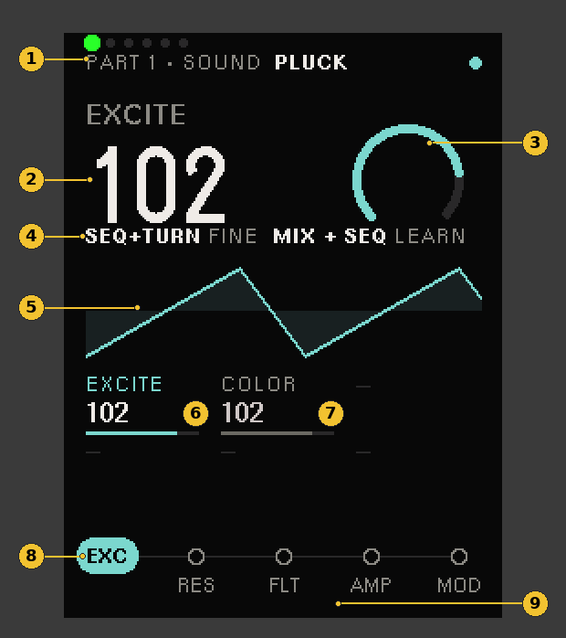

1. Header: the Part, its Sound and the exciter's name, PLUCK.
2. The focused cell, large: EXCITE and its value.
3. EXCITE's glyph, an arc.
4. Focus-band hint: SEQ + turn for fine steps, MIX + SEQ to learn a CC.
5. The picture band: the Part's live output.
6. **EXCITE:** how hard the string is plucked.
7. **COLOR:** the pluck's tone, soft to bright.
8. The chain map, EXC lit.
9. EXC's place on the map: it has no sub-pages.

### MODAL: PLUCK (STRING and SYMP)

| Cell | Range | Default | What it does |
|---|---|---|---|
| **EXCITE** | 0–127 | 102 | How hard the string is plucked. The note's velocity scales it. |
| **COLOR** | 0–127 | 102 | The pluck's tone. Low COLOR smooths the pluck's noise burst several times over, for a soft, round, thumb-like pluck; high COLOR leaves it bright, like a pick. |

SYMP's EXC page is the same as STRING's: EXCITE and COLOR, under the header PLUCK.

### MODAL: STRIKE (BANK)

| Cell | Range | Default | What it does |
|---|---|---|---|
| **EXCITE** | 0–127 | 102 | How hard the bank is struck. The note's velocity scales it. |
| **BURST** | 0–127 | 102 | How long the strike's noise burst lasts, from 2 ms at 0 to 6 ms at 127. Short is a hard mallet's click; long is a softer, duller hit. |

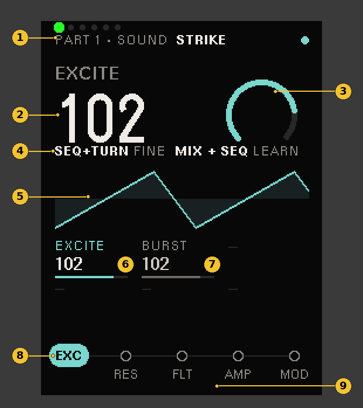

1. Header: the Part, its Sound and the exciter's name, STRIKE.
2. The focused cell, large: EXCITE and its value.
3. EXCITE's glyph, an arc.
4. Focus-band hint: the gestures the cell answers to.
5. The picture band: the Part's live output.
6. **EXCITE:** how hard the bank is struck.
7. **BURST:** how long the strike's noise burst lasts.
8. The chain map, EXC lit.
9. EXC's place on the map: it has no sub-pages.

### MODAL: BOW (BOWED)

| Cell | Range | Default | What it does |
|---|---|---|---|
| **FORCE** | 0–127 | 64 | How hard the bow presses. Harder grips the string more sharply and brightens the tone. Velocity adds to it: a soft key still bows, at half the force. |
| **SPEED** | 0–127 | 64 | How fast the bow moves. A slower bow also sharpens the tone. |

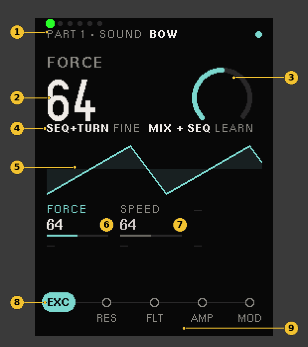

1. Header: the Part, its Sound and the exciter's name, BOW.
2. The focused cell, large: FORCE and its value.
3. FORCE's glyph, an arc.
4. Focus-band hint: the gestures the cell answers to.
5. The picture band: the Part's live output.
6. **FORCE:** how hard the bow presses. Moves a held note.
7. **SPEED:** how fast the bow moves. Moves a held note.
8. The chain map, EXC lit.
9. EXC's place on the map: it has no sub-pages.

FORCE and SPEED move a note you are holding, eased so nothing jumps. EXCITE, COLOR and BURST are read when a note starts: turning them changes the next note, not the one sounding.

FORCE and SPEED are not mod matrix destinations. To swell a bowed note, route an envelope into **BRIGHT** or the filter, as the factory Sound CELLO SWELL does.

**Why:** a pluck or a strike happens once, at the start of the note, so there is nothing to change afterwards. A bow keeps acting while the key is held, so its two controls are live.

A very hard or very slow bow drifts a little out of tune at the top of the keyboard, as a real one does. Inside the middle of FORCE and SPEED it stays within a few cents from G1 to C7.

> **Design note:** BOWED is a single delay loop with a friction curve where the bow touches it: the stick-slip of a real bow, in a few multiplies. A more elaborate two-line waveguide bow was built and tuned, and lost a listening test to this simpler one: the ear, not the maths, had the last word. To get the simple loop in tune it runs at half length and turns the wave upside down on every pass, the inverting reflection described in J. O. Smith's *Physical Audio Signal Processing*. No rosin required.

## MODAL: the RES page (resonator)

**RES** (RES on the chain map, MODAL on the page's header) is MODAL's home page: **MODEL** and the four macros. Its sub-pages, in the stack under RES, are the model's page (MDL2, named on the map after the model: STRING, BANK, BOWED or SYMP) and PIT, the pitch page.

| Cell | Range | Default | What it does |
|---|---|---|---|
| **MODEL** | STRING, BANK, BOWED, SYMP | STRING | The resonator. Turning it restarts the Part's held notes on the new model after a short fade. |
| **STRUCT** | 0–127 | 0 | The resonator's structure. Means something different on each MODEL (below). Dimmed on BOWED. |
| **BRIGHT** | 0–127 | 38 | Dark to bright, on every MODEL. |
| **DAMP** | 0–127 | 120 | How long the note rings. |
| **POS** | 0–127 | 0 | Where the string is plucked, struck or bowed. |

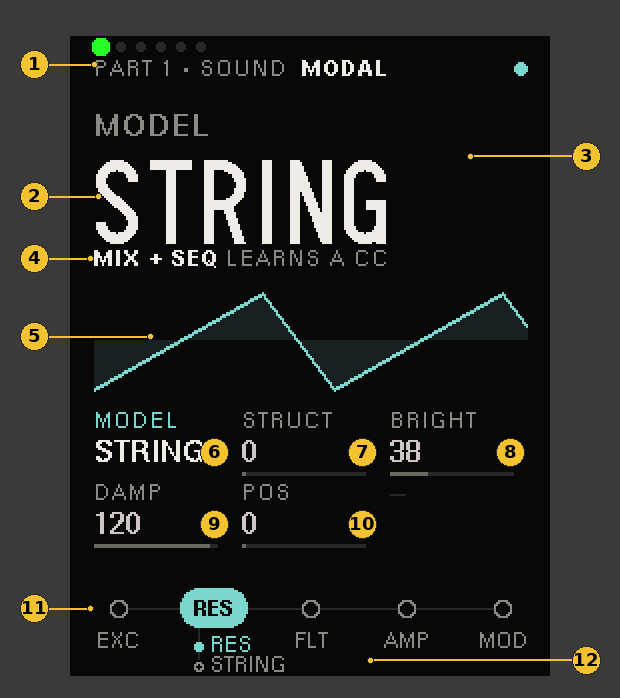

1. Header: the Part, its Sound and the page, MODAL.
2. The focused cell, large: MODEL, here STRING.
3. The glyph's place: empty for MODEL, a word choice, whose word takes the band.
4. Focus-band hint: MIX + SEQ learns a CC.
5. The picture band: the Part's live output.
6. **MODEL:** the resonator.
7. **STRUCT:** the structure (stiffness on STRING).
8. **BRIGHT:** dark to bright.
9. **DAMP:** how long the note rings.
10. **POS:** where the string is plucked.
11. The chain map, RES lit.
12. The sub-pages under RES: RES, the model page (here STRING) and PIT.

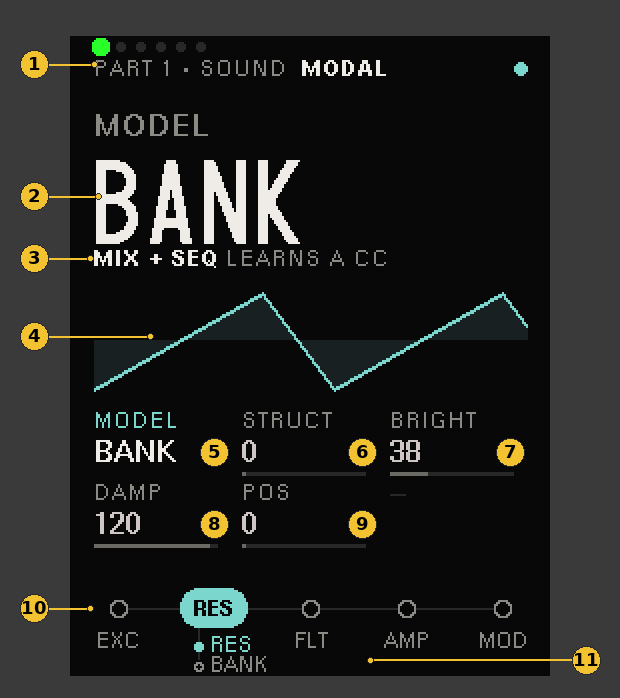

1. Header: the Part, its Sound and the page, MODAL.
2. The focused cell, large: MODEL, here BANK.
3. Focus-band hint: MIX + SEQ learns a CC.
4. The picture band: the Part's live output.
5. **MODEL:** BANK.
6. **STRUCT:** the spacing of the modes.
7. **BRIGHT:** how long the upper modes ring against the lower.
8. **DAMP:** how long the bank rings.
9. **POS:** where the bank is struck, weighting the modes.
10. The chain map, RES lit.
11. The sub-pages under RES: RES, BANK (the model page) and PIT.

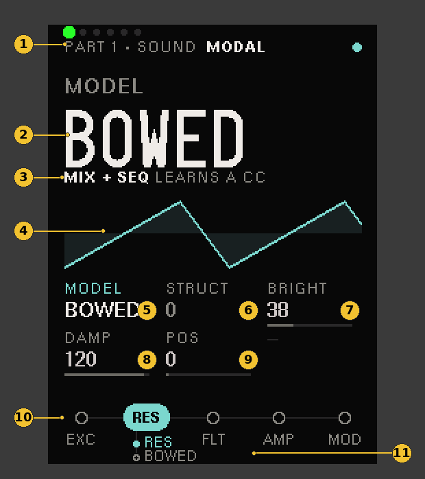

1. Header: the Part, its Sound and the page, MODAL.
2. The focused cell, large: MODEL, here BOWED.
3. Focus-band hint: MIX + SEQ learns a CC.
4. The picture band: the Part's live output.
5. **MODEL:** BOWED.
6. **STRUCT:** dimmed: BOWED doesn't use it.
7. **BRIGHT:** the bridge's tone, after the string.
8. **DAMP:** the ring after the bow lifts.
9. **POS:** where the bow sits, from near the bridge to the middle.
10. The chain map, RES lit.
11. The sub-pages under RES: RES, BOWED (the model page) and PIT.


1. Header: the Part, its Sound and the page, MODAL.
2. The focused cell, large: MODEL, here SYMP.
3. Focus-band hint: MIX + SEQ learns a CC.
4. The picture band: the Part's live output.
5. **MODEL:** SYMP.
6. **STRUCT:** the halo's chord.
7. **BRIGHT:** dark to bright, main string and halo.
8. **DAMP:** how long the main string rings; the halo rings twice as long.
9. **POS:** where the main string is plucked.
10. The chain map, RES lit.
11. The sub-pages under RES: RES, SYMP (the model page) and PIT.

The four macros, STRUCT, BRIGHT, DAMP and POS, are live: they move a sounding note, glide smoothly as you turn them, and are destinations in the MOD matrix. Touch one and press **MIX + PLUS** to prime it as a destination ([the mod matrix](#the-mod-matrix-and-routes)). A control the current MODEL doesn't use is dimmed, with its matrix column.

**Why:** these four are the controls Rings puts on its panel, and the ones every model shares. Keeping them identical across models means a Sound's modulation still makes sense when you change MODEL.

### MODAL: STRUCT on each model

- **STRING:** the string's stiffness. At 0 the partials are harmonic. Turned up, the upper partials go progressively sharp, as on piano wire, more so up the keyboard. The fundamental stays in tune.
- **BANK:** the spacing of the modes. Low settings squeeze the modes together (tube-like), around a quarter of the way they are harmonic, and higher they stretch apart into bell, bar and metal sounds.
- **SYMP:** the halo's chord. STRUCT steps through eleven chords for the seven sympathetic strings, Rings' chord table: from bare octaves at 0, through minor chords (with a seventh, an octave, a ninth, an eleventh), open fifths, and major chords (with an eleventh, a ninth, an octave, a major seventh), to a suspended fourth at 127. A change of chord glides each string to its new pitch, the way a portamento does, taking about a fifth of a second.
- **BOWED:** not used; the cell is dimmed.

### MODAL: BRIGHT, DAMP and POS on each model

- **BRIGHT** runs dark to bright everywhere. On STRING and SYMP it sets how much the string loses its upper harmonics as it rings; on BANK how long the upper modes ring against the lower; on BOWED it is the tone of the bridge, after the string.
- **DAMP** is a ring time. On the strings it runs from 50 ms at 0 to 20 seconds at 127, the same at every pitch, so a high note rings as long as a low one. On BOWED it is the ring after the bow lifts. INIT's 120 is about 14 seconds. On SYMP the halo rings twice as long as the main string.
- **POS** is the pluck's, strike's or bow's place along the string, from the end at 0 to the middle at 127. Away from the end the place cancels some harmonics: at the middle the even ones (the 2nd, 6th, 10th...) fall away, for a hollower tone. On BANK it weights the modes the same way. On BOWED it moves the bow from near the bridge towards the middle.

## MODAL: the MDL2 page (the model's own controls)

**MDL2** sits under RES. On the chain map it is named after the model (STRING, BANK, BOWED or SYMP); its header reads MODAL-2. Its cells follow MODEL. They are read when a note starts: a turn is heard on the next note. They are not matrix destinations.

### MODAL: STRING's model page

| Cell | Range | Default | What it does |
|---|---|---|---|
| **BODY** | 0–127 | 38 | A wooden body's colour: three fixed resonances, low in the range (around 100, 240 and 520 Hz), mixed into the output. It colours without changing the pitch. |
| **ENS.D** | 0–127 | 0 | Ensemble depth: how far the ensemble detunes, up to about 15 cents at 127. |
| **ENS.R** | 0–127 | 38 | Ensemble rate: how fast it moves, from 0.1 Hz to 6 Hz. |
| **ENS.M** | 0–127 | 0 | Ensemble mix. At 0 the ensemble is off. |

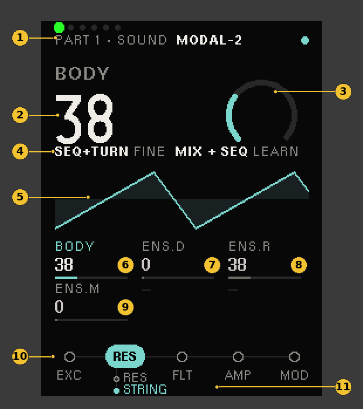

1. Header: the Part, its Sound and the page, MODAL-2.
2. The focused cell, large: BODY and its value.
3. BODY's glyph, an arc.
4. Focus-band hint: SEQ + turn for fine steps, MIX + SEQ to learn a CC.
5. The picture band: the Part's live output.
6. **BODY:** the wooden body's colour.
7. **ENS.D:** ensemble depth.
8. **ENS.R:** ensemble rate.
9. **ENS.M:** ensemble mix; 0 is off.
10. The chain map, RES lit.
11. The sub-pages under RES, on STRING (the model page).

The ensemble reads the string twice more, a little ahead and behind, swaying in and out of tune: a doubled, chorused string, made from the string itself rather than an effect after it.

### MODAL: BANK's model page

| Cell | Range | Default | What it does |
|---|---|---|---|
| **MODES** | 16, 24, 32, 48 | 32 | How many modes the bank rings. More modes give a richer, denser strike, and cost more of the voice budget. |

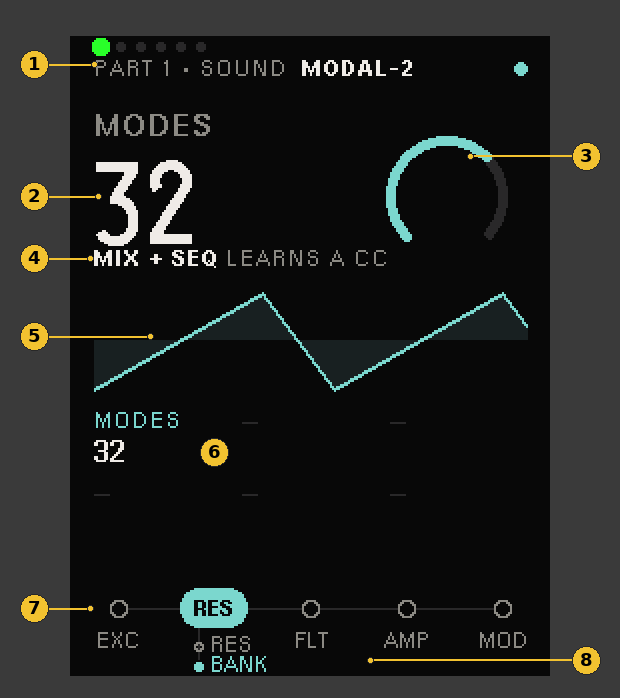

1. Header: the Part, its Sound and the page, MODAL-2.
2. The focused cell, large: MODES and its value.
3. The glyph's place: MODES is a word choice, so the word takes the band.
4. Focus-band hint: the gestures the cell answers to.
5. The picture band: the Part's live output.
6. **MODES:** 16, 24, 32 or 48 modes.
7. The chain map, RES lit.
8. The sub-pages under RES, on BANK (the model page).

MODES is fixed for a note when it starts. A sounding note keeps its modes, and is counted at their cost, until it ends. Modes that would land above what the sample rate can play are dropped, so a high note uses fewer.

**Why:** each mode is a filter running every sample. 48 modes on a high note cost much more than 16, so the count is yours to trade against polyphony; see [limits](#limits-voices-cpu-and-memory).

### MODAL: BOWED's model page

BOWED has no model controls: its page is empty. Everything the bow does is on EXC and RES.

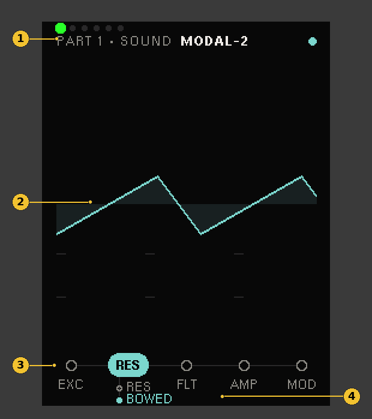

1. Header: the Part, its Sound and the page, MODAL-2.
2. The picture band: the Part's live output. There are no cells.
3. The chain map, RES lit.
4. The sub-pages under RES, on BOWED (the model page).

### MODAL: SYMP's model page

| Cell | Range | Default | What it does |
|---|---|---|---|
| **COUPLE** | 0–127 | 32 | How strongly the main string drives the halo. More COUPLE wakes the sympathetic strings faster and louder. |
| **HALO** | 0–127 | 32 | How loud the halo is in the output. |
| **BODY** | 0–127 | 38 | As on STRING: the body's colour, on the main string and halo together. |
| **ENS.D** | 0–127 | 0 | Ensemble depth, as on STRING. |
| **ENS.M** | 0–127 | 0 | Ensemble mix, as on STRING. SYMP's ensemble runs at a fixed rate. |

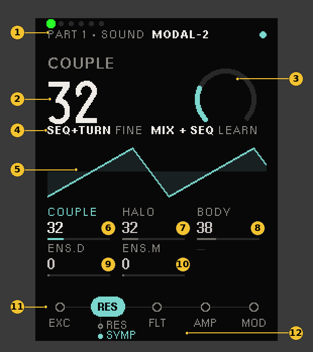

1. Header: the Part, its Sound and the page, MODAL-2.
2. The focused cell, large: COUPLE and its value.
3. COUPLE's glyph, an arc.
4. Focus-band hint: SEQ + turn for fine steps, MIX + SEQ to learn a CC.
5. The picture band: the Part's live output.
6. **COUPLE:** how strongly the main string drives the halo.
7. **HALO:** the halo's level.
8. **BODY:** the body's colour.
9. **ENS.D:** ensemble depth.
10. **ENS.M:** ensemble mix.
11. The chain map, RES lit.
12. The sub-pages under RES, on SYMP (the model page).

The halo's chord is STRUCT's, on RES.

**A limit to know:** the sympathetic strings come from a shared set of four halos. Up to four SYMP notes at once get their own halo; a note that starts when all four are in use plays its main string alone, and keeps playing that way. Nothing is stolen to make room: a ringing halo is never cut short for a new note.

**Why:** each halo is seven strings, so it is large. Giving every voice its own would have taken the memory the other engines need. Sharing four, as Rings shares its strings, keeps SYMP polyphonic where it matters, and refusing to steal keeps ringing notes intact.

## MODAL: the pages it shares

These pages work as on every engine and are documented elsewhere. What is MODAL's own:

- **PIT** ([pitch](#the-voice-chain-pitch-filter-fx-amp-stereo-and-sends)) sits under RES, after the model page. The strings are tuned to a fraction of a sample, so STRING and SYMP stay within a fraction of a cent from G1 to C7, at any STRUCT. The lowest note the strings play is about G1: keys below it play at that pitch.
- **FLT, FMD, FX, JACK** ([filter](#the-voice-chain-pitch-filter-fx-amp-stereo-and-sends)): any filter TYPE follows the resonator. A long DAMP and a resonant filter make long, singing tails.
- **AMP** ([AMP](#the-voice-chain-pitch-filter-fx-amp-stereo-and-sends)): with no route into the VCA, MODAL's note lasts as long as its ring (see "MODAL: notes ring free" above).
- **STER** and **SND** ([stereo and sends](#the-voice-chain-pitch-filter-fx-amp-stereo-and-sends)): as on every engine. MODAL's pages have no reverb cell of their own: the reverb send is on SND.
- **The MOD matrix, E1–E3, SPD, L1–L3** ([the mod matrix](#the-mod-matrix-and-routes), [envelopes and LFOs](#envelopes-and-lfos)): STRUCT, BRIGHT, DAMP and POS are MODAL's destinations. The exciter and model-page cells are not.

RANDOMIZE ([SETTINGS](#settings)) rolls MODAL's STRUCT and POS (and from RICH the MODEL), its DAMP as the envelope family, its BRIGHT, BODY, COLOR and BURST as tone, and the ensemble as movement.

## MODAL: gestures on its pages

On any MODAL cell:

- **SEQ + turn**: fine steps.
- **MIX + turn**: jump to the next landmark: 0, 100, 127.
- **MIX + SEQ**: learn a MIDI CC for the cell ([MIDI](#midi-channels-maps-and-controllers)). The focus band says so.
- **MIX + PLUS** (on STRUCT, BRIGHT, DAMP or POS): prime it as a MOD matrix destination.

## MODAL: starting points

These come from the factory MODAL Sounds and INIT; values are on the 0–127 knob scale.

- **A nylon-string pluck (STRING):** COLOR 76, BRIGHT 38, DAMP 89, POS 38, BODY 64, ENS.D 38, ENS.M 38. Route NOTE into POS so the pluck position follows the keyboard, and VEL into BRIGHT so harder notes are brighter. This is the factory NYLON.
- **A gamelan or bell (BANK):** STRUCT 76, BRIGHT 13, DAMP 114, EXCITE 44, BURST 13, the filter's cutoff down to about 5 kHz to tame the strike's click, VEL into BRIGHT. A slow LFO on DAMP and BRIGHT keeps it alive. This is GAMELAN.
- **A swelling cello (BOWED):** FORCE 76, SPEED 64, BRIGHT 76, DAMP 76. An ENV 2 with a slow attack into BRIGHT and the cutoff swells the tone; a 5 Hz LFO on FINE is the vibrato. This is CELLO SWELL.
- **A drone with sympathetic strings (SYMP):** STRUCT 51 (the chord), COUPLE 89, HALO 89, DAMP 89, COLOR 38, EXCITE 51, BRIGHT 64, some reverb send, slow LFOs on POS, BRIGHT and the cutoff. This is SITAR DRONE.
- **Shorter, percussive notes on any model:** bring DAMP down to around 60–80, or route ENV 1 into the VCA so key up ends the note.
- **Hollower tone:** turn POS towards 127.

# VA, the variable-wave engine

VA is Chimera's analogue-style oscillator engine: two variable-wave oscillators combined by a MODE, a sub-oscillator, a noise source and STABILITY, which lets each voice drift like a real oscillator. This chapter covers the VA page and its OSC1, OSC2 and NOISE sub-pages, every MODE, what STABILITY models, the voice cost and some starting points. The filter, the FX slot, the amp and the modulation are the pages every engine shares: see [the voice chain](#the-voice-chain-pitch-filter-fx-amp-stereo-and-sends), [envelopes and LFOs](#envelopes-and-lfos) and [the mod matrix](#the-mod-matrix-and-routes). This chapter says only what is VA-specific about them.

## VA: what the engine is

A VA voice is:

1. **OSC 1** and **OSC 2**, each a band-limited oscillator whose **WAVE** morphs smoothly from sine through triangle and saw to square, and whose **SHAPE** varies whichever wave is sounding.
2. **MODE**, how the two combine: mixed, hard or soft synced, ring or amplitude modulated, frequency or phase modulated, looped back on themselves, or combined bit by bit. **BLEND** sets how far the MODE goes.
3. **SUB**, a square wave an octave under OSC 1.
4. **NOISE**, the voice's own noise source.
5. **STABILITY**, how far the oscillators drift, voice by voice.

The result then goes through the filter (the 2040 by default), the FX slot and the amp, as on every engine.

**Why:** most digital oscillators sound sterile. The ones that don't build movement into the oscillator itself: a few controls that come alive under modulation, and an instability that lets the sound breathe. VA is built on that idea. Every wave, at every SHAPE, plays at the same level, so turning WAVE, SHAPE or MODE never makes the sound jump in loudness, and every continuous control can be modulated without clicks.

> **Design note:** VA's layout is an open nod to the Mutable Instruments Ambika's: two variable-waveform oscillators, a digital operator between them and a sub locked to the first. Only the architecture came over, taken from the Ambika's manual; the oscillators, operators, tables and names are Chimera's own, written clean-room. The intent was an engine that feels analogue on the way in and can go either way on the way out: East Coast (saws and pulses, SUB, into the 2040 or the LADDER with an envelope on the cutoff) or West Coast (sines and triangles bent by FM, PHASE and LOOPFM, folded in the FX slot and closed by AMP's low-pass gate). The waves are kept clean with polyBLEP and polyBLAMP corrections, the techniques of Välimäki and Huovilainen and of Esqueda, Välimäki and Bilbao. No oscillators were harmed, but several were made deliberately unstable.

## VA: the chain and its pages

A VA Part's chain map reads **VA · FLT · AMP · MOD**. VA is the home: entering the chain lands there.

| Node | Its pages, short name (full word on the sub-page row and header) |
|---|---|
| VA | **VA**, **OSC1** (OSC 1 in the header), **OSC2** (OSC 2), **NOISE**, **PIT** (PITCH) |
| FLT | FILTER, MODULATION, FX, JACKS: see [the voice chain](#the-voice-chain-pitch-filter-fx-amp-stereo-and-sends) |
| AMP | AMP, STEREO, SENDS: see [the voice chain](#the-voice-chain-pitch-filter-fx-amp-stereo-and-sends) |
| MOD | MATRIX, ENV1–ENV3, SPEED, LFO1–LFO3: see [envelopes and LFOs](#envelopes-and-lfos) and [the mod matrix](#the-mod-matrix-and-routes) |

From the VA page, **SEQ** goes on to OSC1, OSC2, NOISE and PITCH (wrapping round from the last), and **EDIT** goes back one. With SETTINGS › PERSONALIZE › CHAIN MAP › PAGES set to STACK, EDIT goes down and SEQ goes up instead (see [the panel and navigation](#the-panel-and-navigation)).

The 0–127 values below are the knob scale the screen shows for VA's continuous controls.

## VA: the VA page


1. **Header:** the Part (PART 1 · SOUND) and the page, VA.
2. **Focus band:** the touched cell, large: WAVE1, 85 (saw).
3. **Glyph:** a scope of OSC 1's wave at the touched WAVE.
4. **Hint:** `SEQ+TURN FINE` and `MIX + SEQ LEARN`.
5. **Picture:** the live output's waveform.
6. **WAVE1:** OSC 1's wave, sine to square.
7. **WAVE2:** OSC 2's wave.
8. **MODE:** how the oscillators combine.
9. **BLEND:** how far MODE goes.
10. **SUB:** the sub-oscillator's level.
11. **STABILITY:** how far the oscillators drift.
12. **Chain map:** the VA node lit.
13. **Sub-pages:** the node's sub-pages, the current one lit.

With BLEND touched, its glyph names the MODE's two ends:

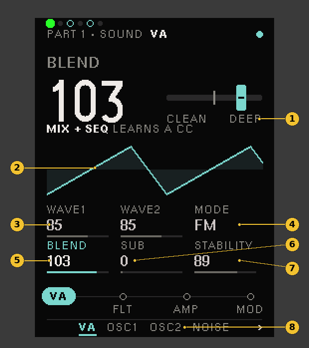

1. **BLEND's glyph:** a crossfader, with what each end gives under it. The words change with MODE (here FM: CLEAN to DEEP).
2. The live output.
3. **WAVE1, WAVE2:** each oscillator's wave, morphing through sine, triangle, saw and pulse.
4. **MODE:** how OSC 1 and OSC 2 combine. Touch MODE and the glyph draws the result.
5. **BLEND:** how far MODE goes.
6. **SUB:** a sub-oscillator an octave under OSC 1.
7. **STABILITY:** how far the oscillators drift, voice by voice.
8. VA's sub-pages: OSC1, OSC2 (coarse, fine and shape for each), NOISE and PITCH.

| Cell | Range | INIT | What it does |
|---|---|---|---|
| **WAVE1** | 0–127 | 85 (saw) | OSC 1's wave: sine at 0, triangle at 42, saw at 85, square at 127, a crossfade between |
| **WAVE2** | 0–127 | 85 (saw) | The same for OSC 2 |
| **MODE** | MIX, SYNC, RING, XOR, BITS, FM, AM, MAX, LOOPFM, SOFT SYNC, PHASE | MIX | How OSC 1 and OSC 2 combine |
| **BLEND** | 0–127 | 64 | How far MODE goes; its two ends are named under the glyph |
| **SUB** | 0–127 | 0 | The sub-oscillator's level |
| **STABILITY** | 0–127 | 89 | 127 is steady; lower, the oscillators drift and breathe |

All six are mod destinations (**MIX + PLUS** on a cell primes it for a route) and can be learned to a MIDI control (**MIX + SEQ**). **MIX + turn** jumps a value to its next landmark; on a continuous cell, hold **SEQ** and turn for fine steps. See [the panel and navigation](#the-panel-and-navigation).

The MODE cell shows the first word of a long name: it reads SOFT for SOFT SYNC. The focus band spells every MODE in full.

### VA: WAVE

WAVE morphs through four waves at fixed points: **sine** (0), **triangle** (42), **saw** (85) and **square** (127). Between two of them, the oscillator is a crossfade of the two neighbours, so the sound moves smoothly as you turn; it never steps. Every wave is kept in phase with the others, so a crossfade never thins the fundamental.

- WAVE is good to modulate: an envelope into WAVE sweeps a note from sine to saw (as the factory Sound FADED HYMN does), and an LFO on it makes a slow, moving timbre.
- A WAVE change crosses at most one of the four points in each 1.3 ms audio block. A jump from one end to the other therefore lands in about 2.7 ms, passing through the middle, and an audio-rate LFO at full depth on WAVE swings a little narrower than asked.

**Why the one-point limit:** each crossing costs processing time, and allowing two in one block would have cost every VA voice extra in every MODE. One crossing a block kept VA within its voice budget with no audible step.

## VA: OSC1 and OSC2, the oscillator pages

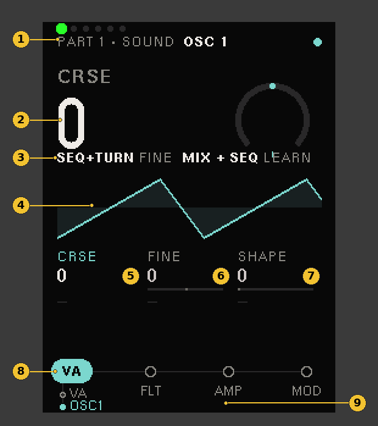

1. **Header:** the Part (PART 1 · SOUND) and the page, OSC 1.
2. **Focus band:** the touched cell, large: CRSE and its value.
3. **Hint:** `SEQ+TURN FINE` and `MIX + SEQ LEARN`.
4. **Picture:** the live output's waveform.
5. **CRSE:** OSC 1's coarse tuning in semitones.
6. **FINE:** OSC 1's fine tuning in cents.
7. **SHAPE:** varies OSC 1's wave.
8. **Chain map:** the VA node lit.
9. **Sub-pages:** the node's sub-pages, the current one lit.


1. **Header:** the Part (PART 1 · SOUND) and the page, OSC 2.
2. **Focus band:** the touched cell, large: CRSE and its value.
3. **Hint:** `SEQ+TURN FINE` and `MIX + SEQ LEARN`.
4. **Picture:** the live output's waveform.
5. **CRSE:** OSC 2's coarse tuning in semitones.
6. **FINE:** OSC 2's fine tuning in cents.
7. **SHAPE:** varies OSC 2's wave.
8. **Chain map:** the VA node lit.
9. **Sub-pages:** the node's sub-pages, the current one lit.

OSC1 and OSC2 are the same page for each oscillator:

| Cell | Range | INIT (OSC 1 / OSC 2) | What it does |
|---|---|---|---|
| **CRSE** | −24 to +24 semitones | 0 / 0 | Coarse tuning |
| **FINE** | −100 to +100 cents | 0 / +6 | Fine tuning |
| **SHAPE** | 0–127 | 0 / 0 | Varies the wave that is sounding |

What SHAPE does depends on WAVE:

| Wave | SHAPE 0 to 127 |
|---|---|
| Sine | Folds brighter, into a sine of a sine |
| Triangle | Skews: the rising part grows from half the cycle to nearly all of it |
| Saw | Splits its reset into two half-height steps that move a quarter cycle apart: the second harmonic thins while the fundamental holds. Never an octave-up saw |
| Square | Narrows the pulse from 50 % to 5 %: pulse-width modulation under an LFO. Never narrower than one sample |

Between two waves, SHAPE varies both. The level holds across SHAPE.

- **CRSE** on OSC 2 sets the interval between the oscillators: +12 an octave, +7 a fifth. In SYNC it is the sync sweep (see below).
- **FINE** on OSC 2 detunes it against OSC 1 for beating. INIT's +6 cents gives a slow beat and keeps XOR from going silent (see [VA: MODE](#va-mode-how-the-oscillators-combine)).
- PIT's PITCH and FINE move the whole voice; CRSE and FINE here move one oscillator.

## VA: MODE, how the oscillators combine

MODE picks how OSC 1 and OSC 2 combine and BLEND sets how far. The words at BLEND's two ends say what you get, and MODE's glyph draws the combined wave.

| MODE | What it does | BLEND from … to … |
|---|---|---|
| **MIX** | The two oscillators mixed | 1 · 2 |
| **SYNC** | OSC 2 restarts at each of OSC 1's cycles (hard sync) | 1 · 2 |
| **SOFT SYNC** | OSC 2 turns round at each of OSC 1's cycles instead of restarting. Softer than SYNC with sine and triangle waves | 1 · 2 |
| **RING** | Ring modulation: the two multiplied | MIX · RING |
| **AM** | OSC 2 swells and dips OSC 1's level without turning it upside down; at audio rates it adds sidebands and keeps OSC 1's note. In the top third of BLEND it runs on into RING | CLEAN · RING |
| **FM** | OSC 2 bends OSC 1's speed, deep enough to run it backwards (through-zero FM). You hear OSC 1; OSC 2 is the modulator | CLEAN · DEEP |
| **PHASE** | OSC 2 bends OSC 1's phase, as in phase distortion | CLEAN · WARP |
| **LOOPFM** | Each oscillator modulates its own frequency; BLEND also brings OSC 2 in. WAVE sets how much each one loops | 1 · LOOP |
| **MAX** | The louder of the two waves at each moment, its corners rounded | MIX · MAX |
| **XOR** | The two waves' samples combined bit by bit (exclusive or): harsh and digital | MIX · XOR |
| **BITS** | The mix crushed from 16 bits down to 2 | CLEAN · CRUSH |

More on each:

- **MIX:** BLEND 0 is OSC 1 alone, 127 OSC 2 alone, 64 an equal mix.
- **SYNC:** keep OSC 2 above OSC 1 and sweep OSC 2's CRSE or FINE (by hand, an envelope or an LFO) for the classic sync sweep. BLEND balances the master against the synced oscillator. While SYNC plays, OSC 1, the master, stops at 7 kHz: a master asked higher (very high notes, or PITCH or CRSE pushing it there) plays 7 kHz. The other MODEs are not limited.
- **SOFT SYNC:** OSC 2 reverses direction at each of OSC 1's cycles. With a saw or square the turn is still a jump; with sines and triangles it is gentle.
- **RING:** BLEND 0 is an equal mix of the two, 127 the pure product. Detune or offset OSC 2 (CRSE +6, a tritone, gives clangorous tones) for bells and blips.
- **AM:** BLEND from 0 to about 85 goes from OSC 1 plain to full amplitude modulation; from 85 to 127 it runs on through over-modulation into ring modulation.
- **FM:** BLEND sets the depth, rising faster towards the top. Past about a fifth of the way the modulation is deep enough to run OSC 1 backwards on OSC 2's troughs. The pitch stays centred on OSC 1's note, and the SUB stays an octave under it whatever the depth. On very high notes the depth is limited so the sound stays clean.
- **PHASE:** BLEND 0 is OSC 1 plain; up the range OSC 2 warps OSC 1's phase, as Casio's CZ phase distortion does. A sine warped by a sine gets brighter and more resonant without any change of pitch.
- **LOOPFM:** each oscillator frequency-modulates itself; each one's WAVE sets how far it loops. The harmonics rise in octaves as WAVE and BLEND go up, ending near a sharp pulse.
- **MAX:** takes whichever oscillator is higher at each moment, with the corners rounded so it stays clean.
- **XOR:** the two waves are turned into 16-bit numbers and combined bit by bit. It aliases on purpose; that is its sound. Two identical oscillators (same WAVE, same pitch, same phase) XOR to silence, so keep a few cents between them: under about 20 cents of detune it is a fat, moving texture.
- **BITS:** BLEND crushes the mix from 16 bits at 0 to 2 bits at 127. Like XOR it is digital and harsh by design, and the crush depth moves in small steps rather than smoothly.

A MODE change while notes sound ducks the output for about 2.7 ms, swaps the MODE and brings it back over the same time, so there is no click.

**Why so many MODEs on one page:** each is a classic way two oscillators interact, from analogue (MIX, SYNC, RING, AM) to the digital and modular (FM, PHASE, LOOPFM, XOR, BITS). They all share WAVE, SHAPE, BLEND and SUB, so a Sound can move from one to another without being rebuilt.

> **Design note:** LOOPFM is built on Tamara Smyth's loopback FM paper (DAFx-26, "Loopback Frequency Modulation Using a Time-Varying Delay Line"), its closed form re-implemented in Chimera's own code, with its own curve for how far the loop goes. XOR's bitwise mixing follows Jari Kleimola's DAFx-08 work on bitwise operations between oscillators. Both are measured against an alias limit, except where aliasing is the point: XOR and BITS were excused from the test the way the drummer is excused from the tuning check.

## VA: SUB

**SUB** adds a square wave one octave below OSC 1, after MODE. It always follows OSC 1's pitch, also when MODE is FM and OSC 1's speed is being bent.

As SUB comes up, the oscillators dip a little so the total stays level: SUB thickens the bottom rather than making the voice louder.

## VA: STABILITY

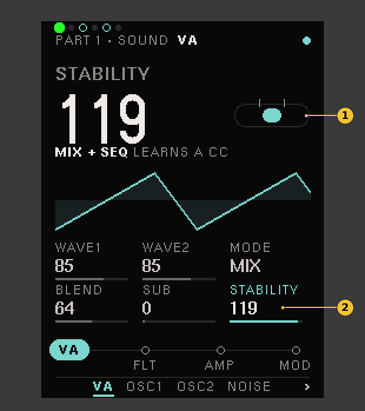

1. **STABILITY's glyph** is a spirit level: the further the bubble sits from the middle, the more the voices drift.
2. STABILITY, touched.

At **127** the oscillators are steady: every note starts both oscillators and the sub at the start of their cycle, so the attack is the same every time, and a render is exactly repeatable. Below 127 each voice behaves like an untrimmed analogue oscillator:

- **Drift:** each voice has three slow random walks, one shared by both oscillators and one each. They move together, so the pair drifts as one while their interval beats slowly.
- **Trim:** each oscillator gets its own small fixed detune, up to about ±3 cents.
- **High-frequency tracking:** each oscillator goes a little flat (now and then a little sharp) the higher it plays, so the two pull apart and beat faster up the keyboard, as real oscillators do.
- **Scale error:** each oscillator's octaves are slightly stretched or squeezed.
- **Jitter:** each cycle's pitch wobbles very slightly.
- **Free-running phase:** the oscillators run on from note to note, so each attack is a little different.

The amount follows a curve: the top of the knob is fine-grained, and the effect grows faster towards 0. At 0 the shared drift reaches about ±12 cents. The character of each voice (its trims and errors) is fixed by the Part and the voice it plays on, so it comes back the same each time; the drift and the phases differ from take to take.

INIT has STABILITY 89, a gentle amount. The filter's own STABILITY (on FLT › FX, for the 2040, LADDER and SEM) is a separate control: it gives each voice its own slightly different filter chip (see [the voice chain](#the-voice-chain-pitch-filter-fx-amp-stereo-and-sends)).

**Why:** an oscillator that never moves sounds like a computer. STABILITY gives VA the slow life of analogue oscillators, and lets you choose between a perfectly repeatable sound (127) and a sound that is a little different every time.

> **Design note:** STABILITY models the faults of a real voltage-controlled oscillator. Its high-frequency tracking error is an estimate worked out from the CEM3340 oscillator chip's datasheet (a fixed delay in every cycle that makes high notes go flat), not a measurement of one unit; the octave stretch is the same chip's typical untrimmed scale error. The drift is noise through two slow filters, so it wanders rather than wobbles. In other words, a very carefully engineered way of making something worse, which is most of analogue synthesis.

## VA: NOISE


1. **Header:** the Part (PART 1 · SOUND) and the page, NOISE.
2. **Focus band:** the touched cell, large: KIND, WHITE.
3. **Hint:** MIX + SEQ learns a MIDI control.
4. **Picture:** the live output's waveform.
5. **KIND:** the noise's colour, WHITE, PINK, RED or DIGITAL.
6. **LEVEL:** how much noise.
7. **Chain map:** the VA node lit.
8. **Sub-pages:** the node's sub-pages, the current one lit.

| Cell | Range | INIT | What it does |
|---|---|---|---|
| **KIND** | WHITE, PINK, RED, DIGITAL | WHITE | The noise's colour |
| **LEVEL** | 0–127 | 0 | How much noise |

| KIND | Sound |
|---|---|
| **WHITE** | Even hiss across the whole range |
| **PINK** | Softer, fuller hiss: less top |
| **RED** | Dark rumble and wind: mostly low end |
| **DIGITAL** | Stepped, gritty noise that follows the key: brighter on higher notes |

The noise is mixed in beside SUB, after MODE and before the filter. Every voice has its own noise. As with SUB, the oscillators dip a little as LEVEL comes up, so the filter sees the same level. LEVEL is a mod destination: an envelope into it gives a breathy attack.

**Why one noise source and not one per oscillator:** noise after MODE is heard the same whatever the MODE does to the oscillators; inside a MODE (ring modulated or XORed) it would turn into something else.

## VA: the shared pages on a VA Part

The shared pages work as on every engine (see [the voice chain](#the-voice-chain-pitch-filter-fx-amp-stereo-and-sends)). On VA:

- **PIT** (PITCH) hangs under the VA node, after NOISE.
- **FLT:** a new VA Sound starts on the 2040 filter (VOICE REV2), modelled on the SSM2040 chip.
- **AMP:** VA does not shape its own level: with no route into VCA, the key alone starts and ends the note. That is why INIT VA routes ENV 1 into VCA at +127: ENV 1 is the note's contour. Leave AMP's BASE at 0 on VA; above 0 it holds the level up past ENV 1's attack and release.
- **West Coast tools:** the FX slot's FOLD and AMP's LPG, DECAY and STRIKE (a low-pass gate) suit sines and triangles in FM, PHASE or LOOPFM.

## VA: voices and what a patch costs

Chimera has 8 voices shared by the six Parts. A VA note's cost depends mostly on the filter and the FX slot; the MODEs differ only a little. Some figures, for one Part alone on the rev V chip beside the TAPE delay and the QUAD reverb:

| Sound type | Example | Voices |
|---|---|---|
| VA on the 2040 | SOLO PORTA | 7 |
| VA with FUZZ | INIT VA, FX FUZZ | 6 |
| VA on the LADDER with FOLD | GROWL BASS | 5 |

See [limits](#limits-voices-cpu-and-memory).

## VA: starting points

INIT VA: two saws (WAVE1 and WAVE2 85), OSC 2 FINE +6 cents, MODE MIX at BLEND 64, SUB 0, STABILITY 89, NOISE off, the 2040 filter, ENV 1 into VCA.

- **Detuned saw pad (as TAPE DRIFT):** INIT, STABILITY 76, a slow ENV 1 attack and release, a very slow LFO into OSC 2's FINE and another into both SHAPEs in opposite directions.
- **Wide saws (as SUPER SAWS):** OSC 2 CRSE +12 and FINE +3, SUB around 44, an LFO into SHAPE1 for movement.
- **Sync lead (as SYNC SCREAM):** MODE SYNC, OSC 2 CRSE +7, ENV 2 into OSC 2's CRSE so each note sweeps.
- **Ring bell lead (as RING LEAD):** MODE RING, BLEND around 44, OSC 2 CRSE +12, WAVE1 around 51 and WAVE2 around 13; velocity into BLEND adds the bell when played hard.
- **Flute (as SOFT FLUTE):** WAVE1 near square (121), WAVE2 a sine an octave up (CRSE +12), BLEND around 38, STABILITY 102, an LFO into SHAPE1 for breath. Add a touch of NOISE for air.
- **Crushed to clean (as BIT BLOOM):** both WAVEs at sine (0), MODE BITS, BLEND 0, ENV 2 into BLEND at +127 so each note opens crushed.
- **Acid bass (as ACID CLASSIC):** one saw (WAVE1 85, BLEND 0, SUB 0), STABILITY 64, the LADDER filter, ENV 2 into the cutoff, velocity into ENV 2's level for accents.
- **Bass with sub (as GLIDE BASS):** SUB around 25 and STABILITY around 25 for a looser, more analogue pitch; put the Part in mono with glide.
- **A West Coast tone:** both WAVEs at sine, MODE FM or PHASE, BLEND around halfway, FOLD in the FX slot, AMP's LPG up with DECAY and STRIKE for plucks that darken as they fade.

The factory Sounds named above ship in the factory set (see [the card, Sounds and the library](#the-sd-card-projects-sounds-and-the-library)); load one and open its pages to see the rest of its settings.

# TAPE, the sample engine

TAPE plays sound sources, recordings held in the project's memory or streamed from the card while they play, through one of four machines: WALK, STRETCH, SCRUB and WAVE. This chapter covers TAPE's own pages: **SRC** (the source and its window), **DECK** (the machine and the knobs that shape it) and **MCH** (the machine's own page), plus what TAPE does on the pitch page and how it tells you what it can't play. The shared pages (PIT, FLT, FMD, FX, JACK, AMP, STER, SND, the MOD matrix, the envelopes and the LFOs) are explained in [the voice chain](#the-voice-chain-pitch-filter-fx-amp-stereo-and-sends), [envelopes and LFOs](#envelopes-and-lfos) and [the mod matrix](#the-mod-matrix-and-routes). Getting sources onto the card is in [the SD card, Sounds and the library](#the-sd-card-projects-sounds-and-the-library).

## TAPE: what it is and how it plays

A TAPE Part's chain is **SRC · DECK · FLT · AMP · MOD**.

- **SRC** (SOURCE on the page's header) picks the source and the stretch of it that plays: the *window*, from **START** to **END**.
- **DECK** picks the machine with **MODEL** and holds the knobs that move the machine's picture.
- **MCH**, the machine's own page, sits under DECK. On the chain map it is named after the machine (WALK, STRCH, SCRUB or WAVE), and its header spells it in full (WALK, STRETCH, SCRUB, WAVE). It starts with the tape's wear, **TAPE**, **AGE** and **WOW**, on every machine.
- **PIT**, the pitch page, is the last sub-page under DECK.

| MODEL | The machine |
|---|---|
| WALK | Plays the window once through (FWD or REVERSE), round a loop (LOOP) or there and back (PING). With TRON on, each key gets its own Mellotron-style tape. |
| STRCH (STRETCH) | Plays the source at the key's pitch, stretched or squeezed in time: CLASSIC and CLS POLY splice it, GRAIN plays it in grains. |
| SCRUB | Moves through the source by hand, like a tape reel under your finger. Keys can place the finger. |
| WAVE | Plays a wavetable source: a source made of single-cycle frames. |

INIT TAPE has no source: it is silent until you pick one on SRC. The factory TAPE Sounds come with their sources, once the factory set is on the card ([the SD card](#the-sd-card-projects-sounds-and-the-library)).

Every machine draws its own picture in the focus band: a runner for WALK, an accordion for STRETCH, a sponge on the tape for SCRUB, film through a gate for WAVE. DECK's knobs move it, and it stays still when nothing changes.

> **Design note:** TAPE treats a recording as raw oscillator material, in the spirit of the 12-bit samplers of the late 80s. Sources are 12-bit with a sample rate of their own, as on the Akai S950. Pitching a source up is not filtered against aliasing: well above its own speed the top end folds back, the gritty character the E-mu SP-1200 made famous, kept on purpose and bounded. Think of it as a vintage sampler that never needs its floppy drive cleaned.

## TAPE: sources and memory

A source lives on the card, in `/CHIMERA/TAPES`, as a `.SRC` file: Chimera's own format, mono and 12-bit. TAPE plays these files only; a way to turn your own recordings into them isn't part of this release. Putting the factory sources onto the card, and how the card and its folders work, are in [the SD card, Sounds and the library](#the-sd-card-projects-sounds-and-the-library): in short, the factory set's TAPES folder is copied onto the card over USB, and a source's file name is a checksum of what is in it, so the same source is never stored twice.

To play a source, a project **loads** it into its memory (the pool). A source too long for the memory left is not loaded: it **streams**, read from the card while it plays.

- SETTINGS › PROJECT › POOL shows what the project's memory holds. PURGE UNUSED SRC frees the memory of sources no Part uses; the files on the card stay. See [SETTINGS](#settings).
- How much memory there is, and how many notes can stream at once, are in [limits](#limits-voices-cpu-and-memory).

Each source the project holds remembers the Part's **START**, **END**, **PITCH** and **FINE** on it while the project is open: turn SOURCE away and back, and the Part's window and tuning on that source come back. This memory is not saved; a saved Sound keeps its own source's values.

**Why:** the card is inside the case, so files arrive over USB and the card is never filled with copies. Holding sources in memory lets every machine jump anywhere in them; streaming lets a long recording play at all.

## TAPE: the SRC page (source)

**SRC** (SRC on the chain map, SOURCE on the header) picks the source and its window.

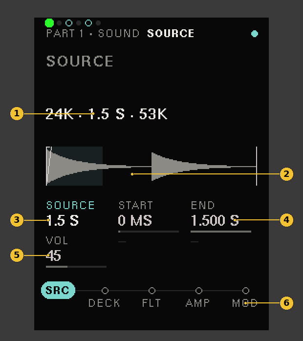

1. **SOURCE's readout:** the source's rate, length and the memory it takes (`24K · 1.5 S · 53K`). A source too long for memory streams from the card; then the readout says how many notes of it can stream at once (`… · 7 STREAMS`).
2. **The strip:** the source's waveform, the window lit, and the play heads while notes play.
3. **SOURCE:** turn it through the sources the project holds, then the ones on the card.
4. **START** and **END:** the window, in time. **MIX + turn** snaps to the next onset in the source.
5. **VOL:** the source's level.
6. TAPE's chain.

| Cell | Range | Default | What it does |
|---|---|---|---|
| **SOURCE** | the project's sources, then the card's | none | The source. The cell shows its length (`1.5 S`), or a card source's size, or why it can't play (below). |
| **START** | the source, in time | 0 MS | Where the window starts. |
| **END** | the source, in time | the source's end | Where the window ends. END before START plays the window backwards. |
| **VOL** | 0–127 | 45 | The source's level. |

**START** and **END** read in time when a source is held: `137 MS` under a second, else `1.500 S`. A turn moves them 1 ms a detent when slow and up to 100 ms a detent when fast, and at full speed at least a hundredth of the source, so a long source crosses in a few turns. **MIX + turn** jumps to the next onset (a note or hit starting) in the direction you turn; the focus band reads `MIX + TURN NEXT ONSET`. With no onset that way, the mark stays. On a streamed source, only the parts held in memory (its start and loop heads) can be searched for onsets.

START is a MOD matrix destination, read when a note starts: route VEL into START and harder notes start further in. START and END are read at the note's start; a held note doesn't follow them.

### TAPE: picking a card source

Turn **SOURCE** past the project's sources, over a divider, to the card's. A card source is not yet loaded: its focus band shows the memory meter, its name, rate, length and size, and what loading it would take.

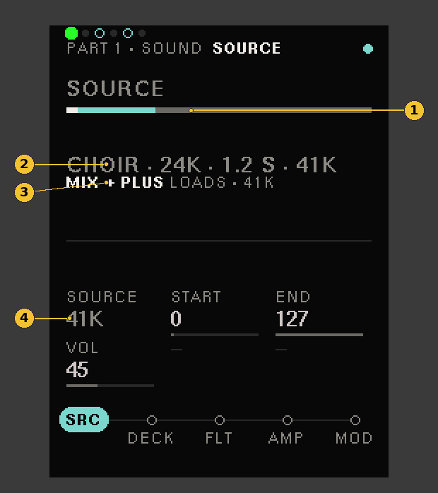

1. **The memory meter**, with what loading this source would take.
2. The card source's name, rate, length and size.
3. **MIX + PLUS** loads it into the project, and the Part plays it. If it won't fit, the hint says WON'T FIT.
4. Until it is loaded, SOURCE shows its size, dimmed.

While a source loads the screen shows BUSY; **MENU** cancels the load.

### TAPE: the source states

SOURCE's cell and focus band say what state the source is in.

| State | Cell | Focus band | What it means and what to do |
|---|---|---|---|
| Loaded | its length, `1.5 S` | `24K · 1.5 S · 53K` | The source is in the project's memory. Every machine can play it. |
| Streamed | its length | `24K · 30.0 S · 7 STREAMS` | Too long for memory, it plays from the card. The number is how many notes of it can stream at once. Some machines need RAM (below). |
| Card row, fits | its size, dimmed | `LOADS · 41K` | On the card, not loaded. **MIX + PLUS** loads it. |
| Card row, won't fit | its size, dimmed | `WON'T FIT · NEEDS 41K, 28K FREE` | Not enough memory left in the project. Free some with PURGE UNUSED SRC, or use fewer sources. |
| No source | NONE | | INIT TAPE: pick one. |
| Missing | MISSING | SOURCE MISSING | The Sound names a source the project doesn't hold. |
| Not on card | NO FILE | SOURCE NOT ON CARD | The source's file isn't in `/CHIMERA/TAPES`. Copy the factory set (or the file) onto the card. |
| No room | NO ROOM | POOL FULL | The project's memory is full. |
| Read failed | ERROR | CARD READ FAILED | The card couldn't be read. |
| Streams full | FULL | STREAMS FULL | More streamed sources than can play at once (eight). |
| Fragmented | FRAG | FRAGMENTED · SILENT | The file is stored in too many pieces on the card to stream. |
| Bad file | BAD FILE | BAD FILE · DROPS OUT | Part of a streamed file can't be read: only the notes reading it drop out. |
| Not a wavetable | NO WAVE | NEEDS A WAVE TABLE | WAVE on a source that isn't a wavetable. The band on SOURCE says `TURN SOURCE TO A WAVE TABLE`. |

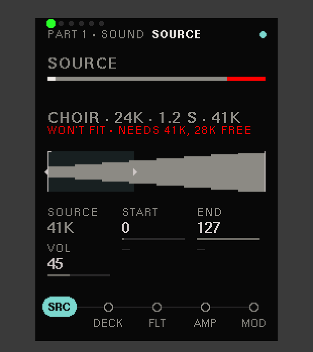

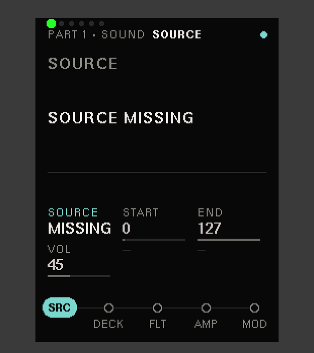

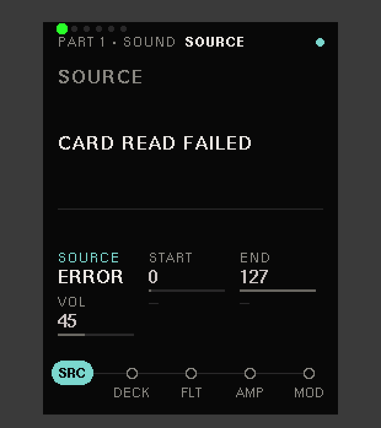


## TAPE: what a streamed source can't play

A streamed source is read forward from the card as it plays. Anything that needs to jump around in it needs the whole source in memory:

- WALK on **REVERSE** or **PING**, or with END before START;
- **STRETCH**, **SCRUB** and **WAVE**.

WALK playing forward, on LOOP, and with TRON on, all stream.

TAPE says so where you are. Turning **MODEL** or **DIRECTION** onto something the streamed source can't play lands on it, dimmed, and the focus band gives the reason: `PING NEEDS RAM · STREAMED`, `REVERSE NEEDS RAM · STREAMED`, `STRETCH NEEDS RAM · STREAMED`, `SCRUB NEEDS RAM · STREAMED` or `WAVE NEEDS RAM · STREAMED`. Nothing is changed; the next turn moves on. On SOURCE, a card file that can't be loaded or streamed reads, in its cell and band: RAM (it needs RAM for the machine in use), TOO BIG with `TRANSWAVE: NO STREAM` (a wavetable never streams) or `ZONES: NO STREAM`, or SHORT with `TOO SHORT TO STREAM`.

On a streamed LOOP, the loop's crossfade is held to 100 ms of source; past that, XFADE's band reads `STREAMED · XFADE CAPPED AT 100 MS`.

**Why:** reading a card is fast only straight ahead. Jumping backwards or anywhere at random would stall the read and drop out. Telling you on the cell you are turning, rather than playing silence, is the rule TAPE follows everywhere.

## TAPE: the DECK page

**DECK** (DECK on the chain map and header) is TAPE's home. Its first cell is **MODEL**; the other five are the machine's knobs, the ones that move its picture, each labelled as the machine names it.

| Cell | Options | Default | What it does |
|---|---|---|---|
| **MODEL** | WALK, STRCH, SCRUB, WAVE | WALK | The machine. The cell reads STRCH for STRETCH. |

Turning MODEL sets the new machine's knobs to their defaults, so every machine plays from the first turn. It keeps the window (START and END), WALK's DIRECTION and the tape's wear (TAPE, AGE, WOW). Onto WALK playing once through, and onto STRETCH, it also sets ENV 1 to open instantly and hold at full, so the source is its own envelope, as on a sampler pad. MODEL can be learned to a MIDI CC with **MIX + SEQ**.

**Why:** a fresh machine with the last machine's numbers in its cells usually makes no sound worth hearing. Defaults that play mean you hear what the machine does before you shape it.

## TAPE: WALK

WALK plays the window as a one-shot, a loop, a ping-pong or a Mellotron-style tape.

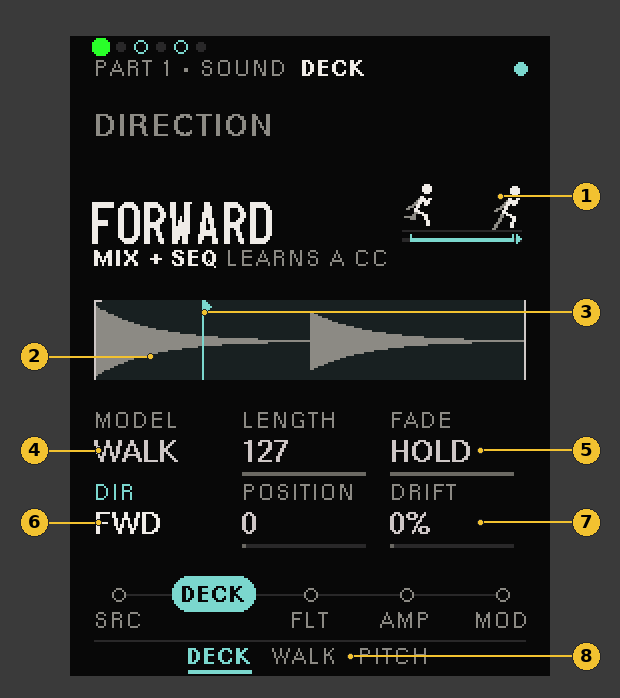

1. **WALK's picture:** a runner on the window, facing the way it plays, the window's arrow under it. FADE draws as a dashed tail.
2. **The strip**, the window lit.
3. **The play head.**
4. **MODEL:** WALK, STRCH (STRETCH), SCRUB or WAVE.
5. **LENGTH:** how much plays from POSITION. **FADE:** the fade at the note's edges.
6. **DIR** (DIRECTION): FWD, REVERSE, LOOP or PING.
7. **POSITION:** where the run starts. **DRIFT:** random wandering of POSITION, note by note.
8. The sub-pages: DECK, WALK (the machine's page) and PITCH.

| Cell | Range | Default | What it does |
|---|---|---|---|
| **LENGTH** | 0–127; 0.25–8 s with TRON on | 127 once through, 102 around a loop | How much plays from POSITION. Once through, 127 plays to the window's end. Around a loop, it sizes the loop. With TRON on, it is the tape's length in seconds. |
| **FADE** | 10–500 ms, then HOLD | HOLD once through, 32 ms around a loop | The fade at the note's edges. Once through with TRON off, its last step, HOLD, makes the note play to its end whatever the key does (a drum one-shot). |
| **DIRECTION** (DIR) | FWD, REVERSE, LOOP, PING | LOOP | FWD: forward, once through. REVERSE: backward, once through. LOOP: round a loop. PING: there and back. |
| **POSITION** | 0–127 | 0 | Where the run starts. Around a loop, it places the loop inside the window. Once through, it is the start, counted the way it plays (REVERSE counts from END). |
| **DRIFT** | 0–100 % | 0 % | At each note, POSITION moves by a random step of up to DRIFT of the window, from where the last note left it, wrapping round the window's ends. Repeats wander through the source; 100 % reaches anywhere. |

The cell reads **DIR**; the focus band spells it DIRECTION. Turning DIRECTION between once through (FWD, REVERSE) and a loop (LOOP, PING) sets LENGTH and FADE to that side's defaults; within a side it changes nothing else.

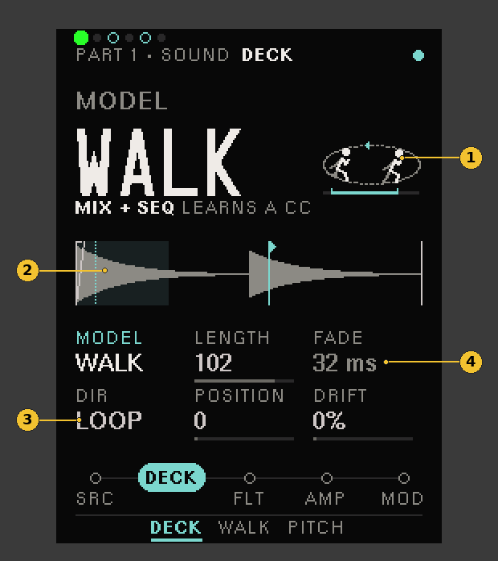

1. On LOOP the runner goes round a track.
2. The loop, inside the window: LENGTH sizes it and POSITION places it.
3. DIR: LOOP.
4. FADE in ms: around a loop the note fades out at key up.

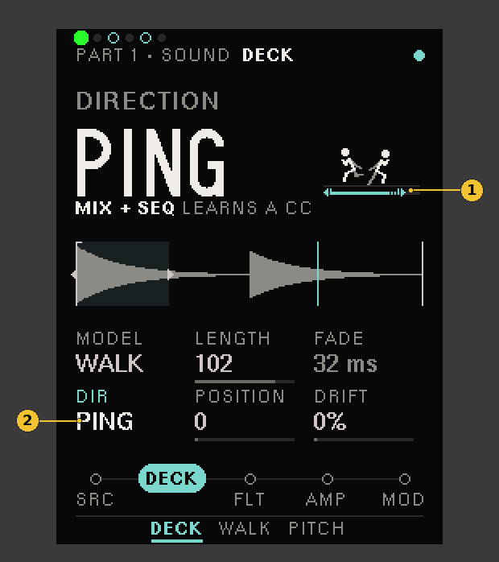

1. On PING the window's arrow points both ways: the run goes there and back.
2. DIR: PING.

**FADE and the amp envelope.** A note has one release. With no route into the VCA, FADE is the release. With an envelope routed into the VCA ([the mod matrix](#the-mod-matrix-and-routes)), that envelope's release ends the note: on LOOP and PING, FADE is dimmed and its band reads `AMP RELEASE ENDS THE NOTE`; once through, only FADE's HOLD step still counts, and its band reads `BELOW HOLD AMP RELEASE ENDS IT`. TRON keeps FADE whatever the routes.

**Why:** two releases on one note, FADE's and the envelope's, would fight. The rule picks one and the screen says which.

### TAPE: TRON

With **TRON** ON (on WALK's page), each key has its own tape, as on a Mellotron: **LENGTH** reads in seconds, 0.25 to 8 s, and the tape is the same length at every pitch. The window plays from POSITION and comes round again, its seam crossfaded by XFADE, until the tape runs out. At key up the pressure pad lifts through **FADE**.

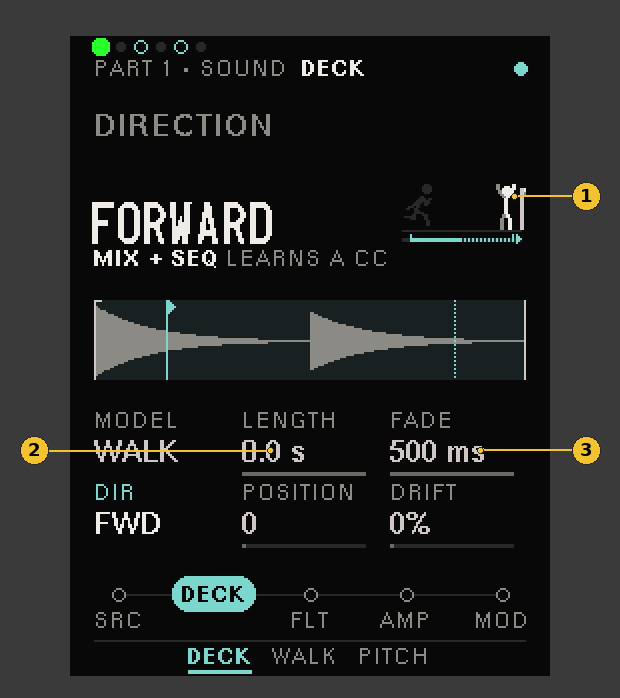

1. With TRON on, a finish post marks the end of the tape.
2. **LENGTH** reads in seconds: each key has its own tape, 0.25 to 8 s long, the same at every pitch. The window comes round again until the tape runs out.
3. **FADE:** at key up the pressure pad lifts through FADE.

TRON streams, so long sources can play as TRON tapes.

> **Design note:** TRON is modelled on the Mellotron M400, where every key has its own strip of tape about eight seconds long, and a held note simply runs out. Chimera keeps the run-out audible whatever the source: the tape's length is a time, not a stretch of the recording, so even a short source comes round again until the tape ends. Unlike the real thing, nobody has to rewind the tape frame afterwards.

## TAPE: WALK's machine page

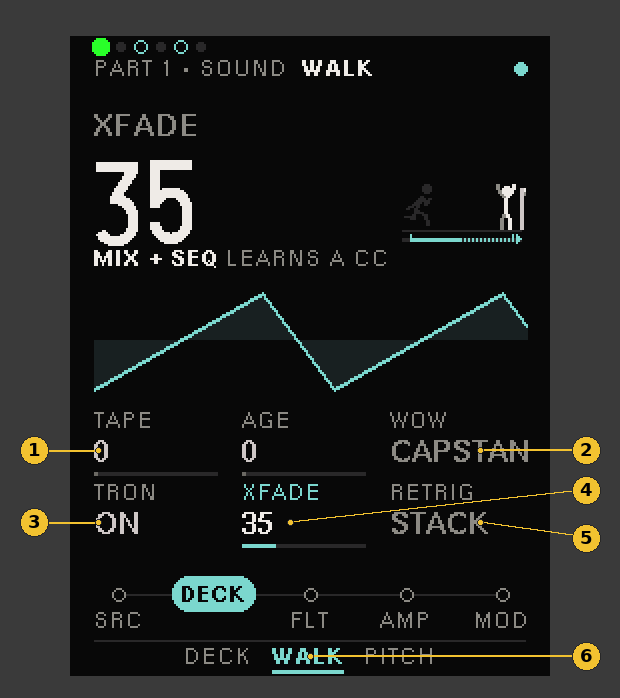

1. **TAPE, AGE, WOW:** the tape's wear.
2. WOW's kind: CAPSTAN or WARBLE.
3. **TRON:** OFF or ON.
4. **XFADE:** the crossfade at the loop's seam, heard on LOOP and on TRON's rounds.
5. **RETRIG:** STACK or CUT.
6. The sub-page row, on WALK.

| Cell | Range | Default | What it does |
|---|---|---|---|
| **TRON** | OFF, ON | OFF | The Mellotron-style tape (above). |
| **XFADE** | 0–127 | 25 | The crossfade at a loop's seam, as a share of the loop: 127 is half the loop. Heard on LOOP and on TRON's rounds. |
| **RETRIG** | STACK, CUT | STACK | STACK: notes play over each other. CUT: a new note cuts the last. Heard once through with TRON off. |

A cell the current DIRECTION can't use is dimmed, and the band says why: XFADE once through with TRON off, `ONLY LOOP AND TRON CROSSFADE`; XFADE on PING, `PING-PONG TURNS · NO SEAM`; RETRIG on LOOP or PING, `CUTS ONLY ONCE THROUGH`; RETRIG with TRON on, `CUTS ONLY WITH TRON OFF`.

## TAPE: the wear on every machine

The first three cells of every machine's page are the tape's wear. They are kept across MODEL turns: a flavour you keep, whatever machine plays.

| Cell | Range | Default | What it does |
|---|---|---|---|
| **TAPE** | 0–127 | 0 | How much the pitch wobbles: wow and flutter, up to about a quarter of a semitone of wow at 127. |
| **AGE** | 0–127 | 0 | Darker, with hiss. AGE lowers the top end over its whole travel, about three octaves at 127. Past halfway, the level drops out now and then, as worn tape does. |
| **WOW** | CAPSTAN, WARBLE | CAPSTAN | How it wobbles. CAPSTAN: a tape machine's steady wow and flutter. WARBLE: a pitch that wanders to a new random place and glides there. |

With TAPE at 0 and nothing routed to it, there is no wow to shape: WOW is dimmed and its band reads `TAPE AT 0 · NO WOW TO SHAPE`. TAPE and AGE are MOD matrix destinations.

## TAPE: STRETCH

STRETCH plays the source at the key's pitch, stretched or squeezed in time: a long note keeps its pitch as you slow it down, and a short one keeps its pitch as you speed it up.


1. **STRETCH's picture:** an accordion under a note.
2. **TYPE:** CLASSIC, CLS POLY or GRAIN.
3. **SPEED:** how fast it moves through the source.
4. **LENGTH:** how long a key plays the source. GRAIN's: dimmed under CLASSIC.
5. **D-TIME:** the splice length. CLASSIC's: dimmed under GRAIN.
6. **POSITION:** where CLASSIC starts. A cell dimmed under the other TYPE says so in the focus band.

| Cell | Range | Default | What it does |
|---|---|---|---|
| **TYPE** | CLASSIC, CLS POLY, GRAIN | GRAIN | How the source is stretched (below). Fixed for a note when it starts. |
| **SPEED** | `-1.00x` to `2.00x` | `1.00x` | How fast it moves through the source. `0.00x` freezes in place, `1.00x` is the source's own speed, below 0 it moves backwards. Fine steps below 1×: 0.1× to 0.5× take many detents. |
| **LENGTH** | 0.25–8 s | 2.0 s | GRAIN's: how long a key takes to play the window. The source reaches its end at LENGTH on every key. Dimmed under CLASSIC and CLS POLY. |
| **D-TIME** | 0–127 | 64 | CLASSIC's and CLS POLY's: the splice length, 10 to 250 ms. Dimmed under GRAIN. |
| **POSITION** | 0–127 | 0 | CLASSIC's and CLS POLY's: where in the window it starts. Dimmed under GRAIN. |

The TYPEs:

- **CLASSIC** splices the source, overlapping short pieces of it D-TIME long, and locks the splices to the source's own pitch period. For a pitched source.
- **CLS POLY** splices to D-TIME instead, for chords and unpitched sources.
- **GRAIN** plays the source in four overlapping grains at the key's pitch, while a pointer walks the window in LENGTH seconds. It stays in tune at every LENGTH. On a pitched source the grains lock to its period, so tones don't comb or beat.

Each TYPE's cells are dimmed under the other, and the band says why: `GRAIN TYPE ONLY` or `CLASSIC TYPE ONLY`.


1. TAPE, AGE, WOW: the tape's wear.
2. **GRAIN:** each grain's length.
3. **SPRAY:** scatters the grains in time.
4. **END:** what GRAIN does at the window's end.
5. The sub-page row, on STRETCH.

| Cell | Range | Default | What it does |
|---|---|---|---|
| **GRAIN** | 30–250 ms | 80 ms | Each grain's length. Short grains are grittier; long ones smoother, and smear fast changes. |
| **SPRAY** | 0–100 % | 40 % | Scatters each grain up to 25 ms in time, so an unpitched source never combs. On a pitched source the lock rounds the scatter to whole periods. |
| **END** | HOLD, STOP | HOLD | At the window's end: HOLD keeps playing the last grains while the key is held (up to 8 s), STOP ends the note there. |

GRAIN, SPRAY and END are GRAIN's. A turn moves the grains to come; the ones playing finish as they started. Key up is the amp envelope's.

> **Design note:** CLASSIC is the Akai S950's time-stretch done in real time: the S950 had to render a stretched copy and make you wait, while CLASSIC stretches as you play. GRAIN's grain core is a port of Émilie Gillet's Mutable Instruments Beads (its pulse-train clock, bell-shaped window and grain stealing), the same core as the delay's GRAIN type. Around it, Chimera adds what a sampler needs and Beads doesn't: a pointer that reaches the end in exactly LENGTH seconds on every key, grains that lock to the source's pitch so a stretched tone stays a tone, and levels that hold steady whether the grains agree or not. It is an accordion for sound, minus the folk club.

## TAPE: SCRUB

SCRUB moves through a source by hand, like a tape reel under your finger.

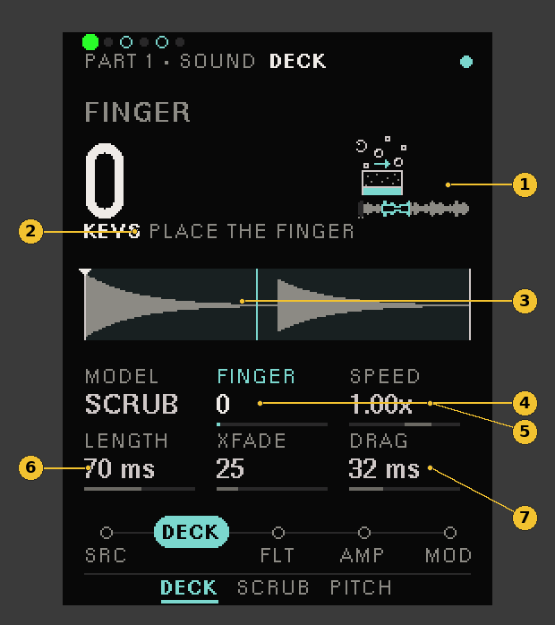

1. **SCRUB's picture:** a sponge on the tape.
2. On FINGER, with KEY at POSITION, the hint reads KEYS PLACE THE FINGER.
3. The strip, the finger's place marked.
4. **FINGER:** turn it like a jog wheel.
5. **SPEED:** the speed of the loop behind the finger.
6. **LENGTH:** the loop behind the finger. **XFADE:** its seam's crossfade.
7. **DRAG:** how long the finger takes to stop.

| Cell | Range | Default | What it does |
|---|---|---|---|
| **FINGER** | 0–127 | 0 | Where the finger is in the window. Turn it like a jog wheel: it reads how fast you turn, and glides to a stop through DRAG when you let go. A MIDI CC or a MOD route moves it too. |
| **SPEED** | −2× to 2× | `1.00x` | The speed of the short loop playing under the finger, as a factor of the source's own. |
| **LENGTH** | 2 ms to 2 s | 70 ms | The loop under the finger. Never longer than the window. |
| **XFADE** | 0–127 | 25 | The loop's seam crossfade, as a share of the loop. |
| **DRAG** | 10–500 ms | 32 ms | How long the finger takes to stop after you let go. Short is a hand on the reel; long is a heavy flywheel. |

SCRUB's page holds the wear and **KEY**:

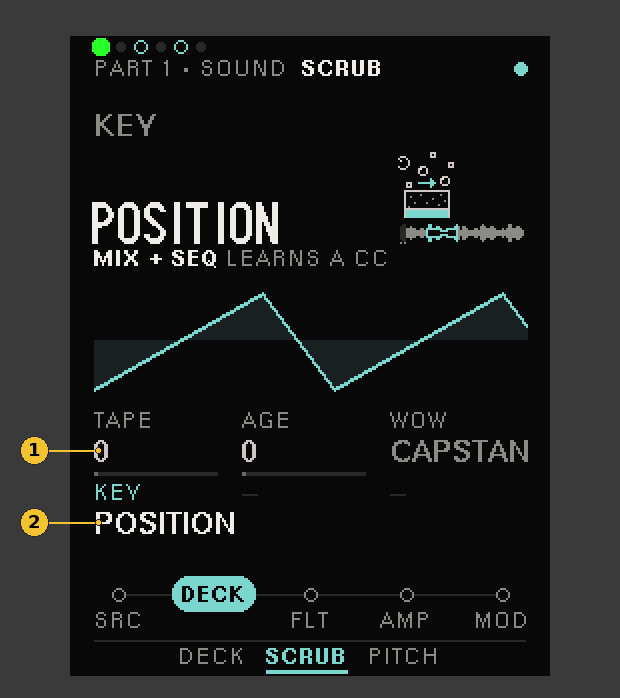

1. TAPE, AGE, WOW: the tape's wear.
2. **KEY:** POSITION or PITCH.

| Cell | Options | Default | What it does |
|---|---|---|---|
| **KEY** | POSITION, PITCH | POSITION | POSITION: each key places the finger and plays at the source's root. C is the start of the window and each semitone up is 1/12 further along, the same in every octave; FINGER adds to it. PITCH: the key transposes the scrub. |

On KEY POSITION a legato key change (STEAL at GLIDE on the pitch page) slides the finger to the new key's place. FINGER's band reads `KEYS PLACE THE FINGER`.

**Why 70 ms:** under about 50 ms the loop repeats fast enough to fuse into a buzz of its own pitch; over about 100 ms a sweep sounds like stuttered echoes and the finger answers late. 70 ms sits in between.

**Why KEY POSITION is the default:** SCRUB's pitch already belongs to SPEED and the finger, so keys as pitch would make a chord a smear of one spot. Keys as places make the keyboard a map of the source, as slices and start points do on grooveboxes and samplers.

## TAPE: WAVE

WAVE plays wavetable sources: a source made of single-cycle frames, each a tiny waveform. A scan sweeps across the frames, so the tone morphs.

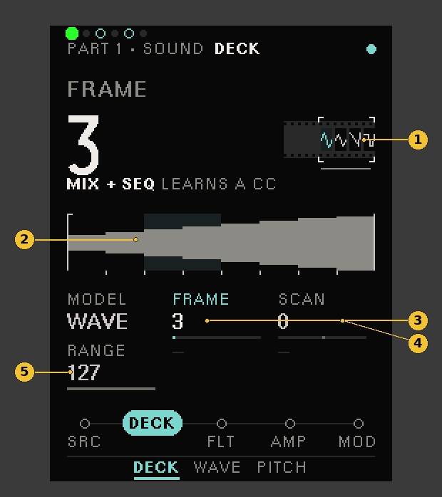

1. **WAVE's picture:** film running through a gate.
2. **The strip:** the source's frames, the playing ones lit.
3. **FRAME:** the frame it starts on.
4. **SCAN:** how it moves through the frames.
5. **RANGE:** how many frames it travels.

| Cell | Range | Default | What it does |
|---|---|---|---|
| **FRAME** | 0–127 | 0 | The frame the scan starts from. |
| **SCAN** | −64 to +63 | 0 | How fast the scan sweeps back and forth across the frames. At 0 it stays on FRAME. |
| **RANGE** | 0–127 | 127 | How many frames the sweep covers. |

FRAME, SCAN and RANGE are MOD matrix destinations: an LFO or envelope on FRAME is the classic wavetable sweep. WAVE's own page holds only TAPE, AGE and WOW:

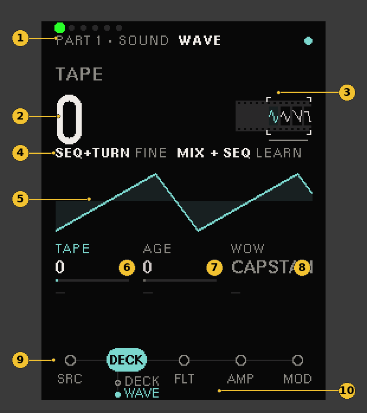

1. Header: the Part, its Sound and the page, WAVE.
2. The focused cell, large: TAPE and its value.
3. The machine's glyph: film through a gate.
4. Focus-band hint: SEQ + turn for fine steps, MIX + SEQ to learn a CC.
5. The picture band: the Part's live output.
6. **TAPE:** how much the pitch wobbles.
7. **AGE:** darker, with hiss and, past halfway, dropouts.
8. **WOW:** CAPSTAN or WARBLE; dimmed here, as TAPE is at 0.
9. The chain map, DECK lit.
10. The sub-pages under DECK: DECK, WAVE and PIT.

 Each frame is stored at several resolutions, and WAVE picks the one that suits the note, so high notes don't alias. On a source that isn't a wavetable, SOURCE reads NO WAVE and the band says `TURN SOURCE TO A WAVE TABLE`.

> **Design note:** WAVE follows the wavetable synths of the 80s and 90s: single-cycle frames, scanned, each kept at a ladder of octave-spaced versions so a high note never folds, the way the PPG Wave and the Waldorf Microwave did it. The factory WAVE sources are transwave-style tables made from Chimera's own engines (morphing, saw, bowed, brass). Somewhere, a 1990s workstation is feeling very flattered.

## TAPE: the pitch page

TAPE's **PIT** page is the shared pitch page ([PITCH](#the-voice-chain-pitch-filter-fx-amp-stereo-and-sends)), last in the stack under DECK. On TAPE:

- **A source plays at the key you play, from its root.** Each source carries its root note; C4 on the keyboard plays a C4-rooted source at its own speed, and other keys speed it up or slow it down. PITCH and FINE shift it from there.
- **A source with no known root** reads `ROOT ?` in the tuner, with its shift from the source's own speed (`+7st +0ct`).
- **SNAP MUSICAL** is useful here: PITCH steps a fifth, then a fourth, then a fifth, so two clicks make an octave. Sampled material transposed by fifths and octaves stays in key with itself.
- **Some notes play at the root whatever the key:** SCRUB on KEY POSITION (the key places the finger instead).
- **Pitching far up** folds the top end, by design (see the design note at the top of this chapter). On a 24 kHz source, the fold starts about 18 semitones above the source's own speed.


1. Header: the Part, its Sound and the page, PITCH.
2. The focused cell, large: PITCH and its value.
3. Focus-band hint: the gestures the cell answers to.
4. The picture band: the tuner, with the note the last note sounds at (or `ROOT ?`), over the live output.
5. **PITCH:** the shift in semitones.
6. **FINE:** the shift in cents.
7. **STEAL:** CUT or GLIDE.
8. **TIME:** the glide time.
9. **SNAP:** CHROMA or MUSICAL.
10. The chain map, DECK lit.
11. The sub-pages under DECK: DECK, the machine's page and PIT.


## TAPE: the pages it shares

- **FLT, FMD, FX, JACK** ([filter](#the-voice-chain-pitch-filter-fx-amp-stereo-and-sends)): as on every engine, after the machine.
- **AMP** ([AMP](#the-voice-chain-pitch-filter-fx-amp-stereo-and-sends)): a route into the VCA makes the envelope's release end the note, in place of WALK's FADE (see "TAPE: WALK" above).
- **STER** and **SND** ([stereo and sends](#the-voice-chain-pitch-filter-fx-amp-stereo-and-sends)): as on every engine. TAPE's pages have no reverb cell of their own: the reverb send is on SND.
- **The MOD matrix, E1–E3, SPD, L1–L3** ([the mod matrix](#the-mod-matrix-and-routes), [envelopes and LFOs](#envelopes-and-lfos)): TAPE's destinations are START, POSITION (FINGER, FRAME), the speeds (SPEED, SCAN), LENGTH on WALK and SCRUB, D-TIME and RANGE, TAPE and AGE. STRETCH's LENGTH, GRAIN, SPRAY, and XFADE, DRAG and DRIFT are not destinations. Touch one and press **MIX + PLUS** to prime it.

RANDOMIZE ([SETTINGS](#settings)) never touches a TAPE Sound's source, MODEL or place, and leaves its pitch alone.

## TAPE: gestures on its pages

- **SEQ + turn** on a cell: fine steps.
- **MIX + turn** on START or END: snap to the next onset. On other cells: jump to the next landmark.
- **MIX + PLUS** on SOURCE: load the card source. On a modulatable cell: prime it as a MOD matrix destination.
- **MENU** while a source loads: cancel the load.
- **MIX + SEQ**: learn a MIDI CC for the cell ([MIDI](#midi-channels-maps-and-controllers)).
- **FINGER** on SCRUB: turn it like a jog wheel; the speed of your hand moves the reel.

## TAPE: starting points

These come from the factory TAPE Sounds, which all play once the factory set is on the card; numbers are on the 0–127 scale unless the cell shows a unit.

- **A drum or stab one-shot:** WALK, DIR FWD, FADE HOLD, LENGTH 127. Every note plays to its end; ENV 1 opens instantly. This is EPIANO HIT, TX BASS HIT, BELL HIT.
- **A reversed hit:** the same with START at the end and END at the start. This is BELL BACKWARDS.
- **A sustained loop:** WALK, DIR LOOP, LENGTH 127, START a little into the source to skip the attack. This is PAD LOOP and BRASS LOOP. Add DRIFT so every note loops a different part.
- **A ping-pong pad:** WALK, DIR PING, POSITION 64 (past the attack), LENGTH 127. This is PAD PINGPONG.
- **A Mellotron:** WALK, DIR FWD, TRON ON, FADE 32 ms, TAPE 38, WOW WARBLE. This is TRON BOWED.
- **A stretched chord or voice:** STRETCH with TYPE GRAIN at its defaults. This is STAB STRETCH and VOICE STRETCH. Turn SPEED to `0.00x` to freeze it.
- **A scrubbed texture:** SCRUB at its defaults; play keys to jump through the source, turn FINGER to scrub. This is SAW SCRUB and RAIN SCRUB.
- **A wavetable sweep:** WAVE on a WAVE source (WAVE MORPH, WAVE SAW), with an LFO into FRAME.
- **Worn tape on anything:** TAPE around 38, AGE around 40; AGE past 64 adds dropouts.

# DRUM, the kit engine

A DRUM Part plays a kit of twelve pads. Each pad is a drum machine of its own (a kick, a snare, a hat, a plain sine...) with its own knobs, level, pan, choke group, filter, amp envelope, mod envelope, LFO and four routes. This chapter covers the kit and its keymap, every pad page, every MACHINE and its knobs, choke and voice groups, how a kit is saved, and what each machine costs in voices. The pad's filter types are explained once, in [the voice chain](#the-voice-chain-pitch-filter-fx-amp-stereo-and-sends); the Part's own envelopes, LFOs and matrix in [Envelopes and LFOs](#envelopes-and-lfos) and [the mod matrix](#the-mod-matrix-and-routes).

## DRUM: what a kit is

Load **INIT DRUM** from the Sound browser (**EDIT + B*n***, the INIT rows at the top) and the Part becomes a kit. A DRUM Part has two layers:

- **The kit: twelve pads.** Each pad holds a MACHINE and its knobs, LEVEL, PAN, CHOKE, RETRIG, and a compact sound of its own: a filter, an AMP envelope with a gate, a mod envelope, an LFO and four routes.
- **The Part's Sound, shared by every pad:** the FX slot (FX TYPE and FX PLACE), the filter's INPUT, FEEDBACK, STABILITY and its jacks, the filter MODULATION routes, the three envelopes and three LFOs, the MOD matrix, WIDTH and the SENDS.

A note strikes a pad. The hit takes a copy of its pad at that moment and plays it through the Part's chain.

**Why:** a full Sound for each of twelve pads would take more memory than the instrument has for six Parts. A compact pad, as on an Analog Rytm, gives each drum the controls that make it a different drum (its machine, filter, envelope and pan) while the costly, characterful parts of the chain (the FX slot, the matrix) stay one per Part.

> **Design note:** The pads' layout, the choke groups and the way notes reach pads follow the Elektron Analog Rytm. The machines' names and knob sets take their shape from the Elektron Machinedrum's machine reference, read from its manual only: no Elektron code, ROM or samples, and every algorithm is Chimera's own. Each machine was first built on a computer, auditioned by ear, then ported to the instrument line for line, so the firmware's output matches the prototype sample for sample. Think of it as a drum machine that grew up reading other drum machines' manuals, and never their diaries.

## DRUM: the chain map

The DRUM chain is **KIT · MCH · FLT · AMP · MOD**. Each node has sub-pages, shown in a row under the map in full words:

```
   KIT ──────── MCH ──────── FLT ──────────── AMP ──────── MOD
    └ KEYS       └ MORE       ├ FMD             ├ GATE       ├ PENV  PLFO  ROUTE
                              ├ FX              └ SENDS      ├ E1  E2  E3  SPD
                              └ JACK                         └ L1  L2  L3
```

| Map | Full name | Whose | What it holds |
|---|---|---|---|
| **KIT** | KIT | pad, kit | PAD, MACHINE, LEVEL, PAN, TONAL |
| **KEYS** | KEYS | pad | PAD, CHOKE, RETRIG |
| **MCH** | MACHINE | pad | the machine's first six knobs |
| **MORE** | MORE | pad | MACHINE again, the machine's last two knobs |
| **FLT** | FILTER | pad, Part | the pad's filter; the Part's FX and FX PLACE |
| **FMD** | MODULATION | Part (one cell pad) | filter routes; SEM's OUTPUT is the pad's |
| **FX** | FX | Part | INPUT, MIX, STABILITY, the FX slot's knobs |
| **JACK** | JACKS | Part | FREQ SRC, RES SRC |
| **AMP** | AMP | pad | the pad's AHD envelope, VEL, MODE |
| **GATE** | GATE | pad, Part | the pad's LPG, DECAY, STRIKE; the Part's WIDTH |
| **SND** | SENDS | Part | CHORUS, DELAY, REVERB |
| **MTX** | MATRIX | Part | the mod matrix |
| **PENV** | PAD ENV | pad | the pad's mod envelope |
| **PLFO** | PAD LFO | pad | the pad's LFO |
| **ROUTE** | ROUTE | pad | the pad's four routes |
| **E1 E2 E3 SPD L1 L2 L3** | ENV1 ENV2 ENV3 SPEED LFO1 LFO2 LFO3 | Part | the Part's envelopes and LFOs |

A DRUM Part has no PITCH page and no STEREO page: each machine tunes itself, and the GATE page holds the Part's WIDTH.

The header always names the pad you are editing: `PART 1 · 02 TONE SNARE  KIT` is pad 02, a TONE SNARE, on the KIT page. Where the whole name does not fit, it shows the machine's last word (`03 IMPULSE`).

## DRUM: the pad gestures

Every page that edits a pad answers the same keys:

| Keys | Does |
|---|---|
| **MIX + MINUS / PLUS** | Step to the previous / next pad. The page stays, so you can walk all twelve pads on one page |
| Turn **PAD** (KIT, KEYS) | Pick a pad, 01 to 12 |
| Play a note | Strikes its pad; the pad's tile lights. With PAD FOLLOW, it can also select that pad (see [PAD FOLLOW](#drum-pad-follow)) |
| **SEQ + turn** | Fine turn on a value cell |
| **MIX + turn** | Jump to the value's next landmark (minimum, default, maximum), as everywhere |

The focus band's hint line shows `MIX + -/+ PAD` on every pad cell, and on the Part's FX and FX PLACE cells on FLT, since those sit on a pad page. On CHOKE the hint line shows the kit's voice groups instead (see [choke and voice groups](#drum-choke-groups-and-voice-groups)).

The pad cells have no MIDI-learn: **MIX + SEQ** does not bind them, and pads have no NRPN address. The Part's own cells on a DRUM Part (the FX, the envelopes, the LFOs, the sends) learn as on any engine. See [MIDI](#midi-channels-maps-and-controllers).

## DRUM: the KIT page


1. **Header:** the Part, the selected pad and its machine (`01 TONE KICK`), and the page, KIT.
2. **The focused cell, large:** here PAD, 01.
3. **The machine's icon, large:** its family letter (T) and its instrument.
4. **Hint line:** `MIX + -/+ PAD`, the pad step.
5. **The twelve pads:** number, choke group, icon; the selected pad framed.
6. **PAD:** which pad the pages edit.
7. **MACHINE:** what the pad plays.
8. **LEVEL:** the pad's level.
9. **PAN:** the pad's place in the stereo field.
10. **TONAL:** the kit's keymap.
11. **The chain map:** KIT · MCH · FLT · AMP · MOD, KIT lit.
12. **KIT's sub-pages:** KIT and KEYS.

KIT is the home of a DRUM Part. The band shows the twelve pads in two rows of six. Each tile shows:

- the pad's number, top left (01 to 12);
- its choke group, top right (A to D; nothing when CHOKE is OFF);
- its machine's icon: a small picture of the instrument, with the machine family's letter at its left: **T** for TONE, **M** for METAL, **B** for BODY, **P** for PLAIN.

The selected pad is framed in the accent colour. A pad lights while it sounds.

Touch **PAD** or **MACHINE** and the focus band draws the machine's icon large.

| Cell | Range | Default | What it does |
|---|---|---|---|
| **PAD** | 01 to 12 | 01 | Which pad every pad page edits |
| **MACHINE** | the twelve machines, then NONE | per pad (INIT kit below) | What the pad plays. See [every machine](#drum-every-machine) |
| **LEVEL** | 0 to 127 | 127 | The pad's level, applied to the machine before the filter |
| **PAN** | L64 to R63, C in the middle | C | The pad's place in the stereo field (constant power, unity at C) |
| **TONAL** | OFF, 01 to 12 | OFF | The kit's keymap: which pad, if any, plays chromatically. See [the KIT keymap](#drum-the-kit-keymap-and-tonal) |

TONAL is the kit's, not the pad's: it reads the same whichever pad is selected.

A new MACHINE takes its own knob defaults on MCH and MORE. The pad's LEVEL, PAN, CHOKE, RETRIG and its filter, AMP and mod settings stay.

**Why:** LEVEL acts before the filter so a quieter pad drives LADDER or DIRTY less, as a quieter signal would through an analogue filter.

## DRUM: the KIT keymap and TONAL

Which note plays which pad depends on the kit's **TONAL** setting alone.

**TONAL OFF** (the default): every note strikes pad *note mod 12* at its own tuned pitch. The kit repeats every octave:

| Note | C | C# | D | D# | E | F | F# | G | G# | A | A# | B |
|---|---|---|---|---|---|---|---|---|---|---|---|---|
| Pad | 01 | 02 | 03 | 04 | 05 | 06 | 07 | 08 | 09 | 10 | 11 | 12 |

So C1, C2, C3 and C4 all play pad 01, and any octave of a keyboard plays the whole kit.

**TONAL on a pad (01 to 12):** the lowest octave, C0 to B0 (MIDI notes 0 to 11), still strikes the twelve pads as above. Every note from C1 (MIDI 12) up plays the TONAL pad, tuned so middle C (MIDI 60) is its own pitch: C#4 is a semitone up, B3 a semitone down. A TONE TOM on TONAL becomes a playable tom bass; a PLAIN SINE becomes a sine bass.

- What moves with the note is the machine's PITCH knob; the rest of the pad stays as set.
- The TONAL pad keeps its RETRIG and CHOKE. To play chords on it, set its RETRIG to STACK; on CUT it plays one note at a time.
- A machine with no PITCH knob (TONE CLAP, BODY SHAKER, PLAIN NOISE) plays the same hit on every note. TONAL's focus band says so: `NO PITCH ON CLAP`.
- TONAL on a NONE pad plays nothing from C1 up; its band says `NONE PLAYS NOTHING`.


**Why:** what a note plays depends on the kit, which is saved, never on which pad the screen shows. OFF repeats the kit every octave, which is what a drum pad controller, a sequencer or a part written for a General MIDI kit expects: they send notes from 36 up, and each lands on a pad. TONAL puts its pad's tuned pitch at middle C, where a keyboard plays, instead of five octaves down.

## DRUM: the KEYS page


1. **Header:** the Part, the pad and its machine, and the page, KEYS.
2. **The focused cell, large:** here PAD, 01.
3. **The machine's icon, large.**
4. **Hint line:** `MIX + -/+ PAD`. With CHOKE touched it reads the kit's `GROUPS n/8` instead.
5. **The twelve pads**, as on KIT, each with its choke group.
6. **PAD:** which pad.
7. **CHOKE:** the pad's choke group.
8. **RETRIG:** CUT or STACK.
9. **The chain map**, KIT lit.
10. **KIT's sub-pages**, KEYS lit.

KEYS (under KIT; **SEQ** from KIT) sets how the selected pad's hits meet each other.

| Cell | Range | Default | What it does |
|---|---|---|---|
| **PAD** | 01 to 12 | | Which pad, as on KIT |
| **CHOKE** | OFF, A, B, C, D | per pad (INIT kit below) | A hit on a pad ends every other pad in the same group. OFF: the pad chokes nothing and nothing chokes it |
| **RETRIG** | STACK, CUT | CUT | CUT: a new hit ends the pad's own ringing hit. STACK: hits overlap, each rings out |

The ended hit fades out quickly rather than stopping dead, so a choke never clicks.

A classic use: open and closed hats in one group, so the closed hat cuts the open one.

## DRUM: choke groups and voice groups

A Part has eight voices. A DRUM kit fits them by its choke groups: a choke group sounds one pad at a time, and a pad with CHOKE OFF sounds on its own. Each group in use (A to D) counts once and each OFF pad counts once. A kit may hold at most **8 voice groups**.

- With CHOKE touched, the hint line reads `GROUPS n/8`; INIT DRUM reads `GROUPS 8/8`.
- An encoder turn onto a group that would make a ninth lands on it dimmed, with the reason in red: `9 GROUPS · KIT HOLDS 8`. Nothing is written; turn on past it to a group that fits.
- A change that cannot land from a controller shows the reason as a toast.


A NONE pad still counts toward the groups, as its choke group or as OFF.

A **STACK** pad that needs a voice when all are busy ends its own oldest hit, never another pad's. A CUT pad has nothing of its own left ringing, so it takes a voice as any note does (the oldest released voice first).

**Why:** a steal is a choke nobody chose. Letting a busy pattern take voices from other pads freed voices, but it sounded worse everywhere except the busiest breakbeat. Eight groups in eight voices means a kit never has to steal from itself. INIT DRUM's kit has exactly eight groups.

## DRUM: the INIT kit

INIT DRUM's kit, every pad on RETRIG CUT, LEVEL 127, PAN C:

| Pad | Note (TONAL OFF) | MACHINE | CHOKE | Set from the machine's defaults |
|---|---|---|---|---|
| 01 | C | TONE KICK | OFF | |
| 02 | C# | TONE SNARE | OFF | |
| 03 | D | PLAIN IMPULSE (a rimshot) | A | |
| 04 | D# | TONE CLAP | A | |
| 05 | E | TONE TOM | OFF | PITCH 30 (about 82 Hz): low tom |
| 06 | F | TONE TOM | B | PITCH 50 (113 Hz): mid tom |
| 07 | F# | TONE TOM | B | PITCH 70 (about 157 Hz): high tom |
| 08 | G | METAL HAT | C | DECAY 20 (39 ms): closed |
| 09 | G# | METAL HAT | C | DECAY 80 (about 0.3 s): open |
| 10 | A | TONE CYMBAL | D | |
| 11 | A# | TONE COWBELL | D | |
| 12 | B | BODY SHAKER | OFF | |

Every pad starts with the same pad sound: CLEAN LP4 at 20.0 kHz with Q 0, an open AMP (DECAY INF) on 1-SHOT, VEL 127, no gate, a mod envelope of ATTACK 0, HOLD 0, DECAY 64 at MED, the LFO on SINE at SPEED 6, DEPTH 127, and no routes.

## DRUM: the MCH and MORE pages


1. **Header:** the Part, the pad and its machine, and the page, MCH.
2. **The focused cell, large:** here PITCH, 46 Hz.
3. **Its arc.**
4. **Hint line:** `MIX + -/+ PAD` and `SEQ+TURN FINE`.
5. **The picture band:** the Part's live output.
6. **Knob A:** here TONE KICK's PITCH.
7. **Knob B:** DECAY.
8. **Knob C:** SWEEP.
9. **Knob D:** SWPT (SWEEP TIME).
10. **Knob E:** CLICK.
11. **Knob F:** DRIVE.
12. **The chain map**, MCH lit.
13. **MCH's sub-pages:** MCH and MORE.

**MCH** (MACHINE on the row) holds the machine's first six knobs; **MORE** (**SEQ** from MCH) holds MACHINE again, then the machine's last two knobs. Each machine labels the knobs its own way, and each knob shows its value in the machine's unit: Hz, ms or s, semitones (+15.1), a ratio (1.47x), octaves (0.50 OCT) or a plain amount. A cell the machine lacks is empty. A label longer than seven letters shows in short on its cell (SWEEP TIME as SWPT); the focus band names it in full. The tables below give both.


1. **Header:** the Part, the pad and its machine, and the page, MORE.
2. **The focused cell, large:** MACHINE, in its full name (TONE KICK).
3. **The machine's icon, large.**
4. **Hint line:** `MIX + -/+ PAD`.
5. **The picture band:** the Part's live output.
6. **MACHINE:** the pad's machine, as on KIT.
7. **Knob G:** here TONE KICK's START.
8. **Knob H:** here HARM (HARMONICS).
9. **The chain map**, MCH lit.
10. **MCH's sub-pages**, MORE lit.

The machine's knobs, LEVEL, PAN and VEL are read when the pad is struck: a turn is heard on the next hit, not on a hit already ringing. The pad's filter, envelopes, LFO and route amounts follow a turn on hits still ringing (see [what follows a ringing hit](#drum-what-a-ringing-hit-follows)).

**Why:** the machine's knobs set up the strike itself (its pitch sweep, its burst pattern, its tuning). Changing them under a ringing hit would mean rewriting each machine's sound in mid-flight; latching them at the strike keeps every machine exact and cheap. Where a moving sound matters, the filter and the envelopes follow.

## DRUM: every machine

There are twelve machines in four families, and NONE. The family's letter is the badge on the pad's icon.

| Family | Machines | How it sounds |
|---|---|---|
| **TONE** (T) | TONE KICK, TONE SNARE, TONE TOM | A sine body swept down in pitch, a noise layer, and drive |
| **TONE** (T) | TONE CLAP | Bursts of noise through a band-pass, then a tail |
| **TONE** (T) | TONE COWBELL, TONE CYMBAL | Square waves through band-passes |
| **METAL** (M) | METAL HAT | Six square waves through band-passes, with noise |
| **METAL** (M) | METAL JINGLE | The same squares, rung higher and gated by shaken particles, with a frame drum's thump |
| **BODY** (B) | BODY SHAKER | Grains of noise in a shake, through a band-pass |
| **PLAIN** (P) | PLAIN SINE, PLAIN NOISE, PLAIN IMPULSE | One source under one decay |
| | NONE | No machine: the pad plays nothing |

Each table below lists the knobs in cell order: the first six on MCH (top row A B C, bottom row D E F), the last two on MORE. Ranges and defaults are as the screen shows them. The machines' knobs are 0 to 127 on the encoder; the value cell shows the unit.

### DRUM: TONE KICK


1. **Header:** the Part, the pad and `TONE KICK`, and the page, MCH.
2. **The focused cell, large:** PITCH.
3. **Its arc.**
4. **Hint line:** `MIX + -/+ PAD` and `SEQ+TURN FINE`.
5. **The picture band:** the Part's live output.
6. **PITCH** (top left, encoder 1).
7. **DECAY** (top middle, encoder 2).
8. **SWEEP** (top right, encoder 3).
9. **SWPT (SWEEP TIME)** (bottom left, encoder 4).
10. **CLICK** (bottom middle, encoder 5).
11. **DRIVE** (bottom right, encoder 6).
12. **The chain map**, MCH lit.
13. **MCH's sub-pages:** MCH and MORE.

A swept sine kick: the body starts SWEEP semitones above PITCH and falls to it.

| Cell | Range | Default | What it does |
|---|---|---|---|
| **PITCH** | 30 Hz to 120 Hz | 46 Hz | Where the body settles |
| **DECAY** | 80 ms to 3.00 s | 785 ms | How long the body rings |
| **SWEEP** | 0.0 to +48.0 | +15.1 | How far above PITCH the body starts, in semitones |
| **SWEEP TIME** (cell: SWPT) | 2 ms to 120 ms | 7 ms | How fast the sweep falls |
| **CLICK** | 0 to 120 | 19 | The click at the start |
| **DRIVE** | 0 to 100 | 8 | Saturation |
| **START** (MORE) | 0 to 100 | 0 | Starts the body up to a quarter cycle in: a harder edge |
| **HARMONICS** (MORE) (cell: HARM) | 0 to 100 | 0 | Folds in the second and third partials |

Starting points: a long sub kick, DECAY up past 1.5 s, SWEEP low, CLICK 0. A punchy short kick, DECAY around 300 ms, SWEEP high and SWEEP TIME short, a little DRIVE.

### DRUM: TONE SNARE


1. **Header:** the Part, the pad and `TONE SNARE`, and the page, MCH.
2. **The focused cell, large:** PITCH.
3. **Its arc.**
4. **Hint line:** `MIX + -/+ PAD` and `SEQ+TURN FINE`.
5. **The picture band:** the Part's live output.
6. **PITCH** (top left, encoder 1).
7. **DECAY** (top middle, encoder 2).
8. **BUMP** (top right, encoder 3).
9. **SNAP** (bottom left, encoder 4).
10. **SDEC (SNAP DECAY)** (bottom middle, encoder 5).
11. **TONE** (bottom right, encoder 6).
12. **The chain map**, MCH lit.
13. **MCH's sub-pages:** MCH and MORE.

Two drum heads and a noise snap.

| Cell | Range | Default | What it does |
|---|---|---|---|
| **PITCH** | 100 Hz to 400 Hz | 173 Hz | The lower head's pitch |
| **DECAY** | 40 ms to 800 ms | 103 ms | The heads' decay |
| **BUMP** | 0.0 to +12.0 | +3.8 | Both heads start this many semitones up and fall quickly |
| **SNAP** | 0 to 35 | 22 | The snare wires' noise level |
| **SNAP DECAY** (cell: SDEC) | 30 ms to 600 ms | 98 ms | How long the noise lasts |
| **TONE** | 800 Hz to 9.00 kHz | 3.04 kHz | The noise's band-pass |
| **INTERVAL** (MORE) (cell: INTV) | 1.20x to 1.77x | 1.47x | The upper head over the lower |
| **DRIVE** (MORE) | 0 to 100 | 0 | Saturation |

### DRUM: TONE TOM


1. **Header:** the Part, the pad and `TONE TOM`, and the page, MCH.
2. **The focused cell, large:** PITCH.
3. **Its arc.**
4. **Hint line:** `MIX + -/+ PAD` and `SEQ+TURN FINE`.
5. **The picture band:** the Part's live output.
6. **PITCH** (top left, encoder 1).
7. **DECAY** (top middle, encoder 2).
8. **SWEEP** (top right, encoder 3).
9. **SWPT (SWEEP TIME)** (bottom left, encoder 4).
10. **NOISE** (bottom middle, encoder 5).
11. **DAMP** (bottom right, encoder 6).
12. **The chain map**, MCH lit.
13. **MCH's sub-pages:** MCH and MORE.

| Cell | Range | Default | What it does |
|---|---|---|---|
| **PITCH** | 50 Hz to 400 Hz | 113 Hz | Where the body settles |
| **DECAY** | 80 ms to 2.00 s | 472 ms | How long it rings |
| **SWEEP** | 0.0 to +24.0 | +5.7 | How far above PITCH it starts, in semitones |
| **SWEEP TIME** (cell: SWPT) | 4 ms to 300 ms | 16 ms | How fast the sweep falls |
| **NOISE** | 0 to 60 | 9 | A noise layer, low-passed at four times PITCH (at most 12 kHz) |
| **DAMP** | 0 to 100 | 16 | Blends in a faster decay: a damped head |
| **DRIVE** (MORE) | 0 to 100 | 0 | Saturation |
| **DRIVE TYPE** (MORE) (cell: DTYP) | 0 to 100 | 0 | From a soft clip (0) leaning into a wavefolder (100) |

### DRUM: TONE CLAP


1. **Header:** the Part, the pad and `TONE CLAP`, and the page, MCH.
2. **The focused cell, large:** TONE.
3. **Its arc.**
4. **Hint line:** `MIX + -/+ PAD` and `SEQ+TURN FINE`.
5. **The picture band:** the Part's live output.
6. **TONE** (top left, encoder 1).
7. **DECAY** (top middle, encoder 2).
8. **CLAPS** (top right, encoder 3).
9. **SPREAD** (bottom left, encoder 4).
10. **TAIL** (bottom middle, encoder 5).
11. **RING** (bottom right, encoder 6).
12. **The chain map**, MCH lit.
13. **MCH's sub-pages:** MCH and MORE.

Several quick bursts of noise, then a tail.

| Cell | Range | Default | What it does |
|---|---|---|---|
| **TONE** | 500 Hz to 4.00 kHz | 1.33 kHz | The band-pass the bursts sound through |
| **DECAY** | 50 ms to 1.00 s | 163 ms | The tail's length |
| **CLAPS** | 1 to 8 | 4 | How many hands |
| **SPREAD** | 4 ms to 30 ms | 9 ms | The time between the claps |
| **TAIL** | 0 to 100 | 71 | The tail's level |
| **RING** | 0 to 90 | 21 | The band-pass's resonance |
| **HARDNESS** (MORE) (cell: HARD) | 0.80x to 0.15x | 0.34x | Each clap's fall as a share of SPREAD: higher on the knob, shorter and harder |
| **ROOM TONE** (MORE) (cell: ROOM) | 400 Hz to 24.0 kHz | 24.0 kHz | A low-pass on the tail: lower sounds further away |

### DRUM: TONE COWBELL


1. **Header:** the Part, the pad and `TONE COWBELL`, and the page, MCH.
2. **The focused cell, large:** PITCH.
3. **Its arc.**
4. **Hint line:** `MIX + -/+ PAD` and `SEQ+TURN FINE`.
5. **The picture band:** the Part's live output.
6. **PITCH** (top left, encoder 1).
7. **DECAY** (top middle, encoder 2).
8. **INTV (INTERVAL)** (top right, encoder 3).
9. **TONE** (bottom left, encoder 4).
10. **RING** (bottom middle, encoder 5).
11. **DRIVE** (bottom right, encoder 6).
12. **The chain map**, MCH lit.
13. **MCH's sub-pages:** MCH and MORE.

Two square waves through band-passes.

| Cell | Range | Default | What it does |
|---|---|---|---|
| **PITCH** | 300 Hz to 1.20 kHz | 547 Hz | The lower square |
| **DECAY** | 80 ms to 1.50 s | 254 ms | How long it rings |
| **INTERVAL** (cell: INTV) | 1.20x to 1.80x | 1.48x | The upper square over the lower |
| **TONE** | 600 Hz to 6.00 kHz | 2.13 kHz | The band-pass |
| **RING** | 0 to 85 | 27 | The band-pass's resonance |
| **DRIVE** | 0 to 100 | 24 | Saturation |
| **DAMP** (MORE) | 0 to 100 | 60 | Blends in a faster decay |
| **BUMP** (MORE) | 0.00 OCT to 1.00 OCT | 0.00 OCT | Starts the pitch up to an octave higher, falling in 6 ms. BUMP costs extra voice time while it sweeps (see [voice cost](#drum-voice-cost-per-machine)) |

### DRUM: TONE CYMBAL


1. **Header:** the Part, the pad and `TONE CYMBAL`, and the page, MCH.
2. **The focused cell, large:** PITCH.
3. **Its arc.**
4. **Hint line:** `MIX + -/+ PAD` and `SEQ+TURN FINE`.
5. **The picture band:** the Part's live output.
6. **PITCH** (top left, encoder 1).
7. **DECAY** (top middle, encoder 2).
8. **TONE** (top right, encoder 3).
9. **SPREAD** (bottom left, encoder 4).
10. **RING** (bottom middle, encoder 5).
11. **SHIMMER** (bottom right, encoder 6).
12. **The chain map**, MCH lit.
13. **MCH's sub-pages:** MCH and MORE.

Six square waves through band-passes, with a separate top.

| Cell | Range | Default | What it does |
|---|---|---|---|
| **PITCH** | -24.0 to +24.0 | +0.2 | Tunes the squares, in semitones |
| **DECAY** | 200 ms to 5.00 s | 1.52 s | How long it rings |
| **TONE** | 2.50 kHz to 12.0 kHz | 5.94 kHz | The band-pass |
| **SPREAD** | 0 to 100 | 24 | Detunes the six squares away from their set ratios |
| **RING** | 0 to 90 | 21 | The band-pass's resonance |
| **SHIMMER** | 0 to 100 | 31 | Two slow LFOs detune the squares and sway their levels |
| **TOP** (MORE) | 0 to 50 | 30 | A second, higher band's level |
| **TOP TUNE** (MORE) (cell: TTUN) | 1.10x to 1.60x | 1.35x | That band over TONE |

### DRUM: METAL HAT


1. **Header:** the Part, the pad and `METAL HAT`, and the page, MCH.
2. **The focused cell, large:** PITCH.
3. **Its arc.**
4. **Hint line:** `MIX + -/+ PAD` and `SEQ+TURN FINE`.
5. **The picture band:** the Part's live output.
6. **PITCH** (top left, encoder 1).
7. **DECAY** (top middle, encoder 2).
8. **TONE** (top right, encoder 3).
9. **SPREAD** (bottom left, encoder 4).
10. **RING** (bottom middle, encoder 5).
11. **NOISE** (bottom right, encoder 6).
12. **The chain map**, MCH lit.
13. **MCH's sub-pages:** MCH and MORE.

| Cell | Range | Default | What it does |
|---|---|---|---|
| **PITCH** | -24.0 to +24.0 | +0.2 | Tunes the six squares, in semitones |
| **DECAY** | 20 ms to 1.50 s | 39 ms | Short for closed, long for open |
| **TONE** | 3.00 kHz to 14.0 kHz | 7.92 kHz | The band-pass |
| **SPREAD** | 0 to 100 | 0 | Detunes the squares |
| **RING** | 0 to 90 | 21 | The band-pass's resonance |
| **NOISE** | 0 to 50 | 6 | A noise layer |
| **HIGH PASS** (MORE) (cell: HP) | 0.25x to 1.00x | 0.50x | A high-pass, as a share of TONE |
| **LOW PASS** (MORE) (cell: LP) | 2.00 kHz to 20.0 kHz | 20.0 kHz | A low-pass; at the top it is off |

### DRUM: METAL JINGLE


1. **Header:** the Part, the pad and `METAL JINGLE`, and the page, MCH.
2. **The focused cell, large:** PITCH.
3. **Its arc.**
4. **Hint line:** `MIX + -/+ PAD` and `SEQ+TURN FINE`.
5. **The picture band:** the Part's live output.
6. **PITCH** (top left, encoder 1).
7. **DECAY** (top middle, encoder 2).
8. **JINGLES** (top right, encoder 3).
9. **SHAKE** (bottom left, encoder 4).
10. **TONE** (bottom middle, encoder 5).
11. **RING** (bottom right, encoder 6).
12. **The chain map**, MCH lit.
13. **MCH's sub-pages:** MCH and MORE.

A tambourine: the hat's squares, an octave up, gated by shaken particles. HEAD adds a frame drum's thump.

| Cell | Range | Default | What it does |
|---|---|---|---|
| **PITCH** | -12.0 to +24.0 | +6.1 | Tunes the jingles (and the head), in semitones |
| **DECAY** | 50 ms to 1.00 s | 163 ms | The shake's length |
| **JINGLES** | 300 Hz to 6.00 kHz | 1.56 kHz | How many jingle strikes a second at the shake's peak (shown in Hz) |
| **SHAKE** | 0 to 60 | 14 | Where in the shake its peak falls |
| **TONE** | 5.00 kHz to 14.0 kHz | 8.13 kHz | The band-pass |
| **RING** | 50 to 95 | 68 | The band-pass's resonance; held just under where it would ring on for good |
| **HEAD** (MORE) | 0 to 70 | 0 | The frame drum's thump |
| **SPREAD** (MORE) | 0 to 100 | 31 | Detunes the jingles |

### DRUM: BODY SHAKER


1. **Header:** the Part, the pad and `BODY SHAKER`, and the page, MCH.
2. **The focused cell, large:** GRAINS.
3. **Its arc.**
4. **Hint line:** `MIX + -/+ PAD` and `SEQ+TURN FINE`.
5. **The picture band:** the Part's live output.
6. **GRAINS** (top left, encoder 1).
7. **DECAY** (top middle, encoder 2).
8. **GLEN (GRAIN LENGTH)** (top right, encoder 3).
9. **TONE** (bottom left, encoder 4).
10. **SHAKE** (bottom middle, encoder 5).
11. **RING** (bottom right, encoder 6).
12. **The chain map**, MCH lit.
13. **MCH's sub-pages:** MCH and MORE.

A shaker: short grains of noise in a swell.

| Cell | Range | Default | What it does |
|---|---|---|---|
| **GRAINS** | 100 Hz to 3.00 kHz | 852 Hz | Grains a second at the shake's peak (shown in Hz) |
| **DECAY** | 30 ms to 500 ms | 91 ms | The shake's length |
| **GRAIN LENGTH** (cell: GLEN) | 0 ms to 3 ms | 0 ms | Each grain's ring, 0.2 ms to 3 ms (the cell shows whole ms) |
| **TONE** | 2.00 kHz to 12.0 kHz | 6.18 kHz | The band-pass |
| **SHAKE** | 5 to 70 | 20 | Where in the shake its peak falls |
| **RING** | 0 to 90 | 21 | The band-pass's resonance |
| **HARDNESS** (MORE) (cell: HARD) | 0 to 100 | 50 | Below the middle, darker grains; above, dry grains over the band |

BODY SHAKER has no eighth knob.

### DRUM: PLAIN SINE


1. **Header:** the Part, the pad and `PLAIN SINE`, and the page, MCH.
2. **The focused cell, large:** PITCH.
3. **Its arc.**
4. **Hint line:** `MIX + -/+ PAD` and `SEQ+TURN FINE`.
5. **The picture band:** the Part's live output.
6. **PITCH** (top left, encoder 1).
7. **DECAY** (top middle, encoder 2).
8. **SWEEP** (top right, encoder 3).
9. **SWPT (SWEEP TIME)** (bottom left, encoder 4).
10. **The chain map**, MCH lit.
11. **MCH's sub-pages:** MCH and MORE.

| Cell | Range | Default | What it does |
|---|---|---|---|
| **PITCH** | 30 Hz to 2.00 kHz | 58 Hz | Where the sine settles |
| **DECAY** | 20 ms to 3.00 s | 317 ms | How long it rings |
| **SWEEP** | 0.0 to +48.0 | +11.3 | How far above PITCH it starts |
| **SWEEP TIME** (cell: SWPT) | 2 ms to 200 ms | 6 ms | How fast the sweep falls |

A plain swept sine: an 808-style bass on TONAL, a zap, a blip.

### DRUM: PLAIN NOISE


1. **Header:** the Part, the pad and `PLAIN NOISE`, and the page, MCH.
2. **The focused cell, large:** DECAY.
3. **Its arc.**
4. **Hint line:** `MIX + -/+ PAD` and `SEQ+TURN FINE`.
5. **The picture band:** the Part's live output.
6. **DECAY** (top left, encoder 1).
7. **TONE** (top middle, encoder 2).
8. **The chain map**, MCH lit.
9. **MCH's sub-pages:** MCH and MORE.

| Cell | Range | Default | What it does |
|---|---|---|---|
| **DECAY** | 10 ms to 2.00 s | 35 ms | How long it lasts |
| **TONE** | LP 100 to HP 100 | HP 57 | Below the middle a low-pass closing; above, a high-pass opening; FLAT in the middle |

### DRUM: PLAIN IMPULSE


1. **Header:** the Part, the pad and `PLAIN IMPULSE`, and the page, MCH.
2. **The focused cell, large:** PITCH.
3. **Its arc.**
4. **Hint line:** `MIX + -/+ PAD` and `SEQ+TURN FINE`.
5. **The picture band:** the Part's live output.
6. **PITCH** (top left, encoder 1).
7. **DECAY** (top middle, encoder 2).
8. **SWEEP** (top right, encoder 3).
9. **SWPT (SWEEP TIME)** (bottom left, encoder 4).
10. **The chain map**, MCH lit.
11. **MCH's sub-pages:** MCH and MORE.

A pulse wave under a decay: a rimshot, a click, a blip.

| Cell | Range | Default | What it does |
|---|---|---|---|
| **PITCH** | 30 Hz to 2.00 kHz | 113 Hz | The pulse's pitch |
| **DECAY** | 20 ms to 3.00 s | 65 ms | How long it lasts |
| **SWEEP** | 0.0 to +48.0 | 0.0 | How far above PITCH it starts |
| **SWEEP TIME** (cell: SWPT) | 2 ms to 200 ms | 2 ms | How fast the sweep falls |
| **WIDTH** (MORE) | 0 to 100 | 92 | The pulse's width |

PLAIN IMPULSE costs more voice time while SWEEP moves it, and at a high PITCH with WIDTH near the top (see [voice cost](#drum-voice-cost-per-machine)).

> **Design note:** The DRUM machines are built from parts the rest of Chimera already had: VA's noise and oscillators, the CLEAN filter's band-passes, the FX slot's SOFT and FOLD shapers. The metal machines tune their six squares to the 808-style ratios, the published values from that drum machine's circuit, with SPREAD to pull them apart. Nothing here is a sample. If your hi-hat sounds like a filing cabinet falling down the stairs, that is RING and SPREAD at the top, and it is working as intended.

### DRUM: NONE


1. **Header:** the Part, the pad and `NONE`, and the page, KIT.
2. **The focused cell, large:** MACHINE, NONE.
3. **NONE's icon:** a box with an X.
4. **Hint line:** `MIX + -/+ PAD`.
5. **The twelve pads:** this pad shows NONE's box.
6. **PAD:** still live.
7. **MACHINE:** NONE; turn it to bring a machine back.
8. **LEVEL:** dimmed, its value kept.
9. **PAN:** dimmed, its value kept.
10. **TONAL:** still live.
11. **The chain map**, KIT lit.
12. **KIT's sub-pages.**


1. **Header:** the pad, NONE, and the page, MCH.
2. **The picture band.** Every knob cell is empty.
3. **The chain map**, MCH lit.
4. **MCH's sub-pages.**

NONE is MACHINE's last choice. A NONE pad plays nothing: a note on it books no voice, ends no other hit and chokes nothing. A live note on it still selects it on KIT (with PAD FOLLOW), so you can find the pad you hit.

- The pad's icon is a box with an X, and the header reads `· 01 NONE`.
- MCH and MORE are empty.
- Every other pad cell (LEVEL, PAN, CHOKE, RETRIG, the filter, AMP, GATE, PAD ENV, PAD LFO, ROUTE) is dimmed and ignores the encoder. Its values stay, so choosing a machine again brings back the pad's level, pan, chokes and sound. The machine's knobs come back at that machine's defaults.
- PAD, TONAL and the Part's FX and FX PLACE stay live.
- A hit already ringing when its pad turns NONE rings out.

**Why:** a kit is billed for its most expensive pad, every pad's filter shape, routes and gate included, even pads you never strike. NONE tells the instrument a pad is not in use, so a spare pad with a costly filter or routes no longer takes voices from the pads you play.

## DRUM: the FLT page (the pad's filter)


1. **Header:** the Part, the pad and its machine, and the page, FILTER.
2. **The pad's filter curve**, with the cutoff's dot. Hint line above it: `MIX + -/+ PAD`.
3. **The filter TYPE**, large.
4. **TYPE:** the pad's filter type.
5. **FX:** the Part's FX slot.
6. **Q:** the pad's resonance.
7. **MODE:** the pad's filter response.
8. **FX PLACE:** the FX slot before or after the filter (drawn as which box comes first).
9. **FREQ:** the pad's cutoff.
10. **The chain map**, FLT lit.
11. **FLT's sub-pages:** FLT, FMD and on.

FLT (FILTER on the row) puts the pad's filter and the Part's FX slot on one page. Its cells, encoders 1 to 6:

| Cell | Whose | What it does |
|---|---|---|
| **TYPE** | pad | CLEAN, 2040, DIRTY, LADDER or SEM. Default CLEAN |
| **FX** | Part | The FX slot: OFF, SOFT, FUZZ or FOLD. Default OFF |
| **Q** or **RES** | pad | Resonance (Q on CLEAN, DIRTY and LADDER; RES on 2040 and SEM). 0 to 127, default 0 |
| **MODE** or **VOICE** | pad | The response (below) |
| **FX PLACE** | Part | PRE or POST: the FX slot before or after the filter. Default PRE |
| **FREQ** or **CUTOFF** | pad | The cutoff, 20 Hz to 20.0 kHz, default 20.0 kHz (CUTOFF on 2040, FREQ on the others) |

The cells after TYPE follow it:

| TYPE | Resonance | Response | Cutoff |
|---|---|---|---|
| CLEAN | **Q** | **MODE**: LP1, LP2, LP4, BP2, BP4, HP4, NOTCH1, NOTCH2 (default LP4) | **FREQ** |
| 2040 | **RES** | **VOICE**: REV2 or EXPNDR | **CUTOFF** |
| DIRTY | **Q** | **MODE**: LP2, BP2, HP2, NOTCH1 | **FREQ** |
| LADDER | **Q** | **MODE**: LP2, LP4, BP2, BP4, HP4 | **FREQ** |
| SEM | **RES** | **MODE**: a sweep from low-pass through notch to high-pass, 0 to 127 | **FREQ** |

What each TYPE, MODE and VOICE sounds like is in [the voice chain](#the-voice-chain-pitch-filter-fx-amp-stereo-and-sends). The FX slot's types are there too.

The hint line shows `MIX + -/+ PAD` on FLT's cells, the Part's FX and FX PLACE included: on this page MIX + MINUS / PLUS always steps the pad.

**Why:** each pad gets its own filter because a drum machine's pads each shape their own sound (a dark kick, a bright hat). The FX slot is the voice's costliest block and the Part's character, so it stays one per Part: a per-pad FX slot would cost up to twelve times as much.

## DRUM: the FMD, FX and JACK pages

These three sub-pages of FLT are the Part's, shared by every pad, with one exception: on SEM, **OUTPUT** is the pad's.

**FMD** (MODULATION on the row) holds the filter's modulation routes:

| Cell | What it does |
|---|---|
| **ENV AMT** | ENV1 into the cutoff |
| **KEYBOARD** | The note into the cutoff |
| **FREQ MOD** | The source picked on JACK as FREQ SRC into the cutoff |
| **FEEDBACK** (cell: FDBK) | The filter's output fed back into its cutoff |
| **RES MOD** | The source picked on JACK as RES SRC into the resonance |
| **OUTPUT** (SEM only, the pad's) | MODE (the MODE sweep's output) or BP (the band-pass output) |


1. **Header:** `PART 1 · SOUND  FILTER MOD`: a Part page, shared by the pads.
2. **The focused cell, large:** ENV AMT, 0 %.
3. **Hint line:** `MIX + MINUS DELETES THE ROUTE`.
4. **The picture band:** the Part's live output.
5. **ENV AMT.**
6. **KEYBOARD.**
7. **FREQ MOD.**
8. **FDBK** (FEEDBACK).
9. **RES MOD.**
10. **The chain map**, FLT lit.
11. **FLT's sub-pages**, FMD lit.

**FX** holds the filter's **INPUT** level (default 64), the FX slot's **MIX** (shown −64 to +63, default +63), **STABILITY** on 2040, LADDER and SEM (default 64), and the FX slot's three knobs: **DRIVE**, **TONE**, **LEVEL** on SOFT; **SUSTAIN**, **TONE**, **VOLUME** on FUZZ; **FOLD**, **SYMMETRY**, **LEVEL** on FOLD.


1. **Header:** `PART 1 · SOUND  FX`: a Part page.
2. **The focused cell, large:** INPUT, 64.
3. **Its arc.**
4. **Hint line:** `SEQ+TURN FINE` and `MIX + SEQ LEARN`.
5. **The FX slot's picture:** where the slot sits in the chain (here between MCH and FLT, PRE), over the live output.
6. **INPUT:** the level into the filter.
7. **MIX:** the FX slot's mix. With FX OFF, the slot's knobs are dashes.
8. **The chain map**, FLT lit.
9. **FLT's sub-pages**, FX lit.

**JACK** (JACKS on the row) picks **FREQ SRC** (LFO1, LFO2, LFO3, ENV2, ENV3, VELO, OP5, OP6) and **RES SRC** (ENV1, LFO1, ENV2, ENV3, LFO2, LFO3, VELO, NOTE, OP5, OP6).


1. **Header:** `PART 1 · SOUND  FILTER JACKS`: a Part page.
2. **The picture band:** the Part's live output.
3. **FREQ SRC:** what FREQ MOD reads.
4. **RES SRC:** what RES MOD reads.
5. **The chain map**, FLT lit.
6. **FLT's sub-pages**, JACK lit.

Every one of these is explained in [the voice chain](#the-voice-chain-pitch-filter-fx-amp-stereo-and-sends); on DRUM they work the same, on whichever filter each pad plays. Which panel FMD, FX and JACK show follows the selected pad's TYPE.

## DRUM: the AMP page


1. **Header:** the Part, the pad and its machine, and the page, AMP. Hint line under it: `MIX + -/+ PAD`, `SEQ+TURN FINE`.
2. **The focused stage**, lit in the accent colour: here ATTACK.
3. **The rest of the envelope:** flat here, as DECAY is INF.
4. **The envelope's shape**, filled.
5. **ATTACK.**
6. **HOLD.**
7. **DECAY:** INF holds the level.
8. **SPEED:** FAST, MED or SLOW.
9. **VEL:** velocity's share of the hit's level.
10. **MODE:** 1-SHOT or GATED.
11. **The chain map**, AMP lit.
12. **AMP's sub-pages:** AMP, GATE, SENDS.

AMP is the pad's own amp envelope: attack, hold, decay. The band draws its shape.

| Cell | Range | Default | What it does |
|---|---|---|---|
| **ATTACK** | 0 to 127 | 0 | The rise |
| **HOLD** | 0 to 127 | 0 | How long it holds full after the rise |
| **DECAY** | 0 to 126, then INF | INF | The fall to silence; INF holds the level (the envelope is open) |
| **SPEED** | FAST, MED, SLOW | MED | The time range of all three stages, as the Part's envelope SPEED ([Envelopes and LFOs](#envelopes-and-lfos)) |
| **VEL** | 0 to 127 | 127 | How much velocity sets the hit's level. 127: fully; 0: every hit plays as if at full velocity |
| **MODE** | 1-SHOT, GATED | 1-SHOT | 1-SHOT ignores note-off: the envelope plays out. GATED holds after HOLD until note-off, then falls over DECAY |

On GATED, a short note still plays its full attack and hold first. A DECAY of INF on GATED never falls.

The machine has its own decay (its DECAY knob). The AMP envelope shapes on top of it: with an open AMP (DECAY INF, the default), a hit rings its machine's full decay.

**VEL** acts on the machine itself, before the filter, so a soft hit also drives LADDER or DIRTY less. It is read at the strike.

**Why:** most drums ignore how long you hold a key, so 1-SHOT is the default. GATED, as on Elektron's AMP page, lets a held pad (a drone, a gated hat) end with its key. Note-off on 1-SHOT is still heard by the Part's VCA routes in the matrix (see [the mod matrix](#the-mod-matrix-and-routes)).

## DRUM: the GATE page


1. **Header:** the Part, the pad and its machine, and the page, GATE.
2. **The picture band:** the Part's live output.
3. **LPG:** the pad's low-pass gate amount.
4. **DECAY:** the gate's decay.
5. **STRIKE:** how hard the strike opens it.
6. **WIDTH:** the Part's stereo width.
7. **The chain map**, AMP lit.
8. **AMP's sub-pages**, GATE lit.

GATE (under AMP) is the pad's low-pass gate, and the Part's stereo width.

| Cell | Range | Default | Whose | What it does |
|---|---|---|---|---|
| **LPG** | 0 to 127 | 0 | pad | How much the low-pass gate closes the sound as it decays. 0: off |
| **DECAY** | 0 to 127 | 0 | pad | The gate's own decay |
| **STRIKE** | 0 to 127 | 0 | pad | How hard the strike opens the gate |
| **WIDTH** | 0 to 127 | 64 | Part | Spreads or narrows the kit's pans |

The low-pass gate is the one described under AMP in [the voice chain](#the-voice-chain-pitch-filter-fx-amp-stereo-and-sends); on DRUM each pad has its own, replacing the Part's.

## DRUM: the PENV, PLFO and ROUTE pages

The first three sub-pages of MOD are the pad's own modulation: one envelope, one LFO and four routes. After them come the Part's ENV1, ENV2, ENV3, SPEED, LFO1, LFO2 and LFO3 ([Envelopes and LFOs](#envelopes-and-lfos)); the MOD node itself is the Part's MATRIX ([the mod matrix](#the-mod-matrix-and-routes)).

### DRUM: PENV, the pad's mod envelope


1. **Header:** the Part, the pad and its machine, and the page, PENV.
2. **The focused stage**, lit in the accent colour: here ATTACK.
3. **HOLD and DECAY**, the rest of the shape.
4. **Hint line**, above the picture: `MIX + -/+ PAD`, `SEQ+TURN FINE`.
5. **The envelope's shape**, filled.
6. **ATTACK.**
7. **HOLD.**
8. **DECAY.**
9. **SPEED.**
10. **The chain map**, MOD lit.
11. **MOD's sub-pages**, PENV lit.

PENV (PAD ENV on the row) is an AHD envelope like AMP's, feeding the routes as MOD ENV.

| Cell | Range | Default |
|---|---|---|
| **ATTACK** | 0 to 127 | 0 |
| **HOLD** | 0 to 127 | 0 |
| **DECAY** | 0 to 126, then INF | 64 |
| **SPEED** | FAST, MED, SLOW | MED |

### DRUM: PLFO, the pad's LFO


1. **Header:** the Part, the pad and its machine, and the page, PLFO.
2. **The focused cell, large:** WAVE, SINE.
3. **Hint line:** `MIX + -/+ PAD`.
4. **The picture band:** the Part's live output.
5. **WAVE.**
6. **SPEED.**
7. **DEPTH.**
8. **PHASE.**
9. **MODE:** FREE or RETRIG.
10. **The chain map**, MOD lit.
11. **MOD's sub-pages**, PLFO lit.

PLFO (PAD LFO on the row) feeds the routes as LFO.

| Cell | Range | Default | What it does |
|---|---|---|---|
| **WAVE** | SINE, TRI, SAW, SQUARE, RANDOM | SINE | The shape |
| **SPEED** | 0 to 127 | 6 | The rate |
| **DEPTH** | 0 to 127 | 127 | Its size |
| **PHASE** | 0 to 127 | 0 | Where in its cycle it starts on RETRIG |
| **MODE** | FREE, RETRIG | FREE | FREE runs on; RETRIG restarts at PHASE on every hit |

### DRUM: ROUTE, the pad's four routes


1. **Header:** the Part, the pad and its machine, and the page, ROUTE.
2. **The focused cell, large.**
3. **Hint line:** `MIX + -/+ PAD`.
4. **The picture band:** the Part's live output.
5. **ROUTE:** which of the four.
6. **SOURCE.**
7. **DEST.**
8. **AMOUNT.**
9. **The chain map**, MOD lit.
10. **MOD's sub-pages**, ROUTE lit.

ROUTE shows one route at a time. Turn **ROUTE** (1 to 4) to pick it.

| Cell | Range | Default | What it does |
|---|---|---|---|
| **ROUTE** | 1 to 4 | 1 | Which route the other cells edit |
| **SOURCE** | MOD ENV, LFO, VEL, LFO 1, LFO 2, LFO 3 | MOD ENV | MOD ENV, LFO and VEL are the pad's own; LFO 1 to 3 are the Part's LFOs |
| **DEST** | CUTOFF, RESO, VOLUME, LFO SPD, LFO DEP | CUTOFF | The pad's cutoff, resonance, volume, or its own LFO's speed or depth |
| **AMOUNT** | -100% to +100% | 0% | How far, and which way |

A route at 0% does nothing. CUTOFF and RESO routes move the filter at audio rate, as a Part's routes do.

**VOLUME** never boosts: a positive AMOUNT opens the volume as its source rises (full depth: silent at the source's bottom), a negative one ducks it as the source rises. Several VOLUME routes multiply.

Starting points: a snare that darkens as it decays, SOURCE MOD ENV, DEST CUTOFF, AMOUNT up, with a CLEAN LP cutoff part-way down. A hat that brightens with velocity, SOURCE VEL, DEST CUTOFF. A slow wobble on a long tom, SOURCE LFO, DEST CUTOFF, PLFO on TRI.

**Why:** a compact second layer of modulation. The Part's matrix still reaches each pad's filter and VCA; the pad's own routes give each drum movement of its own without a matrix per pad.

## DRUM: what a ringing hit follows

A hit is a copy of its pad, taken at the strike. Some of it follows your edits while the hit rings:

- **Set at the strike:** MACHINE and its knobs, LEVEL, PAN, VEL, CHOKE, RETRIG, the filter's TYPE and MODE (or VOICE), the PAD LFO's WAVE and MODE, each route's SOURCE and DEST, both envelopes' SPEED, AMP's MODE.
- **Follow a ringing hit, gliding:** CUTOFF / FREQ, Q / RES, SEM's MODE sweep, the AMP and PAD ENV times, LPG, the gate's DECAY and STRIKE, PAD LFO's SPEED, DEPTH and PHASE, each route's AMOUNT.

A long cymbal answers a filter sweep while it rings; a change of TYPE waits for the next hit.

**Why:** this is the Analog Rytm's split. Continuous values glide so a sweep sounds smooth on a hit already ringing; choices latch so a ringing hit never clicks or jumps.

## DRUM: the Part's own pages on a kit

The Part's Sound still runs on a DRUM Part, under every pad:

- **SENDS** (SND, under AMP): **CHORUS**, **DELAY** and **REVERB**, the Part's sends to the master effects. Every pad shares them. See [the voice chain](#the-voice-chain-pitch-filter-fx-amp-stereo-and-sends) and [the MIXER](#the-mixer-and-the-master-effects).
- **MATRIX** (MTX, the MOD node): the Part's mod matrix. Its routes reach every pad's filter and VCA. A route into VCA is the only thing on DRUM that hears note-off on a 1-SHOT pad.
- **ENV1 to ENV3, SPEED, LFO1 to LFO3** (E1 E2 E3 SPD L1 L2 L3): the Part's envelopes and LFOs. ENV1 drives FMD's ENV AMT on every pad; the LFOs feed JACK's sources and the pad routes' LFO 1 to 3.
- The Part's mixer channel (LEVEL, PAN, EQ, MAX VOICES, RESERVE) is on MIXER › PRT, as for any Part ([the MIXER](#the-mixer-and-the-master-effects)).

The Part's own filter TYPE and its gate are not used on DRUM: each pad's replace them.

On a DRUM Part these pages look and work as on every engine; their header reads `PART 1 · SOUND` and the map is DRUM's.


1. **Header:** `PART 1 · SOUND  SENDS`.
2. **The focused cell, large.**
3. **Its level bar.**
4. **Hint line.**
5. **The picture band:** the Part's live output.
6. **CHORUS:** the send to the chorus.
7. **DELAY:** the send to the delay.
8. **REVERB:** the send to the reverb.
9. **The chain map**, AMP lit.
10. **AMP's sub-pages**, SENDS lit.


1. **Header:** `PART 1 · SOUND  MOD MATRIX`.
2. **The sources**, one a row (ENV1 to SLIDE).
3. **The destinations**, one a column (FLT FREQ, FLT Q, OUT VCA...); `>` means more.
4. **The source names**, the cursor's row bright.
5. **The grid:** a route's amount in its square.
6. **The cursor's route:** its source (ENV 1)...
7. ...**and its destination** (FILTER CUTOFF), with its amount under it.
8. **Hint line:** `MIX + MINUS`...
9. ...`DELETES THE ROUTE`.
10. **The count:** routes in use and destinations given a column.
11. **The chain map**, MOD lit.
12. **MOD's sub-pages**, MTX lit.


1. **Header:** `PART 1 · SOUND  ENV 1 / A`: ENV1, TYPE A.
2. **The envelope's rise**, the focused stage lit.
3. **The rest of the shape.**
4. **The rise's line.**
5. **The envelope's shape**, filled, its stages named under it (A H D S R).
6. **ATTACK.**
7. **DECAY.**
8. **SUSTAIN.**
9. **RELEASE.**
10. **HOLD.**
11. **TYPE:** A or B.
12. **The chain map**, MOD lit.
13. **MOD's sub-pages**, E1 lit.


1. **Header:** `PART 1 · SOUND  ENV 2 / A`: ENV2, TYPE A.
2. **The envelope's rise**, the focused stage lit.
3. **The rest of the shape.**
4. **The rise's line.**
5. **The envelope's shape**, filled, its stages named under it (A H D S R).
6. **ATTACK.**
7. **DECAY.**
8. **SUSTAIN.**
9. **RELEASE.**
10. **HOLD.**
11. **TYPE:** A or B.
12. **The chain map**, MOD lit.
13. **MOD's sub-pages**, E2 lit.


1. **Header:** `PART 1 · SOUND  ENV 3 / B`: ENV3, TYPE B.
2. **MODE's pills** (ENV, LFO, BURST) over the shape's rise.
3. **The rise.**
4. **The shape**, filled.
5. **MODE.**
6. **RISE.**
7. **FALL.**
8. **SHAPE.**
9. **FORM.**
10. **TYPE.**
11. **The chain map**, MOD lit.
12. **MOD's sub-pages**, E3 lit.


1. **Header:** `PART 1 · SOUND  ENV SPEED`.
2. **Each envelope's speed** as pills: FAST, MED, SLOW (dimmed where it does not apply).
3. **Each envelope's kind:** AHDSR, or RISE/FALL on TYPE B.
4. **E1 SPEED.**
5. **E2 SPEED.**
6. **E3 SPEED.**
7. **E1 HOLD.**
8. **E2 HOLD.**
9. **E3 HOLD.**
10. **The chain map**, MOD lit.
11. **MOD's sub-pages**, SPD lit.


1. **Header:** `PART 1 · SOUND  LFO 1`.
2. **The focused cell, large:** RATE.
3. **Its glyph:** the rate as a period.
4. **Hint line:** `SEQ+TURN FINE`, `MIX + SEQ LEARN`.
5. **The LFO drawn**, one cycle.
6. **RATE.**
7. **SHAPE.**
8. **SYNC.**
9. **PHASE.**
10. **DEPTH.**
11. **TYPE:** CLASSIC or a function type.
12. **The chain map**, MOD lit.
13. **MOD's sub-pages**, L1 lit.


1. **Header:** `PART 1 · SOUND  LFO 2`.
2. **The focused cell, large:** RATE.
3. **Its glyph:** the rate as a period.
4. **Hint line:** `SEQ+TURN FINE`, `MIX + SEQ LEARN`.
5. **The LFO drawn**, one cycle.
6. **RATE.**
7. **SHAPE.**
8. **SYNC.**
9. **PHASE.**
10. **DEPTH.**
11. **TYPE:** CLASSIC or a function type.
12. **The chain map**, MOD lit.
13. **MOD's sub-pages**, L2 lit.


1. **Header:** `PART 1 · SOUND  LFO 3`.
2. **The focused cell, large:** RATE.
3. **Its glyph:** the rate as a period.
4. **Hint line:** `SEQ+TURN FINE`, `MIX + SEQ LEARN`.
5. **The LFO drawn**, one cycle.
6. **RATE.**
7. **SHAPE.**
8. **SYNC.**
9. **PHASE.**
10. **DEPTH.**
11. **TYPE:** CLASSIC or a function type.
12. **The chain map**, MOD lit.
13. **MOD's sub-pages**, L3 lit.

Every cell on these pages is explained in [Envelopes and LFOs](#envelopes-and-lfos), [the mod matrix](#the-mod-matrix-and-routes) and [the voice chain](#the-voice-chain-pitch-filter-fx-amp-stereo-and-sends).

## DRUM: PAD FOLLOW


1. **Header:** where you are in SETTINGS (`PERSONAL › FOLLOW`).
2. **The focused cell, large:** FOLLOW's value.
3. **The picture band.**
4. **FOLLOW:** OFF, IDLE or ALWAYS.
5. **Footer:** the project, and whether it has unsaved changes.
6. **Footer:** the keys this page answers to.

SETTINGS › PERSONALIZE › PAD FOLLOW decides whether a hit you play selects its pad on the DRUM pages. One cell, **FOLLOW**:

| Value | What a live hit does |
|---|---|
| OFF | Never moves the selection. Only PAD and MIX + MINUS / PLUS do |
| IDLE (default) | Selects its pad, unless you turned an encoder or stepped a pad on this Part's DRUM pages in the last 2 seconds |
| ALWAYS | Every hit on the shown Part selects its pad |

Hits still light their pads in every mode. FOLLOW is a unit setting, kept in SYSTEM, not the project. See [SETTINGS](#settings).

**Why:** following is handy when you play to find a pad, and annoying when you are shaping one and a pattern pulls the page away. IDLE does both: it follows when your hands are off the encoders.

## DRUM: the kit and the library

Every Part has a kit, DRUM or not. Switching a Part to another engine and back keeps its kit.

- **A project** saves each Part's kit with the Part. Loading a project brings its kits back; NEW starts each Part on the INIT kit.
- **SAVE TO LIBRARY** on a DRUM Part saves the kit with the Sound. Loading that library Sound onto a Part brings its kit with it. A DRUM library Sound with no kit in its file loads the INIT kit.
- **Everything else that replaces a Sound leaves the kit:** loading a project slot, INIT, RELOAD FROM PROJ, an engine switch, a MIDI program change. They ask only about the Sound.
- **The one question about the kit:** loading a DRUM Sound from the library replaces the Part's kit. If the Part's kit is not the INIT kit and not a kit the library already holds, the browser asks first: `LOAD INTO P1?` / `KIT NOT IN LIBRARY`, with REPLACE and CANCEL (CANCEL highlighted). To keep the kit, cancel and SAVE TO LIBRARY first.
- If a DRUM Part's library save cannot write its kit (the firmware's second half is missing, as after an incomplete update), the save is refused and says `KIT NOT SAVED · NEEDS UPDATE`.

See [the SD card, Sounds and the library](#the-sd-card-projects-sounds-and-the-library).

**Why:** the kit lives beside the Sound, not inside it, so the five Parts that are not DRUM pay nothing for one in every copy of their Sound. That makes a library load of a DRUM Sound the only thing that can lose a kit, and so the only place the instrument asks.

## DRUM: voice cost per machine

A DRUM hit costs its own machine plus the Part's pad chain (the filter, AMP, routes and gate). Machines differ by more than two to one. The Part's voice count is worked out from its costliest pad, every pad's filter shape, routes and gate included, so one expensive pad in a kit lowers how many hits it can sound at once.

| Cost | Machines |
|---|---|
| Lightest | TONE CLAP, PLAIN SINE, PLAIN NOISE, PLAIN IMPULSE |
| Light | TONE TOM, TONE COWBELL, BODY SHAKER |
| Medium | TONE KICK, TONE SNARE |
| Heavy (about two and a half times the lightest) | TONE CYMBAL, METAL HAT |
| Heaviest | METAL JINGLE |

Two machines cost more while they sweep: **TONE COWBELL** with BUMP up (about three times its plain cost for the few milliseconds of its sweep), and **PLAIN IMPULSE** with SWEEP up, or at a high PITCH with WIDTH near the top. A kit holding one of them is billed for that worst case.

To get more hits from a kit:

- Set unused pads to **NONE**: they leave the bill altogether.
- Keep the costly filters (LADDER, the 2040, moving routes) on the pads that need them.
- Put the metal machines in choke groups.
- Give the Part a RESERVE on MIXER › PRT › VOICES so other Parts cannot take its voices.

The numbers behind this, and what happens at the limit, are in [Limits](#limits-voices-cpu-and-memory).

**Why:** one bill for every machine would either under-bill the metals (overloading the audio) or cost a light kit most of its voices. Billing each hit by its own machine keeps a kit of kicks and claps cheap and a kit of cymbals safe.

## DRUM: starting points

Each from INIT DRUM:

- **A tuned 808-style bass:** pad 01's MACHINE to PLAIN SINE, PITCH low, DECAY long, SWEEP a little; KIT's TONAL to 01; KEYS RETRIG to STACK if you want overlapping notes. Play from C1 up; middle C is the pad's tuned pitch.
- **A gated noise hat:** a pad on PLAIN NOISE, TONE well into HP; AMP MODE to GATED and DECAY short, so the key's length sets the hat's length.
- **A distant clap:** TONE CLAP, CLAPS up, SPREAD longer, TAIL up, ROOM TONE down on MORE; a little REVERB on SND.
- **A trashy kit:** FX to FUZZ on FLT, FX PLACE POST; every pad goes through it.
- **A tom that falls in pitch:** TONE TOM, SWEEP high, SWEEP TIME long; on a LADDER LP4 with a MOD ENV → CUTOFF route.
- **Open and closed hats that choke:** both METAL HAT pads in one CHOKE group, the closed one with a short DECAY.

# The voice chain: pitch, filter, FX, amp, stereo and sends

Every melodic engine (ALGO, MODAL, VA and TAPE) runs its sound through the same voice pages after the engine's own: **PITCH**, the **FILTER** with its MODULATION, FX and JACKS sub-pages, **AMP** with STEREO and SENDS. This chapter covers each of them, cell by cell. The engines are in [ALGO](#algo-the-six-operator-engine), [MODAL](#modal-the-physical-modelling-engine), [VA](#va-the-variable-wave-engine) and [TAPE](#tape-the-sample-engine); DRUM has its own pad pages, in [DRUM](#drum-the-kit-engine). The envelopes and LFOs are in [Envelopes and LFOs](#envelopes-and-lfos), and the routes that move these pages are in [the mod matrix](#the-mod-matrix-and-routes).

## Voice chain: the order of the signal

One voice plays this way:

```
engine ── [FX slot, PRE] ── FILTER ── [FX slot, POST] ── AMP (VCA / low-pass gate) ── STEREO ── SENDS
```

- The **FX slot** sits either before or after the filter, never both: **FX PLACE** chooses.
- **AMP** is the voice's VCA. Its three gate knobs turn it into a low-pass gate.
- **STEREO** places each note in the stereo field and sets how wide the Part is.
- **SENDS** feed the Part to the shared chorus, delay and reverb (see [the mixer and master FX](#the-mixer-and-the-master-effects)).

On the chain map the pages sit under two nodes. FLT holds FILTER, MODULATION, FX and JACKS. AMP holds AMP, STEREO and SENDS. PITCH hangs under each engine's first node (see [PITCH: the pitch page](#pitch-the-pitch-page)). Press **SEQ** to step on through a node's sub-pages and **EDIT** to step back; **MINUS** and **PLUS** move along the chain. [The panel and navigation](#the-panel-and-navigation) has the full tour.

Every value on these pages glides when you turn it, so a sweep of the cutoff, a send or the pan never steps.

**Why:** one chain for every engine means one set of habits. A filter sweep, a drive or a send works the same on an FM patch, a struck string, an analogue-style voice or a tape loop.

## Voice chain: page names on the map and on screen

| Short name (chain map) | Name in the sub-page row | Page title |
|---|---|---|
| **PIT** | PITCH | PITCH |
| **FLT** | FILTER | FILTER |
| **FMD** | MODULATION | FILTER MOD (DIRTY MOD, LADDER MOD or SEM MOD on those types) |
| **FX** | FX | FX |
| **JACK** | JACKS | FILTER JACKS |
| **AMP** | AMP | AMP |
| **STER** | STEREO | STEREO |
| **SND** | SENDS | SENDS |

With SETTINGS › PERSONALIZE › CHAIN MAP › PAGES set to STACK, the sub-pages show by their short names, stacked under the node.

## Voice chain: values and gestures on every page

- Continuous knobs read 0 to 127 unless the table says otherwise. A bipolar knob (FEEDBACK) reads −64 to +63, with 0 in the middle. Cutoffs read in Hz, times in ms or s.
- **Hold SEQ + turn** makes fine steps: one tick a detent, a tenth of a continuous value's step, with no acceleration. The hint line shows it as `SEQ+TURN FINE`.
- **MIX + turn** jumps the touched value to its next landmark: its minimum, its default, its maximum. On a route cell (ENV AMT, FREQ MOD, RES MOD) it jumps the amount to 0, then to full, in the direction you turn.
- **MIX + PLUS** on a cell primes it as a destination in the MOD matrix. The focus band says ADDED, ALREADY ROUTED, NOT MODULATABLE or MATRIX FULL. See [MOD: priming a destination](#mod-priming-a-destination).
- **MIX + MINUS** on a route cell deletes the route. On any other cell it takes that parameter out of the matrix, with its routes.
- **MIX + SEQ** learns a MIDI control for the touched cell (see [MIDI](#midi-channels-maps-and-controllers)).
- Touch a cell and the hint line under the value shows the combos it answers to.

## PITCH: the pitch page

**PITCH** (PIT on the chain map) tunes the whole voice and sets what happens when a new note takes over a sounding voice. Every engine has it, under its first node:

| Engine | Where PITCH sits |
|---|---|
| ALGO | under ALG, after ALGORITHM |
| MODAL | under RES, after RESONATOR and the model page |
| VA | under VA, after OSC1, OSC2 and NOISE |
| TAPE | under DECK, after the machine's page |


1. **Header:** the Part, its Sound and the page, PITCH.
2. **The touched cell, large:** here PITCH at 0, with its arc beside it.
3. **The hint line:** hold SEQ and turn for fine steps; MIX + SEQ learns a MIDI control.
4. **The tuner:** the note the Part's last note sounds at and how far off it is in cents (`C4 +0ct`), and that pitch in Hz. Before the first note it reads `REF C4`.
5. **PITCH**, in semitones.
6. **FINE**, in cents.
7. **STEAL:** CUT or GLIDE.
8. **TIME:** the glide time.
9. **SNAP:** CHROMA or MUSICAL.
10. **The chain map**, on ALG.
11. **The sub-pages** of ALG: ALGORITHM, then PITCH, lit.

The tuner reads A4 = 440 Hz. On a Part in another tuning, it reads the note as that tuning plays it. It follows PITCH and FINE as they turn, with no note held. It is lit while the Part sounds and dim between notes.

| Cell | Range | Default | What it does |
|---|---|---|---|
| **PITCH** | −24 to +24 semitones | 0 | Transposes the voice. A matrix destination: a full route moves it 24 semitones |
| **FINE** | −100 to +100 cents | 0 | Fine tuning. A matrix destination |
| **STEAL** | CUT, GLIDE | CUT | What a note does when it takes over a voice of its own Part that is still sounding. CUT starts the new note at its own pitch; GLIDE slides from the pitch the voice had |
| **TIME** | 1 ms to 2 s | 150 ms | How long the glide takes to get there (95 % of the way). Used under GLIDE |
| **SNAP** | CHROMA, MUSICAL | CHROMA | How PITCH steps. CHROMA: a semitone a detent. MUSICAL: along a ladder of fifths and octaves (−24, −19, −12, −7, 0, +7, +12, +19, +24) |


1. **Header**, on PITCH.
2. **The touched cell, large:** STEAL, now GLIDE.
3. **The hint line** for STEAL.
4. **The tuner.**
5. **PITCH.**
6. **FINE.**
7. **STEAL** at GLIDE.
8. **TIME**, now in use: how long the glide takes.
9. **SNAP.**
10. **The chain map.**
11. **The sub-pages**, PITCH lit.

GLIDE only acts when a new note takes a sounding voice of the same Part. On a Part held to one voice (MAX VOICES 1 on the mixer's VOICES page, see [the mixer](#the-mixer-and-the-master-effects)) every new note does that, so GLIDE becomes a legato portamento. A note on a free voice starts at its own pitch.

STEAL and TIME are read at the moment of the steal, so they are not matrix destinations.

**On TAPE** a source plays at the key you play, from its root. A source with no known pitch reads `ROOT ?` in the tuner, over its shift from the source's own speed.

**Why:** the tuner reads what the Part will really play (PITCH, FINE, the Part's tuning and the engine's own transposition), so you can tune a Sound by eye without holding a note. MUSICAL SNAP exists because most transpositions worth playing are fifths and octaves; it lets one encoder reach them in a few detents.

## FILTER: the filter page

**FILTER** (FLT on the chain map) is the same on every engine. Its sub-pages are MODULATION, FX and JACKS.


1. **Header:** the Part, its Sound and the page, FILTER.
2. **The response**, drawn from the filter's real response at the values you set, resonance peak included; the dot is the corner, at the cutoff.
3. **The readout** of the touched control, here TYPE: CLEAN.
4. **TYPE**, the kind of filter.
5. **FX**, the voice's FX slot.
6. **Q**, the resonance.
7. **MODE**, the response.
8. **FX PLACE**: the slot before the filter (PRE) or after it (POST). The cell draws the order.
9. **FREQ**, the cutoff. The thin line under its bar shows modulation reaching it.
10. **The chain map**, on FLT.
11. **The sub-pages** of FLT: FILTER lit, then MODULATION, FX and JACKS.

The page gives the whole band to the picture, so it has no focus band. The readout shows the value you set and stays still while an LFO or envelope moves the sound. When something modulates the cutoff, a faint band under the plot runs from the corner to where modulation has the cutoff now, with a tick at its end:


1. **The response.**
2. **The corner**, at the cutoff you set.
3. **The readout** of the touched control: here FREQ.
4. **The modulation mark:** from the corner to where modulation has the cutoff now.
5. **TYPE.**
6. **FX.**
7. **FX PLACE.**
8. **FREQ**, with Q and MODE beside it.
9. `>`: more sub-pages off the edge.

The front page reads **TYPE · FX · Q · MODE · FX PLACE · FREQ** on CLEAN, DIRTY and LADDER. Two types change the words:

- **2040:** **RES** in Q's place, **VOICE** in MODE's, **CUTOFF** in FREQ's.
- **SEM:** **RES** in Q's place, and **MODE** is a knob, not a list.

| Cell | Range | Default | What it does |
|---|---|---|---|
| **TYPE** | CLEAN, 2040, DIRTY, LADDER, SEM | CLEAN (VA: 2040) | Which filter. The other cells change with it |
| **FX** | OFF, SOFT, FUZZ, FOLD | OFF | The voice's FX slot (see [FX: the FX slot](#fx-the-fx-slot)) |
| **Q** / **RES** | 0 to 127 | 0 | Resonance |
| **MODE** | depends on TYPE | LP4 where the type has it | The response. On the 2040, **VOICE**; on SEM, a knob |
| **FX PLACE** | PRE, POST | follows FX | The slot before the filter (PRE: FX into FLT) or after it (POST: FLT into FX) |
| **FREQ** / **CUTOFF** | 20 Hz to 20.0 kHz | 20.0 kHz | The cutoff |

**FREQ** (and **CUTOFF**) ticks 1/24 of an octave a detent, so the whole range is ten octaves of even steps, and reads in Hz: whole Hz under 1 kHz, then kHz (`2.14 kHz`, `12.5 kHz`). A turn glides, and modulation is spread across each block, so a sweep by knob, envelope or LFO never steps.

Changing TYPE or MODE crossfades from the old setting to the new one over a few milliseconds, with no click. When you change TYPE, MODE stays if the new type has it; otherwise it takes the new type's default.

**Why:** every number shows the value you set, never the modulated one. A readout that jumped with every LFO cycle would be unreadable, and you could never set it back exactly. The faint band under the curve shows where modulation has the cutoff instead. The 1/24-octave tick makes every detent the same musical size, at 50 Hz and at 5 kHz.

### FILTER: CLEAN

A clean state-variable filter, in the manner of the Cascadia's VCF. It is the home filter of ALGO, MODAL and TAPE.

| MODE | Response |
|---|---|
| LP1 | Low-pass, one pole (6 dB an octave) |
| LP2 | Low-pass, two poles (12 dB) |
| LP4 | Low-pass, four poles (24 dB) |
| BP2 | Band-pass, two poles |
| BP4 | Band-pass, four poles |
| HP4 | High-pass, four poles |
| NOTCH1 | One notch, at twice FREQ |
| NOTCH2 | Two notches, below and above FREQ (a phaser-style response); Q deepens them, and it never self-oscillates |

At high Q, CLEAN self-oscillates (except in NOTCH2). LP4 fully open passes its input untouched. The NOTCH2 picture is a sketch of the response, not the filter's real response.

> **Design note:** CLEAN takes its controls and words from the Intellijel Cascadia's VCF: the modes are named by what they do (LP1, BP4, NOTCH2) rather than by a datasheet. Under it runs a zero-delay state-variable filter that can self-oscillate. NOTCH2 is four all-pass stages around the dry signal, after an application circuit in the SSM2040's own data sheet, which is a nice touch of family history for a filter that sits next to a 2040.

### FILTER: 2040


1. **Header**, on FILTER.
2. **The response** of the 2040, at the values you set.
3. **The readout**: TYPE, 2040.
4. **TYPE**: 2040.
5. **FX.**
6. **RES**, the resonance.
7. **VOICE**: REV2 or EXPNDR.
8. **FX PLACE.**
9. **CUTOFF.**
10. **The chain map**, on FLT.
11. **The sub-pages** of FLT.

A four-pole low-pass, modelled on the SSM2040 filter chip. It is VA's home filter. Touch TYPE and the readout names its one mode, 4-POLE LP. Its front page reads **TYPE · FX · RES · VOICE · FX PLACE · CUTOFF**.

**VOICE** picks the chip's surroundings:

- **REV2:** the chip as the Prophet-5 used it, its resonance linear and bounded by the chip's own clip.
- **EXPNDR:** the chip as the Kobol Expander uses it, with a CA3080 in the resonance loop. It squelches as resonance rises, keeps more of its bass than a plain four-pole would, and rings over its input at full RES.

On the 2040, INPUT drives the chip's stages directly: it is the filter's drive.

> **Design note:** the 2040 is a circuit model of the SSM2040, with each VOICE solving the loop through its own resonance part: the Prophet's linear one for REV2, the Kobol's CA3080 for EXPNDR. EXPNDR's bass and ring were then measured against a recording of a real Kobol Expander, swept at three resonance settings, and EXPNDR's make-up gain was fitted to match it. REV2 was left exactly as modelled.

### FILTER: DIRTY


1. **Header**, on FILTER.
2. **The response** of the DIRTY, at the values you set.
3. **The readout**: TYPE, DIRTY.
4. **TYPE**: DIRTY.
5. **FX.**
6. **Q.**
7. **MODE**: LP2, BP2, HP2 or NOTCH1.
8. **FX PLACE.**
9. **FREQ.**
10. **The chain map**, on FLT.
11. **The sub-pages** of FLT.

A Chamberlin state-variable filter that drives hard. It is the cheapest filter and the edgiest.

| MODE | Response |
|---|---|
| LP2 | Low-pass, two poles (default) |
| BP2 | Band-pass |
| HP2 | High-pass |
| NOTCH1 | One notch, at FREQ |

DIRTY uses CLEAN's words: **Q**, **MODE**, **FREQ**. Its FILTER MOD page is titled DIRTY MOD.

### FILTER: LADDER


1. **Header**, on FILTER.
2. **The response** of the LADDER, at the values you set.
3. **The readout**: TYPE, LADDER.
4. **TYPE**: LADDER.
5. **FX.**
6. **Q.**
7. **MODE**: LP2, LP4, BP2, BP4 or HP4.
8. **FX PLACE.**
9. **FREQ.**
10. **The chain map**, on FLT.
11. **The sub-pages** of FLT.

The Moog transistor ladder, four poles, with Xpander-style modes and INPUT as its drive. Like the original, it loses some bass as resonance rises. It uses CLEAN's words: **Q**, **MODE**, **FREQ**. Its FILTER MOD page is titled LADDER MOD.

| MODE | Response |
|---|---|
| LP2 | Low-pass, two poles |
| LP4 | Low-pass, four poles (default) |
| BP2 | Band-pass, two poles |
| BP4 | Band-pass, four poles |
| HP4 | High-pass, four poles |

> **Design note:** LADDER is Vadim Zavalishin's topology-preserving ladder from *The Art of VA Filter Design*, run at the base sample rate, with its feedback loop solved in closed form. Three published Moog models were weighed first. A benchmark paper against a transistor-level simulation tipped the choice of where the saturation goes: five saturators spread through the ladder, one at the input and one a stage, because distributed saturation matches the real circuit far better than a single clipper at the end.

### FILTER: SEM


1. **Header**, on FILTER.
2. **The response** of the SEM, at the values you set.
3. **The readout**: TYPE, SEM.
4. **TYPE**: SEM.
5. **FX.**
6. **RES.**
7. **MODE**, a knob: low-pass at 0, notch in the middle, high-pass at 127.
8. **FX PLACE.**
9. **FREQ.**
10. **The chain map**, on FLT.
11. **The sub-pages** of FLT.

The Oberheim SEM's 12 dB state-variable filter. Its front page reads **TYPE · FX · RES · MODE · FX PLACE · FREQ**.

- **MODE** is a knob, like the SEM's own pot: it sweeps the output from low-pass (0), through a notch at FREQ (the middle), to high-pass (127). It glides and can be modulated, so an LFO on MODE sweeps the response itself.
- **OUTPUT**, on the SEM MOD page, is the SEM's switch: **MODE** (the knob's sweep) or **BP** (band-pass).

The SEM does not self-oscillate, as the original doesn't: at full RES it rings, and the ring dies away.

> **Design note:** SEM was built twice. The first try was an existing filter with new labels, and it got sent back. The second started from the SEM-1A's schematic: every part of the VCF in one circuit simulation, using the nodal method and the measured CA3080 data of Köper, Holters, Esqueda and Parker's DAFx paper on the EDP Wasp filter. The filter you play is a much cheaper model with every constant taken from that simulation, and over 75 test renders it tracks the full circuit closely, down to how long the resonance rings at each frequency.

## FILTER MOD: the filter's modulation page

**FILTER MOD** (FMD on the chain map, MODULATION in the sub-page row) holds what moves the filter. Its title follows the type: DIRTY MOD, LADDER MOD or SEM MOD.


1. **Header:** the Part, its Sound and the page, FILTER MOD.
2. **The touched cell, large:** here ENV AMT at 0 %, with its arc.
3. **The hint line:** on a route cell, MIX + MINUS deletes the route.
4. **The picture band:** the live output's waveform.
5. **ENV AMT.**
6. **KEYBOARD.**
7. **FREQ MOD.**
8. **FDBK**, the filter's FEEDBACK.
9. **RES MOD**, reading a dash: no route yet.
10. **The chain map**, on FLT.
11. **The sub-pages** of FLT, MODULATION lit.

The hint line under the value shows the touched cell's combos, keys in bold, what they do beside them, while that cell is the touched one. Turn hints off at SETTINGS › PERSONALIZE › THEME › HINTS. On SEM a sixth cell, **OUTPUT**, takes the bottom right. A route cell that holds no route reads a dash; turn it to make the route.

| Cell | Range | Default | What it does |
|---|---|---|---|
| **ENV AMT** | −100 % to +100 % | 0 % | How far envelope 1 moves the cutoff. A route: ENV 1 into the FREQ column of the matrix |
| **KEYBOARD** | −100 % to +100 % (2040: OFF, HALF, FULL) | OFF | How far the cutoff follows the key. A route: NOTE into FREQ. At FULL the cutoff moves an octave for each octave you play |
| **FREQ MOD** | −100 % to +100 % | 0 % | How far the source on the FREQ SRC jack moves the cutoff. A route |
| **FEEDBACK** (FDBK on the cell) | −64 to +63 | 0 | The filter's own output fed back into its cutoff, positive or negative |
| **RES MOD** | −100 % to +100 % | 0 % | How far the source on the RES SRC jack moves the resonance. A route |
| **OUTPUT** | MODE, BP | MODE | SEM only: the knob's sweep, or band-pass |

A full route (100 %) moves the cutoff ten octaves. On FREQ MOD and RES MOD the focus band names the source the route reads, for example `FREQ MOD LFO1`.

On the 2040, **KEYBOARD** steps OFF, HALF and FULL, one step a detent, as a Prophet's keyboard switch does.

**FEEDBACK** (FDBK in the matrix's column header) works on every TYPE. Positive amounts make the filter open on its own peaks and snarl; negative ones pull the cutoff down as the output swings. It is a MOD matrix destination.

**Why:** ENV AMT, KEYBOARD, FREQ MOD and RES MOD are not separate controls with their own hidden wiring. Each is a cell of the MOD matrix, shown here where you think about the filter. Turn ENV AMT and the matrix's ENV1 → FREQ route changes with it, and **MIX + MINUS** on any of them deletes the route. See [MOD: route cells on other pages](#mod-route-cells-on-other-pages).

> **Design note:** FEEDBACK comes from a favourite patch on the Kobol Expander, which feeds the audio out back into the filter's frequency input. Here the output, one sample late and smoothed, bends the cutoff by up to eight octaves at full scale. On a pluck it sounds like the filter is arguing with the note. The 2040 gets an extra soft limit while FEEDBACK is on, so a full-feedback, full-resonance patch stays inside full scale.

### FILTER MOD: good starting points

- **Classic filter envelope:** on a VA Sound, CUTOFF around 400 Hz, RES around 40, ENV AMT +50 %. Then shape envelope 1's DECAY on the ENV1 page.
- **Keyboard tracking:** KEYBOARD at FULL (or +100 % on the other types) keeps the brightness even across the keyboard; HALF lets low notes sound darker.
- **Wah from the wheel:** on JACKS set FREQ SRC to LFO2, on FILTER MOD set FREQ MOD to +30 %. On the LFO2 page set DEPTH to 0, prime it with **MIX + PLUS**, and route WHEEL into it in the matrix. The wheel now brings the sweep in.

## FX: the FX slot

Every voice has one FX slot, before or after the filter. You pick its TYPE with **FX** and its place with **FX PLACE**, both on the FILTER page. The **FX** sub-page holds the effect's controls.


1. **Header:** the Part, its Sound and the page, FX.
2. **The touched cell, large:** here INPUT at 64.
3. **Its arc.**
4. **The hint line.**
5. **The signal path** (here OSC, FX, FLT: FX PLACE at PRE) over **the effect's curve**. With FX OFF the curve is the plain sine.
6. **INPUT.**
7. **MIX**, dimmed while FX is OFF. The pots' cells read dashes.
8. **The chain map**, on FLT.
9. **The sub-pages** of FLT, FX lit.

With an effect on, the pots fill in:


1. **The signal path**, in the order FX PLACE sets: here the oscillators into FX into the filter.
2. **The effect's curve:** a sine going in (faint), the shaped wave coming out.
3. The touched pot's arc.
4. **INPUT:** the level into the filter.
5. The FX TYPE's first pot …
6. … and its second: for SOFT, DRIVE and TONE.
7. Its third: LEVEL.
8. **MIX:** dry to wet. Dimmed when FX is OFF.
9. The sub-page row, on FX.

The page reads **INPUT · P1 · P2 / P3 · MIX · STABILITY**, where P1 to P3 are the TYPE's three pots:

| TYPE | First pot | Second pot | Third pot | Starts at |
|---|---|---|---|---|
| **OFF** | – | – | – | – |
| **SOFT** | **DRIVE**: how hard it clips | **TONE**: dark to bright | **LEVEL**: the wet level | PRE |
| **FUZZ** | **SUSTAIN**: the gain into the clipping stages | **TONE**: low-pass to high-pass, scooping the mids at noon | **VOLUME**: the wet level | PRE |
| **FOLD** | **FOLD**: how many times the wave folds | **SYMMETRY**: bends the fold off centre | **LEVEL**: the wet level | POST |

| Cell | Range | Default | What it does |
|---|---|---|---|
| **INPUT** | 0 to 127 | 64 | The level into the filter. 64 is unity; lower cuts, higher pushes the filter harder (up to four times). On the 2040 it is the chip's drive |
| **DRIVE**, **SUSTAIN**, **FOLD** | 0 to 127 | 0 | The effect's amount |
| **TONE**, **SYMMETRY** | 0 to 127 | 64 | The effect's colour |
| **LEVEL**, **VOLUME** | 0 to 127 | 64 | The wet level: 64 is unity, the range a quarter to four times |
| **MIX** | −64 to +63 | +63 | Dry (−64) to wet (+63) |
| **STABILITY** | 0 to 127 | 64 at INIT | 2040, LADDER and SEM only: how alike each voice's filter chip is |

- **SOFT** is symmetric soft clipping with a tone control: warmth at low DRIVE, crunch at the top.
- **FUZZ** is a fuzz pedal, modelled on the Big Muff's circuit: two diode clipping stages and its tone stack.
- **FOLD** is a wavefolder. A sine through it grows new harmonics as FOLD rises. Silence folds to silence, whatever SYMMETRY says.

The four TYPEs are level-matched. Changing TYPE or FX PLACE fades over 20 ms with no click. When you leave OFF, FX PLACE takes the new TYPE's starting place; after that, changing TYPE keeps the PLACE you set.

In PRE, INPUT and the effect's level stack: both push the filter. In POST, the effect shapes the filter's output, resonance included.

In the MOD matrix the FX column moves the effect's first pot (DRIVE, SUSTAIN or FOLD), whatever the TYPE. The other pots, INPUT, MIX and STABILITY are destinations you prime.

**Why:** one slot that goes either side of the filter does the work of a drive stage and a separate folder, at the cost of one. PRE gives the classic "overdriven oscillator into a filter"; POST gives "filter, then mangle", where a resonant peak gets folded or fuzzed.

> **Design note:** FUZZ is an Electro-Harmonix Big Muff Pi, the NYC reissue, modelled stage by stage from its published circuit values: the input transistor, two diode clipping stages and the tone stack. When the model's mid scoop at noon came out shallower than the plan said it should, the circuit won and the plan was corrected. Please do enjoy. Try not to lick the capacitors.

### FX: STABILITY

On the 2040, LADDER and SEM, the sixth cell of the FX page is **STABILITY**. It gives each voice its own slightly different filter chip: a cutoff offset, a slow drift, a tracking error across the keyboard and a spread in resonance. At 127 every voice is the same. Lower, they drift further apart. A new Sound starts at 64, a Prophet-like amount. Its glyph is a spirit level: the further the bubble from the middle, the more the voices differ. It is a matrix destination.

On CLEAN and DIRTY the cell is empty.

> **Design note:** a Prophet-5 has one SSM2040 per voice, and its own service manual warns that the filters will drift and never track as well as the oscillators. That is part of why a chord on one sounds the way it does. STABILITY puts that back, using the same law as VA's oscillator STABILITY, so the two read as one idea.

## JACKS: the filter's patch points

**FILTER JACKS** (JACK on the chain map, JACKS in the sub-page row) picks which sources FREQ MOD and RES MOD read.


1. **Header:** the Part, its Sound and the page, FILTER JACKS.
2. **The picture band:** the touched jack and the source plugged into it.
3. **FREQ SRC:** the source FREQ MOD reads.
4. **RES SRC:** the source RES MOD reads.
5. **The chain map**, on FLT.
6. **The sub-pages** of FLT, JACKS lit.

| Cell | Choices | Default |
|---|---|---|
| **FREQ SRC** | LFO1, LFO2, LFO3, ENV2, ENV3, VELO, OP5, OP6 | LFO1 |
| **RES SRC** | ENV1, LFO1, ENV2, ENV3, LFO2, LFO3, VELO, NOTE, OP5, OP6 | ENV3 |

- **OP5** and **OP6** are the audio of ALGO's operators 5 and 6: audio-rate modulation of the filter. They are offered on ALGO only.
- FREQ SRC has no ENV1, because ENV AMT already is ENV 1 into the cutoff.
- A jack skips any source whose route into the same column is already held by another cell; the focus band then says SOURCE IN USE.
- Moving a jack moves its route with it: the amount on FREQ MOD or RES MOD stays, and now reads the new source.

The jacks are patching, not sound, so they cannot be learned to a MIDI control or modulated.

**Why:** the matrix carries every source into the filter already. The jacks are a shortcut: two knobs on the filter's own pages that each pick a source, as patch cables would on a modular.

## AMP: the VCA and low-pass gate

**AMP** is the voice's VCA. **LPG**, **DECAY** and **STRIKE** turn it into a low-pass gate, in the manner of the one in Mutable Instruments' Plaits. With all three at 0 it is a plain VCA. **BASE** is where the routes into the VCA start.


1. **Header:** the Part, its Sound and the page, AMP.
2. **The touched cell, large.**
3. **The hint line.**
4. **The picture band:** the live output's waveform.
5. **VEL:** how far velocity scales what is routed into the VCA.
6. **LPG:** the darkening follows the level: the quieter the note, the darker it is.
7. **DECAY:** how slowly the gate closes: fast while bright, slower as it dims, like a vactrol.
8. **STRIKE:** each note-on strikes the gate, as hard as the note is played, and it rings out through DECAY.
9. **BASE:** where the routes into the VCA start.
10. **The chain map**, on AMP.
11. **The sub-pages** of AMP: AMP lit, then STEREO and SENDS.

The page reads **VEL · LPG · DECAY / STRIKE · BASE**.

| Cell | Range | Default | What it does |
|---|---|---|---|
| **VEL** | 0 to 127 | 127 | How much velocity scales the routes into the VCA. Dimmed until a route goes into VCA |
| **LPG** | 0 to 127 | 0 | How much the gate darkens with the level. At 0 the gate is a VCA; at 127 it is all filter |
| **DECAY** | 0 to 127 | 0 | How slowly the gate closes after its level falls |
| **STRIKE** | 0 to 127 | 0 | How hard each note-on strikes the gate |
| **BASE** | 0 to 127 | 0 | Where the sum of the routes into VCA starts. Dimmed, and reading `NEEDS A ROUTE INTO VCA`, until a route goes into VCA |

LPG, DECAY, STRIKE and BASE can be modulated in the MOD matrix and learned to a MIDI CC.

**STRIKE** adds to the envelope routed into VCA as an accent, and a held note falls back to the envelope. With nothing routed into VCA, the strike alone plays the note, which ends when the gate shuts, even with the key held.

Any filter TYPE plays in front of the gate. A sine through FX FOLD with LPG and STRIKE at full is a bongo.

> **Design note:** the low-pass gate is a port of Émilie Gillet's low-pass gate from Mutable Instruments Plaits, with its vactrol-style envelope and its decay and colour mapping. The three knobs were added so that with all three at 0 the voice runs the plain VCA, bit for bit: every Sound made before the gate existed still sounds exactly as it did. A full vactrol model, from a published study of the VTL5C3 part, also lives in the circuit lab as a reference.

### AMP: routes into VCA and BASE

The MOD matrix's **VCA** column (OUTPUT VCA in the readout) is the note's amp. What a route into it does depends on whether it is the first.

- **No route:** each engine shapes its own level. ALGO by its carriers' envelopes, MODAL by its decay, VA and TAPE by the key.
- **The first route replaces that contour.** Once any route goes into VCA, the routes are the amp. The gain is BASE plus each route's amount times its source, held between silence and full.

The engine still plays under that gain: ALGO's carriers and MODAL's resonator keep their own shape, scaled by it. On VA and TAPE the routes are the note's whole contour, which is why their INIT Sounds route ENV 1 into VCA at full.

BASE is 0 to begin with, so a lone PRESS route on VCA is silent until you lean into the key: there is just nothing under it. In the matrix an empty cell of the VCA column says so: `VCA: ROUTES REPLACE CONTOUR`, or `VCA: SUM STARTS AT AMP BASE` once an ENV is routed into VCA.

**Swell or duck a held note, keeping its attack** (ALGO and MODAL):

- **Duck under pressure:** BASE 127, PRESS at −64 into VCA. The note plays the engine's own contour, and pressing all the way halves it.
- **Swell under pressure:** BASE 64, PRESS at +63. The note plays at half, and pressing all the way brings it to full.
- **Pressure only:** BASE 0, PRESS alone. Silent until pressed.

On ALGO and MODAL, a BASE above 0 keeps the carriers' or the resonator's own tail after key up.

On VA and TAPE, ENV 1 already goes into VCA at +127, so leave BASE at 0: above 0 it would hold the gain up past ENV 1's attack and release. To duck, add PRESS at a negative amount. To swell, lower ENV 1's amount to leave room (+64, say) and add PRESS at a positive one.

Pressure is linear: a tenth of the pressure gives a tenth of the route's amount.

### AMP: the release gate

On ALGO and MODAL with nothing routed into VCA, a gate after the filter follows the engine's own tail once you let go of the key. A resonant filter then dies away with the sound that feeds it, instead of ringing on by itself. While the key is held, the gate stays open: a self-oscillating filter is a played tone. A normal release is untouched. There is nothing to set.

### AMP: good starting points

- **Plucked percussion:** FX FOLD, LPG 127, DECAY around 60, STRIKE 127, nothing routed into VCA. Play softly for a dull thud and harder for a bright one.
- **Vactrol-ish pluck on VA:** keep ENV 1 into VCA, set LPG around 90 and STRIKE around 60. The note keeps its envelope and gains a bright accent on each hit.

## STEREO: pan and width

**STEREO** (STER on the chain map) places each note in the stereo field and sets the Part's width.


1. **Header:** the Part, its Sound and the page, STEREO.
2. **The touched cell, large.**
3. **The hint line.**
4. **The picture band:** the live output's waveform.
5. **PAN.**
6. **WIDTH.**
7. **The chain map**, on AMP.
8. **The sub-pages** of AMP, STEREO lit.

| Cell | Range | Default | What it does |
|---|---|---|---|
| **PAN** | L64 to R63, C in the middle | C | Where each note of the Part sits, at constant power. A matrix destination: route NOTE into PAN to spread the keyboard across the field, or an LFO to move it |
| **WIDTH** | 0 to 127 | 64 | The Part's stereo width. 0 is mono, 64 plays the pans as set, 127 twice as wide |

PAN places each note as it plays, so two notes routed differently sit in different places. WIDTH acts on the whole Part afterwards. With the Part's own pan centred, WIDTH never changes the mono sum.

PAN is on ALGO, MODAL, VA and TAPE. A DRUM Part places each pad with the pad's own PAN instead.

**Why:** a voice's sides come only from panning, so a WIDTH that stops at "as set" could only narrow. Past 64 it spreads a NOTE-spread patch wider than its pans.

## SENDS: chorus, delay and reverb

**SENDS** (SND on the chain map) feeds the Part to the three shared effects.


1. **Header:** the Part, its Sound and the page, SENDS.
2. **The touched send's level, large.**
3. **Its level bar.**
4. **The effect it sends to**, and that effect's TYPE (`CHORUS ▸ I`).
5. **The effects chain**, the touched send's effect lit; the short bars under it are the three sends.
6. **CHORUS.**
7. **DELAY.**
8. **REVERB.**
9. **The chain map**, on AMP.
10. **The sub-pages** of AMP, SENDS lit.

| Cell | Range | Default | What it does |
|---|---|---|---|
| **CHORUS** | 0 to 127 | 0 | The Part's send to the chorus slot |
| **DELAY** | 0 to 127 | 0 | The Part's send to the delay |
| **REVERB** | 0 to 127 | 0 | The Part's send to the reverb |

This is the same page as SND in the Part's mixer. The sends belong to the Sound, so a Sound loaded on another Part brings its sends with it. The effects return wet only. The effects themselves are in [the mixer and master FX](#the-mixer-and-the-master-effects).

The sends follow a squared taper: 64 is −12 dB, 32 is −24 dB, and the first step is far below hearing, so turning a send up from 0 fades the effect in.

**Why:** with a straight taper, the bottom of the knob jumped from nothing to an audible effect and the top half did little. On a squared taper the top half of the knob spans 12 dB, and the low end grows from silence.

## Voice chain: differences between engines

The voice pages are the same on every melodic engine. These are the differences:

| Where | ALGO | MODAL | VA | TAPE |
|---|---|---|---|---|
| PITCH sits under | ALG | RES | VA | DECK |
| Default TYPE | CLEAN, LP4 | CLEAN, LP4 | 2040 | CLEAN, LP4 |
| OP5, OP6 on the jacks and in the matrix | yes | no | no | no |
| INIT route into VCA | none | none | ENV 1 at +127 | ENV 1 at +127 |
| Release gate (no VCA route) | yes | yes | no | no |
| Tuner | the note | the note | the note, with OSC 1 | from the source's root; `ROOT ?` if unknown |

DRUM has its own filter, amp and FX pages per pad, built from the same filters and FX: see [DRUM](#drum-the-kit-engine).

# Envelopes and LFOs

Every melodic Part has three envelope slots and three LFO slots. They sit under the MOD node of the chain map, after the matrix: **E1**, **E2**, **E3** (the envelopes), **SPD** (their speeds) and **L1**, **L2**, **L3** (the LFOs). They are the same on ALGO, MODAL, VA and TAPE. This chapter covers every cell. What the envelopes and LFOs move is set in [the mod matrix](#the-mod-matrix-and-routes); the filter's ENV AMT and the AMP page are in [the voice chain](#the-voice-chain-pitch-filter-fx-amp-stereo-and-sends).

## Modulators: where the pages are

| Short name (chain map) | Name in the sub-page row | Page title |
|---|---|---|
| **E1**, **E2**, **E3** | ENV1, ENV2, ENV3 | ENV 1 / A (or / B, after the slot's TYPE) |
| **SPD** | SPEED | ENV SPEED |
| **L1**, **L2**, **L3** | LFO1, LFO2, LFO3 | LFO 1, LFO 2, LFO 3 |

From the MOD node's own page (MATRIX), press **SEQ** to step on to ENV1, ENV2, ENV3, SPEED, LFO1, LFO2 and LFO3. **EDIT** steps back. On LFO3, SEQ wraps round to the matrix.

The envelope pages and SPEED give the whole band to a picture of the slot and have no focus band. The LFO pages keep the focus band, with a glyph for each control.

Every value here can be learned to a MIDI control with **MIX + SEQ**. **Hold SEQ + turn** makes fine steps: one tick a detent, a tenth of a continuous value's step, with no acceleration. **MIX + turn** jumps a value to its next landmark (minimum, default, maximum). **MIX + PLUS** on a cell primes it as a matrix destination where it is one (see [Modulators: what can be modulated](#modulators-what-can-be-modulated)).

**Why:** a Sound gets six modulators, each one a choice of kind, instead of a fixed "filter envelope", "amp envelope" and "vibrato LFO". Any slot can drive anything through the matrix.

> **Design note:** the envelope slots follow the behaviour and ranges of the Intellijel Cascadia's Envelopes A and B, taken from its manual: no code, just the published ranges and how each mode behaves. Envelope A is the Cascadia's AHDSR with its speed switch and hold position; Envelope B is its function generator, which can be an envelope, an LFO or a burst of pulses. The stages charge like a capacitor toward a rail, which is why they sound like an analogue envelope rather than a ruler.

## Envelopes: the three slots

Each envelope slot is one of two kinds, set by its **TYPE**:

- **A:** an AHDSR envelope (attack, hold, decay, sustain, release) at one of three speeds.
- **B:** a function generator: an envelope, an LFO or a burst, by its **MODE**.

A new Sound starts E1 and E2 on A at MED speed and E3 on B, MODE ENV. On VA and TAPE, E1 shapes the note's level from the start (it is routed into the VCA at full), and E1 is the envelope the filter's ENV AMT reads on every engine.

Changing TYPE, MODE or FORM never makes the output jump: the new shape takes over from the level the slot is at.

The outputs carry no velocity. Velocity reaches the sound as a source of its own (VELO in the matrix), through AMP's VEL, or through a route into an envelope's level (see [Envelopes: modulating an envelope](#envelopes-modulating-an-envelope)).

## Envelopes: type A, the AHDSR


1. **Header:** the Part, its Sound and the page, ENV 1 / A.
2. **The picture:** the envelope at the values you set.
3. **Its stages**, left to right: attack, hold, decay, sustain, release.
4. **The touched stage**, lit.
5. **The stage letters**, A H D S R, under the picture.
6. **ATTACK.**
7. **DECAY.**
8. **SUSTAIN.**
9. **RELEASE.**
10. **HOLD.**
11. **TYPE:** A.
12. **The chain map**, on MOD.
13. **The sub-pages** of MOD, ENV1 lit.

E2 starts the same way:


1. **Header:** the Part, its Sound and the page, ENV 2 / A.
2. **The picture:** the envelope at the values you set.
3. **Its stages**, left to right: attack, hold, decay, sustain, release.
4. **The touched stage**, lit.
5. **The stage letters**, A H D S R, under the picture.
6. **ATTACK.**
7. **DECAY.**
8. **SUSTAIN.**
9. **RELEASE.**
10. **HOLD.**
11. **TYPE:** A.
12. **The chain map**, on MOD.
13. **The sub-pages** of MOD, ENV2 lit.

The page reads **ATTACK · DECAY · SUSTAIN / RELEASE · HOLD · TYPE**.

| Cell | Range (at MED) | Default | What it does |
|---|---|---|---|
| **ATTACK** | 2 ms to 10 s | 10 ms | Time to rise to the peak |
| **DECAY** | 3.5 ms to 10 s | 299 ms | Time to fall from the peak to SUSTAIN |
| **SUSTAIN** | 0 to 100 % | 70 % | The level held while the key is down |
| **RELEASE** | 3.5 ms to 10 s | 299 ms | Time to fall to 0 after the key is let go |
| **HOLD** | 0.001 ms to 10 s | 0.001 ms | Time held at the peak, or the shortest gate (see HOLD on SPEED) |
| **TYPE** | A, B | A (E3: B) | The slot's kind |

The time ranges depend on the slot's SPEED (on the SPEED page):

| SPEED | HOLD | ATTACK | DECAY and RELEASE |
|---|---|---|---|
| **FAST** | 0.001 ms to 2.5 s | 0.2 ms to 1.5 s | 0.6 ms to 2.5 s |
| **MED** | 0.001 ms to 10 s | 2 ms to 10 s | 3.5 ms to 10 s |
| **SLOW** | 0.001 ms to 60 s | 9.3 ms to 60 s | 30 ms to 60 s |

Each time knob is exponential: every detent is the same ratio, so short times have as fine a control as long ones. Times read in ms, then in s from one second.

The stages are curved as an analogue envelope's are: the attack aims past the top and stops at it, so it rises fast and arrives firm; decay and release slow down as they near their end.

## Envelopes: type B, the function generator

Set TYPE to **B** and the slot becomes a function generator. Its page reads **MODE · (two times or rates) / (a shape) · FORM · TYPE**, and the labels follow MODE and FORM.

| MODE | What it is | FORM choices | Cells |
|---|---|---|---|
| **ENV** | An envelope that rises and falls | AD, AHR, CYCLE | **RISE**, **FALL**, **SHAPE** |
| **LFO** | A free-running wave | FREE, SYNC, LFV | **RATE**, **PHASE**, **TILT** (LFV: **RATE**, **DELTA**, **SLEW**) |
| **BURST** | A train of pulses under a burst | AD, AHR, CYCLE | **RATE**, **LENGTH**, **TILT** |

Each MODE remembers its own FORM, so switching MODE and back finds the FORM you left.

### Envelopes: B in ENV mode


1. **Header:** the Part, its Sound and the page, ENV 3 / B.
2. **The MODE pills** (ENV, LFO, BURST), the current one lit, over the picture.
3. **The rise**, drawn at RISE's time and SHAPE's curve.
4. **The fall**, at FALL's time.
5. **MODE.**
6. **RISE.**
7. **FALL.**
8. **SHAPE.**
9. **FORM:** AD.
10. **TYPE:** B.
11. **The chain map**, on MOD.
12. **The sub-pages** of MOD, ENV3 lit.


| Cell | Range | Default | What it does |
|---|---|---|---|
| **MODE** | ENV, LFO, BURST | ENV | The slot's mode |
| **RISE** | 2 ms to 5 s | 10 ms | Time to rise |
| **FALL** | 2 ms to 5 s | 299 ms | Time to fall |
| **SHAPE** | LOG, LIN, EXP | LIN | The curve of both segments: logarithmic below the middle, straight at it, exponential above. Reads `LOG 40`, `LIN`, `EXP 25` |
| **FORM** | AD, AHR, CYCLE | AD | See below |
| **TYPE** | A, B | B on E3 | The slot's kind |

- **AD:** each note-on rises then falls, whatever the key does. Played again, it rises from where it is.
- **AHR:** rises, holds at the top while the key is down, falls when it is let go.
- **CYCLE:** rises and falls over and over while the key is held, restarting its rise at each note-on. A looping envelope: an LFO whose up and down times you set apart.

 

### Envelopes: B in LFO mode


| Cell | Range | Default | What it does |
|---|---|---|---|
| **RATE** | 0.05 Hz to 800 Hz | 1.00 Hz | The speed. Reads in Hz |
| **PHASE** | 0 to 360 | 230 | Where the wave starts (FREE, SYNC) |
| **TILT** | SAW, TRI, RAMP | TRI | The wave's slope: a falling saw at one end, a triangle at the middle, a rising ramp at the other |
| **DELTA** | 0 to 100 % | 64 % | LFV only: how far each new random target may land from the last |
| **SLEW** | 0 to 100 % | 50 % | LFV only: how smoothly it glides to each target |
| **FORM** | FREE, SYNC, LFV | FREE | See below |

- **FREE:** runs on its own, never reset by notes.
- **SYNC:** restarts at PHASE on each note-on.
- **LFV:** a random walk. Each cycle it picks a new target near the last (DELTA says how near), and glides to it (SLEW says how smoothly). It never goes past the ends. For wandering, organic movement.

 

### Envelopes: B in BURST mode


| Cell | Range | Default | What it does |
|---|---|---|---|
| **RATE** | 0.05 Hz to 1 kHz | about 0.9 Hz | The pulse rate within the burst |
| **LENGTH** | 10 ms to 20 s | about 1.3 s | How long the burst lasts |
| **TILT** | SAW, TRI, RAMP | TRI | The shape of the burst over its length |
| **FORM** | AD, AHR, CYCLE | AD | AD: one burst a note. AHR: the burst goes on while the key is down. CYCLE: bursts repeat while the key is held; when you let go the running burst is the last |

A burst is a quick way to get ratchets, flutters and bouncing-ball patterns from one note: route it into the VCA for a stuttered note, or into the cutoff for a burst of filter blips.

 

### Envelopes: B's top speed

A type B slot that feeds the VCA runs every sample, at its full range. Anywhere else it runs once a block, and its rates stop at 93.75 Hz: LFO RATE, BURST's pulse RATE and the repeat rates of ENV CYCLE and BURST CYCLE. One-shot AD and AHR times are not limited.

**Why:** six modulators running every sample would cost voices. Only the slot that shapes the note's level needs audio-rate detail; everywhere else 93.75 Hz is faster than any sweep you will hear as a sweep.

## SPEED: the envelopes' speeds

**SPEED** (SPD on the chain map, ENV SPEED on screen) holds each type A slot's SPEED and HOLD in one place, a column per slot.


1. **Header:** the Part, its Sound and the page, ENV SPEED.
2. **The speed pills**, a column a slot (E1, E2, E3): FAST, MED or SLOW, the slot's speed lit.
3. **The hold position** under each column (AHDSR here). A type B slot's column is dimmed and reads RISE/FALL: SPEED and HOLD are type A's.
4. **E1 SPEED.**
5. **E2 SPEED.**
6. **E3 SPEED**, reading TYPE B, dimmed.
7. **E1 HOLD.**
8. **E2 HOLD.**
9. **E3 HOLD**, reading TYPE B, dimmed.
10. **The chain map**, on MOD.
11. **The sub-pages** of MOD, SPEED lit.

| Cell | Choices | Default | What it does |
|---|---|---|---|
| **E1 SPEED**, **E2 SPEED**, **E3 SPEED** | FAST, MED, SLOW | MED | The slot's time ranges (see [Envelopes: type A, the AHDSR](#envelopes-type-a-the-ahdsr)) |
| **E1 HOLD**, **E2 HOLD**, **E3 HOLD** | OFF, AHDSR, GATE EXT | AHDSR | Where the slot's HOLD acts |

- **OFF:** no hold stage. The envelope is a plain ADSR.
- **AHDSR:** after the attack, the envelope holds at the peak for HOLD's time, then decays.
- **GATE EXT:** HOLD becomes the shortest gate. A note shorter than HOLD plays as if the key were held for HOLD's time. Useful for short sequencer gates and drum triggers, which then still reach the sustain.

On a type B slot both cells read TYPE B and are dimmed.

**Why:** SPEED changes the range under the knob, not the knob's travel, so the same envelope shape can be a click at FAST or a minute-long swell at SLOW, with fine control at each.

## Envelopes: modulating an envelope

An envelope's own controls are matrix destinations, so velocity, the wheel or another modulator can reshape it as you play. Prime them with **MIX + PLUS** on the envelope page:

| On a type A slot, MIX + PLUS on | Primes | What a route into it does |
|---|---|---|
| ATTACK, DECAY, RELEASE or HOLD | the slot's **TIME** | Scales all its times together. Positive amounts make it faster, negative slower |
| SUSTAIN | the slot's **LEVEL** | Sets the envelope's peak. Once routed, the peak is the sum of the routes, between 0 and full |

On a type B slot, **RISE**, **FALL** and **SHAPE** are destinations each (whatever their labels read under the current MODE: RATE, PHASE, DELTA, LENGTH, TILT, SLEW).

Starting points:

- **Velocity-sensitive envelope:** on E2's page touch SUSTAIN and press **MIX + PLUS**; in the matrix, route VELO into the new column at +127. Softer notes now have a smaller envelope.
- **Faster envelopes higher up:** prime E1's TIME (MIX + PLUS on ATTACK) and route NOTE into it at a positive amount, as an acoustic instrument's notes get shorter as they rise.

## LFOs: the three LFO slots

Each LFO slot is one of two kinds, set by its **TYPE**:

- **CLASSIC:** a wave with a shape, a rate in Hz, a sync choice, a phase and a depth.
- **FUNC:** envelope B locked to LFO mode: TILT, the random walk, and rates up to 93.75 Hz.


1. The touched control's value: CLASSIC's RATE reads in Hz.
2. **The control's own glyph.** RATE draws two seconds of the LFO; SHAPE, SYNC, PHASE, DEPTH and the others each draw what they do.
3. **The LFO itself:** one cycle at the values you set.
4. A dot rides the newest voice's place in the cycle. It rests at the start while nothing plays.
5. **RATE, SHAPE, SYNC** on the top row; **PHASE** (dimmed under SYNC FREE) and **DEPTH** below.
6. **TYPE:** CLASSIC or FUNC. FUNC has its own controls (TILT, DELTA, SLEW and others) and its RATE goes up to 93.75 Hz.
7. `<`: more sub-pages to the left (the envelopes and SPEED).

## LFOs: CLASSIC


1. **Header:** the Part, its Sound and the page, LFO 1.
2. **The touched cell, large:** its name and value (RATE reads in Hz).
3. **Its glyph:** each control draws what it does; RATE draws two seconds of the LFO over a one-second ruler.
4. **The hint line:** hold SEQ and turn for fine steps; MIX + SEQ learns a MIDI control.
5. **The LFO itself:** one cycle at the values you set. A dot rides the newest voice's place in the cycle; it rests at the start while nothing plays.
6. **RATE.**
7. **SHAPE.**
8. **SYNC.**
9. **PHASE**, dimmed under SYNC FREE.
10. **DEPTH.**
11. **TYPE:** CLASSIC or FUNC.
12. **The chain map**, on MOD.
13. **The sub-pages** of MOD, LFO1 lit.


1. **Header:** the Part, its Sound and the page, LFO 2.
2. **The touched cell, large:** its name and value (RATE reads in Hz).
3. **Its glyph:** each control draws what it does; RATE draws two seconds of the LFO over a one-second ruler.
4. **The hint line:** hold SEQ and turn for fine steps; MIX + SEQ learns a MIDI control.
5. **The LFO itself:** one cycle at the values you set. A dot rides the newest voice's place in the cycle; it rests at the start while nothing plays.
6. **RATE.**
7. **SHAPE.**
8. **SYNC.**
9. **PHASE**, dimmed under SYNC FREE.
10. **DEPTH.**
11. **TYPE:** CLASSIC or FUNC.
12. **The chain map**, on MOD.
13. **The sub-pages** of MOD, LFO2 lit.


1. **Header:** the Part, its Sound and the page, LFO 3.
2. **The touched cell, large:** its name and value (RATE reads in Hz).
3. **Its glyph:** each control draws what it does; RATE draws two seconds of the LFO over a one-second ruler.
4. **The hint line:** hold SEQ and turn for fine steps; MIX + SEQ learns a MIDI control.
5. **The LFO itself:** one cycle at the values you set. A dot rides the newest voice's place in the cycle; it rests at the start while nothing plays.
6. **RATE.**
7. **SHAPE.**
8. **SYNC.**
9. **PHASE**, dimmed under SYNC FREE.
10. **DEPTH.**
11. **TYPE:** CLASSIC or FUNC.
12. **The chain map**, on MOD.
13. **The sub-pages** of MOD, LFO3 lit.

The page reads **RATE · SHAPE · SYNC / PHASE · DEPTH · TYPE**.

| Cell | Range | Default | What it does |
|---|---|---|---|
| **RATE** | 0.01 Hz to 20 Hz | 1.00 Hz | The speed, in Hz |
| **SHAPE** | SINE, TRI, SAW, SQR, S&H | SINE | The wave. S&H holds a new random value each cycle |
| **SYNC** | FREE, RETRIG | FREE | FREE: every voice of the Part shares one LFO phase. RETRIG: each note restarts its own LFO at PHASE |
| **PHASE** | 0 to 127 | 0 | Where a RETRIG LFO starts. Dimmed under FREE |
| **DEPTH** | 0 to 127 | LFO1: 0, LFO2 and LFO3: 127 | How much of the LFO comes out. A matrix destination |
| **TYPE** | CLASSIC, FUNC | CLASSIC | The slot's kind |

Under **FREE**, the Part keeps a phase clock for each LFO slot, running whether or not anything plays. Every voice of the Part reads it, so a chord's notes all wobble together, whenever each was struck, and a change of RATE changes the speed without jumping the phase.

Under **RETRIG**, each note runs its own LFO from PHASE. A chord's notes then move apart over time, and each note's vibrato or sweep starts the same way.

> **Design note:** CLASSIC FREE works like the one LFO of a Prophet-5, which every voice shares: play a chord and the vibrato moves the whole chord as one. The clock is an accumulator, not "time since the start times RATE", so turning RATE in the middle of a note speeds the wave up smoothly instead of teleporting it to a new place in its cycle.

## LFOs: FUNC


TYPE **FUNC** makes the slot a type B function generator locked to LFO mode. Its MODE cell is fixed: it reads LFO, dimmed, and does not turn.

| Cell | Range | Default | What it does |
|---|---|---|---|
| **MODE** | LFO (fixed) | LFO | Shown for its place; FUNC is always an LFO |
| **RATE** | 0.05 Hz to 93.75 Hz | 1.00 Hz | The speed |
| **PHASE** | 0 to 360 | 0 | Where the wave starts (FREE, SYNC) |
| **TILT** | SAW, TRI, RAMP | TRI | The wave's slope |
| **DELTA** | 0 to 100 % | 0 % | LFV only: how far each random step may go |
| **SLEW** | 0 to 100 % | 50 % | LFV only: how smoothly it glides |
| **FORM** | FREE, SYNC, LFV | FREE | FREE runs on; SYNC restarts at PHASE on each note-on; LFV is a random walk |
| **TYPE** | CLASSIC, FUNC | CLASSIC | The slot's kind |

FUNC has no DEPTH: its level is set by the routes it feeds. Its RATE stops at 93.75 Hz, the top speed of a slot that runs once a block.

**Why:** FUNC gives the LFO slots envelope B's shapes (any slope from saw to ramp, and the LFV random walk) without using an envelope slot for it.

## LFOs: DEPTH as a destination

Each CLASSIC LFO's **DEPTH** is a MOD matrix destination: on its LFO page, touch DEPTH and press **MIX + PLUS**, then route any source into it. A DEPTH route reaches its LFO one block (1.3 ms) after its source moves. The LFO's other controls (RATE, SHAPE and the rest) are not destinations.

A new Sound comes with one such route: WHEEL into LFO 1's DEPTH at +127, with LFO 1 into PITCH and its DEPTH at 0. With the wheel down there is no vibrato; with the wheel up it plays at full depth. Moving the wheel is playing, not editing: the Sound stays as it was saved. See [MIDI](#midi-channels-maps-and-controllers) for the wheel and pressure.

Starting points:

- **Vibrato that fades in:** route ENV 2 (an A envelope with a slow ATTACK) into LFO 1's DEPTH instead of the wheel.
- **Pressure-controlled tremolo:** set LFO 2's DEPTH to 0, prime it, route PRESS into it, and route LFO 2 into the VCA (or into PAN for an auto-pan you squeeze in).

## Modulators: what can be modulated

| Slot | Destinations |
|---|---|
| Envelope, type A | TIME (primed from ATTACK, DECAY, RELEASE or HOLD) and LEVEL (primed from SUSTAIN) |
| Envelope, type B | RISE, FALL and SHAPE, under whatever names the MODE gives them |
| LFO, CLASSIC | DEPTH |
| LFO, FUNC | none |

MODE, FORM, TYPE, SPEED, HOLD (on SPEED), SHAPE and SYNC on CLASSIC, and the LFO's RATE and PHASE are not destinations: **MIX + PLUS** on them says NOT MODULATABLE. See [the mod matrix](#the-mod-matrix-and-routes) for how routes work.

# The mod matrix and routes

Every connection from a modulator to the sound is a **route**: one cell of the MOD matrix, a source on its row and a destination in its column, with an amount. This chapter covers the matrix page (**MTX** on the chain map, MATRIX in the sub-page row, MOD MATRIX on screen), every source, every destination on each engine, and every gesture that makes, changes or deletes a route. The modulators themselves are in [Envelopes and LFOs](#envelopes-and-lfos); the filter's route cells and the VCA are in [the voice chain](#the-voice-chain-pitch-filter-fx-amp-stereo-and-sends); the wheel, pressure and MPE are in [MIDI](#midi-channels-maps-and-controllers).

## MOD: every connection is a route

There is no hidden wiring. When an envelope opens the filter, an LFO adds vibrato or velocity makes a note louder, there is a route in the matrix that says so, with an amount you can see and change. Some routes also show on other pages as knobs (ENV AMT on the filter's MODULATION page, for one), but each of those is the same matrix cell seen from another place: turn it in either place and both move.

A route's amount runs from −127 to +127. The source's value times the amount is added to the destination's own setting. The parameter's number on its page never moves: it shows the value you set, and a thin line under its bar shows modulation reaching it.

**Why:** one place holds every connection, so a Sound can always be read. Nothing modulates the sound that the matrix doesn't show, and deleting a route always takes its effect away.

> **Design note:** only a parameter the voice reads afresh every block can be a destination. A knob that is read once at note-on, or that only picks a mode, can't follow a moving source, so it would accept a route and then ignore it. Rather than offer a connection that does nothing, those parameters say NOT MODULATABLE. The matrix only makes promises it keeps.

## MOD: the matrix page

The MOD node's own page is the matrix. **SEQ** steps on from it to the envelopes, SPEED and the LFOs.


1. **Header:** the Part, its Sound and the page, MOD MATRIX.
2. **Source rows:** the envelopes and LFOs (ENV1 to ENV3, LFO1 to LFO3).
3. **A primed column**, here PIT PITCH, holding LFO 1's +2 route: the INIT vibrato.
4. **VELO** and **NOTE**, the note's own sources.
5. **The hand rows** (WHEEL, PRESS, SLIDE), then ALGO's operator taps, **OP5** and **OP6**. Their `×` cells are columns a tap can't reach.
6. **The readout:** the route under the cursor, source to destination, in full words (`ENV 1 → FILTER CUTOFF`) …
7. … and under it the amount and what it means in the destination's terms (`0 = 0 oct`).
8. **The hint:** the keys for the cell under the cursor …
9. … and what they do: here MIX + MINUS deletes the route.
10. **The count:** routes in use, and destinations primed out of 16 (`5 ROUTES   2 OF 16 DEST`).
11. **The chain map**, on MOD.
12. **The sub-pages:** MTX lit, the envelopes below it.

The matrix page has no cells of its own. The encoders work the grid:

| Encoder | Does |
|---|---|
| 1 | Moves the cursor up and down the rows |
| 2 | Moves the cursor across the columns |
| 4 | Scrolls the columns sideways (the cursor comes along) |
| 5 | Sets the amount of the cell under the cursor, −127 to +127 |

Five columns show at once. `<` and `>` at the edges mean more columns are off screen. Each column header has two lines: the block on top (FLT, OUT, FX, PIT, LF1, E2, OP1 …) and the parameter under it.

In the grid, a cell with a route is lit and prints its amount; an empty cell is an outline; the cursor's cell is outlined in the accent colour. A route at 0 stays a route (it prints `0`): it is ready for an amount, and does nothing until it gets one.


## MOD: the sources

| Row | Readout name | What it is | Range |
|---|---|---|---|
| **ENV1**, **ENV2**, **ENV3** | ENV 1, ENV 2, ENV 3 | The three envelope slots | 0 to 1 (an LFO-mode slot −1 to 1) |
| **LFO1**, **LFO2**, **LFO3** | LFO 1, LFO 2, LFO 3 | The three LFO slots | −1 to 1 |
| **VELO** | VELOCITY | How hard the note was played | 0 to 1 |
| **NOTE** | NOTE | The key played, centred on middle C (C4) | −1 to 1 |
| **WHEEL** | MOD WHEEL | The mod wheel, CC 1, on the Part's channel | 0 to 1 |
| **PRESS** | PRESSURE | Aftertouch: channel pressure, or the note's own poly pressure, whichever is higher | 0 to 1 |
| **SLIDE** | SLIDE | CC 74 (an MPE controller's slide), on the Part's channel or the note's own | 0 to 1 |
| **OP5**, **OP6** | OP5, OP6 | ALGO only: the audio of operators 5 and 6 | audio |

- **NOTE** is scaled so that a route at +127 into the cutoff tracks one octave per octave played.
- **WHEEL**, **PRESS** and **SLIDE** glide, so a fast wheel throw or a sudden squeeze never steps the sound. The channel's wheel and pressure carry on across notes and Sound loads; a new note starts with no poly pressure of its own. Under MPE each note has its own PRESS and SLIDE. See [MIDI](#midi-channels-maps-and-controllers).

## MOD: the four fixed columns

The first four columns are on every Sound and take no destination slot:

| Column | Readout name | What it moves |
|---|---|---|
| **FLT FREQ** | FILTER CUTOFF | The filter's cutoff (FREQ, or CUTOFF on the 2040). A full route moves it ten octaves |
| **FLT Q** | FILTER RESO | The filter's resonance (Q or RES) |
| **OUT VCA** | OUTPUT VCA | The note's amp. The first route into it replaces the engine's own level contour (see [AMP: routes into VCA and BASE](#amp-routes-into-vca-and-base)) |
| **FX FX** | FX and the pot's name | The FX slot's first pot, whatever the FX TYPE: DRIVE, SUSTAIN or FOLD |

An empty cell of the VCA column says what a route there would do: `VCA: ROUTES REPLACE CONTOUR`, or `VCA: SUM STARTS AT AMP BASE` once an envelope is routed into VCA.

## MOD: priming a destination

Every other column is a destination you **prime**: you add it to the matrix from the page where the parameter lives.

1. On any page, touch the parameter (turn its encoder a little).
2. Press **MIX + PLUS**. The focus band says what happened.
3. Go to the matrix (PLUS along the chain to MOD). The new column is there, after the others.
4. Move the cursor to a source row under it and turn encoder 5 for the amount.

What **MIX + PLUS** can say:

| Message | Means |
|---|---|
| **ADDED** | A new column is in the matrix |
| **ALREADY ROUTED** | It is a column already (the fixed four always are) |
| **NOT MODULATABLE** | It can't be a destination, or its cell is dimmed in the current setting |
| **MATRIX FULL** | All 16 destination slots are taken; remove one first |

The message stays until your next input.

A few cells prime something other than themselves:

- On a type A envelope, **ATTACK**, **DECAY**, **RELEASE** and **HOLD** prime the slot's TIME, and **SUSTAIN** its LEVEL (see [Envelopes: modulating an envelope](#envelopes-modulating-an-envelope)).
- On AMP, **VEL** answers for the VCA column, which is always there.

## MOD: making, changing and deleting a route

- **Make a route:** put the cursor on an empty cell and turn encoder 5. The cell lights and takes the amount.
- **Change it:** turn encoder 5 on it. Amounts glide as you turn, so changing a route never steps the sound.
- **Delete it:** on the matrix, put the cursor on it and press **MIX + MINUS**. On another page, **MIX + MINUS** on a route cell (ENV AMT, KEYBOARD, FREQ MOD, RES MOD) deletes that route.
- **Remove a destination:** on the parameter's own page, touch it and press **MIX + MINUS**. Its column leaves the matrix with every route in it, and the slot is free again.

While the cursor is on a route, the hint reads `MIX + MINUS DELETES THE ROUTE`; on an empty cell it reads `MIX + PLUS ON A PARAM PRIMES IT`, as a reminder of where columns come from.

## MOD: what an amount means

The readout under the grid says what the amount does in the destination's own terms:

| Destination kind | Readout | Example |
|---|---|---|
| A cutoff | octaves | `+42 = +3.3 oct` |
| PITCH | semitones (a full route is 24) | `+32 = +6.0 st` |
| A tuning in cents | cents | `+32 = +25 ct` |
| Anything else | a share of the parameter's range | `+42 = +33%` |

A route adds to the setting, it does not replace it. A cutoff at 400 Hz with ENV 1 at +42 opens about three octaves above 400 Hz at the envelope's peak, then settles back. The result is held to the parameter's range.

## MOD: route cells on other pages

Some pages show matrix cells as knobs, where you think about them. Each is one route, shown in two places:

| Page | Cell | The route |
|---|---|---|
| FILTER MOD | **ENV AMT** | ENV 1 into FLT FREQ |
| FILTER MOD | **KEYBOARD** | NOTE into FLT FREQ (on the 2040 it steps OFF, HALF, FULL) |
| FILTER MOD | **FREQ MOD** | The FREQ SRC jack's source into FLT FREQ |
| FILTER MOD | **RES MOD** | The RES SRC jack's source into FLT Q |

On these cells the amount reads in percent (`+50%`), and the focus band names the source (`FREQ MOD LFO1`). **MIX + turn** jumps the amount to 0, then to full, in the direction you turn. **MIX + MINUS** deletes the route. Moving a jack on FILTER JACKS moves its route to the new source, amount and all. See [FILTER MOD: the filter's modulation page](#filter-mod-the-filters-modulation-page).

## MOD: the destinations, shared by every engine

These can be routed on ALGO, MODAL, VA and TAPE:

| Page | Destinations |
|---|---|
| PITCH | **PITCH**, **FINE** |
| FILTER | FREQ / CUTOFF and Q / RES (fixed columns), SEM's **MODE** knob |
| FILTER MOD | **FEEDBACK** (FDBK in the header) |
| FX | DRIVE / SUSTAIN / FOLD (the fixed FX column), the second and third pots (TONE, SYMMETRY, LEVEL, VOLUME), **INPUT**, **MIX**, **STABILITY** |
| AMP | VCA (fixed column, through **BASE**), **LPG**, **DECAY**, **STRIKE** |
| STEREO | **PAN** |
| ENV1 to ENV3 | type A: TIME and LEVEL; type B: RISE, FALL, SHAPE |
| LFO1 to LFO3 | **DEPTH** (CLASSIC only) |

Not destinations: TYPE, MODE lists, VOICE, FX PLACE, the jacks, STEAL, TIME (glide), SNAP, VEL, WIDTH, the sends, every envelope and LFO choice, and the LFOs' RATE, SHAPE, SYNC and PHASE.

## MOD: the destinations of each engine

Each engine adds its own. The engine chapters say what each one does.

| Engine | Destinations of its own |
|---|---|
| [ALGO](#algo-the-six-operator-engine) | ALGORITHM's **MORPH**, **VOWEL** and **VOL**; each operator's level (LVL page), formant (FRM page) and BW (operator pages) |
| [MODAL](#modal-the-physical-modelling-engine) | RESONATOR's **BRIGHT**, **DAMP**, **POS** and **STRUCT** |
| [VA](#va-the-variable-wave-engine) | VA's **WAVE1**, **WAVE2**, **BLEND**, **SUB** and **STABILITY**; OSC1's and OSC2's **SHAPE**, **CRSE** and **FINE**; NOISE's **LEVEL** |
| [TAPE](#tape-the-sample-engine) | SRC's **START** and **VOL**; DECK's continuous knobs (their labels follow the machine); the machine page's **AGE** and **TAPE** |

A column whose parameter does nothing in the current setting (ALGO's MORPH while ALG A and ALG B are the same, say) dims: its name and amounts turn grey, and its routes stay, waiting.


## MOD: ALGO's operator taps

On ALGO the matrix has two more rows, **OP5** and **OP6**: the audio of operators 5 and 6, as modulation sources. They reach only the four fixed columns (FREQ, Q, VCA and the FX pot), at audio rate. Their other cells show `×`, and the hint reads `OP5: FREQ Q VCA FOLD ONLY`. The operator's own level and envelope are the depth.

The same taps are on FILTER JACKS as OP5 and OP6 for FREQ SRC and RES SRC.


**Why:** an operator feeding the filter cutoff at audio rate gives the growl and sidebands of filter FM. The taps keep their place in the algorithm and lend their output to the filter as well.

## MOD: what a new Sound has

A new Sound (INIT) starts with these routes:

| Route | Amount | Why |
|---|---|---|
| ENV 1, LFO 1 and NOTE into FLT FREQ | 0 | Ready: turn ENV AMT or KEYBOARD and they work |
| LFO 1 into PIT PITCH | +2 | The vibrato, about ±0.4 semitone at full depth |
| WHEEL into LF1 DEPTH | +127 | The wheel brings the vibrato in; LFO 1's DEPTH rests at 0 |
| ENV 1 into OUT VCA (VA and TAPE only) | +127 | ENV 1 is the note's level, since a VA tone or a tape loop has no end of its own |

## MOD: limits

- 11 source rows (13 on ALGO, with OP5 and OP6).
- The four fixed columns, plus up to 16 primed destinations.
- Every cell can hold a route.

## MOD: good starting points

- **Velocity brightness:** VELO into FLT FREQ at +30. Hard notes open the filter.
- **Expression on pressure:** PRESS into FLT FREQ at +40, and PRESS into a primed FX second pot (TONE) for more bite as you lean in.
- **Stereo spread across the keys:** prime STEREO's PAN, route NOTE into it at +64. Low notes sit left, high notes right.
- **Wobble:** set LFO 2 to SQR or S&H, route it into FLT Q at +40 for a stepped resonance.

# The MIXER and the master effects

This chapter covers the MIXER: each Part's own strip (level, pan, output, voices, EQ and sends) and the effects and master section the six Parts share. It explains every page and cell, how the signal flows from a Part to the output jacks, and why it flows that way. The voice's own effects (drive, fuzz, fold) are in [the voice chain](#the-voice-chain-pitch-filter-fx-amp-stereo-and-sends); MIDI control of the mixer is in [MIDI](#midi-channels-maps-and-controllers).

Continuous knobs on these pages read 0 to 127 unless the screen shows a unit (ms, Hz, dB, s).

## MIXER: opening it

- **Press the Part's button again.** From Part *n*'s sound pages, B*n* flips to Part *n*'s mixer. Press B*n* once more and you are back on the sound page you left.
- **MIX + B*n*** opens Part *n*'s mixer from anywhere. Inside the mixer, MIX + B*n* jumps to another Part's mixer and keeps the page you are on, so you can balance LEVEL or PAN across Parts without walking back to PRT each time.
- The mixer opens on **SND**, then on whichever mixer page you last used this session. **PRT** is remembered only when you go from one mixer to another with MIX + B*n*.
- The header reads `PART 1 · MIX` while you are in Part 1's mixer.

**Why:** the mixer opens on SND, not on PRT, because PRT's third cell is OUT. A turn of the wrong encoder on arrival could send the Part to an output pair you are not listening to. Most mixer pages are the shared effects, so the last page you used is remembered once for every Part, not once per Part.

Every mixer cell that has no hint of its own shows `MIX + B1-6 PART` in the focus band, and `MIX + SEQ LEARN` beside it where a MIDI control can be learned ([MIDI](#midi-channels-maps-and-controllers)). **MIX + turn** jumps a value to its next landmark (minimum, default, maximum), as everywhere.

## MIXER: the chain

The mixer is a chain like a Part's, walked with MINUS and PLUS:

**PRT** · **SND** · **CHR** · **DLY** · **REV** · **MST**

| Node | Full name on screen | Sub-pages (short name, full name) |
|---|---|---|
| **PRT** | PART | **VOI** (VOICES), **EQ** (EQ) |
| **SND** | SENDS | |
| **CHR** | CHORUS | |
| **DLY** | DELAY | **CHAR** (CHARACTER), **GRAIN** (GRAIN) |
| **REV** | REVERB | **MORE** (MORE), **DUCK** (DUCK), **MOR2** (MORE 2) |
| **MST** | MASTER | **LVL** (LEVEL) |

PRT, VOI, EQ and SND belong to the Part you opened the mixer from (one set of these pages per Part: PART1_PRT, PART1_VOI, PART1_EQ and PART1_SND for Part 1, up to PART6_PRT, PART6_VOI, PART6_EQ and PART6_SND for Part 6). CHR, DLY, REV and MST are shared by all six Parts, so they look the same whichever Part's mixer you are in.

Sub-pages work as on a Part ([the panel and navigation](#the-panel-and-navigation)). With CHAIN MAP's PAGES at ROW (the default), **SEQ** goes on to the next sub-page and **EDIT** goes back one; from PRT or SND, **EDIT** goes down to the Sound browser for that Part. With PAGES at STACK, **EDIT** walks down PRT → VOICES → EQ → the Sound browser, and **SEQ** walks back up.


1. `PART 1 · MIX`: Part 1's mixer.
2. LEVEL's glyph, a level bar.
3. All six Parts' levels, the current Part's in accent.
4. **CH** (MIDI channel), **MODE** (MONO or POLY), **OUT** (output pair P1, P2 or P3).
5. **LEVEL**, **PAN**, and **BEND** (pitch-bend range in semitones).
6. The mixer's chain. EDIT from PRT or SND goes down to the Sound browser.
7. **The hint:** `MIX + B1-6 PART` jumps to that Part's mixer and keeps the page you are on. `MIX + SEQ LEARN` starts MIDI learn for the touched cell.

## MIXER: the PRT page

**PART** (PRT on the chain map) is the Part's channel strip.

| Cell | Range | Default | What it does |
|---|---|---|---|
| **CH** | 1 to 16 | Part *n* on channel *n* | The MIDI channel the Part listens on. The same value as SETTINGS › MIDI CONFIG › CHANNELS ([MIDI](#midi-channels-maps-and-controllers)) |
| **MODE** | MONO, POLY | POLY | MONO plays one voice at a time and retriggers it; POLY plays chords |
| **OUT** | P1, P2, P3 | P1 | The output pair the Part plays out of. The same value as SETTINGS › AUDIO ROUTING › OUTPUTS |
| **LEVEL** | 0 to 127 | 102 | The Part's fader |
| **PAN** | L63 to C to R63 | C | Where the Part sits left to right. C is centre |
| **BEND** | 0 to 24 | 2 | Pitch-bend range in semitones |

The picture band shows all six Parts' LEVEL bars. Beside each bar is a live meter of what the Part plays, taken after its EQ and before its LEVEL: its foot is −48 dBFS and its top 0 dBFS. It rises at once and falls 20 dB a second; a thin mark holds the peak for a second. If a Part passes full scale, the top of its meter lights in the alert colour. A small square beside a Part's number lights while a key is held on that Part's MIDI channel (or on a member channel of an MPE zone that plays it).

**Why:** the meter reads before the fader, so it answers "is this Part making sound?" even with LEVEL down. The LEVEL bar beside it already shows the fader. The key mark shows held keys, not note flashes, so a Part that should be playing but is silent is easy to spot: a lit key mark over an empty meter points at the Sound, an unlit one at the MIDI channel.

When OUT is not P1, the header shows `OUT P2` or `OUT P3` on the Part's sound pages and in its mixer, as a warning: that Part is not on the main pair.

## MIXER: the VOICES sub-page

**VOICES** (VOI on the chain map) sets the Part's share of the eight-voice pool.


1. **Header:** `PART n · MIX` and the page's full name.
2. **The focused cell**, large: its name and value.
3. **The hint:** `MIX + B1-6 PART` (on RESERVE, the project's total, `RESERVES 2/8`).
4. **The picture band:** the six Parts' LEVEL bars and meters.
5. **MODE:** MONO or POLY.
6. **VOICES:** the Part's cap.
7. **RESERVE:** the Part's guarded voices.
8. **The chain map:** this page's place in the mixer's chain.
9. **The sub-pages:** PART, VOICES, EQ, the lit one is where you are.

| Cell | Options | Default | What it does |
|---|---|---|---|
| **MODE** | MONO, POLY | POLY | The same cell as on PRT, here beside the cap |
| **VOICES** | AUTO, 1, 2, 3, 4, 5, 6, 7, 8 | AUTO | The most voices the Part sounds at once. AUTO sets no cap |
| **RESERVE** | 0, 1, 2, 3, 4, 5, 6, 7, 8 | 0 | Voices no other Part may take from this one while they play |

- **VOICES (the cap).** A Part at its cap never takes a free voice from the pool: its next note takes one of its own voices instead (the oldest ringing tail first, then the oldest held note). Released tails count toward the cap, since they still sound.
- **RESERVE (the floor).** While a note's key is down, or while a DRUM hit's voice still sounds, that voice is guarded: another Part's note cannot steal it. A released note's tail is not guarded. A reserve does not hold free voices back; a Part with nothing sounding still gets a free voice first. RESERVE 0 guards nothing.
- **What is refused.** A Part's RESERVE may not pass its own VOICES, and the six Parts' reserves may not add up to more than the pool's 8. A turn onto a refused value lands on it dimmed, with the reason in the focus band (`RESERVE 2 · VOICES 1`, or `RESERVES 9 · POOL HOLDS 8`), and nothing changes. The RESERVE cell's focus band shows the project's total, `RESERVES 2/8`.
- A mono voice is never stolen, guarded or not.

**Why:** with six Parts sharing eight voices, a busy pad Part can take a drum hit's tail or a bass note from under you. VOICES keeps a Part from hogging the pool; RESERVE keeps the notes that matter safe from the others. A cap of 1 counts like MONO but steals rather than retriggers, so each note gets its own envelope. The voice limits and what happens at them are in [limits](#limits-voices-cpu-and-memory).

## MIXER: the EQ sub-page

**EQ** (EQ on the chain map) is the Part's channel EQ, at the end of its strip, and its role for SMART EQ.


1. **Header:** `PART n · MIX` and the page's full name.
2. **The focused cell**, large: its name and value (TILT in dB).
3. **The hint:** `SEQ+TURN FINE` and `MIX + SEQ LEARN`.
4. **The picture band:** the six Parts' LEVEL bars and meters, with SMART EQ's four live cuts.
5. **TILT**.
6. **LO CUT**.
7. **ROLE:** FRONT, MID or BACK for SMART EQ.
8. **The chain map:** this page's place in the mixer's chain.
9. **The sub-pages:** PART, VOICES, EQ, the lit one is where you are.

| Cell | Range | Default | What it does |
|---|---|---|---|
| **TILT** | −10.0 dB to +9.8 dB | 0 dB | Tips the whole spectrum around 810 Hz: positive is brighter (highs up, lows down), negative darker. 0 dB is flat |
| **LO CUT** | OFF, ON | OFF | A gentle high-pass at 150 Hz (6 dB per octave), to clear low-end rumble from a Part that does not need it |
| **ROLE** | FRONT, MID, BACK | MID | The Part's place for SMART EQ (below) |

LO CUT runs first, then TILT, then SMART EQ's cuts. Switching LO CUT fades over 20 ms, so it never clicks; TILT glides as you turn it. Loading a Sound never changes the EQ: it belongs to the Part's place in the mix, not to the Sound.

The picture band shows the six Parts' LEVEL bars and meters, as on PRT, and under each the four bands SMART EQ listens to, each hanging down by its live cut. The edited Part is lit, with its deepest cut in dB.

**Why:** a tilt and a low cut fix most "this Part is too dull, too bright or too boomy for the mix" problems with two controls. TILT can be learned to a MIDI control and played; LO CUT is a setup switch and stays on the panel.

## MIXER: SMART EQ

SMART EQ stops Parts masking each other without any EQ by hand. Each Part has a **ROLE** (on its EQ page): FRONT, MID or BACK. Where a higher-role Part is loud in a band, a lower-role Part that is also playing in that band is cut there, slowly. FRONT is never cut, and Parts of the same role never cut each other.

- **The bands.** Four fixed bands per Part: LOW (100 Hz), LOW MID (400 Hz), HIGH MID (1.6 kHz) and HIGH (6.4 kHz). SMART EQ listens through them and cuts through them, after LO CUT and TILT.
- **How deep.** A BACK Part under a FRONT one is cut the most; one rank apart (MID under FRONT, BACK under MID) is cut about two thirds as much.
- **How fast.** A cut deepens over about half a second and lets go over about two seconds, so at moderate AMOUNTs it is heard as a cleaner mix, not as pumping.
- **The kick.** A DRUM Part of a higher role presses on lower Parts' LOW band through a fast dip instead: in within a few milliseconds, out over about 100 ms, as a sidechain ducker does. So a bass ducks under the kick and comes back between hits.
- **The reverb is a member.** The reverb's return has its own role (**REV ROLE** on MST › LVL, the same setting as **SMART ROLE** on REV › DUCK), BACK by default. It yields as a Part of that role would and never makes a Part yield.

The master switch and the depth are on MST › LVL: **SMART EQ** (OFF or ON) and **AMOUNT** (0 to 127). With SMART EQ OFF, or AMOUNT 0, nothing is cut.

| AMOUNT | LOW and LOW MID | HIGH MID and HIGH | The kick's dip |
|---|---|---|---|
| 64 (default, polite) | 6 dB | 6 dB | 6 dB |
| 95 (deep) | 12 dB | 6 dB | 15 dB |
| 127 | 21 dB | 9 dB | 27 dB |

These are BACK under FRONT; one rank apart takes two thirds. Up to about 64 the cuts are 4 to 6 dB and move over seconds. Past it the kick's dip is deep and fast enough to hear, on purpose.

**Why:** the mix stays clear without a page of EQ for every Part, and you decide what matters with one word per Part. AMOUNT runs past the good setting (around 95) toward too much, so there is always more to reach for.

> **Design note:** SMART EQ takes its idea of groups from sonible's smart:EQ: tell the mix who leads, and let it make room. Chimera's version is a much smaller thing, four fixed bands that only ever cut, because it runs beside the voices on a chip with no time to spare. It listens to long ringing tails as the sustained energy they are, which is why a MODAL bell held under a lead finally stops clouding it. The kick's dip was meant to hold steady between dense kicks; every rule for telling a kick from a snare on a kick's tail failed somebody's groove, so it stayed a plain follower that wobbles with the beat, like every honest sidechain.

## MIXER: the SND page

**SENDS** (SND on the chain map) holds the Part's three effect sends. It is the same page as AMP › SENDS on the Part's own chain: one value, two places.


1. **Header:** `PART n · MIX` and the page's full name.
2. **The focused cell**, large: its name and value.
3. **Its glyph:** a level bar.
4. **The hint:** the effect this send feeds and its TYPE (`CHORUS ▸ I`).
5. **The picture band:** the effects flow, the effect of the focused send lit.
6. **CHORUS** send.
7. **DELAY** send.
8. **REVERB** send.
9. **The chain map:** this page's place in the mixer's chain.
10. **The sub-pages:** none on SND.

| Cell | Range | Default | What it does |
|---|---|---|---|
| **CHORUS** | 0 to 127 | 0 | How much of the Part goes to the chorus |
| **DELAY** | 0 to 127 | 0 | How much goes to the delay |
| **REVERB** | 0 to 127 | 0 | How much goes to the reverb |

- The sends belong to the Sound: a Sound saved with its sends brings them back when it loads. A Sound load glides the sends from the old values, never a jump.
- A send is taken after the Part's EQ and SMART EQ and **before** its LEVEL and PAN. Turning LEVEL down leaves the effects fed; a Part at LEVEL 0 with a send up plays only through the effect.
- The sends follow a squared taper: half way (64) is −12 dB, and the low steps rise from silence instead of jumping in.

**Why:** a squared taper spends the knob's travel where the ear hears a change. Half way at −12 dB is the usual audio-taper midpoint, so the top half of the knob covers 12 dB instead of 6.

## MIXER: how the effects are wired

The three effects are true send effects, as on a mixing desk:

- Each effect takes the sum of all six Parts' sends to it and returns **only its wet signal**. The dry sound reaches the outputs through the Parts alone. Each effect's **MIX** is its return level.
- The returns come back on output pair P1, the main pair.
- **CHORUS** and **REVERB** return in stereo. **DELAY** is mono, on both sides at the same level.
- The delay can feed the reverb: DLY's **REV** sends the delay's return into the reverb's input, in the same moment, so echoes gather a room.
- An effect runs whatever its MIX: at MIX 0 its return fades out, but it keeps taking its send. Bring MIX back up and you hear what the send is doing now, never a stale tail.
- Every effect setting glides; a TYPE change crossfades. Nothing clicks or steps.
- The effect settings belong to the project, not to a Sound. A new project starts with every MIX at 127 and the chorus on I.

**Why:** sends returning wet only means one reverb serves all six Parts with nothing doubled, and the Part's own LEVEL stays the dry level. The chorus and reverb return in stereo, where width matters most.

## MIXER: the CHR page

**CHORUS** (CHR on the chain map) is the shared modulation effect.


1. **Header:** `PART n · MIX` and the page's full name.
2. **The focused cell**, large: TYPE at I.
3. **Its glyph:** the braid, the chorus's sweep drawn.
4. **The hint:** `MIX + B1-6 PART`.
5. **The effects flow:** IN, CHR, DLY, REV, OUT, the effect you are on lit.
6. **TYPE**.
7. **RATE**.
8. **DEPTH**.
9. **MIX:** the return level.
10. **The chain map:** this page's place in the mixer's chain.
11. **The sub-pages:** none on CHR.


1. **Header:** `PART n · MIX` and the page's full name.
2. **The focused cell**, large: TYPE at II.
3. **Its glyph:** the braid, the chorus's sweep drawn.
4. **The hint:** `MIX + B1-6 PART`.
5. **The effects flow:** IN, CHR, DLY, REV, OUT, the effect you are on lit.
6. **TYPE**.
7. **RATE**.
8. **DEPTH**.
9. **MIX:** the return level.
10. **The chain map:** this page's place in the mixer's chain.
11. **The sub-pages:** none on CHR.


1. **Header:** `PART n · MIX` and the page's full name.
2. **The focused cell**, large: TYPE at I+II.
3. **Its glyph:** the braid, the chorus's sweep drawn.
4. **The hint:** `MIX + B1-6 PART`.
5. **The effects flow:** IN, CHR, DLY, REV, OUT, the effect you are on lit.
6. **TYPE**.
7. **RATE**.
8. **DEPTH**.
9. **MIX:** the return level.
10. **The chain map:** this page's place in the mixer's chain.
11. **The sub-pages:** none on CHR.


1. **Header:** `PART n · MIX` and the page's full name.
2. **The focused cell**, large: TYPE at OFF.
3. **The hint:** `MIX + B1-6 PART`.
4. **The effects flow:** IN, CHR, DLY, REV, OUT, the effect you are on lit.
5. **TYPE**.
6. **RATE**.
7. **DEPTH**.
8. **MIX:** the return level.
9. **The chain map:** this page's place in the mixer's chain.
10. **The sub-pages:** none on CHR.

| Cell | Range | Default | What it does |
|---|---|---|---|
| **TYPE** | OFF, I, II, I+II, FLANGER, PHASER | I | Which effect the slot plays |
| **RATE** | 0 to 127 | 64 | The sweep's speed |
| **DEPTH** | 0 to 127 | 64 | The sweep's depth |
| **MIX** | 0 to 127 | 127 | The return level |

- **I**, **II** and **I+II** are a bucket-brigade style chorus with two lines: I slow and subtle, II faster and deeper, I+II both at once. The right side reads its line on the inverted sweep, so the chorus is wide in stereo and does not cancel in mono.
- **FLANGER** is a short delay swept by a slow triangle and fed back on itself; the right side sweeps the other way.
- **PHASER** sweeps six all-pass stages a side, fed back.
- RATE and DEPTH set each TYPE's sweep. FLANGER's and PHASER's feedback is fixed, as on a one-knob pedal.
- All TYPEs return wet only. A flanger's or phaser's notches come from the Part's dry signal beside the return, so the Part's CHORUS send sets how deep they are (deepest at 127).


1. **Header:** `PART n · MIX` and the page's full name.
2. **The focused cell**, large: TYPE at FLANGER.
3. **Its glyph:** the braid, the chorus's sweep drawn.
4. **The hint:** `MIX + B1-6 PART`.
5. **The effects flow:** IN, CHR, DLY, REV, OUT, the effect you are on lit.
6. **TYPE**.
7. **RATE**.
8. **DEPTH**.
9. **MIX:** the return level.
10. **The chain map:** this page's place in the mixer's chain.
11. **The sub-pages:** none on CHR.


1. **Header:** `PART n · MIX` and the page's full name.
2. **The focused cell**, large: TYPE at PHASER.
3. **Its glyph:** the braid, the chorus's sweep drawn.
4. **The hint:** `MIX + B1-6 PART`.
5. **The effects flow:** IN, CHR, DLY, REV, OUT, the effect you are on lit.
6. **TYPE**.
7. **RATE**.
8. **DEPTH**.
9. **MIX:** the return level.
10. **The chain map:** this page's place in the mixer's chain.
11. **The sub-pages:** none on CHR.

The glyph draws the chorus as a braid; FLANGER and PHASER get two strands each.

> **Design note:** I, II and I+II are the Juno-60's chorus buttons: two bucket-brigade lines on triangle sweeps, I at 0.513 Hz and II at 0.863 Hz at the default RATE. FLANGER is the feedback comb described in Jon Dattorro's "Effect Design Part 2" (1997); PHASER is the all-pass phaser of Julius O. Smith's "An Allpass Approach to Digital Phasing and Flanging" (1984). Both share the chorus's own delay lines, so the two new TYPEs cost no extra memory at all. Moving from a chorus to a flanger crossfades every TYPE by its share, so you can switch mid-chord and nothing jumps.

## MIXER: the DLY page

**DELAY** (DLY on the chain map) is the shared echo.


1. **TYPE**, large while touched: TAPE, a tape echo, or GRAIN, which builds its repeats from short grains of the last half second.
2. **The effects chain**, the delay lit.
3. TYPE's cell.
4. **TIME** and **FDBK** (feedback).
5. **TONE**, **REV** (the delay sent on into the reverb) and **MIX**.
6. DLY's sub-pages: DELAY, CHARACTER (TAPE's) and GRAIN (GRAIN's).

| Cell | Range | Default | What it does |
|---|---|---|---|
| **TYPE** | TAPE, GRAIN | TAPE | How the repeats are made |
| **TIME** | 0 to 127 for 10 to 500 ms (FREE), or a note value (SYNC) | 95 (375 ms), 1/8D | The time between repeats; under GRAIN, how far behind the input the grains start |
| **FDBK** | 0 to 127 | 51 | Feedback: how much of each repeat comes round again |
| **TONE** | 0 to 127 | 76 | The high-frequency roll-off inside the loop: lower is darker, each repeat duller than the last |
| **REV** | 0 to 127 | 0 | How much of the delay's return goes on into the reverb |
| **MIX** | 0 to 127 | 127 | The return level |

- A TIME change crossfades two read heads over 20 ms, so the pitch never sweeps and nothing clicks.
- **MIX + turn on TIME** switches SYNC: right for SYNC, left for FREE. The focus band says so: `MIX+TURN SYNC` in FREE, `MIX+TURN FREE` under SYNC. In FREE, **SEQ + turn** on TIME is a fine turn (`SEQ+TURN FINE`).
- REV feeds the reverb after the delay's MIX, on the same squared taper as the sends.
- A TYPE change crossfades over 20 ms, both running, so nothing steps.

The same page on GRAIN (its cells are the same five; GRAIN's own controls are on the GRAIN sub-page):


1. **Header:** `PART n · MIX` and the page's full name.
2. **The focused cell**, large: TYPE at GRAIN.
3. **The hint:** `MIX + B1-6 PART`.
4. **The effects flow:** IN, CHR, DLY, REV, OUT, the effect you are on lit.
5. **TYPE**.
6. **TIME**.
7. **FDBK**.
8. **TONE**.
9. **REV:** the delay into the reverb.
10. **MIX:** the return level.
11. **The chain map:** this page's place in the mixer's chain.
12. **The sub-pages:** DELAY, CHARACTER, GRAIN, the lit one is where you are.

### DELAY: SYNC and the tempo

**SYNC** (on CHARACTER and on GRAIN, cell E, the same setting on both) is FREE or SYNC, default FREE.

- Under **SYNC**, TIME turns note values of the tempo, one per detent: 1/32T, 1/32, 1/16T, 1/32D, 1/16, 1/8T, 1/16D, 1/8, 1/4T, 1/8D, 1/4. The default 1/8D is 375 ms at 120 BPM, the same as FREE's default, so switching a fresh project to SYNC sounds the same.
- The tempo is the external MIDI clock when one leads, otherwise the project's tempo, playing or stopped ([ORBIT](#orbit-the-ring-sequencer), [MIDI](#midi-channels-maps-and-controllers)).
- A note longer than 500 ms plays halved and stays on the grid; one shorter than 10 ms plays doubled. The cell then shows the note marked `▾1/8` (or `▴`), and the focus band says `HALVED TO FIT 500 MS` or `DOUBLED TO FIT 10 MS`.
- On the SYNC cell the band reads `TIME TURNS NOTES OF THE TEMPO`.
- FREE and SYNC remember their own values: back in FREE, TIME is the ms you left there.
- When the tempo moves, TAPE's head glides to the new time as a real tape would (a small pitch bend); a big jump crossfades instead. Under GRAIN, the grains playing finish where they are and the next ones start on the new time.

**Why:** a tape delay that follows a DAW's slow tempo change by gliding sounds like tape; a chain of crossfades would smear it. A note folded by halves stays in time with the music, where one held at the 500 ms limit would drift a little more each repeat.

## MIXER: the CHAR sub-page

**CHARACTER** (CHAR on the chain map) is TAPE's own character.


1. **MECHANICS'** glyph: the tape reel, wobbling as much as the transport does.
2. **MECH:** wow and flutter.
3. **SAT:** tape saturation.
4. The sub-page row, on CHARACTER.

| Cell | Range | Default | What it does |
|---|---|---|---|
| **MECHANICS** (the cell reads MECH) | 0 to 127 | 19 | Wow and flutter: a slow 0.5 Hz wow, plus an irregular flutter (a capstan's 9 Hz and random jitter). 0 is a perfect transport; 127 a worn machine, clearly heard and still musical |
| **SAT** | 0 to 127 | 25 | Tape saturation inside the feedback loop. Even at 0 the loop saturates gently, so high feedback never runs away |
| **SYNC** | FREE, SYNC | FREE | Whether TIME is ms or a note of the tempo (see above) |

MECHANICS and SAT are heard under TAPE. Under GRAIN they are dimmed, and the focus band says `TAPE TYPE ONLY`; they keep their values for when you switch back.


1. **Header:** `PART n · MIX` and the page's full name.
2. **The focused cell**, dimmed: its value kept for TAPE.
3. **The band:** `TAPE TYPE ONLY`.
4. **The effects flow:** IN, CHR, DLY, REV, OUT, the effect you are on lit.
5. **MECHANICS** (MECH), dimmed.
6. **SAT**, dimmed.
7. **SYNC**, which works under both TYPEs.
8. **The chain map:** this page's place in the mixer's chain.
9. **The sub-pages:** DELAY, CHARACTER, GRAIN, the lit one is where you are.

**Why:** SAT never reaches "none" because a loop with no saturation at all can build past full scale at high feedback. The gentlest curve keeps every repeat bounded.

## MIXER: the GRAIN sub-page

**GRAIN** (GRAIN on the chain map) holds the GRAIN TYPE's four controls.


1. **SIZE:** a grain's length.
2. **DENSITY:** how many grains start each second.
3. **PITCH:** each grain's shift in semitones. +12 with a high FDBK is a shimmer.
4. **TEXTURE:** scatters where and when the grains start.
5. The sub-page row, on GRAIN.

| Cell | Range | Default | What it does |
|---|---|---|---|
| **SIZE** | 0 to 127 (10 to 500 ms) | 76 | A grain's length |
| **DENSITY** | 0 to 127 (1 to 128 grains a second) | 76 | How many grains start each second |
| **PITCH** | −24 to +24 | 0 | Each grain's pitch shift in semitones |
| **TEXTURE** | 0 to 127 | 25 | 0 is a regular train of grains, all TIME behind the input; up, the grains start at random intervals and scatter round TIME |
| **SYNC** | FREE, SYNC | FREE | The same cell as on CHARACTER |

Each grain is shaped by a smooth bell, and each reads SIZE, DENSITY, PITCH and TEXTURE when it starts, so a turn is heard grain by grain with nothing to zipper. FDBK sends the grains round again: with PITCH at +12, each pass climbs an octave, the shimmer. Under TAPE the four are dimmed and the focus band says `GRAIN TYPE ONLY`.


1. **Header:** `PART n · MIX` and the page's full name.
2. **The focused cell**, dimmed: its value kept for GRAIN.
3. **The band:** `GRAIN TYPE ONLY`.
4. **The effects flow:** IN, CHR, DLY, REV, OUT, the effect you are on lit.
5. **SIZE**, dimmed.
6. **DENSITY**, dimmed.
7. **PITCH**, dimmed.
8. **TEXTURE**, dimmed.
9. **SYNC**, which works under both TYPEs.
10. **The chain map:** this page's place in the mixer's chain.
11. **The sub-pages:** CHARACTER, GRAIN, the lit one is where you are.

After an incomplete update GRAIN plays as TAPE and TYPE reads `NEEDS UPDATE` ([updating](#updating-and-recovery)).

Starting points: for a shimmer, GRAIN, PITCH +12, FDBK high, TEXTURE low and some REV. For a granular haze, DENSITY high, SIZE short, TEXTURE high.

> **Design note:** GRAIN is a port of the grain engine in Émilie Gillet's Mutable Instruments Beads: its pulse-train clock, the way a grain starts behind the write head, the smooth bell, the grain-stealing fades and the four-point read are hers. Chimera's differs where the delay asks it to. It plays six grains, not Beads' thirty-two, and reads from the delay's half-second line instead of a seconds-long buffer, so there are no time-stretched clouds, no freeze, no reverse grains and no stereo spray. TEXTURE does one job (how random the grains are) where Beads splits the DENSITY knob in two. And the level law is new: grains read from one place add up in phase, not in power, so each grain is scaled by how many overlap, and the feedback counts them too. The result is that FDBK under the top always dies away, which we checked by trying hard to make it not. The same grain core also runs TAPE's STRETCH machine ([TAPE](#tape-the-sample-engine)).

## MIXER: the REV page

**REVERB** (REV on the chain map) is the shared reverb. Its **TYPE** picks a family of spaces; the four cells between TYPE and MIX change their names and jobs with the TYPE.

See each TYPE's picture below, in [REVERB: the TYPEs one by one](#reverb-the-types-one-by-one).

| Cell | Options or range | Default | What it does |
|---|---|---|---|
| **TYPE** | QUAD, ROOM, HALL, BLOOM, GATE, REVERSE | QUAD | The reverb's family |
| Cells B to E | depend on TYPE (below) | | |
| **MIX** | 0 to 100 % | 100 % | The return level, always in the same place |

The TYPEs:

- **QUAD:** Chimera's own four-stage ring, a smooth and simple reverb.
- **ROOM:** small to medium rooms, from tight and bright to soft.
- **HALL:** large halls; at its smallest SIZE it becomes a PLATE (the SIZE cell reads PLATE).
- **BLOOM:** a reverb that swells in after the sound, instead of starting with it.
- **GATE:** a dense burst that cuts off sharply, the gated drum sound.
- **REVERSE:** a burst that rises toward its end, as if played backwards.

What cells B to E are under each TYPE:

| TYPE | B | C | D | E |
|---|---|---|---|---|
| QUAD | **SIZE** | **TIME** | **DAMP** | **SMEAR** |
| ROOM | **SIZE** | **DECAY** | **TONE** | **DIFFUSE** |
| HALL | **SIZE** | **DECAY** | **TONE** | **DIFFUSE** |
| BLOOM | **SWELL** | **DECAY** | **TONE** | **DIFFUSE** |
| GATE | **LENGTH** | **TAIL** | **TONE** | **DENSITY** |
| REVERSE | **LENGTH** | **REGEN** | **TONE** | **DENSITY** |

What each control does, with the unit the cell shows:

| Control | Shows | What it does |
|---|---|---|
| **SIZE** | ms | How big the space is: the length of its loops. QUAD's SIZE steps through a table of fixed sizes |
| **SWELL** | ms | BLOOM's size: how long it takes to swell |
| **LENGTH** | ms | GATE's and REVERSE's burst length |
| **TIME**, **DECAY** | s | How long the tail lasts (to −60 dB) |
| **TAIL** | s | What rings on after GATE's burst cuts; at 0, `OFF`: a hard gate |
| **REGEN** | s | REVERSE's feedback: how long its bursts keep regenerating; 0 is `OFF` |
| **DAMP** | kHz | Damping inside the loops: lower is darker as the tail decays |
| **TONE** | kHz | The input's brightness (on BLOOM, the damper inside its loop). On ROOM the top of the knob opens the filter (`OFF`); on HALL, 0 does |
| **DIFFUSE** | a gain, 0.00 up | How quickly echoes smear into a smooth wash |
| **DENSITY** (GATE, REVERSE) | taps on GATE, a gain on REVERSE | How many echoes make up the burst, or how quickly they thicken |
| **SMEAR** | ms | A slow random wander of the loop lengths, so the tail smears into a wash with no vibrato. 0 is `OFF` |

Starting points: for a drum room, ROOM with SIZE low and DECAY short. For a pad, HALL or BLOOM with DECAY long and a little SMEAR. For an 80s snare, GATE.

### REVERB: the TYPEs one by one

**QUAD**


1. **Header:** `PART n · MIX` and the page's full name.
2. **The focused cell**, large: TYPE at QUAD.
3. **The hint:** `MIX + B1-6 PART`.
4. **The effects flow:** IN, CHR, DLY, REV, OUT, the effect you are on lit.
5. **TYPE**.
6. **SIZE**.
7. **TIME**.
8. **DAMP**.
9. **SMEAR**.
10. **MIX:** the return level, in %.
11. **The chain map:** this page's place in the mixer's chain.
12. **The sub-pages:** REVERB, MORE, DUCK and, on HALL, MORE 2, the lit one is where you are.

**ROOM**


1. **Header:** `PART n · MIX` and the page's full name.
2. **The focused cell**, large: TYPE at ROOM.
3. **The hint:** `MIX + B1-6 PART`.
4. **The effects flow:** IN, CHR, DLY, REV, OUT, the effect you are on lit.
5. **TYPE**.
6. **SIZE**.
7. **DECAY**.
8. **TONE (OFF: the top of the knob opens it)**.
9. **DIFFUSE**.
10. **MIX:** the return level, in %.
11. **The chain map:** this page's place in the mixer's chain.
12. **The sub-pages:** REVERB, MORE, DUCK and, on HALL, MORE 2, the lit one is where you are.

**HALL**


1. **Header:** `PART n · MIX` and the page's full name.
2. **The focused cell**, large: TYPE at HALL.
3. **The hint:** `MIX + B1-6 PART`.
4. **The effects flow:** IN, CHR, DLY, REV, OUT, the effect you are on lit.
5. **TYPE**.
6. **SIZE**.
7. **DECAY**.
8. **TONE**.
9. **DIFFUSE**.
10. **MIX:** the return level, in %.
11. **The chain map:** this page's place in the mixer's chain.
12. **The sub-pages:** REVERB, MORE, DUCK and, on HALL, MORE 2, the lit one is where you are.

**BLOOM**


1. **Header:** `PART n · MIX` and the page's full name.
2. **The focused cell**, large: TYPE at BLOOM.
3. **The hint:** `MIX + B1-6 PART`.
4. **The effects flow:** IN, CHR, DLY, REV, OUT, the effect you are on lit.
5. **TYPE**.
6. **SWELL**.
7. **DECAY**.
8. **TONE**.
9. **DIFFUSE**.
10. **MIX:** the return level, in %.
11. **The chain map:** this page's place in the mixer's chain.
12. **The sub-pages:** REVERB, MORE, DUCK and, on HALL, MORE 2, the lit one is where you are.

**GATE**


1. **Header:** `PART n · MIX` and the page's full name.
2. **The focused cell**, large: TYPE at GATE.
3. **The hint:** `MIX + B1-6 PART`.
4. **The effects flow:** IN, CHR, DLY, REV, OUT, the effect you are on lit.
5. **TYPE**.
6. **LENGTH**.
7. **TAIL**.
8. **TONE**.
9. **DENSITY (taps)**.
10. **MIX:** the return level, in %.
11. **The chain map:** this page's place in the mixer's chain.
12. **The sub-pages:** REVERB, MORE, DUCK and, on HALL, MORE 2, the lit one is where you are.

**REVERSE**


1. **Header:** `PART n · MIX` and the page's full name.
2. **The focused cell**, large: TYPE at REVERSE.
3. **Its glyph:** the TYPE's word, here too wide for the band beside it.
4. **The hint:** `MIX + B1-6 PART`.
5. **The effects flow:** IN, CHR, DLY, REV, OUT, the effect you are on lit.
6. **TYPE**.
7. **LENGTH**.
8. **REGEN (OFF at 0)**.
9. **TONE**.
10. **DENSITY**.
11. **MIX:** the return level, in %.
12. **The chain map:** this page's place in the mixer's chain.
13. **The sub-pages:** REVERB, MORE, DUCK and, on HALL, MORE 2, the lit one is where you are.

### REVERB: changing TYPE

The first time you pick a TYPE, its knobs jump to that TYPE's starting setting, each matched to a reference program (see the design note). Every TYPE then remembers its own knobs while the unit is on: go from HALL to GATE and back, and HALL is as you left it. The switch crossfades, with no click and no stale echo of the old space.

**Why:** each TYPE's cells mean different things, so one TYPE's DECAY would be nonsense on another. Remembering each TYPE's knobs means trying the other spaces costs you nothing.

> **Design note:** ROOM, HALL, BLOOM, GATE and REVERSE were derived from, and A/B-matched against, thement's open-source midiverb_emulator, which recreates a classic hardware reverb from its decompiled programs. ROOM's and BLOOM's structures (their delay lengths, all-pass and tap positions and gains) and HALL's diffuser start from numbers read out of it; the engine around them, the knobs and everything they do between the reference settings are Chimera's own. Each TYPE's starting setting was fitted until our render matched the emulator's on decay time in every octave, pre-delay, early energy, echo density and brightness, within a few percent. QUAD is the one TYPE with no reference: it is Chimera's original ring, kept exactly as it was. SMEAR is ours too, a wander instead of a wobble, bounded so a held note drifts by no more than a few cents. Fitting a reverb by octave-band decay times is a strange way to spend an evening, but the GATE does sound right.

## MIXER: the MORE sub-page

**MORE** (MORE on the chain map) holds each TYPE's extra controls.

The pictures for every TYPE are in [REVERB: MORE on each TYPE](#reverb-more-on-each-type).

| TYPE | A | B | C | D | E | F |
|---|---|---|---|---|---|---|
| QUAD | | | | **RATE** | | |
| ROOM | **PRE-DLY** | **DAMP** | **SMEAR** | **RATE** | **SYNC** | **LOOPS** |
| HALL | **PRE-DLY** | **DAMP** | **SMEAR** | **RATE** | **SYNC** | **SPREAD** |
| BLOOM | **PRE-DLY** | | **SMEAR** | **RATE** | **SYNC** | |
| GATE | **PRE-DLY** | **SHAPE** | **SMEAR** | **RATE** | **SYNC** | **DAMP** |
| REVERSE | **ONSET** | **CURVE** | **SMEAR** | **RATE** | **SYNC** | |

| Control | Shows | What it does |
|---|---|---|
| **PRE-DLY** (the cell reads PRE) | ms | Silence before the reverb starts, so the dry attack stays clear |
| **ONSET** | ms | REVERSE's pre-delay: where its rising ramp starts |
| **SHAPE** | dB | GATE's burst envelope, end to end: falling, flat or rising |
| **CURVE** | dB | REVERSE's rising curve, end to end |
| **LOOPS** | degrees, 0 to 90 | How ROOM's four loops couple: 0 is four short loops, 90 two long ones |
| **SPREAD** (the cell reads SPRD) | ms | HALL's diffuser length: how far the early echoes spread |
| **RATE** | Hz, 0.1 to 2 | SMEAR's speed |
| **DAMP** | kHz | As on REV (on GATE, the damping of its TAIL) |
| **SMEAR** | ms | As on REV |
| **SYNC** | OFF, TIME, ALL | Tempo sync (below) |

### REVERB: MORE on each TYPE

**QUAD**


1. **Header:** `PART n · MIX` and the page's full name.
2. **The effects flow:** IN, CHR, DLY, REV, OUT, the effect you are on lit.
3. **RATE**, QUAD's only extra.
4. **The chain map:** this page's place in the mixer's chain.
5. **The sub-pages:** REVERB, MORE, DUCK, the lit one is where you are.

**ROOM**


1. **Header:** `PART n · MIX` and the page's full name.
2. **The focused cell**, large: PRE-DLY in ms.
3. **Its glyph:** the reverb's decay shape.
4. **The hint:** `SEQ+TURN FINE` and `MIX + SEQ LEARN`.
5. **The effects flow:** IN, CHR, DLY, REV, OUT, the effect you are on lit.
6. **PRE-DLY**.
7. **DAMP**.
8. **SMEAR**.
9. **RATE**.
10. **SYNC**.
11. **LOOPS**.
12. **The chain map:** this page's place in the mixer's chain.
13. **The sub-pages:** REVERB, MORE, DUCK, the lit one is where you are.

**HALL**


1. **Header:** `PART n · MIX` and the page's full name.
2. **The focused cell**, large: PRE-DLY in ms.
3. **Its glyph:** the reverb's decay shape.
4. **The hint:** `SEQ+TURN FINE` and `MIX + SEQ LEARN`.
5. **The effects flow:** IN, CHR, DLY, REV, OUT, the effect you are on lit.
6. **PRE-DLY**.
7. **DAMP**.
8. **SMEAR**.
9. **RATE**.
10. **SYNC**.
11. **SPREAD**.
12. **The chain map:** this page's place in the mixer's chain.
13. **The sub-pages:** REVERB, MORE, DUCK, the lit one is where you are.

**BLOOM**


1. **Header:** `PART n · MIX` and the page's full name.
2. **The focused cell**, large: PRE-DLY in ms.
3. **Its glyph:** the reverb's decay shape.
4. **The hint:** `SEQ+TURN FINE` and `MIX + SEQ LEARN`.
5. **The effects flow:** IN, CHR, DLY, REV, OUT, the effect you are on lit.
6. **PRE-DLY**.
7. **SMEAR**.
8. **RATE**.
9. **SYNC**.
10. **The chain map:** this page's place in the mixer's chain.
11. **The sub-pages:** REVERB, MORE, DUCK, the lit one is where you are.

**GATE**


1. **Header:** `PART n · MIX` and the page's full name.
2. **The focused cell**, large: PRE-DLY in ms.
3. **Its glyph:** the reverb's decay shape.
4. **The hint:** `SEQ+TURN FINE` and `MIX + SEQ LEARN`.
5. **The effects flow:** IN, CHR, DLY, REV, OUT, the effect you are on lit.
6. **PRE-DLY**.
7. **SHAPE**.
8. **SMEAR**.
9. **RATE**.
10. **SYNC**.
11. **DAMP**.
12. **The chain map:** this page's place in the mixer's chain.
13. **The sub-pages:** REVERB, MORE, DUCK, the lit one is where you are.

**REVERSE**


1. **Header:** `PART n · MIX` and the page's full name.
2. **The focused cell**, large: ONSET in ms.
3. **Its glyph:** the reverb's decay shape.
4. **The hint:** `SEQ+TURN FINE` and `MIX + SEQ LEARN`.
5. **The effects flow:** IN, CHR, DLY, REV, OUT, the effect you are on lit.
6. **ONSET**.
7. **CURVE**.
8. **SMEAR**.
9. **RATE**.
10. **SYNC**.
11. **The chain map:** this page's place in the mixer's chain.
12. **The sub-pages:** REVERB, MORE, DUCK, the lit one is where you are.

### REVERB: tempo sync

**SYNC** on MORE locks the reverb's times to the tempo (the same tempo as the delay's):

- **OFF:** times are free.
- **TIME:** PRE-DLY (or GATE's and REVERSE's LENGTH) turns note values instead of ms.
- **ALL:** as TIME, and HALL's and BLOOM's DECAY turns whole beats: 1, 2, 3, 4, 6, 8, 12, 16, 24 or 32 (the cell reads `4 BT`).

ROOM offers OFF and TIME only. QUAD has no SYNC. A synced time that the reverb cannot reach is marked `▾` or `▴`: it plays shorter or longer than it reads.

## MIXER: the DUCK sub-page

**DUCK** (DUCK on the chain map) turns the reverb's return down while its own input is loud, so a big reverb never smears an attack and the tail blooms in the gaps. It works the same under every TYPE.


1. **Header:** `PART n · MIX` and the page's full name.
2. **The focused cell**, large: AMOUNT in %.
3. **The band's words** for the touched cell: `DUCKS THE TAIL UNDER ITS INPUT`.
4. **The effects flow:** IN, CHR, DLY, REV, OUT, the effect you are on lit.
5. **AMOUNT**.
6. **RELEASE**.
7. **SMART ROLE**.
8. **The chain map:** this page's place in the mixer's chain.
9. **The sub-pages:** MORE, DUCK, and on HALL MORE 2, the lit one is where you are.

| Cell | Range | Default | What it does |
|---|---|---|---|
| **AMOUNT** | 0 to 100 % | 0 % | How far the return goes down under its input, up to 30 dB at 100 %. 0 is no ducking. Band: `DUCKS THE TAIL UNDER ITS INPUT` |
| **RELEASE** | 1 ms to 2 s | about 0.30 s | How long the tail takes to come all the way back once the input stops. Band: `HOW FAST THE TAIL RETURNS` |
| **SMART ROLE** | FRONT, MID, BACK | BACK | The reverb return's SMART EQ role: the same setting as REV ROLE on MST › LVL |

- The duck listens to the reverb's own input: every Part's REVERB send, and the delay's REV.
- Only the wet return is ducked. The dry Parts are untouched.
- Below about 30 ms RELEASE follows the input closely: a gated, pumping effect.
- DUCK and SMART EQ stack: DUCK turns the whole return down by level; SMART EQ cuts it per band under Parts that outrank it.

**Why:** the master compressor would duck the dry mix too. Keying the reverb on its own input does just the one job: keep a long tail off the notes and let it out between them.

## MIXER: the MOR2 sub-page

**MORE 2** (MOR2 on the chain map) is HALL's alone:

| Cell | Range | Default | What it does |
|---|---|---|---|
| **DENSITY** (the cell reads DENS) | 3 to 8 taps a side | about 4 | How many early echoes HALL takes from its loop on each side: more is denser |


1. **Header:** `PART n · MIX` and the page's full name.
2. **The focused cell**, large: DENSITY.
3. **Its glyph:** the reverb's decay shape.
4. **The hint:** `SEQ+TURN FINE` and `MIX + SEQ LEARN`.
5. **The effects flow:** IN, CHR, DLY, REV, OUT, the effect you are on lit.
6. **DENSITY**.
7. **The chain map:** this page's place in the mixer's chain.
8. **The sub-pages:** DUCK, MORE 2, the lit one is where you are.

Under every other TYPE the page is empty, and going down the sub-pages skips it.

## MIXER: the MST page

**MASTER** (MST on the chain map) is the master compressor, the last effect before the output stage. The page gives most of the screen to the compressor's curve.


1. **Header:** `PART n · MIX` and the page's full name.
2. **OUT:** the output level, up the side of the curve. This page has no focus band: the curve takes its place.
3. **The gain-reduction meter**, on the right.
4. **The curve's area:** the compressor's response at the current THRESH and RATIO.
5. **The curve:** input (IN) along the bottom; the KEY in use (here FULL) is named under it.
6. **THRESH**.
7. **RATIO**.
8. **ATK**.
9. **REL**.
10. **KEY**.
11. **MIX:** parallel compression.
12. **The chain map:** this page's place in the mixer's chain.
13. **The sub-pages:** MASTER, LEVEL, the lit one is where you are.

| Cell | Range | Default | What it does |
|---|---|---|---|
| **THRESH** | 0 to 127 (−40 dB to 0 dB) | 89 (about −12 dB) | The level above which the compressor works |
| **RATIO** | 1:1, 1.5:1, 2:1, 3:1, 4:1, 6:1, 10:1, 20:1, MAX | 1:1 | How hard it presses on what passes THRESH. 1:1 is off; MAX takes off everything over THRESH, a limiter's slope |
| **ATK** | 0 to 127 (0.1 ms to 100 ms) | 64 | Attack: how fast it starts pressing |
| **REL** | 0 to 127 (10 ms to 1 s) | 64 | Release: how fast it lets go |
| **KEY** | FULL, LOW, HIGH, HIT, PART 1, PART 2, PART 3, PART 4, PART 5, PART 6 | FULL | What the compressor listens to (below) |
| **MIX** | 0 to 127 | 127 | Parallel compression: 0 is the dry mix, 127 all compressed, between a blend |

- The compressor hears all three output pairs and applies one gain to all of them, so the stereo image and the pairs never shift against each other.
- The picture shows the curve: input (IN) along the bottom, output (OUT) up the side. The bar on the right is the gain reduction. The KEY in use is named under the curve.
- MIX 0, or RATIO 1:1 with MAKEUP 0, is an exact bypass.
- **MAKEUP** (the gain after compression) is on MST › LVL.

### MASTER: the compressor's KEY

KEY picks what the compressor's detector hears. The audio itself is only ever turned up and down; the KEY changes what decides how far. While KEY is touched, the page says what the choice does:

| KEY | The page says | What the detector hears |
|---|---|---|
| **FULL** | `HEARS THE WHOLE MIX` | The whole mix: classic bus glue |
| **LOW** | `THE KICK PUMPS THE MIX` | Only the lows, below 150 Hz: the kick and bass drive it, for pumping |
| **HIGH** | `HEARS ALL BUT THE BASS` | Everything above 150 Hz, so the low end never makes it pump |
| **HIT** | `EVERY HIT PUSHES IT ALIKE` | The mix through a loudness weighting (the curve broadcast loudness meters use), so each hit pushes it by how loud it sounds |
| **PART 1** … **PART 6** | `DUCKS ALL BUT ITSELF` | That Part alone, after its EQ and before its LEVEL |

Under PART *n*, the keying Part always passes unducked: the compressor turns the rest of the mix down under it and adds the key Part back at full level. Its effect returns still duck with the mix, and MAKEUP lifts the rest but not it. The Part's LEVEL does not change how hard it pumps; a Part turned all the way down still pumps the rest. A silent key Part lets the compressor go at REL.

Starting points: for sidechain pumping from a DRUM Part on Part 1, KEY PART 1, RATIO 4:1 or higher, THRESH low, ATK fast, REL to taste with the tempo. For gentle glue, KEY HIGH, RATIO 2:1, THRESH just under the loud parts.

**Why:** a compressor keyed from the whole mix glues, but never gives the pump of a kick-keyed one. Letting the key Part through unducked means the kick keeps its punch while everything else breathes round it.

> **Design note:** KEY follows how Elektron's Analog Rytm keys its compressor: a few fixed curves on what the compressor hears (never on the audio), then, after the ranges, the Parts themselves, as a Digitakt picks a track. No manual publishes the curves' corners, so LOW's and HIGH's 150 Hz are Chimera's own starting points. HIT is the K-weighting from the ITU-R BS.1770 loudness standard, the curve broadcast meters use to guess how loud things sound, built from its analogue prototype so it is the same curve at any sample rate. FULL is the old compressor bit for bit, so nothing you saved changed its sound.

## MIXER: the LVL sub-page

**LEVEL** (LVL on the chain map) holds the master output and SMART EQ's master settings.


1. **Header:** `PART n · MIX` and the page's full name.
2. **The focused cell**, large: its name and value.
3. **Its glyph:** a level bar.
4. **The hint:** `SEQ+TURN FINE` and `MIX + SEQ LEARN`.
5. **The picture band:** SMART EQ's bands for Parts 1 to 6 and the reverb return (REV), each role's letter under it.
6. **VOL**.
7. **PAN**.
8. **MAKEUP**.
9. **SMART EQ**.
10. **AMOUNT**.
11. **REV ROLE**.
12. **The chain map:** this page's place in the mixer's chain.
13. **The sub-pages:** MASTER, LEVEL, the lit one is where you are.

| Cell | Range | Default | What it does |
|---|---|---|---|
| **VOL** | 0 to 127 | 127 | The master volume, after the limiter |
| **PAN** | L63 to C to R63 | C | The master balance |
| **MAKEUP** | 0 to 127 (0 to +24 dB) | 0 | The compressor's makeup gain |
| **SMART EQ** | OFF, ON | OFF | SMART EQ on or off for every Part |
| **AMOUNT** | 0 to 127 | 64 | How deep SMART EQ cuts (see [SMART EQ](#mixer-smart-eq)) |
| **REV ROLE** | FRONT, MID, BACK | BACK | The reverb return's SMART EQ role (the same setting as SMART ROLE on DUCK) |

The picture band shows every Part's four SMART EQ bands, small, under its number, with its role's letter below (F, M or B), and the reverb return's under REV. The Part you came from is lit.

## MIXER: signal flow and gain staging

From a voice to the jacks, in order:

1. **The voices** of a Part are summed into the Part's bus (each voice's own chain is in [the voice chain](#the-voice-chain-pitch-filter-fx-amp-stereo-and-sends)).
2. **LO CUT**, then **TILT**, then **SMART EQ's** cuts (EQ page).
3. **The meter** on PRT reads here.
4. **The sends** are taken here, before LEVEL: CHORUS, DELAY and REVERB.
5. **LEVEL** and **PAN**, then the Part goes to its output pair (OUT).
6. **The effects** run on the summed sends. The delay runs first, and its REV feeds the reverb. The reverb's return passes DUCK and its SMART EQ bands. All returns, wet only, join pair P1.
7. **The master compressor** hears all three pairs and turns them all by one gain (MST, with MAKEUP on LVL).
8. **The output stage:** a fixed gain of +1.94 dB and a peak limiter, linked across every pair and side. It is exact below −6 dBFS, bends softly above it, and never lets a sample past −1 dBFS. It looks 1.33 ms ahead, so its attack is done before the peak arrives, and lets go over 50 ms.
9. **VOL** and **PAN** (LVL), after the limiter.
10. Your computer's sound from USB, at USB IN's level, is mixed into the main out after the synth ([USB](#usb-midi-audio-and-the-console-over-one-cable)).

The limiter is not a page: it has no controls and is always on.

- A single ALGO INIT note peaks near −12 dBFS on the main out. Sounds with more punch land hotter, and chords and dense scenes are caught by the limiter's soft knee.
- Leave headroom with the Part LEVELs, not with VOL: VOL comes after the limiter, so turning it down only makes the output quieter. Six Parts playing loud chords with effects on can still take the limiter 15 dB or more into its knee; if a mix sounds squashed, bring the LEVELs down.

**Why:** the gain is set at the very end, inside the limiter, so every stage before it (the delay's saturation, the reverb, the compressor's threshold) hears the same levels whatever the output gain. A saturating delay keeps its character, and the compressor fires where its THRESH says. VOL comes after the limiter so the fader never changes how the limiter behaves.

> **Design note:** the output stage started life as a 1/√8 trim, so eight voices summed at random phase would land where one voice did, and a hard limiter. It was too polite: single notes came out 23 dB under full scale and you had to turn your amp up to hear a pluck. The gain went up 11 dB and the limiter grew a soft knee, so now one note sits at a healthy −12 dBFS and a held eight-note chord leans gently into the knee instead of slamming into a wall. We checked a sustained chord does not pump: its level wobbles less than 0.15 dB.

# ORBIT, the ring sequencer

ORBIT plays Chimera by itself while you shape sounds. A chord progression turns round the outside of five rhythm rings. Each ring divides the bar into its own number of steps, so the rings run as polyrhythms, and each plays a Part, fitting its notes to the key, the scale or the chord playing. Eight scenes hold whole setups. This chapter covers every ORBIT page and gesture, the clock and MIDI sync, and how ORBIT is saved. Sync and the SEQUENCER control channel are also in [MIDI](#midi-channels-maps-and-controllers); the SETTINGS › ORBIT list is in [SETTINGS](#settings).

## ORBIT: getting in and out

| Keys | Does |
|---|---|
| **hold SEQ** (from anywhere) | Enter ORBIT |
| **MENU** | Leave ORBIT, back where you were |
| **B6** | Play / stop |
| **B1–B5** | Open ring 1–5 on the RING page (on RING, the sub-page you are on stays) |
| **hold B1–B5** | Go to the pages of the Part that ring plays |
| **MIX + B1–B5** | Mute / unmute that ring |
| **MINUS / PLUS** | Previous / next page along ORBIT's chain |
| **SEQ / EDIT** | Up / down a sub-page, as on every chain |
| **EDIT** on SCN | Save the playing scene to SAVE's slot (see [SCN](#orbit-the-scn-page-scenes)) |
| **MIX + SEQ** | Learn a MIDI control for the touched ring amount (see [ORBIT under MIDI control](#orbit-under-midi-control)) |

ORBIT keeps playing when you leave it: go to a Part, shape its Sound, and hold SEQ to come back.

A second dot left of the sounding dot, top right, pulses ORBIT's beat while it runs, on every page of the instrument.

**Why:** B1 to B5 are the five rings and B6 the transport, so ORBIT needs no new buttons; holding a ring's button is the quickest way to the Part it plays. MIX + PLUS and MIX + MINUS are left free in ORBIT, as on the Part pages.

## ORBIT: the chain

ORBIT has its own chain: **ORB · RING · CHRD · SCN**.

| Map | Full name | Sub-pages | What it holds |
|---|---|---|---|
| **ORB** | ORBIT | CUSTOM | The overview: every ring at once; RING, KEY, SCALE, BARS, SCENE, BPM |
| **RING** | RING | RHYTHM, VOICE, NOTES | The selected ring: its rhythm, how its hits sound, its notes and its Part |
| **CHRD** | CHORDS | | The progression: SEGS, DEGREE, PLAY |
| **SCN** | SCENES | | The eight scenes: SCENE, SAVE, SWITCH |

The RING node's own page is RHYTHM; VOICE and NOTES sit under it. The header names the ring or the scene: `RING 3  RHYTHM`, `SCENE 1  CHORDS`.

## ORBIT: the ORB page


1. **Header:** the playing scene and the page, ORBIT. Top right, ORBIT's beat dot (while it runs) and the sounding dot.
2. **The frame line:** key, scale, loop length in bars, and the tempo with its source: `INT` is ORBIT's own clock, `MIDI` a MIDI clock it follows.
3. **The chord progression**, round the outside; the playing segment lit, with the sweep showing where the bar is while it runs.
4. **The rings:** each ring's steps round its own circle, a hit filled, an accent ringed, the step playing lit; each ring's Part number at its first step. A muted ring goes dark.
5. **RING:** the selected ring and its Part (`3 › P3`).
6. **KEY.**
7. **SCALE.**
8. **BARS.**
9. **SCENE.**
10. **BPM.**
11. **The chain map:** ORB · RING · CHRD · SCN, ORB lit.
12. **ORB's sub-pages:** ORB and CUSTOM.

Ring 1 is the outermost circle, ring 5 the innermost. ORB gives the whole band to its picture, so it has no focus band.

| Cell | Range | Default | What it does |
|---|---|---|---|
| **RING** | 1 to 5 | 1 | The selected ring, shown with its Part (`3 › P3`). The RING pages edit this ring |
| **KEY** | C, C#, D, D#, E, F, F#, G, G#, A, A#, B | C | The key's tonic |
| **SCALE** | MAJOR, MINOR, DORIAN, PHRYGIAN, LYDIAN, MIXOLYD, LOCRIAN, HARM MIN, PENT MAJ, PENT MIN, CUSTOM | MAJOR | The scale. CUSTOM is your own set of notes ([CUSTOM](#orbit-the-custom-page)) |
| **BARS** | 1 to 8 | 1 | The loop's length in bars: the progression spans it, scenes switch at its end, MUTATE draws at its end |
| **SCENE** | 1 to 8 | 1 | The scene playing; a turn queues another, which switches at the loop's end. The same cell as SCN's SCENE |
| **BPM** | 30 to 300 | 120 | ORBIT's tempo. While a MIDI clock leads, BPM dims and the header shows the clock's tempo |

MAJOR, MINOR, DORIAN, PHRYGIAN, LYDIAN, MIXOLYD (Mixolydian), LOCRIAN, HARM MIN (harmonic minor), PENT MAJ and PENT MIN (the pentatonics) are the named scales.

A new project's scene 1 is a short groove in A minor: four bars, i–VI–VII–i, a bar each. Ring 1 plays the roots on Part 1, ring 2 an arpeggio on Part 2, rings 3 and 4 a held pad on Part 3, and ring 5 (Part 5) is muted, ready to bring in.

**Why:** ORB holds what a player changes while the rings run (the key, the scale, the loop's length, the scene and the tempo), on the page where they are watching it all.

## ORBIT: the CUSTOM page


1. **Header:** the playing scene and the page, CUSTOM.
2. **The circle of the twelve notes**, the tonic at the top.
3. **A note out of the scale:** an outline.
4. **A note in the scale:** filled.
5. **The centre:** the scale's name and how many notes it holds.
6. **NOTE:** the cursor, ringed on the circle.
7. **IN SCALE:** ON or OFF for the cursor's note; `ROOT` on the tonic, which always stays in.
8. **The chain map**, ORB lit.
9. **ORB's sub-pages**, CUSTOM lit.

CUSTOM (under ORB: **EDIT** from ORB opens it, and EDIT again comes back) shows the scale's notes round a circle of the twelve, the tonic at the top. A note in the scale is filled, one out of it is an outline, and the cursor ringed. The centre names the scale and how many notes it holds.

| Cell | Range | What it does |
|---|---|---|
| **NOTE** | the twelve notes | Moves the cursor round the circle (it wraps) |
| **IN SCALE** | OFF, ON (ROOT on the tonic) | Turn right to put the cursor's note in the scale, left to take it out |

Changing a note of a named scale makes it CUSTOM, starting from that scale's notes. The tonic always stays in. Turning SCALE to CUSTOM on ORB opens this page too.

Tip: with every one of the twelve notes IN SCALE, nothing a ring plays is moved, which is how a ring reaches every pad of a DRUM kit (see [rings and DRUM kits](#orbit-rings-and-drum-kits)).

## ORBIT: how a ring makes a rhythm

Each ring divides one bar (four beats) into **STEPS** equal steps and spreads **HITS** of them as evenly as it can: 4 hits in 16 steps is four on the floor; 3 in 8 is the tresillo; 5 in 16, 7 in 12 and so on give the rhythms found in music round the world. **ROTATE** turns the pattern round the ring.

Because each ring has its own STEPS, rings run in different subdivisions of the same bar: a ring of 16 plays sixteenths, a ring of 12 triplet eighths, a ring of 5 quintuplets. They meet again on every bar's downbeat.

Each hit then:

1. draws **CHANCE**: whether it sounds this time;
2. takes its note: the next note of the ring's pool (POOL) or the step's own note (STEP);
3. snaps the note to the key's scale or to the chord playing (**SNAP**);
4. plays it on the ring's Part, for **GATE** of a step, at **VEL** (more on an accent).

A hit that does not sound (CHANCE, or MUTE) still moves the walk on, so the ring stays in phase when it comes back.

At the end of each loop, **MUTATE** may change the ring a little: one hit nudged a step earlier or later, or one note swapped for another note of the key in the ring's register.

> **Design note:** The even spread is the Euclidean rhythm: k hits as evenly as possible over n steps, worked out with Bjorklund's algorithm, the way Godfried Toussaint showed that the same spread generates traditional rhythms from Cuba to Bulgaria. MUTATE is in the spirit of the Turing Machine Eurorack module: a loop that drifts a little each time round, locked when MUTATE is 0. Five rings at five step counts make polyrhythms the easy way. The hard way is still available: practise.

## ORBIT: the RHYTHM page


1. **Header:** the ring and the page, `RING 3  RHYTHM`.
2. **The focused cell, large:** STEPS.
3. **The ring's steps** along a line, a tick under step 1.
4. **STEPS.**
5. **HITS.**
6. **ROTATE.**
7. **CHANCE.**
8. **MUTATE.**
9. **MUTE.**
10. **The chain map**, RING lit.
11. **RING's sub-pages:** RHYTHM, VOICE, NOTES.

RHYTHM is the RING node's page. The band shows the ring's steps along a line: a hit filled (as far as CHANCE lets it sound), an accent ringed, the step under the clock lit, a tick at step 1 so ROTATE reads. A muted ring is drawn dark. HITS shows as hits over steps (`1/1`).

| Cell | Range | Default | What it does |
|---|---|---|---|
| **STEPS** | 1 to 32 | 16 | The steps in a bar |
| **HITS** | 0 to 32 (up to STEPS) | 4 | How many steps are hits, spread evenly |
| **ROTATE** | 0 to 31 (up to STEPS − 1) | 0 | Turns the pattern by this many steps |
| **CHANCE** | 0% to 100% | 100% | Each hit's chance of sounding |
| **MUTATE** | 0% to 100% | 0% | The chance, at each loop's end, that the ring changes a little. 0% locks it |
| **MUTE** | OFF, ON | OFF | Silences the ring; it keeps running. Same as MIX + B*n* |

A new STEPS, HITS or ROTATE lays the hits out afresh, dropping MUTATE's nudges.

## ORBIT: the VOICE page


1. **Header:** `RING 3  VOICE`.
2. **The focused cell, large:** GATE, 100 %.
3. **Its arc.**
4. **Hint line:** `MIX + SEQ LEARNS A CC`; under it the ring's register (`C4 TO B4`).
5. **The hits as bars:** as long as GATE, as tall as their velocity.
6. **GATE.**
7. **VEL.**
8. **ACCENT.**
9. **OCTAVE.**
10. **RANGE.**
11. **SNAP.**
12. **The chain map**, RING lit.
13. **RING's sub-pages**, VOICE lit.

VOICE (under RING) sets how the ring's hits sound. The band draws each hit as a bar as long as GATE and as tall as its velocity; an accented hit is taller and in the second ink colour; a rest is a dot. The line above reads the ring's register and the accent's boost: `C4 TO B4 · ACCENT +30 VEL`.

| Cell | Range | Default | What it does |
|---|---|---|---|
| **GATE** | 0% to 100% | 50% | Each note's length, as a share of one step |
| **VEL** | 1 to 127 | 100 | The notes' velocity |
| **ACCENT** | 0 to 32 | 0 | How many of the hits are accented, spread evenly over them. An accent plays 30 velocity higher (at most 127) |
| **OCTAVE** | 0 to 8 | 4 | The ring's register: OCTAVE 4 starts at C4 (middle C) |
| **RANGE** | 0, 1, 2, 3 | 0 | Extra octaves above OCTAVE: the pool walks up through them, and MUTATE and CLEAR draw notes from them |
| **SNAP** | SCALE, CHORD | SCALE | What every note is fitted to: the key's scale, or the tones of the chord playing |

A note is never played out of key: SCALE snaps it to the nearest note of the scale, CHORD to the nearest tone of the chord in its segment. A bass ring on CHORD plays the progression's roots and fifths; a melody ring on SCALE moves freely over the chords.

## ORBIT: the NOTES page


1. **Header:** `RING 3  NOTES`.
2. **The focused cell, large:** MODE, POOL. Under it the line `POOL 1 · HITS 1 · COMES ROUND IN 1`.
3. **The chips:** the ring's notes (here a pool of one, E4).
4. **MODE:** POOL or STEP.
5. **WALK.**
6. **TARGET:** the Part the ring plays.
7. **LEARN.**
8. **CLEAR:** `C4 / RND`, with MIX held.
9. **NOTE:** the selected chip's pitch.
10. **The chain map**, RING lit.
11. **RING's sub-pages**, NOTES lit.

NOTES (under VOICE) holds the ring's notes and the Part it plays. The band shows the notes as chips; the chip NOTE edits is outlined. The line above them reads, on a POOL ring, `POOL 8 · HITS 1 · COMES ROUND IN 8`: the pool's size, the hits, and how many hits until the walk and the rhythm line up again (`-` on RANDOM, which never comes round). On a STEP ring it reads `STEPS 8 · HITS 3`.

| Cell | Range | Default | What it does |
|---|---|---|---|
| **MODE** | STEP, POOL | POOL | POOL: a pool of 1 to 8 notes, walked one note a hit. STEP: one note for each step, as on a step sequencer |
| **WALK** | UP, DOWN, RANDOM, PING-PG | UP | How a POOL ring walks its pool: up, down, at random, or up and back down (PING-PG, ping-pong) |
| **TARGET** | 1 to 6 | the ring's number | The Part the ring plays |
| **LEARN** | OFF, ON | OFF | Turn up to capture notes from your keyboard into the ring; turn down to cancel |
| **CLEAR** | `C4 / RND` | | With MIX held only: up resets, down rolls random notes |
| **NOTE** | C-1 to G9 | | The selected chip's note, a semitone a detent |

The pool is kept in pitch order; after a NOTE edit the selection follows the note to its new place. The walk goes up through the pool, then repeats it RANGE more octaves up.


On a STEP ring the chips are the ring's steps: a hit's chip filled, a rest's outlined, the step under the clock lit. They show eight at a time; a longer ring scrolls, with a line under them showing where you are.

### ORBIT: NOTES gestures

| Keys | Does |
|---|---|
| Turn **NOTE** | The selected chip's pitch, a semitone a detent |
| **MIX + NOTE** | Pick the chip: a pool note (POOL) or a step (STEP). The hint reads `MIX + NOTE ◂▸ PICK` or `◂▸ STEP` |
| **MIX + CLEAR** up | Reset: one note at OCTAVE's C (on a STEP ring, every step) |
| **MIX + CLEAR** down | Roll a full pool of 8 random notes of the key in the ring's register (on a STEP ring, every step). Each turn rolls new ones |
| Plain turn on **CLEAR** | Nothing |
| **LEARN** up, then play | Capture (below) |

**Why CLEAR needs MIX:** both ways lose notes you set by hand, there is no undo, and CLEAR sits right beside NOTE, the cell you turn most on this page. A slip on the way to NOTE does nothing.

### ORBIT: capturing notes with LEARN

Turn **LEARN** up (it reads ON) and play:

- **A POOL ring** takes the notes you hold, up to 8, each once, in the order played. The capture ends when you let go of the last key.
- **A STEP ring** takes one note per key-down, repeats included, across key-ups, one for each hit (at most 8): play a melody a note at a time. Hits past the eighth cycle the notes. Each rest takes the note of the hit before it.

Either way, OCTAVE moves to the octave of the lowest note you played, and LEARN turns itself OFF. A key already held when you armed is not taken. The capture goes into the scene that was playing when it ended.

## ORBIT: rings and Parts

Each ring plays one Part, set by **TARGET** on NOTES. A new project points ring *n* at Part *n*. Several rings may play the same Part (the new project's pad uses rings 3 and 4 on Part 3).

A ring sends notes into its Part as your keyboard would, so the Part's Sound decides everything else: its envelopes, its voices, its glide. ORBIT never turns its notes off for you: STOP ends only ORBIT's own notes, and a ring's note-off never releases a key you are holding or another ring's note.

### ORBIT: rings and DRUM kits

A ring can play a DRUM Part. Each note picks a pad by its note name, as on a keyboard ([the KIT keymap](#drum-the-kit-keymap-and-tonal)): with the kit's TONAL OFF, C plays pad 01, C# pad 02 and so on up to B, pad 12.

The notes are still snapped to the scale or chord first, so in C major only the pads on C, D, E, F, G, A and B are reached. To reach any pad, use a **CUSTOM** scale holding all twelve notes, set SNAP to SCALE, and set the ring's notes with **NOTE** on a STEP ring: each step then plays exactly the pad you set. With a kit on TONAL, notes from C1 up play the TONAL pad as a melody, so a ring makes a tuned drum line.

## ORBIT: the CHRD page


1. **Header:** the playing scene and the page, `SCENE 1  CHORDS`.
2. **The focused cell, large:** SEGS, 4.
3. **Its arc.**
4. **The segments:** a chip each, the degree's numeral over its chord (`i` over `Am`); the selected one outlined. Under them, the loop's bars.
5. **SEGS.**
6. **DEGREE:** here `i Am`.
7. **PLAY:** `-`, no chord played in.
8. **The chain map**, CHRD lit.
9. CHRD has no sub-pages.

CHRD (CHORDS on the row) is the progression that turns round ORB's outside. The loop (BARS long) is cut into **SEGS** equal segments, each holding one chord. The band shows a chip a segment: the degree's numeral over its chord, the segment playing lit, the one DEGREE edits outlined, a played chord dotted. Under them, the loop's bars and where the clock is.

| Cell | Range | Default | What it does |
|---|---|---|---|
| **SEGS** | 1 to 8 | 1 | How many chord segments the loop holds |
| **DEGREE** | the scale's degrees (I, II... VII) | I | The selected segment's chord: the scale's triad on that degree. The cell names it (`VI F`) |
| **PLAY** | `-`, `HOLD`, or a chord's name | `-` | A chord you played into the segment, which wins over its degree |

| Keys | Does |
|---|---|
| Turn **DEGREE** | The selected segment's degree |
| **MIX + DEGREE** | Pick the segment. The hint reads `MIX + DEGREE ◂▸ SEGMENT` |
| **PLAY** up | Arm: PLAY reads `HOLD`. Play a chord (at least two different notes) and let go: it becomes the segment's chord, named on its chip (`Bm7b5`) |
| **PLAY** down | Disarm, keeping any played chord |
| **MIX + PLAY** down | Drop the played chord: the degree plays again. The hint reads `MIX + PLAY ▾ DROPS THE CHORD` |

A played chord is kept with its lowest note as the bass. A capture of fewer than two different notes is ignored and PLAY stays armed. DEGREE always names the degree's own triad, which plays once PLAY is cleared.


The chord playing is what SNAP CHORD rings fit to, and its segment lights on ORB's outer ring.

**Why a plain PLAY down only disarms:** encoder detents arrive over several frames, so a quick two-detent flick to cancel a re-capture would otherwise disarm on one frame and drop the chord on the next.

## ORBIT: the SCN page (scenes)


1. **Header:** the playing scene and the page, `SCENE 1  SCENES`.
2. **The focused cell, large:** SCENE, here `SCENE · PLAYING` 1; a queued one reads `SCENE · ON THE LOOP`.
3. **The eight slots:** a saved scene filled, an empty one an outline, the playing one ringed, SAVE's slot dotted.
4. **SCENE.**
5. **SAVE:** `TO 1`.
6. **SWITCH:** LOOP.
7. **The chain map**, SCN lit.
8. SCN has no sub-pages.

SCN (SCENES on the row) holds eight scenes. A scene is a whole setup: the five rings, the progression, the key and scale, BARS. The band shows the eight slots, two rows of four: a saved scene filled, an empty one an outline, the playing one ringed, a queued one filling up as the loop runs out, and SAVE's slot dotted.

| Cell | Range | What it does |
|---|---|---|
| **SCENE** | 1 to 8 | The scene playing. Turn to queue another: it switches at the end of the loop (`SCENE · ON THE LOOP`). Turn back to the playing scene to cancel. The same cell as ORB's SCENE |
| **SAVE** | 1 to 8 (`TO 3`) | Where **EDIT** saves the playing scene. Starts on the playing scene's slot |
| **SWITCH** | LOOP | When a switch lands: at the loop's end. Read-only |

**EDIT** on SCN saves the playing scene to SAVE's slot: at once over its own slot or an empty one; over another saved scene it asks first, `SAVE OVER SCENE n?` with SAVE OVER and CANCEL. While a switch is queued, a save is refused with `SWITCH PENDING`: what lands stays what you queued.

With ORBIT stopped, a scene switch lands at once.

### ORBIT: edits, drift and saving a scene

- **Your edits stay with their scene.** Every turn you make goes into the playing scene. Switch to another scene and back, and your edits are still there.
- **MUTATE's drift does not.** What MUTATE changed is heard while the scene plays; when the scene is switched away and back, it restarts from your edits.
- **SAVE keeps the drift.** EDIT on SCN, or SETTINGS › ORBIT › SAVE TO PROJ, writes the scene as it plays now, drift included, over a slot. That is the deliberate way to keep a variation you like.
- **RELOAD FROM PROJ** (SETTINGS › ORBIT) restarts the playing scene from its slot at the loop's end: its drift is dropped, its edits stay. The prompt says `RELOAD SCENE n?` / `ITS DRIFT RESTARTS, ITS EDITS STAY`. It is dimmed when there is no drift.
- **CLEAR** (SETTINGS › ORBIT) empties the playing scene's slot, landing at the loop's end.

**Why:** this follows hardware sequencers such as Elektron's and the Cirklon: edits to a pattern persist in the working project until you reload it, while machine-made variation (probability, conditions) is playback only and never rewrites what you made. Writing a variation in is something you choose to do.

## ORBIT: the clock and transport

**B6** starts and stops ORBIT. A start plays from bar 1, the loop's start. Stop ends every note ORBIT is holding, and only those.

SETTINGS › MIDI CONFIG › **SYNC** decides who leads:

| SYNC | What happens |
|---|---|
| **EXT** (default) | A DAW or MIDI clock drives ORBIT. MIDI Start plays from bar 1 (no B6 needed); Stop stops; Continue plays on from where ORBIT is. ORBIT follows the incoming clock's tempo; the header shows it with `MIDI`. If the clock stops arriving for half a second, ORBIT's own clock takes over from that point, at BPM |
| **INT** | ORBIT always runs on its own clock at BPM. Incoming Clock, Start, Continue and Stop are ignored; notes still play |

- A clock alone never starts ORBIT; only B6 or a Start does.
- B6 and the DAW share one transport: the last word wins. B6 with a stopped DAW plays ORBIT on its own clock from bar 1.
- Changing SYNC never jumps or stops ORBIT: it carries on from where it is under the new leader.
- SYNC is a unit setting, kept in SYSTEM, not in the project: it says how the unit is wired into your studio, so a project taken to another setup does not bring a SYNC that fights it.

Notes land within a fraction of a millisecond of their step under either clock.

**Why EXT is the default:** a DAW works out of the box, and with no clock arriving ORBIT still runs free on B6, so EXT costs a player with no DAW nothing. INT is for a rig whose clock is meant for something else.

See [MIDI](#midi-channels-maps-and-controllers) for the clock and the SEQUENCER control channel.

## ORBIT: under MIDI control

- **Learn:** on any ORBIT page, touch a ring amount and press **MIX + SEQ** to learn a MIDI control for it, as on a Part's page. The ring amounts that learn are HITS, ROTATE, CHANCE, MUTATE, GATE, VEL, ACCENT and OCTAVE. STEPS, MUTE, a ring's choices (RANGE, SNAP, MODE, WALK, TARGET), the progression and BPM stay on the panel. The binding lives in the Part you are on and listens on its channel; the MIDI MAP names it with its ring, `RING 1 CHANCE`. A fader on HITS or ROTATE covers the ring as it is (0 to STEPS) over its whole travel. A controller move changes the playing scene as a turn would.
- **SEQUENCER channel:** SETTINGS › MIDI CONFIG › CONTROL CHANNELS › SEQ gives ORBIT a channel of its own, with CCs for PLAY/STOP, each ring's ON/OFF, CHANCE and STEPS, KEY and SCALE; a note on that channel sets KEY to its note name.

Both are described in full in [MIDI](#midi-channels-maps-and-controllers).

## ORBIT: saved with the project

ORBIT is part of the project: the eight scenes, the scene playing, and BPM. Saving the project (hold **MENU**, or SETTINGS › PROJECT) writes it after the six Parts; loading a project brings it back, stopped, on its playing scene. A switch still queued when you save is saved as if it had landed.

Saving a scene on SCN keeps it in the project in memory; only a project save writes it to the card.

A damaged ORBIT part of a project file never costs you the Parts: the Parts load, and ORBIT takes what it can read.

## ORBIT: what it costs

While ORBIT plays, the instrument keeps a little processing time aside for it, so the rings are never late; the Parts have a little less to share. See [Limits](#limits-voices-cpu-and-memory).

## ORBIT: starting points

- **Hear it now:** start a new project, hold **SEQ**, press **B6**. Press **B5**, then **MIX + B5** to bring in ring 5.
- **A polyrhythm:** ring 1 on 16 STEPS, 4 HITS (four on the floor); ring 2 on 12 STEPS, 5 HITS; ring 3 on 7 STEPS, 3 HITS. Turn ROTATE on each until it grooves.
- **A living arpeggio:** a POOL ring with WALK PING-PG, RANGE 1, SNAP CHORD, a few notes LEARNed from a chord; MUTATE at 20%.
- **A bass that follows the chords:** a POOL ring with one note at OCTAVE 2, SNAP CHORD: it plays each chord's nearest tone.
- **Sparser hats:** a ring on a hat Part, 16 STEPS, 16 HITS, CHANCE 60%, ACCENT 4.
- **A drum pattern:** ring 1 on a DRUM Part, MODE STEP, SCALE CUSTOM with all twelve notes; set each step's NOTE to the pad you want (C for pad 01, D for pad 03...).

# SETTINGS

This chapter covers the SETTINGS menu: how to move in it, every list and page in it, and every question it asks before it changes a file. MIDI's pages are documented in [MIDI](#midi-channels-maps-and-controllers), tuning in [tuning](#tuning-temperaments-scala-files-and-mts), the card and its files in [the SD card, Sounds and the library](#the-sd-card-projects-sounds-and-the-library), and ORBIT's scenes in [ORBIT](#orbit-the-ring-sequencer).

## SETTINGS: opening and moving

- **MENU** opens SETTINGS, from anywhere. Inside, **MENU** steps back one level; at the top it closes SETTINGS and returns you to where you pressed it.
- **Hold MENU**, from anywhere, to quick-save the project to the card (see [quick save](#settings-quick-save-with-a-menu-hold)).
- **MINUS** and **PLUS**, or any encoder, move the bar.
- **EDIT** opens the row under the bar (a list, a page or a screen) or runs it (an action).
- **SEQ** or **MENU** goes back.
- **B1 to B6** leave SETTINGS at once for that Part's sound pages, from any depth.

SETTINGS has its own visual language: whole-width lists with a highlight bar, a breadcrumb that grows as you go in, and a footer with the project and the keys. It has no chain map. A row's leaf page uses the usual six-cell grid but keeps the breadcrumb and the footer.


1. **Breadcrumb:** where you are in SETTINGS (`SETTINGS › PROJECT`, and so on).
2. The bar: the selected row.
3. A chevron: this row opens a list or a page.
4. `LATER`: not built yet. Dimmed rows are skipped, and EDIT does nothing on them.
5. The loaded project's name, then its state: `SAVED`, or `* MODIFIED` once you change anything. A new project shows its name alone (`NEW PROJECT`).
6. What the keys do here, for example `EDIT OPEN · MENU CLOSE` at the top, `EDIT RUN · MENU BACK` on an action, `A-F EDIT · MENU BACK` on a page of cells, `EDIT OK · MENU BACK` in a question.

**Why:** each row opens one page and nothing more: no page inside SETTINGS has sub-pages, so no key steps sideways and nothing hides behind EDIT or PLUS. A screen with more to show is a list of pages. Rows that are planned but not built stay in the list as `LATER`, so the list never reshuffles when they arrive.

## SETTINGS: the top list

| Row | What it holds |
|---|---|
| **PROJECT** | Load, save, manage and clean up projects |
| **PART** | The active Part's Sound: rename, clear, save, reload, LIVE SNAP, the library, RANDOMIZE and its MIDI map |
| **ORBIT** | The playing scene: clear, save, reload |
| **MIDI CONFIG** | Clock, program change, channels, control channels, echo and MPE |
| **SYSEX DUMP** | `LATER` |
| **AUDIO ROUTING** | Output pairs, tuning and USB audio |
| **PERSONALIZE** | How the screen and the pages look and behave |
| **SYSTEM** | Firmware update entry, diagnostics, push encoders and ABOUT |

Breadcrumbs use short names: PROJECT, `PART 1` (the active Part), `SCENE 3` (the playing scene), MIDI, AUDIO, PERSONAL and SYSTEM.

## SETTINGS: quick save with a MENU hold

Hold **MENU** anywhere to save the project to the card at once, over its own file. A project that has never been saved asks for a name first (SAVE PROJECT AS's naming screen). If the card in the slot is not the one the project came from, the question `CARD CHANGED` / `SAVE AS A NEW PROJECT ON THIS CARD?` offers **SAVE AS** or **CANCEL**, so nothing is written over a file on a different card.

**Why:** saving should never take a trip through menus in the middle of playing. A save that could land on the wrong card asks first.

## SETTINGS: the footer and the project state

The footer always names the loaded project and its state:

- `SAVED`: the project matches its file.
- `* MODIFIED` (in the warning colour): something changed since it was loaded or saved. A turn of any knob counts, and so does a RANDOMIZE roll.
- No state: a new project (`NEW PROJECT`), never saved.

## SETTINGS: PROJECT


| Row | What it does |
|---|---|
| **LOAD PROJECT** | Lists the projects on the card. EDIT loads the one under the bar |
| **SAVE PROJECT AS** | Saves a copy under a new name: opens the naming screen |
| **MANAGE PROJECTS** | Lists the projects with commands for each |
| **POOL** | How the project's Sound memory is used (read-only) |
| **PURGE UNUSED SRC** | Frees the memory held by TAPE sources no Part uses |

Projects live on the card in `/CHIMERA/PROJECTS/`. The card, the file layout and the pool are in [the SD card, Sounds and the library](#the-sd-card-projects-sounds-and-the-library).

### PROJECT: LOAD PROJECT


Each project is a row, numbered by its slot on the card. The loaded one is marked `● LOADED`. The **+ CREATE NEW** row starts a fresh project.

- If the current project has unsaved changes, loading asks first: `LOAD BETA?` (or `START A NEW PROJECT?` for + CREATE NEW), with **SAVE THEN LOAD**, **LOAD ANYWAY** or **CANCEL**. SAVE THEN LOAD saves the current one first (naming it first if it has no file).
- Rows can also read `FILE DAMAGED` (the file cannot be read), `NEWER FIRMWARE` (saved by a newer Chimera), `NO PROJECTS`, `MORE ON CARD` (more files than the list holds) or `NO CARD`. On `NO CARD`, EDIT reads the card again.


### PROJECT: SAVE PROJECT AS

Opens the naming screen with a proposed name (a word and a number, such as `DRIFT-002`). Change it or keep it, then EDIT saves. If a project of that name is already on the card, the question `NAME EXISTS` / `SLOT 02 IS NAMED BETA` offers **KEEP BOTH** (save as a new file beside it) or **OVERWRITE THAT ONE**.


### PROJECT: MANAGE PROJECTS


The projects on the left, the commands for the one under the bar on the right. EDIT on a project moves the bar into its commands (`EDIT COMMANDS · MENU BACK`); EDIT then runs the command (`EDIT RUN · MENU LIST`) and MENU goes back to the list.

| Command | What it does |
|---|---|
| **LOAD FROM** | Loads that project, as LOAD PROJECT does |
| **SAVE TO** | Saves the project you have open over that file. Asks `SAVE OVER BETA?` / `ITS CONTENTS ARE REPLACED`: **SAVE OVER** or **CANCEL** |
| **RENAME** | Renames the loaded project (naming screen). Dimmed on any other, with `LOAD TO RENAME` in the footer |
| **CLEAR** | Empties that project to a new one. Asks `CLEAR BETA?` / `IT BECOMES A NEW PROJECT`: **CLEAR** or **CANCEL**. On the loaded project, its own file is saved over with a new project |
| **DELETE** | Deletes that project's file. Asks `DELETE BETA?` / `THIS CANNOT BE UNDONE`: **DELETE** or **CANCEL**. Dimmed on the loaded project |
| **PROTECT** | `LATER` |


**Why:** RENAME works on the loaded project only, so a name never changes under a file you are not looking at. DELETE refuses the loaded project because you are standing in it; CLEAR it instead.

### PROJECT: POOL


1. **Breadcrumb:** where you are in SETTINGS.
2. **USED**, large: how full the pool is.
3. **Its glyph:** an arc, the same share.
4. **The picture band:** the pool as a bar.
5. **SOUNDS:** how many Sounds and their memory.
6. **SOURCES:** TAPE sources and their memory.
7. **FREE:** what is left.
8. **Footer:** the project and its state.
9. **Footer:** the keys this page answers to (`MENU BACK`: nothing to edit).

A read-only page: how full the project's Sound memory is (`USED 64%`, with its arc), and what fills it. **SOUNDS** (how many Sounds and the memory they take), **SOURCES** (TAPE sources and their memory), **FREE** (what is left) and **PENDING** (shown only while freed memory waits to be reclaimed). See [the SD card, Sounds and the library](#the-sd-card-projects-sounds-and-the-library) for the pool.

### PROJECT: PURGE UNUSED SRC

Counts the TAPE sources held in memory that no Part uses, and asks `PURGE 3 SOURCES? FREES 61K` / `THE CARD KEEPS THEM`: **PURGE** or **CANCEL**. The files on the card stay. With none to purge, it says `NO UNUSED SOURCES`.


## SETTINGS: the naming screen

Every name (a project, a Sound, a MIDI map) is edited on one screen. Its title says what you are naming (`PROJECT NAME`, `SOUND NAME`, `MAP NAME`). A name holds up to 16 characters.

| Encoder | Cell | What it does |
|---|---|---|
| 1 | **CURSOR** | Moves the cursor (`3 / 16`) |
| 2 | **LETTER** | Picks a letter A to Z at the cursor |
| 3 | **DIGIT** | Picks a digit, a space or a dash at the cursor |
| 4 | **CASE** | Switches the character at the cursor between capital and small (`ABC`, `abc`) |
| 5 | **DELETE** | Right deletes the character under the cursor; left deletes the one before it |
| 6 | **TAGS** | `LATER` |

**EDIT** saves (`EDIT SAVE · MENU BACK`); **MENU** or **SEQ** cancels.


## SETTINGS: PART

PART acts on the active Part (the one whose pages you came from). Its breadcrumb is `PART 1`, and a strip under it names the Part's Sound and its state.


The strip: `P1 · TX BASS` on the left and, on the right, `CLEAN` (as saved), `* EDITED · FROM SLOT 03` or `* EDITED · FROM INIT` (changed since it was loaded or saved), or `◦ SLOT 03 MOVED` (the slot it came from has changed since).

| Row | What it does |
|---|---|
| **RENAME** | Names the Part's Sound (naming screen) |
| **CLEAR** | Clears the Part to its engine's INIT Sound |
| **SAVE TO PROJ** | Saves the Part's Sound into one of the project's Sound slots |
| **RELOAD FROM PROJ** | Throws away the Part's edits and reloads its Sound from its slot. Dimmed with nothing to drop |
| **LIVE SNAP** | Snaps the keys you play on this Part to ORBIT's scale or chord |
| **SAVE TO LIBRARY** | Names the Part's Sound and saves it to the card's library, for any project |
| **RANDOMIZE** | Rolls a new Sound on the Part |
| **MIDI MAP** | The Part's MIDI control map ([MIDI](#midi-channels-maps-and-controllers)) |

### PART: CLEAR, SAVE TO PROJ and RELOAD FROM PROJ

- **CLEAR** on an edited Part asks `CLEAR P1 TO INIT?`: **SAVE PART FIRST**, **REPLACE** or **CANCEL**.
- **SAVE TO PROJ** opens a list: `OVER SLOT 03` (the slot the Sound came from) or `TO NEW SLOT 07` (the next free one). After a save the screen says `SAVED TO SLOT 03`. If the pool has no room, it says `POOL FULL` or how much it needs.
- If other Parts also play the slot you save over, the question `ALSO USES SLOT 03` / `IT KEEPS THE OLD SOUND` offers **UPDATE P4** (or **UPDATE ALL** when several do) or **LEAVE**. LEAVE lets them keep playing the old Sound until they reload.
- **RELOAD FROM PROJ** asks `RELOAD P1 FROM SLOT 03?`: **SAVE PART FIRST**, **RELOAD** or **CANCEL**.
- Loading a Sound into an edited Part from the browser asks the same way: `REPLACE P1 SOUND?` or, from the library, `LOAD INTO P1?`, each with **SAVE PART FIRST**, **REPLACE** or **CANCEL**. For a DRUM kit that is not in the library the second line reads `KIT NOT IN LIBRARY`, with **REPLACE** or **CANCEL**.


The Sound browser asks one more: MIX + MINUS on a slot no Part plays asks `CLEAR SLOT 03?` / `NO PART USES IT`: **CLEAR** or **CANCEL** ([the SD card, Sounds and the library](#the-sd-card-projects-sounds-and-the-library)).


**Why:** a Sound you have shaped is never thrown away by a slip. Every action that would replace an edited Part offers to save it first. Several Parts can share one slot; a save over it asks whether they should follow, because one of them may be playing a part you want to keep.

### PART: LIVE SNAP

**LIVE SNAP** (SNP in the editor's list) snaps the notes you play live on this Part to ORBIT's harmony while ORBIT runs. It is the active Part's own setting, saved with the project.


1. **Breadcrumb:** where you are in SETTINGS.
2. **The focused cell**, large: its name and value.
3. **The picture band:** the live output's waveform.
4. **SNAP**.
5. **HELD**.
6. **Footer:** the project and its state.
7. **Footer:** the keys this page answers to (`A-F EDIT · MENU BACK`).

| Cell | Options | Default | What it does |
|---|---|---|---|
| **SNAP** | OFF, SCALE, CHORD | OFF | OFF plays the keys as they are. SCALE moves each note to the nearest note of ORBIT's scale; CHORD to the nearest note of the chord playing now |
| **HELD** | STAY, RE-SNAP | STAY | What a held key does when the harmony changes. STAY keeps its note; RE-SNAP glides it to the new chord's note |

- Snapping happens only while ORBIT plays (or follows a running external clock). With ORBIT stopped, keys play as they are.
- RE-SNAP moves a held note with a short glide (about 40 ms), without restriking it. Its envelopes run on.
- Two keys that snap to the same note share one voice; it is let go when the last of them is up.

**Why:** with SNAP, anyone can play along with ORBIT without wrong notes. RE-SNAP re-snaps from the key you hold, never from where the note last sounded, so a held chord follows the progression and never drifts. See [ORBIT](#orbit-the-ring-sequencer).

### PART: RANDOMIZE

**RANDOMIZE** (RND in the editor's list) rolls a new Sound on the active Part. Each roll stays inside ranges that keep it musical: the note keeps its pitch, the envelopes come from a family you pick, modulation is bounded, and levels stay close to the engine's INIT. A roll is never silent and never blasts. The same seed and amounts on the same Sound always roll the same result, so a Sound you like is easy to find again.


1. **Breadcrumb:** the Part being rolled.
2. **The focused cell's value.**
3. **The hint:** `TURN ROLLS THE SOUND`. Every cell on this page rolls when you turn it.
4. **The amounts:** OSC (the oscillators or operators), ENV (the envelopes), TONE (brightness and depth) and MOD (movement). `OFF` leaves that part of the Sound as it is.
5. **SEED**, 0 to 255. Each detent rolls a new Sound. Turn back to a seed and its Sound comes back.
6. **The project reads `* MODIFIED`.** The Part's strip in SETTINGS › PART reads `* EDITED`.

| Cell | Values | Default | What it rolls |
|---|---|---|---|
| **OSC** | OFF, PURE, RICH, WILD | RICH | ALGO: the algorithm and each operator's ratio and wave. Carriers stay in octaves, so the note keeps its pitch; WILD can blend two algorithms with MORPH. VA: MODE, the waves and OSC 2's interval (octaves, then fifths and fourths), with detune, SUB, SHAPE and NOISE. MODAL: STRUCT and POS, and from RICH the MODEL. TAPE: nothing (the source's pitch is its own) |
| **ENV** | OFF, PLUCK, PAD, ANY | ANY | The amp envelope's family: PLUCK strikes and decays, PAD swells and holds, ANY can be either or between. ALGO: every operator's envelope (modulators decay a little quicker). VA and TAPE: ENV 1. MODAL: DAMP, how long it rings |
| **TONE** | OFF, SOFT, BRIGHT, WILD | BRIGHT | The filter's CUTOFF and RESO (its TYPE and MODE stay). ALGO: the modulators' depth, FEEDBACK and VEL. MODAL: BRIGHT, BODY, COLOR and BURST |
| **MOD** | OFF, SUBTLE, MOVING, WILD | SUBTLE | LFO 2 and LFO 3's rate and shape, ENV 2, and how far ENV 2 and LFO 2 move CUTOFF and LFO 3 moves RESO. MODAL: the ensemble too |
| **SEED** | 0 to 255 | 0 | Which roll. Each detent is a new Sound |

- Each amount draws on its own, so changing one leaves what the others rolled. On ALGO, an operator that OSC turns from a modulator into a carrier (or back) takes the envelope and depth of its new role.
- A roll never touches the Part's LEVEL, PITCH or sends, LFO 1 (the mod wheel's vibrato), ENV 1's route to the VCA, the filter's TYPE and MODE, or a TAPE Sound's source, MODEL and place.
- ENV 2 only ever opens the filter: closing a dark CUTOFF would be silence.
- The five settings are not stored: they are the page's, for rolling.

**Undo.** A roll is an edit like a turn of any knob: the Sound glides to it while you play. To get the Part's saved Sound back, use **RELOAD FROM PROJ**. Nothing is saved until you save the Part (SAVE TO PROJ or SAVE TO LIBRARY). After an incomplete update the five cells read `NEEDS UPDATE` and turning them rolls nothing.

Starting points: for a bank of plucks, ENV PLUCK, MOD OFF, and turn SEED. For evolving pads, ENV PAD, MOD MOVING. To keep a Sound's oscillators and try new envelopes on them, OSC OFF and turn SEED.

**Why:** a seed makes randomness reproducible: a Sound you heard at seed 42 is there again at 42. The amounts are named for what they do rather than numbered, and the ranges are bounded, so a roll is a starting point you can play, not noise.

> **Design note:** the four amounts come from the stock PreenFM3 firmware's randomizer (its OPER, ENV, IM and MODL), renamed for what they do. Behind them is a pure function: the Sound and five numbers in, a Sound out, every dimension drawing from its own seeded stream so OSC never nudges what ENV rolled. On ALGO the carriers stay in octaves and drop a little in level for each extra carrier, so a six-carrier stack sums about where one does. The result is a dice cup that never lands on a dead patch, which is more than can be said for most dice.

## SETTINGS: ORBIT

ORBIT acts on the scene that is playing; its breadcrumb is `SCENE 3`.

| Row | What it does |
|---|---|
| **RENAME** | `LATER` |
| **CLEAR** | Asks `CLEAR SCENE 3?` / `IT GOES SILENT ON THE LOOP`: **CLEAR** or **CANCEL** |
| **SAVE TO PROJ** | A row per scene slot: `OVER SCENE 2` for a saved one, `SCENE 5` for an empty one. Saving over asks `SAVE OVER SCENE 2?` / `ITS SAVED SCENE IS REPLACED`: **SAVE OVER** or **CANCEL** |
| **RELOAD FROM PROJ** | Asks `RELOAD SCENE 3?` / `ITS DRIFT RESTARTS, ITS EDITS STAY`: **RELOAD** or **CANCEL**. Dimmed with nothing to drop |

CLEAR and RELOAD are refused while a scene switch waits (`SWITCH PENDING`). Scenes are explained in [ORBIT](#orbit-the-ring-sequencer).


## SETTINGS: MIDI CONFIG

| Row | Page | See |
|---|---|---|
| **SYNC** | SYNC (INT or EXT clock) and PROGRAM (program changes load Sounds) | [MIDI](#midi-channels-maps-and-controllers) |
| **PORT CONFIG** | `LATER` | |
| **CHANNELS** | P1 to P6: each Part's MIDI channel, the same value as the mixer's CH | [MIDI](#midi-channels-maps-and-controllers) |
| **CONTROL CHANNELS** | MIXER, SEQUENCER, AUTO and BUILT-IN | [MIDI](#midi-channels-maps-and-controllers) |
| **ECHO** | ECHO (MIDI thru to DIN OUT) and PARAM OUT | [MIDI](#midi-channels-maps-and-controllers) |
| **MPE** | The MPE zones | [MIDI](#midi-channels-maps-and-controllers) |


These settings belong to the unit, not to a project, except CHANNELS, which are each Part's own.

## SETTINGS: AUDIO ROUTING

| Row | What it holds |
|---|---|
| **OUTPUTS** | Each Part's output pair |
| **SENDS** | `LATER` |
| **TUNING** | TUNE, and the active Part's TUNING and MAPPING ([tuning](#tuning-temperaments-scala-files-and-mts)) |
| **USB AUDIO** | USB IN: how loud your computer plays through Chimera |


### AUDIO ROUTING: OUTPUTS

**OUTPUTS** (OUT in the editor's list) sets each Part's output pair in one place: the same value as OUT on each Part's mixer PRT page ([the MIXER](#mixer-the-prt-page)).


1. **Breadcrumb:** where you are in SETTINGS.
2. **The focused cell**, large: its name and value.
3. **The picture band:** the live output's waveform.
4. **P1:** Part 1's output pair.
5. **P2:** Part 2's.
6. **P3:** Part 3's.
7. **P4:** Part 4's.
8. **P5:** Part 5's.
9. **P6:** Part 6's.
10. **Footer:** the project and its state.
11. **Footer:** the keys this page answers to (`A-F EDIT · MENU BACK`).

| Cell | Options | Default | What it does |
|---|---|---|---|
| **P1**, **P2**, **P3**, **P4**, **P5**, **P6** | P1, P2, P3 | P1 | The output pair that Part plays out of. P1 is the main pair |

The shared effects return on P1 only, and the master section treats all three pairs as one ([signal flow](#mixer-signal-flow-and-gain-staging)). A Part sent to P2 or P3 is silent on the main pair; its header then shows `OUT P2` or `OUT P3`.

### AUDIO ROUTING: USB AUDIO

**USB AUDIO** (USB in the editor's list) sets how loud your computer's sound joins the main out when Chimera is the computer's audio output.


1. **SETTINGS › AUDIO ROUTING › USB AUDIO.**
2. **USB IN** (A): how loud your computer's sound joins the main out.
3. **The hint:** `A-F EDIT · MENU BACK`. MENU goes back.

| Cell | Options | Default | What it does |
|---|---|---|---|
| **USB IN** | OFF, -24dB, -18dB, -12dB, -9dB, -6dB, -3dB, 0dB | 0dB | The computer's level into the main out. OFF keeps the output there for your computer but silent |

A change fades in over a few milliseconds, never with a click. At `0dB` a loud computer track on top of a loud patch can pass full scale: the main out then clips hard, so turn one of them down. The computer's sound is mixed in after the synth's, so recording Chimera over USB never records it back. See [USB](#usb-midi-audio-and-the-console-over-one-cable).

## SETTINGS: PERSONALIZE

How the screen looks and how some pages behave. Every setting here belongs to the unit, not to a project: it is stored in the SYSTEM file on the card and survives loading any project.

| Row | Page |
|---|---|
| **THEME** | BRIGHT, GAMMA, ACCENT, BLACK, HINTS, INVERT |
| **SCREENSAVER** | SAVER |
| **CHAIN MAP** | PAGES |
| **TEXT SIZE** | SIZE |
| **PAD FOLLOW** | FOLLOW |
| **ALGO PAGES** | FIRST |


### PERSONALIZE: THEME

**THEME** (THM in the editor's list).


1. **Breadcrumb:** where you are in SETTINGS.
2. **The focused cell**, large: its name and value.
3. **Its glyph:** an arc for BRIGHT.
4. **The picture band:** the live output's waveform.
5. **BRIGHT**.
6. **GAMMA**.
7. **ACCENT**.
8. **BLACK**.
9. **HINTS**.
10. **INVERT**.
11. **Footer:** the project and its state.
12. **Footer:** the keys this page answers to (`A-F EDIT · MENU BACK`).

| Cell | Options | Default | What it does |
|---|---|---|---|
| **BRIGHT** | 10, 15, 20, 25, 30, 35, 40, 45, 50, 55, 60, 65, 70, 75, 80, 85, 90, 95, 100 | 70 | The backlight, in percent |
| **GAMMA** | PANEL, SOFT, PUNCH | PUNCH | The display's gamma. PANEL is the screen's own power-on look; PUNCH gives deeper blacks and more contrast; SOFT is halfway between |
| **ACCENT** | TEAL, AMBER, ROSE, LIME, ICE | TEAL | The one accent colour: the focused cell, the bar, the pictures |
| **BLACK** | -2, -1, 0, +1, +2, +3, +4 | -2 | Lifts the black ground: -2 is pure black, +4 a dark grey. In light mode it takes the edge off the white instead |
| **HINTS** | OFF, ON | ON | The gesture hints in the focus band. Off, the band shows the cell alone; the gestures still work |
| **INVERT** | OFF, ON | OFF | Light mode: white ground, dark ink |

In light mode each accent is darkened only as far as it needs to stay readable on white; the warning and alert colours follow the same rule. The boot splash keeps its own colours in both modes.

Without a card or a SYSTEM file, the unit starts at 70, PUNCH, TEAL, -2.

> **Design note:** BRIGHT drives the backlight with a 20 kHz signal, above hearing, so dimming the screen never whines into the audio. GAMMA sends the display chip one of three gamma curves: its own factory curve, a punchier one with deeper blacks, or the midpoint of the two, field by field. The colours themselves are swapped on their way to the screen, after everything is drawn, so a theme costs the drawing code nothing. And yes, you can have a rose-pink synthesizer. We won't tell.

### PERSONALIZE: SCREENSAVER

**SCREENSAVER** (SAV in the editor's list).


1. **Breadcrumb:** where you are in SETTINGS.
2. **The focused cell**, large: its name and value.
3. **The picture band:** the live output's waveform.
4. **SAVER**.
5. **Footer:** the project and its state.
6. **Footer:** the keys this page answers to (`A-F EDIT · MENU BACK`).

| Cell | Options | Default | What it does |
|---|---|---|---|
| **SAVER** | OFF, 5 S, 7 S, 10 S, 30 S, 60 S, 2 MIN, 5 MIN, 10 MIN | 5 MIN | How long the panel waits, untouched, before the screensaver. OFF never starts it |

The screensaver is an oscilloscope: the main output's waveform large in the accent colour, with the last note received (its velocity and Part), the note it sounds as (after LIVE SNAP and the Part's pitch, as a note and cents), the pitch measured off the scope (for notes above about 300 Hz), and the keys held on every Part with their chord.

- Any button or encoder wakes it. A button also does its job, so one press both wakes and acts. A turn loses its first detent, so you never change a value you could not see.
- MIDI never wakes it: a sequencer playing does not keep the screen lit.

### PERSONALIZE: CHAIN MAP

**CHAIN MAP** (MAP in the editor's list).


1. **Breadcrumb:** where you are in SETTINGS.
2. **The focused cell**, large: its name and value.
3. **The picture band:** the live output's waveform.
4. **PAGES**.
5. **Footer:** the project and its state.
6. **Footer:** the keys this page answers to (`A-F EDIT · MENU BACK`).

| Cell | Options | Default | What it does |
|---|---|---|---|
| **PAGES** | ROW, STACK | ROW | How a node's sub-pages show on the chain map. ROW: a line of full words under the map; **SEQ** goes on one, **EDIT** back one. STACK: a list hung under the node; **EDIT** goes down one, **SEQ** back up |

See [the panel and navigation](#the-panel-and-navigation).

### PERSONALIZE: TEXT SIZE

**TEXT SIZE** (TXT in the editor's list).


1. **Breadcrumb:** where you are in SETTINGS.
2. **The focused cell**, large: its name and value.
3. **Its glyph**.
4. **The picture band:** the live output's waveform.
5. **SIZE**.
6. **Footer:** the project and its state.
7. **Footer:** the keys this page answers to (`A-F EDIT · MENU BACK`).

| Cell | Options | Default | What it does |
|---|---|---|---|
| **SIZE** | NORMAL, LARGE | NORMAL | LARGE draws the cell labels and values, the focus label, the hints, the SETTINGS lists and the Sound names a size up, wherever each fits whole |

The header, the breadcrumbs and footer, the chain map, the big focus value and the pictures, dialogs, ORBIT's rings and MANAGE's two columns stay as they are. A text that does not fit at LARGE draws at NORMAL.


### PERSONALIZE: PAD FOLLOW

**PAD FOLLOW** (FOL in the editor's list) sets whether hitting a pad on a DRUM Part selects that pad on its pages.


1. **Breadcrumb:** where you are in SETTINGS.
2. **The focused cell**, large: its name and value.
3. **The picture band:** the live output's waveform.
4. **FOLLOW**.
5. **Footer:** the project and its state.
6. **Footer:** the keys this page answers to (`A-F EDIT · MENU BACK`).

| Cell | Options | Default | What it does |
|---|---|---|---|
| **FOLLOW** | OFF, IDLE, ALWAYS | IDLE | OFF: hits never move the selected pad; only MIX + MINUS / PLUS and the PAD cell do. ALWAYS: every live hit on the shown Part selects its pad. IDLE: a hit selects its pad only once 2 seconds have passed since you last turned an encoder or stepped a pad on that Part's DRUM pages |

**Why:** following hits is handy for finding a pad by playing it, and maddening while you are tweaking one pad and the drummer keeps playing. IDLE gives you both: the pages follow your hits until you start editing, then hold still. The hold is per Part. See [DRUM](#drum-the-kit-engine).

### PERSONALIZE: ALGO PAGES

**ALGO PAGES** (ALG in the editor's list).


1. **Breadcrumb:** where you are in SETTINGS.
2. **The focused cell**, large: its name and value.
3. **Its glyph**.
4. **The picture band:** the live output's waveform.
5. **FIRST**.
6. **Footer:** the project and its state.
7. **Footer:** the keys this page answers to (`A-F EDIT · MENU BACK`).

| Cell | Options | Default | What it does |
|---|---|---|---|
| **FIRST** | PARAMS, OPS | PARAMS | The order of ALGO's OSC sub-pages. PARAMS: one parameter across the six operators first (WAVE, COARSE …), then each operator's page. OPS: each operator's own page first (OPERATOR 1 to 6), then the parameter pages |

Every page is there either way; only the order changes. See [ALGO](#algo-the-six-operator-engine).

**Why:** some players think "all the ratios", others "operator 3". Neither page is skipped or dimmed, even for a silent operator, because an operator at LEVEL 0 is exactly the page you open to turn it up.

## SETTINGS: SYSTEM


| Row | What it does |
|---|---|
| **OS UPGRADE** | Restarts the unit into the chip's firmware loader, for an update |
| **STORAGE** | `LATER` |
| **FORMAT CARD** | `LATER` |
| **USB CONFIG** | `LATER` |
| **DIAGNOSTICS** | AUDIO LOAD, and TEST TONE and INPUT TEST (`LATER`) |
| **PUSH ENCODERS** | For control boards whose encoders push |
| **ABOUT** | The firmware, the chip and the card |

### SYSTEM: OS UPGRADE

Asks `ENTER DFU?` / `PLAY STOPS UNTIL FLASHED OR POWER-CYCLED`: **ENTER DFU** or **CANCEL**. ENTER DFU restarts into the chip's DFU loader, where the update tool can write new firmware. Until it is flashed or switched off and on, the unit makes no sound. How to update is in [updating and recovery](#updating-and-recovery).


### SYSTEM: DIAGNOSTICS

**AUDIO LOAD** is a read-only page of the audio engine's health: **LOAD** (how much of each audio block's time it uses), **PEAK**, **OVER**, **DROPS**, **DESYNC** and **STACK**. Useful when reporting a glitch. **TEST TONE** and **INPUT TEST** are `LATER`.


1. **Breadcrumb:** where you are in SETTINGS.
2. **The focused cell**, large: LOAD in %.
3. **Its glyph:** an arc.
4. **The picture band:** the chip revision, clock and last reset, and the load against its 75 % budget.
5. **LOAD:** how much of each audio block's time is used.
6. **PEAK:** the highest load seen.
7. **OVER:** blocks that ran over.
8. **DROPS:** audio blocks dropped, by source.
9. **DESYNC:** times the audio lost step.
10. **STACK:** the audio's stack use.
11. **Footer:** the project and its state.
12. **Footer:** the keys this page answers to (`MENU BACK`: nothing to edit).

### SYSTEM: PUSH ENCODERS

**PUSH ENCODERS** (PSH in the editor's list). Some PreenFM3 control boards have encoders that push; nothing on the board says so, so it is a setting.


1. **Breadcrumb:** where you are in SETTINGS.
2. **The focused cell**, large: its name and value.
3. **Its glyph**.
4. **The picture band:** the live output's waveform.
5. **PUSH**.
6. **Footer:** the project and its state.
7. **Footer:** the keys this page answers to (`A-F EDIT · MENU BACK`).

| Cell | Options | Default | What it does |
|---|---|---|---|
| **PUSH** | OFF, ON | OFF | ON reads the encoders' pushes |

With PUSH ON, on a cell with a value:

- **push and turn:** a fine turn, one small step per detent.
- **push and let go without turning:** the cell jumps to its default.
- MIX + turn still jumps to landmarks, pushed or not.

The focus band then shows `PUSH DEFAULT  PUSH + TURN FINE` on cells with no hint of their own. ON with a board that has no pushes does nothing. Every push gesture has another way to do it (SEQ + turn for fine, MIX + turn for the default), so a board without pushes misses nothing.

### SYSTEM: ABOUT

A read-only page: **VERSION** and **BUILD** (the firmware, as quoted in a bug report), **CHIP** (the processor's revision and board package), **CLOCK**, **RESET** (why the unit last restarted) and **CARD** (the card's label or serial as last seen, `NO CARD` or `ERROR`). It reads nothing new from the card. ABOUT also says whether the firmware's second part needs an update ([updating and recovery](#updating-and-recovery)).


1. **Breadcrumb:** where you are in SETTINGS.
2. **The name**, large.
3. **Its picture:** the firmware's name.
4. **The firmware line:** the version and build.
5. **The firmware's own label**, and whether its second part needs an update.
6. **VERSION**.
7. **BUILD**.
8. **CHIP:** the processor's revision and board package.
9. **CLOCK**.
10. **RESET:** why the unit last restarted.
11. **CARD:** the card as last seen.
12. **Footer:** the project and its state.
13. **Footer:** the keys this page answers to (`MENU BACK`: nothing to edit).

## SETTINGS: every question it asks

Each question is a panel over the screen: the question, a line saying what will happen, and the answers. Any encoder moves the highlight, **EDIT** answers, **MENU** or **SEQ** cancels; the hint reads `EDIT OK · MENU BACK`. The risky ones (DELETE, CLEAR, SAVE OVER) open on CANCEL, so a quick EDIT does no harm.

| Question | Second line | Answers | Where |
|---|---|---|---|
| `LOAD BETA?` / `START A NEW PROJECT?` | | SAVE THEN LOAD, LOAD ANYWAY, CANCEL | Loading over unsaved changes |
| `NAME EXISTS` | `SLOT 02 IS NAMED BETA` | KEEP BOTH, OVERWRITE THAT ONE | SAVE PROJECT AS |
| `CARD CHANGED` | `SAVE AS A NEW PROJECT ON THIS CARD?` | SAVE AS, CANCEL | A save on a different card |
| `SAVE OVER BETA?` | `ITS CONTENTS ARE REPLACED` | SAVE OVER, CANCEL | MANAGE › SAVE TO |
| `CLEAR BETA?` | `IT BECOMES A NEW PROJECT` | CLEAR, CANCEL | MANAGE › CLEAR |
| `DELETE BETA?` | `THIS CANNOT BE UNDONE` | DELETE, CANCEL | MANAGE › DELETE |
| `PURGE 3 SOURCES? FREES 61K` | `THE CARD KEEPS THEM` | PURGE, CANCEL | PURGE UNUSED SRC |
| `CLEAR P1 TO INIT?` | | SAVE PART FIRST, REPLACE, CANCEL | PART › CLEAR on an edited Part |
| `REPLACE P1 SOUND?` | | SAVE PART FIRST, REPLACE, CANCEL | Loading a Sound into an edited Part |
| `LOAD INTO P1?` | | SAVE PART FIRST, REPLACE, CANCEL | Loading a library Sound into an edited Part |
| `LOAD INTO P1?` | `KIT NOT IN LIBRARY` | REPLACE, CANCEL | Loading over an unsaved DRUM kit |
| `RELOAD P1 FROM SLOT 03?` | | SAVE PART FIRST, RELOAD, CANCEL | PART › RELOAD FROM PROJ |
| `ALSO USES SLOT 03` | `IT KEEPS THE OLD SOUND` | UPDATE P4 (or UPDATE ALL), LEAVE | Saving over a slot other Parts play |
| `CLEAR SLOT 03?` | `NO PART USES IT` | CLEAR, CANCEL | MIX + MINUS in the Sound browser |
| `CLEAR SCENE 3?` | `IT GOES SILENT ON THE LOOP` | CLEAR, CANCEL | ORBIT › CLEAR |
| `SAVE OVER SCENE 2?` | `ITS SAVED SCENE IS REPLACED` | SAVE OVER, CANCEL | ORBIT › SAVE TO PROJ |
| `RELOAD SCENE 3?` | `ITS DRIFT RESTARTS, ITS EDITS STAY` | RELOAD, CANCEL | ORBIT › RELOAD FROM PROJ |
| `ENTER DFU?` | `PLAY STOPS UNTIL FLASHED OR POWER-CYCLED` | ENTER DFU, CANCEL | SYSTEM › OS UPGRADE |
| `DELETE MAP?` / `DELETE CC 74?` | | DELETE, CANCEL | PART › MIDI MAP ([MIDI](#midi-channels-maps-and-controllers)) |


**Why:** every action that changes or removes a file, or throws away an edit, asks first, and nothing else does. EDIT is always OK and MENU always backs out, in a question as everywhere in SETTINGS, so your hands never have to learn a second set of keys.

# MIDI, channels, maps and controllers

This chapter covers how Chimera listens and talks over MIDI, on the DIN ports and over USB: each Part's channel, the CONTROL CHANNELS, SYNC and program change, MPE, the built-in CCs, learn, the MIDI MAP page and controller maps, NRPN addresses, SysEx controllers, ECHO and PARAM OUT. The USB side (the port, audio, the console) is in [USB](#usb-midi-audio-and-the-console-over-one-cable); per-Part tunings and MIDI Tuning Standard are in [Tuning](#tuning-temperaments-scala-files-and-mts). On SETTINGS pages and on MIDI MAP, the letters **A** to **F** are encoders 1 to 6.

## MIDI: how Chimera listens

Chimera has six Parts. Each Part is its own instrument and listens on its own MIDI channel. Out of the box, Part *n* listens on channel *n*, over DIN and USB alike. Every Part on a channel plays what comes on it, so two Parts on one channel layer.

A Part answers, on its channel:

- notes, velocity, pitch bend, the sustain pedal, the mod wheel, channel and poly pressure;
- the [built-in CCs](#midi-the-built-in-ccs) (the General MIDI controllers), with no setup;
- the bindings in its [MIDI map](#midi-the-midi-map-page): the Sound's own rows and the Part's controller map;
- every stored cell's fixed [NRPN address](#midi-nrpn-addresses);
- program changes, when PROGRAM is on (see [program change](#midi-program-change-sounds-from-a-sequencer)).

Three more channels can be given a job of their own (MIXER, SEQUENCER and AUTO, see [CONTROL CHANNELS](#midi-control-channels-mixer-sequencer-and-auto)). MPE controllers play in zones (see [MPE](#midi-mpe-zones)).

**Why per Part, and no global CC chart:** each Part can play a different engine, and each engine has its own cells. A fixed chart for the whole unit could only name the cells every engine shares. So control lives with the Part: the General MIDI controllers work on every Part at once, a Sound carries the knobs it was voiced with, and a controller map set up once follows the Part through every Sound and every project.

The MIDI settings live in **SETTINGS › MIDI CONFIG**. Its rows are SYNC, PORT CONFIG (dimmed, marked LATER: not built), CHANNELS, CONTROL CHANNELS, ECHO and MPE. Everything on these pages is kept with the rest of SETTINGS on the unit, not in the project: it says how the unit is wired into your studio, which stays the same whichever project you load.

## MIDI: the SYNC page

**SETTINGS › MIDI CONFIG › SYNC** (SYN on the settings chain) holds two cells.


1. Header: `SETTINGS › MIDI › SYNC`.
2. The focused cell, large: its name and value.
3. The picture band.
4. **SYNC** (A): INT or EXT.
5. **PROGRAM** (B): OFF or ON.
6. Footer: the project's name and whether it has unsaved changes.
7. Footer: the keys this page answers to, `A-F EDIT · MENU BACK`.

| Cell | Options | Default | What it does |
|---|---|---|---|
| **SYNC** (A) | INT, EXT | EXT | Who drives ORBIT's transport: its own clock (INT) or a MIDI clock (EXT) |
| **PROGRAM** (B) | OFF, ON | OFF | Whether a program change loads a Sound (see [program change](#midi-program-change-sounds-from-a-sequencer)) |

**SYNC at EXT** lets a DAW or a sequencer drive [ORBIT](#orbit-the-ring-sequencer):

- **Start** goes to bar 0 and plays. **Stop** stops. **Continue** plays on from where ORBIT is.
- ORBIT follows the clock's ticks. A clock alone never starts ORBIT; it only moves it once it plays.
- **B6** still plays and stops ORBIT. The last word wins: a B6 press or the DAW's Start, Continue or Stop.
- If the ticks stop for half a second, ORBIT's own clock takes over from where it is, at the tempo it had, so nothing jumps or stops.
- With no clock arriving at all, ORBIT runs free on B6, as under INT.

**SYNC at INT** ignores MIDI clock, Start, Continue and Stop: ORBIT keeps its own tempo. Notes still play. Use it when your rig's clock is meant for something else.

Switching SYNC forgets the other mode's clock and carries on from where ORBIT is, without a jump.

**Why EXT by default:** a DAW works out of the box, and with no clock arriving ORBIT still runs free on B6, so EXT costs a player with no DAW nothing. **Why SYNC is not in the project:** a project carried to a friend's unit, or loaded with the DAW off, must not bring a clock setting that fights the room.

## MIDI: the CHANNELS page

**SETTINGS › MIDI CONFIG › CHANNELS** (CHN on the settings chain) sets each Part's MIDI channel.


1. Header: `SETTINGS › MIDI › CHANNELS`.
2. The focused cell, large: its name and value.
3. The picture band.
4. **P1** (A): Part 1's channel.
5. **P2** (B): Part 2's channel.
6. **P3** (C): Part 3's channel.
7. **P4** (D): Part 4's channel.
8. **P5** (E): Part 5's channel.
9. **P6** (F): Part 6's channel.
10. Footer: the project's name and whether it has unsaved changes.
11. Footer: the keys this page answers to, `A-F EDIT · MENU BACK`.

| Cell | Range | Default | What it does |
|---|---|---|---|
| **P1** (A) | 1 to 16 | 1 | The channel Part 1 listens on, and echoes and sends on |
| **P2** (B) | 1 to 16 | 2 | The channel Part 2 listens on, and echoes and sends on |
| **P3** (C) | 1 to 16 | 3 | The channel Part 3 listens on, and echoes and sends on |
| **P4** (D) | 1 to 16 | 4 | The channel Part 4 listens on, and echoes and sends on |
| **P5** (E) | 1 to 16 | 5 | The channel Part 5 listens on, and echoes and sends on |
| **P6** (F) | 1 to 16 | 6 | The channel Part 6 listens on, and echoes and sends on |

These are the same values as each Part's channel on the mixer's Part page (see [the mixer](#the-mixer-and-the-master-effects)): editing either edits both. The channels are saved in the project, as part of its mix.

To layer two Parts, put them on one channel. To play an MPE zone, put the Part on the zone's master channel (1 or 16, see [MPE](#midi-mpe-zones)).

## MIDI: CONTROL CHANNELS, MIXER, SEQUENCER and AUTO

**SETTINGS › MIDI CONFIG › CONTROL CHANNELS** (CTL on the settings chain) gives three channels a job of their own, beside the Parts' channels, and holds the switch for the built-in CCs.


1. Header: `SETTINGS › MIDI › CONTROL`.
2. The focused cell, large: its name and value.
3. The picture band.
4. **MIXER** (A): the mixer chart's channel, or OFF.
5. **SEQ** (B): SEQUENCER's channel, ORBIT's chart, or OFF. The big readout and the focus band name it SEQUENCER.
6. **AUTO** (C): the channel that plays the Part you are on, or OFF.
7. **BUILT-IN** (D): whether each Part answers the built-in CCs.
8. Footer: the project's name and whether it has unsaved changes.
9. Footer: the keys this page answers to, `A-F EDIT · MENU BACK`.

Here AUTO is set to Part 1's channel, so it reads dimmed and the band says why:


1. **Breadcrumb:** `SETTINGS › MIDI › CONTROL`.
2. **MIXER** (A), here 14.
3. **SEQ** (B), here 15.
4. **AUTO** (C): here `1`, Part 1's channel, so it reads dimmed: it does nothing.
5. **Why it is dimmed:** on a dimmed cell the band says which job has the channel: `A PART HAS THIS CHANNEL`, `MIXER HAS THIS CHANNEL`, `SEQUENCER HAS THIS CHANNEL` or `MPE HAS THIS CHANNEL`.
6. **BUILT-IN** (D): `ON` or `OFF`, whether each Part answers the [built-in CCs](#midi-the-built-in-ccs) on its own channel.

| Cell | Options | Default | What it does |
|---|---|---|---|
| **MIXER** (A) | OFF, 1 to 16 | OFF | The mixer and master FX chart's channel |
| **SEQUENCER** (B) | OFF, 1 to 16 | OFF | ORBIT's chart's channel |
| **AUTO** (C) | OFF, 1 to 16 | OFF | Plays the Part you are on |
| **BUILT-IN** (D) | OFF, ON | ON | Each Part answers the General MIDI CCs on its own channel |

A Part's own channel always wins: a CONTROL channel that a Part also listens on belongs to the Part, and its cell reads dimmed until you move one of them. When two CONTROL channels share a channel, MIXER wins over SEQUENCER, and SEQUENCER over AUTO. If you use MPE, keep these channels off its zones' channels.

The MIXER and SEQUENCER charts are fixed: learn does not bind on their channels, and a controller map does not apply there.

**Why all OFF by default:** a channel taken by default would steal notes from a setup that already used it, and MPE uses channel 16 as its upper zone's master and channels 2 to 15 as the lower zone's note channels.

> **Design note:** the split of track channels, an effects channel and an "auto" channel that follows the selected track comes straight from Elektron's Digitakt and Digitone, where AUTO CHANNEL and FX CONTROL CH have earned their keep on a lot of stages. Chimera adds a SEQUENCER channel for ORBIT, because a ring sequencer you can't drive from a footswitch is just a very pretty clock.

### MIDI: the AUTO channel

Notes, CCs, bend, pressure and the pedal sent on AUTO's channel play the Part you are on, as if you had sent them on that Part's channel: every Part on that channel plays them, and the Part's map answers the CCs, the built-in CCs included. Change Part and AUTO follows. A note you are holding, or the pedal, stays with the Part that started it until you let go, so nothing hangs.

**Why:** one keyboard set to one channel can play every Part in turn: pick the Part on the panel, and the keyboard follows.

### MIDI: the MIXER channel chart

On MIXER's channel these CCs move the mixer and the master FX, gliding as a knob does. They are plain 7-bit CCs (0 to 127); for finer steps on the FX, send their NRPNs. An NRPN of the FX's (CHORUS, DELAY, REVERB or COMP, by the [NRPN chart](https://joegiralt.github.io/chimera-releases/guides/nrpn)) moves it too, so you reach their other cells. Notes on MIXER's channel are ignored.

| CC | Part | Parameter |
|---|---|---|
| 20 | Part 1 | PART LEVEL |
| 21 | Part 2 | PART LEVEL |
| 22 | Part 3 | PART LEVEL |
| 23 | Part 4 | PART LEVEL |
| 24 | Part 5 | PART LEVEL |
| 25 | Part 6 | PART LEVEL |
| 26 | Part 1 | PART PAN |
| 27 | Part 2 | PART PAN |
| 28 | Part 3 | PART PAN |
| 29 | Part 4 | PART PAN |
| 30 | Part 5 | PART PAN |
| 31 | Part 6 | PART PAN |
| 41 | Part 1 | OUT CHORUS |
| 42 | Part 2 | OUT CHORUS |
| 43 | Part 3 | OUT CHORUS |
| 44 | Part 4 | OUT CHORUS |
| 45 | Part 5 | OUT CHORUS |
| 46 | Part 6 | OUT CHORUS |
| 47 | Part 1 | OUT DELAY |
| 48 | Part 2 | OUT DELAY |
| 49 | Part 3 | OUT DELAY |
| 50 | Part 4 | OUT DELAY |
| 51 | Part 5 | OUT DELAY |
| 52 | Part 6 | OUT DELAY |
| 53 | Part 1 | OUT REVERB |
| 54 | Part 2 | OUT REVERB |
| 55 | Part 3 | OUT REVERB |
| 56 | Part 4 | OUT REVERB |
| 57 | Part 5 | OUT REVERB |
| 58 | Part 6 | OUT REVERB |
| 70 | FX | CHORUS RATE |
| 71 | FX | CHORUS DEPTH |
| 72 | FX | CHORUS MIX |
| 73 | FX | DELAY TIME |
| 74 | FX | DELAY FDBK |
| 75 | FX | DELAY MECHANICS |
| 76 | FX | DELAY SAT |
| 77 | FX | DELAY TONE |
| 78 | FX | DELAY MIX |
| 79 | FX | DELAY REV |
| 80 | FX | DELAY SIZE |
| 81 | FX | DELAY DENSITY |
| 82 | FX | DELAY PITCH |
| 83 | FX | DELAY TEXTURE |
| 84 | FX | REVERB TIME |
| 85 | FX | REVERB DAMP |
| 86 | FX | REVERB SIZE |
| 87 | FX | REVERB MIX |
| 88 | FX | REVERB TONE |
| 89 | FX | REVERB DIFFUSE |
| 90 | FX | REVERB PRE-DLY |
| 91 | FX | REVERB SHAPE |
| 92 | FX | REVERB SMEAR |
| 93 | FX | REVERB RATE |
| 94 | FX | REVERB DENSITY |
| 102 | FX | COMP THRESH |
| 103 | FX | COMP ATK |
| 104 | FX | COMP REL |
| 105 | FX | COMP MAKEUP |
| 106 | FX | COMP MIX |
| 107 | FX | COMP VOL |
| 108 | FX | COMP PAN |

OUT CHORUS, OUT DELAY and OUT REVERB are the Part's Sound's sends. MIXER uses no CC that MIDI keeps for itself (bank select, data entry and its increment and decrement, RPN and NRPN select, the sustain pedal).

### MIDI: the SEQUENCER channel chart

On SEQUENCER's channel these CCs drive [ORBIT](#orbit-the-ring-sequencer). PLAY/STOP and a ring's ON/OFF act as **B6** and **MIX + B*n*** do, each time the value rises past 63: a button that sends 127 and then 0 is one press. CHANCE, STEPS, KEY and SCALE step through their values across 0 to 127. A note on SEQUENCER's channel sets KEY to its pitch class: play an E and ORBIT's chords move to E.

| CC | Parameter |
|---|---|
| 20 | PLAY/STOP |
| 21 | RING1 ON/OFF |
| 22 | RING2 ON/OFF |
| 23 | RING3 ON/OFF |
| 24 | RING4 ON/OFF |
| 25 | RING5 ON/OFF |
| 26 | RING1 CHANCE |
| 27 | RING2 CHANCE |
| 28 | RING3 CHANCE |
| 29 | RING4 CHANCE |
| 30 | RING5 CHANCE |
| 102 | RING1 STEPS |
| 103 | RING2 STEPS |
| 104 | RING3 STEPS |
| 105 | RING4 STEPS |
| 106 | RING5 STEPS |
| 107 | ORBIT KEY |
| 108 | ORBIT SCALE |

## MIDI: MPE zones

An MPE controller (LinnStrument, Seaboard, Osmose and the like) sends each note on a channel of its own, so each finger bends, presses and slides its own note. Chimera plays MPE in zones:

- The **lower zone**: master channel 1, its notes on channels 2 and up.
- The **upper zone**: master channel 16, its notes on channels 15 and down.

A zone's notes play the Parts on its master channel: set a Part's channel to 1 for the lower zone (Part 1 is there already) or 16 for the upper. Parts on the zone's other channels don't hear them while the zone is on.

Each note's own pitch bend bends that note alone, over the zone's bend range. Its own pressure feeds PRESS and its own CC 74 feeds SLIDE in the [mod matrix](#the-mod-matrix-and-routes), for that note only. What comes on the master channel reaches every note of the zone: its bend on top of each note's (over the Part's BEND), its mod wheel, pressure and CC 74, and its sustain pedal and All Notes Off.

Most MPE controllers set the zones themselves when they start: their configuration message (RPN 6) turns a zone on with its channel count and sets its bend range to 48. You can also set them by hand on **SETTINGS › MIDI CONFIG › MPE** (MPE on the settings chain, the last row of MIDI CONFIG):


1. Header: `SETTINGS › MIDI › MPE`.
2. The focused cell, large: its name and value.
3. The picture band.
4. **LOWER** (A): the lower zone's note channels.
5. **L BEND** (B): the lower zone's note bend range.
6. **UPPER** (C): the upper zone's note channels.
7. **U BEND** (D): the upper zone's note bend range.
8. Footer: the project's name and whether it has unsaved changes.
9. Footer: the keys this page answers to, `A-F EDIT · MENU BACK`.

| Cell | Options | Default | What it does |
|---|---|---|---|
| **LOWER** (A) | OFF, 1 to 15 | OFF | How many note channels the lower zone has, counting up from channel 2; they play the Parts on channel 1 |
| **L BEND** (B) | 0 to 96 semitones | 48 | The lower zone's per-note bend range, each way |
| **UPPER** (C) | OFF, 1 to 15 | OFF | How many note channels the upper zone has, counting down from channel 15; they play the Parts on channel 16 |
| **U BEND** (D) | 0 to 96 semitones | 48 | The upper zone's per-note bend range, each way |

The zones never overlap: growing one shrinks the other. RPN 0 on a note channel sets its zone's bend range; on the master channel it sets the Part's BEND, as on any channel. With both zones OFF every channel is its own, as with any keyboard.

**Why zones play the master channel's Parts:** a Part already listens on one channel. Under MPE the master channel names the instrument, and the note channels are only how the controller carries each finger, so the Parts on the master channel play them all.

> **Design note:** the zones follow the MIDI Polyphonic Expression 1.0 specification to the letter: masters on 1 and 16, members growing inwards, CC 74 as the third dimension, 48 semitones of member bend unless told otherwise. Nothing clever, on purpose. MPE controllers are expensive, and nobody wants theirs to be the one that "almost works".

## MIDI: the mod wheel, pressure and slide

The [mod matrix](#the-mod-matrix-and-routes) has three rows for your hands, after NOTE:

- **WHEEL** (MOD WHEEL in the readout): the mod wheel, CC 1, on the Part's channel. At rest it is 0, fully up it is 1.
- **PRESS** (PRESSURE in the readout): aftertouch. Channel pressure moves every note on the Part's channel; poly pressure moves only the note whose key you press harder. Each note follows the higher of the two.
- **SLIDE**: CC 74 on the Part's channel, 0 to 1. Under MPE each note also has its own; each note follows the higher of the two.

They glide, so a fast wheel throw or a sudden squeeze never steps the sound. A new note starts with no poly pressure of its own; the channel's wheel and pressure carry on across notes, Sound loads and project loads.

A new Sound (INIT) comes with the wheel's vibrato as a route: WHEEL into LFO 1's DEPTH at +127, and LFO 1 into PITCH. LFO 1 rests at DEPTH 0, so the wheel down plays no vibrato and the wheel up plays it at full depth. Moving the wheel is playing, not editing: the Sound stays as it was saved. Factory Sounds that move LFO 1 keep the wheel they were voiced with, as a MIDI map row of CC 1 on LFO 1's DEPTH: there the wheel sets DEPTH itself, and the Sound shows as edited.

The wheel, CC 74 and channel pressure reach the MIDI map as well, so a binding on CC 1, CC 74 or PRESSURE keeps working beside a route.

## MIDI: the built-in CCs

Every Part answers the General MIDI controllers on its own channel, with no binding and no setup, so a DAW's mixer lanes, a GM sequence or a keyboard's sliders work at once:

| CC | Name | Moves |
|---|---|---|
| 7 | Volume | The Part's LEVEL |
| 10 | Pan | The Part's PAN |
| 11 | Expression | A swell on top of LEVEL (below) |
| 71 | Resonance | The filter's RESO |
| 72 | Release | Shifts the release from the Sound's own (64 is the Sound). ALGO: every operator's RR. VA and TAPE: ENV 1's REL. MODAL: DAMP |
| 73 | Attack | Shifts the attack from the Sound's own (64 is the Sound). ALGO: every operator's AR. VA and TAPE: ENV 1's ATK. MODAL: nothing |
| 74 | Brightness | The filter's CUTOFF |
| 91 | Reverb | The Sound's REVERB send |
| 93 | Chorus | The Sound's CHORUS send |
| 94 | Delay | The Sound's DELAY send |

- **Each glides** to its value as a knob does. A 0 to 127 sweep covers the cell's whole range. ATTACK and RELEASE are the exception.
- **ATTACK and RELEASE** shift the envelope that shapes the Part's loudness: 64 is the Sound as it is, above 64 is longer, below is shorter. They move each cell from its own value, so an ALGO patch keeps the shape of its six operators' envelopes. On VA and TAPE that is ENV 1's ATK and REL, 1/127 of the range a step. On ALGO it is every operator's AR or RR, turned round (a higher rate is a shorter time): 64 to 127 is 15 AR steps slower and 7 RR steps longer, and AR never reaches 0, which never rises. MODAL rings until DAMP stops it, so RELEASE shifts DAMP; its strike has no attack. The cells on the page show the shifted values, and saving the Sound keeps them as they sound; from then on 64 is the Sound as saved. A Sound load starts again from that Sound, and Reset All Controllers (CC 121) takes the shifts back to 64.
- **Expression** (CC 11) turns the whole Part down from its LEVEL, its sends to the master FX too: 127 is the Part as set, 64 about 12 dB under it, 0 silent. It is playing, not editing: it is never saved, leaves no `*`, and is back at 127 after a project load, NEW, or a Reset All Controllers.
- **Your bindings come first.** When the Sound's own rows or the Part's controller map bind a CC, that binding moves and the built-in CC does nothing. Bind CC 74 to MORPH and CC 74 drives MORPH.
- **With MPE**, CC 74 on a zone's master channel is SLIDE only and leaves CUTOFF alone; the other built-in CCs still answer there. On a zone's note channels every CC is the note's own.
- **AUTO** plays the Part you are on, so built-in CCs sent there move that Part. MIXER's and SEQUENCER's channels are never a Part's, so their charts never meet these.

To turn the built-in CCs off (when a controller sends CC 7 or CC 74 for something else and you'd rather not bind it), set **BUILT-IN** to OFF on [CONTROL CHANNELS](#midi-control-channels-mixer-sequencer-and-auto).

**Why these numbers:** they are the numbers General MIDI and the MIDI sound-controller recommendation give volume, pan, expression, resonance, release, attack, brightness and the effect sends. Any gear that speaks General MIDI reaches the same controls on Chimera without setup.

## MIDI: what a binding can drive

A binding ties one control on your controller to one cell. It can drive:

- **The Sound's cells:** every engine, filter, envelope, LFO, FX slot and output cell, but the patching jacks.
- **The Part's LEVEL and PAN.**
- **The master FX's knobs:** CHORUS, DELAY, REVERB and MASTER, each continuous cell (RATE, TIME, MIX…). Their TYPE and MODE switches stay on the panel, and so does the delay's SYNC. The delay's TIME is two cells, its ms under FREE and its note under SYNC, and each takes its own binding: learn TIME while SYNC is on to turn the notes from a controller.
- **ORBIT's ring amounts**, per ring: HITS, ROTATE, CHANCE, MUTATE, GATE, VEL, ACCENT and OCTAVE. STEPS, MUTE, a ring's choices and the chord ring stay on the panel.

The MOD MATRIX's routes are not cells a control may drive, and neither are a DRUM kit's pad cells.

The master FX and ORBIT are shared by every Part, but a binding to them still lives in one Part's map and listens on that Part's channel: the Part you learned it on owns it. If two Parts bind the same cell, both move it, and the last message wins. A ring amount moves the playing scene and its saved slot, as a turn on its page does. A fader on HITS or ROTATE covers the ring as it is now, 0 to STEPS or 0 to STEPS − 1, once over its travel.

A binding's control can be:

- a **CC** (`CC 74`): a knob, fader, endless encoder or button;
- a **14-bit CC pair** (`CC 2+34`): a fine control that sends CC *n* and then CC *n* + 32 (CC 1 to 31 with their partners);
- an **NRPN** (`NRPN 10:3`): a sequencer lane or a high-resolution control;
- **PRESSURE**: channel aftertouch;
- a **SysEx message** (`SYSEX 9`): a knob on an old programmer that edits a synth by SysEx (see [SysEx controllers](#midi-sysex-controllers)).

## MIDI: learn

Learn binds the control you move to the cell you touched.

1. Touch the cell you want to control (turn its encoder a notch), on a Part's page, a master FX page or an ORBIT page.
2. Hold **MIX** and press **SEQ**. The value line reads `MOVE A KNOB · CUTOFF` (the cell's name).
3. Move the control on your controller. The binding is written at once, and Chimera listens on to tell what kind of control it is.
4. Turn it right, then left. Chimera guesses the kind and shows the guess in words.
5. Press **MIX + SEQ** again to keep the guess. A page change, a nav key or a turn of one of Chimera's own encoders also ends learn.

While learn listens, the control you are teaching moves nothing. A learned row goes into the Sound's own rows.


1. **The binding:** the control heard and the cell it drives (`CC 21 → FINE`).
2. **The guess**, in the value's place: `TURN IT RIGHT, THEN LEFT` until Chimera is sure, then the kind it heard (`RELATIVE · TWOS COMPLEMENT`).
3. **The hint:** `MIX + SEQ  DONE` once the guess is sure. Press it to finish.

The guesses are `ABSOLUTE` (a knob or fader), `RELATIVE · TWOS COMPLEMENT`, `RELATIVE · BINARY OFFSET` and the other relative encodings (an endless encoder), `BUTTON`, `14-BIT CC` and `INC DEC` (NRPN increment and decrement). A wrong guess is fixed on MIDI MAP with **E**.

Learn refuses, and says why:

- `NOT MAPPABLE`: the cell can't be mapped;
- `CC 21 ON CH 3, PART ON CH 1`: the control came in on another channel than the Part's;
- `CC 64 RESERVED`: a CC Chimera keeps for itself (the sustain pedal, bank select, data entry, NRPN and RPN select, and the channel mode messages);
- `MAP FULL`: the Sound already holds 16 rows.

Learning a relative encoder or a 14-bit control turns its **ECHO** on, so a controller with LED rings shows the value. Knobs, faders, buttons and pressure learn with ECHO off.

**Why learn guesses:** controllers send endless encoders in four different relative codes and rarely say which. Turning right then left is enough for Chimera to tell them apart, so you never have to look up your controller's manual.

## MIDI: SysEx controllers

Old programmers and hardware editors made to edit another synth by SysEx can drive Chimera's cells too. They send one message a parameter, with the value in one byte (or two) and often a checksum at the end.

1. Touch the cell and press **MIX + SEQ**, as for any learn.
2. Move the knob on the box slowly, so it sends at least two different values. Chimera compares two of its messages to find the byte the value sits in and maps the cell to it.
3. Keep turning: a box that sends a 14-bit value (two bytes) shows it when the knob crosses from one coarse step to the next, and Chimera then reads both bytes. Press **MIX + SEQ** to finish.

From then on, that message moves the cell from its lowest to its highest value, gliding as a CC does. A message for another parameter of the box (another address) moves nothing. SysEx bindings listen on every Part whose Sound holds them, whatever the channel, since a box addresses a synth, not a channel.

On MIDI MAP a SysEx binding reads `SYSEX` and the byte its value is in, counting F0 as the first (`SYSEX 9`). It is always absolute and JUMP, and has no ECHO: Chimera can't send the box its message back.

Messages up to 32 bytes are heard. A box that splits one value over two bytes as two 4-bit halves (nibbles) is read as a 14-bit value and won't reach the whole range.

> **Design note:** learn finds the value by diffing two messages from the same knob and skipping a Roland-style checksum at the end. It means a programmer built for a synth from decades ago can drive a filter it has never heard of. The box is none the wiser, and frankly, it's had a long career and deserves a gentle retirement gig.

## MIDI: the MIDI MAP page

**SETTINGS › PART › MIDI MAP** (MAP in the editor's schemas) shows the current Part's bindings, one a row:

1. **`CONTROLLER`**, the first row: the Part's [controller map](#midi-controller-maps), or `NONE`.
2. The controller map's rows, each spelled out `IN <map name>`.
3. The Sound's own rows (up to 16).
4. **`+ NEW BINDING`**, the last row: [adds a row by pointing](#midi-adding-a-row-by-pointing).

With no bindings the page reads `NO CCS · MIX+SEQ ON A CELL` under the first rows.

Here Part 1 plays the controller map `EC4`, with two rows, above its Sound's own rows.


1. **Breadcrumb:** the Part whose map this is.
2. **`CONTROLLER`:** the first row, the Part's controller map.
3. **The map's name**, or `NONE`.
4. **The bar**, here on the controller map's first row: `CC 30`, the control, then `MORPH`, the cell it drives. **A** moves the bar. A control reads `CC 74`, `CC 2+34`, `NRPN 10:3`, `PRESSURE` or `SYSEX 9`. A master FX or ORBIT cell names its block first: `REVERB MIX`, `RING 1 CHANCE`.
5. **How it moves**, in short: the INPUT kind, such as `JUMP`.
6. **A dimmed row** does nothing now. A controller map's row is dimmed when the Sound binds the same control (here CC 74, the Sound's CUTOFF). Any row is dimmed when it drives a cell the Part's engine doesn't have (`- STRUCT`, a MODAL cell on an ALGO Sound); it works again when the Part plays that engine.
7. **The Sound's own rows**, after the controller map's.
8. **The bar's binding, spelled out:** its kind in full words. For a relative encoding, the line below gives the bytes it sends for one step right and one step left, as controller manuals print them.
9. **`IN EC4`:** the row belongs to the controller map, not the Sound.
10. **C MIN** and **D MAX**: the part of the cell's range the control sweeps, 0 to 255 places; MAX below MIN turns the control round. **F ECHO**: `ON` sends the cell's value back to the controller.
11. **B CONTROL** and **E INPUT**: the keys for the control's number and how it moves the cell. Current firmware also shows **EDIT TARGET** here (see [pointing](#midi-adding-a-row-by-pointing)).
12. **The footer:** `A MOVE · MIX+MINUS DELETES`.

### MIDI: the keys on a MIDI MAP row

| Key | On a binding row | On `CONTROLLER` |
|---|---|---|
| **A** | Moves the bar | Moves the bar |
| **B** | CONTROL: the CC number. An NRPN, PRESSURE or SysEx control is fixed (`B FIXED`): learn it again to change it | PICK: steps through the maps on the card and `NONE` |
| **C** | MIN, 0 to 255 | |
| **D** | MAX, 0 to 255 | |
| **E** | INPUT, the response kind (below) | |
| **F** | ECHO, OFF or ON | |
| **EDIT** | TARGET: points the row at another cell | SAVE ROWS TO MAP (see [saving a map](#midi-saving-a-controller-map)) |
| **MIX + C** or **MIX + D** | FINE: MIN or MAX one place a frame, however fast you turn | |
| **MIX + MINUS** | DELETE: asks `DELETE CC 74?` over the cell's name, then removes the row | DELETE: asks `DELETE MAP?`, then deletes the picked map from the card |
| **MIX + PLUS** | | KEEP MAP on or off (see [KEEP MAP](#midi-keep-map-keeping-the-parts-rows)) |
| **MIX + EDIT** | | RENAME the picked map |

Each row's hint line names only the keys it answers: `B CONTROL  E INPUT  EDIT TARGET`, or `B FIXED  E INPUT  EDIT TARGET` on a fixed control. With **MIX** held on a binding row it reads `MIX+C/D FINE  MIX+MINUS DELETE`. On `CONTROLLER` it reads `B PICK  EDIT SAVE ROWS TO MAP`, or with a map picked `EDIT SAVE  MIX+MINUS DELETE`, with `MIX+EDIT RENAME` on the line under the row.

A Sound row's edit is an edit of the Sound: the Sound shows `*`, and saving or reverting the Sound keeps or drops it. A controller map row's edit changes the map on the card (see [changing map rows](#midi-changing-and-deleting-map-rows)); the Sound is not changed.

**Why MIN and MAX have 256 places:** that is already twice a 7-bit control's resolution, so more would not be heard from a CC. The FINE gesture is there because an accelerated turn jumps several places at once, which made a range hard to set exactly.

### MIDI: the INPUT response kinds

**E INPUT** steps through the kinds the control can be. The row shows the short form; the line under the rows spells it out.

| Row | Spelled out | Line below | For |
|---|---|---|---|
| `JUMP` | `ABSOLUTE · JUMPS TO THE KNOB` | | A knob or fader. The cell glides to the knob's place at once. The default |
| `PICKUP` | `ABSOLUTE · WAITS TO PICK UP` | | A knob or fader. Nothing moves until the knob reaches the cell's value |
| `SCALE` | `ABSOLUTE · SCALES TO MEET` | | A knob or fader. The cell moves at once, scaled so knob and value meet at the ends |
| `TWOS COMP` | `RELATIVE · TWOS COMPLEMENT` | `+1 = 1  -1 = 127` | Endless encoders that send 1 for right and 127 for left |
| `OFFSET` | `RELATIVE · BINARY OFFSET` | `+1 = 65  -1 = 63` | 65 for right, 63 for left |
| `SIGNED` | `RELATIVE · SIGNED BIT` | `+1 = 1  -1 = 65` | 1 for right, 65 for left |
| `SIGNED 2` | `RELATIVE · SIGNED BIT 2` | `+1 = 65  -1 = 1` | 65 for right, 1 for left |
| `INC DEC` | `RELATIVE · NRPN` | `INCREMENT AND DECREMENT` | An NRPN sent as data increment and decrement |
| `MOMENTARY` | `BUTTON · HELD IS MAX` | | A button: held is MAX, let go is MIN |
| `TOGGLE` | `BUTTON · EACH PRESS FLIPS` | | A button: each press flips between MIN and MAX |

Which kinds each control offers (the editor's schema spells them TWOS-COMP, SIGNED-2 and INC-DEC):

| Control | Kinds |
|---|---|
| CC | JUMP, PICKUP, SCALE, TWOS COMP, OFFSET, SIGNED, SIGNED 2, MOMENTARY, TOGGLE |
| 14-bit CC pair (CC14) | JUMP, PICKUP, SCALE |
| NRPN | JUMP, PICKUP, SCALE, TWOS COMP, OFFSET, SIGNED, SIGNED 2, INC DEC, MOMENTARY, TOGGLE |
| PRESSURE (PRESS) | JUMP, PICKUP, SCALE |
| SysEx (SYSEX) | JUMP |

A relative encoder turns the cell exactly as Chimera's own encoder does, a step a detent.

### MIDI: pickup

A binding on PICKUP waits for the knob. While it waits, the touched cell's value line says which way to move it.


1. **The touched cell**, FINE, bound to a PICKUP knob that sits below its value.
2. **The hint:** `MOVE THE KNOB UP TO PICK UP` (or `DOWN`). It clears as soon as the knob reaches the value; from then on the knob moves the cell.

The hint shows while HINTS is on at SETTINGS › PERSONALIZE › THEME.

**Why PICKUP exists:** after a Sound load the knob on your controller and the cell rarely agree. JUMP moves the cell to the knob at once (smoothly, never a step); PICKUP leaves the sound alone until you reach it, as many hardware synths do; SCALE moves at once but meets the knob at its ends. Pick the one that suits how you play.

### MIDI: adding a row by pointing

You can add a binding without the controller in hand, and choose its CC by number afterwards.


1. On MIDI MAP, put the bar on the last row, `+ NEW BINDING` (its lines read `POINT AT A CELL` and `ITS CC IS SET ON ITS ROW`), and press **EDIT**.
2. Chimera opens the page you came to SETTINGS from (or the Part's engine page). The value line reads `NEW BINDING`, the hint `A-F POINT  MENU CANCELS`.
3. Walk the pages with **EDIT** as usual, through the Part's pages, the mixer, the FX and ORBIT. Turn the encoder of the cell you want: the turn points at it and changes nothing. The hint becomes `EDIT BINDS  MENU CANCELS`.
4. Press **EDIT**. MIDI MAP opens again, the bar on the new row.
5. Set its CC with **B**, then MIN, MAX, INPUT and ECHO as on any row.

With a controller map picked, the new row joins the map; with `NONE`, the Sound. Its control is the first free CC that is not CC 1 (the wheel), not a [built-in CC](#midi-the-built-in-ccs), and not on any other row of the Part, so a new row never hides another.

**EDIT** on any binding row points at a new cell for it the same way (the value line reads `NEW TARGET`): only its cell changes, and its control, MIN, MAX, INPUT and ECHO stay.

While pointing:

- A cell that can't be mapped reads `NOT MAPPABLE  MENU CANCELS`; a cell another row already drives reads `ALREADY BOUND  MENU CANCELS`. **EDIT** then walks on instead of binding. The MOD MATRIX's routes can't be bound.
- **MENU** cancels, tapped or held (held, it does not quick-save while pointing), and opens MIDI MAP again.
- **MIX + SEQ** does nothing; learn can't start.
- Loading a Sound into the Part (by the Sound rung, the library or a program change), going to another Part, or opening SETTINGS ends pointing.
- If the bind can't happen, a message says why and MIDI MAP opens: `BINDING GONE` (the row went while you pointed) or `NO FREE CC`.
- When the list the new row would join is full, `+ NEW BINDING` reads dimmed, `MAP FULL` and `DELETE A ROW FIRST`, and **EDIT** does nothing.

**Why EDIT binds only when the hint says so:** EDIT also walks the pages, so it binds only when you have turned a cell's encoder on the page you are looking at. A stray EDIT never binds the wrong cell.

## MIDI: controller maps

A controller map is a named list of bindings on the card (FADERFOX, CIRKLON, LCXL3…), up to 90 rows, kept apart from any Sound or project. A Part picks one on MIDI MAP's first row, so a controller is set up once and works in every project.

- **Any map plays on any engine.** A row for a cell the Part's engine doesn't have (MORPH on a VA Part) is dimmed and does nothing, and comes alive when the Part switches to that engine.
- **Parts can share a map.** They play the same rows, and a change to the map reaches all of them at once.
- **The Sound's own rows win:** when the Sound and the map both bind a control, the Sound's row moves and the map's row is dimmed.
- **The project remembers each Part's map by name.** It is read from the card when the project loads or the Part picks it, and it stays with the Part through every Sound load.
- **A Part plays 16 of a map's rows at a time.** A map's ECHO rows take the Part's 16 binding slots first when the Part picks it, then its other rows in order. A control you move whose row has no slot takes the slot heard least recently, so the knobs being played always play. A row taking a slot starts fresh: a PICKUP row waits to pick up again.

**Why maps are files on the card and not in the project:** a controller is part of your studio, not of a song. Kept on the card, one map serves every project, and an edit to it reaches every project that uses it.

> **Design note:** a controller map is a sequencer's instrument definition run in reverse: the Hapax or the Cirklon says "this knob sends that", and Chimera says "that message moves this". The per-track maps on Elektron's boxes showed how comfortable it is when the knobs simply stay put.

### MIDI: picking a controller map

1. Go to **SETTINGS › PART › MIDI MAP**. The bar is on `CONTROLLER`; the row names the Part's map, or `NONE`.
2. Turn **B** to step through the maps on the card and `NONE`. The Part plays the map at once, and its rows show below the first row.

MIDI MAP lists up to 16 maps: the five factory maps and 11 of your own. With more on the card and no map picked, `CARD HOLDS MORE: 16 SHOWN` shows under the first row.

### MIDI: saving a controller map

1. Learn the controls you want on the Part with **MIX + SEQ**. They become the Sound's own rows.
2. On MIDI MAP, with the bar on `CONTROLLER`, press **EDIT** (`SAVE ROWS TO MAP`). NAMING opens on the Part's map's name (`CONTROLLER` if it has none).
3. Keep the name to update that map, or type a new one, and press **EDIT**.

The Sound's rows move into the map, each replacing the map row on its control or cell, and go after the map's other rows. The Part then plays the saved map, and its Sound's own rows are empty, so the Sound shows `*` until you save or revert it. Saving under a new name copies the Part's map first, then adds the rows.

- A save past 90 rows is refused with `MAP FULL`, and nothing is written.
- Two names can share a file pair (see [maps on the card](#midi-controller-maps-on-the-card)): a save whose files hold another map is refused with `NAME TAKEN`, and that map stays as it was.

To add another engine's cells to a map, switch the Part's engine, learn them and save under the same name.

### MIDI: KEEP MAP, keeping the Part's rows

A controller map already stays with the Part through any Sound load. The Sound's own rows don't: they belong to the Sound, so loading another Sound brings that Sound's rows. To browse Sounds with the rows you learned, turn on KEEP MAP:

1. On MIDI MAP, with the bar on `CONTROLLER`, press **MIX + PLUS**. The line under the row reads `MIX + PLUS KEEP MAP ON`.
2. Load Sounds into the Part as usual. Each one plays the Part's rows, not its own.

Kept rows don't count as an edit: a Sound loaded this way shows no `*`, and the next load asks nothing. Any other change to the Sound still shows `*` and asks. Rows learned or changed while KEEP MAP is on are kept from then on; they show `*` like any edit, so the next load asks once (REPLACE keeps them). A revert keeps the rows too.

Press **MIX + PLUS** again to turn it off (`MIX + PLUS KEEP MAP OFF`). If the Part's rows differ from its Sound's, the Sound then shows `*`: save it to keep the rows in the Sound, or revert it to take the Sound's own. KEEP MAP is not saved: it is off for every Part after a project loads or the unit starts.

**Why kept rows are not an edit:** if they were, every load after the first would stop at the "save first?" question, and browsing would mean answering a prompt at every step.

> **Design note:** this is the same idea as locking a control surface to a device in a DAW, so the knobs stay yours while the presets change underneath them. It's also the cure for the classic "I spent ten minutes mapping, loaded one preset, and now I'm sad" experience.

### MIDI: changing and deleting map rows

- **To change a map row**, put the bar on it and turn **B** to **F**, as on a Sound's row. The row changes at once, for every Part on the map, and is written to the map on the card a moment later. Or learn the same control on the Part (it hides the map's row), then save.
- **To point a map row at another cell**, press **EDIT** on it and point, as in [pointing](#midi-adding-a-row-by-pointing).
- **To delete a map row**, put the bar on it and press **MIX + MINUS**. Chimera asks, then removes the row, and the card's copy follows.

If the map has left the card since it was read, Chimera says `FILE NOT FOUND` and writes nothing.

### MIDI: renaming and deleting a controller map

With the bar on `CONTROLLER` and a map picked:

- **To rename the map**, press **MIX + EDIT**. NAMING opens on the map's name (`RENAME MAP`). Type the new name and press **EDIT**. Every Part playing the map plays it under its new name. A name another map already has is refused with `NAME TAKEN`, and nothing changes.
- **To delete the map**, press **MIX + MINUS**. Chimera asks `DELETE MAP?` with the map's name, then deletes it from the card. Every Part that played it plays `NONE`.

### MIDI: controller maps on the card

Maps live in `/CHIMERA/MAPS`, one pair of files a map (`FADE3C04.A` and `.B`): up to four letters of the name, then four characters made from the whole name. The map's full name is inside the file, so MIDI MAP lists it by that name whatever the file is called.

The card is inside the case. To copy maps to and from a computer, use the bootloader's SD card access (hold **MENU** at power-on, then button 3), or Chimera's `chimera-usb.py` tool over the USB console (see [USB](#usb-midi-audio-and-the-console-over-one-cable) and [the card](#the-sd-card-projects-sounds-and-the-library)):

```
python3 chimera-usb.py ls maps
python3 chimera-usb.py get /CHIMERA/MAPS/FADE3C04 faderfox.map
python3 chimera-usb.py put faderfox.map /CHIMERA/MAPS/
```

`ls maps` lists the files. `get` copies a map off the card into a file on the computer; it never writes over a file already there. `put` copies a map file onto the card under its name's files, replacing a map of the same name; a Part playing that map plays the new one at once.

### MIDI: the factory maps

The factory set's `CHIMERA/MAPS` holds one map an engine, named after it: **ALGO**, **MODAL**, **VA**, **TAPE** and **DRUM**. Each is a starting point for a box of knobs or faders: set them to send these CCs on the Part's channel, and pick the map on MIDI MAP.

- The cells every engine has (both ENV TYPEs' cells, the LFOs, the filter, the voice and the output) sit on the same CCs in every map; then the engine's own cells follow.
- The CCs avoid the [built-in CCs](#midi-the-built-in-ccs), the wheel, breath, foot and the pedals (CC 1, 2, 4, 64 to 69, 84), and CC 16 to 19, which factory Sounds' own rows use. CUTOFF, RESONANCE and the sends are left to the built-in CCs.
- Every row is absolute, `JUMP`, with ECHO off; change one to PICKUP with **E**.
- DRUM's pads have no mappable cells, so DRUM's own rows are the master FX.

To change a factory map, save it under a new name first (**EDIT** on `CONTROLLER`), then edit that copy: copying the factory set onto the card again puts the factory maps back over any edit.

Every engine's map holds these rows:

| CC | Cell |
|---|---|
| 3 | ENV 1 ATK |
| 9 | ENV 1 DEC |
| 14 | ENV 1 SUS |
| 15 | ENV 1 REL |
| 20 | ENV 1 RISE |
| 21 | ENV 1 FALL |
| 22 | ENV 1 SHAPE |
| 23 | ENV 1 TIME |
| 24 | ENV 1 LEVEL |
| 25 | ENV 2 ATK |
| 26 | ENV 2 DEC |
| 27 | ENV 2 SUS |
| 28 | ENV 2 REL |
| 29 | ENV 2 RISE |
| 30 | ENV 2 FALL |
| 31 | ENV 2 SHAPE |
| 85 | ENV 2 TIME |
| 86 | ENV 2 LEVEL |
| 87 | LFO 1 RATE |
| 88 | LFO 1 DEPTH |
| 89 | LFO 1 OFST |
| 90 | LFO 1 RISE |
| 102 | LFO 1 FALL |
| 103 | LFO 2 RATE |
| 104 | LFO 2 DEPTH |
| 105 | LFO 2 OFST |
| 106 | LFO 2 RISE |
| 107 | LFO 2 FALL |
| 108 | LFO 3 RATE |
| 109 | LFO 3 DEPTH |
| 110 | LFO 3 OFST |
| 111 | LFO 3 RISE |
| 112 | LFO 3 FALL |
| 113 | FILTER INPUT LEVEL |
| 114 | FILTER STAB |
| 115 | FILTER FEEDBACK |
| 116 | FILTER SEM MODE |
| 117 | FX AMOUNT |
| 118 | FX SHAPE |
| 119 | FX LEVEL |
| 5 | FX MIX |
| 8 | VOICE FINE |
| 12 | VOICE TIME |
| 13 | OUTPUT LEVEL |
| 33 | OUTPUT PAN |
| 34 | OUTPUT VCA |
| 35 | OUTPUT VEL |
| 36 | OUTPUT LPG |
| 37 | OUTPUT DECAY |
| 39 | OUTPUT STRIKE |
| 40 | OUTPUT WIDTH |

ALGO (`ALGODE32.A`, 86 rows), after those:

| CC | Cell |
|---|---|
| 41 | ALG A |
| 42 | ALG B |
| 43 | MORPH |
| 44 | TRNSP |
| 45 | VOWEL |
| 46 | OPERATOR 1 WAVE |
| 47 | OPERATOR 2 WAVE |
| 48 | OPERATOR 3 WAVE |
| 49 | OPERATOR 4 WAVE |
| 50 | OPERATOR 5 WAVE |
| 51 | OPERATOR 6 WAVE |
| 52 | OPERATOR 1 CRSE |
| 53 | OPERATOR 2 CRSE |
| 54 | OPERATOR 3 CRSE |
| 55 | OPERATOR 4 CRSE |
| 56 | OPERATOR 5 CRSE |
| 57 | OPERATOR 6 CRSE |
| 58 | OPERATOR 1 FINE |
| 59 | OPERATOR 2 FINE |
| 60 | OPERATOR 3 FINE |
| 61 | OPERATOR 4 FINE |
| 62 | OPERATOR 5 FINE |
| 63 | OPERATOR 6 FINE |
| 70 | OPERATOR 1 DETUN |
| 75 | OPERATOR 2 DETUN |
| 76 | OPERATOR 3 DETUN |
| 77 | OPERATOR 4 DETUN |
| 78 | OPERATOR 5 DETUN |
| 79 | OPERATOR 6 DETUN |
| 80 | OPERATOR 1 LEVEL |
| 81 | OPERATOR 2 LEVEL |
| 82 | OPERATOR 3 LEVEL |
| 83 | OPERATOR 4 LEVEL |
| 92 | OPERATOR 5 LEVEL |
| 95 | OPERATOR 6 LEVEL |

MODAL (`MODA3D52.A`, 77 rows), after those:

| CC | Cell |
|---|---|
| 41 | MODEL |
| 42 | EXCITE |
| 43 | BRIGHT |
| 44 | POS |
| 45 | BODY |
| 46 | ENS.D |
| 47 | ENS.R |
| 48 | ENS.M |
| 49 | DAMP |
| 50 | STRUCT |
| 51 | COUPLE |
| 52 | HALO |
| 53 | MODES |
| 54 | FORCE |
| 55 | SPEED |
| 56 | COLOR |
| 57 | BURST |
| 58 | ENV 3 ATK |
| 59 | ENV 3 DEC |
| 60 | ENV 3 SUS |
| 61 | ENV 3 REL |
| 62 | ENV 3 RISE |
| 63 | ENV 3 FALL |
| 70 | ENV 3 SHAPE |
| 75 | ENV 3 TIME |
| 76 | ENV 3 LEVEL |

VA (`VA2B02.A`, 74 rows), after those:

| CC | Cell |
|---|---|
| 41 | WAVE1 |
| 42 | WAVE2 |
| 43 | MODE |
| 44 | AMNT |
| 45 | SUB |
| 46 | STAB |
| 47 | CRSE1 |
| 48 | FINE1 |
| 49 | SHAPE1 |
| 50 | CRSE2 |
| 51 | FINE2 |
| 52 | SHAPE2 |
| 53 | KIND |
| 54 | NOISE |
| 55 | ENV 3 ATK |
| 56 | ENV 3 DEC |
| 57 | ENV 3 SUS |
| 58 | ENV 3 REL |
| 59 | ENV 3 RISE |
| 60 | ENV 3 FALL |
| 61 | ENV 3 SHAPE |
| 62 | ENV 3 TIME |
| 63 | ENV 3 LEVEL |

TAPE (`TAPE2C4E.A`, 84 rows), after those:

| CC | Cell |
|---|---|
| 41 | MODEL |
| 42 | START |
| 43 | END |
| 44 | POSITION (WALK POSITION, STRCH POSITION, SCRUB FINGER, WAVE FRAME) |
| 45 | MOTION (STRCH SPEED, SCRUB SPEED, WAVE SCAN) |
| 46 | TAPE |
| 47 | AGE |
| 48 | SIZE (WALK LENGTH, STRCH D-TIME, SCRUB LENGTH, WAVE RANGE) |
| 49 | XFADE (WALK XFADE, SCRUB XFADE) |
| 50 | DRAG (WALK FADE, SCRUB DRAG) |
| 51 | TYPE (STRCH TYPE) |
| 52 | ROOT |
| 53 | PERIOD |
| 54 | SLICE |
| 55 | WOW |
| 56 | DIRECTION (WALK DIRECTION) |
| 57 | RETRIG (WALK RETRIG) |
| 58 | TRON (WALK TRON) |
| 59 | DRIFT (WALK DRIFT) |
| 60 | KEY (SCRUB KEY) |
| 61 | LENGTH (STRCH LENGTH) |
| 62 | GRAIN (STRCH GRAIN) |
| 63 | SPRAY (STRCH SPRAY) |
| 70 | FINISH (STRCH END) |
| 75 | ENV 3 ATK |
| 76 | ENV 3 DEC |
| 77 | ENV 3 SUS |
| 78 | ENV 3 REL |
| 79 | ENV 3 RISE |
| 80 | ENV 3 FALL |
| 81 | ENV 3 SHAPE |
| 82 | ENV 3 TIME |
| 83 | ENV 3 LEVEL |

DRUM (`DRUME1A7.A`, 86 rows), after those:

| CC | Cell |
|---|---|
| 41 | CHORUS RATE |
| 42 | CHORUS DEPTH |
| 43 | CHORUS MIX |
| 44 | DELAY TIME |
| 45 | DELAY FDBK |
| 46 | DELAY MECHANICS |
| 47 | DELAY SAT |
| 48 | DELAY TONE |
| 49 | DELAY MIX |
| 50 | DELAY REV |
| 51 | DELAY SIZE |
| 52 | DELAY DENSITY |
| 53 | DELAY PITCH |
| 54 | DELAY TEXTURE |
| 55 | DELAY NOTE |
| 56 | REVERB TIME |
| 57 | REVERB DAMP |
| 58 | REVERB SIZE |
| 59 | REVERB MIX |
| 60 | REVERB TONE |
| 61 | REVERB DIFFUSE |
| 62 | REVERB PRE-DLY |
| 63 | REVERB SHAPE |
| 70 | REVERB SMEAR |
| 75 | REVERB RATE |
| 76 | REVERB DENSITY |
| 77 | REVERB DUCK |
| 78 | REVERB RELEASE |
| 79 | COMP THRESH |
| 80 | COMP ATK |
| 81 | COMP REL |
| 82 | COMP MAKEUP |
| 83 | COMP MIX |
| 92 | COMP VOL |
| 95 | COMP PAN |

## MIDI: NRPN addresses

Every stored cell has a fixed NRPN address of its own, which works on the Part's channel with no binding at all, gliding as a knob does. The addresses never change from one firmware to the next, so a sequencer's instrument definition (a Cirklon instrument, a Hapax definition, a DAW's NRPN lane) made once keeps working.

- **The message:** CC 99 (the address MSB), CC 98 (the address LSB), then CC 6 (the value MSB) and, for a 14-bit value, CC 38 (the value LSB).
- **The address:** the MSB names the block (an engine, an operator, the filter, an envelope, a master effect…), the LSB the cell within it. The chart writes it as MSB:LSB, and also as one 14-bit number (MSB × 128 + LSB): `2:2 (258)` is ALGO's MORPH.
- **The value:** a continuous cell takes 14 bits, its whole range over 0 to 16383 (a 7-bit sender's CC 6 alone covers the range too). A stepped cell takes a step count in CC 6 alone. A choice takes a fixed code in CC 6; the codes never change and are not the choices' order on screen.
- An engine's cells move only on a Part playing that engine. The master FX's NRPNs work on any Part's channel. ORBIT's ring cells move the playing scene. Addresses not on the chart are reserved and do nothing.
- A binding in the Part's map on the same NRPN number wins over the address.

The full list of addresses, by engine and block, is the [NRPN chart](https://joegiralt.github.io/chimera-releases/guides/nrpn). Each release also carries it as `NRPN.json`, for a script that builds a controller template.

**Why frozen addresses:** an address comes from the cell's identity in the file format, not from its place on a page, so moving a cell on screen never moves its address, and a template built once stays good.

## MIDI: program change, Sounds from a sequencer

A program change on a Part's channel loads a Sound into that Part, so a sequencer can change Sounds with its patterns. Turn it on with **PROGRAM** on [SYNC](#midi-the-sync-page). With it OFF, Chimera ignores program changes and bank selects.

| Bank | Program 0 to 127 loads |
|---|---|
| 0 (the default) | The project's Sound slots: program 0 is SLOT 01, program 127 is SLOT 128 |
| 1 | An INIT Sound: 0 ALGO, 1 MODAL, 2 TAPE, 3 VA, 4 DRUM |

Select the bank with **CC 0** (bank select MSB) before the program change; if your sequencer sends only **CC 32** (the LSB), or CC 0 at 0 and then CC 32, Chimera reads CC 32. The bank stays selected on that channel until the next bank select. A program change to an empty slot, to a program past the last INIT, or in bank 2 or higher does nothing. LIBRARY and FACTORY Sounds can't be loaded by program change: save them into the project first.

- **Every Part on the channel** loads the Sound. Parts on other channels keep theirs.
- **A Part already playing that Sound** keeps it, edits and all, so a sequencer that sends the same program change on every pattern costs nothing. A Part marked `◦` (its slot was saved over since) loads the slot's new Sound.
- **A Part with unsaved edits** (`*`) loads the new Sound without asking. Its edits are kept: a program change back to the Sound you edited brings them back, still marked `*`. Each Part keeps one set of edits this way, the last one it left. Loading anything into the Part another way (RELOAD, the Sound rung, a library load) or loading a project lets them go. To keep edits for good, save the Sound.
- **The notes that follow** a program change on its channel wait for the new Sound, up to 40 ms, so a pattern's first note plays the new Sound.
- **While Chimera is busy** loading from the card, or a prompt, learn or the Part's Sound rung is open, the last program change on each channel waits and loads when it closes.
- **On the Part you are editing**, the pages follow the new Sound's engine. Other Parts change without moving the page.

**Why only the project's slots:** the order of the LIBRARY and FACTORY lists shifts as files are added to the card, so a program number would not keep pointing at the same Sound. The project's slots stay put.

## MIDI: ECHO, values back to the controller

**SETTINGS › MIDI CONFIG › ECHO** (ECH on the settings chain) is the switch for everything Chimera sends from MIDI OUT, and where PARAM OUT sends your edits.


1. Header: `SETTINGS › MIDI › ECHO`.
2. The focused cell, large: its name and value.
3. The focused cell's glyph: its switch.
4. The picture band.
5. **ECHO** (A): MIDI OUT on or off.
6. **PARAM OUT** (B): OFF or NRPN.
7. Footer: the project's name and whether it has unsaved changes.
8. Footer: the keys this page answers to, `A-F EDIT · MENU BACK`.

| Cell | Options | Default | What it does |
|---|---|---|---|
| **ECHO** (A) | OFF, ON | ON | Chimera's MIDI OUT on or off: value echo, identity replies, the parameter dump and PARAM OUT |
| **PARAM OUT** (B) | OFF, NRPN | OFF | Each cell you turn goes out as its NRPN |

With ECHO on, each binding whose own ECHO is on sends its cell's value on the Part's channel, on its own control: a CC sends the value, a 14-bit pair both halves, an NRPN its full address and value, a button MIN or MAX as 0 or 127, and a relative encoder the absolute value on its CC, so its LED ring follows. Chimera sends a value when it changes, whatever changed it: Chimera's encoders, a Sound or project load, another binding, ORBIT. It holds a binding's echo for a quarter second after that binding's control last moved, so it never fights your hand. A Part change, a Sound load, a map change and a project load send the Part's values all at once. Of a controller map's rows, the ones holding the Part's binding slots echo; ECHO rows take those slots first.

When two Parts share a channel and bind the same control, the lower-numbered Part echoes. With ECHO off, MIDI OUT stays silent, PARAM OUT included.

If your setup sends Chimera's MIDI OUT back into its MIDI IN (a DAW track with MIDI thru on, an interface's soft thru, a controller that merges its input), ECHO can stay on: an echo that comes back within that quarter second is not taken as a turn, so a relative encoder's cell never walks.

### MIDI: PARAM OUT, recording your edits

With PARAM OUT at NRPN, every cell you turn on Chimera goes out of MIDI OUT and USB as its [NRPN](#midi-nrpn-addresses), on the Part's channel, so a sequencer or DAW can record your knob moves and play them back. A cell with no NRPN (a jack, a mod route, a SETTINGS cell) sends nothing.

- Only your hands on the panel send: a value that came in over MIDI, a Sound or project load, ORBIT's playing and the modulation never go out, so a MIDI thru loop never feeds back.
- A fast turn sends the latest value, as often as MIDI OUT has room, never a backlog: DIN carries about 300 NRPNs a second.
- A continuous cell sends 14 bits (CC 99, 98, 6 and 38); a stepped cell or a choice sends its MSB alone (CC 99, 98 and 6).
- The master FX and ORBIT's ring cells send on the channel of the Part you are on.

**Why NRPN and not CC:** every cell already has a frozen NRPN address, so what PARAM OUT records plays back into the same cell, on any Chimera, with no map in between.

### MIDI: the parameter dump

A controller with LED rings or a screen, or an editor, can ask Chimera what a Part's Sound is set to, so it shows the right values after a Sound or project load.

**The request** is a SysEx of seven bytes, `F0 7D 43 48 01 pp F7`, with `pp` saying whose values:

| `pp` | Answers with |
|---|---|
| `00` to `05` | Part 1 to Part 6 |
| `10` to `1F` | The Part on MIDI channel 1 to 16 (with several, the lowest, as with ECHO) |
| `7F` | The Part you are editing |

**The answer** goes out of the port that asked (DIN or USB), on the Part's channel: one NRPN for each of the Sound's cells that its engine reads, in the NRPN chart's order, the same message PARAM OUT sends; then `F0 7D 43 48 02 pp F7`, with `pp` the Part that answered, to say it is complete. The values are the knobs' own, as stored.

On DIN an ALGO Sound takes about half a second, the other engines about 0.3 s; on USB, under a tenth of a second. A request while ECHO is off, or naming no Part, gets no answer. If the Part loads another Sound mid-dump, the dump starts again. The dump carries the cells' values only: not the routes, the map, the name, the Part's LEVEL and PAN, or the project's effects.

## MIDI: what else Chimera answers

- **Pitch bend** bends the Part over its BEND range. **RPN 0** sets the Part's BEND range in semitones (0 to 24). **RPN 6** on channel 1 or 16 sets an MPE zone.
- **The sustain pedal** (CC 64) holds the Part's notes.
- **MIDI clock, Start, Continue and Stop** drive ORBIT under SYNC EXT.
- **Identity request** (`F0 7E 7F 06 01 F7`): Chimera answers with its identity and firmware version, while ECHO is on.
- **Parameter dump request** (above).
- **All Notes Off** (CC 123), and the Omni and Mono/Poly messages (CC 124 to 127): the notes of every Part on that channel are released. **All Sound Off** (CC 120) silences them. **Reset All Controllers** (CC 121) resets the pedal, the bend, the mod wheel, pressure, CC 74, expression and the ATTACK and RELEASE shifts.
- **System Reset** (`FF`): every sound stops and every controller resets.
- **Active Sensing:** once a controller sends it, a pulled cable releases every held note within a third of a second, and the screen shows `DIN MIDI LOST`. A USB host that resets or sleeps while you hold a note or the pedal does the same, with `USB MIDI LOST`.
- **MIDI Tuning Standard** SysEx retunes every Part whose TUNING is MTS: see [Tuning](#tuning-temperaments-scala-files-and-mts).

When SETTINGS › SYSTEM › ABOUT reads `NEEDS UPDATE` (the firmware's second half is not installed), Chimera ignores MIDI in, notes and clock too, until the update is installed: MIDI MAP reads `NEEDS UPDATE`, and **MIX + SEQ** says `NEEDS UPDATE` instead of starting learn. See [Updating](#updating-and-recovery).

## MIDI: over USB

Over USB, Chimera shows up as one MIDI port called **Chimera**, both ways: every channel, as on DIN, each Part on its own channel. Clock, SysEx, the identity reply, the parameter dump, ECHO and PARAM OUT use this port. DIN and USB work side by side. See [USB](#usb-midi-audio-and-the-console-over-one-cable) for the port, USB audio and host notes.

# Tuning, temperaments, Scala files and MTS

Each Part plays in a tuning of its own: equal temperament, a historical temperament, a Scala file from the card, or a tuning sent over MIDI. This chapter covers the TUNING page, the built-in temperaments, Scala files and keyboard maps on the card, MIDI Tuning Standard, and how tuning meets SNAP. For MIDI in general see [MIDI](#midi-channels-maps-and-controllers); for getting files onto the card see [the card](#the-sd-card-projects-sounds-and-the-library) and [USB](#usb-midi-audio-and-the-console-over-one-cable). On SETTINGS pages the letters **A** to **F** are encoders 1 to 6.

## Tuning: the TUNING page

**SETTINGS › AUDIO ROUTING › TUNING** (TUN on the settings chain; the breadcrumb reads `SETTINGS › AUDIO › TUNING`) holds three cells. TUNE is the whole unit's; TUNING and MAPPING are the active Part's. To set another Part's tuning, make that Part active (press its Part button) and come back.


1. Header: `SETTINGS › AUDIO › TUNING`.
2. The focused cell, large: its name and value.
3. The picture band.
4. **TUNE** (A): the whole unit, in cents.
5. **TUNING** (B): the active Part's tuning.
6. **MAPPING** (C): how a Scala file lies on the keys.
7. Footer: the project's name and whether it has unsaved changes.
8. Footer: the keys this page answers to, `A-F EDIT · MENU BACK`.

With a Scala file picked, the page shows the file and its scale:


1. **TUNE** (A): the whole unit, in cents.
2. **TUNING** (B): the Part's tuning. Turn past MTS and it steps through the Scala files on the card, by file name. The cell shows a name's first 7 characters.
3. **MAPPING** (C): how a Scala file lies on the keys, `CONTIN.` (continuous) or `KEYBD` (keyboard).
4. The Scala file's own name for its scale (its description line), or the file's name if it has none.
5. While TUNING has focus, a longer file name scrolls here and in the cell: it holds still, runs to its end, holds, and starts again.

| Cell | Range or options | Default | What it does |
|---|---|---|---|
| **TUNE** (A) | −100 to +100 cents | 0 | Moves the whole unit's reference: A4 = 440 Hz shifted by this many cents. Every Part follows |
| **TUNING** (B) | 12-TET, JUST, PYTHAG, MEANTONE, WERCK, MTS, then each Scala file by name | 12-TET | The active Part's tuning |
| **MAPPING** (C) | CONTIN., KEYBD | CONTIN. | How the active Part's Scala file lies on the keys (below) |

A new note plays the tuning; a note already sounding keeps its pitch. TUNE is kept with the rest of SETTINGS on the unit. TUNING and MAPPING are each Part's, saved in the project.

The focus band explains the choice under the cursor: on MTS it reads `FOLLOWS MTS SYSEX FROM MIDI IN`; on a Scala file it names the `.SCL` file and, when one is beside it, the `.KBM` file (`.KBM MAPS THE KEYS`); on MAPPING it reads `EACH KEY THE NEXT STEP` for CONTIN. and `EACH C STARTS THE SCALE` for KEYBD, or `FOR SCALA FILES` when the Part plays no Scala file.

The PITCH page's tuner (see [the voice chain](#the-voice-chain-pitch-filter-fx-amp-stereo-and-sends)) reads the note as the Part's tuning plays it.

**Why per Part:** one Part can play a just-intoned drone while another plays equal-tempered chords against it, and a project keeps each Part's choice. **Why TUNE is the unit's:** it matches Chimera to the room (a piano, a band, a recording), which stays the same whichever project is loaded.

## Tuning: the built-in temperaments

| TUNING | What it plays |
|---|---|
| `12-TET` | Equal temperament, every semitone 100 cents |
| `JUST` | 5-limit just intonation on C: pure thirds and fifths in C's keys |
| `PYTHAG` | Pythagorean on C: pure fifths, bright wide thirds |
| `MEANTONE` | Quarter-comma meantone: pure major thirds, a wolf fifth on G♯–E♭ |
| `WERCK` | Werckmeister III: a well temperament, every key playable, each its own colour |
| `MTS` | The tuning a DAW or editor sends as MIDI Tuning Standard SysEx (see [MTS](#tuning-midi-tuning-standard)) |
| a file name, such as `PELOG` | A Scala file from the card (the schema calls this choice SCALA) |

C stays at its usual pitch in every named temperament, so a Part in JUST plays in tune with one in 12-TET on C.

**Why named temperaments first:** most players want to hear a temperament, not edit one. The five built-ins are picked by ear with one encoder; Scala files are there for the rest.

## Tuning: Scala files

A Scala file (`.scl`) holds a scale: up to 128 steps, in cents or as ratios. Thousands are in the Scala archive (huygens-fokker.org). Files up to 4 KB are read.

Scala files live on the card in **/CHIMERA/TUNINGS**. Chimera only reads that folder; it never writes to it.

> **Design note:** the `.scl` and `.kbm` formats are Manuel Op de Coul's, from his Scala program, and they have quietly become the lingua franca of microtonal music. The KEYBD and CONTIN. mappings behave the way the stock PreenFM3 firmware lays a Scala file on the keys, so a tuning you loved on stock plays the same here. We read how it behaves, not its code. And yes, you can now play Bohlen–Pierce at a dinner party. Results may vary.

### Tuning: putting Scala files on the card

The card is inside the case, so a Scala file reaches it over USB, in one of two ways.

**With the bootloader's SD card access** (no tools needed):

1. Turn the PreenFM3 off. Hold **MENU** and turn it on.
2. Press **button 3 (SD card access)**. The card shows up on your computer like a USB drive.
3. Open the **CHIMERA** folder. If it has no **TUNINGS** folder, make one there.
4. Copy the `.scl` file into **TUNINGS**. To map it to the keys yourself, copy a `.kbm` file of the same name beside it (`bohlen-pierce.kbm` with `bohlen-pierce.scl`).
5. Eject the drive, press **MENU** to leave SD card access, and turn the PreenFM3 off and on.

Files keep the names they have: `bohlen-pierce.scl` shows as `BOHLEN-PIERCE`, in capitals (letters outside A–Z show as `?`, and the first 32 characters are shown). The hidden files a Mac leaves beside the ones you copy (`._bohlen-pierce.scl`, `.DS_Store`) are harmless: they are never listed.

**With `chimera-usb.py`**, Chimera's tool (Python 3, Linux or macOS), with Chimera connected and running (see [USB](#usb-midi-audio-and-the-console-over-one-cable)):

```
python3 chimera-usb.py tuning pelog.scl
python3 chimera-usb.py tuning pelog.scl java.kbm
```

The file keeps its own name: `pelog.scl` lands as `PELOG.SCL` in **CHIMERA/TUNINGS**, and a `.kbm` sent with it lands beside it under the same name (`PELOG.KBM`). The tool only takes names of 1 to 8 letters and digits, so rename `bohlen-pierce.scl` to, say, `bohlen.scl` for it, or copy it with SD card access under its own name. Sending a file of the same name again replaces it, and every Part playing it plays the new one at once. A new `.scl` also clears its old `.kbm`, so send the map with the scale, as the second command does.

To take a file off the card, move it out of the folder with SD card access. Every Part playing it then plays 12-TET (or, with only the `.kbm` gone, the scale by its MAPPING).

### Tuning: picking a Scala file

On TUNING, turn **B** past MTS: it steps through the `.scl` files in the folder, and the cell shows the file's name; the line under the big readout shows the scale's own name. The first 128 `.scl` files in the folder are reached, in the order they were copied; turning past the last of them when the folder holds more says `FIRST 128 FILES ONLY`.

A file is read when you pick it, when a project using it loads, and when a new one is sent over USB. If it is missing or can't be read, the Part plays 12-TET and the screen says why: `PELOG.SCL NOT FOUND`, `PELOG.SCL NOT SCALA`, `PELOG.SCL TOO BIG` or `PELOG.SCL NOT READ`.

The project keeps the file's name, not its place in the list: a file added later moves nothing, a file copied onto the card again under the same name is still the one it plays, and a changed `PELOG.SCL` on the card changes every project that plays `PELOG`.

**Why by name:** a list position would move every time a file is added, and a project would wake up in the wrong tuning.

### Tuning: MAPPING, the scale on the keys

- **CONTIN.** (continuous): middle C plays the scale's first step at its usual pitch, and each key up plays the next step, whatever the scale's size. Use it for scales that don't repeat at the octave, or that you want to play as one long row of keys.
- **KEYBD** (keyboard): each scale starts on a C. The scale's steps go on the keys from C up; the octave is rounded up to whole octaves of keys (a 7-step scale takes 12 keys, a 19-step scale 24), and the keys left over are silent. Use it to keep a scale's octave under your hand's octave.

A 12-step scale plays the same either way.

A `.kbm` file of the same name, if present, maps keys to the scale's steps and sets the reference pitch, in place of MAPPING. Keys it leaves out (`x`), or outside its range, play equal temperament.

## Tuning: MIDI Tuning Standard

A Part on MTS plays the tuning received over MIDI, on DIN or USB. Chimera takes:

- **single-note tuning changes** (real-time, and the bank form);
- **bulk tuning dumps** (all 128 keys);
- **scale/octave tuning**, one-byte and two-byte (each pitch class in every octave).

Messages for device 7F (all) or 0 are taken. Every Part on MTS follows one MTS tuning; the tuning program and channel bits in a message are ignored. A received tuning lasts until the unit is turned off: it isn't saved with the project.

**Why one shared MTS tuning:** a DAW or tuning editor that sends MTS retunes the instrument as a whole. Any Part you set to MTS joins it; the others keep their own tuning.

## Tuning: how SNAP and tuning meet

A Part's LIVE SNAP (SETTINGS › PART › LIVE SNAP, see [Settings](#settings)) and ORBIT's scale fitting work in semitones, on the keys. The tuning then tunes the key that SNAP chose:

1. A note comes in.
2. SNAP (if on) moves it to a key of the scale or chord, in semitones.
3. The Part's tuning gives that key its pitch.

So SNAP to a C major scale on a Part in JUST plays C major's keys, justly tuned. Under KEYBD, a key the mapping leaves silent stays silent after SNAP. A held note that RE-SNAPs to a new key glides to that key's tuned pitch, never a step; if it RE-SNAPs onto a silent key, it keeps sounding at equal temperament.

**Why SNAP works in semitones:** SNAP's scales and chords are built from the twelve keys you play. Tuning them afterwards keeps both tools simple, and each does one thing.

# The SD card, projects, Sounds and the library

This chapter covers everything Chimera keeps on the PreenFM3's SD card: the folders, projects, the Sound browser with its PROJECT, LIBRARY and FACTORY tabs, the INIT Sounds, the sound pool and its memory, putting files onto the card from a computer, and what each card message means. The SETTINGS › PROJECT list itself is in [the SETTINGS menu](#settings); TAPE sources and how they play are in [TAPE](#tape-the-sample-engine); controller maps are in [MIDI](#midi-channels-maps-and-controllers); tunings are in [Tuning](#tuning-temperaments-scala-files-and-mts).

## Card: the SD card inside the PreenFM3

The PreenFM3's SD card sits inside the case. You never need to take it out for routine work: files reach it over USB, through the bootloader's SD card access (see [Card: copying files from a computer](#card-copying-files-from-a-computer)).

- The card must be formatted **FAT32** (FAT16 also reads). An exFAT card shows **CARD IS EXFAT: FORMAT FAT32** and Chimera can't use it.
- Chimera reads and writes only inside the `/CHIMERA/` folder. Your stock PreenFM3 patches and settings elsewhere on the card are left alone.
- At power-on Chimera waits up to about a second for the card to wake, then reads it (the screen says **BUSY** meanwhile). It loads the project you had last, or starts a new one and shows **NEW PROJECT**.
- SETTINGS › SYSTEM › ABOUT shows the card in its **CARD** cell: the card's volume label, its serial number if it has no label, **NO CARD**, or **ERROR**.

**Why:** the card is inside a closed case, so taking it out means opening the synth. Everything Chimera needs from a computer comes over the USB cable instead, and Chimera stays out of the stock firmware's files so you can switch back at any time.

> **Design note:** Chimera talks to the card through its own small FAT layer, written for this synth: it knows only short 8.3 names, never renames a file, and never trusts a write to finish. That sounds like a list of limitations, and it is. Each one is a corner that couldn't go wrong because it wasn't there. The card controller still does its own thing at its own pace, which is why boot gives the card a full second to clear its throat.

## Card: the folders under /CHIMERA

| Folder or file | What it holds |
|---|---|
| `/CHIMERA/PROJECTS/` | Projects, one pair of files each: `P0000001.A` and `P0000001.B` |
| `/CHIMERA/SOUNDS/` | The LIBRARY and the FACTORY Sounds, one pair each: `S0000001.A` and `.B`. Factory Sounds have numbers from `S9000001` up |
| `/CHIMERA/TAPES/` | TAPE sources, `<checksum>.SRC`. The name is a checksum of what is inside |
| `/CHIMERA/MAPS/` | Controller maps, such as the factory SUGGEST map, as `.A` and `.B` pairs |
| `/CHIMERA/TUNINGS/` | Scala tuning files, `.SCL` and `.KBM` |
| `/CHIMERA/SYSTEM.A`, `SYSTEM.B` | The unit's own settings: theme, MIDI setup, the last project |
| `/CHIMERA/SYSTEM/` | Where the second half of the firmware waits while it installs (see [Updating: the install screen](#updating-the-install-screen)) |

A file's name is a number, not its display name. The name you give a project or Sound is stored inside the file, so two Sounds can share a name.

The `SOUNDS` folder is made the first time you save a Sound to the library.

**Why the names are numbers and every file comes in pairs:** the card uses short 8.3 names (eight letters, a dot, three), which leave no room for a real name, so the name lives inside the file. Every file is written as two sides, `.A` and `.B`, each with a generation counter. A save writes the older side and leaves the newer one alone. If the power goes off in the middle of a save, the side being written is damaged, but the other side is still whole, and Chimera loads the newest side that reads correctly. Every file ends in a checksum, so a damaged side is always noticed and never half-loaded.

## Card: copying files from a computer

The same steps add factory Sounds, TAPE sources, projects, maps, tunings or library Sounds, and are the ones the [README](https://joegiralt.github.io/chimera-releases/install) uses for installing.

1. Connect the PreenFM3 to your computer with a USB cable that carries data (some only charge).
2. Turn the PreenFM3 off. Hold **MENU** and turn it on, and keep holding until the bootloader screen appears.
3. Press **button 3 (SD card access)**. The card appears on your computer like a USB drive.
4. Copy the files into the right folder under `CHIMERA` (see the table above). Library Sounds go in `CHIMERA/SOUNDS` and show up on the LIBRARY tab.
5. Safely eject the drive from your computer.
6. Press **MENU** on the PreenFM3 to leave SD card access, and turn it off and on.

**Copying the factory set onto a card that already has a `CHIMERA` folder:** copy folder by folder, not the whole `CHIMERA` folder. Open **SOUNDS**, **TAPES**, **PROJECTS** and **MAPS** in the unzipped factory set and copy the files inside each into the folder of the same name on the card. On a Mac, replacing a whole folder throws away what was in it, which would take your own Sounds and projects with it.

- **SOUNDS** and **PROJECTS**: choose **Replace** for files with the same name.
- **MAPS**: if the card has no **MAPS** folder, copy the whole folder. If it has one, choose **Replace**: that puts back the factory SUGGEST map and leaves your own maps alone.
- **TAPES**: if the card has no **TAPES** folder, copy the whole folder. If it has one, choose **Skip** for any `.SRC` file already there. A source's name is the checksum of what it holds, so the one on the card is the same file, and Chimera keeps sources read-only, so replacing one may ask for permission or stop the copy.
- The four demo projects take the first four project numbers. If you saved your own projects there (`P0000001.A` to `P0000004.A` in **PROJECTS**), copy them to your computer first.

To take a file off the unit, copy it from the card to your computer the same way. To get rid of a project, use SETTINGS › PROJECT › MANAGE PROJECTS › **DELETE** on the unit (see [the SETTINGS menu](#settings)).

**Why:** the card is never meant to fill up with junk. Chimera checks every file it reads, so a file copied by hand that is damaged or of the wrong kind is refused with a message, never loaded wrongly.

## Projects on the card

A project is a whole setup: the six Parts and their Sounds, the project's own Sound pool (the PROJECT tab), its TAPE sources, the mixer and effects, and ORBIT. Each project is one pair of files in `/CHIMERA/PROJECTS/`.

- **Quick save: hold MENU**, from anywhere. It saves over the project's own file. A project that has never been saved (NEW PROJECT) opens the naming screen first.
- **Save a copy under a new name:** SETTINGS › PROJECT › **SAVE PROJECT AS**.
- **Load, or start a new one:** SETTINGS › PROJECT › **LOAD PROJECT**, then **EDIT** on a project, or on **+ CREATE NEW**. If the current project has unsaved changes, it asks first (**SAVE THEN LOAD** saves it, then loads).
- **Rename, copy, clear or delete:** SETTINGS › PROJECT › **MANAGE PROJECTS** (**LOAD FROM**, **SAVE TO**, **RENAME**, **CLEAR**, **DELETE**). You can't delete or clear the project that is loaded.
- When the save finishes, the screen shows **SAVED**.

The footer of every SETTINGS page names the project, with **MODIFIED** beside it when there are unsaved changes.

At power-on Chimera loads the project you had last. If there is none, or it is gone, it starts a new one.

**A save shows `SAVED: P1 DIFFERS FROM SLOT 03`.** The project saved. Part 1 plays an edited version of the Sound in slot 03 of the PROJECT tab, and the project keeps both: the Part's edited Sound and the slot as it was. To make the slot match, save the Part's Sound over its slot (see [Sounds: saving to the project](#sounds-saving-to-the-project)). With more than one, it reads `SAVED: 3 PARTS DIFFER FROM SLOTS`.

**A quick save on another card.** If the card was changed since the project was loaded, holding MENU asks **CARD CHANGED · SAVE AS A NEW PROJECT ON THIS CARD?** with **SAVE AS** and **CANCEL**, so it never writes over a different project that happens to have the same number on the new card.


**Why projects own their Sounds:** loading a Sound into a Part copies it, from the library into the project, and from the project's pool into the Part. A later change to a library Sound, or to a slot, never changes a Part that is already playing it. A project you load next year sounds the way you left it, whatever happened to your library meanwhile.

## Sounds: the Sound browser

Hold **EDIT** and press **B1** to **B6** to open the Sound browser for that Part. It opens on the PROJECT tab, on the Part's own Sound.


1. The tab: **PROJECT**, **LIBRARY** or **FACTORY**. The bright one is shown.
2. **B ◂▸**: turn encoder 2 (B) to change tab.
3. The Part the browser loads into (**P1**).
4. The INIT rows, one per engine: **INIT ALGO**, **INIT MODAL**, **INIT VA**, **INIT TAPE**, **INIT DRUM**. Each loads that engine's clean starting Sound.
5. The engine tag of an INIT row.
6. The slot number in the project's pool, 01 to 128.
7. The selected row.
8. What the Sound costs in the pool's memory, in kilobytes.
9. The Sound's engine.
10. The keys and what they do here, with the memory each one moves: **EDIT LOADS**, **MIX + EDIT SAVES · +0.3K**, **MIX + MINUS CLEARS · FREES 0.3K**.
11. The pool meter: how full the project's memory is, as a percentage.

In the browser:

- Turn encoder 1 (or any encoder but B) to move the bar. **SEQ** goes back to the page you came from.
- **EDIT** loads the selected Sound into the Part. If the Part has edits you haven't saved, it asks first.
- **MIX + EDIT** saves the Part's Sound. On PROJECT it saves into the project's pool; on LIBRARY it saves to the card (see [Sounds: the LIBRARY tab](#sounds-the-library-tab)). FACTORY is read-only: **MIX + EDIT** does nothing there.
- **MIX + MINUS** clears the selected slot, on the PROJECT tab only. It asks before clearing. A slot a Part is playing can't be cleared.

Empty slots are dimmed. A Sound's name has up to 16 characters; where a long name meets the cost column it is cut short on screen.


## Sounds: INIT, the clean start for each engine

The top rows of the PROJECT tab, above slot 01, are the INIT Sounds: **INIT ALGO**, **INIT MODAL**, **INIT VA**, **INIT TAPE** and **INIT DRUM**. Each one is a plain, working Sound for its engine, at a level matched to the factory Sounds. Loading one is how you change a Part's engine from scratch.

- INIT TAPE has no source, so it is silent until you pick one on SRC (see [TAPE](#tape-the-sample-engine)).
- To reset a Part to the INIT of its own engine: SETTINGS › PART › **CLEAR**.
- INIT rows cost nothing in the pool.

## Sounds: the PROJECT tab and the pool

The PROJECT tab lists the project's own Sounds: 128 numbered slots. Every new project starts with a set of factory Sounds in them (TX BASS, TX EPIANO, TX BRASS, TX BELL, SAW LEAD, SQR BASS, MORPH PAD, MORPH KEYS, CHOIR, TALK BASS, BREATH and VOX). To get those back, start a new project.

### Sounds: saving to the project

- **MIX + EDIT** on the PROJECT tab saves the Part's Sound over its own slot, or to a new slot if it has none. The hint shows how much memory it takes (**SAVES · +0.3K**), or **WON'T FIT**.
- SETTINGS › PART › **SAVE TO PROJ** gives you the choice: **OVER SLOT** or **TO NEW SLOT**.
- SETTINGS › PART › **RELOAD FROM PROJ** puts the Part back to its saved slot.

A Sound saved to the project lives in the project's memory. **Hold MENU** to write the project to the card, or the Sound is lost at power-off.

### Sounds: the pool and its memory

The project's Sounds and the TAPE sources it holds in memory share one memory, the pool: 160 KB. A typical Sound takes 0.2 to 0.4 KB. TAPE sources take far more.

- The meter at the bottom of the browser shows how full it is.
- SETTINGS › PROJECT › **POOL** shows it in detail: **USED** as a percentage, then **SOUNDS** (how many, and their size), **SOURCES** (how many, and their size) and **FREE**.
- SETTINGS › PROJECT › **PURGE UNUSED SRC** frees the memory of sources no Part uses. The files on the card stay.


When a save or load doesn't fit, the browser says so in red: **POOL FULL** and what it needs, for example **NEEDS 2.0K, 0.2K FREE**. Nothing changes. Clear a slot you don't use (**MIX + MINUS**) or purge unused sources, and try again.


A project loaded from the card that doesn't all fit loads what it can and says what it left out: `LOADED · 2 SOUNDS, 1 SRC DIDN'T FIT`.

**Why one memory for Sounds and sources:** a project can be mostly Sounds or mostly recordings. With one shared budget and one meter, you spend the memory the way your project needs, and you always see what a save or load will cost before you make it.

## Sounds: the LIBRARY tab

The LIBRARY is your own collection of Sounds on the card, in `/CHIMERA/SOUNDS/`, which any project can load. Turn encoder 2 to the LIBRARY tab.


- The newest saves are first. The tab shows 48 Sounds a page: **OLDER ›** at the bottom goes to the next page, **‹ NEWER** at the top goes back.
- **EDIT** loads the selected Sound into the Part. The hint shows what it adds to the pool (**EDIT LOADS · +0.3K**), or **WON'T FIT**. The Sound is copied into a free slot of the project's pool and the toast says where: `LOADED TO SLOT 12`. A Sound the pool already holds is not copied twice.
- **MIX + EDIT** saves the Part's Sound to the library. It opens the naming screen; **EDIT** saves and the toast says **SAVED TO LIBRARY**.
- SETTINGS › PART › **SAVE TO LIBRARY** does the same from SETTINGS.

A save to the library always makes a new file. It never overwrites a library Sound, even one of the same name.


On the naming screen: encoder 1 moves the **CURSOR**, 2 picks a **LETTER**, 3 a **DIGIT**, space or dash, 4 switches **CASE**, 5 deletes (**DELETE**). **TAGS** reads LATER: it isn't built. **EDIT** saves; **MENU** or **SEQ** cancels.

A library Sound that plays a TAPE source loads with its source, if the source is on the card. A DRUM Part's kit is saved with its Sound and comes back with it.

| On the LIBRARY tab | What it means |
|---|---|
| **NO SOUNDS YET** | The library is empty: nothing saved yet |
| **NO CARD** | No card in the slot |
| A row reading `—` and **FILE IS CUT SHORT** (or another file message) | A file in the folder that can't be read: it is listed so you know it is there, but **EDIT** does nothing on it |
| **LOADED · SOME PARAMS SKIPPED** | The Sound loaded, but its file holds settings this firmware doesn't know, and they were left out |


### Sounds: build stamps

Every library Sound carries the version and build of the firmware that saved it. The third hint line shows it for the selected Sound:

- **SAVED ON THIS BUILD**: saved by the firmware you are running.
- **SAVED ON 0.1.0 AABBCCDD**: saved by another version (a `+` after the build number marks a developer's build).
- **NO STAMP**: the file has no stamp.


The stamp is only information. It never stops a Sound from loading.

**Why:** a Sound saved on an older firmware should still load after an update, and you should be able to tell two saves of the same name apart. Chimera has no users with years of old patches yet, so it makes one promise about old files: they always load safely. A Sound from another version loads, skips what it doesn't understand and says so, but it may not sound exactly as it did. A file that needs a newer firmware than yours is refused with **NEEDS NEWER FIRMWARE**, never loaded half-understood.

### Sounds: the LIBRARY when the pool is full

A library Sound that doesn't fit in the project's pool reads **EDIT WON'T FIT** in its hint, and **EDIT** shows **POOL FULL** with what it needs. Free some memory (see [Sounds: the pool and its memory](#sounds-the-pool-and-its-memory)) and load again.


## Sounds: the FACTORY tab

The FACTORY tab lists the factory Sounds, read-only: 128 Sounds across ALGO, MODAL, VA and TAPE, in three pages. **NEXT ›** at the bottom goes to the next page and **‹ PREVIOUS** at the top goes back.


- The second hint line is the Sound's one-line description, for example `A PAD SOFT, BRASS PLAYED HARD`.
- The third line names the factory set and the build it came from: `FACTORY · 0.1.0 1A2B3C4D`.
- **EDIT** loads it into the Part (copied into the project's pool, like a library Sound).
- **MIX + EDIT** does nothing here: the factory Sounds can't be changed. To keep your edits of a factory Sound, save it to the LIBRARY (**MIX + EDIT** on the LIBRARY tab, or SETTINGS › PART › **SAVE TO LIBRARY**), or to the project.
- The factory TAPE Sounds play the sources of the factory TAPE set, which the factory zip copies into `/CHIMERA/TAPES/`.


The factory Sounds come in the factory zip on the releases page (`factory-v1.zip`), with the TAPE sources they play, four demo projects and the SUGGEST controller map. Copy them onto the card as in [Card: copying files from a computer](#card-copying-files-from-a-computer). Until you do, the tab reads **NO FACTORY SOUNDS** (or **NO CARD** with no card).


**Why read-only:** the factory set is a shared reference. Keeping it read-only means a factory Sound is always the same everywhere, and your own version lives beside it in the library under a name you choose.

> **Design note:** sixteen of the factory ALGO Sounds are ports in the spirit of the Yamaha TX81Z's classic presets, rebuilt by hand for Chimera's six operators and then left to wander. The rest are original. Each factory Sound starts life as a small text file, is built and checked on a computer, and arrives on the card as the same kind of file your own Sounds are. No secret factory format, no back door: the only special thing about them is that the unit refuses to let you spill coffee on them.

## Card messages and what to do

Messages about the card and its files appear as toasts in the middle of the screen. Where a file is involved, the toast ends with its number, such as `P0000007`.

| Message | What happened | What to do |
|---|---|---|
| **NO CARD** | No card answered at power-on | Check the card is seated in its slot inside the case. Chimera plays without a card, but can't save or load |
| **CARD IS EXFAT: FORMAT FAT32** | The card is formatted exFAT | Copy anything you want to keep off the card, format it FAT32 on a computer, and copy the files back |
| **CARD IS NOT FAT16/FAT32**, **CARD HAS NO PARTITION TABLE**, **CARD FORMAT IS DAMAGED**, **CARD FAT NOT MIRRORED: FORMAT IT** | The card's format isn't one Chimera reads | As above: format it FAT32 on a computer |
| **CARD CHANGED** | The card was swapped since the list was read | Open the list again. A quick save on another card asks before saving as a new project |
| **FILE CHECKSUM FAILED** | The file's checksum doesn't match: it is damaged, or it isn't a Chimera file | Chimera loads the other side of the pair if it is whole. If both are damaged, the file can't be loaded. Copy a backup over it from your computer |
| **FILE IS CUT SHORT** | The file ends early, for example after a copy that was cut off | As above |
| **FILE IS DAMAGED**, **FILE DATA OUT OF BOUNDS** | The file's contents don't make sense | As above |
| **NOT A CHIMERA FILE**, **WRONG FILE TYPE**, **FILE NAME IS INVALID** | A file in Chimera's folders that isn't the kind expected there | Move it off the card on your computer |
| **NEEDS NEWER FIRMWARE** | The file was saved by a newer Chimera | Update the firmware (see [Updating and recovery](#updating-and-recovery)) |
| **LOAD FAILED** | A project load failed partway | The unit is left on a new project. Try the load again; if it fails again, the file is damaged |
| **PROJECT NOT FOUND** | The project's file is gone from the card | Copy it back, or load another |
| **AUDIO BUSY, NOT LOADED** | A voice still held a TAPE source when the load would start | Nothing loaded. Try again |
| **CARD FULL** | No room left on the card for the file | Make room on the card from your computer, or delete a project you don't need |
| **FILE IS READ-ONLY** | The file is marked read-only on the card | TAPE sources are kept read-only on purpose. For another file, clear the read-only mark on a computer |
| **CARD TIMEOUT**, **CARD ERROR**, **CARD BUSY**, **CARD READ FAILED** | The card didn't answer in time, or a read or write failed | Try again. If it keeps happening, turn the unit off and on |
| **CHANGED SINCE ASKED: TRY AGAIN** | Something changed between the question and your answer | Nothing was written. Do it again |
| **NO PROJECT IDS LEFT**, **NO SOUND IDS LEFT** | Every file number is in use | Delete projects or Sounds you don't need |


**Why Chimera refuses rather than guesses:** every file is checked in full before any of it is used. A load either happens whole or not at all, so a damaged file can never leave a Part half-changed or a project half-loaded.

# USB, MIDI, audio and the console over one cable

One USB cable between the PreenFM3 and a computer carries MIDI both ways, Chimera's main out as an audio input, the computer's sound into Chimera's main out, and a console that the update tool and the browser editor talk through. This chapter covers each, how Chimera shows up on a computer, and notes for each operating system. MIDI itself is in [MIDI](#midi-channels-maps-and-controllers); putting files on the card is in [the card](#the-sd-card-projects-sounds-and-the-library); the editor in [the browser editor](#the-browser-editor); updating in [Updating and recovery](#updating-and-recovery).

## USB: what the cable carries

Connect the PreenFM3 to a computer with a USB cable that carries data (some cables only charge). While Chimera runs, it shows up as one device called **Chimera**, with:

| Part of the device | Shows up as | What it is for |
|---|---|---|
| MIDI | a MIDI port **Chimera**, in and out | Playing and controlling Chimera, as on DIN (see [USB MIDI](#usb-midi)) |
| Audio input | an input **Chimera**, stereo | Recording Chimera's main out (see [USB audio](#usb-audio)) |
| Audio output | an output **Chimera**, stereo | Playing the computer's sound through Chimera's main out |
| Console | a serial port | The update tool, the browser editor and file transfers (see [the console](#usb-the-console)) |

Chimera is class compliant: MIDI and audio need no driver on Linux, macOS or Windows. DIN MIDI and the jacks keep working while USB is in use.

## USB MIDI

Over USB, Chimera is one MIDI port, **Chimera**, both ways. It carries every channel, as DIN does: each Part plays from its own channel, the CONTROL CHANNELS and MPE zones work the same, and clock, SysEx, MIDI Tuning Standard, the identity reply, the parameter dump, ECHO and PARAM OUT all use it. Everything in [MIDI](#midi-channels-maps-and-controllers) applies to USB as to DIN.

USB and DIN are heard side by side. A controller on DIN and a DAW on USB can play at once. ECHO and PARAM OUT go out of both.

If the computer resets or goes to sleep while USB holds a note or the sustain pedal, Chimera lets go of them and the screen shows `USB MIDI LOST`, so nothing hangs.

**Why one port and not one per Part:** the description a USB device gives the computer of itself has to fit a fixed space. With the audio streams in it, there is room for one MIDI port. Six Part ports and audio together do not fit, and the audio was chosen. Each Part still plays from its own channel on the one port, as on DIN.

> **Design note:** a USB device introduces itself with a descriptor, a little block of bytes that the USB library on the chip expects to fit in a 256-byte box. Once, an early build sent a descriptor bigger than its box, and the unit stopped talking to the computer until it was put back by hand. Since then every USB layout is enumerated by a test on the computer before it is ever flashed, and the box has been fitted with a shoehorn and a very stern note.

## USB audio

Chimera's USB audio is stereo, 24-bit, 48 kHz, both ways.

**The audio input** (Chimera to the computer) carries the main out: what the synth plays into the main out jacks, after the master bus. Record it in your DAW like any interface's input. The jacks keep playing while it streams.

**The audio output** (the computer to Chimera) is mixed into the main out jacks. Pick **Chimera** as your DAW's or your system's output and Chimera plays it beside its own sound. Chimera sets the pace and the computer follows its clock, so the sound never drifts or clicks over a long session.

- Chimera plays your computer's sound at the computer's own scale: a full-scale sample is as loud as the synth at full scale. Your computer's own output volume for Chimera still applies.
- The computer's sound is mixed in after the point the audio input records, so the input never records it back: a DAW recording Chimera while it plays a backing track through Chimera records only Chimera.
- If you monitor Chimera's input in your DAW while also playing out through Chimera, you hear Chimera twice. Turn the DAW's input monitoring off.

### USB: the USB AUDIO page

**SETTINGS › AUDIO ROUTING › USB AUDIO** (USB on the settings chain) sets how loud the computer plays through Chimera.


1. Header: `SETTINGS › AUDIO › USB`.
2. The focused cell, large: its name and value.
3. The focused cell's glyph: its knob.
4. The picture band.
5. **USB IN** (A): how loud the computer's sound joins the main out.
6. Footer: the project's name and whether it has unsaved changes.
7. Footer: the keys this page answers to, `A-F EDIT · MENU BACK`. **MENU** goes back.

| Cell | Options | Default | What it does |
|---|---|---|---|
| **USB IN** (A) | OFF, -24dB, -18dB, -12dB, -9dB, -6dB, -3dB, 0dB | 0dB | The level of the computer's sound in the main out |

- A change fades in over a few milliseconds, never with a click, and a stream starting fades in from silence.
- At 0dB a loud computer track on top of a loud patch can pass full scale: the main out then clips cleanly at full scale, so turn one of them down.
- OFF keeps the output there for your computer, but silent.
- USB IN is kept with the rest of SETTINGS on the unit, not in the project.

**Why 0dB by default:** the computer plays as soon as it sends, as any class-compliant interface's output does, with nothing to find in a menu first.

> **Design note:** USB IN is Chimera's version of the USB-to-main control on Elektron's boxes: the computer becomes one more voice in the mix, after the synth's own effects. Recording deliberately leaves it out, the way a class-compliant interface does with loopback off, so a DAW monitoring its input never builds a feedback loop. Nobody needs to discover the sound of infinite gain at 2 a.m.

## USB: the console

The console is a serial port on the same cable. A player rarely types into it: the tools use it.

- **The update tool.** `chimera-usb.py update` installs a new firmware over the cable in one go: it checks both halves first, puts the second half on the card, writes the first half, and the unit installs the rest after it restarts. See [Updating and recovery](#updating-and-recovery).
- **The browser editor.** The editor on Chimera's site reaches the unit through the console with the browser's Web Serial, in Chrome, Edge or another Chromium browser. See [the browser editor](#the-browser-editor).
- **Files onto the card.** The card is inside the case. `chimera-usb.py` copies files onto it and off it while Chimera runs, with no trip to the bootloader: project files, library Sounds, TAPE sources, controller maps (see [MIDI](#midi-controller-maps-on-the-card)) and Scala tunings (see [Tuning](#tuning-putting-scala-files-on-the-card)). Each file goes over in checked pieces and is written through Chimera's own save. See [the card](#the-sd-card-projects-sounds-and-the-library).
- **Bug reports.** `chimera-usb.py status` prints the unit's state and version, and `chimera-usb.py shot` saves a screenshot of the screen as a PNG, both useful in a bug report.

`chimera-usb.py` is one Python 3 file, with no other parts but Python's own. It runs on Linux and macOS, not Windows. Run `python3 chimera-usb.py help` for its commands. On Windows, use the bootloader's SD card access to move files, and the card steps to install.

**Why a console as well as MIDI:** files and the editor's traffic are large and need answers. A serial port carries them without disturbing the MIDI port your music is on.

## USB: how Chimera shows up on a computer

While Chimera runs, the device has the USB ID **0483:5740**, the one the stock PreenFM3 firmware uses, and the name **Chimera**. The serial port is listed under the same ID.

The ID stays the PreenFM3's because Chimera is software on the PreenFM3's hardware: the computer sees the same instrument, running different firmware. The device's version number changes when its USB layout changes, so Windows sets up its driver afresh instead of reusing an old one.

Two other modes belong to the PreenFM3's bootloader, not to Chimera:

- **SD card access:** hold **MENU** while turning the unit on, then press **button 3**. The card shows up as a USB drive. While in this mode, Chimera is not running, and there is no MIDI or audio.
- **DFU mode**, for installing over USB: the unit shows up as the chip's own loader, USB ID **0483:df11**. **SETTINGS › SYSTEM › OS UPGRADE** restarts Chimera into it. See [Updating and recovery](#updating-and-recovery).

SETTINGS › SYSTEM › USB CONFIG is a placeholder (dimmed, marked LATER): there are no USB settings to change.

> **Design note:** Chimera is a guest in someone else's beautifully built house. The PreenFM3's hardware and its bootloader are left as they are; Chimera uses the instrument's own USB identity, so as far as your computer is concerned, it is still a PreenFM3, now with opinions.

## USB: notes for Linux, macOS and Windows

USB MIDI and USB audio have been tried on Linux. macOS and Windows should work without a driver, since Chimera is class compliant, but they have not been tried yet. If you use either, the project's known issues page says how to report what you find.

**Linux**

- PipeWire may start the new **Chimera** output at 40 % (about −24 dB). Set Chimera's output to 100 % in your sound settings.
- If `chimera-usb.py` says "no access" to the console, either add yourself to the `dialout` group (then log out and in again), or run once the `sudo tee` line it prints.
- If `dfu-util` cannot access the unit in DFU mode, see the udev line in the install guide's troubleshooting section.

**macOS**

- `chimera-usb.py` needs `pyserial` to find the PreenFM3, and the update needs `dfu-util`. The install page on the site walks through both for a Mac user who has never opened Terminal.
- When you copy files to the card with SD card access, macOS leaves small hidden files beside them (`._name`). Chimera never lists them.

**Windows**

- The first time you connect the unit after an update, Windows may set up its driver again, because the unit's USB layout changed. Let it finish, then pick **Chimera** again in your music software.
- `chimera-usb.py` does not run on Windows. Use SD card access to move files, and the card steps to install.

**Every system**

- The browser editor needs Chrome, Edge or another Chromium browser; Safari, Firefox and phones have no Web Serial.
- A faint buzz or whine when the PreenFM3 is powered over USB from the same computer as your audio interface is a ground loop, not a fault. Power the PreenFM3 from its 9 V supply, or use a USB isolator, and it goes away.
- Computer sleep, and unplugging and replugging the cable while Chimera runs, have not been tried yet with USB audio. Starting and stopping USB audio recording works.

# The browser editor

The browser editor is a sound editor that runs in a web browser and talks to Chimera over the USB cable. It shows the Sound on the unit's current Part on one screen: turn a control in the editor and the unit follows, turn a knob on the unit and the editor follows. This chapter covers what it needs, how to connect, what it shows and what its messages mean. The pages it mirrors are described in the engine chapters ([ALGO](#algo-the-six-operator-engine), [MODAL](#modal-the-physical-modelling-engine), [VA](#va-the-variable-wave-engine), [TAPE](#tape-the-sample-engine), [DRUM](#drum-the-kit-engine)), [the voice chain](#the-voice-chain-pitch-filter-fx-amp-stereo-and-sends), [the mod matrix](#the-mod-matrix-and-routes) and [the mixer](#the-mixer-and-the-master-effects). The USB connection itself is in [USB](#usb-midi-audio-and-the-console-over-one-cable).

## Editor: what you need

- **Chimera 0.4 or later** on the unit. An older unit is refused (see [Editor: messages](#editor-messages)).
- **Chrome, Edge or another Chromium browser** on a computer. The editor reaches the unit through Web Serial, which Safari, Firefox and phones don't have. In a browser without it, the editor says **USE CHROME OR EDGE**.
- The PreenFM3 running Chimera, connected with a USB cable that carries data.

Nothing is installed on the computer: the editor is a web page. Open it from the **EDITOR** page of the Chimera website (**OPEN THE EDITOR**).

**Why Web Serial:** Chimera already has a text console on its USB port. The editor speaks to that same port, so it needs no driver, no app and no extra firmware mode, and it works the same on every computer that runs Chrome.

## Editor: connecting to the unit

1. Connect the PreenFM3 to the computer and turn it on as usual, so it plays Chimera.
2. Open the editor and press **CONNECT UNIT**.
3. The browser asks which device to use: pick the PreenFM3 and press **Connect**.

While the editor reads the unit, it says **READING THE UNIT**. Then it shows the current Part's page. Its title names the Part and engine (`PART 1 · VA`), and the top bar shows the link as live.

Before you connect, the page says **NOT CONNECTED** and the top bar **NO UNIT**.

Only one program can hold the unit's USB port at a time. If the update tool is running, the editor says **THE PORT IS IN USE (CLOSE chimera-usb.py)**: let the update finish, then connect.

The editor also has a **CONNECT SIMULATOR** button. It is for people who build Chimera from its source code and run its desktop simulator; with a PreenFM3, use **CONNECT UNIT**.

## Editor: what it shows

The page is laid out like a hardware panel, built from what the unit itself describes. Every control shows the value the unit has stored, never a guess.

- **The top bar.** **CHIMERA**, then a tab per Part, **P1** to **P6**, each named by its engine (ALGO, MODAL, VA, TAPE, DRUM). Click a Part's tab to edit it: the unit moves to that Part too. After the Part tabs comes the **MIXER** tab. At the right are the **DAY | NIGHT** theme switch and the link.
- **SHOW.** A row of chips that show or hide groups of modules: **ALGORITHM**, **PITCH**, **OPERATORS**, **OSCILLATORS**, **RESONATOR**, **TAPE**, **FILTER**, **FX**, **AMP**, **ENVELOPES**, **LFOS**, **MOD**, **KIT**, **OUT**, **PAD** and the rest, as the page has them. **FOLD ALL** and **OPEN ALL** fold or open every module.
- **The unit's screens.** Each page's picture (the algorithm, the filter's response, an envelope, an LFO) is drawn as the unit draws it, and moves as the values change.
- **Knobs, faders and choices.** Drag a knob up or down, or use the mouse wheel or the arrow keys, to turn it. **Double-click** a knob to set it back to its default. A choice with more than eight options opens a list.
- **The MOD patch bay.** The Part's mod matrix as a patch bay: sources as jacks on the left, destinations on the right, one cable per route. Drag from an output to an input to patch a route. Each cable has a small knob at its middle for the amount: drag it up or down, double-click it to unpatch. Cable colour is the sign: amber adds, blue subtracts. The **PATCH | MATRIX** switch shows the same routes as a grid instead.
- **DRUM.** On a DRUM Part, a strip of the kit's pads, named by their machines, picks the pad you edit.
- **The MIXER.** A channel strip per Part and the **OUT** strip, then the effects in a row of tabs with the chosen one's controls and its picture.
- **OTHER.** Anything the unit describes that the editor's layout doesn't place yet is shown in an **OTHER** module, so nothing is hidden.

When the editor changes a cell on the page the unit is showing, the unit's focus moves to that cell, as if you had turned its knob.

**Why the editor follows the unit:** the unit stays the instrument. The editor never keeps its own copy of a Sound: every value it shows is the unit's, read back after each change, so the screen in front of you and the synth on the desk always agree.

> **Design note:** the pictures in the editor aren't copies of the unit's screens. They are the unit's own drawing code, the same code that runs on the PreenFM3, compiled for the browser and fed the unit's values. When the filter curve bends in the editor, it bends by exactly the same maths as on the synth. The DAY theme is a cream panel in the spirit of a Cascadia; NIGHT is the dark of the unit itself. Both are kind to your eyes, which is more than can be said for some 1980s rack units.

## Editor: messages

Messages from the unit and the editor appear in a **THE UNIT SAID** module at the top of the page. Press **SEEN** to clear them. A message that repeats shows a count (`×3`).

| Message | What it means | What to do |
|---|---|---|
| **THIS EDITOR NEEDS CHIMERA 0.4 OR LATER. THIS UNIT IS RUNNING 0.3.0.** | The unit's firmware is too old for the editor | Update the unit (see [Updating and recovery](#updating-and-recovery)). The editor shows **DOWNLOAD CHIMERA 0.4 OR LATER**, a link to the releases page |
| **USE CHROME OR EDGE** | The browser has no Web Serial | Open the editor in Chrome, Edge or another Chromium browser |
| **THE PORT IS IN USE (CLOSE chimera-usb.py)** | Another program holds the unit's USB port | Close it, then connect again |
| **THE UNIT WAS DISCONNECTED** | The cable came out, or the unit was turned off | Reconnect and press **CONNECT UNIT** |
| **THE UNIT STOPPED ANSWERING** | The unit stopped replying | Check the cable, then reconnect |
| **UPDATE THE EDITOR** | The unit is newer than this editor | Reload the editor page to get the current one |
| **THE UNIT REFUSED: …** | The unit turned down a change, and says why | Read the reason. A refused control shows the reason when you point at it |
| **NOT TAKEN: THE UNIT KEPT ITS VALUE** | A change didn't land, and the unit kept its value | Try again |
| **THE TURN OF … WAS NOT SENT: THE BOX TOOK ANOTHER PART** | The unit moved to another Part or Sound while you were turning | The editor now shows the new Part. Turn again |

If the unit is busy for a moment, the editor asks again quietly and only shows a message if it gives up.

**Why the editor says so plainly:** an editor that silently drops a change leaves you wondering what the synth is really doing. Every refusal comes back in the unit's own words, and the control keeps the unit's value, never the one you hoped for.

# Updating and recovery

This chapter covers installing and updating Chimera, the install screen, the stock bootloader it relies on, DFU mode, going back to the stock PreenFM3 firmware, getting a unit back when something goes wrong, and what to put in a bug report. Copying files to the card is also in [the SD card chapter](#card-copying-files-from-a-computer); the USB port is in [USB](#usb-midi-audio-and-the-console-over-one-cable).

## Updating: the two halves of the firmware

Chimera comes as two files, and needs both:

- `CHIMERA.BIN`, the first half. The bootloader writes it.
- `CHIMERA.BK2`, the second half. Chimera installs it itself when it starts and finds one on the card (or from the update tool) that it hasn't installed yet.

The release also has the factory zip (`factory-v1.zip`): the factory Sounds, the TAPE sources they play, four demo projects and the SUGGEST controller map. And it has the update tool, `chimera-usb.py`.

The file names never carry a version. The version is in the release title, on the boot splash, and at SETTINGS › SYSTEM › ABOUT. Keep the names exactly as they are. If your browser saved a second copy as `CHIMERA (1).BIN` (or `CHIMERA (1).BK2`), rename it back to `CHIMERA.BIN` in Finder or Explorer. Rename it; don't delete it.

There are three ways to install. All of them end on the same install screen.

| Way | When to use it |
|---|---|
| [The update tool over USB](#updating-with-the-update-tool-over-usb) | The unit already runs Chimera 0.3 or later, and the computer is a Mac or runs Linux. One command |
| [The SD card](#updating-from-the-sd-card) | A first install, any computer, Windows, or if the tool stops |
| [USB DFU with dfu-util](#updating-over-usb-dfu-with-dfu-util) | When the card method can't be used, on macOS or Linux |

Your projects and Sounds on the card stay through an update.

**Why two halves:** the first part of the chip's flash, which the bootloader writes, is too small for everything Chimera does. The rest lives in a second area the bootloader doesn't reach, so Chimera writes it itself. The update tool and the install screen make the two halves one step for you.

## Updating with the update tool over USB

A PreenFM3 running Chimera 0.3 or later updates with the update tool, `chimera-usb.py`, over the USB cable. You type the command once, the tool puts both halves on the unit, and you see one install screen. The tool runs on macOS and Linux. On Windows, use [the SD card](#updating-from-the-sd-card).

You'll need:

- Your PreenFM3, running Chimera.
- A USB cable that carries data.
- Three files from the release: `CHIMERA.BIN`, `CHIMERA.BK2` and `chimera-usb.py`, saved in your Downloads folder with their names exactly as they are.

**Once, on a Mac: open Terminal and add two helpers.**

1. Open Terminal: press **Command + Space**, type **Terminal** and press **Return**. Each command below is typed (or pasted) on the line ending in `%` or `$`, then run with Return. When the line comes back, the command has finished.
2. If you don't have Homebrew yet, install it with the one command shown on brew.sh. When it asks for your password, type your Mac's password: nothing shows as you type, which is normal.
3. Install dfu-util, which the tool uses to write the firmware:

   ```bash
   brew install dfu-util
   ```

4. Install pyserial, which the tool uses to find the PreenFM3:

   ```bash
   python3 -m pip install --user pyserial
   ```

   If the Mac offers to install the command line developer tools, press Install, wait for it to finish, and run the command again.

On Linux, install `dfu-util` with your distribution's package manager (for example `sudo apt install dfu-util`).

**The update:**

1. Save your project on the PreenFM3 (**hold MENU**). The tool won't start while the project has unsaved changes: it says so and changes nothing.
2. Connect the PreenFM3 to the computer and turn it on as usual, so it plays Chimera (not the bootloader screen).
3. In Terminal, go to your Downloads folder:

   ```bash
   cd ~/Downloads
   ```

4. Run the update:

   ```bash
   python3 chimera-usb.py update CHIMERA.BIN CHIMERA.BK2
   ```

5. Wait. The tool checks both files first, then writes the firmware. The PreenFM3 restarts and shows **DON'T POWER OFF** while it installs the second half. Leave the cable in, the power on and the Terminal window open until Terminal prints `OK updated` and the version. That can take a few minutes. Never stop the tool or pull the cable while it runs.

The tool updates the firmware only. To add the factory Sounds, copy the factory zip's folders onto the card as in [the SD card chapter](#card-copying-files-from-a-computer).

**If it stops:**

- Before the PreenFM3 restarts, nothing on the unit has changed. Read the tool's last line, fix what it names (an unsaved project, a missing file, the cable), and run the update again.
- After the restart, the bootloader is untouched: Chimera never writes it. Turn the PreenFM3 off, hold **MENU** while you turn it on, and install with [the SD card](#updating-from-the-sd-card).

While the tool runs, nothing else can use the unit's USB port: close the [browser editor](#the-browser-editor) first.

**Why one command:** an update should be one package, one command and one install screen, never two separate jobs you could do in the wrong order or half-finish.

## Updating from the SD card

This way needs no software on the computer. The card stays inside the PreenFM3: your computer reaches it over USB.

**Step 1: check the bootloader.**

1. Turn off the PreenFM3.
2. Hold **MENU** and turn it on. Keep holding until the screen lights up.
3. The screen shows the bootloader's version at the top. It must say `pfm3 BootLoader 1.09`. If it shows an older version, [update the bootloader](#updating-an-older-bootloader) first, once. If nothing happens, see [Recovery: the bootloader screen doesn't appear](#recovery-the-bootloader-screen-doesnt-appear).

**Step 2: download** `CHIMERA.BIN`, `CHIMERA.BK2` and the factory zip from the releases page, and unzip the factory zip. It unzips to a folder called **CHIMERA**.

**Step 3: copy the files to the card.**

1. Connect the PreenFM3 to the computer with a USB cable.
2. Enter the bootloader (hold **MENU** while turning it on).
3. Press **button 3 (SD card access)**. The card appears on the computer like a USB drive.
4. Copy `CHIMERA.BIN` and `CHIMERA.BK2` into the drive's main folder (not inside another folder). If older copies are already there, choose **Replace**.
5. Copy the factory set from the unzipped **CHIMERA** folder, as [the SD card chapter](#card-copying-files-from-a-computer) describes (whole folder on a new card, folder by folder on a card that already has one).
6. Safely eject the drive.
7. Press **MENU** on the PreenFM3 to leave SD card access.

**Step 4: flash and install.**

1. Under **Firmware to flash**, press **−** and **+** to step through the files on the card until it shows `CHIMERA.BIN`.
2. Press **button 1 (flash)**.
3. When Chimera starts, it finds `CHIMERA.BK2` on the card and installs it (see [Updating: the install screen](#updating-the-install-screen)). Leave the power on until it's done.

**Pick `CHIMERA.BIN`, the big file.** The bootloader shows every `.bin` on the card, one at a time, and Chimera's may not be the first. On a Mac, copying also leaves a small hidden twin, `._CHIMERA.BIN`, which the bootloader lists as `CHIMER~1.BIN`. It isn't firmware: flashing it leaves a black screen. You can leave it on the card; just pick the real one. Copying from Windows or Linux doesn't make the twin.

You can leave `CHIMERA.BIN` and `CHIMERA.BK2` on the card. The next release uses the same two names: copy the new ones over them and choose **Replace**.

**On Windows**, the first time you connect the unit over USB after an update, Windows may set up its driver again. Let it finish, then pick **Chimera** again in your music software.

## Updating over USB DFU with dfu-util

If you can't use the SD card, `CHIMERA.BIN` can go over USB with `dfu-util`, on macOS or Linux. On Windows, use the SD card.

1. Install `dfu-util` (`brew install dfu-util` on a Mac, your package manager on Linux).
2. Put the PreenFM3 in DFU mode: connect it with a USB cable, turn it off, hold **MENU** while turning it on, and when the bootloader appears press **button 2 (DFU Mode)**. From Chimera itself, SETTINGS › SYSTEM › **OS UPGRADE** does the same (see [Updating: DFU from SETTINGS](#updating-dfu-from-settings)).
3. In a terminal, in the folder with the firmware, run exactly:

   ```bash
   dfu-util -a 0 -d 0483:df11 -D CHIMERA.BIN -s 0x08020000:leave
   ```

   The PreenFM3 restarts into Chimera. `Error during download get_status` after the transfer is normal if the unit has already restarted.

4. Then add `CHIMERA.BK2` and the factory set: hold **MENU** while powering on, press **button 3 (SD card access)**, copy them onto the card as in [Updating from the SD card](#updating-from-the-sd-card), eject, press **MENU**, and turn the PreenFM3 off and on. Chimera installs `CHIMERA.BK2` on that start.

**Only ever use that command.** Chimera always goes to address `0x08020000`. Never write it to `0x08000000` (that's the bootloader), and never use `-a 1` (that writes the chip's option bytes, which can lock the chip for good).

If Linux says it can't access the DFU device, run the command with `sudo`, or allow your user once:

```bash
echo 'SUBSYSTEM=="usb", ATTRS{idVendor}=="0483", ATTRS{idProduct}=="df11", TAG+="uaccess"' | sudo tee /etc/udev/rules.d/70-stm32-dfu.rules && sudo udevadm control --reload
```

Then unplug the PreenFM3 and plug it back in.

## Updating: DFU from SETTINGS

SETTINGS › SYSTEM › **OS UPGRADE** restarts the unit into DFU mode, ready for `dfu-util`, without the power-on MENU hold. It asks first: **ENTER DFU? PLAY STOPS UNTIL FLASHED OR POWER-CYCLED**, with **ENTER DFU** and **CANCEL**. The bar starts on **CANCEL**, so a quick **EDIT** does no harm.


In DFU mode nothing plays. Flash with the command above, or turn the unit off and on to go back to Chimera unchanged.

## Updating: the install screen

When Chimera starts with a new second half to install, it shows the install screen.


1. **DON'T POWER OFF.** Chimera is writing the second half of its firmware. Your sound keeps playing, but leave the power on.
2. The version it is installing, with its build number.
3. What it is doing: **ERASING**, then **WRITING**, then **SEALING**. When it's done, Chimera carries on by itself.

The panel's buttons and knobs wait until the install ends.

If the power does go off during the install, nothing is lost: the next start installs it again, from the beginning. The bootloader and the first half are never touched by it.

**Why it can survive a power cut:** the install writes the second half first and its seal last. Until the seal is written, Chimera treats the second half as not there and installs it again on the next start. A half-written install is never run.

> **Design note:** Chimera rides on the stock PreenFM3 bootloader, Ixox's, version 1.09, and never writes a byte of it. That is a deliberate act of humility: the bootloader is the one program that can always bring the synth back, so Chimera treats it like a landlord's wiring. Look, admire, do not rewire. Everything that can go wrong during an update happens in Chimera's own rooms.

### Updating: when the install is refused


If the screen shows **NOT INSTALLED · THE MIXER SLOT HOLDS OTHER CODE. · NOTHING WAS WRITTEN.** (or **THE EDIT SLOT**), Chimera found another program in a flash area the bootloader keeps for optional extra programs, the ones it starts when **MIXER** or **EDIT** is held at power-on. Chimera writes nothing over someone else's program. The screen stays for 5 seconds or until you press a button, then Chimera starts without its second half: Parts and effects that need it stay silent and say **UPDATE**, and SETTINGS › SYSTEM › ABOUT reads **SLOT IN USE**. Please [report it](#recovery-reporting-a-bug), with the version you were installing.

### Updating: a Part or effect says UPDATE or NEEDS UPDATE

`CHIMERA.BK2` isn't installed, or it's from another version than `CHIMERA.BIN`. Without it, the engines, effects, ORBIT and most of MIDI stay silent, and Chimera ignores MIDI in. Copy the `CHIMERA.BK2` from the same release as your `CHIMERA.BIN` to the main folder of the card (hold **MENU** at power-on, then button 3), eject, and restart. The screen says **DON'T POWER OFF** while it installs.

## Updating an older bootloader

Chimera needs the stock PreenFM3 bootloader **1.09**. Chimera never changes the bootloader, so a unit that already has 1.09 keeps it.

If yours is older, update it once, before installing Chimera. The bootloader is Ixox's, from the stock PreenFM3 firmware: `p3_boot_1_09.bin` is inside `pfm3_firmware_1_03.zip`, on the PreenFM3 v1.03 release page, with Ixox's instructions.

1. Put the unit in DFU mode (see [Updating over USB DFU with dfu-util](#updating-over-usb-dfu-with-dfu-util), step 2).
2. Run:

   ```bash
   dfu-util -a 0 -d 0483:df11 -D p3_boot_1_09.bin -s 0x08000000
   ```

   This is the only time you ever write to `0x08000000`, and only with this file.

3. Don't disconnect the synth or turn off its power while it runs: an interrupted bootloader update can stop the PreenFM3 from starting normally.
4. Restart, hold **MENU**, and check the screen says 1.09. Then install Chimera as usual.

**Why 1.09:** Chimera is software on someone else's hardware. It uses the bootloader every PreenFM3 owner already has, so installing and leaving Chimera are the same steps as for the stock firmware, and the stock bootloader is always there to take you back.

## Going back to the stock PreenFM3 firmware

You can return to the original firmware whenever you like.

1. Download the stock PreenFM3 v1.03 firmware and find `p3_1_03.bin`.
2. Enter the bootloader by holding **MENU** while powering on.
3. Install it with the SD card method (copy it to the card, pick it with **−** / **+**, press button 1) or the USB DFU method above, with `p3_1_03.bin` in place of `CHIMERA.BIN`.

Your stock patches and settings were never touched: Chimera keeps its files in `/CHIMERA/` on the card. They stay there for when you come back.

## Recovery: never interrupt an update

- Don't turn the power off or pull the USB cable while `dfu-util` or the update tool is writing, or while the screen says **DON'T POWER OFF**.
- Never stop the update tool or `dfu-util` part way: let it finish.
- If the power does go off anyway: during the install screen, the next start installs again. During a `CHIMERA.BIN` write, the bootloader is untouched, so hold **MENU** at power-on and flash again.

## Recovery: the BOOT0 jumper stays in NORMAL

Inside the PreenFM3 is a BOOT0 jumper. Leave it in its **NORMAL** position. Bridged, or left hanging on a single pin, it can make the unit start in the chip's own DFU mode at power-on (a dark screen, and the computer sees a DFU device) instead of starting the bootloader and Chimera. If your unit starts dark every time, check the jumper is fully on its NORMAL pins.

## Recovery: black screen after flashing

The bootloader is never touched by a Chimera install, so it is always there. Turn the unit off, hold **MENU** while powering on, and flash again, making sure you pick `CHIMERA.BIN` (the big file) and not `CHIMER~1.BIN` or another `.bin`.

## Recovery: the bootloader screen doesn't appear

Turn the PreenFM3 off completely. Hold **MENU** before turning it back on, and keep holding until the bootloader screen appears. If it still doesn't, check the BOOT0 jumper (above), then [open an issue](#recovery-reporting-a-bug) before trying anything else.

## Recovery: the computer doesn't see the SD card

Check the USB cable (some only carry power) and that you pressed **button 3 (SD card access)** in the bootloader.

## Recovery: the unit starts in DFU again after a flash

If the unit was flashed with the BOOT0 jumper bridged, it can go back into DFU mode once after the flash. Leave DFU a second time, flashing nothing:

```bash
dfu-util -a 0 -d 0483:df11 -s 0x08020000:leave
```

`dfu-util` may report an error as it exits, because the unit restarts under it. That is expected. Then put the jumper back in NORMAL.

## Recovery: a damaged bootloader

A Chimera install never writes the bootloader, so this should never happen. If the bootloader is ever lost (for example after an interrupted bootloader update), the chip's own DFU mode, which lives in memory that can't be written, can still bring the unit back:

1. Bridge the BOOT0 jumper and plug the unit in. The computer sees it as a DFU device (`dfu-util -l` lists `0483:df11`).
2. Write the stock bootloader back from Ixox's v1.03 release:

   ```bash
   dfu-util -a 0 -d 0483:df11 -D p3_boot_1_09.bin -s 0x08000000
   ```

3. Write Chimera, and leave DFU:

   ```bash
   dfu-util -a 0 -d 0483:df11 -D CHIMERA.BIN -s 0x08020000:leave
   ```

4. Put the BOOT0 jumper back in NORMAL and turn the unit off and on. The bootloader runs and starts Chimera, which installs `CHIMERA.BK2` from the card.

Never write with `-a 1`: that alternate setting is the chip's option bytes, and a bad write there can lock the chip for good. Every command in this chapter uses `-a 0`.

## Recovery: reporting a bug

Check [Known issues](https://joegiralt.github.io/chimera-releases/guides/known-issues) first: it lists what is known and being worked on. Then open **Issues › New issue › Bug report** on the releases page. The form asks for:

- **Which build are you on?** From SETTINGS › SYSTEM › ABOUT or the boot splash, for example `0.4.0 a1b2c3d4`.
- **Board.** The **CHIP** cell on SETTINGS › SYSTEM › ABOUT, for example `V 176`.
- **What were you doing when you first noticed it?** Which Part and engine, which Sound or project, what you were playing or turning.
- **How can we make it happen?** Steps in order, from a fresh start if you can. If you can't make it happen again, say so.
- **What did you expect to happen?** and **What actually happened?** What you heard or saw.
- **How often?** Every time, sometimes, or once so far.
- **Your setup** (optional): MIDI controller or sequencer, how it's powered (9 V supply or USB), anything else connected.
- **Attachments** (optional): a recording, a photo of the screen, or the project file. A short recording or phone video helps a lot.


A faint buzz with the unit powered over USB from the computer your audio interface is on is a ground loop, not a bug: power the PreenFM3 from its 9 V supply instead.

# Limits: voices, CPU and memory

This chapter explains the instrument's ceilings and what happens when you reach one: how many notes can sound, how a voice is chosen when there aren't enough, what a Part's **VOICES** and **RESERVE** do, the CPU readout and the AUDIO LOAD page, the project's sound memory (the pool) and TAPE streaming, and the sizes of lists, maps and names. Each section says why the limit is where it is. The ideas behind Parts and Sounds are in [Concepts](#concepts-parts-sounds-projects-and-the-voice-chain); the mixer page that holds VOICES and RESERVE is in [The MIXER and the master effects](#the-mixer-and-the-master-effects).

## Limits: the voice pool

Chimera has **eight voices**, shared by all six Parts. A voice plays one note (or one DRUM hit). Any Part can use any free voice; a Part on MONO uses one at a time.

Eight is the most that ever sound at once. How many a Sound actually gets depends on how much work each of its voices is (see [the voice budget](#limits-the-voice-budget-why-rich-sounds-get-fewer-voices)). A light Sound can use all eight; a rich one gets fewer.

**Why eight:** every voice keeps its own state in the chip's fastest memory, close to the processor, and a MODAL voice needs room for a whole string's worth of delay line, down to the low G of a bass guitar. Eight voices of that size are what that memory holds.

## Limits: the voice budget, why rich Sounds get fewer voices

Every block of sound (64 samples, 1.33 ms) has to be computed before the next one is due. About three quarters of the chip's time goes to audio; the rest keeps the screen, the controls, MIDI and the card running.

Each Sound has a **cost**: the sum of what its parts take, measured on the unit. An ALGO Sound costs more with more operators and more links between them; any Sound costs more with a moving filter, a FUZZ or FOLD in the FX slot, the low-pass gate, many routes, or a costly filter TYPE. Before a note starts, Chimera checks that its cost fits beside the voices already sounding, the shared effects and, while it plays, ORBIT. If it fits, the note gets a voice. If not, a voice is stolen for it (see [Voice stealing](#limits-voice-stealing)).

So the number of voices is not fixed per Sound: a Part playing a simple Sound beside a heavy one gets fewer notes than it would alone. Typical figures:

- Simple Sounds (a single-oscillator VA, a light ALGO patch) can use all eight voices.
- Rich Sounds (two morphing ALGO algorithms with six operators, a modelled filter, a fuzz) get around six.
- The costliest ALGO Sound still gets at least four voices, three with a formant operator.

ALGO's formant (FRMT) and noise (NOIS) operators are the one place where Chimera refuses a choice for cost: a WAVE or ALG choice that would push the Sound under that floor is shown dimmed with `OVER BUDGET` (or `BUDGET FULL · OTHER FORMANTS`) in the focus band, and nothing changes until you land on one that fits. See [ALGO](#algo-the-six-operator-engine).

**Why:** a voice in Chimera is more than an oscillator: each note runs its own engine, filter model, FX slot, amp and low-pass gate, stereo placement and modulation. A plain synth on the same chip plays more notes because each note does far less. Chimera spends the chip on making each voice rich, and accepts six to eight voices of a typical patch as the price. Billing each Sound by what it really uses gives light Sounds every voice there is.

> **Design note:** every cost in Chimera was measured on a real PreenFM3 with a cycle counter, worst block first, then rounded up. When a reading came back higher than its bill, the bill went up. When it came back lower, it stayed put until a second reading agreed. Accountants would approve; synth players mostly just notice that nothing glitches.

The chip itself matters too. PreenFM3 units are built with one of two revisions of the processor: revision V runs at 480 MHz, revision Y at 400 MHz. A revision Y unit has less time per block, so its Sounds get a voice or so fewer. SETTINGS › SYSTEM › DIAGNOSTICS › AUDIO LOAD shows which one yours has (`REV V  480 MHZ`).

## Limits: voice stealing

When a note needs a voice and none is free, or the budget has no room, Chimera takes one from a note already sounding:

1. **A Part re-playing its own key** reuses that key's voice. A MONO Part always reuses its one voice.
2. Otherwise **the oldest released note**, a tail still ringing after its key was let go, is taken first.
3. Only if no tail is left, **the oldest held note** is taken.
4. **A MONO Part's voice is never stolen** by another Part.

A Part's **VOICES** and **RESERVE** change who may be taken (see the next section). A stolen voice fades out over about 3 ms on its own Part's sound, then the new note starts clean. Within a Part, PITCH's **STEAL** decides whether the new note cuts in or glides from the old pitch ([The voice chain](#the-voice-chain-pitch-filter-fx-amp-stereo-and-sends)).

**Why:** a tail is the least missed. Taking held notes last keeps what you are still playing.

## Limits: VOICES and RESERVE per Part

Each Part has two voice limits on its mixer's VOICES page (MIXER › PRT, then SEQ to VOICES; VOI on the chain map). They are part of the project's mix, not the Sound.


1. **Header:** `PART 1 · MIX`, the VOICES page.
2. **The focused cell**, large: MODE and its value.
3. **The hint:** `MIX + B1-6 PART` opens another Part's VOICES page.
4. **The picture:** all six Parts' levels, the current one in accent.
5. **MODE** (encoder 1): MONO or POLY.
6. **VOICES** (encoder 2): the Part's cap, AUTO or 1–8.
7. **RESERVE** (encoder 3): voices guarded for the Part, 0–8.
8. **The chain map:** PRT, the mixer's Part page.
9. **The sub-pages:** PRT and VOI (VOICES), with EQ after it.

| Cell | Range | Default | What it does |
|---|---|---|---|
| **MODE** | MONO, POLY | POLY | One voice at a time, or one a note |
| **VOICES** | AUTO, 1–8 | AUTO | The most voices the Part sounds at once. AUTO caps nothing |
| **RESERVE** | 0–8 | 0 | Voices other Parts can't take from this Part while its keys are held |

**VOICES, the cap.** A Part never sounds more voices than its cap, tails included. A new note on a Part at its cap takes one of the Part's own voices (its oldest tail, else its oldest held note), even when other voices are free. Use it to stop a pad with a long release from eating the whole pool, or to make a Part play like a three-voice synth.

**RESERVE, the floor.** A Part's held notes, up to its reserve, are guarded: another Part's note can't steal them. A DRUM hit is guarded until it finishes sounding. Tails are not guarded, and a reserve never holds free voices back: a Part with nothing playing still gets a free voice first. A reserve of 0 guards nothing. Use it to keep a bass line or a lead intact while a busy Part plays chords around it. Touch RESERVE and the focus band shows the reserves booked across all Parts, `RESERVES 3/8`.

**The rule.** A Part's RESERVE can't be more than its VOICES, and all six reserves together can't be more than the eight voices. A turn past the rule is held dimmed with the reason, and nothing changes: `RESERVE 3 · VOICES 2` (the reserve is over this Part's cap) or `RESERVES 9 · POOL HOLDS 8` (the reserves would add up past the pool). A MIDI CC or the editor asking for the same is refused with that message as a toast.

**Why:** with one pool shared by six Parts, the Part playing most would otherwise always win. The cap stops one Part from taking everything; the reserve promises another Part what it needs. Both are off by default, so a project that doesn't need them plays as before.

## Limits: when the CPU is full, shedding

Sometimes the voices already sounding no longer fit: you turned a filter TYPE to a costlier one, added a FUZZ, or ORBIT started. Then Chimera **sheds** voices until the rest fit:

- **Tails go first**, oldest first, then the newest held note. Voices other Parts reserve go last.
- **A shed voice fades out** over two blocks (about 3 ms), on the sound it had before the change, so the edit that caused it is never heard as a click on the way out.
- **A new note waits** for a fading voice rather than cutting a held one: it starts at most about 3 ms late.

As a last safety net, if a block of sound ever takes more than 95 % of its time (a cost that was underestimated), Chimera sheds one more voice before the next block, and keeps doing so until the load is back under. A shed voice always fades; it is never cut.

**Why:** a block that isn't ready in time is a glitch in every Part at once. Losing the quietest note, faded, is far less noticeable than a dropout, and the rule "tails before held notes" keeps what you are playing.

## Limits: CPU and the load readout

The right of the header shows the audio load as `CPU 23%` when nothing else needs that place (see [The panel and navigation](#panel-the-cpu-readout-in-the-header)): grey up to 60 %, amber from 61 % to 80 %, red above 80 %. It is the share of each block's time the audio took, averaged over a few frames.

High numbers are normal: the voice budget fills the audio's share on purpose, and a busy, correctly billed block can read in the 80s. Glitches are not normal; if you hear one, check the AUDIO LOAD page.

### Limits: the AUDIO LOAD page

SETTINGS › SYSTEM › DIAGNOSTICS › AUDIO LOAD (AUD LOAD) shows the audio's health.


1. **Header:** where you are in SETTINGS.
2. **The focused cell**, large: LOAD, the load now.
3. **Its glyph**, an arc of the load.
4. **The picture band:** the chip's revision and clock (`REV V  480 MHZ`), why it last restarted (`RST WDOG` for the watchdog; a plain power-on reads differently), and a bar of the load with the 75 % mark, the audio's share of the chip.
5. **LOAD** (encoder 1): the average load, in % of the block's time.
6. **PEAK** (encoder 2): the worst block since power-on.
7. **OVER** (encoder 3): blocks that missed their deadline since power-on. Each is a glitch; it should stay at 0.
8. **DROPS** (encoder 4): notes and MIDI events dropped because the incoming queue was full, one count for each note source, joined by `/`.
9. **DESYNC** (encoder 5): a timing count kept for diagnosis; it should stay at or near 0.
10. **STACK** (encoder 6): the most working memory the audio has used, in K.
11. **Footer:** the project and its state.
12. **Footer:** the keys: MENU goes back.

The numbers are read-only. If OVER or DROPS climb in normal playing, note what was playing and report it ([Updating and recovery](#updating-and-recovery) says where).

**Timing.** Notes land on block edges, every 1.33 ms. While ORBIT plays, part of the budget is set aside for its own work and for up to five notes starting in the same block, so a project with ORBIT running has a little less room for voices.

## Limits: the sound pool, the project's memory

A project's Sounds and TAPE sources share one block of memory, the **pool**: 160 KB. It holds:

- **the project's Sounds**: up to 128 slots. A Sound is stored by what differs from its engine's INIT, so most take 0.1K to 0.5K, and none more than about 3K;
- **TAPE sources**: up to 32. A short source is held whole; a long one keeps only its first tenth of a second here and streams the rest from the card (see [TAPE streaming](#limits-tape-sources-and-streaming)).

The six Parts' current Sounds don't count: a Part plays its own copy. What fills the pool is what you keep in the project.

SETTINGS › PROJECT › POOL shows it.


1. **Header:** SETTINGS › PROJECT › POOL.
2. **The focused cell**, large: USED, how full the pool is, in %.
3. **Its glyph**, an arc of the same.
4. **The picture band:** the pool meter, Sounds in white, sources in grey, then a faint part for space being freed, then free space.
5. **SOUNDS** (encoder 1): how many Sounds, and the memory they take (`17 · 5.8K`).
6. **SOURCES** (encoder 2): how many sources, and their memory.
7. **FREE** (encoder 3): the memory left.
8. **Footer:** the project and its state.
9. **Footer:** the keys: MENU goes back.

The same meter sits at the bottom of the Sound browser, and each row there shows what its Sound costs. The browser's hints say what saving or clearing would take or free (`MIX + EDIT SAVES · +0.3K`, `MIX + MINUS CLEARS · FREES 0.3K`).

### Limits: when the pool is full

When something doesn't fit, Chimera says so and changes nothing:

- **Saving a Sound** to the project: `POOL FULL`, then what it needs and what is free, `NEEDS 2.0K, 0.2K FREE`. A full set of 128 slots also refuses a new one.
- **Loading a card source** on TAPE's SRC page: the hint reads `WON'T FIT · NEEDS 41K, 12K FREE`, and the meter previews the source in red.
- **Loading a library Sound** whose source won't fit: the library says so before loading.


To make room: clear Sounds you don't need from the PROJECT tab (MIX + MINUS), or free the memory of sources no Part uses with SETTINGS › PROJECT › PURGE UNUSED SRC (the files stay on the card). A Sound in use by a Part can't be cleared.

**Why:** the pool is the memory left after the voices, the effects' delay lines and the rest of the instrument. Budgeting Sounds and sources together in one meter means one number tells you how full the project is, whatever it holds, and a sparse Sound means a project holds many more Sounds than a fixed slot size would allow.

## Limits: TAPE sources and streaming

A source is stored as 12-bit audio at its own rate, 4 to 48 kHz (24 kHz is usual). At 24 kHz, the whole pool would hold only about four and a half seconds. So:

- **A short source** is loaded whole into the pool. Every machine and direction plays it.
- **A long source** streams from the card while it plays. Only its first tenth of a second is kept in the pool, so a note starts at once. SOURCE's readout then shows how many notes of it can stream at once at its root pitch, for example `24K · 30.0 S · 7 STREAMS`. A note played higher reads faster and takes more of the card's speed.
- **What a stream can't do:** play backwards or jump around. REVERSE, PING, STRETCH, SCRUB and WAVE need the whole source in memory. On a streamed source they are dimmed, with the reason (`REVERSE NEEDS RAM`, `STRETCH NEEDS RAM`, `… NEEDS RAM · STREAMED`).
- **When the card can't keep up:** a new streamed note can stop a streamed tail (a released note) to free card time, but never a held note another Part reserves. If nothing can be freed, the note doesn't play, and the source reads `STREAMS FULL`.
- **A damaged file** reads `BAD FILE · DROPS OUT`: only the notes reading it drop out.

The machines and their pages are in [TAPE](#tape-the-sample-engine).

**Why:** the card is large and the memory small. Streaming lets a TAPE Part play recordings far longer than memory holds, at the cost of the machines that need to read anywhere in the source at once.

## Limits: lists, maps and names

| What | Limit | What happens past it |
|---|---|---|
| Sound slots in a project | 128 | Saving to a new slot is refused |
| TAPE sources in a project | 32 | Loading another is refused; purge unused ones |
| Projects listed in LOAD PROJECT and MANAGE PROJECTS | 48 | The rest don't show |
| Sources listed from the card on SRC | 64 | The rest don't show |
| Rows a page of the Sound browser shows | 48 | `NEXT ›` / `OLDER ›` turn to the next page |
| Scala tuning files TUNING walks | The first 128 | The rest don't show ([Tuning](#tuning-temperaments-scala-files-and-mts)) |
| Controller maps listed on MIDI MAP | 16 | `CARD HOLDS MORE: 16 SHOWN` |
| Rows in a controller map | 90 | `MAP FULL` |
| A Sound's own MIDI rows | 16 | `MAP FULL`; delete a row first |
| SysEx controls in one map | 16 | `MAP FULL` |
| MOD matrix destinations a Sound | 16 | `MATRIX FULL` ([The mod matrix](#the-mod-matrix-and-routes)) |
| Voice groups in a DRUM kit | 8 | A CHOKE that makes a ninth is held dimmed ([DRUM](#drum-the-kit-engine)) |
| A name (project, Sound, map) | 16 characters | The cursor stops |
| A factory Sound's description | 40 characters | |
| Incoming MIDI events waiting to play | 64 | Counted in DROPS; note-offs keep room of their own, so a note never hangs |

**Why the lists stop:** a listing is read from the card into a fixed amount of memory. Chimera never allocates memory while it plays, so every list has a fixed size, chosen to cover normal use.

## Limits: the firmware's size, and NEEDS UPDATE

The chip's built-in program memory is small. Chimera fills it and keeps the rest of itself, most of the engines, the effects, ORBIT and much of MIDI, in a second part that installs from the file `CHIMERA.BK2` on the card. Without that second part, or with one from another version, those parts stay silent and their screens say **UPDATE** or **NEEDS UPDATE**. The fix is to copy the matching `CHIMERA.BK2` to the card and restart: see [Updating and recovery](#updating-and-recovery).

**Why:** the chip was chosen for its speed, not its program memory, and a multi-engine synth doesn't fit in what it has built in. The two halves always come from the same release and install as one update.

# Glossary

Short definitions of the words this manual and the screen use, each with a link to the section that explains it in full. Screen labels are in capitals, as the screen shows them.

## Glossary: terms A to F

- **ALGO.** The six-operator phase-modulation engine, with 32 algorithms and a MORPH between two of them. See [ALGO](#algo-the-six-operator-engine).
- **ALGORITHM (ALG).** How ALGO's six operators connect: which modulate which, and which are heard. See [the ALGORITHM page](#algo-the-algorithm-page-alg).
- **AMP.** The voice's VCA and low-pass gate page, last in the voice before stereo and the sends. See [AMP](#amp-the-vca-and-low-pass-gate).
- **AUTO channel.** A MIDI channel that plays whichever Part you are editing. See [CONTROL CHANNELS](#midi-control-channels-mixer-sequencer-and-auto).
- **B1 to B6.** The six buttons under the screen. Each one selects a Part. See [the controls](#panel-the-controls).
- **Cell.** One of the six value boxes on a page, turned by the encoder below it. See [the cells](#panel-the-cells-and-how-values-move).
- **Chain, chain map.** A Part's pages in a row of nodes (for example ALG, OSC, FLT, AMP, MOD), drawn at the bottom of the screen. See [the screen](#panel-the-screen).
- **Choke group.** DRUM pads in one group cut each other off, like an open and a closed hi-hat. See [choke groups](#drum-choke-groups-and-voice-groups).
- **CHRD.** ORBIT's chord ring, which sets the harmony the other rings fit to. See [the CHRD page](#orbit-the-chrd-page).
- **Controller map.** A list of up to 90 bindings from a controller's knobs to Chimera's parameters, kept on the card. See [controller maps](#midi-controller-maps).
- **D-pad.** MINUS and PLUS move along the chain; SEQ and EDIT move through a node's sub-pages. The same four keys work everywhere. See [the D-pad](#panel-the-d-pad).
- **Design note.** A boxed aside in this manual that tells where a part of Chimera came from and how it was modelled. It is not needed to play the instrument.
- **DFU.** The chip's own USB update mode, used when the normal update path is not available. See [DFU](#updating-over-usb-dfu-with-dfu-util).
- **DRUM.** The kit engine: twelve pads, each with its own machine, filter, amp and envelopes. See [DRUM](#drum-the-kit-engine).
- **ENV A, ENV B.** The two kinds of envelope slot: A is an AHDSR, B a function generator that can also loop as an LFO or burst. See [envelopes](#envelopes-the-three-slots).
- **Exciter.** What sets a MODAL resonator ringing: a strike, a bow, a burst of noise. See [the EXC page](#modal-the-exc-page-exciter).
- **FACTORY.** The read-only Sounds that come with Chimera. Edits are saved to the LIBRARY. See [the FACTORY tab](#sounds-the-factory-tab).
- **Focus band.** The upper part of the screen. It shows the touched cell large, with its glyph and the gestures it answers to. See [the focus band](#panel-the-focus-band).
- **FX slot.** One drive or shaping stage per voice (SOFT, FUZZ, FOLD), before or after the filter. See [the FX slot](#fx-the-fx-slot).

## Glossary: terms G to M

- **Glide.** A value change eases to its target instead of jumping. Every continuous setting glides, so knob moves never click. See [design ideas](#concepts-design-ideas-you-will-meet-everywhere).
- **Glyph.** The small picture beside a focused value: an arc, a waveform, a staff, a level. See [the focus band](#panel-the-focus-band).
- **Hint.** A line in the focus band that names the hidden gestures the touched cell answers to, such as MIX + SEQ LEARN. See [hints](#panel-hints-in-the-focus-band).
- **INIT.** The clean starting Sound of each engine. See [INIT](#sounds-init-the-clean-start-for-each-engine).
- **KIT keymap.** Which MIDI keys play which DRUM pad. See [the KIT keymap](#drum-the-kit-keymap-and-tonal).
- **Learn.** Binding a controller's knob to a cell by touching the cell and moving the knob. See [learn](#midi-learn).
- **LFO.** A low-frequency oscillator. Each Sound has three LFO slots, CLASSIC or FUNC. See [LFOs](#lfos-the-three-lfo-slots).
- **LIBRARY.** Your own Sounds, saved on the card and loadable into any project. See [the LIBRARY tab](#sounds-the-library-tab).
- **Low-pass gate (LPG).** A VCA and a low-pass filter moved together, so a note gets darker as it gets quieter. See [AMP](#amp-the-vca-and-low-pass-gate).
- **Machine.** In TAPE, the way a source is played (WALK, STRETCH, SCRUB, WAVE). In DRUM, the sound model of a pad (TONE KICK, METAL HAT, NONE). See [TAPE](#tape-the-deck-page) and [every machine](#drum-every-machine).
- **Master effects.** The chorus, delay, reverb and compressor shared by all six Parts, on the MIXER chain. See [how the effects are wired](#mixer-how-the-effects-are-wired).
- **MIX.** The key that, held, turns other keys into secondary actions (MIX + …). See [key combos](#panel-key-combos-and-holds).
- **MIXER.** The pages for each Part's level, voices, EQ and sends, and for the master effects. See [the MIXER](#the-mixer-and-the-master-effects).
- **MODAL.** The physical-modelling engine: an exciter sets a resonator (string, bank, bowed, sympathetic) ringing. See [MODAL](#modal-the-physical-modelling-engine).
- **Mod matrix (MTX).** The grid of every modulation route of a Sound: sources down the side, destinations across. See [the matrix page](#mod-the-matrix-page).
- **MORPH.** ALGO's blend between ALG A and ALG B. See [the ALGORITHM page](#algo-the-algorithm-page-alg).
- **MPE.** MIDI Polyphonic Expression: per-note pitch, pressure and slide from an MPE controller. See [MPE zones](#midi-mpe-zones).

## Glossary: terms N to R

- **NRPN.** A MIDI message that addresses a parameter by number. Every stored parameter of Chimera has a fixed NRPN address. See [NRPN addresses](#midi-nrpn-addresses).
- **Node.** One stop on the chain map, such as FLT. A node can hold sub-pages. See [the D-pad](#panel-the-d-pad).
- **ORBIT.** The ring sequencer: a chord ring and five step rings that play Parts or kit pads. See [ORBIT](#orbit-the-ring-sequencer).
- **Part.** One of six instruments, each with its own Sound, engine, MIDI channel and mixer strip. See [Parts](#concepts-parts).
- **Pickup.** A controller knob takes over a value only once it passes the value's current position, so nothing jumps. See [the MIDI MAP page](#midi-the-midi-map-page).
- **Pool.** The project's memory for Sounds and TAPE sources. See [the sound pool](#limits-the-sound-pool-the-projects-memory).
- **Priming.** Picking a destination on the matrix before choosing a source for it. See [priming](#mod-priming-a-destination).
- **Project.** Six Parts with their Sounds, the mixer and ORBIT, saved together on the card. See [projects](#concepts-projects).
- **RANDOMIZE.** Rolls the active Part's Sound from a seed, in a chosen style. See [PART](#settings-part).
- **RESERVE.** Voices a Part keeps for itself so other Parts cannot steal them. See [VOICES and RESERVE](#limits-voices-and-reserve-per-part).
- **Resonator.** The ringing body of a MODAL voice. See [the RES page](#modal-the-res-page-resonator).
- **Ring.** One of ORBIT's circular step patterns. See [how a ring makes a rhythm](#orbit-how-a-ring-makes-a-rhythm).
- **Route.** One connection from a modulation source to a destination, with an amount. Every modulation in Chimera is a route. See [every connection is a route](#mod-every-connection-is-a-route).

## Glossary: terms S to Z

- **Scala file.** A text file that describes a tuning. Chimera reads them from the card. See [Scala files](#tuning-scala-files).
- **Scene.** A stored ORBIT state you can switch to in time. See [scenes](#orbit-the-scn-page-scenes).
- **Sends.** How much of a Part goes to the chorus, delay and reverb. See [SENDS](#sends-chorus-delay-and-reverb).
- **SETTINGS.** The menu behind MENU: projects, Parts, MIDI, audio, personal choices and system pages. See [SETTINGS](#settings).
- **Shedding.** When the CPU runs out, Chimera fades voices out, released tails first, instead of glitching. See [shedding](#limits-when-the-cpu-is-full-shedding).
- **SMART EQ.** A Part EQ that carves room for the Part by its ROLE in the mix. See [SMART EQ](#mixer-smart-eq).
- **SNAP.** Fits played keys to a scale, per Part. See [how SNAP and tuning meet](#tuning-how-snap-and-tuning-meet).
- **Sound.** A Part's patch: its engine and every setting of its voice. See [Sounds](#concepts-sounds).
- **Source.** A sample on the card that a TAPE Part plays. See [sources and memory](#tape-sources-and-memory).
- **STABILITY.** How steady VA's oscillators and some filters are. Lower values drift like old analogue circuits. See [STABILITY](#va-stability).
- **Streaming.** A TAPE source too long for memory plays straight from the card. See [streaming](#limits-tape-sources-and-streaming).
- **Sub-page.** A page under a node, reached with SEQ and EDIT. See [the D-pad](#panel-the-d-pad).
- **TAPE.** The sample engine, with its machines and 12-bit character. See [TAPE](#tape-the-sample-engine).
- **Toast.** A short message that appears over the screen and goes away by itself, such as SAVED. See [card messages](#card-messages-and-what-to-do).
- **VA.** The virtual analogue engine: two variable-wave oscillators combined by a MODE, with SUB and NOISE. See [VA](#va-the-variable-wave-engine).
- **Voice.** One sounding note. Chimera shares a pool of voices among the six Parts. See [the voice pool](#limits-the-voice-pool).
- **Voice chain.** The path a note takes: engine, filter, FX slot, AMP, stereo, sends. See [the voice chain](#concepts-the-voice-chain).
