# Chimera 0.4 manual for the PreenFM3

<!-- Generated by `just manual` from the chapters beside this file. Edit those, not this. -->

The complete reference for Chimera 0.4, multi-engine firmware for the PreenFM3 synthesizer. It explains every page, cell and gesture, and why the instrument works the way it does. Labels are written as the screen shows them.

New to Chimera? The [quick start](https://joegiralt.github.io/chimera-releases/guides/quick-start) gets you playing in a few minutes, and the [FAQ](https://joegiralt.github.io/chimera-releases/guides/faq) answers short "how do I" questions. This manual is the full reference behind both.

The whole manual is also one file, [manual.md](manual.md), for reading offline or for handing to an LLM. [llms.txt](llms.txt) points to it.

## Manual: chapters

**Getting around**

1. [Concepts: Parts, Sounds, projects and the voice chain](#concepts-parts-sounds-projects-and-the-voice-chain)
2. [The panel and navigation](#the-panel-and-navigation)

**The engines**

3. [ALGO](#algo-the-six-operator-engine)
4. [MODAL](#modal-the-physical-modelling-engine)
5. [VA](#va-the-variable-wave-engine)
6. [TAPE](#tape-the-sample-engine)
7. [DRUM](#drum-the-kit-engine)

**Shaping the voice**

8. [The voice chain: pitch, filter, FX, amp, stereo and sends](#the-voice-chain-pitch-filter-fx-amp-stereo-and-sends)
9. [Envelopes and LFOs](#envelopes-and-lfos)
10. [The mod matrix](#the-mod-matrix-and-routes)

**The whole instrument**

11. [The MIXER and the master effects](#the-mixer-and-the-master-effects)
12. [ORBIT, the ring sequencer](#orbit-the-ring-sequencer)
13. [SETTINGS](#settings)
14. [MIDI](#midi-channels-maps-and-controllers)
15. [Tuning](#tuning-temperaments-scala-files-and-mts)

**Files, connections and care**

16. [The SD card, Sounds and the library](#the-sd-card-projects-sounds-and-the-library)
17. [USB: audio, MIDI and the console](#usb-midi-audio-and-the-console-over-one-cable)
18. [The browser editor](#the-browser-editor)
19. [Updating and recovery](#updating-and-recovery)
20. [Limits: voices, CPU and memory](#limits-voices-cpu-and-memory)
21. [Glossary](#glossary)

## Manual: how to read it

- Each chapter covers one subject. Each section covers one topic, and its heading is unique in the whole manual, so a link to it stays put.
- Cells and pages are in bold capitals, as on the screen: **CUTOFF**, **FX PLACE**. Option values are in capitals: LP4, FUZZ.
- A page has a short name on the chain map (FLT) and a full name on its tab (FILTER). The manual gives both.
- Continuous knobs read 0 to 127 unless the screen shows a unit (Hz, ms, dB, %).
- Paragraphs headed **Why:** give the reasoning behind a design choice.
- This manual describes the firmware version in its title. Each release has its own copy.

# Concepts: Parts, Sounds, projects and the voice chain

This chapter explains the ideas the rest of the manual builds on: the six Parts, Sounds, projects and the library, the path a note takes to the output jacks, modulation, the five engines and the design rules behind the controls. For the buttons and the screen, read [The panel and navigation](#the-panel-and-navigation) next; for voices, CPU and memory, see [Limits](#limits-voices-cpu-and-memory).

## Concepts: what Chimera is

Chimera is firmware for the PreenFM3. It runs on the PreenFM3's own hardware (chip, screen, six encoders, buttons, jacks, MIDI, USB and SD card) and replaces the stock FM synthesizer with a different instrument:

- **Multi-engine.** Five engines, ALGO, MODAL, VA, TAPE and DRUM; each Part can use any of them.
- **Multitimbral.** Six Parts play at once, each with its own engine, Sound and MIDI channel.
- **One voice chain.** Every engine runs through the same filter, FX slot, amp, stereo and sends, moved by the same modulation matrix.
- **A ring sequencer**, [ORBIT](#orbit-the-ring-sequencer), plays the Parts by itself.

Chimera keeps the PreenFM3's USB identity, SD card and bootloader. It reads and writes only inside the card's `/CHIMERA/` folder, so your stock files are left alone. Going back to the stock firmware is in [Updating and recovery](#updating-and-recovery).

> **Design note:** Chimera started as an idea of a boutique, Eurorack-flavoured instrument squeezed into a box built for FM. The PreenFM3 has a fast chip, a colour screen and six encoders, which is plenty, provided you are prepared to count every cycle. The rest of this manual is, in a sense, the story of that counting. Please do enjoy. Try not to lick the capacitors and get high on LSD.

## Concepts: Parts

A **Part** is one instrument inside Chimera. There are six, one for each button **B1** to **B6**. Press **B*n*** for Part *n*'s sound pages; press it again for its mixer.

Each Part has its own Sound (and so its own engine), its own MIDI channel (Part *n* listens on channel *n* out of the box; set it with **CH** on the Part's mixer page or in SETTINGS › MIDI CONFIG › CHANNELS, see [MIDI](#midi-channels-maps-and-controllers)), and its own mix: **LEVEL**, **PAN**, **MODE** (MONO or POLY), **OUT** (P1, P2 or P3), **BEND**, **VOICES**, **RESERVE** and its EQ (**TILT**, **LO CUT**, **ROLE**). The mix lives in the [MIXER](#the-mixer-and-the-master-effects), not in the Sound. All six Parts share one pool of eight voices ([Limits](#limits-the-voice-pool)).

Two Parts on the same MIDI channel both play: that is how you layer Sounds.

## Concepts: Sounds

A **Sound** is a Part's patch. It holds the engine and all its settings, the voice chain (PITCH, filter, FX slot, AMP, STEREO), the modulation (three envelopes, three LFOs, the MOD matrix), the sends to CHORUS, DELAY and REVERB, the MIDI rows learned to its cells, and for TAPE its source, for DRUM its kit.

The engine belongs to the Sound: to change a Part's engine, load a Sound that uses another one. Each engine has a clean start, its **INIT** row in the Sound browser (INIT ALGO, INIT MODAL, INIT VA, INIT TAPE, INIT DRUM).

A Sound does **not** hold the Part's channel or mix, so loading a Sound never moves your mix.

**Why:** choosing the engine by loading a Sound means a Part is never half set up for one engine and half for another.

## Concepts: projects

A **project** is the whole musical state, saved as one file on the card: its Sounds (up to 128 slots, the PROJECT tab of the Sound browser), its TAPE sources ([the sound pool](#limits-the-sound-pool-the-projects-memory)), the six Parts and their mix, the shared effects and master, and ORBIT.

**Hold MENU** from anywhere to save it (a new project asks for a name). Load, create, rename, copy and delete projects in SETTINGS › PROJECT ([SETTINGS](#settings), [the SD card](#the-sd-card-projects-sounds-and-the-library)). A new project starts with a set of factory Sounds, and Parts 1 to 5 on some of them.

### Concepts: copies, not links

```
   LIBRARY (card)  ──copy──▶  PROJECT slot  ──copy──▶  Part
```

Loading a Sound copies it; editing the Part edits only its copy; saving (MIX + EDIT in the browser, or SETTINGS › PART › SAVE TO PROJ) copies it back into a slot. A later change to a library Sound or a slot never changes a Part loaded from it. An edited Part reads `* EDITED` in SETTINGS › PART; a project with unsaved changes reads `* MODIFIED`. Chimera asks before anything would throw away unsaved work.

**Why:** if a Part only pointed at a library Sound, editing it for another song would quietly change this one. Copies keep each project as you left it.

## Concepts: the library and factory Sounds

Two more places to load from, both on the card: the **LIBRARY**, Sounds you saved from any project (to carry a Sound between projects), and **FACTORY**, the read-only factory Sounds. Open the Sound browser with **EDIT + B*n*** and turn encoder 2 to switch tabs. See [The SD card, Sounds and the library](#the-sd-card-projects-sounds-and-the-library).

## Concepts: the voice chain

Every note a Part plays runs through the same path, whatever its engine:

```
  one voice (a note)                                 one Part (all its voices)
 ┌───────────────────────────────────────────┐     ┌──────────────────────────────┐
 │ ENGINE ─▶ FX slot ─▶ FILTER ─▶ FX slot ─▶  │     │                              │
 │           (PRE)               (POST)       │     │  sum ─▶ EQ ─▶ LEVEL / PAN ──┼──▶ OUT pair
 │   ─▶ AMP (VCA / LPG) ─▶ STEREO ───────────┼────▶│        (LO CUT,   │          │
 └───────────────────────────────────────────┘     │         TILT)     └─ sends ──┼──▶ CHORUS
                                                   └──────────────────────────────┘    DELAY
                                                                                        REVERB
                                                                                          │
   main pair P1 ◀── effect returns ◀────────────────────────────────────────────────────────┘
      │
      └─▶ MASTER compressor (MST) ─▶ master level (LVL) ─▶ output jacks (and USB audio)
```

1. **The engine** makes the raw note.
2. **The FX slot** (OFF, SOFT, FUZZ or FOLD) sits before or after the filter, set by **FX PLACE** (PRE or POST).
3. **The filter**: CLEAN, 2040, DIRTY, LADDER or SEM.
4. **AMP**, the VCA, which **LPG**, **DECAY** and **STRIKE** turn into a low-pass gate.
5. **STEREO** places each note.
6. The Part's voices are summed, then **LO CUT** and **TILT**, then **LEVEL**, **PAN** and three **sends**. The delay can also feed the reverb.
7. **OUT** picks the pair: P1 (main), P2 or P3. Effects return on P1 only. The compressor (**MST**) and master level (**LVL**) come last; USB audio records the main pair.

Every engine's chain map ends in **FLT** (FILTER), **AMP** and **MOD**, and every engine has a **PITCH** sub-page. These shared pages are explained once, in [The voice chain](#the-voice-chain-pitch-filter-fx-amp-stereo-and-sends); the mix and effects in [The MIXER and the master effects](#the-mixer-and-the-master-effects).

**Why:** one chain means one set of pages to learn. A filter sweep or a low-pass gate works the same on an FM bell, a string or a recording.

> **Design note:** the voice chain reads like a Eurorack row: oscillator, wavefolder or fuzz, filter, low-pass gate. The low-pass gate uses code adapted from Émilie Gillet's Mutable Instruments Plaits (MIT licence); FUZZ is modelled on the circuit of a Big Muff pedal; SEM is modelled on the behaviour of the Oberheim SEM-1A filter, after a published circuit-model paper; 2040 models the SSM2040 chip. No soldering iron was harmed.

## Concepts: modulation

Everything that moves a setting over time is a **route** in the Part's **MOD matrix**. Sources are the rows: ENV1–ENV3, LFO1–LFO3, VELO, NOTE, WHEEL, PRESS, SLIDE and, on ALGO, OP5 and OP6. Destinations are the columns: filter frequency and resonance, the VCA, the FX slot, and any parameter you add with **MIX + PLUS** on its cell. The filter's **ENV AMT**, **FREQ MOD** and **RES MOD** are routes too, shown where you would look for them. See [The mod matrix](#the-mod-matrix-and-routes) and [Envelopes and LFOs](#envelopes-and-lfos).

**Why:** one way to connect anything to anything, as on a patch bay. Nothing is hard-wired out of sight.

## Concepts: the five engines

| Engine | What it is |
|---|---|
| [ALGO](#algo-the-six-operator-engine) | Six-operator phase modulation. Two algorithms, **ALG A** and **ALG B**, blended by **MORPH**; operators can be formant (FRMT) or noise (NOIS) |
| [MODAL](#modal-the-physical-modelling-engine) | Physical models: an exciter (EXC) strikes, plucks or bows a resonator (RES); **MODEL** picks STRING, BANK, BOWED or SYMP. Notes ring on after key-up |
| [VA](#va-the-variable-wave-engine) | Two morphing oscillators combined by **MODE** (MIX, SYNC, RING, FM…), with **SUB**, NOISE and **STABILITY** for analogue drift |
| [TAPE](#tape-the-sample-engine) | Plays recordings (sources) from memory or streamed from the card; the DECK machine is **WALK**, **STRETCH**, **SCRUB** or **WAVE** |
| [DRUM](#drum-the-kit-engine) | A kit on one Part: twelve pads, each with its own machine (TONE KICK, METAL HAT, PLAIN NOISE…), filter, amp, modulation and keys |

> **Design note:** the engines have known ancestors, and none of them is a copy. MODAL builds on the maths of Émilie Gillet's Mutable Instruments Rings and Elements, and uses code adapted from Rings (MIT licence). ALGO's factory set includes Sounds inspired by Yamaha TX81Z presets, which then wander off on six operators instead of four. TAPE's STRETCH is inspired by the way a classic Akai S950 stretched time. VA is a clean-room design, meant to feel analogue while still able to go West Coast or East Coast. DRUM is after the architecture of an Analog Rytm kit and in the spirit of the Machinedrum's machines, from their manuals only.

## Concepts: design ideas you will meet everywhere

These rules hold across the whole instrument.

| Rule | What it means | Why |
|---|---|---|
| Changes glide, never snap | A continuous control eases to its new value over 20–30 ms; a structural choice (TYPE, WAVE, algorithm, machine) crossfades or waits for the next note | An instant jump is heard as a click, from a knob, a CC, RANDOMIZE or a program change |
| Numbers show what you set | Modulation never moves the number; a thin line under a bar or a faint band on a picture shows it | A number that jumps with an LFO can't be read or set |
| Hidden gestures show a hint | Touch a cell and the focus band lists its combos ([Hints](#panel-hints-in-the-focus-band)) | A combo nobody can find doesn't exist |
| Labelled modules | Each page is one module with up to six labelled controls in fixed places; full words where they fit | Readable at a glance, like a Eurorack panel |
| Pages show what they do | The middle of the screen draws the page's effect; a dimmed cell says why it does nothing | You shape by ear; the picture tells you what changed |
| Safe by default | DELETE, CLEAR and SAVE OVER open on CANCEL; an unplayable choice is shown dimmed with its reason and not applied | Explore without fear of losing work |

### Concepts: one D-pad everywhere

**MINUS** and **PLUS** go along (pages, Parts, rows); **EDIT** and **SEQ** go between a page and its sub-pages, on a Part's pages, the mixer, the Sound browser, ORBIT and every SETTINGS list ([The D-pad](#panel-the-d-pad)).

**Why:** a key that means up on one screen and save on another can't be learned by hand.

# The panel and navigation

This chapter covers the panel, the screen, the D-pad, every key combo and hold (the full table lives here), hints, dialogs, naming, lists, the chain map, the screensaver and text size. The pages have their own chapters ([the chapter list](README.md)); Parts, Sounds and projects are in [Concepts](#concepts-parts-sounds-projects-and-the-voice-chain).

## Panel: the controls

| Control | What it does |
|---|---|
| **Encoders 1–6** | Each turns the cell above it: 1 2 3 on the top row, 4 5 6 below. Hints name them A to F |
| **B1–B6** | The six Parts: B*n* for Part *n*'s sound pages, again for its mixer. In ORBIT, B1–B5 are the rings and B6 is play / stop |
| **MINUS / PLUS** | Along: previous / next page, row or Part (see [The D-pad](#panel-the-d-pad)) |
| **EDIT** | Between a page and its sub-pages; opens or runs a list row; **OK** in a dialog |
| **SEQ** | The other way between sub-pages; back one level in SETTINGS; cancels a dialog. Held, enters ORBIT |
| **MIX** | Shift: held, it turns keys and turns into secondary actions |
| **MENU** | Opens SETTINGS, steps back out of it. Held, saves the project |

The front-panel LED pulses ORBIT's beat while it runs: short on each beat, long on the bar.

A button acts when pressed, except where it also has a hold: SEQ, MENU and, in ORBIT, B1–B5 act on release, or at the hold after half a second.

### Panel: encoders that push

Most PreenFM3 encoders only turn, and Chimera never needs a push: every push is a shortcut. If yours push, turn on SETTINGS › SYSTEM › PUSH ENCODERS › **PUSH** (OFF by default). Then **PUSH** sets the cell to its default and **PUSH + TURN** steps finely; the hint reads `PUSH DEFAULT  PUSH/SEQ FINE`. Without push, use **SEQ + turn** and **MIX + turn** ([the gesture table](#panel-key-combos-and-holds)).


1. Header: SETTINGS › SYSTEM › PUSH.
2. The focused cell, PUSH, and its value.
3. Its glyph, a switch (off).
4. The picture band, the live output.
5. Cell A (encoder 1): **PUSH**, OFF or ON.
6. Footer: the project and its state.
7. Footer: the keys this page answers to.

## Panel: the screen

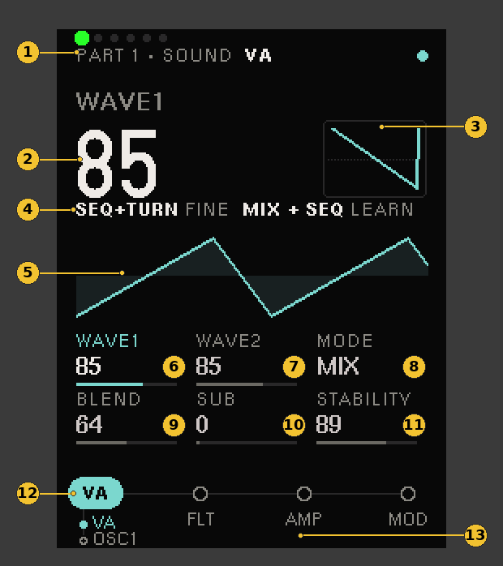

1. **Header.** A dot per Part (current bright green, playing ringed), the place (`PART 1 · SOUND` or `PART 1 · MIX`) and the page's full name. Right: the sounding dot, ORBIT's beat, and `OUT P2` / `OUT P3` for a Part on another pair.
2. **Focus band:** the touched cell's label (WAVE1) and value (85), large, with its unit. Modulation never moves this number.
3. **Focus band: the glyph**, a picture of the value (here the wave's shape).
4. **Focus band: the hint line**, the touched cell's combos (`SEQ+TURN FINE  MIX + SEQ LEARN`).
5. **The picture band** (viz band): what the page does; pages without a picture show the live output.
6. **Cell 1** (encoder 1), WAVE1. The focused label is in the accent colour; the bar shows where the value sits.
7. **Cell 2**, WAVE2.
8. **Cell 3**, MODE (MIX). A choice has no bar.
9. **Cell 4**, BLEND.
10. **Cell 5**, SUB.
11. **Cell 6**, STABILITY. A line under a bar shows modulation; a dash is an empty slot; dimmed does nothing now.
12. **The chain map**: the filled pill (VA) is the current page; FLT, AMP, MOD are MINUS / PLUS away.
13. **The sub-page row**: VA (underlined, you are here), OSC1, OSC2, NOISE; `>` (and `<`) mean more off the edge.

What each VA cell does is in [VA](#va-the-variable-wave-engine).

Every Part, mixer and ORBIT page has these five bands; some (FILTER, MASTER, the envelopes and LFO speeds, ORB) merge focus and viz into one picture. SETTINGS has a breadcrumb header (`SETTINGS › PROJECT › POOL`) and the project at the bottom ([SETTINGS](#settings)).

### Panel: the CPU readout in the header

When nothing else needs the right of the header, it shows the audio load, `CPU 23%`: grey up to 60 %, amber to 80 %, red above. A long page name or `OUT P2` / `OUT P3` takes its place. See [Limits: CPU](#limits-cpu-and-the-load-readout).

### Panel: the boot screen

At power-on the screen shows the Yellow Sign on yellow with the firmware's version; while the second half of the firmware installs, it says DON'T POWER OFF ([Updating and recovery](#updating-and-recovery)). Then Chimera opens on Part 1's home page.


> **Design note:** the sign on the boot screen is the Yellow Sign, designed by Christian Knutsson for Pelgrane Press, who released it into the public domain. It is the emblem of the King in Yellow, a play that, in the old stories, drives its readers mad. Carcosa, where the King holds court, is never far from this project. You have been warned; the manual, at least, is safe to read.

## Panel: the focus band

The strip under the header reads the cell you last touched, with no timer, until you touch another. Each page remembers its own focused cell. It shows:

- **the label and value**, large, with its unit;
- **a glyph**: an arc for most knobs (from 12 o'clock when bipolar), a crossfader for blends (MORPH, BLEND), a level bar, a scope for waves, a spirit level for STABILITY, a loop for FEEDBACK; word choices (MODEL, MODE, STEAL) show as words;
- **a note** where it helps: a route's source (`FREQ MOD LFO1`), an operator's ratio, the reserves booked (`RESERVES 3/8`);
- **the reason** a cell is dimmed or a choice refused, in place of the hint (`GRAIN TYPE ONLY`, `OVER BUDGET`, `REVERSE NEEDS RAM`);
- **the hint line** ([Hints](#panel-hints-in-the-focus-band)).

**Why:** six cells leave little room for names and units; the focus band gives the control you are working on room to explain itself.

## Panel: the cells and how values move

Each page has up to six cells laid out as the encoders are. Turning an encoder changes its cell and focuses it; an empty slot (a dash) does nothing.

- **Turn speed.** A quick turn moves further per detent. Lists and named choices start gently, one row a detent, so they don't overshoot.
- **Gliding.** Sound and bar ease to the new value, from a knob, a CC or the editor.
- **Dimmed cells** still turn but have no effect until the setting that uses them is on; the focus band says why.
- **Refused choices** (an ALGO WAVE past the formant budget, a TAPE machine a streamed source can't feed, a ninth DRUM CHOKE group, VOICES or RESERVE with no room) show dimmed with their reason; nothing changes until you land on one that can play.

**Why:** a refused choice is shown, not skipped, so you see what stands in its way; it is never applied, so the sound never breaks under you.

## Panel: the D-pad

| Key | Does |
|---|---|
| **MINUS / PLUS** | Along: previous / next page of the chain, row of a list, Part in the Sound browser. No wrap at the ends |
| **SEQ** | With the chain map on ROW (default): next sub-page, wrapping from the last back to the page itself |
| **EDIT** | With ROW: previous sub-page; on the page itself it does nothing |
| **MENU** | Leave: open SETTINGS, step back out, leave ORBIT |

The same keys work on a Part's pages, the mixer, the Sound browser, ORBIT and every SETTINGS list.

```
   MINUS (previous page)  ◀  page  ▶  PLUS (next page)

   EDIT (previous sub-page)  ◀  sub-page  ▶  SEQ (next sub-page, wraps)

   An ALGO Part's chain (ALG is its home):

   ALG ──── OSC ─────────── FLT ──────── AMP ──────── MOD
    └ PIT    ├ CRS … FBK     ├ FMD        ├ STER       ├ E1  E2  E3
             └ OP1 … OP6     ├ FX         └ SND        ├ SPD
                             └ JACK                    └ L1  L2  L3
```

**Why:** the panel has no arrow keys, so these four stand in for them, with one meaning everywhere.

### Panel: the chain map and its STACK option

The strip at the bottom of every Part, mixer and ORBIT page maps the chain you are in.

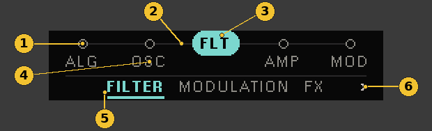

1. A node: one page of the chain.
2. The line joins the pages in order.
3. The pill: the page you are on.
4. Node labels: short names (ALG, OSC, FLT, AMP, MOD).
5. The sub-page row, in full words: FILTER (underlined, where you are), MODULATION, FX.
6. `>`: more sub-pages off the edge (`<` when some are off the left; OSC has 18).

| Where | Chain |
|---|---|
| ALGO Part | ALG · OSC · FLT · AMP · MOD |
| MODAL Part | EXC · RES · FLT · AMP · MOD |
| VA Part | VA · FLT · AMP · MOD |
| TAPE Part | SRC · DECK · FLT · AMP · MOD |
| DRUM Part | KIT · MCH · FLT · AMP · MOD |
| A Part's mixer | PRT · SND · CHR · DLY · REV · MST |
| ORBIT | ORB · RING · CHRD · SCN |

The map shows short names (FLT); the sub-page row and header show full names (FILTER, MODULATION, JACKS).

**STACK.** SETTINGS › PERSONALIZE › CHAIN MAP › **PAGES** sets ROW (default) or STACK. With STACK the sub-pages hang under the node and the keys follow the picture: **EDIT** goes down (wrapping), **SEQ** goes up.


1. Header: SETTINGS › PERSONAL › MAP.
2. The focused cell, PAGES, and its value (ROW).
3. The picture band, the live output.
4. Cell A (encoder 1): **PAGES**, ROW or STACK.
5. Footer: the project and its state.
6. Footer: `A-F EDIT · MENU BACK`.

**Why:** on ROW, EDIT sits left of SEQ, so it goes left; on STACK, it goes down. The key always moves the way the picture does.

### Panel: Part buttons

| Where you are | B*n* does |
|---|---|
| Part *n*'s sound pages | Its mixer (SENDS, or the mixer page you last left) |
| Part *n*'s mixer | Back to its sound pages, on the page you left |
| Another Part's sound pages | Part *n*'s same page if its chain has it, else the nearest, else its home |
| Anywhere else | Part *n*'s home page |
| ORBIT | B1–B5 open ring 1–5; B6 plays / stops |

**Why:** keeping the page when you switch Parts lets you compare one page across Parts with one press.

### Panel: the mixer and browser moves

In a Part's mixer, MINUS / PLUS walk PRT · SND · CHR · DLY · REV · MST; PRT has two sub-pages, VOICES and EQ. **EDIT** on PRT or SND goes down to the Sound browser; **SEQ** in the browser comes back up; SEQ on SND does nothing. See [The MIXER](#the-mixer-and-the-master-effects).

In the [Sound browser](#the-sd-card-projects-sounds-and-the-library), encoder 1 moves the bar, encoder 2 switches tab (PROJECT, LIBRARY, FACTORY), MINUS / PLUS switch Part.

### Panel: SETTINGS moves

In a SETTINGS list, MINUS / PLUS or any encoder move the bar, **EDIT** opens or runs the row, **SEQ** or **MENU** go back a level. On the top list SEQ does nothing and MENU closes SETTINGS. A LATER row isn't built and is skipped. On a page with cells (CHANNELS, THEME, CHAIN MAP, AUDIO LOAD) the encoders turn the cells (`A-F EDIT`). See [SETTINGS](#settings).

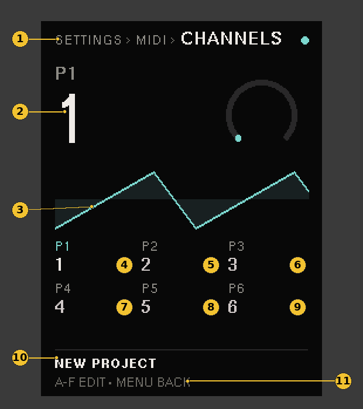

1. Header: the breadcrumb, SETTINGS › MIDI › CHANNELS.
2. The focused cell: P1 and its channel, with its glyph.
3. The picture band, the live output.
4. Cell A: P1, Part 1's MIDI channel.
5. Cell B: P2.
6. Cell C: P3.
7. Cell D: P4.
8. Cell E: P5.
9. Cell F: P6.
10. Footer: the project and its state (`SAVED`, `* MODIFIED`; nothing means never saved).
11. Footer: `A-F EDIT · MENU BACK`.

## Panel: key combos and holds

Every combo and hold, in one place. Each also shows as a hint on the cells where it applies.

| Keys | Where | Does |
|---|---|---|
| B*n* | anywhere but ORBIT | Part *n*'s pages; again for its mixer ([Part buttons](#panel-part-buttons)) |
| **MIX + B*n*** | anywhere but ORBIT | Part *n*'s mixer; in the mixer, the same page for Part *n* (hint `MIX + B1-6 PART`) |
| **EDIT + B*n*** | anywhere but ORBIT | The Sound browser for Part *n* |
| **MIX + turn** | a cell | Jump to the next landmark that way: minimum, default, maximum (end of a list) |
| **SEQ + turn** | a value cell on a Part, mixer or effect page | Fine steps, no speed-up (hint `SEQ+TURN FINE`). Not on choices, SETTINGS or ORBIT |
| **PUSH**, **PUSH + TURN** | a cell, with push encoders on | Default; fine steps |
| **MIX + PLUS** | a parameter | Add it as a MOD matrix destination: ADDED, ALREADY ROUTED, NOT MODULATABLE or MATRIX FULL |
| **MIX + MINUS** | a parameter | Take it out of the MOD matrix |
| **MIX + MINUS** | a route amount (ENV AMT, FREQ MOD, RES MOD; the matrix cursor) | Delete the route |
| **MIX + SEQ** | a cell | MIDI learn; press again to finish ([MIDI](#midi-channels-maps-and-controllers)) |
| **MIX + MINUS / PLUS** | a DRUM pad's pages | Previous / next pad (hint `MIX + -/+ PAD`; [DRUM](#drum-the-kit-engine)) |
| **EDIT** | the Sound browser | Load the selected Sound (asks if the Part has unsaved edits) |
| **MIX + EDIT** | the Sound browser | Save the Part's Sound: to the project on PROJECT, to the card on LIBRARY; nothing on FACTORY |
| **MIX + MINUS** | the Sound browser, PROJECT tab | Clear the selected slot, after asking |
| **MIX + turn** | TAPE's START and END | Snap to the next onset (hint `MIX + TURN NEXT ONSET`; [TAPE](#tape-the-sample-engine)) |
| **hold SEQ** | anywhere but SETTINGS | Enter ORBIT. A turn while SEQ is down cancels this |
| **hold MENU** | anywhere | Quick-save the project; a new project asks for a name |
| **MENU** | ORBIT | Leave ORBIT |
| **B6** | ORBIT | Play / stop |
| **B1–B5** | ORBIT | Open ring 1–5 |
| **hold B1–B5** | ORBIT | Go to the Part that ring plays |
| **MIX + B1–B5** | ORBIT | Mute / unmute that ring |

Page-specific combos (the matrix cursor, ORBIT's NOTES, CHRD and RHYTHM, the delay's SYNC, RANDOMIZE, MIDI MAP, the TAPE machines) are described with their pages and always hinted.

A turn while SEQ is held cancels SEQ's own press: it neither changes sub-page nor opens ORBIT. Holding MENU for half a second saves the project file (TAPE sources are already on the card) and a toast confirms; a shorter tap opens or backs out of SETTINGS.

**Why:** MIX turns a few keys into many, and holds give ORBIT and saving a key without taking one away. SEQ carries the fine turn because its hold waits, so a turn says you meant fine, not ORBIT.

## Panel: hints in the focus band

Touch a cell and the focus band's bottom line lists its combos, keys in bold: a choice cell reads `MIX + SEQ LEARNS A CC`, a continuous cell `SEQ+TURN FINE  MIX + SEQ LEARN`. Arrows show which way to turn: `◂▸` along, `▴▾` up and down. A cell's own words (a reason, a note) take the line instead.


1. The page name is the sub-page's: FILTER MOD.
2. The touched cell, RES MOD, and its source (ENV3).
3. Its arc, bipolar, filled from 12 o'clock.
4. The hint line: the touched cell's combo, `MIX + MINUS DELETES THE ROUTE`.
5. A route amount (FREQ MOD); its source is set on JACKS.
6. The touched cell, RES MOD, with its amount.
7. The node, FLT, lit on the map.
8. The sub-page row: FILTER, MODULATION (underlined, you are here), FX …
9. … and `>`: JACKS off the edge.

| Hint | Where |
|---|---|
| `MIX + SEQ LEARNS A CC` (or `LEARN`) | Every learnable cell |
| `SEQ+TURN FINE` | Every cell that takes the fine turn |
| `MIX + B1-6 PART` | Mixer cells |
| `MIX + MINUS DELETES THE ROUTE` | Route amounts, the matrix cursor on a route |
| `MIX + PLUS ON A PARAM PRIMES IT` | The matrix cursor on an empty cell |
| `MIX + -/+ PAD` | A DRUM pad's cells |
| `EDIT LOADS`, `MIX + EDIT SAVES`, `MIX + MINUS CLEARS` | The Sound browser, with the memory each takes or frees |
| `MOVE THE KNOB UP TO PICK UP` | A cell bound to a MIDI knob waiting to catch the value ([MIDI](#midi-channels-maps-and-controllers)) |

SETTINGS › PERSONALIZE › THEME › **HINTS**: OFF hides hints; the combos still work.

**Why:** a hint only for the cell you touched tells you what you need then and keeps the screen quiet otherwise.

## Panel: lists

SETTINGS, the Sound browser, project lists, MIDI MAP and dialogs are lists with a bar on one row.

- Any encoder (but the browser's encoder 2) or MINUS / PLUS moves the bar, one row a detent at first; **EDIT** opens or runs the row.
- A long list scrolls with a scrollbar. Sound browser tabs come in pages of 48 rows, with `NEXT ›` and `‹ PREVIOUS` rows (`OLDER ›` and `‹ NEWER` on LIBRARY).
- A name too long for its cell scrolls sideways while selected.


1. Breadcrumb: where you are in SETTINGS.
2. The bar: the selected row.
3. A chevron: this row opens a list.
4. LATER: not built yet; dimmed rows are skipped.
5. The project's name and state (`SAVED`, `* MODIFIED`).
6. What the keys do here.

## Panel: dialogs

When an action needs a decision, a dialog opens: a question, the reason in colour, and two or three answers as pills.


- Any encoder moves between pills; **EDIT** confirms (only on its own: with MIX or a B key it confirms nothing); **MENU** or **SEQ** cancels. The bottom line reads `EDIT OK · MENU BACK`.
- Destructive dialogs (DELETE, CLEAR, SAVE OVER, PURGE, ENTER DFU, a map's delete, a scene's CLEAR or RELOAD) open on CANCEL. Others lead with the answer that keeps your work: SAVE THEN LOAD, SAVE PART FIRST, KEEP BOTH, UPDATE, SAVE AS.

**Why:** a dialog uses the keys you already know, and opening on the safe answer means a reflex EDIT never loses work.

### Panel: naming

Naming a project, library Sound, Part or controller map opens the naming screen.


| Encoder | Cell | Does |
|---|---|---|
| 1 | **CURSOR** | Moves along the name (up to 16 characters) |
| 2 | **LETTER** | A letter at the cursor |
| 3 | **DIGIT** | A digit, space or dash |
| 4 | **CASE** | Upper or lower case |
| 5 | **DELETE** | Deletes at the cursor |

**EDIT** saves; **MENU** or **SEQ** cancels (`EDIT SAVE · MENU BACK`).

### Panel: toasts and BUSY

A **toast** is a short boxed message (SAVED, a card error, a refusal). It blocks nothing, goes by itself, and any key or turn dismisses it. At boot, while a card operation must finish, the screen shows **BUSY**. While a Sound or source is read from the card, other keys wait; MENU cancels the read.

## Panel: the screensaver

After a while untouched, the screen shows a large oscilloscope of the output, with the last note, its sounding and measured pitch, and the held chord. SETTINGS › PERSONALIZE › SCREENSAVER › **SAVER** sets the wait: OFF, 5 S, 7 S, 10 S, 30 S, 60 S, 2 MIN, 5 MIN (default) or 10 MIN.


1. Header: the breadcrumb, `..` › PERSONAL › SAVER (shortened to fit).
2. The focused cell, SAVER, and its value (5 MIN).
3. The picture band, the live output.
4. Cell A (encoder 1): **SAVER**, the wait.
5. Footer: the project and its state.
6. Footer: the keys this page answers to.

Any button or encoder wakes it; MIDI does not. A waking button also does its job; a waking turn loses its first detent.

**Why:** a turn made before you can see the screen shouldn't change a value you couldn't see; a button press is deliberate.

## Panel: text size

SETTINGS › PERSONALIZE › TEXT SIZE › **SIZE**: NORMAL (default) or LARGE. LARGE draws labels, values, hints, lists and Sound names a size up where they fit. It belongs to the unit, not a project.


1. Header: SETTINGS › PERSONAL › TEXT.
2. The focused cell, SIZE, and its value (NORMAL).
3. The picture band, the live output.
4. Cell A (encoder 1): **SIZE**, NORMAL or LARGE.
5. Footer: the project and its state.
6. Footer: the keys this page answers to.

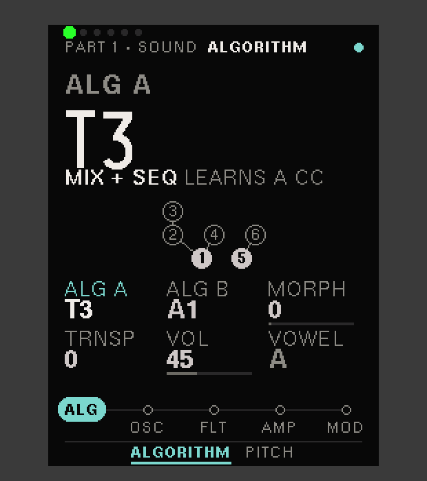

The rest of PERSONALIZE (THEME's colours and HINTS, PAD FOLLOW, ALGO PAGES) is in [SETTINGS](#settings).

# ALGO, the six-operator engine

ALGO is Chimera's operator engine: six phase-modulation operators wired by one of 32 algorithms, with MORPH blending between two algorithms. This chapter covers the ALGORITHM page, the OSC node's group and operator pages, formant and noise operators, and what a patch costs. The shared pages (PIT, FLT, FMD, FX, JACK, AMP, STER, SND, MTX, E1–E3, SPD, L1–L3) are in [the voice chain](#the-voice-chain-pitch-filter-fx-amp-stereo-and-sends), [envelopes and LFOs](#envelopes-and-lfos) and [the mod matrix](#the-mod-matrix-and-routes).

## ALGO: what the engine is

Each operator is an oscillator with its own wave, frequency ratio, level and envelope. An **algorithm** says which operators modulate which, and which you hear:

- A **carrier** is heard. Its LEVEL is loudness.
- A **modulator** feeds another operator. Its LEVEL is brightness: more LEVEL, more harmonics.
- **FDBK** feeds an operator back into itself: a sine with feedback turns towards a saw.

Every Sound stores two algorithms, **ALG A** and **ALG B**; **MORPH** blends one into the other, so a knob, envelope or LFO can move a sound between two wirings. An operator's **WAVE** makes it a **table** operator (16 waves), a **formant** (FRMT) or a **noise band** (NOISE).

**Why:** one engine does the work of several, from a plain wave to a six-operator morphing tone to a singing formant, on one set of pages, and every Sound is billed only for the operators it uses.

**Why phase modulation:** operators modulate each other's phase, not their frequency, so a carrier's pitch stays centred however deep the modulation goes. The stock PreenFM3 firmware does true FM; Chimera is phase modulation throughout.

> **Design note:** ALGO began as a four-operator engine modelled on the behaviour of the TX81Z, and it cost more than the whole chip could spend on one voice: every FM note was refused. It was replaced with a six-operator engine written from scratch. The TX81Z's spirit is still in its bones: the 64 COARSE ratios, FINE, the 0.75 dB LEVEL step, the four-rate envelope and the feedback steps follow the behaviour its owner's manual describes, and T1 to T8 are after its eight algorithms. The waves were redrawn as formulas. The other 24 algorithms are Chimera's own, because six operators deserve more than eight ways to meet.

## ALGO: the chain and its pages

An ALGO Part's chain map reads **ALG · OSC · FLT · AMP · MOD**. ALG is the home.

```
ALG ──── OSC ─────────── FLT ──────── AMP ──────── MOD
 └ PIT    ├ FRM (only with a formant or noise operator)
          ├ CRS FIN DET LVL VEL
          ├ AR D1R D1L D2R RR RS FBK
          └ OP1 … OP6
```

| Node | Its pages, short name (full word on the sub-page row) |
|---|---|
| ALG | **ALG** (ALGORITHM), **PIT** (PITCH) |
| OSC | **OSC** (WAVE), **FRM** (FORMANT), **CRS** (COARSE), **FIN** (FINE), **DET** (DETUNE), **LVL** (LEVEL), **VEL** (VELOCITY), **AR** (ATTACK RATE), **D1R** (DECAY 1 RATE), **D1L** (DECAY 1 LEVEL; DECAY 1 LVL in the header), **D2R** (DECAY 2 RATE), **RR** (RELEASE RATE), **RS** (RATE SCALE), **FBK** (FEEDBACK), **OP1** to **OP6** (OPERATOR 1 to OPERATOR 6) |
| FLT, AMP, MOD | as on every engine: see [the voice chain](#the-voice-chain-pitch-filter-fx-amp-stereo-and-sends), [envelopes and LFOs](#envelopes-and-lfos), [the mod matrix](#the-mod-matrix-and-routes) |

The OSC row has 18 sub-pages after its home (19 with FORMANT) and scrolls, with `<` and `>` at its ends. Navigation is as on every page (see [the panel and navigation](#the-panel-and-navigation)).

## ALGO: ALG PAGES FIRST, parameters or operators first

SETTINGS › PERSONALIZE › ALGO PAGES › **FIRST** sets the order of the OSC node's pages. It belongs to the unit, not the Sound (see [SETTINGS](#settings)).

| Option | What it does |
|---|---|
| **PARAMS** (default) | WAVE, then the group pages, then OP1 to OP6 |
| **OPS** | OP1 to OP6, then WAVE (and FORMANT) and the group pages |

**Why:** some players work a parameter across all operators, others one operator at a time, as on software FM synths. Only the order changes.

## ALGO: the ALGORITHM page (ALG)


1. **Header:** PART 1 · SOUND, page ALGORITHM.
2. **Focus band:** ALG A, T1.
3. **Hint:** `MIX + SEQ LEARNS A CC`.
4. **Picture band:** the T1 chart, carriers 1 and 5 filled.
5. **ALG A**
6. **ALG B**
7. **MORPH**
8. **TRNSP**
9. **VOL**
10. **VOWEL**
11. **Chain map:** ALG lit.
12. **Sub-page row:** ALGORITHM underlined, PITCH.

The chart puts carriers, drawn filled, on the bottom row and each modulator above what it feeds. An operator with FDBK above 0 wears a loop: MID colour under 4.0, accent from 4.0, where a sine starts to break towards a saw.


| Cell | Range | Default | What it does |
|---|---|---|---|
| **ALG A** | T1–T8, A1–A24 | T1 | The algorithm at MORPH 0 |
| **ALG B** | T1–T8, A1–A24 | A1 | The algorithm at MORPH 127 |
| **MORPH** | 0–127 | 0 | Blends ALG A into ALG B |
| **TRNSP** | −24 to +24 | 0 | Transposes the Sound in semitones |
| **VOL** | 0–127 | 45 | The Sound's output level |
| **VOWEL** | U, O, A, E, I | A | Moves every formant and noise operator along the vowels |

- Touching ALG A or ALG B shows that algorithm alone (a refused one dimmed); any other cell shows the MORPH blend.
- A change of ALG A or B under a sounding note ducks, swaps and returns, without a click.
- **MORPH** is dimmed while ALG A and ALG B are the same; its routes stay, inert. Otherwise it glides and is a mod destination.
- **VOWEL** is dimmed until an operator is FRMT or NOISE. The arc shows the exact place between vowels (see [ALGO: VOWEL and the slots](#algo-vowel-and-the-slots)).

**Why MORPH blends the links:** each link has a weight, 1 in an algorithm that has it, 0 in one that does not, and MORPH moves every weight from A to B. Each end sounds exactly like its algorithm, and the sweep is smooth.

**Why INIT is T1 into A1:** T1 is a four-deep stack, A1 the same four operators unlinked. On INIT, MORPH is an FM-depth macro, bright to clean.

**Why the output is scaled by the carriers:** more carriers would be louder, so the output is scaled by the stored carrier levels and the 32 algorithms play at a similar loudness. Routes never change the scale, and it never boosts.

## ALGO: the 32 algorithms

A higher-numbered operator always modulates a lower one; "4→3" means 4 modulates 3.

| Algorithm | Links | Carriers |
|---|---|---|
| T1 | 4→3, 3→2, 2→1, 6→5 | 1, 5 |
| T2 | 4→2, 3→2, 2→1, 6→5 | 1, 5 |
| T3 | 3→2, 2→1, 4→1, 6→5 | 1, 5 |
| T4 | 4→3, 3→1, 2→1, 6→5 | 1, 5 |
| T5 | 4→3, 2→1, 6→5 | 1, 3, 5 |
| T6 | 4→1, 4→2, 4→3, 6→5 | 1, 2, 3, 5 |
| T7 | 4→3, 6→5 | 1, 2, 3, 5 |
| T8 | 6→5 | 1–5 |
| A1 | none | 1–6 |
| A2 | 6→1 | 1–5 |
| A3 | 6→1, 6→2 | 1–5 |
| A4 | 6→1, 5→2 | 1–4 |
| A5 | 6→1, 6→2, 6→3, 6→4 | 1–5 |
| A6 | 6→5, 5→1 | 1–4 |
| A7 | 4→1, 5→2, 6→3 | 1, 2, 3 |
| A8 | 4→1, 5→1, 6→1 | 1, 2, 3 |
| A9 | 6→5, 5→4, 4→1 | 1, 2, 3 |
| A10 | 6→4, 6→5, 4→1, 5→2 | 1, 2, 3 |
| A11 | 5→4, 6→4, 4→1, 4→2, 4→3 | 1, 2, 3 |
| A12 | 5→3, 3→1, 6→4, 4→2 | 1, 2 |
| A13 | 3→1, 4→1, 5→2, 6→2 | 1, 2 |
| A14 | 3→1, 3→2, 4→1, 4→2, 5→3, 6→4 | 1, 2 |
| A15 | 6→5, 5→3, 3→1, 4→2 | 1, 2 |
| A16 | 3, 4, 5, 6 each into 1 and 2 | 1, 2 |
| A17 | 6→5→4→3→2→1 | 1 |
| A18 | 2, 3, 4, 5, 6 each into 1 | 1 |
| A19 | 4→2, 4→3, 2→1, 3→1, 6→5, 5→1 | 1 |
| A20 | 3→2, 2→1, 5→4, 4→1, 6→1 | 1 |
| A21 | 6→5, 5→4, 4→1, 3→2, 2→1 | 1 |
| A22 | 6→4, 6→5, 4→2, 5→3, 2→1, 3→1 | 1 |
| A23 | 6 into 2, 3, 4, 5; each of those into 1 | 1 |
| A24 | 6→5; 5 into 2, 3, 4; each of those into 1 | 1 |

T1–T8 are after the TX81Z's eight algorithms, on operators 1–4, plus a 6→5 pair; with 5 and 6 at LEVEL 0 they behave like its four-operator originals. A1 is an additive organ, A17 the deepest stack; A16, A18 and A23 pile modulators onto one or two carriers. A16 with A17 is the costliest pair to morph.

## ALGO: the OSC node and the group pages

The first fourteen OSC pages are **group pages**: one parameter for all six operators, in cells **OP1** to **OP6**. The focus band names the parameter; the lit cell names the operator.

| Page | Range | INIT | What it sets |
|---|---|---|---|
| **OSC** (WAVE) | W1 … NOISE (below) | W1 | The operator's wave or kind |
| **FRM** (FORMANT) | 100 Hz to 12.8 kHz | 734 Hz, 1.10 kHz, 2.47 kHz, 3.49 kHz ×3 | A formant's centre (a noise band's CENTRE) |
| **CRS** (COARSE) | 0.50 to 25.95 | 1.00 | Frequency ratio to the note |
| **FIN** (FINE) | 0–15 | 0 | Raises the ratio towards the next |
| **DET** (DETUNE) | −3 to +3 | 0 | 1.5 cents a step |
| **LVL** (LEVEL) | 0–99 | 99, 72, 72, 72, 0, 0 | Output level, 0.75 dB a step |
| **VEL** (VELOCITY) | 0–7 | 0 | Velocity sensitivity |
| **AR** (ATTACK RATE) | 0–31 | 31 | Attack rate |
| **D1R** (DECAY 1 RATE) | 0–31 | 0 | First decay rate |
| **D1L** (DECAY 1 LEVEL) | 0–15 | 15 | Where the first decay stops |
| **D2R** (DECAY 2 RATE) | 0–31 | 0 | Second decay rate, while held |
| **RR** (RELEASE RATE) | 1–15 | 5 | Release rate |
| **RS** (RATE SCALE) | 0–3 | 0 | Faster envelopes on higher notes |
| **FBK** (FEEDBACK) | 0.0–7.0 | 0.0 | Self-feedback |

The envelope pages draw the touched operator's envelope; the others show the live output.

### ALGO: WAVE and the operator kinds


1. **Header:** page WAVE.
2. **Focus band:** OP1, W1.
3. **Glyph:** OP1's wave, a sine.
4. **Hint:** `MIX + SEQ LEARNS A CC`.
5. **Picture band:** live output (a test wave here).
6. **OP1**
7. **OP2**
8. **OP3**
9. **OP4**
10. **OP5**
11. **OP6**
12. **Chain map:** OSC lit.
13. **Sub-page row:** WAVE underlined, `>` at the end.

| WAVE | What it is |
|---|---|
| **W1** | Sine |
| **W2** | Sharpened sine, each half bulging towards a square |
| **W3** | W1's positive half, then silence |
| **W4** | W2's positive half, then silence |
| **W5** | W1 squeezed into the first half cycle |
| **W6** | W2 squeezed into the first half cycle |
| **W7** | Two positive humps of W1 in the first half cycle |
| **W8** | The same with W2 |
| **TRI** | Triangle |
| **SAW** | Saw |
| **SQR** | Square |
| **P25** | Pulse, 25 % |
| **P12** | Pulse, 12.5 % |
| **TSAW** | Trisaw: slow rise, fast fall |
| **RSQR** | Rounded square |
| **SSAW** | Soft saw |
| **FRMT** | Formant operator (FORMANT in the band) |
| **NOISE** | Noise band |

W1–W8 are modelled on the TX81Z's eight waves; W3, W4, W7 and W8 keep a DC offset, as its waves do. All tables are band-limited. A WAVE change under a held note crossfades. A choice the [formant budget](#algo-the-formant-budget) refuses shows dimmed and writes nothing.

### ALGO: COARSE, FINE and DETUNE, the ratio

An operator plays at the note's frequency times its ratio. **COARSE** picks one of 64 ratios, after the TX81Z's set:

| | | | | | | | |
|---|---|---|---|---|---|---|---|
| 0.50 | 0.71 | 0.78 | 0.87 | 1.00 | 1.41 | 1.57 | 1.73 |
| 2.00 | 2.82 | 3.00 | 3.14 | 3.46 | 4.00 | 4.24 | 4.71 |
| 5.00 | 5.19 | 5.65 | 6.00 | 6.28 | 6.92 | 7.00 | 7.07 |
| 7.85 | 8.00 | 8.48 | 8.65 | 9.00 | 9.42 | 9.89 | 10.00 |
| 10.38 | 10.99 | 11.00 | 11.30 | 12.00 | 12.11 | 12.56 | 12.72 |
| 13.00 | 13.84 | 14.00 | 14.10 | 14.13 | 15.00 | 15.55 | 15.57 |
| 15.70 | 16.96 | 17.27 | 17.30 | 18.37 | 18.84 | 19.03 | 19.78 |
| 20.41 | 20.76 | 21.20 | 21.98 | 22.49 | 23.55 | 24.22 | 25.95 |

- Whole numbers give harmonic tones; the rest give bells and metals. 3.14 and 6.28 are ratios after the TX81Z's, not π and 2π.
- **FINE** raises the ratio in 16 steps towards the next region (8 below 1.00; FINE 8–15 then hold the top).
- **DETUNE** moves ±4.5 cents at most; detuned carriers beat slowly.
- The focus band shows where the operator lands: `RATIO 1.41, DETUNE +4.5 CENTS`. COARSE steps; FINE and DETUNE glide.


1. **Header:** page COARSE.
2. **Focus band:** OP1, 1.00.
3. **Glyph:** ratio arc.
4. **Hint:** `RATIO 1.00`.
5. **Picture band:** live output (a test wave here).
6. **OP1**
7. **OP2**
8. **OP3**
9. **OP4**
10. **OP5**
11. **OP6**
12. **Chain map:** OSC lit.
13. **Sub-page row:** COARSE underlined.


1. **Header:** page FINE.
2. **Focus band:** OP1, 0.
3. **Hint:** `RATIO 1.00`.
4. **Picture band:** live output (a test wave here).
5. **OP1**
6. **OP2**
7. **OP3**
8. **OP4**
9. **OP5**
10. **OP6**
11. **Chain map:** OSC lit.
12. **Sub-page row:** FINE underlined.

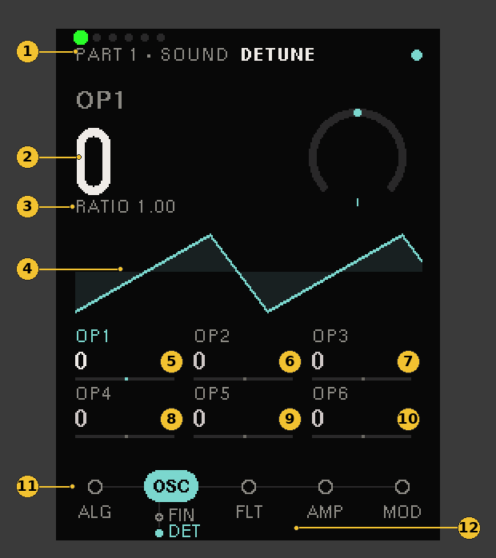

1. **Header:** page DETUNE.
2. **Focus band:** OP1, 0.
3. **Hint:** `RATIO 1.00`.
4. **Picture band:** live output (a test wave here).
5. **OP1**
6. **OP2**
7. **OP3**
8. **OP4**
9. **OP5**
10. **OP6**
11. **Chain map:** OSC lit.
12. **Sub-page row:** DETUNE underlined.

### ALGO: LEVEL and VELOCITY

- **LEVEL**: LEVEL 91 is 6 dB under 99. A silent operator nothing routes into costs nothing. Each LEVEL is a mod destination.
- **VELOCITY**: each step takes up to 3 dB off at the softest velocity (about 21 dB at VEL 7). On a modulator, harder notes play brighter.


1. **Header:** page LEVEL.
2. **Focus band:** OP1, 99.
3. **Glyph:** level bar.
4. **Hint:** `SEQ+TURN FINE  MIX + SEQ LEARN`.
5. **Picture band:** live output (a test wave here).
6. **OP1**
7. **OP2**
8. **OP3**
9. **OP4**
10. **OP5**
11. **OP6**
12. **Chain map:** OSC lit.
13. **Sub-page row:** LEVEL underlined.


1. **Header:** page VELOCITY.
2. **Focus band:** OP1, 0.
3. **Hint:** `SEQ+TURN FINE  MIX + SEQ LEARN`.
4. **Picture band:** live output (a test wave here).
5. **OP1**
6. **OP2**
7. **OP3**
8. **OP4**
9. **OP5**
10. **OP6**
11. **Chain map:** OSC lit.
12. **Sub-page row:** VELOCITY underlined.

### ALGO: FEEDBACK

**FDBK** feeds an operator's output into its own phase: a sine gains harmonics, turns towards a saw and at the top breaks into grit. The whole numbers follow the TX81Z's eight steps, each doubling the swing from step 1; one detent is a tenth of a step. **MIX + turn** jumps to the next whole number, **SEQ + turn** steps by tenths. A noise band ignores FDBK.


1. **Header:** page FEEDBACK.
2. **Focus band:** OP1, 0.0.
3. **Glyph:** level bar.
4. **Hint:** `MIX+TURN WHOLE  SEQ+TURN FINE`.
5. **Picture band:** live output (a test wave here; FDBK is 0.0).
6. **OP1**
7. **OP2**
8. **OP3**
9. **OP4**
10. **OP5**
11. **OP6**
12. **Chain map:** OSC lit.
13. **Sub-page row:** FEEDBACK underlined, OPERATOR 1 next.

**Why tenths:** the TX81Z's low steps were too coarse for subtle colour. A whole number plays exactly as that step did.

## ALGO: the operator envelopes

Every operator has the classic Yamaha four-rate envelope: **AR** rises to full, **D1R** falls to **D1L**, **D2R** falls on while the key is held, **RR** falls to silence after key up. **RS** speeds every rate up on higher notes. **These are rates, not times: higher is faster.**

- **AR 0** never rises: the operator is silent.
- **D1R 0** holds at full; D1L then does nothing, and the band says `DECAY 1 RATE 0: NEVER REACHED`.
- **D2R 0** holds at D1L, which is then the sustain.
- **D1L 0** falls to silence; **D1L 15** is full, so D2R starts at once. Each step below 15 is 3 dB.

**Why the TX81Z's names:** a TX81Z patch sheet reads straight across. D1L is not "sustain": it only sustains while D2R is 0.


1. **Header:** page ATTACK RATE.
2. **Focus band:** ATTACK RATE, 31 (OP1).
3. **Glyph:** rate arc.
4. **Hint:** `SEQ+TURN FINE  MIX + SEQ LEARN`.
5. **Picture band:** OP1's envelope, the attack lit; stage letters below.
6. **OP1**
7. **OP2**
8. **OP3**
9. **OP4**
10. **OP5**
11. **OP6**
12. **Chain map:** OSC lit.
13. **Sub-page row:** ATTACK RATE underlined.


1. **Header:** page DECAY 1 RATE.
2. **Focus band:** DECAY 1 RATE, 0 (OP1).
3. **Hint:** `SEQ+TURN FINE  MIX + SEQ LEARN`.
4. **Picture band:** OP1's envelope, D1 lit; stage letters below.
5. **OP1**
6. **OP2**
7. **OP3**
8. **OP4**
9. **OP5**
10. **OP6**
11. **Chain map:** OSC lit.
12. **Sub-page row:** DECAY 1 RATE underlined.

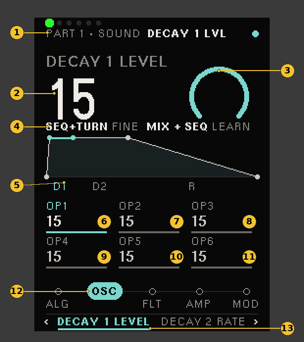

1. **Header:** page DECAY 1 LVL.
2. **Focus band:** DECAY 1 LEVEL, 15 (OP1).
3. **Glyph:** level arc.
4. **Hint:** `SEQ+TURN FINE  MIX + SEQ LEARN`.
5. **Picture band:** OP1's envelope, D1 lit; stage letters below.
6. **OP1**
7. **OP2**
8. **OP3**
9. **OP4**
10. **OP5**
11. **OP6**
12. **Chain map:** OSC lit.
13. **Sub-page row:** DECAY 1 LEVEL underlined.


1. **Header:** page DECAY 2 RATE.
2. **Focus band:** DECAY 2 RATE, 0 (OP1).
3. **Hint:** `SEQ+TURN FINE  MIX + SEQ LEARN`.
4. **Picture band:** OP1's envelope, D2 lit; stage letters below.
5. **OP1**
6. **OP2**
7. **OP3**
8. **OP4**
9. **OP5**
10. **OP6**
11. **Chain map:** OSC lit.
12. **Sub-page row:** DECAY 2 RATE underlined.

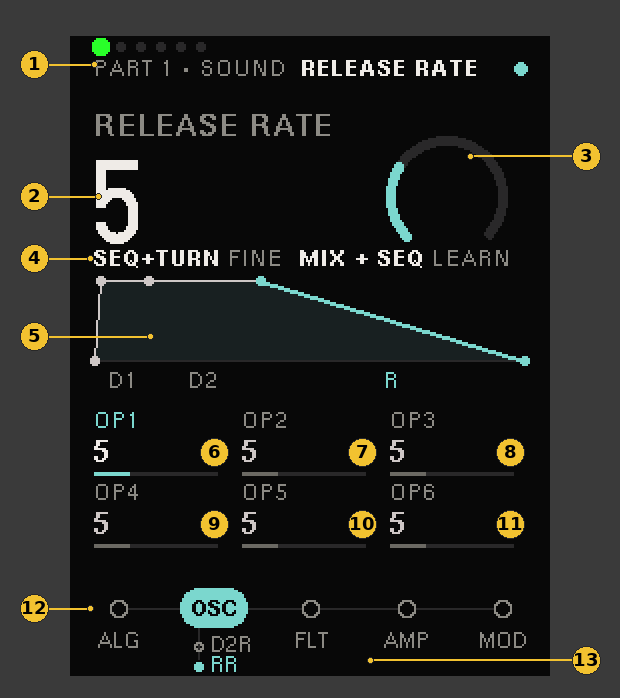

1. **Header:** page RELEASE RATE.
2. **Focus band:** RELEASE RATE, 5 (OP1).
3. **Glyph:** rate arc.
4. **Hint:** `SEQ+TURN FINE  MIX + SEQ LEARN`.
5. **Picture band:** OP1's envelope, R lit; stage letters below.
6. **OP1**
7. **OP2**
8. **OP3**
9. **OP4**
10. **OP5**
11. **OP6**
12. **Chain map:** OSC lit.
13. **Sub-page row:** RELEASE RATE underlined.

### ALGO: envelope rates in seconds

Two steps of AR, D1R or D2R, or one of RR, make a stage twice as fast. Attack rises in a straight line; decays and release fall at a steady dB per second. The table gives the time from full to −80 dB, where a note ends; a stage that stops at D1L takes its share (to D1L 11, −12 dB, is 12/80 of it). RR *n* falls as fast as D1R at 2*n* + 1: RR 5 about 1.7 s, RR 15 about 1.7 ms.

| Rate | AR: full attack | D1R or D2R: full to −80 dB |
|---|---|---|
| 1 | 8.2 s | 55 s |
| 4 | 2.9 s | 19 s |
| 8 | 725 ms | 4.8 s |
| 12 | 181 ms | 1.2 s |
| 16 | 45 ms | 302 ms |
| 20 | 11 ms | 76 ms |
| 24 | 2.8 ms | 19 ms |
| 28 | 0.7 ms | 4.7 ms |
| 31 | 0.25 ms | 1.7 ms |

### ALGO: RATE SCALE

**RS** speeds up every rate, release too, on higher keys, as Yamaha's keyboard rate scaling does: a high bell dies sooner than a low one. The band reads `HIGH NOTES, FASTER ENVELOPES`. **RS 0 is not off:** it is a gentle tilt, as on the TX81Z. Rates top out at the fastest, so AR 31 and RR 15 barely change.

| RS | C2 | C4 | C6 | C8 |
|---|---|---|---|---|
| 0 | 1.00× | 1.19× | 1.41× | 1.68× |
| 1 | 1.19× | 1.68× | 2.4× | 3.4× |
| 2 | 1.41× | 2.8× | 5.7× | 11× |
| 3 | 2.4× | 9.5× | 38× | 152× |


1. **Header:** page RATE SCALE.
2. **Focus band:** OP1, 0.
3. **Hint:** `HIGH NOTES, FASTER ENVELOPES`.
4. **Picture band:** live output (a test wave here).
5. **OP1**
6. **OP2**
7. **OP3**
8. **OP4**
9. **OP5**
10. **OP6**
11. **Chain map:** OSC lit.
12. **Sub-page row:** RATE SCALE underlined.

**Why the operators shape the note:** as on a Yamaha FM synth, each carrier's envelope is the note's loudness and each modulator's its brightness, so ALGO needs no amp envelope; ENV1 is free as a mod source. For swells over minutes, route a SLOW MOD envelope into a modulator's LEVEL (see [envelopes and LFOs](#envelopes-and-lfos)).

## ALGO: the operator pages OP1 to OP6

Each operator's page holds its six most-used settings, the same values as on the group pages. The band draws its envelope with an inset: the wave, the formant's grain, or the noise band's bell.

| Kind | Cells |
|---|---|
| Table (W1 … SSAW) | **WAVE**, **COARSE**, **FINE**, **LEVEL**, **FDBK**, **VELOCITY** |
| Formant (FRMT) | **WAVE**, **FORMANT**, **BW**, **SKIRT**, **KEY**, **SLOT** |
| Noise band (NOISE) | **WAVE**, **CENTRE**, **WIDTH**, **RES**, **SLOT**, **LEVEL** |

The six table-operator pages share one layout:


1. **Header:** page OPERATOR 1.
2. **Focus band:** WAVE, W1.
3. **Glyph:** the operator's wave, a sine.
4. **Hint:** `MIX + SEQ LEARNS A CC`.
5. **Picture band:** the envelope (D1, D2, R marked) with a wave inset.
6. **WAVE**
7. **COARSE**
8. **FINE**
9. **LEVEL**
10. **FDBK**
11. **VELOCITY**
12. **Chain map:** OSC lit.
13. **Sub-page row:** OPERATOR 1 underlined, OPERATOR 2 next.


1. **Header:** page OPERATOR 2.
2. **Focus band:** WAVE, W1.
3. **Glyph:** the operator's wave, a sine.
4. **Hint:** `MIX + SEQ LEARNS A CC`.
5. **Picture band:** the envelope (D1, D2, R marked) with a wave inset.
6. **WAVE**
7. **COARSE**
8. **FINE**
9. **LEVEL**
10. **FDBK**
11. **VELOCITY**
12. **Chain map:** OSC lit.
13. **Sub-page row:** OPERATOR 2 underlined, OPERATOR 3 next.


1. **Header:** page OPERATOR 3.
2. **Focus band:** WAVE, W1.
3. **Glyph:** the operator's wave, a sine.
4. **Hint:** `MIX + SEQ LEARNS A CC`.
5. **Picture band:** the envelope (D1, D2, R marked) with a wave inset.
6. **WAVE**
7. **COARSE**
8. **FINE**
9. **LEVEL**
10. **FDBK**
11. **VELOCITY**
12. **Chain map:** OSC lit.
13. **Sub-page row:** OPERATOR 3 underlined, OPERATOR 4 next.


1. **Header:** page OPERATOR 4.
2. **Focus band:** WAVE, W1.
3. **Glyph:** the operator's wave, a sine.
4. **Hint:** `MIX + SEQ LEARNS A CC`.
5. **Picture band:** the envelope (D1, D2, R marked) with a wave inset.
6. **WAVE**
7. **COARSE**
8. **FINE**
9. **LEVEL**
10. **FDBK**
11. **VELOCITY**
12. **Chain map:** OSC lit.
13. **Sub-page row:** OPERATOR 4 underlined, OPERATOR 5 next.


1. **Header:** page OPERATOR 5.
2. **Focus band:** WAVE, W1.
3. **Glyph:** the operator's wave, a sine.
4. **Hint:** `MIX + SEQ LEARNS A CC`.
5. **Picture band:** the envelope (D1, D2, R marked) with a wave inset.
6. **WAVE**
7. **COARSE**
8. **FINE**
9. **LEVEL**
10. **FDBK**
11. **VELOCITY**
12. **Chain map:** OSC lit.
13. **Sub-page row:** OPERATOR 5 underlined, OPERATOR 6 next.


1. **Header:** page OPERATOR 6.
2. **Focus band:** WAVE, W1.
3. **Glyph:** the operator's wave, a sine.
4. **Hint:** `MIX + SEQ LEARNS A CC`.
5. **Picture band:** the envelope (D1, D2, R marked) with a wave inset.
6. **WAVE**
7. **COARSE**
8. **FINE**
9. **LEVEL**
10. **FDBK**
11. **VELOCITY**
12. **Chain map:** OSC lit.
13. **Sub-page row:** OPERATOR 6 underlined, OPERATOR 5 before it.

An operator set to FRMT shows the formant cells (OPERATOR 2 here):

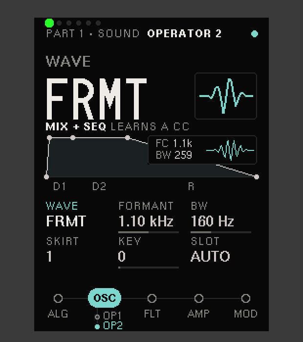

## ALGO: formant and noise operators

With WAVE at **FRMT** or **NOISE**, an operator becomes a resonance at a fixed place in the spectrum, as a voice's formants are. A formant is voiced: grains fired at the note's pitch, each holding a tone at the formant frequency. A noise band is unvoiced: noise shaped around a centre. Both work as carriers or modulators, in every algorithm. While any operator is one, the **FORMANT** page joins the OSC row after WAVE and VOWEL wakes up.

### ALGO: the formant operator's cells

| Cell | Range | INIT | What it does |
|---|---|---|---|
| **FORMANT** | 100 Hz to 12.8 kHz | as FRM | Centre frequency, at vowel A |
| **BW** | 20 Hz to 10.2 kHz | 160 Hz | Bandwidth |
| **SKIRT** | 0–3 | 1 | Side shape: 0 soft with side lobes, 1 clean, 2–3 lower lobes |
| **KEY** | 0–100 | 0 | % the formant follows the note |
| **SLOT** | AUTO, F1, F2, F3, OFF | AUTO | Which vowel formant it follows |

- FORMANT and BW step a quarter tone a detent. They and VOWEL are mod destinations; SKIRT, KEY, SLOT and RES take effect at the next note.
- BW, SKIRT and WIDTH never change the level: a full formant sits about 12 dB under a sine and never clips alone.
- Above about A2 the note's pitch sets a floor on how narrow BW can be.

### ALGO: the noise band's cells

| Cell | Range | INIT | What it does |
|---|---|---|---|
| **CENTRE** | 100 Hz to 12.8 kHz | as FRM | The band's centre (the same value as FORMANT) |
| **WIDTH** | 20 Hz to 10.2 kHz | 160 Hz | From nearly a tone to a full breath (the same value as BW) |
| **RES** | 0–100 | 0 | % blend from band noise to a pure tone at the centre |
| **SLOT** | AUTO, F1, F2, F3, OFF | AUTO | As for a formant |
| **LEVEL** | 0–99 | as LVL | Its level |

A noise band has no pitch: COARSE, FINE, DETUNE, FDBK, SKIRT and KEY are dimmed for it.

### ALGO: VOWEL and the slots

**VOWEL** moves every formant and noise operator together along **U, O, A, E, I**, dark to bright, from its FORMANT (its place at vowel A) to that vowel's formant. The targets are Peterson and Barney's 1952 average adult male formants.

| SLOT | What it does |
|---|---|
| **AUTO** | Takes F1, F2, F3 in turn among AUTO operators, lowest first; a fourth follows none |
| **F1** | Follows the vowel's first formant |
| **F2** | Follows the second |
| **F3** | Follows the third |
| **OFF** | Ignores VOWEL |

Two operators may share a slot, for a choir. Explicit slots do not shift the AUTO ones. Slots are taken at note-on, so a sounding formant never jumps.

**Why three slots:** F1 and F2 carry a vowel's identity, F3 its clarity; higher formants barely move, so a fourth operator is better on a fixed FORMANT.

### ALGO: the formant budget

A formant costs several table operators, more when modulated. A Sound with a formant always keeps at least three voices (other ALGO Sounds four), so ALGO refuses an edit that would break that. Up to three unmodulated formants fit, or one modulated beside one that is not; noise bands are cheap. With MORPH, an operator counts as modulated if either algorithm modulates it.

A turn onto a refused WAVE or ALG choice shows it dimmed and writes nothing; the next turn goes on, so a refused FRMT never blocks NOISE. The focus band says why, even with HINTS off, until the next press, turn elsewhere, page change or load:

| Message | Meaning |
|---|---|
| `OP 1 MODULATED · OVER BUDGET` | That operator has a modulator and would fit only unmodulated |
| `BUDGET FULL · OTHER FORMANTS` | The other formants used the budget |
| `LINKS A FORMANT · OVER BUDGET` | That algorithm would modulate a formant the budget cannot carry |

A MIDI control or load that lands on a refused choice shows the toast `FORMANT BUDGET FULL`.

**Why a budget and not fewer voices:** otherwise one turn could leave a patch playing one voice, or none. Any Sound you can build plays chords.

> **Design note:** your voice is a buzz (the vocal folds, firing once per pitch period) shaped by a few resonances in your throat and mouth: the formants. Move them and the buzz says "ah" or "ee". A formant operator builds that directly. At every pitch period it fires a short grain, a little bell-shaped burst of sine at the formant's frequency. The grains repeat at the note's pitch, so you hear the note; the tone inside each grain sits at a fixed place in the spectrum, so you hear the vowel. Shorter grains mean a wider BW; SKIRT is the bell's shape. Two lanes of grains overlap so a long grain is never cut off by the next. The unvoiced NOISE bands do the same with noise ring-modulated up to a centre: breath, sibilance and consonants.
>
> The idea is old and good:
> - **VOSIM** (Kaegi and Tempelaars, 1978) built vowels from trains of squared-sine pulses.
> - **FOF** (Xavier Rodet's *fonctions d'onde formantique*, IRCAM's CHANT, 1984) made the grain-per-period formant famous, and sang opera with it.
> - **The FS1R** (Yamaha, 1998) put formant operators inside an FM algorithm, so a formant could be modulated like any operator.
>
> Chimera's formant operator is inspired by the FS1R, and its structure follows the FS1R's expired patent (US 5,610,354). The window, the width floor, the level law (an FS1R gets louder as BW widens; this does not), VOWEL and its slots are Chimera's own. The vowel table is Peterson and Barney's 1952 data, so somewhere in the firmware a committee of mid-century American men is still saying "hod", "head" and "hid" on your behalf.

## ALGO: the shared pages on an ALGO Part

The voice pages work as on every engine (see [the voice chain](#voice-chain-differences-between-engines)). Specific to ALGO:

- **PIT** hangs under ALG; TRNSP and PIT's PITCH add up.
- **JACK** and the matrix also offer **OP5** and **OP6**, the audio of operators 5 and 6, for audio-rate cutoff growls.
- **AMP**: with no route into VCA, the carriers shape the note and a release gate stops a self-oscillating filter outliving the tail. ENV1 is not on the VCA.

## ALGO: voices and what a patch costs

The six Parts share 8 voices. An ALGO note is billed for what its Sound uses: operators with LEVEL above 0 or a route into LEVEL, each link (both algorithms' with MORPH), feedback, and formants (much more, more again when modulated). One Part alone, beside the TAPE delay and QUAD reverb:

| Sound type | Example | Voices |
|---|---|---|
| One or two operators | DRIFT ORGAN | 8 |
| Typical | AIR RAID | 7 |
| Heaviest | SOFT HORNS | 3 |
| With formants | NULL CHOIR | 4 |

**Why:** a flat worst-case bill would give a one-operator organ the voices of a six-operator morphing pad. INIT uses four operators so it plays all eight. See [limits](#limits-voices-cpu-and-memory).

## ALGO: starting points

From INIT ALGO (the Sound browser's INIT rows, or SETTINGS › PART › CLEAR): T1 into A1, MORPH 0; operator 1 at LEVEL 99, 2–4 at 72, 5–6 silent; ratios 1.00 on W1; AR 31, D1R 0, D1L 15, D2R 0, RR 5.

- **Stack open and close:** turn MORPH on INIT.
- **Organ (DRIFT ORGAN):** T8; operators 1–4 at COARSE 1, 2, 4, 8, LEVEL 90, DETUNE −3, 0, +1, +3; slow LFOs into LEVELs.
- **Punchy bass (SOLID BASS):** T3; operators 1–3 at 0.50, 4 at 1.00 with FDBK 4.0; modulators at LEVEL 50–62, D1R 12–13, D1L 10–12, VEL 1–3.
- **Electric piano (TINE PIANO):** T5; ratios near 1.41 with FINE 1 and a little DETUNE, D1R about 12, RS 2, VEL 3.
- **Bells:** a modulator at 3.46, 4.24 or 6.28; a carrier with long D1R to D1L 0 and RS 2–3.
- **Morphing bass (MORPH BASS):** T4 into T5, a W7 modulator at 5.00 with FDBK 5.0, ENV2 into MORPH.
- **Choir (NULL CHOIR):** A1; two FRMT operators on F1 and F2 (about 566 Hz and 1.17 kHz, BW 270–360 Hz), a NOISE band at 1.80 kHz, two table operators at 1.00; a slow LFO on VOWEL.
- **Filter growl (VOWEL BUZZ):** a SAW carrier into the 2040, operator 5 quiet and set as JACKS' FREQ SRC.

These ship in the factory set (see [the card, Sounds and the library](#the-sd-card-projects-sounds-and-the-library)).

# MODAL, the physical-modelling engine

MODAL plays resonators: a plucked string, a struck bank of tuned modes, a bowed string, and a string that sets seven others ringing. This chapter covers MODAL's own pages: **EXC** (the exciter), **RES** (the resonator) and **MDL2** (the model's second page). The shared pages (PIT, FLT, FMD, FX, JACK, AMP, STER, SND, the matrix, envelopes and LFOs) are in [the voice chain](#the-voice-chain-pitch-filter-fx-amp-stereo-and-sends), [envelopes and LFOs](#envelopes-and-lfos) and [the mod matrix](#the-mod-matrix-and-routes).

## MODAL: what it is and how it plays

A MODAL Part's chain is **EXC · RES · FLT · AMP · MOD**, and it opens on EXC. A note has two halves:

- **The exciter** puts energy in: a pluck, a strike or a bow (EXC).
- **The resonator** rings. **MODEL** picks it; its four macros **STRUCT**, **BRIGHT**, **DAMP** and **POS** are on RES, its extra controls on MDL2.

| MODEL | Exciter | What it is |
|---|---|---|
| STRING | PLUCK | A plucked string. STRUCT stiffens it, like piano wire. |
| BANK | STRIKE | 16 to 48 tuned modes, struck: bars, bells, plates, glass. |
| BOWED | BOW | A bowed string: sounds while the key is held, rings when the bow lifts. |
| SYMP | PLUCK | A plucked string with seven sympathetic strings (the halo) tuned to a chord. |

> **Design note:** MODAL builds on the maths of Émilie Gillet's Mutable Instruments Rings and Elements, which are open source. The modal bank's band-pass filters, its strike-position weights, its stiffness curve and SYMP's chord table use code adapted from Émilie Gillet's Mutable Instruments Rings (MIT licence). The plucked string itself is Chimera's own code: it began life in an alternative Ambika firmware by Chimera's author, long before it met a PreenFM3. Where Rings is one module with a fixed voice count, MODAL is one engine among several in a six-Part synth, so it had to learn to share: memory, CPU and, in SYMP's case, its sympathetic strings.

## MODAL: notes ring free

A note-off stops the exciter and nothing else. A plucked or struck note rings on through DAMP after key up; a bowed note stops being bowed and rings on. Striking a key whose note still rings re-plucks the same string, adding to the ring, so a repeated note costs one voice.

The voice is freed when its ring has fallen 60 dB. At INIT's DAMP a string rings about 14 seconds, SYMP's halo twice that, so long DAMP with sustain or dense chords means older notes are stolen sooner ([limits](#limits-voices-cpu-and-memory)).

To stop notes at key up, shorten **DAMP**, or route an envelope into the VCA ([the mod matrix](#the-mod-matrix-and-routes)): its release then ends the note. With no VCA route, an amp gate after the filter makes a resonant filter die with the ring ([AMP](#the-voice-chain-pitch-filter-fx-amp-stereo-and-sends)).

**Why:** Rings has no release; its resonator rings on its own damping. A note that stopped dead at key up sounded wrong for strings and bells, and a release knob would duplicate DAMP and a VCA envelope.

## MODAL: loudness across the models

Every MODEL's INIT plays at about the same loudness, so switching MODEL does not jump in level. STRING is set by its peak instead, so an eight-note chord at full velocity stays clear of the output limiter; its single notes sit a few dB under the others. BANK's strike falls in level as the note rises, so a high note is not harsher than a low one.

**Why:** a pluck peaks about 11 dB over a sustained tone of the same loudness; matched by average, STRING's chords hit the limiter.

## MODAL: the EXC page (exciter)

**EXC** is the first page of a MODAL Part. Its header names the exciter (PLUCK, STRIKE or BOW) and its cells follow MODEL. All read 0 to 127. EXC has no sub-pages, so no sub-page row.

EXCITE, COLOR and BURST are read when a note starts: a turn changes the next note. FORCE and SPEED move a held note, eased so nothing jumps. None of them is a matrix destination; to swell a bowed note, route an envelope into **BRIGHT** or the filter, as the factory Sound CELLO SWELL does.

**Why:** a pluck or strike happens once; a bow keeps acting while the key is held, so only its controls are live.

### MODAL: PLUCK (STRING and SYMP)


1. **Header:** PART 1 · SOUND, exciter PLUCK.
2. **Focus band:** EXCITE, 102.
3. **Glyph:** its arc.
4. **Hint:** `SEQ+TURN FINE  MIX + SEQ LEARN`.
5. **Picture band:** live output (a test wave here).
6. **EXCITE.**
7. **COLOR.**
8. **Chain map:** EXC lit.

| Cell | Range | Default | What it does |
|---|---|---|---|
| **EXCITE** | 0–127 | 102 | How hard the string is plucked, scaled by velocity. |
| **COLOR** | 0–127 | 102 | Low: a soft, round, thumb-like pluck. High: bright, like a pick. |

### MODAL: STRIKE (BANK)


1. **Header:** exciter STRIKE.
2. **Focus band:** EXCITE, 102.
3. **Glyph:** its arc.
4. **Hint:** `SEQ+TURN FINE  MIX + SEQ LEARN`.
5. **Picture band:** live output (a test wave here).
6. **EXCITE.**
7. **BURST.**
8. **Chain map:** EXC lit.

| Cell | Range | Default | What it does |
|---|---|---|---|
| **EXCITE** | 0–127 | 102 | How hard the bank is struck, scaled by velocity. |
| **BURST** | 0–127 | 102 | The strike's noise burst, 2 ms to 6 ms: a hard mallet's click to a softer, duller hit. |

### MODAL: BOW (BOWED)


1. **Header:** exciter BOW.
2. **Focus band:** FORCE, 64.
3. **Glyph:** its arc.
4. **Hint:** `SEQ+TURN FINE  MIX + SEQ LEARN`.
5. **Picture band:** live output (a test wave here).
6. **FORCE**, live on a held note.
7. **SPEED**, live on a held note.
8. **Chain map:** EXC lit.

| Cell | Range | Default | What it does |
|---|---|---|---|
| **FORCE** | 0–127 | 64 | Bow pressure. Harder grips more sharply and brightens. Velocity adds to it; a soft key bows at half force. |
| **SPEED** | 0–127 | 64 | Bow speed. Slower also sharpens the tone. |

A very hard or very slow bow drifts a little sharp at the top of the keyboard, as a real one does; mid-range it stays within a few cents from G1 to C7.

> **Design note:** BOWED is a single delay loop with a friction curve where the bow touches it: the stick-slip of a real bow, in a few multiplies. A more elaborate two-line waveguide bow was built and tuned, and lost a listening test to this simpler one: the ear, not the maths, had the last word. To get the simple loop in tune it runs at half length and turns the wave upside down on every pass, the inverting reflection described in J. O. Smith's *Physical Audio Signal Processing*. No rosin required.

## MODAL: the RES page (resonator)

**RES** (MODAL on the header) is MODAL's home: **MODEL** and the four macros. Under it sit the model page (MDL2, named after the model on the sub-page row) and PIT.

| Cell | Range | Default | What it does |
|---|---|---|---|
| **MODEL** | STRING, BANK, BOWED, SYMP | STRING | The resonator. Held notes restart on the new model after a short fade. |
| **STRUCT** | 0–127 | 0 | The structure; per model, below. Dimmed on BOWED. |
| **BRIGHT** | 0–127 | 38 | Dark to bright. |
| **DAMP** | 0–127 | 120 | How long the note rings. |
| **POS** | 0–127 | 0 | Where the string is plucked, struck or bowed. |

The macros are live: they move a sounding note, glide as you turn, and are matrix destinations (touch one, **MIX + PLUS** primes it, see [the mod matrix](#the-mod-matrix-and-routes)). A macro the MODEL doesn't use is dimmed, with its matrix column.

**Why:** these are the four controls Rings puts on its panel and every model shares, so a Sound's modulation still makes sense after a MODEL change.


1. **Header:** page MODAL.
2. **Focus band:** MODEL, STRING.
3. **Hint:** `MIX + SEQ LEARNS A CC`.
4. **Picture band:** live output (a test wave here).
5. **MODEL.**
6. **STRUCT:** stiffness.
7. **BRIGHT.**
8. **DAMP.**
9. **POS.**
10. **Chain map:** RES lit.
11. **Sub-page row:** RESONATOR underlined, then STRING and PITCH.


1. **Header:** page MODAL.
2. **Focus band:** MODEL, BANK.
3. **Hint:** `MIX + SEQ LEARNS A CC`.
4. **Picture band:** live output (a test wave here).
5. **MODEL.**
6. **STRUCT:** mode spacing.
7. **BRIGHT:** upper modes' ring.
8. **DAMP.**
9. **POS:** strike place.
10. **Chain map:** RES lit.
11. **Sub-page row:** RESONATOR underlined, then BANK and PITCH.


1. **Header:** page MODAL.
2. **Focus band:** MODEL, BOWED.
3. **Hint:** `MIX + SEQ LEARNS A CC`.
4. **Picture band:** live output (a test wave here).
5. **MODEL.**
6. **STRUCT:** dimmed.
7. **BRIGHT:** the bridge's tone.
8. **DAMP:** ring after the bow lifts.
9. **POS:** bow place.
10. **Chain map:** RES lit.
11. **Sub-page row:** RESONATOR underlined, then BOWED and PITCH.

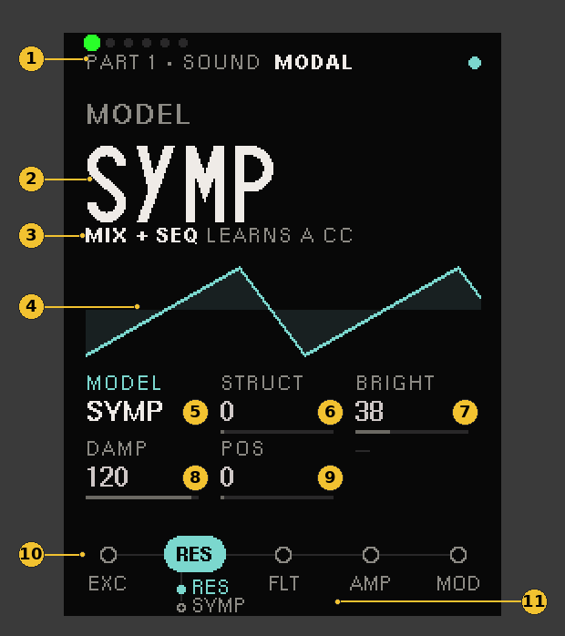

1. **Header:** page MODAL.
2. **Focus band:** MODEL, SYMP.
3. **Hint:** `MIX + SEQ LEARNS A CC`.
4. **Picture band:** live output (a test wave here).
5. **MODEL.**
6. **STRUCT:** the halo's chord.
7. **BRIGHT:** string and halo.
8. **DAMP:** the halo rings twice as long.
9. **POS.**
10. **Chain map:** RES lit.
11. **Sub-page row:** RESONATOR underlined, then SYMP and PITCH.

### MODAL: the macros on each model

| Macro | STRING | BANK | BOWED | SYMP |
|---|---|---|---|---|
| **STRUCT** | Stiffness: 0 is harmonic; higher, upper partials go sharp as on piano wire, more so up the keyboard. The fundamental stays in tune. | Mode spacing: squeezed (tube-like) low, harmonic about a quarter up, stretched into bell, bar and metal higher. | Not used. | The halo's chord (below). |
| **BRIGHT** | How fast the upper harmonics fade. | How long upper modes ring against lower. | The bridge's tone, after the string. | As STRING, string and halo. |
| **DAMP** | Ring time, 50 ms to 20 s, the same at every pitch (120 is about 14 s). | Ring time. | Ring after the bow lifts. | As STRING; the halo rings twice as long. |
| **POS** | Pluck place, end (0) to middle (127). Towards the middle even harmonics fall away: hollower. | Weights the modes the same way. | Bow from near the bridge to the middle. | As STRING. |

SYMP's STRUCT steps through Rings' eleven chords for the seven sympathetic strings: bare octaves at 0, minor chords (with seventh, octave, ninth, eleventh), open fifths, major chords (with eleventh, ninth, octave, major seventh), and a suspended fourth at 127. A chord change glides each string to its new pitch in about a fifth of a second.

## MODAL: the MDL2 page (the model's own controls)

**MDL2** sits under RES, named after the model on the sub-page row (STRING, BANK, BOWED or SYMP), MODAL-2 on the header. Its cells follow MODEL, are read when a note starts, and are not matrix destinations.

### MODAL: STRING's model page


1. **Header:** page MODAL-2.
2. **Focus band:** BODY, 38.
3. **Glyph:** its arc.
4. **Hint:** `SEQ+TURN FINE  MIX + SEQ LEARN`.
5. **Picture band:** live output (a test wave here).
6. **BODY.**
7. **ENS.D.**
8. **ENS.R.**
9. **ENS.M.**
10. **Chain map:** RES lit.
11. **Sub-page row:** STRING underlined, between RESONATOR and PITCH.

| Cell | Range | Default | What it does |
|---|---|---|---|
| **BODY** | 0–127 | 38 | A wooden body: three fixed resonances near 100, 240 and 520 Hz, mixed in. Colours without changing pitch. |
| **ENS.D** | 0–127 | 0 | Ensemble depth, up to about 15 cents of detune. |
| **ENS.R** | 0–127 | 38 | Ensemble rate, 0.1 Hz to 6 Hz. |
| **ENS.M** | 0–127 | 0 | Ensemble mix; 0 is off. |

The ensemble reads the string twice more, a little ahead and behind, swaying in and out of tune: a chorused string made from the string itself.

### MODAL: BANK's model page


1. **Header:** page MODAL-2.
2. **Focus band:** MODES, 32.
3. **Glyph:** its arc.
4. **Hint:** `MIX + SEQ LEARNS A CC`.
5. **Picture band:** live output (a test wave here).
6. **MODES.**
7. **Chain map:** RES lit.
8. **Sub-page row:** BANK underlined.

| Cell | Range | Default | What it does |
|---|---|---|---|
| **MODES** | 16, 24, 32, 48 | 32 | How many modes ring. More is richer and costs more voice budget. |

A note keeps its mode count, and its cost, until it ends. Modes above what the sample rate can play are dropped, so high notes use fewer.

**Why:** each mode is a filter running every sample; 48 on a high note cost far more than 16, so the count is yours to trade against polyphony ([limits](#limits-voices-cpu-and-memory)).

### MODAL: BOWED's model page


1. **Header:** page MODAL-2.
2. **Picture band:** no cells, only the output (a test wave here).
3. **Chain map:** RES lit.
4. **Sub-page row:** BOWED underlined.

BOWED has no model controls: everything is on EXC and RES.

### MODAL: SYMP's model page


1. **Header:** page MODAL-2.
2. **Focus band:** COUPLE, 32.
3. **Glyph:** its arc.
4. **Hint:** `SEQ+TURN FINE  MIX + SEQ LEARN`.
5. **Picture band:** live output (a test wave here).
6. **COUPLE.**
7. **HALO.**
8. **BODY.**
9. **ENS.D.**
10. **ENS.M.**
11. **Chain map:** RES lit.
12. **Sub-page row:** SYMP underlined.

| Cell | Range | Default | What it does |
|---|---|---|---|
| **COUPLE** | 0–127 | 32 | How strongly the main string drives the halo: faster, louder sympathy. |
| **HALO** | 0–127 | 32 | The halo's level. |
| **BODY** | 0–127 | 38 | As STRING, on string and halo. |
| **ENS.D** | 0–127 | 0 | As STRING. |
| **ENS.M** | 0–127 | 0 | As STRING; the rate is fixed. |

**A limit:** the sympathetic strings come from four shared halos. Up to four SYMP notes get one each; a note that starts when all four are busy plays its main string alone. A ringing halo is never stolen.

**Why:** each halo is seven strings; one per voice would take memory the other engines need. Sharing four, as Rings shares its strings, keeps SYMP polyphonic where it matters.

## MODAL: the pages it shares

The shared pages work as on every engine. What is MODAL's own:

- **PIT** sits under RES. The strings are tuned to a fraction of a sample: within a fraction of a cent from G1 to C7 at any STRUCT. Keys below about G1 play at G1.
- **AMP:** with no VCA route, a note lasts as long as its ring (see above).
- **SND** holds the reverb send; MODAL's pages have none of their own.
- **The matrix:** STRUCT, BRIGHT, DAMP and POS are MODAL's destinations; exciter and model-page cells are not.

RANDOMIZE ([SETTINGS](#settings)) rolls STRUCT and POS (and from RICH the MODEL), DAMP as the envelope family, BRIGHT, BODY, COLOR and BURST as tone, and the ensemble as movement.

## MODAL: starting points

From the factory Sounds; values on the 0–127 scale.

- **Nylon string (STRING, NYLON):** COLOR 76, BRIGHT 38, DAMP 89, POS 38, BODY 64, ENS.D 38, ENS.M 38; NOTE into POS, VEL into BRIGHT.
- **Gamelan or bell (BANK, GAMELAN):** STRUCT 76, BRIGHT 13, DAMP 114, EXCITE 44, BURST 13, cutoff about 5 kHz to tame the click, VEL into BRIGHT, a slow LFO on DAMP and BRIGHT.
- **Swelling cello (BOWED, CELLO SWELL):** FORCE 76, SPEED 64, BRIGHT 76, DAMP 76; a slow-attack ENV 2 into BRIGHT and cutoff; a 5 Hz LFO on FINE for vibrato.
- **Sympathetic drone (SYMP, SITAR DRONE):** STRUCT 51, COUPLE 89, HALO 89, DAMP 89, COLOR 38, EXCITE 51, BRIGHT 64, some reverb, slow LFOs on POS, BRIGHT and cutoff.
- **Shorter notes:** DAMP around 60–80, or ENV 1 into the VCA.
- **Hollower tone:** POS towards 127.

# VA, the variable-wave engine

VA is Chimera's analogue-style oscillator engine: two variable-wave oscillators combined by a MODE, a sub-oscillator, a noise source and STABILITY, which lets each voice drift like a real oscillator. The filter, FX slot, amp and modulation are the shared pages: see [the voice chain](#the-voice-chain-pitch-filter-fx-amp-stereo-and-sends), [envelopes and LFOs](#envelopes-and-lfos) and [the mod matrix](#the-mod-matrix-and-routes).

## VA: what the engine is

1. **OSC 1** and **OSC 2**: band-limited oscillators whose **WAVE** morphs from sine through triangle and saw to square, and whose **SHAPE** varies the sounding wave.
2. **MODE**: how the two combine, from a plain mix to sync, ring, FM or bitwise logic. **BLEND** sets how far.
3. **SUB**: a square an octave under OSC 1.
4. **NOISE**: the voice's own noise.
5. **STABILITY**: how far the oscillators drift, voice by voice.

Then the filter (the 2040 by default), the FX slot and the amp, as on every engine.

**Why:** the digital oscillators that don't sound sterile build movement into the oscillator itself. Every wave, at every SHAPE, plays at the same level, so WAVE, SHAPE and MODE never jump in loudness and every continuous control modulates without clicks.

> **Design note:** VA's layout is an open nod to the Mutable Instruments Ambika: two variable-waveform oscillators, a digital operator between them and a sub locked to the first. It is after the Ambika's architecture, as its manual describes it; the code is Chimera's own, written clean-room. It goes East Coast (saws, SUB, the 2040 or LADDER with an envelope) or West Coast (sines bent by FM, PHASE and LOOPFM, folded and closed by the low-pass gate). The waves are kept clean with polyBLEP and polyBLAMP, the techniques of Välimäki and Huovilainen and of Esqueda, Välimäki and Bilbao. No oscillators were harmed, but several were made deliberately unstable.

## VA: the chain and its pages

A VA Part's chain map reads **VA · FLT · AMP · MOD**. VA is the home.

| Node | Its pages (header name) |
|---|---|
| VA | **VA**, **OSC1** (OSC 1), **OSC2** (OSC 2), **NOISE**, **PIT** (PITCH) |
| FLT, AMP, MOD | as on every engine: see [the voice chain](#the-voice-chain-pitch-filter-fx-amp-stereo-and-sends), [envelopes and LFOs](#envelopes-and-lfos), [the mod matrix](#the-mod-matrix-and-routes) |

Navigation and gestures are as on every page (see [the panel and navigation](#the-panel-and-navigation)). Every VA cell is a mod destination and can be MIDI-learned.

## VA: the VA page


1. **Header:** PART 1 · SOUND, page VA.
2. **Focus band:** WAVE1, 85 (saw).
3. **Glyph:** OSC 1's wave at the touched WAVE.
4. **Hint:** `SEQ+TURN FINE`, `MIX + SEQ LEARN`.
5. **Picture:** live output.
6. **WAVE1**, 85.
7. **WAVE2**, 85.
8. **MODE**, MIX.
9. **BLEND**, 64.
10. **SUB**, 0.
11. **STABILITY**, 89.
12. **Chain map:** VA lit.
13. **Sub-page row:** VA underlined, then OSC1, OSC2, NOISE; `>` for PITCH off the edge.

With BLEND touched, its glyph names the MODE's two ends:


1. **Header:** PART 1 · SOUND, page VA.
2. **Focus band:** BLEND, 102.
3. **BLEND's glyph:** a crossfader labelled with each end (here FM: CLEAN to DEEP).
4. **Hint:** `SEQ+TURN FINE`, `MIX + SEQ LEARN`.
5. **Picture:** live output.
6. **WAVE1**, 85.
7. **WAVE2**, 85.
8. **MODE**, FM.
9. **BLEND**, 102, touched.
10. **SUB**, 0.
11. **STABILITY**, 89.
12. **Chain map:** VA lit.
13. **Sub-page row:** VA underlined, then OSC1, OSC2, NOISE; `>` for PITCH.

| Cell | Range | INIT | What it does |
|---|---|---|---|
| **WAVE1** | 0–127 | 85 (saw) | OSC 1's wave: sine 0, triangle 42, saw 85, square 127 |
| **WAVE2** | 0–127 | 85 (saw) | The same for OSC 2 |
| **MODE** | MIX … PHASE (below) | MIX | How OSC 1 and OSC 2 combine |
| **BLEND** | 0–127 | 64 | How far MODE goes |
| **SUB** | 0–127 | 0 | Sub-oscillator level |
| **STABILITY** | 0–127 | 89 | 127 steady; lower drifts more |

The MODE cell shows SOFT for SOFT SYNC; the focus band spells it in full.

### VA: WAVE

Between the four points WAVE crossfades the two neighbours, kept in phase so the fundamental never thins. An envelope on WAVE sweeps a note from sine to saw (as FADED HYMN does). A WAVE change crosses at most one point per 1.3 ms audio block, so an end-to-end jump takes about 2.7 ms.

**Why the one-point limit:** allowing two crossings a block would have cost every VA voice extra in every MODE, with no audible gain.

## VA: OSC1 and OSC2, the oscillator pages


1. **Header:** page OSC 1.
2. **Focus band:** CRSE, 0 (its arc beside it).
3. **Hint:** `SEQ+TURN FINE`, `MIX + SEQ LEARN`.
4. **Picture:** live output.
5. **CRSE**, 0.
6. **FINE**, 0.
7. **SHAPE**, 0.
8. **Chain map:** VA lit.
9. **Sub-page row:** VA, OSC1 (underlined), OSC2, NOISE, PITCH.

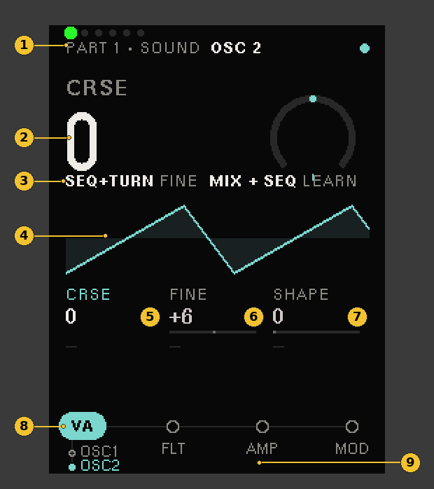

1. **Header:** page OSC 2.
2. **Focus band:** CRSE, 0.
3. **Hint:** as OSC 1.
4. **Picture:** live output.
5. **CRSE**, 0.
6. **FINE**, +6.
7. **SHAPE**, 0.
8. **Chain map:** VA lit.
9. **Sub-page row:** VA, OSC1, OSC2 (underlined), NOISE, PITCH.

| Cell | Range | INIT (OSC 1 / OSC 2) | What it does |
|---|---|---|---|
| **CRSE** | −24 to +24 semitones | 0 / 0 | Coarse tuning; on OSC 2, the interval |
| **FINE** | −100 to +100 cents | 0 / +6 | Fine tuning; INIT's +6 gives a slow beat and keeps XOR alive |
| **SHAPE** | 0–127 | 0 / 0 | Varies the sounding wave (below) |

| Wave | SHAPE 0 to 127 |
|---|---|
| Sine | Folds brighter, a sine of a sine |
| Triangle | Skews the rise from half the cycle to nearly all |
| Saw | Splits the reset into two steps a quarter cycle apart: the second harmonic thins, the fundamental holds |
| Square | Narrows the pulse from 50 % to 5 % (PWM) |

Between two waves SHAPE varies both, at a steady level. PIT moves the whole voice; CRSE and FINE move one oscillator.

## VA: MODE, how the oscillators combine

| MODE | What it does | BLEND from … to … |
|---|---|---|
| **MIX** | The two mixed; 64 is equal | 1 · 2 |
| **SYNC** | OSC 2 restarts at each OSC 1 cycle (hard sync) | 1 · 2 |
| **SOFT SYNC** | OSC 2 reverses at each OSC 1 cycle; gentle with sines and triangles | 1 · 2 |
| **RING** | The two multiplied | MIX · RING |
| **AM** | OSC 2 swells OSC 1's level; past about 85 runs on into RING | CLEAN · RING |
| **FM** | Through-zero FM of OSC 1 by OSC 2; pitch and SUB stay on OSC 1's note | CLEAN · DEEP |
| **PHASE** | OSC 2 warps OSC 1's phase, as in Casio's CZ phase distortion | CLEAN · WARP |
| **LOOPFM** | Each oscillator modulates itself, its WAVE setting how far; BLEND brings in OSC 2 | 1 · LOOP |
| **MAX** | The higher wave at each moment, corners rounded | MIX · MAX |
| **XOR** | The waves' 16-bit samples combined bit by bit; aliases on purpose | MIX · XOR |
| **BITS** | The mix crushed from 16 bits to 2, in small steps | CLEAN · CRUSH |

- **SYNC:** keep OSC 2 above OSC 1 and sweep its CRSE or FINE. OSC 1, the master, stops at 7 kHz in SYNC only.
- **FM:** depth rises faster towards the top; on very high notes it is limited to stay clean.
- **XOR:** identical oscillators XOR to silence; keep a few cents apart (under about 20 cents is a fat, moving texture).
- A MODE change while notes sound ducks for about 2.7 ms, swaps and returns, without a click.

**Why so many MODEs on one page:** each is a classic way two oscillators meet, analogue to digital, and all share WAVE, SHAPE, BLEND and SUB, so a Sound moves between them without being rebuilt.

> **Design note:** LOOPFM is built on Tamara Smyth's DAFx-26 paper "Loopback Frequency Modulation Using a Time-Varying Delay Line", re-implemented with its own loop curve. XOR follows Jari Kleimola's DAFx-08 work on bitwise operations between oscillators. Everything is measured against an alias limit, except XOR and BITS, excused the way the drummer is excused from the tuning check.

## VA: SUB

**SUB** adds a square an octave below OSC 1 after MODE, following OSC 1's pitch even under FM. As it comes up the oscillators dip so the total stays level: it thickens rather than adds level.

## VA: STABILITY


1. **Header:** PART 1 · SOUND, page VA.
2. **Focus band:** STABILITY, 119.
3. **STABILITY's glyph:** a spirit level; the further the bubble from the middle, the more drift.
4. **Hint:** `SEQ+TURN FINE`, `MIX + SEQ LEARN`.
5. **Picture:** live output.
6. **WAVE1**, 85.
7. **WAVE2**, 85.
8. **MODE**, MIX.
9. **BLEND**, 64.
10. **SUB**, 0.
11. **STABILITY**, 119, touched.
12. **Chain map:** VA lit.
13. **Sub-page row:** VA underlined, then OSC1, OSC2, NOISE; `>` for PITCH.

At **127** the oscillators are steady and every note starts in the same phase, so a render repeats exactly. Below 127 each voice behaves like an untrimmed analogue oscillator:

| Fault | What it does |
|---|---|
| Drift | Three slow random walks per voice, one shared, one per oscillator |
| Trim | A fixed detune per oscillator, up to about ±3 cents |
| High-frequency tracking | Each oscillator goes a little flat up high, so the pair beats faster up the keyboard |
| Scale error | Octaves slightly stretched or squeezed |
| Jitter | Each cycle's pitch wobbles very slightly |
| Free-running phase | Each attack a little different |

The top of the knob is fine-grained; at 0 the shared drift reaches about ±12 cents. Each voice's trims and errors are fixed by Part and voice, so they come back; drift and phase differ each take. The filter's own STABILITY (FLT › FX) is separate: see [FX: STABILITY](#fx-stability).

**Why:** an oscillator that never moves sounds like a computer. You choose between perfectly repeatable (127) and a little different every time.

> **Design note:** the tracking error is an estimate from the CEM3340 datasheet (a fixed delay each cycle that flattens high notes), the octave stretch that chip's typical untrimmed scale error, and the drift noise through two slow filters, so it wanders rather than wobbles. A very carefully engineered way of making something worse, which is most of analogue synthesis.

## VA: NOISE

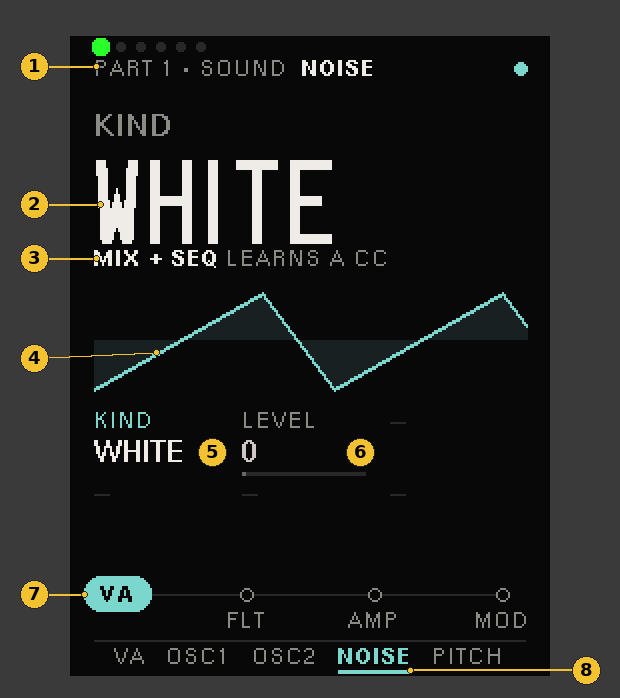

1. **Header:** page NOISE.
2. **Focus band:** KIND, WHITE.
3. **Hint:** `MIX + SEQ LEARNS A CC`.
4. **Picture:** live output.
5. **KIND**, WHITE.
6. **LEVEL**, 0.
7. **Chain map:** VA lit.
8. **Sub-page row:** VA, OSC1, OSC2, NOISE (underlined), PITCH.

| Cell | Range | INIT | What it does |
|---|---|---|---|
| **KIND** | WHITE, PINK, RED, DIGITAL | WHITE | The colour (below) |
| **LEVEL** | 0–127 | 0 | How much noise |

| KIND | Sound |
|---|---|
| **WHITE** | Even hiss |
| **PINK** | Softer, less top |
| **RED** | Dark rumble and wind |
| **DIGITAL** | Stepped grit that follows the key |

Noise joins beside SUB, after MODE, with the same level compensation. An envelope into LEVEL gives a breathy attack.

**Why one noise source after MODE:** inside a MODE it would be ring-modulated or XORed into something else.

## VA: the shared pages on a VA Part

See [the voice chain](#voice-chain-differences-between-engines). On VA, PIT hangs under the VA node, a new Sound starts on the 2040 filter, and with no route into VCA the key alone gates the note, so INIT routes ENV 1 into VCA at +127; leave AMP's BASE at 0. For West Coast tones, FX FOLD and AMP's LPG, DECAY and STRIKE suit sines in FM, PHASE or LOOPFM.

## VA: voices and what a patch costs

A VA note's cost depends mostly on the filter and the FX slot. One Part alone, beside the TAPE delay and QUAD reverb:

| Sound type | Example | Voices |
|---|---|---|
| VA on the 2040 | SOLO PORTA | 7 |
| VA with FUZZ | INIT VA, FX FUZZ | 6 |
| VA on the LADDER with FOLD | GROWL BASS | 5 |

See [limits](#limits-voices-cpu-and-memory).

## VA: starting points

INIT VA: two saws, OSC 2 FINE +6, MIX at BLEND 64, SUB 0, STABILITY 89, NOISE off, the 2040, ENV 1 into VCA.

- **Detuned pad (TAPE DRIFT):** STABILITY 76, slow ENV 1, very slow LFOs into OSC 2's FINE and into both SHAPEs in opposite directions.
- **Wide saws (SUPER SAWS):** OSC 2 CRSE +12, FINE +3, SUB about 44, an LFO into SHAPE1.
- **Sync lead (SYNC SCREAM):** SYNC, OSC 2 CRSE +7, ENV 2 into OSC 2's CRSE.
- **Ring bell (RING LEAD):** RING, BLEND about 44, OSC 2 CRSE +12, WAVE1 51, WAVE2 13, velocity into BLEND.
- **Flute (SOFT FLUTE):** WAVE1 121, WAVE2 sine at CRSE +12, BLEND 38, STABILITY 102, an LFO into SHAPE1, a touch of NOISE.
- **Crushed to clean (BIT BLOOM):** both sines, BITS at BLEND 0, ENV 2 into BLEND at +127.
- **Acid bass (ACID CLASSIC):** one saw (BLEND 0), STABILITY 64, LADDER, ENV 2 into cutoff, velocity into ENV 2's level.
- **Bass with sub (GLIDE BASS):** SUB and STABILITY about 25, mono with glide.
- **West Coast:** both sines, FM or PHASE at half, FOLD, LPG with DECAY and STRIKE.

These ship in the factory set (see [the card, Sounds and the library](#the-sd-card-projects-sounds-and-the-library)).

# TAPE, the sample engine

TAPE plays sound sources, held in the project's memory or streamed from the card, through one of four machines: WALK, STRETCH, SCRUB and WAVE. This chapter covers TAPE's own pages, **SRC**, **DECK** and **MCH**, and what TAPE does on the pitch page. The shared pages are in [the voice chain](#the-voice-chain-pitch-filter-fx-amp-stereo-and-sends), [envelopes and LFOs](#envelopes-and-lfos) and [the mod matrix](#the-mod-matrix-and-routes); getting sources onto the card is in [the SD card, Sounds and the library](#the-sd-card-projects-sounds-and-the-library).

## TAPE: what it is and how it plays

A TAPE Part's chain is **SRC · DECK · FLT · AMP · MOD**.

- **SRC** (SOURCE on the header) picks the source and the *window* that plays, **START** to **END**.
- **DECK** picks the machine with **MODEL** and holds the knobs that move its picture.
- **MCH**, under DECK, is the machine's own page, named in full on the header and the sub-page row (WALK, STRETCH, SCRUB, WAVE). It starts with the tape's wear: **TAPE**, **AGE**, **WOW**.
- **PIT** (PITCH on the sub-page row) is the last sub-page under DECK.

| MODEL | The machine |
|---|---|
| WALK | Plays the window once (FWD, REVERSE), round a loop (LOOP) or there and back (PING). TRON gives each key a Mellotron-style tape. |
| STRCH (STRETCH) | Plays at the key's pitch, stretched in time: CLASSIC and CLS POLY splice, GRAIN plays grains. |
| SCRUB | Moves through the source by hand, like a reel under your finger. Keys can place the finger. |
| WAVE | Plays a wavetable source of single-cycle frames. |

INIT TAPE has no source and is silent until you pick one. The factory TAPE Sounds bring their sources once the factory set is on the card.

Each machine draws its picture in the focus band (a runner, an accordion, a sponge on the tape, film through a gate); DECK's knobs move it.

> **Design note:** TAPE treats a recording as raw oscillator material, in the spirit of the 12-bit samplers of the late 80s. Sources are 12-bit with a sample rate of their own, as on the Akai S950. Pitching a source up is not filtered against aliasing: well above its own speed the top end folds back, the gritty character the E-mu SP-1200 made famous, kept on purpose and bounded. Think of it as a vintage sampler that never needs its floppy drive cleaned.

## TAPE: sources and memory

A source is a `.SRC` file in `/CHIMERA/TAPES` on the card: Chimera's own format, mono, 12-bit. TAPE plays only these; converting your own recordings isn't part of this release. A source's file name is a checksum of its contents, so the same source is never stored twice.

A project **loads** a source into its memory (the pool). A source too long for the memory left **streams** from the card while it plays. SETTINGS › PROJECT › POOL shows the pool; PURGE UNUSED SRC frees sources no Part uses, leaving the card's files ([SETTINGS](#settings)). Sizes and stream counts are in [limits](#limits-voices-cpu-and-memory).

While the project is open, each source remembers the Part's **START**, **END**, **PITCH** and **FINE** on it, so turning SOURCE away and back restores them. This is not saved; a saved Sound keeps its own source's values.

**Why:** the card is inside the case, so files arrive over USB and the card never fills with copies. Memory lets machines jump anywhere in a source; streaming lets a long one play at all.

## TAPE: the SRC page (source)


1. **Readout:** rate, length, memory (`24K · 1.5 S · 53K`); a streamed source shows `… · 7 STREAMS`.
2. **Strip:** the waveform, window lit, play heads.
3. **SOURCE.**
4. **END** (START beside it); **MIX + turn** snaps to an onset.
5. **VOL.**
6. TAPE's chain map, SRC lit.

| Cell | Range | Default | What it does |
|---|---|---|---|
| **SOURCE** | project's sources, then the card's | none | The source; the cell shows its length, a card source's size, or a state (below). |
| **START** | the source, in time | 0 MS | Window start. A matrix destination, read at note start: VEL into START starts harder notes further in. |
| **END** | the source, in time | source's end | Window end. Before START, the window plays backwards. |
| **VOL** | 0–127 | 45 | The source's level. |

START and END read `137 MS` or `1.500 S`. A slow turn moves 1 ms a detent, a fast one up to 100 ms (at least a hundredth of the source). **MIX + turn** jumps to the next onset that way (band: `MIX + TURN NEXT ONSET`); with none, the mark stays. On a streamed source only the parts held in memory can be searched. A held note doesn't follow START or END.

### TAPE: picking a card source

Turn **SOURCE** past the project's sources, over a divider, to the card's.


1. **Memory meter**, with what loading would take.
2. Name, rate, length, size.
3. **MIX + PLUS** loads it and the Part plays it; WON'T FIT if it can't.
4. Unloaded: SOURCE shows its size, dimmed.

While it loads the screen shows BUSY; **MENU** cancels.

### TAPE: the source states

| State | Cell | Focus band | Meaning, what to do |
|---|---|---|---|
| Loaded | `1.5 S` | `24K · 1.5 S · 53K` | In memory; every machine plays it. |
| Streamed | its length | `24K · 30.0 S · 7 STREAMS` | Plays from the card; the number is notes at once. Some machines need RAM (below). |
| Card, fits | size, dimmed | `LOADS · 41K` | **MIX + PLUS** loads it. |
| Card, won't fit | size, dimmed | `WON'T FIT · NEEDS 41K, 28K FREE` | Free memory with PURGE UNUSED SRC. |
| No source | NONE | | Pick one. |
| Missing | MISSING | SOURCE MISSING | The Sound names a source the project doesn't hold. |
| Not on card | NO FILE | SOURCE NOT ON CARD | Copy the file or factory set into `/CHIMERA/TAPES`. |
| No room | NO ROOM | POOL FULL | The project's memory is full. |
| Read failed | ERROR | CARD READ FAILED | The card couldn't be read. |
| Streams full | FULL | STREAMS FULL | More than eight streamed sources at once. |
| Fragmented | FRAG | FRAGMENTED · SILENT | File in too many pieces to stream. |
| Bad file | BAD FILE | BAD FILE · DROPS OUT | Part of a streamed file is unreadable; only notes reading it drop out. |
| Not a wavetable | NO WAVE | NEEDS A WAVE TABLE | WAVE needs a wavetable; SOURCE's band says `TURN SOURCE TO A WAVE TABLE`. |


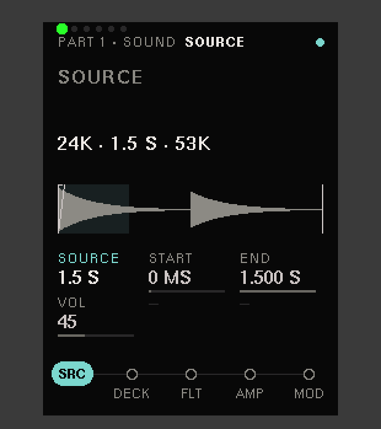

## TAPE: what a streamed source can't play

A streamed source is read forward only. WALK on **REVERSE** or **PING** (or END before START), **STRETCH**, **SCRUB** and **WAVE** need it in memory; WALK forward, on LOOP or with TRON streams.

Turning **MODEL** or **DIRECTION** onto a choice the source can't play lands on it dimmed, changes nothing, and says why: `PING NEEDS RAM · STREAMED`, `REVERSE NEEDS RAM · STREAMED`, `STRETCH NEEDS RAM · STREAMED`, `SCRUB NEEDS RAM · STREAMED`, `WAVE NEEDS RAM · STREAMED`. On SOURCE, a card file that can neither load nor stream reads RAM (the machine needs it), TOO BIG with `TRANSWAVE: NO STREAM` (wavetables never stream) or `ZONES: NO STREAM`, or SHORT with `TOO SHORT TO STREAM`.

A streamed LOOP's crossfade is capped at 100 ms of source: `STREAMED · XFADE CAPPED AT 100 MS`.

**Why:** a card reads fast only straight ahead; jumping would drop out. TAPE tells you on the cell you are turning rather than playing silence.

## TAPE: the DECK page

**DECK** is TAPE's home: **MODEL** (WALK, STRCH, SCRUB, WAVE; default WALK), then five knobs named by the machine.

Turning MODEL sets the new machine's knobs to their defaults, keeping the window, WALK's DIRECTION and the wear. Onto WALK once through, or STRETCH, it also sets ENV 1 to open instantly and hold, so the source is its own envelope, as on a sampler pad. **MIX + SEQ** learns MODEL to a CC.

**Why:** a fresh machine with the last machine's numbers usually makes no useful sound; defaults that play let you hear it first.

## TAPE: WALK


1. Header: PART 1 · SOUND, page DECK.
2. Focused cell, large: DIRECTION FORWARD.
3. **Picture:** a runner facing the way it plays.
4. Hint line: MIX + SEQ LEARNS A CC.
5. **Strip:** window lit, play head.
6. **MODEL:** WALK.
7. **LENGTH:** 127.
8. **FADE:** HOLD.
9. **DIR:** FWD.
10. **POSITION:** 0.
11. **DRIFT:** 0%.
12. Chain map, DECK lit.
13. Sub-page row: DECK WALK PITCH, DECK underlined.

| Cell | Range | Default | What it does |
|---|---|---|---|
| **LENGTH** | 0–127; 0.25–8 s with TRON | 127 once, 102 looped | How much plays from POSITION; around a loop, the loop's size; with TRON, the tape's length. |
| **FADE** | 10–500 ms, then HOLD | HOLD once, 32 ms looped | The fade at the note's edges. HOLD (once through, TRON off) plays to the end whatever the key does: a one-shot. |
| **DIRECTION** (DIR) | FWD, REVERSE, LOOP, PING | LOOP | Once forward, once backward, round a loop, there and back. |
| **POSITION** | 0–127 | 0 | Where the run starts (REVERSE counts from END); around a loop, where the loop sits. |
| **DRIFT** | 0–100 % | 0 % | Each note moves POSITION by a random step up to DRIFT of the window, wrapping; repeats wander the source. |

Turning DIRECTION between once through and looped sets LENGTH and FADE to that side's defaults.


1. Header: page DECK.
2. Focused cell, large: MODEL WALK.
3. **Picture:** the runner goes round a track.
4. Hint line: MIX + SEQ LEARNS A CC.
5. **Strip:** the loop lit; LENGTH sizes it, POSITION places it.
6. **MODEL:** WALK.
7. **LENGTH:** 102, the looped default.
8. **FADE:** 32 ms, dimmed: the amp release ends the note.
9. **DIR:** LOOP.
10. **POSITION:** 0.
11. **DRIFT:** 0%.
12. Chain map, DECK lit.
13. Sub-page row, DECK underlined.


1. Header: page DECK.
2. Focused cell, large: DIRECTION PING.
3. **Picture:** runners both ways, the arrow pointing both ways.
4. Hint line: MIX + SEQ LEARNS A CC.
5. **Strip:** window lit.
6. **MODEL:** WALK.
7. **LENGTH:** 102.
8. **FADE:** 32 ms, dimmed.
9. **DIR:** PING.
10. **POSITION:** 0.
11. **DRIFT:** 0%.
12. Chain map, DECK lit.
13. Sub-page row, DECK underlined.

**FADE and the amp envelope.** A note has one release. With no VCA route, FADE is it. With an envelope routed into the VCA, its release ends the note: on LOOP and PING, FADE is dimmed (`AMP RELEASE ENDS THE NOTE`); once through, only HOLD still counts (`BELOW HOLD AMP RELEASE ENDS IT`). TRON keeps FADE whatever the routes.

**Why:** two releases on one note would fight; the rule picks one and the screen says which.

### TAPE: TRON

With **TRON** ON each key has its own tape: **LENGTH** reads 0.25 to 8 s, the same at every pitch. The window plays from POSITION and comes round again, its seam crossfaded by XFADE, until the tape runs out; at key up the pressure pad lifts through **FADE**. TRON streams.


1. Header: page DECK.
2. Focused cell, large: DIRECTION FORWARD.
3. **Picture:** a finish post marks the tape's end.
4. Hint line: MIX + SEQ LEARNS A CC.
5. **Strip:** play head, the tape's end dotted.
6. **MODEL:** WALK.
7. **LENGTH:** 8.0 s, in seconds with TRON.
8. **FADE:** 500 ms, the pad lifting at key up.
9. **DIR:** FWD.
10. **POSITION:** 0.
11. **DRIFT:** 0%.
12. Chain map, DECK lit.
13. Sub-page row, DECK underlined.

> **Design note:** TRON is modelled on the Mellotron M400, where every key has its own strip of tape about eight seconds long, and a held note simply runs out. Chimera keeps the run-out audible whatever the source: the tape's length is a time, not a stretch of the recording, so even a short source comes round again until the tape ends. Unlike the real thing, nobody has to rewind the tape frame afterwards.

## TAPE: WALK's machine page


1. Header: page WALK.
2. Focused cell, large: TAPE 0.
3. **Picture:** runner and finish post (TRON on).
4. Hint line: SEQ+TURN FINE, MIX + SEQ LEARN.
5. The picture band: a test wave in this shot.
6. **TAPE:** 0.
7. **AGE:** 0.
8. **WOW:** CAPSTAN, dimmed at TAPE 0.
9. **TRON:** ON.
10. **XFADE:** 25.
11. **RETRIG:** STACK, dimmed with TRON on.
12. Chain map, DECK lit.
13. Sub-page row: DECK WALK PITCH, WALK underlined.

| Cell | Range | Default | What it does |
|---|---|---|---|
| **TRON** | OFF, ON | OFF | The Mellotron-style tape. |
| **XFADE** | 0–127 | 25 | The loop seam's crossfade, as a share of the loop (127 is half). LOOP and TRON only. |
| **RETRIG** | STACK, CUT | STACK | STACK: notes overlap. CUT: a new note cuts the last. Once through, TRON off. |

Unusable cells are dimmed with the reason: `ONLY LOOP AND TRON CROSSFADE`, `PING-PONG TURNS · NO SEAM`, `CUTS ONLY ONCE THROUGH`, `CUTS ONLY WITH TRON OFF`.

## TAPE: the wear on every machine

Every machine page starts with the wear, kept across MODEL turns.

| Cell | Range | Default | What it does |
|---|---|---|---|
| **TAPE** | 0–127 | 0 | Wow and flutter, up to about a quarter semitone. Matrix destination. |
| **AGE** | 0–127 | 0 | Darker (up to three octaves less top), with hiss; past halfway, dropouts. Matrix destination. |
| **WOW** | CAPSTAN, WARBLE | CAPSTAN | CAPSTAN: a tape machine's steady wow. WARBLE: pitch glides to new random places. |

With TAPE at 0 and nothing routed, WOW is dimmed: `TAPE AT 0 · NO WOW TO SHAPE`.

## TAPE: STRETCH

STRETCH plays the source at the key's pitch, stretched or squeezed in time.

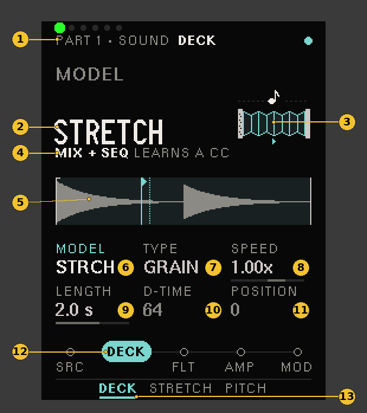

1. Header: page DECK.
2. Focused cell, large: MODEL STRETCH.
3. **Picture:** an accordion under a note.
4. Hint line: MIX + SEQ LEARNS A CC.
5. **Strip:** window lit, play head.
6. **MODEL:** STRCH.
7. **TYPE:** GRAIN.
8. **SPEED:** 1.00x.
9. **LENGTH:** 2.0 s (GRAIN).
10. **D-TIME:** 64, dimmed (CLASSIC only).
11. **POSITION:** 0, dimmed (CLASSIC only); a dimmed cell says why in the band.
12. Chain map, DECK lit.
13. Sub-page row: DECK STRETCH PITCH, DECK underlined.

| Cell | Range | Default | What it does |
|---|---|---|---|
| **TYPE** | CLASSIC, CLS POLY, GRAIN | GRAIN | How it stretches; fixed per note. |
| **SPEED** | `-1.00x` to `2.00x` | `1.00x` | Speed through the source: `0.00x` freezes, below 0 runs backwards. Fine steps below 1×. |
| **LENGTH** | 0.25–8 s | 2.0 s | GRAIN: time to play the window, the same on every key. |
| **D-TIME** | 0–127 | 64 | CLASSIC, CLS POLY: splice length, 10 to 250 ms. |
| **POSITION** | 0–127 | 0 | CLASSIC, CLS POLY: start in the window. |

| TYPE | What it does |
|---|---|
| CLASSIC | Overlapping splices, locked to the source's pitch period. For pitched sources. |
| CLS POLY | Splices at D-TIME, for chords and unpitched sources. |
| GRAIN | Four overlapping grains at the key's pitch while a pointer walks the window in LENGTH. In tune at any LENGTH; on pitched sources the grains lock to the period. |

The other TYPE's cells are dimmed: `GRAIN TYPE ONLY` or `CLASSIC TYPE ONLY`.

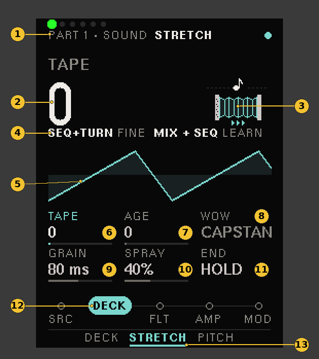

1. Header: page STRETCH.
2. Focused cell, large: TAPE 0.
3. **Picture:** the accordion.
4. Hint line: SEQ+TURN FINE, MIX + SEQ LEARN.
5. The picture band: a test wave in this shot.
6. **TAPE:** 0.
7. **AGE:** 0.
8. **WOW:** CAPSTAN, dimmed at TAPE 0.
9. **GRAIN:** 80 ms.
10. **SPRAY:** 40%.
11. **END:** HOLD.
12. Chain map, DECK lit.
13. Sub-page row, STRETCH underlined.

| Cell | Range | Default | What it does |
|---|---|---|---|
| **GRAIN** | 30–250 ms | 80 ms | Grain length: short is grittier, long smoother. |
| **SPRAY** | 0–100 % | 40 % | Scatters grains up to 25 ms so unpitched sources never comb; whole periods on pitched ones. |
| **END** | HOLD, STOP | HOLD | At the window's end: HOLD keeps the last grains while held (up to 8 s); STOP ends the note. |

These are GRAIN's; a turn affects grains to come. Key up is the amp envelope's.

> **Design note:** CLASSIC is inspired by the Akai S950's time-stretch, done in real time: the S950 had to render a stretched version and make you wait, while CLASSIC stretches as you play. GRAIN's grain core uses code adapted from Émilie Gillet's Mutable Instruments Beads (MIT licence): its pulse-train clock, bell-shaped window and grain stealing. The delay's GRAIN type runs the same core. Around it, Chimera adds what a sampler needs and Beads doesn't: a pointer that reaches the end in exactly LENGTH seconds on every key, grains that lock to the source's pitch so a stretched tone stays a tone, and levels that hold steady whether the grains agree or not. It is an accordion for sound, minus the folk club.

## TAPE: SCRUB


1. Header: page DECK.
2. Focused cell, large: FINGER 51.
3. **Picture:** a sponge on the tape.
4. Hint on FINGER with KEY at POSITION: KEYS PLACE THE FINGER.
5. **Strip:** the finger marked.
6. **MODEL:** SCRUB.
7. **FINGER:** 51.
8. **SPEED:** 1.00x.
9. **LENGTH:** 70 ms.
10. **XFADE:** 25.
11. **DRAG:** 32 ms.
12. Chain map, DECK lit.
13. Sub-page row: DECK SCRUB PITCH, DECK underlined.

| Cell | Range | Default | What it does |
|---|---|---|---|
| **FINGER** | 0–127 | 0 | The finger's place. Turn it like a jog wheel: it follows your hand's speed and glides to a stop through DRAG. CC and matrix move it too. |
| **SPEED** | −2× to 2× | `1.00x` | Speed of the short loop under the finger. |
| **LENGTH** | 2 ms to 2 s | 70 ms | The loop under the finger, at most the window. |
| **XFADE** | 0–127 | 25 | The loop seam's crossfade. |
| **DRAG** | 10–500 ms | 32 ms | Stop time: a hand on the reel to a heavy flywheel. |


1. Header: page SCRUB.
2. Focused cell, large: TAPE 0.
3. **Picture:** the sponge.
4. Hint line: SEQ+TURN FINE, MIX + SEQ LEARN.
5. The picture band: a test wave in this shot.
6. **TAPE:** 0.
7. **AGE:** 0.
8. **WOW:** CAPSTAN, dimmed at TAPE 0.
9. **KEY:** POSITION.
10. Chain map, DECK lit.
11. Sub-page row, SCRUB underlined.

| Cell | Options | Default | What it does |
|---|---|---|---|
| **KEY** | POSITION, PITCH | POSITION | POSITION: keys place the finger and play at the root; C is the window's start, each semitone 1/12 further, every octave alike; FINGER adds. PITCH: keys transpose. |

On KEY POSITION a legato key change (STEAL at GLIDE) slides the finger.

**Why 70 ms:** under about 50 ms the loop fuses into a buzz; over about 100 ms a sweep stutters and answers late.

**Why KEY POSITION:** SCRUB's pitch belongs to SPEED and the finger; keys as places make the keyboard a map of the source, as slices do on samplers.

## TAPE: WAVE

WAVE scans a wavetable source's single-cycle frames, so the tone morphs.


1. Header: page DECK.
2. Focused cell, large: MODEL WAVE.
3. **Picture:** film through a gate, the wave under it.
4. Hint line: MIX + SEQ LEARNS A CC.
5. **Strip:** the frames, playing ones lit.
6. **MODEL:** WAVE.
7. **FRAME:** 0.
8. **SCAN:** 0.
9. **RANGE:** 127.
10. Chain map, DECK lit.
11. Sub-page row: DECK WAVE PITCH, DECK underlined.

| Cell | Range | Default | What it does |
|---|---|---|---|
| **FRAME** | 0–127 | 0 | The frame the scan starts from. |
| **SCAN** | −64 to +63 | 0 | Sweep speed back and forth; 0 stays on FRAME. |
| **RANGE** | 0–127 | 127 | How many frames the sweep covers. |

All three are matrix destinations: an LFO on FRAME is the classic sweep. Each frame is stored at several resolutions, so high notes don't alias. WAVE's own page holds only the wear:


1. Header: page WAVE.
2. Focused cell, large: TAPE 0.
3. **Picture:** film through a gate.
4. Hint line: SEQ+TURN FINE, MIX + SEQ LEARN.
5. The picture band: a test wave in this shot.
6. **TAPE:** 0.
7. **AGE:** 0.
8. **WOW:** CAPSTAN, dimmed at TAPE 0.
9. Chain map, DECK lit.
10. Sub-page row: DECK WAVE PITCH, WAVE underlined.

> **Design note:** WAVE follows the wavetable synths of the 80s and 90s: single-cycle frames, scanned, each kept at a ladder of octave-spaced versions so a high note never folds, in the spirit of the PPG Wave and the Waldorf Microwave. The factory WAVE sources are transwave-style tables made from Chimera's own engines (morphing, saw, bowed, brass). Somewhere, a 1990s workstation is feeling very flattered.

## TAPE: the pitch page

**PIT** is the shared [pitch page](#the-voice-chain-pitch-filter-fx-amp-stereo-and-sends). On TAPE:

- A source plays from its root: C4 plays a C4-rooted source at its own speed. PITCH and FINE shift from there.
- A source with no known root shows `ROOT ?` and its shift (`+7st +0ct`).
- **SNAP MUSICAL** steps fifths and fourths, keeping sampled material in key with itself.
- SCRUB on KEY POSITION plays at the root whatever the key.
- Pitching far up folds the top end by design: on a 24 kHz source, from about 18 semitones up.


1. Header: page PITCH.
2. Focused cell, large: PITCH 0.
3. Hint line: SEQ+TURN FINE, MIX + SEQ LEARN.
4. The picture band, where the tuner shows the note sounding (or `ROOT ?`); a test wave in this shot.
5. **PITCH:** 0.
6. **FINE:** 0.
7. **STEAL:** CUT.
8. **TIME:** 150 ms.
9. **SNAP:** CHROMA.
10. Chain map, DECK lit.
11. Sub-page row: DECK WALK PITCH, PITCH underlined.


## TAPE: the pages it shares

- **AMP:** a VCA route makes the envelope's release end the note, in place of WALK's FADE.
- **SND** holds the reverb send; TAPE's pages have none.
- **The matrix:** destinations are START, POSITION, FINGER, FRAME, SPEED, SCAN, LENGTH (WALK, SCRUB), D-TIME, RANGE, TAPE and AGE. STRETCH's LENGTH, GRAIN, SPRAY, XFADE, DRAG and DRIFT are not. **MIX + PLUS** primes one.

RANDOMIZE ([SETTINGS](#settings)) never touches a TAPE Sound's source, MODEL, place or pitch.

## TAPE: starting points

From the factory TAPE Sounds; 0–127 unless the cell shows a unit.

- **One-shot (EPIANO HIT, TX BASS HIT, BELL HIT):** WALK, DIR FWD, FADE HOLD, LENGTH 127.
- **Reversed hit (BELL BACKWARDS):** the same with START and END swapped.
- **Sustained loop (PAD LOOP, BRASS LOOP):** WALK, DIR LOOP, LENGTH 127, START past the attack; DRIFT for variety.
- **Ping-pong pad (PAD PINGPONG):** WALK, DIR PING, POSITION 64, LENGTH 127.
- **Mellotron (TRON BOWED):** WALK, FWD, TRON ON, FADE 32 ms, TAPE 38, WOW WARBLE.
- **Stretched voice (STAB STRETCH, VOICE STRETCH):** STRETCH, GRAIN defaults; SPEED `0.00x` freezes.
- **Scrubbed texture (SAW SCRUB, RAIN SCRUB):** SCRUB defaults; keys jump, FINGER scrubs.
- **Wavetable sweep:** WAVE on WAVE MORPH or WAVE SAW, an LFO into FRAME.
- **Worn tape:** TAPE about 38, AGE about 40; past 64 adds dropouts.

# DRUM, the kit engine

A DRUM Part plays a kit of twelve pads. Each pad is a drum machine of its own (a kick, a snare, a hat, a plain sine...) with its own knobs, level, pan, choke group, filter, amp envelope, mod envelope, LFO and four routes. This chapter covers the kit and its keymap, the pad pages, every MACHINE, choke and voice groups, saving kits, and voice cost. Filter TYPEs, the FX slot and the Part's modulation are explained once in [the voice chain](#the-voice-chain-pitch-filter-fx-amp-stereo-and-sends), [envelopes and LFOs](#envelopes-and-lfos) and [the mod matrix](#the-mod-matrix-and-routes).

## DRUM: what a kit is

Load **INIT DRUM** from the Sound browser (**EDIT + B*n***, the INIT rows at the top) and the Part becomes a kit, in two layers:

- **Twelve pads.** Each holds a MACHINE and its knobs, LEVEL, PAN, CHOKE, RETRIG, a filter, an AMP envelope with a gate, a mod envelope, an LFO and four routes.
- **The Part's Sound, shared by every pad:** the FX slot, filter modulation and jacks, envelopes, LFOs, matrix, WIDTH and sends.

A note strikes a pad; the hit takes a copy of the pad at that moment and plays it through the Part's chain.

**Why:** a full Sound per pad would take more memory than six Parts have. A compact pad, as on an Analog Rytm, gives each drum what makes it a different drum, while the costly parts of the chain (FX slot, matrix) stay one per Part.

> **Design note:** The pads' layout, the choke groups and the way notes reach pads are inspired by the Elektron Analog Rytm. The machines' names and knob sets are in the spirit of the Elektron Machinedrum's machines, after its manual only: no Elektron code, ROM or samples, and every algorithm is Chimera's own. Each machine was first built on a computer, auditioned by ear, then ported to the instrument line for line, so the firmware's output matches the prototype sample for sample. Think of it as a drum machine that grew up reading other drum machines' manuals, and never their diaries.

## DRUM: the chain map

```
   KIT ──────── MCH ──────── FLT ──────────── AMP ──────── MOD
    └ KEYS       └ MORE       ├ FMD             ├ GATE       ├ PENV  PLFO  ROUTE
                              ├ FX              └ SENDS      ├ E1  E2  E3  SPD
                              └ JACK                         └ L1  L2  L3
```

| Whose | Pages (full name on the row) |
|---|---|
| pad | **KIT**, **KEYS**, **MCH** (MACHINE), **MORE**, **AMP**, **PENV** (PAD ENV), **PLFO** (PAD LFO), **ROUTE** |
| pad and Part | **FLT** (FILTER: pad filter, Part FX), **GATE** (pad gate, Part WIDTH) |
| Part | **FMD** (MODULATION), **FX**, **JACK** (JACKS), **SND** (SENDS), **MTX** (MATRIX), **E1 E2 E3 SPD L1 L2 L3** (ENV1 ENV2 ENV3 SPEED LFO1 LFO2 LFO3) |

DRUM has no PITCH or STEREO page: each machine tunes itself. The header names the pad being edited: `PART 1 · 02 TONE SNARE  KIT`, or the machine's last word when it doesn't fit (`03 IMPULSE`).

## DRUM: the pad gestures

| Keys | Does |
|---|---|
| **MIX + MINUS / PLUS** | Previous / next pad, staying on the page. On FLT this includes the Part's FX and FX PLACE cells |
| Turn **PAD** (KIT, KEYS) | Pick a pad, 01 to 12 |
| Play a note | Strikes its pad and lights its tile; may select it ([PAD FOLLOW](#drum-pad-follow)) |

The hint line shows `MIX + -/+ PAD` on every pad cell. Pad cells have no MIDI-learn (**MIX + SEQ** does nothing) and no NRPN address; the Part's own cells learn as on any engine ([MIDI](#midi-channels-maps-and-controllers)).

## DRUM: the KIT page


1. **Header:** `PART 1 · 01 TONE KICK`, page KIT.
2. **Focused cell:** PAD, 01.
3. **Machine icon,** large, with its family letter (T).
4. **Hint:** `MIX + -/+ PAD`.
5. **The twelve pads:** number, choke group, icon; 01 framed.
6. **PAD.**
7. **MACHINE:** KICK.
8. **LEVEL.**
9. **PAN.**
10. **TONAL.**
11. **Chain map:** KIT lit.
12. **Sub-page row:** KIT KEYS, KIT underlined.

Family letters: **T** TONE, **M** METAL, **B** BODY, **P** PLAIN. A pad lights while it sounds.

| Cell | Range | Default | What it does |
|---|---|---|---|
| **PAD** | 01 to 12 | 01 | Which pad every pad page edits |
| **MACHINE** | twelve machines, NONE | per pad | What the pad plays ([every machine](#drum-every-machine)) |
| **LEVEL** | 0 to 127 | 127 | Pad level, before the filter |
| **PAN** | L64 to R63 | C | Pad position, constant power |
| **TONAL** | OFF, 01 to 12 | OFF | The kit's keymap ([below](#drum-the-kit-keymap-and-tonal)); the same whichever pad is selected |

A new MACHINE takes its own knob defaults; the pad's other settings stay.

**Why:** LEVEL acts before the filter so a quieter pad drives LADDER or DIRTY less, as on an analogue filter.

## DRUM: the KIT keymap and TONAL

**TONAL OFF** (default): every note strikes pad *note mod 12*; the kit repeats every octave.

| Note | C | C# | D | D# | E | F | F# | G | G# | A | A# | B |
|---|---|---|---|---|---|---|---|---|---|---|---|---|
| Pad | 01 | 02 | 03 | 04 | 05 | 06 | 07 | 08 | 09 | 10 | 11 | 12 |

**TONAL on a pad:** C0 to B0 (MIDI 0–11) still strike the twelve pads. From C1 up every note plays the TONAL pad, with middle C at its own pitch. A TONE TOM becomes a tom bass, a PLAIN SINE a sine bass.

- The note moves the machine's PITCH knob; the rest of the pad stays.
- The pad keeps RETRIG and CHOKE: set RETRIG to STACK for chords.
- Machines with no PITCH (TONE CLAP, BODY SHAKER, PLAIN NOISE) play the same hit everywhere: `NO PITCH ON CLAP`.
- TONAL on a NONE pad plays nothing from C1 up: `NONE PLAYS NOTHING`.


**Why:** a note's pad depends on the saved kit, never on the screen. OFF suits pad controllers, sequencers and General MIDI parts (notes from 36 up); TONAL puts the pad's pitch at middle C, where a keyboard plays.

## DRUM: the KEYS page


1. **Header:** `PART 1 · 01 TONE KICK`, page KEYS.
2. **Focused cell:** PAD, 01.
3. **Machine icon.**
4. **Hint:** `MIX + -/+ PAD`; on CHOKE, `GROUPS n/8`.
5. **The twelve pads,** 01 framed.
6. **PAD.**
7. **CHOKE:** OFF.
8. **RETRIG:** CUT.
9. **Chain map:** KIT lit.
10. **Sub-page row:** KIT KEYS, KEYS underlined.

KEYS (**SEQ** from KIT) sets how the pad's hits meet.

| Cell | Range | Default | What it does |
|---|---|---|---|
| **PAD** | 01 to 12 | | As on KIT |
| **CHOKE** | OFF, A, B, C, D | per pad | A hit ends every other pad in the group. OFF: chokes nothing |
| **RETRIG** | STACK, CUT | CUT | CUT: a hit ends the pad's own ringing hit. STACK: hits overlap |

An ended hit fades quickly, so a choke never clicks. Classic use: open and closed hats in one group.

## DRUM: choke groups and voice groups

A Part has eight voices. A choke group sounds one pad at a time; each group in use and each CHOKE OFF pad counts as one voice group. A kit holds at most **8 voice groups**; NONE pads count too.

- On CHOKE the hint reads `GROUPS n/8`; INIT DRUM reads `GROUPS 8/8`.
- A turn that would make a ninth lands dimmed with `9 GROUPS · KIT HOLDS 8`; nothing is written. From a controller, the reason shows as a toast.


A STACK pad short of a voice ends its own oldest hit, never another pad's. A CUT pad takes a voice as any note does.

**Why:** a steal is a choke nobody chose. Stealing from other pads sounded worse everywhere but the busiest breakbeat; eight groups in eight voices means a kit never steals from itself.

## DRUM: the INIT kit

Every pad on RETRIG CUT, LEVEL 127, PAN C:

| Pad | MACHINE | CHOKE | Set from defaults |
|---|---|---|---|
| 01 | TONE KICK | OFF | |
| 02 | TONE SNARE | OFF | |
| 03 | PLAIN IMPULSE | A | a rimshot |
| 04 | TONE CLAP | A | |
| 05 | TONE TOM | OFF | PITCH 30, about 82 Hz |
| 06 | TONE TOM | B | PITCH 50, 113 Hz |
| 07 | TONE TOM | B | PITCH 70, about 157 Hz |
| 08 | METAL HAT | C | DECAY 20 (39 ms): closed |
| 09 | METAL HAT | C | DECAY 80 (about 0.3 s): open |
| 10 | TONE CYMBAL | D | |
| 11 | TONE COWBELL | D | |
| 12 | BODY SHAKER | OFF | |

Every pad's sound starts as CLEAN LP4 at 20.0 kHz, Q 0; an open AMP (DECAY INF, 1-SHOT, VEL 127); no gate; PENV 0/0/64 at MED; PLFO SINE, SPEED 6, DEPTH 127; no routes.

## DRUM: the MCH and MORE pages

**MCH** (MACHINE on the row) holds the machine's first six knobs, as in the TONE KICK image below. **MORE** (**SEQ** from MCH) holds MACHINE and the last two. Values show in the machine's unit (Hz, ms, semitones, a ratio such as 1.47x, octaves such as 0.50 OCT, or an amount); labels over seven letters are shortened on the cell (SWEEP TIME as SWPT) and spelled out in the focus band. A knob the machine lacks is empty.


1. **Header:** `PART 1 · 01 TONE KICK`, page MORE.
2. **Focused cell:** MACHINE, full name TONE KICK (the dot sits to the left of it).
3. **Machine icon.**
4. **Hint:** `MIX + -/+ PAD`.
5. **Picture band:** a test wave.
6. **MACHINE:** KICK.
7. **START** (knob G).
8. **HARM** (knob H, HARMONICS).
9. **Chain map:** MCH lit.
10. **Sub-page row:** MACHINE MORE, MORE underlined.

The knobs, LEVEL, PAN and VEL are read at the strike; the filter, envelopes, LFO and route amounts follow a ringing hit ([what a ringing hit follows](#drum-what-a-ringing-hit-follows)).

**Why:** the knobs set up the strike itself; latching them keeps every machine exact and cheap, while the filter and envelopes carry the movement.

## DRUM: every machine

Twelve machines in four families, and NONE. The letter is the badge on the pad's icon.

| Family | Machines | How it sounds |
|---|---|---|
| **TONE** (T) | TONE KICK, TONE SNARE, TONE TOM | A sine body swept down, noise, drive |
| **TONE** (T) | TONE CLAP | Noise bursts through a band-pass, then a tail |
| **TONE** (T) | TONE COWBELL, TONE CYMBAL | Square waves through band-passes |
| **METAL** (M) | METAL HAT | Six squares through band-passes, with noise |
| **METAL** (M) | METAL JINGLE | The squares rung higher, gated by shaken particles |
| **BODY** (B) | BODY SHAKER | Noise grains in a shake, through a band-pass |
| **PLAIN** (P) | PLAIN SINE, PLAIN NOISE, PLAIN IMPULSE | One source under one decay |
| | NONE | Plays nothing |

Knobs are listed in cell order: six on MCH, then MORE's. Each MCH image's hint reads `MIX + -/+ PAD`, `SEQ+TURN FINE`.

### DRUM: TONE KICK

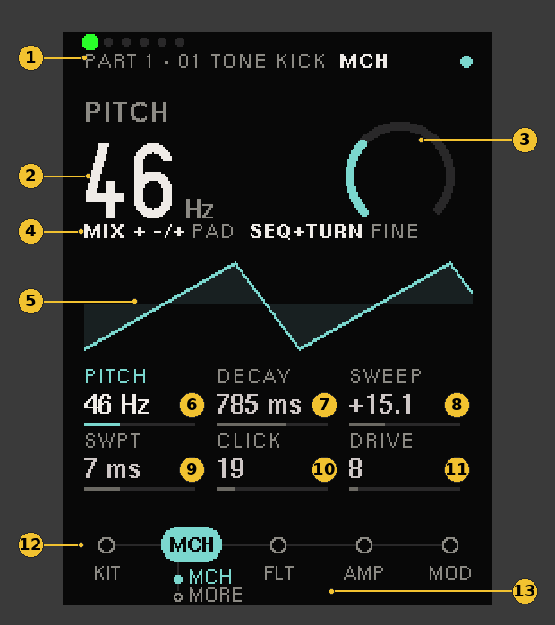

1. **Header:** `PART 1 · 01 TONE KICK`, page MCH.
2. **Focused cell:** PITCH, 46 Hz.
3. **Arc:** where the value sits in its range.
4. **Hint:** `MIX + -/+ PAD`, `SEQ+TURN FINE`.
5. **Picture band:** a test wave.
6. **PITCH.**
7. **DECAY.**
8. **SWEEP.**
9. **SWPT.**
10. **CLICK.**
11. **DRIVE.**
12. **Chain map:** MCH lit.
13. **Sub-page row:** MACHINE MORE, MACHINE underlined.

| Cell | Range | Default | What it does |
|---|---|---|---|
| **PITCH** | 30–120 Hz | 46 Hz | Where the body settles |
| **DECAY** | 80 ms–3.00 s | 785 ms | Body ring |
| **SWEEP** | 0.0 to +48.0 | +15.1 | Start, semitones above PITCH |
| **SWEEP TIME** (SWPT) | 2–120 ms | 7 ms | Sweep fall |
| **CLICK** | 0–120 | 19 | Attack click |
| **DRIVE** | 0–100 | 8 | Saturation |
| **START** (MORE) | 0–100 | 0 | Starts up to a quarter cycle in: harder edge |
| **HARMONICS** (MORE, HARM) | 0–100 | 0 | Folds in 2nd and 3rd partials |

Sub kick: DECAY past 1.5 s, SWEEP low, CLICK 0. Punchy: DECAY about 300 ms, SWEEP high, SWEEP TIME short, a little DRIVE.

### DRUM: TONE SNARE

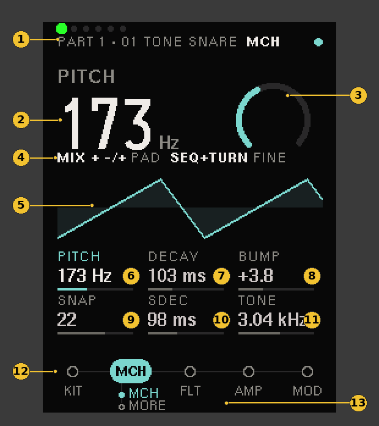

1. **Header:** `PART 1 · 01 TONE SNARE`, page MCH.
2. **Focused cell:** PITCH, 173 Hz.
3. **Arc:** where the value sits in its range.
4. **Hint:** `MIX + -/+ PAD`, `SEQ+TURN FINE`.
5. **Picture band:** a test wave.
6. **PITCH.**
7. **DECAY.**
8. **BUMP.**
9. **SNAP.**
10. **SDEC.**
11. **TONE.**
12. **Chain map:** MCH lit.
13. **Sub-page row:** MACHINE MORE, MACHINE underlined.

| Cell | Range | Default | What it does |
|---|---|---|---|
| **PITCH** | 100–400 Hz | 173 Hz | Lower head |
| **DECAY** | 40–800 ms | 103 ms | Heads' decay |
| **BUMP** | 0.0 to +12.0 | +3.8 | Heads start this many semitones up |
| **SNAP** | 0–35 | 22 | Snare-wire noise level |
| **SNAP DECAY** (SDEC) | 30–600 ms | 98 ms | Noise length |
| **TONE** | 800 Hz–9.00 kHz | 3.04 kHz | Noise band-pass |
| **INTERVAL** (MORE, INTV) | 1.20x–1.77x | 1.47x | Upper head over lower |
| **DRIVE** (MORE) | 0–100 | 0 | Saturation |

### DRUM: TONE TOM


1. **Header:** `PART 1 · 01 TONE TOM`, page MCH.
2. **Focused cell:** PITCH, 113 Hz.
3. **Arc:** where the value sits in its range.
4. **Hint:** `MIX + -/+ PAD`, `SEQ+TURN FINE`.
5. **Picture band:** a test wave.
6. **PITCH.**
7. **DECAY.**
8. **SWEEP.**
9. **SWPT.**
10. **NOISE:** a short noise burst (about 50 ms) on top of the body, like the stick on the head, low-passed at four times PITCH. In 0.4 it is subtle: on low toms barely audible even at 127.
11. **DAMP.**
12. **Chain map:** MCH lit.
13. **Sub-page row:** MACHINE MORE, MACHINE underlined.

| Cell | Range | Default | What it does |
|---|---|---|---|
| **PITCH** | 50–400 Hz | 113 Hz | Where the body settles |
| **DECAY** | 80 ms–2.00 s | 472 ms | Ring |
| **SWEEP** | 0.0 to +24.0 | +5.7 | Start, semitones above PITCH |
| **SWEEP TIME** (SWPT) | 4–300 ms | 16 ms | Sweep fall |
| **NOISE** | 0–60 | 9 | Noise, low-passed at 4× PITCH (max 12 kHz) |
| **DAMP** | 0–100 | 16 | Blends in a faster decay: a damped head |
| **DRIVE** (MORE) | 0–100 | 0 | Saturation |
| **DRIVE TYPE** (MORE, DTYP) | 0–100 | 0 | Soft clip (0) to wavefolder (100) |

### DRUM: TONE CLAP

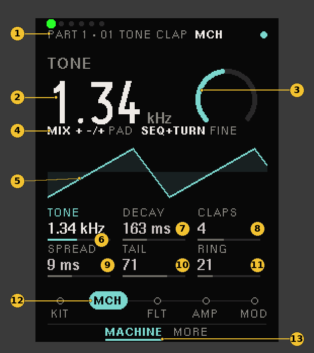

1. **Header:** `PART 1 · 01 TONE CLAP`, page MCH.
2. **Focused cell:** TONE, 1.34 kHz.
3. **Arc:** where the value sits in its range.
4. **Hint:** `MIX + -/+ PAD`, `SEQ+TURN FINE`.
5. **Picture band:** a test wave.
6. **TONE.**
7. **DECAY.**
8. **CLAPS.**
9. **SPREAD.**
10. **TAIL.**
11. **RING.**
12. **Chain map:** MCH lit.
13. **Sub-page row:** MACHINE MORE, MACHINE underlined.

| Cell | Range | Default | What it does |
|---|---|---|---|
| **TONE** | 500 Hz–4.00 kHz | 1.34 kHz | Burst band-pass |
| **DECAY** | 50 ms–1.00 s | 163 ms | Tail length |
| **CLAPS** | 1–8 | 4 | How many hands |
| **SPREAD** | 4–30 ms | 9 ms | Time between claps |
| **TAIL** | 0–100 | 71 | Tail level |
| **RING** | 0–90 | 21 | Band-pass resonance |
| **HARDNESS** (MORE, HARD) | 0.80x–0.15x | 0.34x | Each clap's fall as a share of SPREAD: higher is harder |
| **ROOM TONE** (MORE, ROOM) | 400 Hz–24.0 kHz | 24.0 kHz | Tail low-pass: lower is further away |

### DRUM: TONE COWBELL


1. **Header:** `PART 1 · 01 COWBELL`, page MCH.
2. **Focused cell:** PITCH, 547 Hz.
3. **Arc:** where the value sits in its range.
4. **Hint:** `MIX + -/+ PAD`, `SEQ+TURN FINE`.
5. **Picture band:** a test wave.
6. **PITCH.**
7. **DECAY.**
8. **INTERVAL.**
9. **TONE.**
10. **RING.**
11. **DRIVE.**
12. **Chain map:** MCH lit.
13. **Sub-page row:** MACHINE MORE, MACHINE underlined.

| Cell | Range | Default | What it does |
|---|---|---|---|
| **PITCH** | 300 Hz–1.20 kHz | 547 Hz | Lower square |
| **DECAY** | 80 ms–1.50 s | 254 ms | Ring |
| **INTERVAL** | 1.20x–1.80x | 1.48x | Upper square over lower |
| **TONE** | 600 Hz–6.00 kHz | 2.13 kHz | Band-pass |
| **RING** | 0–85 | 27 | Resonance |
| **DRIVE** | 0–100 | 24 | Saturation |
| **DAMP** (MORE) | 0–100 | 60 | Blends in a faster decay |
| **BUMP** (MORE) | 0.00–1.00 OCT | 0.00 OCT | Starts up to an octave high, falling in 6 ms ([costs more](#drum-voice-cost-per-machine)) |

### DRUM: TONE CYMBAL


1. **Header:** `PART 1 · 01 TONE CYMBAL`, page MCH.
2. **Focused cell:** PITCH, +0.2.
3. **Arc:** where the value sits in its range.
4. **Hint:** `MIX + -/+ PAD`, `SEQ+TURN FINE`.
5. **Picture band:** a test wave.
6. **PITCH.**
7. **DECAY.**
8. **TONE.**
9. **SPREAD.**
10. **RING.**
11. **SHIMMER.**
12. **Chain map:** MCH lit.
13. **Sub-page row:** MACHINE MORE, MACHINE underlined.

| Cell | Range | Default | What it does |
|---|---|---|---|
| **PITCH** | -24.0 to +24.0 | +0.2 | Tunes the six squares, semitones |
| **DECAY** | 200 ms–5.00 s | 1.52 s | Ring |
| **TONE** | 2.50–12.0 kHz | 5.94 kHz | Band-pass |
| **SPREAD** | 0–100 | 24 | Detunes the squares from their ratios |
| **RING** | 0–90 | 21 | Resonance |
| **SHIMMER** | 0–100 | 31 | Slow LFOs sway tuning and levels |
| **TOP** (MORE) | 0–50 | 30 | A higher band's level |
| **TOP TUNE** (MORE, TTUN) | 1.10x–1.60x | 1.35x | That band over TONE |

### DRUM: METAL HAT

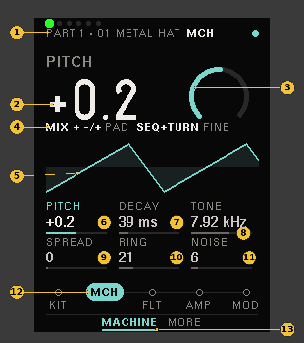

1. **Header:** `PART 1 · 01 METAL HAT`, page MCH.
2. **Focused cell:** PITCH, +0.2.
3. **Arc:** where the value sits in its range.
4. **Hint:** `MIX + -/+ PAD`, `SEQ+TURN FINE`.
5. **Picture band:** a test wave.
6. **PITCH.**
7. **DECAY.**
8. **TONE.**
9. **SPREAD.**
10. **RING.**
11. **NOISE.**
12. **Chain map:** MCH lit.
13. **Sub-page row:** MACHINE MORE, MACHINE underlined.

| Cell | Range | Default | What it does |
|---|---|---|---|
| **PITCH** | -24.0 to +24.0 | +0.2 | Tunes the six squares, semitones |
| **DECAY** | 20 ms–1.50 s | 39 ms | Short closed, long open |
| **TONE** | 3.00–14.0 kHz | 7.92 kHz | Band-pass |
| **SPREAD** | 0–100 | 0 | Detunes the squares |
| **RING** | 0–90 | 21 | Resonance |
| **NOISE** | 0–50 | 6 | Noise layer |
| **HIGH PASS** (MORE, HP) | 0.25x–1.00x | 0.50x | High-pass, as a share of TONE |
| **LOW PASS** (MORE, LP) | 2.00–20.0 kHz | 20.0 kHz | Low-pass; off at the top |

### DRUM: METAL JINGLE


1. **Header:** `PART 1 · 01 METAL JINGLE`, page MCH.
2. **Focused cell:** PITCH, +6.1.
3. **Arc:** where the value sits in its range.
4. **Hint:** `MIX + -/+ PAD`, `SEQ+TURN FINE`.
5. **Picture band:** a test wave.
6. **PITCH.**
7. **DECAY.**
8. **JINGLES.**
9. **SHAKE.**
10. **TONE.**
11. **RING.**
12. **Chain map:** MCH lit.
13. **Sub-page row:** MACHINE MORE, MACHINE underlined.

A tambourine: the hat's squares an octave up, gated by shaken particles.

| Cell | Range | Default | What it does |
|---|---|---|---|
| **PITCH** | -12.0 to +24.0 | +6.1 | Tunes jingles and head, semitones |
| **DECAY** | 50 ms–1.00 s | 163 ms | Shake length |
| **JINGLES** | 300 Hz–6.00 kHz | 1.56 kHz | Strikes a second at the peak |
| **SHAKE** | 0–60 | 14 | Where the peak falls |
| **TONE** | 5.00–14.0 kHz | 8.13 kHz | Band-pass |
| **RING** | 50–95 | 68 | Resonance, held just short of ringing on |
| **HEAD** (MORE) | 0–70 | 0 | A frame drum's thump |
| **SPREAD** (MORE) | 0–100 | 31 | Detunes the jingles |

### DRUM: BODY SHAKER


1. **Header:** `PART 1 · 01 BODY SHAKER`, page MCH.
2. **Focused cell:** GRAINS, 852 Hz.
3. **Arc:** where the value sits in its range.
4. **Hint:** `MIX + -/+ PAD`, `SEQ+TURN FINE`.
5. **Picture band:** a test wave.
6. **GRAINS.**
7. **DECAY.**
8. **GLEN.**
9. **TONE.**
10. **SHAKE.**
11. **RING.**
12. **Chain map:** MCH lit.
13. **Sub-page row:** MACHINE MORE, MACHINE underlined.

| Cell | Range | Default | What it does |
|---|---|---|---|
| **GRAINS** | 100 Hz–3.00 kHz | 852 Hz | Grains a second at the peak |
| **DECAY** | 30–500 ms | 91 ms | Shake length |
| **GRAIN LENGTH** (GLEN) | 0–3 ms | 0 ms | Each grain's ring, 0.2 to 3 ms |
| **TONE** | 2.00–12.0 kHz | 6.18 kHz | Band-pass |
| **SHAKE** | 5–70 | 20 | Where the peak falls |
| **RING** | 0–90 | 21 | Resonance |
| **HARDNESS** (MORE, HARD) | 0–100 | 50 | Below middle darker grains; above, dry grains over the band |

### DRUM: PLAIN SINE


1. **Header:** `PART 1 · 01 PLAIN SINE`, page MCH.
2. **Focused cell:** PITCH, 58 Hz.
3. **Arc:** where the value sits in its range.
4. **Hint:** `MIX + -/+ PAD`, `SEQ+TURN FINE`.
5. **Picture band:** a test wave.
6. **PITCH.**
7. **DECAY.**
8. **SWEEP.**
9. **SWPT.**
10. **Chain map:** MCH lit.
11. **Sub-page row:** MACHINE MORE, MACHINE underlined.

An 808-style bass on TONAL, a zap, a blip.

| Cell | Range | Default | What it does |
|---|---|---|---|
| **PITCH** | 30 Hz–2.00 kHz | 58 Hz | Where the sine settles |
| **DECAY** | 20 ms–3.00 s | 317 ms | Ring |
| **SWEEP** | 0.0 to +48.0 | +11.3 | Start above PITCH |
| **SWEEP TIME** (SWPT) | 2–200 ms | 6 ms | Sweep fall |

### DRUM: PLAIN NOISE


1. **Header:** `PART 1 · 01 PLAIN NOISE`, page MCH.
2. **Focused cell:** DECAY, 35 ms.
3. **Arc:** where the value sits in its range.
4. **Hint:** `MIX + -/+ PAD`, `SEQ+TURN FINE`.
5. **Picture band:** a test wave.
6. **DECAY.**
7. **TONE.**
8. **Chain map:** MCH lit.
9. **Sub-page row:** MACHINE MORE, MACHINE underlined.

| Cell | Range | Default | What it does |
|---|---|---|---|
| **DECAY** | 10 ms–2.00 s | 35 ms | Length |
| **TONE** | LP 100 to HP 100 | HP 57 | Low-pass below the middle, high-pass above, FLAT between |

### DRUM: PLAIN IMPULSE


1. **Header:** `PART 1 · 01 IMPULSE`, page MCH.
2. **Focused cell:** PITCH, 113 Hz.
3. **Arc:** where the value sits in its range.
4. **Hint:** `MIX + -/+ PAD`, `SEQ+TURN FINE`.
5. **Picture band:** a test wave.
6. **PITCH.**
7. **DECAY.**
8. **SWEEP.**
9. **SWPT.**
10. **Chain map:** MCH lit.
11. **Sub-page row:** MACHINE MORE, MACHINE underlined.

A pulse under a decay: a rimshot, a click.

| Cell | Range | Default | What it does |
|---|---|---|---|
| **PITCH** | 30 Hz–2.00 kHz | 113 Hz | Pulse pitch |
| **DECAY** | 20 ms–3.00 s | 65 ms | Length |
| **SWEEP** | 0.0 to +48.0 | 0.0 | Start above PITCH |
| **SWEEP TIME** (SWPT) | 2–200 ms | 2 ms | Sweep fall |
| **WIDTH** (MORE) | 0–100 | 92 | Pulse width |

> **Design note:** The DRUM machines are built from parts the rest of Chimera already had: VA's noise and oscillators, the CLEAN filter's band-passes, the FX slot's SOFT and FOLD shapers. The metal machines tune their six squares to the 808-style ratios, the published values from that drum machine's circuit, with SPREAD to pull them apart. Nothing here is a sample. If your hi-hat sounds like a filing cabinet falling down the stairs, that is RING and SPREAD at the top, and it is working as intended.

### DRUM: NONE

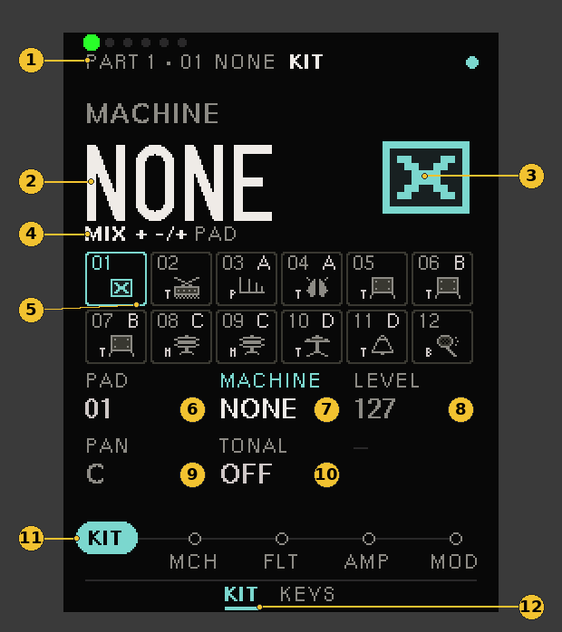

1. **Header:** `PART 1 · 01 NONE`, page KIT.
2. **Focused cell:** MACHINE, NONE.
3. **NONE's icon:** a box with an X.
4. **Hint:** `MIX + -/+ PAD`.
5. **The pads:** 01 shows the box.
6. **PAD:** live.
7. **MACHINE:** turn to bring a machine back.
8. **LEVEL:** dimmed, kept.
9. **PAN:** dimmed, kept.
10. **TONAL:** live.
11. **Chain map:** KIT lit.
12. **Sub-page row:** KIT KEYS, KIT underlined.


1. **Header:** `PART 1 · 01 NONE`, page MACHINE.
2. **Picture band:** a test wave; the knob cells are empty.
3. **Chain map:** MCH lit.
4. **Sub-page row:** MACHINE MORE, MACHINE underlined.

NONE, MACHINE's last choice, plays nothing: a note books no voice and chokes nothing, though with PAD FOLLOW it still selects the pad. MCH and MORE are empty; every other pad cell is dimmed but keeps its value, so a machine chosen again gets back the pad's level, pan, chokes and sound (knobs at that machine's defaults). PAD, TONAL, FX and FX PLACE stay live. A ringing hit rings out.

**Why:** a kit is billed for its costliest pad, unused ones included. NONE takes a spare pad out of the bill.

## DRUM: the FLT page (the pad's filter)


1. **Header:** `PART 1 · 01 TONE KICK`, page FILTER; hint `MIX + -/+ PAD` under it.
2. **Filter curve,** cutoff dot at the right.
3. **TYPE,** large: CLEAN.
4. **TYPE:** CLEAN (pad).
5. **FX:** OFF (Part).
6. **Q:** 0 (pad).
7. **MODE:** LP4 (pad).
8. **FX PLACE** (Part).
9. **FREQ:** 20.0 kHz (pad).
10. **Chain map:** FLT lit.
11. **Sub-page row:** FILTER MODULATION FX, FILTER underlined.

FLT holds the pad's filter and the Part's FX slot. The TYPEs, MODEs and the FX slot are described in [the voice chain](#the-voice-chain-pitch-filter-fx-amp-stereo-and-sends); only the pad split is DRUM's.

| Cell | Whose | Default |
|---|---|---|
| **TYPE** (CLEAN, 2040, DIRTY, LADDER, SEM) | pad | CLEAN |
| **FX** | Part | OFF |
| **Q** (CLEAN, DIRTY, LADDER) or **RES** (2040, SEM) | pad | 0 |
| **MODE**, or **VOICE** on 2040 | pad | LP4 on CLEAN |
| **FX PLACE** | Part | PRE |
| **FREQ**, or **CUTOFF** on 2040 | pad | 20.0 kHz |

**MIX + MINUS / PLUS** steps the pad on every FLT cell, FX and FX PLACE included.

**Why:** each drum shapes its own sound (a dark kick, a bright hat), so the filter is per pad. The FX slot is the costliest block and the Part's character; per pad it would cost up to twelve times as much.

## DRUM: the FMD, FX and JACK pages

These are the Part's pages, shared by every pad and working as in [the voice chain](#the-voice-chain-pitch-filter-fx-amp-stereo-and-sends); the panel shown follows the selected pad's TYPE. One exception: SEM's **OUTPUT** on FMD is the pad's.


1. **Header:** `PART 1 · SOUND  FILTER MOD`.
2. **Focused cell:** ENV AMT, 0 %.
3. **Hint:** `MIX + MINUS DELETES THE ROUTE`.
4. **Picture band:** a test wave.
5. **ENV AMT.**
6. **KEYBOARD.**
7. **FREQ MOD.**
8. **FDBK** (FEEDBACK).
9. **RES MOD.**
10. **Chain map:** FLT lit.
11. **Sub-page row:** FILTER MODULATION FX, MODULATION underlined.


1. **Header:** `PART 1 · SOUND  FX`.
2. **Focused cell:** INPUT, 64.
3. **Arc.**
4. **Hint:** `SEQ+TURN FINE`, `MIX + SEQ LEARN`.
5. **Picture band:** the slot's curve, under its place in the chain (MCH, FX, FLT).
6. **INPUT.**
7. **MIX:** +63; with FX OFF the slot's other knobs are dashes.
8. **Chain map:** FLT lit.
9. **Sub-page row:** MODULATION FX JACKS, FX underlined.


1. **Header:** `PART 1 · SOUND  FILTER JACKS`.
2. **Picture band:** a test wave.
3. **FREQ SRC:** LFO1.
4. **RES SRC:** ENV3.
5. **Chain map:** FLT lit.
6. **Sub-page row:** MODULATION FX JACKS, JACKS underlined.

## DRUM: the AMP page


1. **Header:** `PART 1 · 01 TONE KICK`, page AMP; hint under it.
2. **The shape:** flat at full while DECAY is INF; stage letters A H D below.
3. **ATTACK.**
4. **HOLD.**
5. **DECAY:** INF.
6. **SPEED:** MED.
7. **VEL:** 127.
8. **MODE:** 1-SHOT.
9. **Chain map:** AMP lit.
10. **Sub-page row:** AMP GATE SENDS, AMP underlined.

The pad's own attack-hold-decay envelope, shaping on top of the machine's DECAY.

| Cell | Range | Default | What it does |
|---|---|---|---|
| **ATTACK** | 0–127 | 0 | Rise |
| **HOLD** | 0–127 | 0 | Hold at full |
| **DECAY** | 0–126, INF | INF | Fall; INF stays open, so the machine's decay rings in full |
| **SPEED** | FAST, MED, SLOW | MED | Time range, as [envelope SPEED](#envelopes-and-lfos) |
| **VEL** | 0–127 | 127 | Velocity's share of level, applied before the filter at the strike; 0 plays all hits at full |
| **MODE** | 1-SHOT, GATED | 1-SHOT | 1-SHOT ignores note-off. GATED holds after HOLD until note-off, then falls over DECAY (never, at INF) |

**Why:** most drums ignore key length, so 1-SHOT is the default; GATED, as on Elektron's AMP page, lets a held pad end with its key. On 1-SHOT, note-off still reaches the Part's VCA routes in the matrix.

## DRUM: the GATE page


1. **Header:** `PART 1 · 01 TONE KICK`, page GATE.
2. **Picture band:** a test wave.
3. **LPG.**
4. **DECAY.**
5. **STRIKE.**
6. **WIDTH:** 64 (Part).
7. **Chain map:** AMP lit.
8. **Sub-page row:** AMP GATE SENDS, GATE underlined.

Each pad has its own low-pass gate (as described under AMP in [the voice chain](#the-voice-chain-pitch-filter-fx-amp-stereo-and-sends)), replacing the Part's.

| Cell | Range | Default | Whose | What it does |
|---|---|---|---|---|
| **LPG** | 0–127 | 0 | pad | How far the gate closes as the sound decays; 0 off |
| **DECAY** | 0–127 | 0 | pad | The gate's decay |
| **STRIKE** | 0–127 | 0 | pad | How hard the strike opens it |
| **WIDTH** | 0–127 | 64 | Part | Spreads or narrows the kit's pans |

## DRUM: the PENV, PLFO and ROUTE pages

MOD's first three sub-pages are the pad's own modulation. After them come the Part's E1–E3, SPD and L1–L3; the MOD node is the Part's MATRIX.

### DRUM: PENV, the pad's mod envelope


1. **Header:** `PART 1 · 01 TONE KICK`, page PENV.
2. **Hint:** `MIX + -/+ PAD`, `SEQ+TURN FINE`.
3. **Attack peak** of the shape.
4. **HOLD and DECAY:** the fall.
5. **Stage letters:** A H D.
6. **ATTACK.**
7. **HOLD.**
8. **DECAY:** 64.
9. **SPEED:** MED.
10. **Chain map:** MOD lit.
11. **Sub-page row:** MATRIX PAD ENV PAD LFO, PAD ENV underlined.

An AHD envelope like AMP's (DECAY 0–126 or INF, default 64; SPEED default MED), feeding the routes as MOD ENV.

### DRUM: PLFO, the pad's LFO


1. **Header:** `PART 1 · 01 TONE KICK`, page PLFO.
2. **Focused cell:** WAVE, SINE.
3. **Hint:** `MIX + -/+ PAD`.
4. **Picture band:** a test wave.
5. **WAVE.**
6. **SPEED.**
7. **DEPTH.**
8. **PHASE.**
9. **MODE.**
10. **Chain map:** MOD lit.
11. **Sub-page row:** PAD ENV PAD LFO ROUTE, PAD LFO underlined.

Feeds the routes as LFO.

| Cell | Range | Default | What it does |
|---|---|---|---|
| **WAVE** | SINE, TRI, SAW, SQUARE, RANDOM | SINE | Shape |
| **SPEED** | 0–127 | 6 | Rate |
| **DEPTH** | 0–127 | 127 | Size |
| **PHASE** | 0–127 | 0 | Start point on RETRIG |
| **MODE** | FREE, RETRIG | FREE | RETRIG restarts at PHASE each hit |

### DRUM: ROUTE, the pad's four routes


1. **Header:** `PART 1 · 01 TONE KICK`, page ROUTE.
2. **Focused cell:** ROUTE, 1.
3. **Hint:** `MIX + -/+ PAD`.
4. **Picture band:** a test wave.
5. **ROUTE.**
6. **SOURCE:** MOD ENV.
7. **DEST:** CUTOFF.
8. **AMOUNT:** 0%.
9. **Chain map:** MOD lit.
10. **Sub-page row:** PAD LFO ROUTE ENV1 ENV2, ROUTE underlined.

| Cell | Range | Default | What it does |
|---|---|---|---|
| **ROUTE** | 1–4 | 1 | Which route the cells edit |
| **SOURCE** | MOD ENV, LFO, VEL, LFO 1, LFO 2, LFO 3 | MOD ENV | The pad's own, or the Part's LFOs |
| **DEST** | CUTOFF, RESO, VOLUME, LFO SPD, LFO DEP | CUTOFF | The pad's filter, volume, or own LFO |
| **AMOUNT** | -100% to +100% | 0% | How far, which way |

CUTOFF and RESO move at audio rate. **VOLUME** never boosts: positive opens with the source, negative ducks; several multiply.

**Why:** movement per drum without a matrix per pad; the Part's matrix still reaches every pad's filter and VCA.

## DRUM: what a ringing hit follows

- **Set at the strike:** MACHINE and knobs, LEVEL, PAN, VEL, CHOKE, RETRIG, filter TYPE and MODE/VOICE, PLFO WAVE and MODE, route SOURCE and DEST, both SPEEDs, AMP MODE.
- **Glide on a ringing hit:** CUTOFF/FREQ, Q/RES, SEM's MODE sweep, AMP and PENV times, LPG, gate DECAY and STRIKE, PLFO SPEED, DEPTH, PHASE, route AMOUNT.

**Why:** after the Analog Rytm's split: continuous values glide so a sweep is smooth on a ringing cymbal; choices latch so nothing clicks.

## DRUM: the Part's own pages on a kit

These pages are the Part's, not the pad's: one set shared by every pad, with header `PART 1 · SOUND`. They look and work as on every engine; only the DRUM-specific part is listed here.

| Page | Where it is explained | On DRUM |
|---|---|---|
| **SND** (SENDS) | [the voice chain](#the-voice-chain-pitch-filter-fx-amp-stereo-and-sends) | **CHORUS**, **DELAY**, **REVERB** for the whole kit |
| **MTX** (MATRIX) | [the mod matrix](#the-mod-matrix-and-routes) | Reaches every pad's filter and VCA; a VCA route is the only thing that hears note-off on a 1-SHOT pad |
| **E1 E2 E3 SPD** | [envelopes and LFOs](#envelopes-and-lfos) | ENV1 drives FMD's ENV AMT on every pad |
| **L1 L2 L3** | [envelopes and LFOs](#envelopes-and-lfos) | Feed JACK and the pad routes' LFO 1 to 3 |

The Part's own filter TYPE and gate are unused (each pad's replace them); its mixer channel is on MIXER › PRT.

## DRUM: PAD FOLLOW


1. **Header:** `PERSONAL › FOLLOW`.
2. **Focused cell:** FOLLOW, IDLE.
3. **Picture band:** a test wave.
4. **FOLLOW.**
5. **Footer:** the project, `NEW PROJECT`.
6. **Footer:** the keys, `A-F EDIT · MENU BACK`.

SETTINGS › PERSONALIZE › PAD FOLLOW decides whether a played hit selects its pad. **FOLLOW** is a unit setting, kept in SYSTEM ([SETTINGS](#settings)):

| Value | What a live hit does |
|---|---|
| OFF | Never selects; only PAD and MIX + MINUS / PLUS do |
| IDLE (default) | Selects, unless you edited this Part's DRUM pages in the last 2 seconds |
| ALWAYS | Always selects |

Hits light their pads in every mode.

**Why:** following helps you find a pad and gets in the way while shaping one; IDLE follows only when your hands are off the encoders.

## DRUM: the kit and the library

Every Part has a kit; switching engine and back keeps it.

- **A project** saves each Part's kit; NEW starts on the INIT kit.
- **SAVE TO LIBRARY** on a DRUM Part saves the kit with the Sound; loading it brings the kit. A DRUM Sound with no kit loads the INIT kit.
- **Everything else** that replaces a Sound (a project slot, INIT, RELOAD FROM PROJ, an engine switch, program change) leaves the kit.
- **Loading a DRUM library Sound** replaces the kit. If the kit is neither INIT nor already in the library, the browser asks `LOAD INTO P1?` / `KIT NOT IN LIBRARY`, REPLACE or CANCEL (highlighted).
- If the firmware's second half is missing, as after an incomplete update, a DRUM library save is refused: `KIT NOT SAVED · NEEDS UPDATE`.

See [the SD card, Sounds and the library](#the-sd-card-projects-sounds-and-the-library).

**Why:** the kit lives beside the Sound, so non-DRUM Parts pay nothing for it; that makes a library load the only way to lose a kit, and the only place the instrument asks.

## DRUM: voice cost per machine

A hit costs its machine plus the pad chain (filter, AMP, routes, gate). The Part's voice count comes from its costliest pad, every pad's filter, routes and gate included.

| Cost | Machines |
|---|---|
| Lightest | TONE CLAP, PLAIN SINE, PLAIN NOISE, PLAIN IMPULSE |
| Light | TONE TOM, TONE COWBELL, BODY SHAKER |
| Medium | TONE KICK, TONE SNARE |
| Heavy (about 2.5× lightest) | TONE CYMBAL, METAL HAT |
| Heaviest | METAL JINGLE |

TONE COWBELL with BUMP (about 3× for its few-ms sweep) and PLAIN IMPULSE with SWEEP, or high PITCH with WIDTH near the top, are billed at that worst case.

More hits: set unused pads to **NONE**, keep costly filters (LADDER, 2040, moving routes) where needed, choke the metals, give the Part a RESERVE on MIXER › PRT › VOICES. See [Limits](#limits-voices-cpu-and-memory).

**Why:** one bill for every machine would overload the audio on metals or starve a light kit; billing per machine keeps both right.

## DRUM: starting points

From INIT DRUM:

- **808-style bass:** pad 01 on PLAIN SINE, PITCH low, DECAY long, a little SWEEP; TONAL 01; RETRIG STACK to overlap. Play from C1 up.
- **Gated noise hat:** PLAIN NOISE, TONE well into HP; AMP MODE GATED, DECAY short.
- **Distant clap:** TONE CLAP, CLAPS and SPREAD up, TAIL up, ROOM TONE down; some REVERB.
- **Trashy kit:** FX FUZZ, FX PLACE POST.
- **Falling tom:** TONE TOM, SWEEP high, SWEEP TIME long, LADDER LP4 with MOD ENV → CUTOFF.
- **Choking hats:** both METAL HAT pads in one CHOKE group, the closed one short.

# The voice chain: pitch, filter, FX, amp, stereo and sends

ALGO, MODAL, VA and TAPE run their sound through the same voice pages: **PITCH**, **FILTER** with MODULATION, FX and JACKS, and **AMP** with STEREO and SENDS. This chapter is their one home; the engine chapters ([ALGO](#algo-the-six-operator-engine), [MODAL](#modal-the-physical-modelling-engine), [VA](#va-the-variable-wave-engine), [TAPE](#tape-the-sample-engine), [DRUM](#drum-the-kit-engine)) only add what differs. Envelopes and LFOs are in [Envelopes and LFOs](#envelopes-and-lfos), routes in [the mod matrix](#the-mod-matrix-and-routes).

## Voice chain: the order of the signal

```
engine ── [FX slot, PRE] ── FILTER ── [FX slot, POST] ── AMP (VCA / low-pass gate) ── STEREO ── SENDS
```

- The **FX slot** sits before or after the filter, never both: **FX PLACE** chooses.
- **AMP** is the voice's VCA; three gate knobs turn it into a low-pass gate.
- **STEREO** places each note and sets the Part's width.
- **SENDS** feed the Part to the shared chorus, delay and reverb ([the mixer and master FX](#the-mixer-and-the-master-effects)).

On the chain map, FLT holds FILTER, MODULATION, FX and JACKS; AMP holds AMP, STEREO and SENDS. PITCH hangs under each engine's first node. **SEQ** steps on through a node's sub-pages, **EDIT** steps back, **MINUS** and **PLUS** move along the chain ([the panel and navigation](#the-panel-and-navigation)). Every value glides when you turn it, so a sweep of the cutoff, a send or the pan never steps.

**Why:** one chain for every engine means one set of habits. A filter sweep, a drive or a send works the same on an FM patch, a struck string, an analogue-style voice or a tape loop.

## Voice chain: page names on the map and on screen

| Chain map | Sub-page row | Page title |
|---|---|---|
| **PIT** | PITCH | PITCH |
| **FLT** | FILTER | FILTER |
| **FMD** | MODULATION | FILTER MOD (DIRTY MOD, LADDER MOD or SEM MOD on those types) |
| **FX** | FX | FX |
| **JACK** | JACKS | FILTER JACKS |
| **AMP** | AMP | AMP |
| **STER** | STEREO | STEREO |
| **SND** | SENDS | SENDS |

With SETTINGS › PERSONALIZE › CHAIN MAP › PAGES at STACK, sub-pages show by their short names, stacked under the node.

## Voice chain: values and gestures on every page

- Continuous knobs read 0 to 127 unless a table says otherwise; bipolar ones (FEEDBACK) −64 to +63. Cutoffs read in Hz, times in ms or s.
- **Hold SEQ + turn:** fine steps (one tick a detent, a tenth of a continuous step, no acceleration). Hint: `SEQ+TURN FINE`.
- **MIX + turn:** jump to the next landmark (minimum, default, maximum). On a route cell (ENV AMT, FREQ MOD, RES MOD), to 0 then full, in the direction you turn.
- **MIX + PLUS:** prime the cell as a matrix destination; the focus band says ADDED, ALREADY ROUTED, NOT MODULATABLE or MATRIX FULL ([MOD: priming a destination](#mod-priming-a-destination)).
- **MIX + MINUS:** on a route cell, delete the route; on any other cell, take the parameter out of the matrix with its routes.
- **MIX + SEQ:** learn a MIDI control ([MIDI](#midi-channels-maps-and-controllers)).

The hint line under the value shows the combos the touched cell answers to (off at SETTINGS › PERSONALIZE › THEME › HINTS).

## PITCH: the pitch page

**PITCH** (PIT) tunes the whole voice and sets what a new note does when it takes over a sounding voice. It sits under ALG (after ALGORITHM), RES (after RESONATOR and the model page), VA (after OSC1, OSC2 and NOISE) or DECK (after the machine's page).


1. **Header:** PART 1 · SOUND, page PITCH.
2. **The touched cell**, large: PITCH, 0, with its arc.
3. **Hint line:** `SEQ+TURN FINE  MIX + SEQ LEARN`.
4. **Picture band:** the glide sketch, under **the tuner**: the note the Part's last note sounds at, its offset in cents (`C4 +0ct`), and its Hz. `REF C4` before the first note.
5. **PITCH**, in semitones.
6. **FINE**, in cents.
7. **STEAL:** CUT or GLIDE.
8. **TIME:** the glide time.
9. **SNAP:** CHROMA or MUSICAL.
10. **Chain map**, ALG lit.
11. **Sub-page row:** ALGORITHM PITCH, PITCH underlined.

| Cell | Range | Default | What it does |
|---|---|---|---|
| **PITCH** | −24 to +24 semitones | 0 | Transposes the voice. Destination: a full route moves it 24 semitones |
| **FINE** | −100 to +100 cents | 0 | Fine tuning. Destination |
| **STEAL** | CUT, GLIDE | CUT | When a note takes a still-sounding voice of its Part: CUT starts at its own pitch, GLIDE slides from the old one |
| **TIME** | 1 ms to 2 s | 150 ms | Glide time (to 95 %), under GLIDE |
| **SNAP** | CHROMA, MUSICAL | CHROMA | CHROMA: a semitone a detent. MUSICAL: −24, −19, −12, −7, 0, +7, +12, +19, +24 |

The tuner reads A4 = 440 Hz in the Part's tuning, including PITCH, FINE and the engine's transposition, and follows PITCH and FINE with no note held. It is dim between notes.

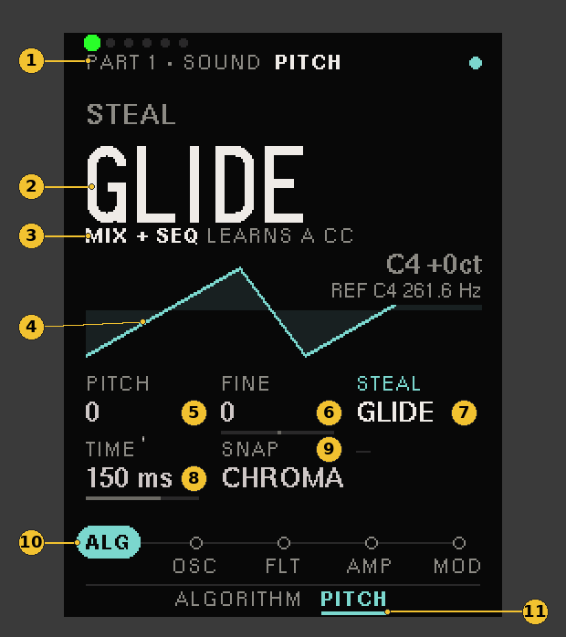

1. Header.
2. The touched cell: STEAL, GLIDE.
3. Hint line: `MIX + SEQ LEARNS A CC`.
4. Picture band: glide sketch and tuner.
5. PITCH.
6. FINE.
7. **STEAL** at GLIDE.
8. **TIME**, now in use.
9. SNAP.
10. Chain map, ALG lit.
11. Sub-page row, PITCH underlined.

GLIDE acts only when a new note takes a sounding voice of the same Part. With MAX VOICES 1 ([the mixer](#the-mixer-and-the-master-effects)) that is every note, so GLIDE becomes legato portamento. STEAL and TIME are read at the moment of the steal, so they are not destinations.

**On TAPE** a source plays at the key, from its root; with no known root the tuner reads `ROOT ?` over its shift from the source's own speed.

**Why:** the tuner shows what the Part will really play, so you can tune by eye without holding a note. MUSICAL SNAP is there because most transpositions worth playing are fifths and octaves.

## FILTER: the filter page

**FILTER** (FLT) is the same on every engine.


1. **Header:** PART 1 · SOUND, page FILTER.
2. **The picture:** the readout of the touched control (TYPE, CLEAN) over the response, drawn from the filter's real response, resonance peak included; the dot is the corner, at the cutoff.
3. **TYPE.**
4. **FX:** the voice's FX slot.
5. **Q:** resonance.
6. **MODE:** the response.
7. **FX PLACE:** PRE or POST; the cell draws the order.
8. **FREQ:** the cutoff; a thin line under its bar shows modulation reaching it.
9. **Chain map**, FLT lit.
10. **Sub-page row:** FILTER MODULATION FX `>`, FILTER underlined; `>` leads on to JACKS.

The picture takes the whole band, so there is no focus band. The readout shows the value you set and stays still under modulation; a faint band under the plot runs from the corner to where modulation has the cutoff now, with a tick at its end:

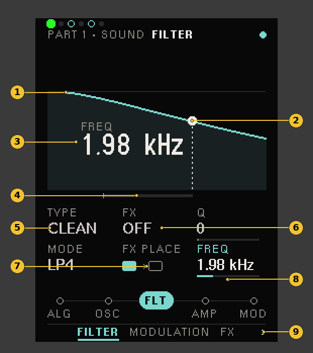

1. The response.
2. The corner, at the cutoff you set.
3. Readout (FREQ).
4. **The modulation mark.**
5. TYPE.
6. FX.
7. FX PLACE.
8. FREQ, with Q and MODE beside it.
9. `>`: more sub-pages.

| Cell | Range | Default | What it does |
|---|---|---|---|
| **TYPE** | CLEAN, 2040, DIRTY, LADDER, SEM | CLEAN (VA: 2040) | Which filter; the cells follow it |
| **FX** | OFF, SOFT, FUZZ, FOLD | OFF | The FX slot ([FX: the FX slot](#fx-the-fx-slot)) |
| **Q** / **RES** | 0 to 127 | 0 | Resonance (RES on 2040 and SEM) |
| **MODE** / **VOICE** | per TYPE | LP4 where it exists | The response (VOICE on 2040; a knob on SEM) |
| **FX PLACE** | PRE, POST | follows FX | Slot before (FX into FLT) or after (FLT into FX) the filter |
| **FREQ** / **CUTOFF** | 20 Hz to 20.0 kHz | 20.0 kHz | The cutoff (CUTOFF on 2040) |

**FREQ** steps 1/24 octave a detent, ten even octaves, reading whole Hz under 1 kHz, then kHz (`2.14 kHz`). Turns glide and modulation is spread across each block, so knob, envelope and LFO sweeps never step. Changing TYPE or MODE crossfades over a few milliseconds; MODE stays if the new type has it, else takes its default.

**Why:** a readout that jumped with every LFO cycle would be unreadable and impossible to set back. The 1/24-octave tick makes every detent the same musical size at 50 Hz and at 5 kHz.

### FILTER: CLEAN

A clean state-variable filter in the manner of the Cascadia's VCF; the home filter of ALGO, MODAL and TAPE.

| MODE | Response |
|---|---|
| LP1 / LP2 / LP4 | Low-pass, 1, 2 or 4 poles (6, 12, 24 dB an octave) |
| BP2 / BP4 | Band-pass, 2 or 4 poles |
| HP4 | High-pass, 4 poles |
| NOTCH1 | One notch, at twice FREQ |
| NOTCH2 | Two notches around FREQ (phaser-style); Q deepens them, never self-oscillates |

At high Q, CLEAN self-oscillates (not in NOTCH2). LP4 fully open passes its input untouched. The NOTCH2 picture is a sketch, not the real response.

> **Design note:** CLEAN's controls and words are inspired by the Intellijel Cascadia's VCF: modes named by what they do (LP1, BP4, NOTCH2), not by a datasheet. Under it runs a zero-delay state-variable filter that can self-oscillate. NOTCH2 is four all-pass stages around the dry signal, after an application circuit in the SSM2040's own data sheet: a nice bit of family history for a filter that sits next to a 2040.

### FILTER: 2040


1. Header.
2. The picture: readout `TYPE · 4-POLE LP`, 2040, over the 2040's response.
3. **TYPE.**
4. FX.
5. **RES.**
6. **VOICE:** REV2 or EXPNDR.
7. FX PLACE.
8. **CUTOFF.**
9. Chain map, FLT lit.
10. Sub-page row, FILTER underlined.

A four-pole low-pass modelled on the SSM2040 filter chip; VA's home filter. Its one mode reads 4-POLE LP. **INPUT** (on FX) drives the chip's stages directly. **VOICE** picks the chip's surroundings:

| VOICE | What it is |
|---|---|
| REV2 | Modelled on the chip as the Prophet-5 used it: linear resonance, bounded by the chip's own clip |
| EXPNDR | Modelled on the chip as the Kobol Expander uses it, a CA3080 in the resonance loop: squelches as RES rises, keeps more bass, rings over its input at full RES |

> **Design note:** the 2040 is a circuit model of the SSM2040, each VOICE solving the loop through its own resonance part. EXPNDR's bass and ring were then measured against a recording of a real Kobol Expander at three resonance settings, and its make-up gain fitted to match. REV2 was left exactly as modelled.

### FILTER: DIRTY


1. Header.
2. The picture: readout TYPE, DIRTY, over DIRTY's response.
3. **TYPE.**
4. FX.
5. **Q.**
6. **MODE:** LP2, BP2, HP2 or NOTCH1.
7. FX PLACE.
8. **FREQ.**
9. Chain map, FLT lit.
10. Sub-page row, FILTER underlined.

A Chamberlin state-variable filter that drives hard: the cheapest and edgiest. MODE is **LP2** (default), **BP2**, **HP2** or **NOTCH1** (one notch, at FREQ). Its modulation page is titled DIRTY MOD.

### FILTER: LADDER


1. Header.
2. The picture: readout TYPE, LADDER, over LADDER's response.
3. **TYPE.**
4. FX.
5. **Q.**
6. **MODE:** LP2, LP4, BP2, BP4 or HP4.
7. FX PLACE.
8. **FREQ.**
9. Chain map, FLT lit.
10. Sub-page row, FILTER underlined.

Modelled on the Moog transistor ladder, four poles, with Xpander-style modes (**LP2**, **LP4** default, **BP2**, **BP4**, **HP4**) and INPUT as its drive. Like the original it loses some bass as resonance rises. Its modulation page is titled LADDER MOD.

> **Design note:** LADDER is Vadim Zavalishin's topology-preserving ladder from *The Art of VA Filter Design*, its feedback loop solved in closed form. Three published Moog models were weighed first. A benchmark paper against a transistor-level simulation settled where the saturation goes: five saturators, one at the input and one a stage, because distributed saturation matches the real circuit far better than one clipper at the end.

### FILTER: SEM


1. Header.
2. The picture: SEM's response, under the readout TYPE, SEM.
3. **TYPE.**
4. FX.
5. **RES.**
6. **MODE**, a knob: low-pass at 0, notch mid-way, high-pass at 127.
7. FX PLACE.
8. **FREQ.**
9. Chain map, FLT lit.
10. Sub-page row, FILTER underlined.

Modelled on the behaviour of the Oberheim SEM's 12 dB state-variable filter. **MODE** is a knob, after the SEM's pot: low-pass (0), a notch at FREQ (middle), high-pass (127). It glides and is a destination, so an LFO on MODE sweeps the response itself. **OUTPUT**, on SEM MOD, is after the SEM's switch: MODE (the knob's sweep) or BP (band-pass). Like the original, it does not self-oscillate: at full RES it rings and the ring dies away.

> **Design note:** SEM was built twice. The first try was an existing filter with new labels, and it got sent back. The second started from the SEM-1A's schematic: the whole VCF in one nodal circuit simulation, using the measured CA3080 data of Köper, Holters, Esqueda and Parker's DAFx paper on the EDP Wasp filter. What you play is a much cheaper model with every constant taken from that simulation; over 75 test renders it tracks the full circuit closely, down to how long the resonance rings at each frequency.

## FILTER MOD: the filter's modulation page

**FILTER MOD** (FMD, MODULATION in the sub-page row) holds what moves the filter. Its title follows the type: DIRTY MOD, LADDER MOD or SEM MOD.


1. **Header.**
2. **The touched cell**, large: ENV AMT, 0 %.
3. **Hint:** on a route cell, MIX + MINUS deletes the route.
4. **Picture band:** the live output.
5. **ENV AMT.**
6. **KEYBOARD.**
7. **FREQ MOD.**
8. **FDBK:** FEEDBACK.
9. **RES MOD**, a dash: no route yet.
10. **Chain map**, FLT lit.
11. **Sub-page row:** FILTER MODULATION FX `>`, MODULATION underlined.

| Cell | Range | Default | What it does |
|---|---|---|---|
| **ENV AMT** | −100 % to +100 % | 0 % | Route: ENV 1 into FREQ |
| **KEYBOARD** | −100 % to +100 % (2040: OFF, HALF, FULL) | OFF | Route: NOTE into FREQ. FULL moves the cutoff an octave per octave |
| **FREQ MOD** | −100 % to +100 % | 0 % | Route: the FREQ SRC jack's source into FREQ |
| **FEEDBACK** (FDBK) | −64 to +63 | 0 | The filter's output fed back into its cutoff |
| **RES MOD** | −100 % to +100 % | 0 % | Route: the RES SRC jack's source into the resonance |
| **OUTPUT** | MODE, BP | MODE | SEM only, bottom right: the knob's sweep, or band-pass |

A full route (100 %) moves the cutoff ten octaves. A dash means no route; turn the cell to make one. On FREQ MOD and RES MOD the focus band names the source (`FREQ MOD LFO1`). On the 2040, KEYBOARD steps OFF, HALF, FULL like a Prophet's keyboard switch.

**FEEDBACK** works on every TYPE and is a destination (FDBK in the matrix header). Positive amounts make the filter open on its own peaks and snarl; negative ones pull the cutoff down as the output swings.

**Why:** these four are not separate controls with hidden wiring; each is a matrix cell shown where you think about the filter. Turn ENV AMT and the matrix's ENV1 → FREQ route moves with it ([MOD: route cells on other pages](#mod-route-cells-on-other-pages)).

> **Design note:** FEEDBACK is inspired by a favourite Kobol Expander patch, audio out back into the filter's frequency input. Here the output, a sample late and smoothed, bends the cutoff by up to eight octaves. On a pluck it sounds like the filter is arguing with the note. The 2040 gets an extra soft limit while FEEDBACK is on, so full feedback at full resonance stays inside full scale.

### FILTER MOD: good starting points

- **Classic filter envelope:** on VA, CUTOFF about 400 Hz, RES about 40, ENV AMT +50 %; shape ENV1's DECAY.
- **Keyboard tracking:** KEYBOARD at FULL (+100 % on other types) keeps brightness even across the keys; HALF lets low notes sound darker.
- **Wah from the wheel:** JACKS FREQ SRC to LFO2, FREQ MOD +30 %; LFO2 DEPTH to 0, prime it with **MIX + PLUS**, route WHEEL into it.

## FX: the FX slot

Every voice has one FX slot, before or after the filter: its TYPE is **FX** and its place **FX PLACE**, both on FILTER. The **FX** sub-page holds its controls.


1. **Header.**
2. **The touched cell**, large: INPUT, 64.
3. **Its arc.**
4. **Hint line.**
5. **Picture band:** the signal path (OSC, FX, FLT: PRE) over **the effect's curve**; with FX OFF, a plain sine.
6. **INPUT.**
7. **MIX**, +63, dimmed while FX is OFF; the pots read dashes.
8. **Chain map**, FLT lit.
9. **Sub-page row:** `<` MODULATION FX JACKS, FX underlined.

With an effect on, the pots fill in:


1. Header: PART 1 · SOUND, page FX.
2. The touched cell, large: DRIVE, 40.
3. Its arc.
4. Hint line: `SEQ+TURN FINE  MIX + SEQ LEARN`.
5. Picture band: the signal path in FX PLACE's order (OSC, FX, FLT), over the effect's curve: sine in (faint), shaped wave out.
6. **INPUT**, 64.
7. First pot, **DRIVE** (SOFT), 40.
8. Second pot, **TONE**.
9. Third pot, **LEVEL**, 64.
10. **MIX**, +63.
11. Chain map, FLT lit.
12. Sub-page row, FX underlined.

The page reads **INPUT · P1 · P2 / P3 · MIX · STABILITY**:

| TYPE | P1 | P2 | P3 | Starts at |
|---|---|---|---|---|
| **OFF** | – | – | – | – |
| **SOFT** | **DRIVE**: how hard it clips | **TONE**: dark to bright | **LEVEL** | PRE |
| **FUZZ** | **SUSTAIN**: gain into the clippers | **TONE**: low-pass to high-pass, mids scooped at noon | **VOLUME** | PRE |
| **FOLD** | **FOLD**: how many folds | **SYMMETRY**: folds off centre | **LEVEL** | POST |

| Cell | Range | Default | What it does |
|---|---|---|---|
| **INPUT** | 0 to 127 | 64 | Level into the filter: 64 unity, up to four times; on the 2040 the chip's drive |
| **DRIVE**, **SUSTAIN**, **FOLD** | 0 to 127 | 0 | The effect's amount |
| **TONE**, **SYMMETRY** | 0 to 127 | 64 | The effect's colour |
| **LEVEL**, **VOLUME** | 0 to 127 | 64 | Wet level: 64 unity, a quarter to four times |
| **MIX** | −64 to +63 | +63 | Dry (−64) to wet (+63) |
| **STABILITY** | 0 to 127 | 64 | 2040, LADDER, SEM: how alike each voice's filter is |

- **SOFT:** symmetric soft clipping with tone: warmth low, crunch high.
- **FUZZ:** a Big Muff-style fuzz: two diode clipping stages and its tone stack.
- **FOLD:** a wavefolder; harmonics grow as FOLD rises. Silence folds to silence, whatever SYMMETRY says.

The TYPEs are level-matched; changing TYPE or FX PLACE fades over 20 ms. Leaving OFF sets FX PLACE to the new TYPE's start; after that TYPE keeps your PLACE. In PRE, INPUT and the effect's level stack, both pushing the filter; in POST the effect shapes the filter's output, resonance included.

The matrix's fixed FX column moves P1 (DRIVE, SUSTAIN or FOLD) whatever the TYPE; the other pots, INPUT, MIX and STABILITY are destinations you prime.

**Why:** one slot either side of the filter does the work of a drive and a folder at the cost of one: PRE overdrives into the filter, POST folds or fuzzes a resonant peak.

> **Design note:** FUZZ is modelled on the Electro-Harmonix Big Muff Pi, the NYC reissue, stage by stage from its published circuit values. When the model's mid scoop came out shallower than the plan said it should, the circuit won and the plan was corrected. Turns out the circuit is always right.

### FX: STABILITY

On 2040, LADDER and SEM the sixth FX cell, **STABILITY**, gives each voice its own slightly different filter chip: cutoff offset, slow drift, keyboard tracking error and resonance spread. 127 makes every voice the same; lower, they drift apart. A new Sound starts at 64, a Prophet-like amount. Its glyph is a spirit level. It is a destination. On CLEAN and DIRTY the cell is empty. It is separate from VA's oscillator STABILITY but uses the same law.

> **Design note:** a Prophet-5 has one SSM2040 per voice, and its own service manual warns that the filters will drift and never track as well as the oscillators. That is part of why a chord on one sounds the way it does. STABILITY puts it back.

## JACKS: the filter's patch points

**FILTER JACKS** (JACK, JACKS in the sub-page row) picks the sources FREQ MOD and RES MOD read.


1. **Header:** page FILTER JACKS.
2. **Picture band:** the source's wave.
3. **FREQ SRC**, LFO1.
4. **RES SRC**, ENV3.
5. Chain map, FLT lit.
6. Sub-page row, JACKS underlined.

| Cell | Choices | Default |
|---|---|---|
| **FREQ SRC** | LFO1, LFO2, LFO3, ENV2, ENV3, VELO, OP5, OP6 | LFO1 |
| **RES SRC** | ENV1, LFO1, ENV2, ENV3, LFO2, LFO3, VELO, NOTE, OP5, OP6 | ENV3 |

- **OP5**, **OP6** (ALGO only): the audio of operators 5 and 6, for audio-rate filter modulation.
- FREQ SRC has no ENV1: ENV AMT already is ENV 1 into the cutoff.
- A jack skips a source whose route into the same column another cell holds (SOURCE IN USE).
- Moving a jack moves its route: the FREQ MOD or RES MOD amount stays and reads the new source.
- Jacks are patching, not sound: they cannot be learned or modulated.

**Why:** the matrix already carries every source to the filter; the jacks are a shortcut, two knobs that pick a source as patch cables would.

## AMP: the VCA and low-pass gate

**AMP** is the voice's VCA. **LPG**, **DECAY** and **STRIKE** turn it into a low-pass gate, using code adapted from Plaits (see the design note below); all three at 0 is a plain VCA. **BASE** is where routes into the VCA start.


1. **Header.**
2. **The touched cell**, large: VEL, 127, dimmed.
3. **Hint line.**
4. **Picture band:** the live output.
5. **VEL**, dimmed: no route into VCA.
6. **LPG.**
7. **DECAY.**
8. **STRIKE.**
9. **BASE**, dimmed.
10. **Chain map**, AMP lit.
11. **Sub-page row:** AMP STEREO SENDS, AMP underlined.

| Cell | Range | Default | What it does |
|---|---|---|---|
| **VEL** | 0 to 127 | 127 | How much velocity scales the routes into VCA. Dimmed until a route goes into VCA |
| **LPG** | 0 to 127 | 0 | How much the gate darkens with level: the quieter, the darker. 0 is a VCA, 127 all filter |
| **DECAY** | 0 to 127 | 0 | How slowly the gate closes: fast while bright, slower as it dims, like a vactrol |
| **STRIKE** | 0 to 127 | 0 | How hard each note-on strikes the gate, by velocity; it rings out through DECAY |
| **BASE** | 0 to 127 | 0 | Where the sum of routes into VCA starts. Dimmed (`NEEDS A ROUTE INTO VCA`) until there is one |

LPG, DECAY, STRIKE and BASE are destinations and MIDI-learnable. **STRIKE** adds to the envelope routed into VCA as an accent; a held note falls back to the envelope. With nothing routed into VCA the strike alone plays the note, which ends when the gate shuts even with the key held. Any filter TYPE plays in front of the gate: a sine through FOLD with LPG and STRIKE at full is a bongo.

> **Design note:** the low-pass gate uses code adapted from Émilie Gillet's Mutable Instruments Plaits (MIT licence): the gate, its vactrol-style envelope and its decay and colour mapping. With all three knobs at 0 the voice runs the plain VCA bit for bit, so every Sound made before the gate existed sounds exactly as it did. A full vactrol model, from a published study of the VTL5C3, lives in the circuit lab as a reference.

### AMP: routes into VCA and BASE

The matrix's **VCA** column (OUTPUT VCA) is the note's amp.

- **No route:** the engine shapes its own level: ALGO by its carriers' envelopes, MODAL by its decay, VA and TAPE by the key alone.
- **The first route replaces that contour.** The gain becomes BASE plus each route's amount times its source, held between silence and full.

ALGO's carriers and MODAL's resonator still play their own shape under that gain. On VA and TAPE the routes are the whole contour, which is why their INIT Sounds route ENV 1 into VCA at full. BASE starts at 0, so a lone PRESS route is silent until you lean in. An empty VCA cell in the matrix says `VCA: ROUTES REPLACE CONTOUR`, or `VCA: SUM STARTS AT AMP BASE` once an ENV is routed.

**Swell or duck a held note, keeping its attack** (ALGO, MODAL):

| Aim | BASE | PRESS into VCA |
|---|---|---|
| Duck under pressure (full press halves it) | 127 | −64 |
| Swell under pressure (half to full) | 64 | +63 |
| Pressure only (silent until pressed) | 0 | alone |

There, a BASE above 0 also keeps the carriers' or resonator's own tail after key up. On VA and TAPE leave BASE at 0 (above it holds the gain past ENV 1's attack and release): duck with a negative PRESS route; swell by lowering ENV 1's amount (+64) and adding a positive one. Pressure is linear.

### AMP: the release gate

On ALGO and MODAL with nothing routed into VCA, a gate after the filter follows the engine's own tail after key up: the voice may be no more than 12 dB louder than what the engine still puts out. A self-oscillating filter then dies with the note instead of ringing on, closing no faster than about 21 ms so a ring fades rather than cuts. While the key is held the gate stays open, so a self-oscillating filter is a played tone; a normal release is untouched. Nothing to set.

### AMP: good starting points

- **Plucked percussion:** FX FOLD, LPG 127, DECAY about 60, STRIKE 127, nothing into VCA. Soft is a dull thud, hard a bright one.
- **Vactrol-ish pluck on VA:** keep ENV 1 into VCA, LPG about 90, STRIKE about 60: the envelope gains a bright accent on each hit.

## STEREO: pan and width

**STEREO** (STER) places each note and sets the Part's width.


1. **Header.**
2. **The touched cell**, large: PAN, C.
3. **Hint line:** `PLACES EACH NOTE, ROUTABLE`.
4. **Picture band:** the live output.
5. **PAN.**
6. **WIDTH**, 64.
7. Chain map, AMP lit.
8. Sub-page row, STEREO underlined.

| Cell | Range | Default | What it does |
|---|---|---|---|
| **PAN** | L64 to R63, C centre | C | Where each note sits, constant power. Destination: NOTE spreads the keys, an LFO moves it |
| **WIDTH** | 0 to 127 | 64 | Part width: 0 mono, 64 the pans as set, 127 twice as wide |

PAN acts per note; WIDTH on the whole Part afterwards, and with the Part's pan centred it never changes the mono sum. A DRUM Part pans each pad with the pad's own PAN.

**Why:** a voice's sides come only from panning, so a WIDTH that stopped at "as set" could only narrow; past 64 it spreads a NOTE-spread patch wider than its pans.

## SENDS: chorus, delay and reverb

**SENDS** (SND) feeds the Part to the three shared effects ([the mixer and master FX](#the-mixer-and-the-master-effects)).

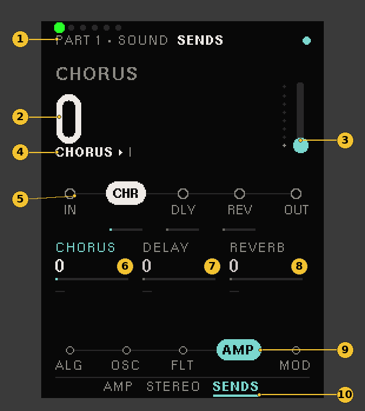

1. **Header.**
2. **The touched send's level**, large.
3. Its level bar.
4. **The effect** and its TYPE (`CHORUS ▸ I`).
5. **The effects chain**, the touched one lit, the three sends as short bars.
6. **CHORUS.**
7. **DELAY.**
8. **REVERB.**
9. Chain map, AMP lit.
10. Sub-page row, SENDS underlined.

| Cell | Range | Default | What it does |
|---|---|---|---|
| **CHORUS** | 0 to 127 | 0 | Send to the chorus slot |
| **DELAY** | 0 to 127 | 0 | Send to the delay |
| **REVERB** | 0 to 127 | 0 | Send to the reverb |

The same page is SND in the Part's mixer. Sends belong to the Sound, so they travel with it. Effects return wet only. The taper is squared: 64 is −12 dB, 32 is −24 dB, and the first step is far below hearing, so a send fades in from 0.

**Why:** on a straight taper the bottom of the knob jumped from nothing to audible and the top half did little; squared, the top half spans 12 dB and the low end grows from silence.

## Voice chain: differences between engines

| Where | ALGO | MODAL | VA | TAPE |
|---|---|---|---|---|
| PITCH sits under | ALG | RES | VA | DECK |
| Default TYPE | CLEAN, LP4 | CLEAN, LP4 | 2040 (REV2) | CLEAN, LP4 |
| OP5, OP6 on jacks and matrix | yes | no | no | no |
| INIT route into VCA | none | none | ENV 1 at +127 | ENV 1 at +127 |
| Release gate (no VCA route) | yes | yes | no | no |
| Tuner | the note | the note | the note, with OSC 1 | from the source's root; `ROOT ?` if unknown |

DRUM builds its per-pad filter, gate and amp pages from the same filters, FX slot and gate: see [DRUM](#drum-the-kit-engine).

# Envelopes and LFOs

Every melodic Part has three envelope slots and three LFO slots, the same on ALGO, MODAL, VA and TAPE. They sit under the MOD node, after the matrix: **E1**, **E2**, **E3** (envelopes), **SPD** (their speeds) and **L1**, **L2**, **L3** (LFOs). What they move is set in [the mod matrix](#the-mod-matrix-and-routes); the filter's ENV AMT and the AMP page are in [the voice chain](#the-voice-chain-pitch-filter-fx-amp-stereo-and-sends).

## Modulators: where the pages are

| Chain map | Sub-page row | Page title |
|---|---|---|
| **E1**, **E2**, **E3** | ENV1, ENV2, ENV3 | ENV 1 / A (or / B, after the slot's TYPE) |
| **SPD** | SPEED | ENV SPEED |
| **L1**, **L2**, **L3** | LFO1, LFO2, LFO3 | LFO 1, LFO 2, LFO 3 |

From MATRIX, **SEQ** steps on through ENV1 to LFO3 and wraps back to the matrix; **EDIT** steps back. The envelope pages and SPEED give the whole band to a picture and have no focus band; the LFO pages keep it, with a glyph for each control. The usual gestures apply ([Voice chain: values and gestures on every page](#voice-chain-values-and-gestures-on-every-page)): **MIX + SEQ** learns, **hold SEQ + turn** is fine, **MIX + turn** jumps to a landmark, **MIX + PLUS** primes a destination where the cell is one ([Modulators: what can be modulated](#modulators-what-can-be-modulated)).

**Why:** instead of a fixed "filter envelope", "amp envelope" and "vibrato LFO", a Sound gets six slots, each a choice of kind, and any of them can drive anything through the matrix.

> **Design note:** the envelope slots are modelled on the behaviour and ranges of the Intellijel Cascadia's Envelopes A and B, after its manual: no code, just the published ranges and how each mode behaves. A is after its AHDSR with speed switch and hold position; B after its function generator, which can be an envelope, an LFO or a burst of pulses. The stages charge like a capacitor toward a rail, which is why they sound like an analogue envelope rather than a ruler.

## Envelopes: the three slots

Each slot's **TYPE** is **A** (an AHDSR at one of three speeds) or **B** (a function generator: envelope, LFO or burst, by its **MODE**). A new Sound starts E1 and E2 on A at MED and E3 on B, MODE ENV. E1 is the envelope the filter's ENV AMT reads; on VA and TAPE it is also routed into the VCA at full.

Changing TYPE, MODE or FORM never jumps: the new shape takes over from the slot's current level. Outputs carry no velocity; velocity arrives as VELO in the matrix, through AMP's VEL, or through a route into an envelope's level ([Envelopes: modulating an envelope](#envelopes-modulating-an-envelope)).

## Envelopes: type A, the AHDSR


1. **Header:** PART 1 · SOUND, page ENV 1 / A.
2. **The picture:** the envelope as set, its stages drawn to scale, the touched stage (attack) lit.
3. **Stage letters:** A H D S R, the touched one lit.
4. **ATTACK**, 10 ms.
5. **DECAY**, 299 ms.
6. **SUSTAIN**, 70%.
7. **RELEASE**, 299 ms.
8. **HOLD**, 0.001 ms.
9. **TYPE:** A.
10. **Chain map**, MOD lit.
11. **Sub-page row:** MATRIX ENV1 ENV2 ENV3 `>`, ENV1 underlined.

E2 starts the same way:


1. Header: ENV 2 / A.
2. The envelope.
3. Stage letters.
4. ATTACK.
5. DECAY.
6. SUSTAIN.
7. RELEASE.
8. HOLD.
9. TYPE: A.
10. Chain map, MOD lit.
11. Sub-page row: `<` ENV1 ENV2 ENV3 SPEED `>`, ENV2 underlined.

| Cell | Range (at MED) | Default | What it does |
|---|---|---|---|
| **ATTACK** | 2 ms to 10 s | 10 ms | Rise to the peak |
| **DECAY** | 3.5 ms to 10 s | 299 ms | Fall from the peak to SUSTAIN |
| **SUSTAIN** | 0 to 100 % | 70 % | Level held while the key is down |
| **RELEASE** | 3.5 ms to 10 s | 299 ms | Fall to 0 after key up |
| **HOLD** | 0.001 ms to 10 s | 0.001 ms | Time at the peak, or the shortest gate (HOLD on SPEED) |
| **TYPE** | A, B | A (E3: B) | The slot's kind |

The ranges follow the slot's SPEED:

| SPEED | HOLD | ATTACK | DECAY and RELEASE |
|---|---|---|---|
| **FAST** | 0.001 ms to 2.5 s | 0.2 ms to 1.5 s | 0.6 ms to 2.5 s |
| **MED** | 0.001 ms to 10 s | 2 ms to 10 s | 3.5 ms to 10 s |
| **SLOW** | 0.001 ms to 60 s | 9.3 ms to 60 s | 30 ms to 60 s |

Time knobs are exponential (each detent the same ratio) and read in ms, then s. The stages curve like an analogue envelope's: the attack aims past the top and stops there, so it arrives firm; decay and release slow as they near their end.

## Envelopes: type B, the function generator

With TYPE **B** the page reads **MODE · (two times or rates) / (a shape) · FORM · TYPE**; labels follow MODE and FORM, and each MODE remembers its own FORM.

| MODE | What it is | FORM choices | Cells |
|---|---|---|---|
| **ENV** | Rises and falls | AD, AHR, CYCLE | **RISE**, **FALL**, **SHAPE** |
| **LFO** | A free-running wave | FREE, SYNC, LFV | **RATE**, **PHASE**, **TILT** (LFV: **RATE**, **DELTA**, **SLEW**) |
| **BURST** | A train of pulses | AD, AHR, CYCLE | **RATE**, **LENGTH**, **TILT** |

### Envelopes: B in ENV mode


1. **Header:** ENV 3 / B.
2. **MODE pills:** ENV, LFO, BURST; ENV lit.
3. **The shape:** up at RISE's time and SHAPE's curve, down at FALL's.
4. **MODE:** ENV.
5. **RISE**, 10 ms.
6. **FALL**, 299 ms.
7. **SHAPE:** LIN.
8. **FORM:** AD.
9. **TYPE:** B.
10. **Chain map**, MOD lit.
11. **Sub-page row:** `<` ENV2 ENV3 SPEED LFO1 `>`, ENV3 underlined.


| Cell | Range | Default | What it does |
|---|---|---|---|
| **MODE** | ENV, LFO, BURST | ENV | The slot's mode |
| **RISE** | 2 ms to 5 s | 10 ms | Rise time |
| **FALL** | 2 ms to 5 s | 299 ms | Fall time |
| **SHAPE** | LOG, LIN, EXP | LIN | Curve of both segments; reads `LOG 40`, `LIN`, `EXP 25` |
| **FORM** | AD, AHR, CYCLE | AD | AD: rise then fall on each note-on, whatever the key does (retriggers from where it is). AHR: holds at the top while the key is down. CYCLE: repeats while held, restarting at each note-on: an LFO with separate up and down times |
| **TYPE** | A, B | B on E3 | The slot's kind |

 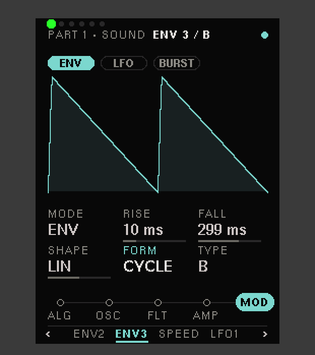

### Envelopes: B in LFO mode


| Cell | Range | Default | What it does |
|---|---|---|---|
| **RATE** | 0.05 Hz to 800 Hz | 0.37 Hz | The speed |
| **PHASE** | 0 to 360 | 230 | Where the wave starts (FREE, SYNC) |
| **TILT** | SAW, TRI, RAMP | TRI | Slope: falling saw, triangle, rising ramp |
| **DELTA** | 0 to 100 % | 64 % | LFV: how far each new random target may land from the last |
| **SLEW** | 0 to 100 % | 50 % | LFV: how smoothly it glides to each target |
| **FORM** | FREE, SYNC, LFV | FREE | FREE: never reset by notes. SYNC: restarts at PHASE on each note-on. LFV: a random walk that never passes the ends, for organic movement |

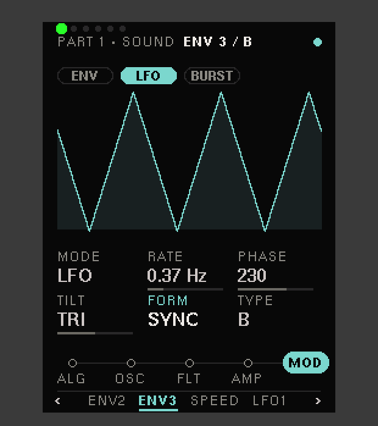 

### Envelopes: B in BURST mode

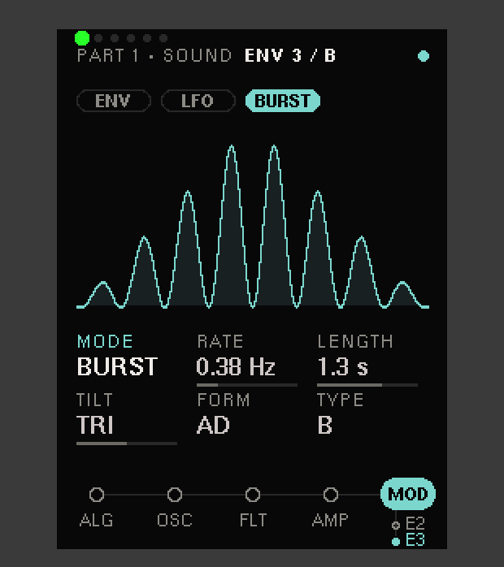

| Cell | Range | Default | What it does |
|---|---|---|---|
| **RATE** | 0.05 Hz to 1 kHz | 0.38 Hz | Pulse rate within the burst |
| **LENGTH** | 10 ms to 20 s | about 1.3 s | How long the burst lasts |
| **TILT** | SAW, TRI, RAMP | TRI | The burst's shape over its length |
| **FORM** | AD, AHR, CYCLE | AD | AD: one burst a note. AHR: goes on while held. CYCLE: repeats while held; on key up the running burst is the last |

A burst gives ratchets, flutters and bouncing balls from one note: into VCA for a stuttered note, into the cutoff for filter blips.

 

### Envelopes: B's top speed

A type B slot feeding the VCA runs every sample, at full range. Anywhere else it runs once a block and its rates stop at 93.75 Hz (LFO RATE, BURST's pulse RATE, the repeat of ENV CYCLE and BURST CYCLE); one-shot AD and AHR times are not limited.

**Why:** six modulators at audio rate would cost voices. Only the slot shaping the level needs that detail; elsewhere 93.75 Hz is faster than any sweep you hear as a sweep.

## SPEED: the envelopes' speeds

**SPEED** (SPD, ENV SPEED on screen) holds each type A slot's SPEED and HOLD, a column a slot.

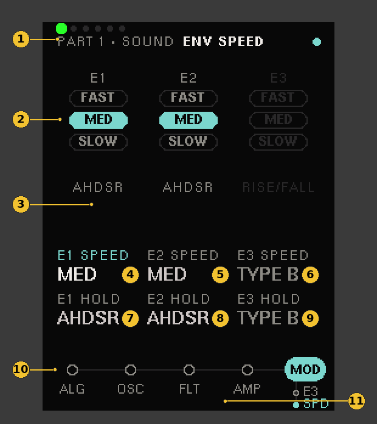

1. **Header:** ENV SPEED.
2. **The picture:** speed pills, a column a slot (FAST, MED or SLOW lit), and the hold position under each (AHDSR); the type B column E3 is dimmed and reads RISE/FALL.
3. **E1 SPEED**, MED.
4. **E2 SPEED**, MED.
5. **E3 SPEED**, TYPE B, dimmed.
6. **E1 HOLD**, AHDSR.
7. **E2 HOLD**, AHDSR.
8. **E3 HOLD**, TYPE B, dimmed.
9. **Chain map**, MOD lit.
10. **Sub-page row:** `<` ENV3 SPEED LFO1 LFO2 `>`, SPEED underlined.

| Cell | Choices | Default | What it does |
|---|---|---|---|
| **E1 SPEED**, **E2 SPEED**, **E3 SPEED** | FAST, MED, SLOW | MED | The slot's time ranges ([Envelopes: type A, the AHDSR](#envelopes-type-a-the-ahdsr)) |
| **E1 HOLD**, **E2 HOLD**, **E3 HOLD** | OFF, AHDSR, GATE EXT | AHDSR | Where HOLD acts (below) |

| HOLD | What it does |
|---|---|
| **OFF** | No hold stage: a plain ADSR |
| **AHDSR** | Holds at the peak for HOLD's time, then decays |
| **GATE EXT** | HOLD is the shortest gate: shorter notes play as if held that long, so short sequencer gates and drum triggers still reach the sustain |

On a type B slot both cells read TYPE B, dimmed.

**Why:** SPEED changes the range under the knob, not its travel, so one shape can be a click at FAST or a minute-long swell at SLOW, with fine control at each.

## Envelopes: modulating an envelope

An envelope's controls are destinations, so velocity, the wheel or another modulator can reshape it as you play. Prime them with **MIX + PLUS** on the envelope page:

| On a type A slot, MIX + PLUS on | Primes | What a route into it does |
|---|---|---|
| ATTACK, DECAY, RELEASE or HOLD | the slot's **TIME** | Scales all its times; positive faster, negative slower |
| SUSTAIN | the slot's **LEVEL** | Sets the peak: once routed, the sum of the routes, 0 to full |

On type B, **RISE**, **FALL** and **SHAPE** are destinations each, under whatever names the MODE gives them (RATE, PHASE, DELTA, LENGTH, TILT, SLEW).

- **Velocity-sensitive envelope:** prime E2's LEVEL (MIX + PLUS on SUSTAIN), route VELO into it at +127.
- **Faster envelopes higher up:** prime E1's TIME, route NOTE into it at a positive amount, as acoustic notes shorten as they rise.

## LFOs: the three LFO slots

Each LFO slot's **TYPE** is **CLASSIC** (shape, rate in Hz, sync, phase, depth) or **FUNC** (envelope B locked to LFO mode: TILT, the random walk, rates to 93.75 Hz).

## LFOs: CLASSIC


1. **Header:** PART 1 · SOUND, page LFO 1.
2. **The touched cell**, large: RATE, 1.33 Hz.
3. **Its glyph:** RATE draws two seconds of the LFO over a one-second ruler; the other cells draw what they do.
4. **Hint line:** `SEQ+TURN FINE  MIX + SEQ LEARN`.
5. **The LFO:** one cycle as set. A dot rides the newest voice's place in the cycle, resting at the start while nothing plays.
6. **RATE.**
7. **SHAPE:** SINE.
8. **SYNC:** FREE.
9. **PHASE**, dimmed under FREE.
10. **DEPTH**, 127.
11. **TYPE:** CLASSIC or FUNC.
12. **Chain map**, MOD lit.
13. **Sub-page row:** `<` SPEED LFO1 LFO2 LFO3, LFO1 underlined.

LFO 2 and LFO 3 are laid out the same:


1. Header: LFO 2.
2. Touched cell: RATE, 1.00 Hz.
3. Glyph.
4. Hint line.
5. The LFO.
6. RATE.
7. SHAPE.
8. SYNC.
9. PHASE.
10. DEPTH, 127.
11. TYPE.
12. Chain map, MOD lit.
13. Sub-page row, LFO2 underlined.


1. Header: LFO 3.
2. Touched cell: RATE, 1.00 Hz.
3. Glyph.
4. Hint line.
5. The LFO.
6. RATE.
7. SHAPE.
8. SYNC.
9. PHASE.
10. DEPTH, 127.
11. TYPE.
12. Chain map, MOD lit.
13. Sub-page row, LFO3 underlined.

| Cell | Range | Default | What it does |
|---|---|---|---|
| **RATE** | 0.01 Hz to 20 Hz | 1.00 Hz | Speed, in Hz |
| **SHAPE** | SINE, TRI, SAW, SQR, S&H | SINE | The wave; S&H holds a new random value each cycle |
| **SYNC** | FREE, RETRIG | FREE | FREE: the Part's voices share one phase. RETRIG: each note restarts its own LFO at PHASE |
| **PHASE** | 0 to 127 | 0 | Where a RETRIG LFO starts; dimmed under FREE |
| **DEPTH** | 0 to 127 | LFO1: 0, LFO2, LFO3: 127 | How much comes out. A destination |
| **TYPE** | CLASSIC, FUNC | CLASSIC | The slot's kind |

Under **FREE** the Part keeps a running phase clock per slot, so a chord wobbles together whenever each note was struck, and changing RATE changes speed without jumping the phase. Under **RETRIG** each note's LFO starts the same way and a chord's notes drift apart.

> **Design note:** CLASSIC FREE works like the one LFO of a Prophet-5, shared by every voice: play a chord and the vibrato moves it as one. The clock is an accumulator, not "time since the start times RATE", so turning RATE mid-note speeds the wave up smoothly instead of teleporting it.

## LFOs: FUNC


TYPE **FUNC** is a type B function generator locked to LFO mode; its MODE cell reads LFO, dimmed, and does not turn.

| Cell | Range | Default | What it does |
|---|---|---|---|
| **MODE** | LFO (fixed) | LFO | Shown for its place |
| **RATE** | 0.05 Hz to 93.75 Hz | 1.00 Hz | The speed |
| **PHASE** | 0 to 360 | 0 | Where the wave starts (FREE, SYNC) |
| **TILT** | SAW, TRI, RAMP | TRI | The wave's slope |
| **DELTA** | 0 to 100 % | 0 % | LFV: how far each random step may go |
| **SLEW** | 0 to 100 % | 50 % | LFV: how smoothly it glides |
| **FORM** | FREE, SYNC, LFV | FREE | As in [B in LFO mode](#envelopes-b-in-lfo-mode) |
| **TYPE** | CLASSIC, FUNC | CLASSIC | The slot's kind |

FUNC has no DEPTH: the routes it feeds set its level. Its RATE stops at 93.75 Hz, the top speed of a once-a-block slot.

**Why:** FUNC gives the LFO slots envelope B's shapes (any slope, the LFV walk) without spending an envelope slot.

## LFOs: DEPTH as a destination

A CLASSIC LFO's **DEPTH** is a destination: touch it, press **MIX + PLUS**, route any source in. The route reaches the LFO one block (1.3 ms) after its source moves.

A new Sound comes with one: WHEEL into LFO 1's DEPTH at +127, with LFO 1 into PITCH and its DEPTH at 0. Wheel down, no vibrato; wheel up, full depth. Moving the wheel is playing, not editing: the Sound stays as saved ([MIDI](#midi-channels-maps-and-controllers)).

- **Vibrato that fades in:** route ENV 2 (type A, slow ATTACK) into LFO 1's DEPTH instead of the wheel.
- **Pressure tremolo:** LFO 2's DEPTH to 0, prime it, route PRESS in, and route LFO 2 into VCA (or PAN, for an auto-pan you squeeze in).

## Modulators: what can be modulated

| Slot | Destinations |
|---|---|
| Envelope, type A | TIME (from ATTACK, DECAY, RELEASE or HOLD), LEVEL (from SUSTAIN) |
| Envelope, type B | RISE, FALL, SHAPE, under the MODE's names |
| LFO, CLASSIC | DEPTH |
| LFO, FUNC | none |

MODE, FORM, TYPE, SPEED, HOLD on SPEED, CLASSIC's SHAPE and SYNC, and the LFOs' RATE and PHASE are not destinations: **MIX + PLUS** says NOT MODULATABLE. Routes are explained in [the mod matrix](#the-mod-matrix-and-routes).

# The mod matrix and routes

Every connection from a modulator to the sound is a **route**: one cell of the MOD matrix, a source on its row and a destination in its column, with an amount. This chapter covers the matrix page (MATRIX in the sub-page row, **MTX** in a STACK chain map, MOD MATRIX on screen), every source and destination, and every gesture that makes, changes or deletes a route. The modulators are in [Envelopes and LFOs](#envelopes-and-lfos), the filter's route cells and the VCA in [the voice chain](#the-voice-chain-pitch-filter-fx-amp-stereo-and-sends), the wheel, pressure and MPE in [MIDI](#midi-channels-maps-and-controllers).

## MOD: every connection is a route

There is no hidden wiring. When an envelope opens the filter, an LFO adds vibrato or velocity makes a note louder, a route in the matrix says so, with an amount you can see and change. Knobs such as ENV AMT on the filter's MODULATION page are the same matrix cell seen from another place: turn either and both move.

An amount runs from −127 to +127. The source's value times the amount is added to the destination's own setting. The parameter's number on its page never moves; a thin line under its bar shows modulation reaching it.

**Why:** one place holds every connection, so a Sound can always be read, and deleting a route always takes its effect away.

> **Design note:** only a parameter the voice reads afresh every block can be a destination. A knob read once at note-on, or one that only picks a mode, would accept a route and then ignore it. Rather than offer a connection that does nothing, those say NOT MODULATABLE. The matrix only makes promises it keeps.

## MOD: the matrix page

The MOD node's own page is the matrix; **SEQ** steps on to the envelopes, SPEED and the LFOs.

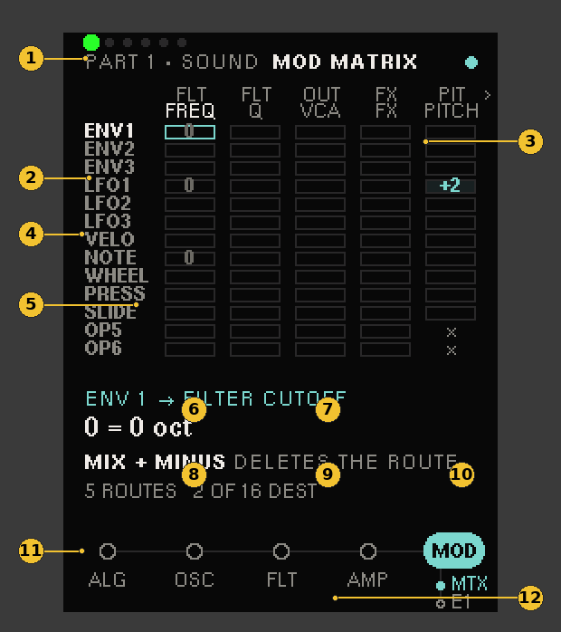

1. **Header:** PART 1 · SOUND, page MOD MATRIX.
2. **Column heads:** the destinations, block over parameter (FLT FREQ, FLT Q, OUT VCA, FX FX, then the primed PIT PITCH, holding LFO 1's +2 route: the INIT vibrato); `>` means more off the edge.
3. **Row labels:** the sources, ENV1 to ENV3, LFO1 to LFO3, VELO, NOTE, the hand rows (WHEEL, PRESS, SLIDE), then ALGO's **OP5** and **OP6**; `×` marks a column a tap can't reach.
4. **Readout:** the route under the cursor in full words (`ENV 1 → FILTER CUTOFF`).
5. **Amount** in the destination's terms (`0 = 0 oct`).
6. **Hint:** the keys for the cell under the cursor (`MIX + MINUS DELETES THE ROUTE`).
7. **Count:** routes in use and destinations primed (`5 ROUTES   2 OF 16 DEST`).
8. **Chain map:** MOD lit.
9. **Sub-page row:** MATRIX (underlined), ENV1, ENV2, ENV3; `>` for SPEED and the LFOs.

The page has no cells of its own; the encoders work the grid:

| Encoder | Does |
|---|---|
| 1 | Cursor up and down the rows |
| 2 | Cursor across the columns |
| 4 | Scrolls the columns (the cursor comes along) |
| 5 | Amount of the cell under the cursor, −127 to +127 |

Five columns show at once; `<` and `>` mean more off screen. Each header has two lines: the block (FLT, OUT, FX, PIT, LF1, E2, OP1 …) over the parameter. A cell with a route is lit and prints its amount, an empty cell is an outline, the cursor's cell is outlined in the accent colour. A route at 0 stays a route (it prints `0`), ready for an amount.


## MOD: the sources

| Row | Readout | What it is | Range |
|---|---|---|---|
| **ENV1**, **ENV2**, **ENV3** | ENV 1 … | The envelope slots | 0 to 1 (LFO-mode slot −1 to 1) |
| **LFO1**, **LFO2**, **LFO3** | LFO 1 … | The LFO slots | −1 to 1 |
| **VELO** | VELOCITY | How hard the note was played | 0 to 1 |
| **NOTE** | NOTE | The key, centred on C4; +127 into the cutoff tracks an octave per octave | −1 to 1 |
| **WHEEL** | MOD WHEEL | CC 1 on the Part's channel | 0 to 1 |
| **PRESS** | PRESSURE | Channel or the note's poly pressure, whichever is higher | 0 to 1 |
| **SLIDE** | SLIDE | CC 74 (MPE slide), on the Part's channel or the note's own | 0 to 1 |
| **OP5**, **OP6** | OP5, OP6 | ALGO only: operators 5 and 6's audio | audio |

WHEEL, PRESS and SLIDE glide, so a fast throw never steps the sound. The channel's wheel and pressure carry across notes and Sound loads; a new note starts with no poly pressure. Under MPE each note has its own PRESS and SLIDE ([MIDI](#midi-channels-maps-and-controllers)).

## MOD: the four fixed columns

These are on every Sound and take no destination slot:

| Column | Readout | What it moves |
|---|---|---|
| **FLT FREQ** | FILTER CUTOFF | The cutoff (FREQ, or CUTOFF on the 2040); a full route moves it ten octaves |
| **FLT Q** | FILTER RESO | The resonance (Q or RES) |
| **OUT VCA** | OUTPUT VCA | The note's amp; the first route replaces the engine's own contour ([AMP: routes into VCA and BASE](#amp-routes-into-vca-and-base)) |
| **FX FX** | FX and the pot's name | The FX slot's first pot: DRIVE, SUSTAIN or FOLD |

An empty VCA cell says what a route would do: `VCA: ROUTES REPLACE CONTOUR`, or `VCA: SUM STARTS AT AMP BASE` once an envelope is routed there.

## MOD: priming a destination

Every other column is one you **prime** from the page where the parameter lives:

1. Touch the parameter (turn its encoder a little).
2. Press **MIX + PLUS**; the focus band says what happened.
3. Go to the matrix (PLUS along the chain to MOD): the new column is last.
4. Put the cursor on a source row under it and turn encoder 5.

| Message | Means |
|---|---|
| **ADDED** | A new column is in the matrix |
| **ALREADY ROUTED** | It is a column already (the fixed four always are) |
| **NOT MODULATABLE** | It can't be a destination, or is dimmed in the current setting |
| **MATRIX FULL** | All 16 destination slots are taken; remove one first |

The message stays until your next input. Some cells prime something else: on a type A envelope, **ATTACK**, **DECAY**, **RELEASE** and **HOLD** prime its TIME and **SUSTAIN** its LEVEL ([Envelopes: modulating an envelope](#envelopes-modulating-an-envelope)); on AMP, **VEL** answers for the VCA column.

## MOD: making, changing and deleting a route

- **Make:** cursor on an empty cell, turn encoder 5.
- **Change:** turn encoder 5 on it; amounts glide, so the sound never steps.
- **Delete:** on the matrix, **MIX + MINUS** on it. On another page, **MIX + MINUS** on a route cell (ENV AMT, KEYBOARD, FREQ MOD, RES MOD).
- **Remove a destination:** on its own page, touch it and press **MIX + MINUS**: the column leaves with every route in it, freeing the slot.

On a route the hint reads `MIX + MINUS DELETES THE ROUTE`; on an empty cell, `MIX + PLUS ON A PARAM PRIMES IT`.

## MOD: what an amount means

The readout gives the amount in the destination's terms:

| Destination | Readout | Example |
|---|---|---|
| A cutoff | octaves | `+42 = +3.3 oct` |
| PITCH | semitones (full route 24) | `+32 = +6.0 st` |
| A tuning in cents | cents | `+32 = +25 ct` |
| Anything else | share of the range | `+42 = +33%` |

A route adds to the setting: a 400 Hz cutoff with ENV 1 at +42 opens about three octaves above 400 Hz at the peak, then settles back. The result is held to the parameter's range.

## MOD: route cells on other pages

Each of these knobs is one route, shown in two places:

| Page | Cell | The route |
|---|---|---|
| FILTER MOD | **ENV AMT** | ENV 1 into FLT FREQ |
| FILTER MOD | **KEYBOARD** | NOTE into FLT FREQ (2040: OFF, HALF, FULL) |
| FILTER MOD | **FREQ MOD** | The FREQ SRC jack's source into FLT FREQ |
| FILTER MOD | **RES MOD** | The RES SRC jack's source into FLT Q |

They read in percent (`+50%`) and the focus band names the source (`FREQ MOD LFO1`). **MIX + turn** jumps to 0, then full, in the direction you turn; **MIX + MINUS** deletes. Moving a jack moves its route, amount and all ([FILTER MOD: the filter's modulation page](#filter-mod-the-filters-modulation-page)).

## MOD: the destinations, shared by every engine

On ALGO, MODAL, VA and TAPE:

| Page | Destinations |
|---|---|
| PITCH | **PITCH**, **FINE** |
| FILTER | FREQ / CUTOFF and Q / RES (fixed), SEM's **MODE** knob |
| FILTER MOD | **FEEDBACK** (FDBK) |
| FX | DRIVE / SUSTAIN / FOLD (fixed), TONE, SYMMETRY, LEVEL, VOLUME, **INPUT**, **MIX**, **STABILITY** |
| AMP | VCA (fixed, through **BASE**), **LPG**, **DECAY**, **STRIKE** |
| STEREO | **PAN** |
| ENV1 to ENV3 | type A: TIME, LEVEL; type B: RISE, FALL, SHAPE |
| LFO1 to LFO3 | **DEPTH** (CLASSIC only) |

Not destinations: TYPE, MODE lists, VOICE, FX PLACE, the jacks, STEAL, TIME (glide), SNAP, VEL, WIDTH, the sends, every envelope and LFO choice, and the LFOs' RATE, SHAPE, SYNC and PHASE.

## MOD: the destinations of each engine

| Engine | Its own destinations |
|---|---|
| [ALGO](#algo-the-six-operator-engine) | ALGORITHM's **MORPH**, **VOWEL**, **VOL**; each operator's level (LVL), formant (FRM) and BW (operator pages) |
| [MODAL](#modal-the-physical-modelling-engine) | RESONATOR's **BRIGHT**, **DAMP**, **POS**, **STRUCT** |
| [VA](#va-the-variable-wave-engine) | VA's **WAVE1**, **WAVE2**, **BLEND**, **SUB**, **STABILITY**; OSC1's and OSC2's **SHAPE**, **CRSE**, **FINE**; NOISE's **LEVEL** |
| [TAPE](#tape-the-sample-engine) | SRC's **START**, **VOL**; DECK's continuous knobs (labels follow the machine); the machine page's **AGE**, **TAPE** |

A column whose parameter does nothing in the current setting (MORPH while ALG A and ALG B match, say) turns grey and the readout adds INERT; its routes stay, waiting.


## MOD: ALGO's operator taps

On ALGO, rows **OP5** and **OP6** carry operators 5 and 6's audio. They reach only the four fixed columns, at audio rate; other cells show `×` and the hint reads `OP5: FREQ Q VCA FOLD ONLY`. The operator's own level and envelope are the depth. The same taps are on FILTER JACKS for FREQ SRC and RES SRC.

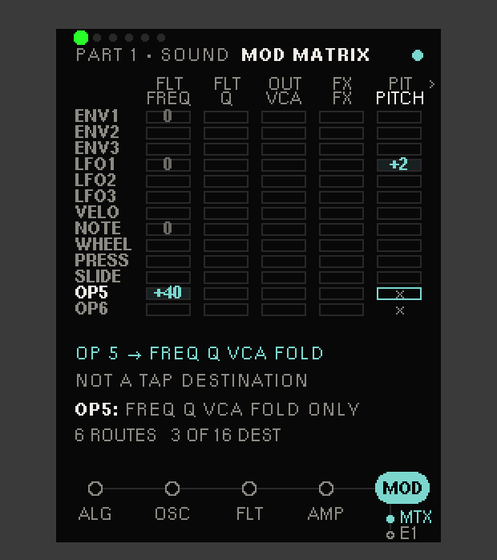

**Why:** an operator on the cutoff at audio rate gives filter FM's growl and sidebands, while keeping its place in the algorithm.

## MOD: what a new Sound has

| Route | Amount | Why |
|---|---|---|
| ENV 1, LFO 1 and NOTE into FLT FREQ | 0 | Ready: turn ENV AMT or KEYBOARD and they work |
| LFO 1 into PIT PITCH | +2 | Vibrato, about ±0.4 semitone at full depth |
| WHEEL into LF1 DEPTH | +127 | The wheel brings the vibrato in; DEPTH rests at 0 |
| ENV 1 into OUT VCA (VA and TAPE) | +127 | ENV 1 is the level: a VA tone or tape loop has no end of its own |

## MOD: limits

- 11 source rows (13 on ALGO, with OP5 and OP6).
- The four fixed columns plus up to 16 primed destinations.
- Every cell can hold a route.

## MOD: good starting points

- **Velocity brightness:** VELO into FLT FREQ at +30.
- **Expression on pressure:** PRESS into FLT FREQ at +40, and into a primed TONE for more bite as you lean in.
- **Stereo spread:** prime PAN, route NOTE into it at +64: low notes left, high right.
- **Wobble:** LFO 2 on SQR or S&H into FLT Q at +40 for stepped resonance.

# The MIXER and the master effects

This chapter covers the MIXER: each Part's strip (level, pan, output, voices, EQ, sends), the three shared effects, the master compressor and the output stage. The voice's own effects (drive, fuzz, fold) are in [the voice chain](#the-voice-chain-pitch-filter-fx-amp-stereo-and-sends); MIDI control of the mixer is in [MIDI](#midi-channels-maps-and-controllers).

Continuous knobs read 0 to 127 unless the screen shows a unit (ms, Hz, dB, s, %).

## MIXER: opening it

| Keys | Does |
|---|---|
| **B*n*** again, from Part *n*'s pages | Flips to Part *n*'s mixer; B*n* once more flips back to the page you left |
| **MIX + B*n*** | Opens Part *n*'s mixer from anywhere; inside the mixer, jumps to that Part's mixer on the same page |
| **MIX + SEQ** | MIDI-learns the touched cell ([MIDI](#midi-channels-maps-and-controllers)) |

The mixer opens on **SND**, then on the mixer page you last used this session. The header reads `PART 1 · MIX` and the page name (`PART 1 · MIX SENDS`).

**Why:** PRT's third cell is OUT; opening there, a stray turn could send the Part to a pair you are not listening to.

## MIXER: the chain

**PRT** · **SND** · **CHR** · **DLY** · **REV** · **MST**, walked with MINUS and PLUS.

| Node | Full name | Sub-pages |
|---|---|---|
| **PRT** | PART | **VOI** (VOICES), **EQ** |
| **SND** | SENDS | |
| **CHR** | CHORUS | |
| **DLY** | DELAY | **CHAR** (CHARACTER), **GRAIN** |
| **REV** | REVERB | **MORE**, **DUCK**, **MOR2** (MORE 2) |
| **MST** | MASTER | **LVL** (LEVEL) |

PRT, VOI, EQ and SND belong to the Part (PART1_PRT … PART6_SND in the schema); CHR, DLY, REV and MST are shared by all six Parts. Sub-pages work as on a Part ([the panel and navigation](#the-panel-and-navigation)); from PRT or SND, **EDIT** goes down to the Part's Sound browser.

Every mixer page has the same frame: the header, the focused cell large (with its glyph), the focus band (hint), a picture band, six cells, the chain map and the sub-page row. On the effect pages the picture band is the effects flow (IN, CHR, DLY, REV, OUT, the current effect lit). The numbered lists below name the dots in that order.

## MIXER: the PRT page

**PART** (PRT) is the Part's channel strip.


1. Header: `PART 1 · MIX PART`.
2. Focused cell: LEVEL 94.
3. LEVEL's glyph: a fader.
4. Hint: `SEQ+TURN FINE`, `MIX + SEQ LEARN`.
5. The six Parts' levels and meters, this Part in accent.
6. **CH**.
7. **MODE**.
8. **OUT**.
9. **LEVEL**.
10. **PAN**.
11. **BEND**.
12. Chain map: PRT lit.
13. Sub-page row: PART underlined.

| Cell | Range | Default | What it does |
|---|---|---|---|
| **CH** | 1 to 16 | Part *n* on *n* | MIDI channel; same value as SETTINGS › MIDI CONFIG › CHANNELS |
| **MODE** | MONO, POLY | POLY | MONO retriggers one voice; POLY plays chords |
| **OUT** | P1, P2, P3 | P1 | Output pair; same value as SETTINGS › AUDIO ROUTING › OUTPUTS |
| **LEVEL** | 0 to 127 | 102 | The fader |
| **PAN** | L63, C, R63 | C | Left to right |
| **BEND** | 0 to 24 | 2 | Pitch-bend range in semitones |

Beside each LEVEL bar is a meter taken after the EQ and before LEVEL: −48 to 0 dBFS, 20 dB/s fall, a one-second peak mark, the top lit in the alert colour past full scale. A square by the Part number lights while a key is held on its channel (or its MPE zone). When OUT is not P1 the header shows `OUT P2` or `OUT P3`.

**Why:** a pre-fader meter answers "is this Part making sound?" even with LEVEL down. A lit key mark over an empty meter points at the Sound; an unlit one at the MIDI channel.

## MIXER: the VOICES sub-page

**VOICES** (VOI) sets the Part's share of the eight-voice pool.

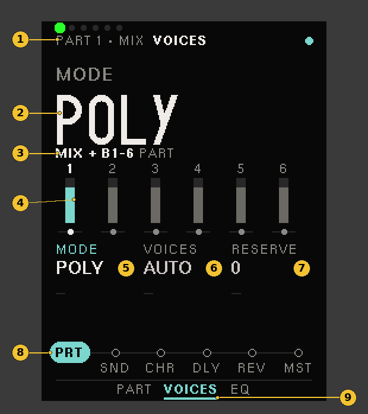

1. Header: `PART 1 · MIX VOICES`.
2. Focused cell: MODE POLY.
3. Hint: `MIX + B1-6 PART` (on RESERVE it shows the total, `RESERVES 2/8`).
4. Levels and meters.
5. **MODE**.
6. **VOICES**.
7. **RESERVE**.
8. Chain map: PRT lit.
9. Sub-page row: VOICES underlined.

| Cell | Options | Default | What it does |
|---|---|---|---|
| **MODE** | MONO, POLY | POLY | Same cell as on PRT |
| **VOICES** | AUTO, 1 to 8 | AUTO | Cap: at it, the Part steals its own oldest tail, then oldest held note. Tails count |
| **RESERVE** | 0 to 8 | 0 | Floor: this many held notes (or sounding DRUM hits) no other Part may steal |

RESERVE may not pass the Part's VOICES, and all reserves together may not pass 8. A refused value shows dimmed with the reason (`RESERVE 2 · VOICES 1`, `RESERVES 9 · POOL HOLDS 8`) and nothing changes. Reserves never hold free voices back, released tails are never guarded, and a mono voice is never stolen.

**Why:** six Parts share eight voices. VOICES stops a pad hogging the pool; RESERVE keeps the bass and the drum tail safe. A cap of 1 steals instead of retriggering, so each note gets its own envelope. More in [limits](#limits-voices-cpu-and-memory).

## MIXER: the EQ sub-page

**EQ** is the Part's channel EQ and its SMART EQ role.


1. Header: `PART 1 · MIX EQ`.
2. Focused cell: TILT 0 dB.
3. Hint: `SEQ+TURN FINE`, `MIX + SEQ LEARN`.
4. Levels and meters, with SMART EQ's four live cuts.
5. **TILT**.
6. **LO CUT**.
7. **ROLE**.
8. Chain map: PRT lit.
9. Sub-page row: EQ underlined.

| Cell | Range | Default | What it does |
|---|---|---|---|
| **TILT** | −10.0 to +9.8 dB | 0 dB | Tips the spectrum round 810 Hz: up brighter, down darker |
| **LO CUT** | OFF, ON | OFF | 6 dB/octave high-pass at 150 Hz, fades in over 20 ms |
| **ROLE** | FRONT, MID, BACK | MID | The Part's place for SMART EQ |

Order: LO CUT, TILT, then SMART EQ. Loading a Sound never changes the EQ; it belongs to the Part's place in the mix.

## MIXER: SMART EQ

SMART EQ stops Parts masking each other. Where a higher-ROLE Part is loud in a band, a lower-ROLE Part playing in that band is cut there, slowly. FRONT is never cut; equal roles never cut each other.

- **Bands:** LOW (100 Hz), LOW MID (400 Hz), HIGH MID (1.6 kHz), HIGH (6.4 kHz), after LO CUT and TILT.
- **Depth:** BACK under FRONT is cut most; one rank apart about two thirds as much.
- **Speed:** in over about half a second, out over about two.
- **The kick:** a higher-role DRUM Part dips lower Parts' LOW band fast (in a few ms, out over about 100 ms), like a sidechain.
- **The reverb** has its own role (**REV ROLE** on LVL = **SMART ROLE** on DUCK), BACK by default. It yields but never makes a Part yield.

**SMART EQ** (OFF, ON) and **AMOUNT** are on MST › LVL. Cuts for BACK under FRONT:

| AMOUNT | LOW, LOW MID | HIGH MID, HIGH | Kick dip |
|---|---|---|---|
| 64 (default) | 6 dB | 6 dB | 6 dB |
| 95 | 12 dB | 6 dB | 15 dB |
| 127 | 21 dB | 9 dB | 27 dB |

**Why:** one word per Part decides what matters, with no page of EQ. AMOUNT runs past the sweet spot (around 95) on purpose.

> **Design note:** the idea of groups comes from sonible's smart:EQ: say who leads and let the mix make room. Chimera's is far smaller, four fixed bands that only cut, because it runs beside the voices. It hears long ringing tails as the sustained energy they are, so a MODAL bell under a lead finally stops clouding it. Every rule for telling a kick from a snare failed somebody's groove, so the kick dip stayed an honest follower that wobbles with the beat.

## MIXER: the SND page

**SENDS** (SND) holds the Part's three sends; it is the same page as AMP › SENDS on the Part's chain.


1. Header: `PART 1 · MIX SENDS`.
2. Focused cell: CHORUS 0.
3. Glyph: a level bar.
4. Hint: the effect and its TYPE (`CHORUS ▸ I`).
5. Effects flow, the focused send's effect (CHR) lit.
6. **CHORUS**.
7. **DELAY**.
8. **REVERB**.
9. Chain map: SND lit (no sub-pages).

**CHORUS**, **DELAY** and **REVERB** run 0 to 127, default 0. Sends belong to the Sound and glide on load. They are taken after EQ and SMART EQ, **before** LEVEL and PAN: a Part at LEVEL 0 plays only through its effects. The taper is squared: 64 is −12 dB, so the top half covers 12 dB.

## MIXER: how the effects are wired

- Each effect sums all six Parts' sends and returns **wet only**; its **MIX** is the return level. Returns come back on P1.
- CHORUS and REVERB return in stereo; DELAY is mono on both sides.
- DLY's **REV** feeds the delay's return into the reverb.
- At MIX 0 an effect keeps running, so raising MIX never plays a stale tail.
- Every setting glides; a TYPE change crossfades.
- Effect settings belong to the project. A new project starts with every MIX at 127 and the chorus on I.

**Why:** wet-only returns let one reverb serve six Parts, and the Part's LEVEL stays its dry level.

## MIXER: the CHR page

**CHORUS** (CHR) is the shared modulation effect.

| Cell | Range | Default | What it does |
|---|---|---|---|
| **TYPE** | OFF, I, II, I+II, FLANGER, PHASER | I | Which effect |
| **RATE** | 0 to 127 | 64 | Sweep speed |
| **DEPTH** | 0 to 127 | 64 | Sweep depth |
| **MIX** | 0 to 127 | 127 | Return level |

| TYPE | What it is |
|---|---|
| **OFF** | No chorus |
| **I** | Bucket-brigade style line, slow and subtle |
| **II** | Faster and deeper |
| **I+II** | Both lines at once |
| **FLANGER** | Short delay on a slow triangle, fed back; right side sweeps the other way |
| **PHASER** | Six all-pass stages a side, fed back |

The right side reads on the inverted sweep, so it is wide in stereo and safe in mono. FLANGER's and PHASER's feedback is fixed; their notches come from the dry Part beside the return, so the CHORUS send sets their depth. The glyph for I, II and I+II is a braid; FLANGER draws a moiré comb, PHASER a ray gun, OFF a flat dry line.

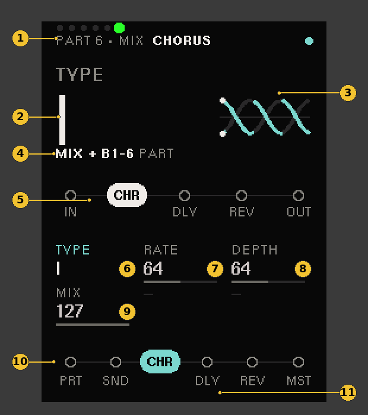

1. Header: `PART 6 · MIX CHORUS`.
2. Focused cell: TYPE I.
3. Glyph: a braid.
4. Hint: `MIX + B1-6 PART`.
5. Effects flow, CHR lit.
6. **TYPE**.
7. **RATE**.
8. **DEPTH**.
9. **MIX**.
10. Chain map: CHR lit (no sub-pages).


1. Header: `PART 6 · MIX CHORUS`.
2. Focused cell: TYPE II.
3. Glyph: a tighter braid.
4. Hint: `MIX + B1-6 PART`.
5. Effects flow, CHR lit.
6. **TYPE**.
7. **RATE**.
8. **DEPTH**.
9. **MIX**.
10. Chain map: CHR lit (no sub-pages).


1. Header: `PART 6 · MIX CHORUS`.
2. Focused cell: TYPE I+II.
3. Glyph: a braid of both lines.
4. Hint: `MIX + B1-6 PART`.
5. Effects flow, CHR lit.
6. **TYPE**.
7. **RATE**.
8. **DEPTH**.
9. **MIX**.
10. Chain map: CHR lit (no sub-pages).

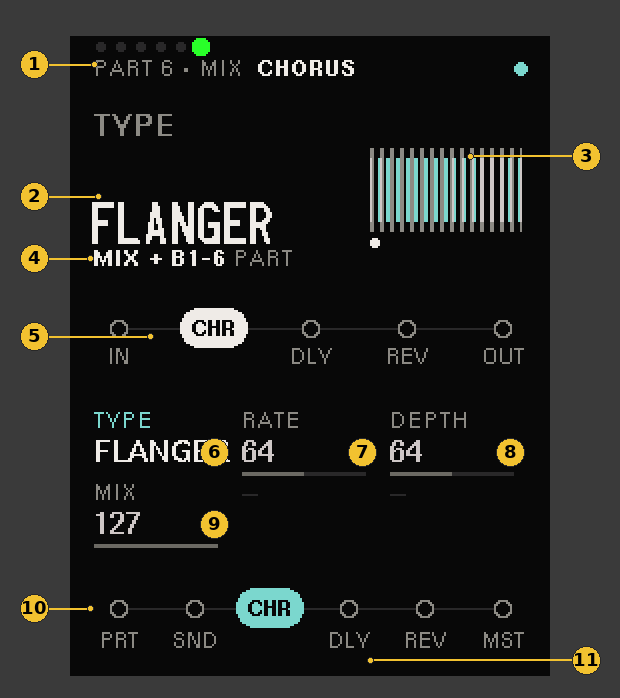

1. Header: `PART 6 · MIX CHORUS`.
2. Focused cell: TYPE FLANGER.
3. Glyph: a moiré comb.
4. Hint: `MIX + B1-6 PART`.
5. Effects flow, CHR lit.
6. **TYPE**.
7. **RATE**.
8. **DEPTH**.
9. **MIX**.
10. Chain map: CHR lit (no sub-pages).


1. Header: `PART 6 · MIX CHORUS`.
2. Focused cell: TYPE PHASER.
3. Glyph: a ray gun; the small dot under it marks TYPE as the focused cell.
4. Hint: `MIX + B1-6 PART`.
5. Effects flow, CHR lit.
6. **TYPE**.
7. **RATE**.
8. **DEPTH**.
9. **MIX**.
10. Chain map: CHR lit (no sub-pages).

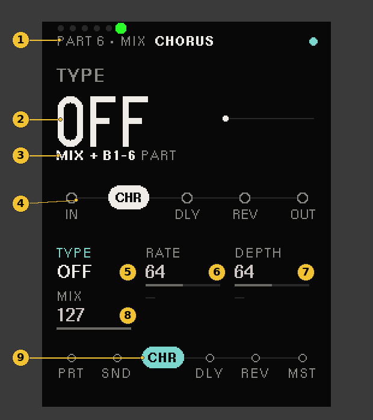

1. Header: `PART 6 · MIX CHORUS`.
2. Focused cell: TYPE OFF (a flat dry line beside it).
3. Hint: `MIX + B1-6 PART`.
4. Effects flow, CHR lit.
5. **TYPE**.
6. **RATE**.
7. **DEPTH**.
8. **MIX**.
9. Chain map: CHR lit (no sub-pages).

> **Design note:** I, II and I+II are inspired by the Juno-60's chorus buttons: two bucket-brigade lines on triangles, I at 0.513 Hz and II at 0.863 Hz at the default RATE. FLANGER is the feedback comb from Jon Dattorro's "Effect Design Part 2" (1997); PHASER the all-pass phaser of Julius O. Smith's "An Allpass Approach to Digital Phasing and Flanging" (1984). Both borrow the chorus's own delay lines, so they cost no memory at all.

## MIXER: the DLY page

**DELAY** (DLY) is the shared echo.


1. Header: `PART 6 · MIX DELAY`.
2. Focused cell: TYPE TAPE.
3. Hint: `MIX + B1-6 PART`.
4. Effects flow, DLY lit.
5. **TYPE**.
6. **TIME** (95, the 375 ms default).
7. **FDBK**.
8. **TONE**.
9. **REV**.
10. **MIX**.
11. Chain map: DLY lit.
12. Sub-page row: DELAY underlined.

| Cell | Range | Default | What it does |
|---|---|---|---|
| **TYPE** | TAPE, GRAIN | TAPE | TAPE echo, or repeats built from grains of the last half second |
| **TIME** | 0 to 127 on screen, no unit: 10 to 500 ms (FREE); or a note (SYNC) | 95 (375 ms), 1/8D | Time between repeats; under GRAIN, how far behind the grains start |
| **FDBK** | 0 to 127 | 51 | How much of each repeat comes round again |
| **TONE** | 0 to 127 | 76 | Roll-off inside the loop: lower is darker each repeat |
| **REV** | 0 to 127 | 0 | Delay return into the reverb (squared taper) |
| **MIX** | 0 to 127 | 127 | Return level |

- **MIX + turn on TIME** switches SYNC: right SYNC, left FREE (`MIX+TURN SYNC` / `MIX+TURN FREE`). In FREE, **SEQ + turn** is fine.
- A TIME change crossfades two read heads over 20 ms: no pitch sweep, no click. A TYPE change crossfades too.


1. Header: `PART 6 · MIX DELAY`.
2. Focused cell: TYPE GRAIN.
3. Hint: `MIX + B1-6 PART`.
4. Effects flow, DLY lit.
5. **TYPE**.
6. **TIME**.
7. **FDBK**.
8. **TONE**.
9. **REV**.
10. **MIX**.
11. Chain map: DLY lit.
12. Sub-page row: DELAY underlined.

### DELAY: SYNC and the tempo

**SYNC** (FREE, SYNC; default FREE) sits on CHARACTER and GRAIN, one setting in two places.

- Under SYNC, TIME steps through 1/32T, 1/32, 1/16T, 1/32D, 1/16, 1/8T, 1/16D, 1/8, 1/4T, 1/8D, 1/4. 1/8D at 120 BPM is 375 ms, FREE's default, so a fresh switch sounds the same. The band reads `TIME TURNS NOTES OF THE TEMPO`.
- The tempo is the leading MIDI clock, otherwise the project's ([ORBIT](#orbit-the-ring-sequencer)).
- A note over 500 ms plays halved, under 10 ms doubled, marked `▾1/8` or `▴` (`HALVED TO FIT 500 MS`, `DOUBLED TO FIT 10 MS`).
- FREE and SYNC keep their own TIME.
- On a tempo change TAPE glides to the new time like tape (a big jump crossfades); GRAIN's next grains start on the new time.

**Why:** gliding follows a DAW's tempo ramp the way tape would. Halving keeps a long note on the grid instead of drifting.

## MIXER: the CHAR sub-page

**CHARACTER** (CHAR) is TAPE's character.


1. Header: `PART 6 · MIX DELAY CHAR`.
2. Focused cell: MECHANICS 19.
3. MECHANICS' glyph: the reel, wobbling with the transport.
4. Hint: `SEQ+TURN FINE`, `MIX + SEQ LEARN`.
5. Effects flow, DLY lit.
6. **MECH**.
7. **SAT**.
8. **SYNC**.
9. Chain map: DLY lit.
10. Sub-page row: CHARACTER underlined.

| Cell | Range | Default | What it does |
|---|---|---|---|
| **MECHANICS** (reads MECH) | 0 to 127 | 19 | Wow (0.5 Hz) and flutter (9 Hz capstan, jitter). 0 is perfect, 127 a worn machine |
| **SAT** | 0 to 127 | 25 | Tape saturation in the loop; never fully off, so feedback never runs away |
| **SYNC** | FREE, SYNC | FREE | See above |

Under GRAIN, MECHANICS and SAT dim (`TAPE TYPE ONLY`) and keep their values.

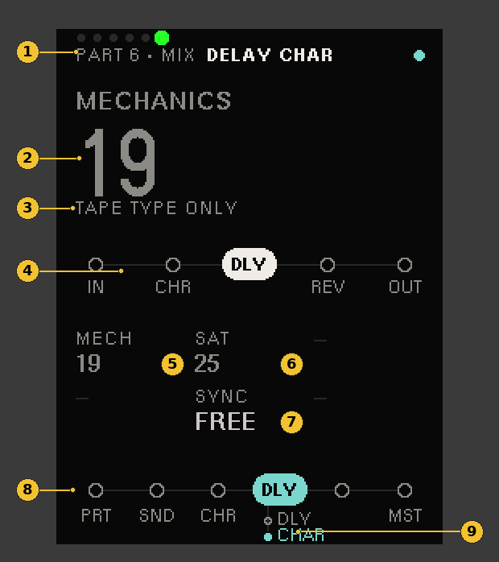

1. Header: `PART 6 · MIX DELAY CHAR`.
2. Focused cell: MECHANICS 19, dimmed.
3. Hint band: `TAPE TYPE ONLY`.
4. Effects flow, DLY lit.
5. **MECH**, dimmed.
6. **SAT**, dimmed.
7. **SYNC**, live under both TYPEs.
8. Chain map: DLY lit.
9. Sub-page row: CHARACTER underlined.

## MIXER: the GRAIN sub-page

**GRAIN** holds the GRAIN TYPE's controls.

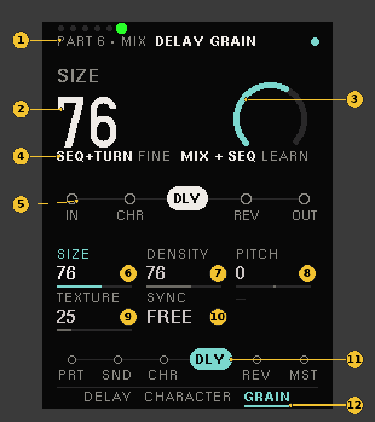

1. Header: `PART 6 · MIX DELAY GRAIN`.
2. Focused cell: SIZE 76.
3. SIZE's glyph: a dial.
4. Hint: `SEQ+TURN FINE`, `MIX + SEQ LEARN`.
5. Effects flow, DLY lit.
6. **SIZE**.
7. **DENSITY**.
8. **PITCH** (0 here; +12 with high FDBK is a shimmer).
9. **TEXTURE**.
10. **SYNC**.
11. Chain map: DLY lit.
12. Sub-page row: GRAIN underlined.

| Cell | Range | Default | What it does |
|---|---|---|---|
| **SIZE** | 0 to 127 on screen, no unit: 10 to 500 ms | 76 | Grain length |
| **DENSITY** | 1 to 128 a second | 76 | Grains started per second |
| **PITCH** | −24 to +24 | 0 | Shift in semitones |
| **TEXTURE** | 0 to 127 | 25 | 0: a regular train TIME behind; up: random starts scattered round TIME |
| **SYNC** | FREE, SYNC | FREE | Same as on CHARACTER |

Each grain reads the cells when it starts, through a smooth bell, so nothing zippers. FDBK sends grains round again; at PITCH +12 each pass climbs an octave. Under TAPE the four dim (`GRAIN TYPE ONLY`). After an incomplete update TYPE reads `NEEDS UPDATE` and GRAIN plays as TAPE ([updating](#updating-and-recovery)).

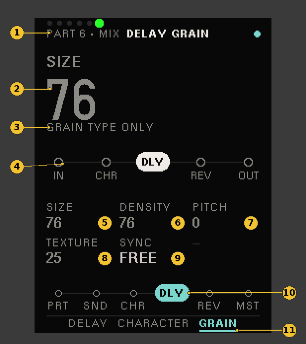

1. Header: `PART 6 · MIX DELAY GRAIN`.
2. Focused cell: SIZE 76, dimmed.
3. Hint band: `GRAIN TYPE ONLY`.
4. Effects flow, DLY lit.
5. **SIZE**, dimmed.
6. **DENSITY**, dimmed.
7. **PITCH**, dimmed.
8. **TEXTURE**, dimmed.
9. **SYNC**, live.
10. Chain map: DLY lit.
11. Sub-page row: GRAIN underlined.

Starting points: shimmer, PITCH +12, FDBK high, TEXTURE low, some REV. Haze: DENSITY high, SIZE short, TEXTURE high.

> **Design note:** GRAIN uses code adapted from the grain engine in Émilie Gillet's Mutable Instruments Beads (MIT licence): the pulse-train clock, grains starting behind the write head, the bell, the grain-stealing fades and the four-point read. Chimera plays six grains, not thirty-two, from the delay's half-second line, so no freeze, reverse or stereo spray. TEXTURE does one job where Beads splits DENSITY in two, and grains are scaled by how many overlap, so FDBK under the top always dies away. We tried hard to make it not. The same core runs TAPE's STRETCH machine ([TAPE](#tape-the-sample-engine)).

## MIXER: the REV page

**REVERB** (REV) is the shared reverb. **TYPE** picks a family; cells B to E change with it; **MIX** (0 to 100 %, default 100 %) stays put.

| TYPE | Sound | B | C | D | E |
|---|---|---|---|---|---|
| **QUAD** | Chimera's own four-stage ring, smooth and simple | **SIZE** | **TIME** | **DAMP** | **SMEAR** |
| **ROOM** | Small to medium rooms | **SIZE** | **DECAY** | **TONE** | **DIFFUSE** |
| **HALL** | Large halls; smallest SIZE reads PLATE | **SIZE** | **DECAY** | **TONE** | **DIFFUSE** |
| **BLOOM** | Swells in after the sound | **SWELL** | **DECAY** | **TONE** | **DIFFUSE** |
| **GATE** | Dense burst, cut sharply | **LENGTH** | **TAIL** | **TONE** | **DENSITY** |
| **REVERSE** | Burst rising to its end | **LENGTH** | **REGEN** | **TONE** | **DENSITY** |

| Control | Shows | What it does |
|---|---|---|
| **SIZE** | ms | Size of the space (QUAD steps a table) |
| **SWELL** | ms | BLOOM's swell time |
| **LENGTH** | ms | GATE's and REVERSE's burst |
| **TIME**, **DECAY** | s | Tail length to −60 dB |
| **TAIL** | s | What rings after GATE cuts; 0 is `OFF` |
| **REGEN** | s | REVERSE's regeneration; 0 is `OFF` |
| **DAMP** | kHz | Loop damping: lower darkens the tail |
| **TONE** | kHz | Input brightness (BLOOM: in-loop damper); ROOM's top and HALL's 0 read `OFF` |
| **DIFFUSE** | gain | How fast echoes smear to a wash |
| **DENSITY** | taps (GATE), gain (REVERSE) | How thick the burst is |
| **SMEAR** | ms | Slow random wander of the loops, no vibrato; 0 is `OFF` |

The first time you pick a TYPE its knobs jump to its starting setting; after that each TYPE keeps its own knobs while the unit is on. The switch crossfades.

**Why:** a DECAY on one TYPE means nothing on another, and remembering each lets you try spaces for free.

Starting points: drum room, ROOM, SIZE low, DECAY short. Pad, HALL or BLOOM, long DECAY, a little SMEAR. 80s snare, GATE.

### REVERB: the TYPEs one by one

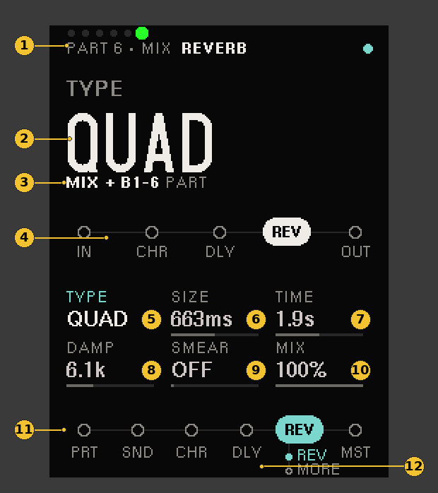

1. Header: `PART 6 · MIX REVERB`.
2. Focused cell: TYPE QUAD.
3. Hint: `MIX + B1-6 PART`.
4. Effects flow, REV lit.
5. **TYPE**.
6. **SIZE** (663ms).
7. **TIME** (1.9s).
8. **DAMP** (6.1k).
9. **SMEAR** (OFF).
10. **MIX** (100%).
11. Chain map: REV lit.
12. Sub-page row: REVERB underlined.


1. Header: `PART 6 · MIX REVERB`.
2. Focused cell: TYPE ROOM.
3. Hint: `MIX + B1-6 PART`.
4. Effects flow, REV lit.
5. **TYPE**.
6. **SIZE** (117ms).
7. **DECAY** (1.0s).
8. **TONE** (OFF).
9. **DIFFUSE** (0.45).
10. **MIX** (100%).
11. Chain map: REV lit.
12. Sub-page row: REVERB underlined.


1. Header: `PART 6 · MIX REVERB`.
2. Focused cell: TYPE HALL.
3. Hint: `MIX + B1-6 PART`.
4. Effects flow, REV lit.
5. **TYPE**.
6. **SIZE** (563ms).
7. **DECAY** (2.0s).
8. **TONE** (12k).
9. **DIFFUSE** (0.49).
10. **MIX** (100%).
11. Chain map: REV lit.
12. Sub-page row: REVERB underlined.


1. Header: `PART 6 · MIX REVERB`.
2. Focused cell: TYPE BLOOM.
3. Hint: `MIX + B1-6 PART`.
4. Effects flow, REV lit.
5. **TYPE**.
6. **SWELL** (538ms).
7. **DECAY** (11s).
8. **TONE** (3.3k).
9. **DIFFUSE** (0.48).
10. **MIX** (100%).
11. Chain map: REV lit.
12. Sub-page row: REVERB underlined.


1. Header: `PART 6 · MIX REVERB`.
2. Focused cell: TYPE GATE.
3. Hint: `MIX + B1-6 PART`.
4. Effects flow, REV lit.
5. **TYPE**.
6. **LENGTH** (195ms).
7. **TAIL** (0.43s).
8. **TONE** (4.6k).
9. **DENSITY** (8.0).
10. **MIX** (100%).
11. Chain map: REV lit.
12. Sub-page row: REVERB underlined.

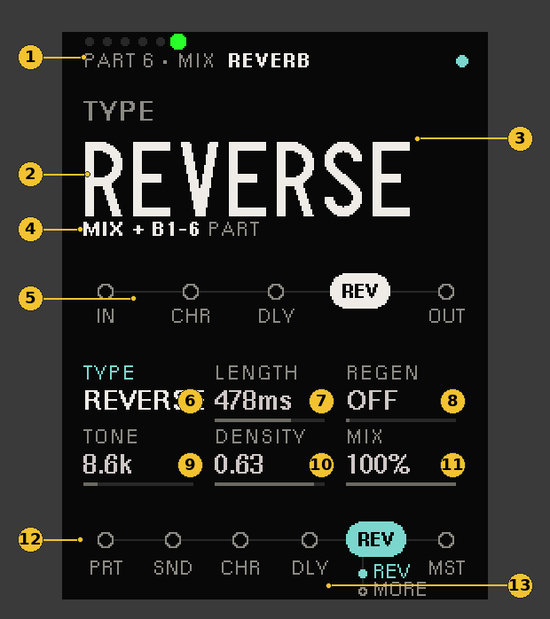

1. Header: `PART 6 · MIX REVERB`.
2. Focused cell: TYPE REVERSE.
3. Hint: `MIX + B1-6 PART`.
4. Effects flow, REV lit.
5. **TYPE**.
6. **LENGTH** (478ms).
7. **REGEN** (`OFF` at 0).
8. **TONE** (8.6k).
9. **DENSITY** (0.63).
10. **MIX** (100%).
11. Chain map: REV lit.
12. Sub-page row: REVERB underlined.

> **Design note:** ROOM, HALL, BLOOM, GATE and REVERSE were voiced and A/B-tuned against thement's open-source midiverb_emulator. ROOM's and BLOOM's structures and HALL's diffuser start from values in it; the engine, the knobs and everything between the reference settings are Chimera's. Each starting setting was fitted until decay per octave, pre-delay, early energy, echo density and brightness matched within a few percent. QUAD is Chimera's original ring; SMEAR is ours too, a wander bounded to a few cents. Fitting reverbs by octave-band decay is a strange way to spend an evening, but the GATE does sound right.

## MIXER: the MORE sub-page

**MORE** holds each TYPE's extras.

| TYPE | A | B | C | D | E | F |
|---|---|---|---|---|---|---|
| QUAD | | | | **RATE** | | |
| ROOM | **PRE-DLY** | **DAMP** | **SMEAR** | **RATE** | **SYNC** | **LOOPS** |
| HALL | **PRE-DLY** | **DAMP** | **SMEAR** | **RATE** | **SYNC** | **SPREAD** |
| BLOOM | **PRE-DLY** | | **SMEAR** | **RATE** | **SYNC** | |
| GATE | **PRE-DLY** | **SHAPE** | **SMEAR** | **RATE** | **SYNC** | **DAMP** |
| REVERSE | **ONSET** | **CURVE** | **SMEAR** | **RATE** | **SYNC** | |

| Control | Shows | What it does |
|---|---|---|
| **PRE-DLY** | ms | Silence before the reverb, so the attack stays clear |
| **ONSET** | ms | REVERSE's pre-delay |
| **SHAPE** | dB | GATE's burst envelope: falling, flat or rising |
| **CURVE** | dB | REVERSE's rising curve |
| **LOOPS** | 0 to 90° | ROOM's coupling: 0 four short loops, 90 two long |
| **SPREAD** | ms | HALL's diffuser: how far early echoes spread |
| **RATE** | 0.1 to 2 Hz | SMEAR's speed |
| **DAMP**, **SMEAR** | | As on REV (GATE's DAMP damps its TAIL) |
| **SYNC** | OFF, TIME, ALL | Tempo sync (below) |

### REVERB: MORE on each TYPE

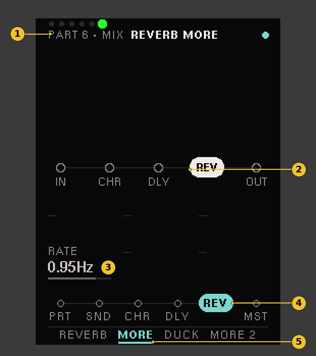

1. Header: `PART 6 · MIX REVERB MORE`.
2. Effects flow, REV lit (no focused cell under QUAD: only RATE).
3. **RATE** (0.95Hz).
4. Chain map: REV lit.
5. Sub-page row: MORE underlined.


1. Header: `PART 6 · MIX REVERB MORE`.
2. Focused cell: PRE-DLY 4 ms.
3. Glyph: the reverb's envelope over time.
4. Hint: `SEQ+TURN FINE`, `MIX + SEQ LEARN`.
5. Effects flow, REV lit.
6. **PRE-DLY** (4ms).
7. **DAMP** (4.5k).
8. **SMEAR** (OFF).
9. **RATE** (0.95Hz).
10. **SYNC** (OFF).
11. **LOOPS** (57).
12. Chain map: REV lit.
13. Sub-page row: MORE underlined.


1. Header: `PART 6 · MIX REVERB MORE`.
2. Focused cell: PRE-DLY 7 ms.
3. Glyph: the reverb's envelope over time.
4. Hint: `SEQ+TURN FINE`, `MIX + SEQ LEARN`.
5. Effects flow, REV lit.
6. **PRE-DLY** (7ms).
7. **DAMP** (3.2k).
8. **SMEAR** (OFF).
9. **RATE** (0.95Hz).
10. **SYNC** (OFF).
11. **SPREAD** (107ms).
12. Chain map: REV lit.
13. Sub-page row: MORE underlined.


1. Header: `PART 6 · MIX REVERB MORE`.
2. Focused cell: PRE-DLY 17 ms.
3. Glyph: the reverb's envelope over time.
4. Hint: `SEQ+TURN FINE`, `MIX + SEQ LEARN`.
5. Effects flow, REV lit.
6. **PRE-DLY** (17ms).
7. **SMEAR** (OFF).
8. **RATE** (0.95Hz).
9. **SYNC** (OFF).
10. Chain map: REV lit.
11. Sub-page row: MORE underlined.


1. Header: `PART 6 · MIX REVERB MORE`.
2. Focused cell: PRE-DLY 9 ms.
3. Glyph: the reverb's envelope over time.
4. Hint: `SEQ+TURN FINE`, `MIX + SEQ LEARN`.
5. Effects flow, REV lit.
6. **PRE-DLY** (9ms).
7. **SHAPE** (-22dB).
8. **SMEAR** (OFF).
9. **RATE** (0.95Hz).
10. **SYNC** (OFF).
11. **DAMP** (2.0k).
12. Chain map: REV lit.
13. Sub-page row: MORE underlined.


1. Header: `PART 6 · MIX REVERB MORE`.
2. Focused cell: ONSET 89 ms.
3. Glyph: REVERSE's rising burst over time.
4. Hint: `SEQ+TURN FINE`, `MIX + SEQ LEARN`.
5. Effects flow, REV lit.
6. **ONSET** (89ms).
7. **CURVE** (33dB).
8. **SMEAR** (OFF).
9. **RATE** (0.95Hz).
10. **SYNC** (OFF).
11. Chain map: REV lit.
12. Sub-page row: MORE underlined.

### REVERB: tempo sync

| SYNC | What locks to the tempo |
|---|---|
| **OFF** | Nothing |
| **TIME** | PRE-DLY (GATE's and REVERSE's LENGTH) turns note values |
| **ALL** | As TIME, and HALL's and BLOOM's DECAY turns beats: 1, 2, 3, 4, 6, 8, 12, 16, 24, 32 (`4 BT`) |

ROOM offers OFF and TIME; QUAD has no SYNC. A time the reverb cannot reach is marked `▾` or `▴`.

## MIXER: the DUCK sub-page

**DUCK** turns the reverb's return down while its own input is loud, so the tail blooms in the gaps. Same under every TYPE.

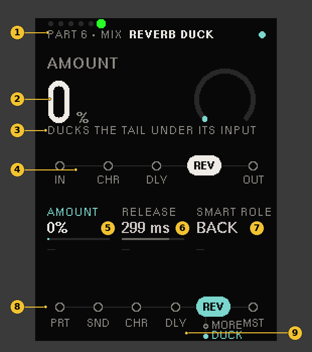

1. Header: `PART 6 · MIX REVERB DUCK`.
2. Focused cell: AMOUNT 0 %.
3. Hint band: `DUCKS THE TAIL UNDER ITS INPUT`.
4. Effects flow, REV lit.
5. **AMOUNT** (0%).
6. **RELEASE** (299 ms).
7. **SMART ROLE** (BACK).
8. Chain map: REV lit.
9. Sub-page row: DUCK underlined.

| Cell | Range | Default | What it does |
|---|---|---|---|
| **AMOUNT** | 0 to 100 % | 0 % | Duck depth, up to 30 dB |
| **RELEASE** | 1 ms to 2 s | about 0.30 s | Return time (`HOW FAST THE TAIL RETURNS`); under 30 ms it pumps |
| **SMART ROLE** | FRONT, MID, BACK | BACK | Reverb's SMART EQ role, same as REV ROLE |

It listens to every REVERB send and the delay's REV, and ducks only the wet return. DUCK works by level; SMART EQ by band; they stack.

**Why:** the master compressor would duck the dry mix too. Keying the reverb on its own input does just the one job.

## MIXER: the MOR2 sub-page

**MORE 2** (MOR2) is HALL's alone: **DENSITY**, 3 to 8 taps a side, about 4 by default: more early echoes is denser. Under other TYPEs it is empty and skipped.


1. Header: `PART 6 · MIX REVERB MORE 2`.
2. Focused cell: DENSITY 4.0.
3. Glyph: the reverb's envelope over time.
4. Hint: `SEQ+TURN FINE`, `MIX + SEQ LEARN`.
5. Effects flow, REV lit.
6. **DENSITY**.
7. Chain map: REV lit.
8. Sub-page row: MORE 2 underlined.

## MIXER: the MST page

**MASTER** (MST) is the master compressor, the last effect before the output stage. Its curve takes the focus band's place.


1. Header: `PART 6 · MIX MASTER`.
2. OUT: the curve's output axis (IN runs along the bottom).
3. Gain-reduction meter, at the right.
4. The curve: input to output (a straight line at RATIO 1:1).
5. The KEY, named inside the graph: `FULL`.
6. **THRESH** (89).
7. **RATIO** (1:1).
8. **ATK**.
9. **REL**.
10. **KEY**.
11. **MIX**.
12. Chain map: MST lit.
13. Sub-page row: MASTER underlined.

| Cell | Range | Default | What it does |
|---|---|---|---|
| **THRESH** | 0 to 127 on screen, no unit: −40 to 0 dB | 89 (about −12 dB) | Where it starts working |
| **RATIO** | 1:1, 1.5:1, 2:1, 3:1, 4:1, 6:1, 10:1, 20:1, MAX | 1:1 | 1:1 is off; MAX is a limiter's slope |
| **ATK** | 0 to 127 on screen: 0.1 to 100 ms | 64 | Attack |
| **REL** | 0 to 127 on screen: 10 ms to 1 s | 64 | Release |
| **KEY** | FULL, LOW, HIGH, HIT, PART 1, PART 2, PART 3, PART 4, PART 5, PART 6 | FULL | What the detector hears |
| **MIX** | 0 to 127 | 127 | Parallel blend: 0 dry, 127 compressed |

It hears all three pairs and applies one gain to all, so the image never shifts. MIX 0, or RATIO 1:1 with MAKEUP 0, is an exact bypass. **MAKEUP** is on LVL.

### MASTER: the compressor's KEY

KEY changes only what the detector hears, never the audio.

| KEY | The page says | Detector hears |
|---|---|---|
| **FULL** | `HEARS THE WHOLE MIX` | Everything: bus glue |
| **LOW** | `THE KICK PUMPS THE MIX` | Below 150 Hz: pumping |
| **HIGH** | `HEARS ALL BUT THE BASS` | Above 150 Hz: lows never pump it |
| **HIT** | `EVERY HIT PUSHES IT ALIKE` | Loudness-weighted, so hits push by how loud they sound |
| **PART 1** … **PART 6** | `DUCKS ALL BUT ITSELF` | That Part, after EQ, before LEVEL |

Under PART *n*, the key Part passes unducked at full level (its effect returns still duck) and MAKEUP skips it. Its LEVEL does not change the pump; a silent key lets go at REL.

Starting points: pumping from a DRUM Part 1, KEY PART 1, RATIO 4:1+, THRESH low, ATK fast, REL with the tempo. Glue, KEY HIGH, RATIO 2:1, THRESH just under the loud parts.

> **Design note:** KEY is inspired by how Elektron's Analog Rytm keys its compressor: fixed curves on the detector, then the Parts themselves. LOW's and HIGH's 150 Hz are Chimera's own guess, since no manual publishes the corners. HIT is the K-weighting of ITU-R BS.1770, the curve broadcast loudness meters use, built from its analogue prototype so it holds at any sample rate.

## MIXER: the LVL sub-page

**LEVEL** (LVL) holds the master output and SMART EQ's master settings.


1. Header: `PART 6 · MIX LEVEL`.
2. Focused cell: VOL 127.
3. Glyph: a fader.
4. Hint: `SEQ+TURN FINE`, `MIX + SEQ LEARN`.
5. SMART EQ's bands for Parts 1 to 6 and REV, each role's letter (F, M, B) under it.
6. **VOL**.
7. **PAN**.
8. **MAKEUP**.
9. **SMART EQ**.
10. **AMOUNT**.
11. **REV ROLE**.
12. Chain map: MST lit.
13. Sub-page row: LEVEL underlined.

| Cell | Range | Default | What it does |
|---|---|---|---|
| **VOL** | 0 to 127 | 127 | Master volume, after the limiter |
| **PAN** | L63, C, R63 | C | Master balance |
| **MAKEUP** | 0 to +24 dB | 0 | Compressor makeup |
| **SMART EQ** | OFF, ON | OFF | SMART EQ for every Part |
| **AMOUNT** | 0 to 127 | 64 | SMART EQ depth ([SMART EQ](#mixer-smart-eq)) |
| **REV ROLE** | FRONT, MID, BACK | BACK | Same as SMART ROLE on DUCK |

## MIXER: signal flow and gain staging

1. A Part's voices sum into its bus ([the voice chain](#the-voice-chain-pitch-filter-fx-amp-stereo-and-sends)).
2. **LO CUT**, **TILT**, SMART EQ's cuts.
3. The PRT meter reads here.
4. The sends are taken here.
5. **LEVEL** and **PAN**, then the output pair (OUT).
6. The effects: delay first, its REV into the reverb; the reverb return through DUCK and its SMART EQ bands; all returns join P1.
7. The master compressor, one gain on all three pairs.
8. The output stage: +1.94 dB and a linked peak limiter, exact below −6 dBFS, soft above, never past −1 dBFS, 1.33 ms look-ahead, 50 ms release. No page, always on.
9. **VOL** and **PAN**.
10. The computer's USB sound, at USB IN's level ([USB](#usb-midi-audio-and-the-console-over-one-cable)).

One ALGO INIT note peaks near −12 dBFS. Leave headroom with the Part LEVELs, not VOL: VOL comes after the limiter. If a dense mix sounds squashed, bring the LEVELs down.

**Why:** setting the gain at the very end means the delay's saturation, the reverb and the compressor's THRESH hear the same levels whatever the output gain.

> **Design note:** the output stage began as a 1/√8 trim and a hard limiter, and single notes came out 23 dB under full scale. The gain went up 11 dB and the limiter grew a soft knee, so a pluck is audible without cranking the amp and an eight-note chord leans into the knee instead of a wall, wobbling less than 0.15 dB.

# ORBIT, the ring sequencer

ORBIT plays Chimera by itself while you shape sounds. A chord progression turns round five rhythm rings; each ring divides the bar into its own number of steps, plays a Part, and fits its notes to the key or the chord. Eight scenes hold whole setups. This chapter covers every ORBIT page and gesture, the clock and how ORBIT is saved. Sync and the SEQUENCER control channel are also in [MIDI](#midi-channels-maps-and-controllers); SETTINGS › ORBIT is in [SETTINGS](#settings).

## ORBIT: getting in and out

| Keys | Does |
|---|---|
| **hold SEQ** | Enter ORBIT, from anywhere |
| **MENU** | Leave ORBIT, back where you were; it keeps playing |
| **B6** | Play / stop |
| **B1–B5** | Open ring 1–5 on the RING page (the sub-page stays) |
| **hold B1–B5** | Go to the Part that ring plays |
| **MIX + B1–B5** | Mute / unmute that ring |
| **MINUS / PLUS** | Along ORBIT's chain |
| **SEQ / EDIT** | Up / down a sub-page |
| **EDIT** on SCN | Save the playing scene ([SCN](#orbit-the-scn-page-scenes)) |
| **MIX + SEQ** | Learn a MIDI control for the touched ring amount |

While ORBIT runs, a second dot left of the sounding dot (top right) pulses its beat on every page.

**Why:** B1 to B5 are the rings and B6 the transport, so ORBIT needs no new buttons.

## ORBIT: the chain

**ORB · RING · CHRD · SCN**

| Map | Full name | Sub-pages | Holds |
|---|---|---|---|
| **ORB** | ORBIT | CUSTOM | The overview; RING, KEY, SCALE, BARS, SCENE, BPM |
| **RING** | RING | RHYTHM, VOICE, NOTES | The selected ring |
| **CHRD** | CHORDS | | The progression: SEGS, DEGREE, PLAY |
| **SCN** | SCENES | | The eight scenes: SCENE, SAVE, SWITCH |

The header names the ring or scene: `RING 3  RHYTHM`, `SCENE 1  CHORDS`.

## ORBIT: the ORB page

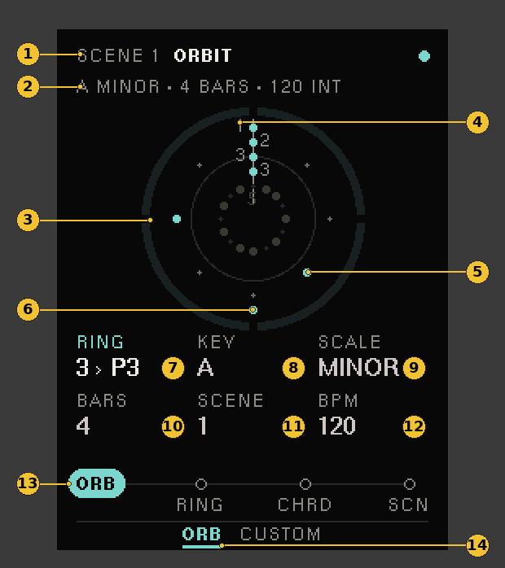

1. Header: `SCENE 1  ORBIT`, the sounding dot.
2. Frame line: `A MINOR · 4 BARS · 120 INT`, key, scale, bars and tempo with its source (`INT` own clock, `MIDI` followed clock).
3. The chord progression: the thick arc round the outside.
4. Part numbers at each ring's step 1 (`1 2 3 3` up the top).
5. A hit on ring 2.
6. A hit on ring 1, the outermost ring (2 steps, 2 hits).
7. **RING**: `3 › P3`.
8. **KEY**: A.
9. **SCALE**: MINOR.
10. **BARS**: 4.
11. **SCENE**: 1.
12. **BPM**: 120.
13. Chain map, ORB lit.
14. Sub-page row: ORB CUSTOM, ORB underlined.

The thick arc round the outside is the chord progression, one piece per segment, the playing one lit. Inside it the rings, ring 1 outermost: hits filled, empty steps `+`, accents ringed, the playing step lit, each Part number at step 1 (the `1 2 3 3` up the top); a muted ring is dark, as ring 5 at the centre.

| Cell | Range | Default | What it does |
|---|---|---|---|
| **RING** | 1 to 5 | 1 | The ring the RING pages edit |
| **KEY** | C, C#, D, D#, E, F, F#, G, G#, A, A#, B | C | The tonic |
| **SCALE** | MAJOR, MINOR, DORIAN, PHRYGIAN, LYDIAN, MIXOLYD, LOCRIAN, HARM MIN, PENT MAJ, PENT MIN, CUSTOM | MAJOR | The scale; CUSTOM is your own ([CUSTOM](#orbit-the-custom-page)) |
| **BARS** | 1 to 8 | 1 | Loop length: the progression spans it, scenes switch and MUTATE draws at its end |
| **SCENE** | 1 to 8 | 1 | The playing scene; a turn queues another for the loop's end |
| **BPM** | 30 to 300 | 120 | ORBIT's tempo; dims while a MIDI clock leads |

A new project's scene 1 is a four-bar A minor groove, i–VI–VII–i: ring 1 roots on Part 1, ring 2 an arpeggio on Part 2, rings 3 and 4 a pad on Part 3, ring 5 muted on Part 5.

## ORBIT: the CUSTOM page

**EDIT** from ORB opens CUSTOM (so does turning SCALE to CUSTOM); EDIT again returns.


1. Header: `SCENE 1  CUSTOM`.
2. Centre: the scale's name and size, `MINOR 7 NOTES`.
3. **NOTE**: A, the cursor.
4. **IN SCALE**: `ROOT` on the tonic.
5. Chain map, ORB lit.
6. Sub-page row: ORB CUSTOM, CUSTOM underlined.

Round the centre the twelve notes sit on a circle, tonic at the top: in the scale filled, out of it outlined, the cursor large.

| Cell | Range | What it does |
|---|---|---|
| **NOTE** | the twelve notes | Moves the cursor (wraps) |
| **IN SCALE** | OFF, ON | Right puts the note in, left takes it out; the tonic stays in |

Editing a named scale makes it CUSTOM, starting from its notes. With all twelve IN SCALE, nothing a ring plays is moved: the way to reach every pad of a DRUM kit ([rings and DRUM kits](#orbit-rings-and-drum-kits)).

## ORBIT: how a ring makes a rhythm

Each ring divides one bar into **STEPS** and spreads **HITS** as evenly as it can: 4 in 16 is four on the floor, 3 in 8 the tresillo. **ROTATE** turns the pattern. Rings with different STEPS run different subdivisions (16 sixteenths, 12 triplet eighths, 5 quintuplets) and meet on every downbeat.

Each hit draws **CHANCE**, takes its note (next in the POOL, or the step's own), snaps it (**SNAP**) and plays it on the ring's Part for **GATE** at **VEL**. A silent hit (CHANCE, MUTE) still moves the walk on, so the ring stays in phase. At each loop's end **MUTATE** may nudge one hit a step or swap one note for another in the key.

> **Design note:** the even spread is the Euclidean rhythm, worked out with Bjorklund's algorithm; Godfried Toussaint showed the same spread generates traditional rhythms from Cuba to Bulgaria. MUTATE is in the spirit of the Turing Machine module: a loop that drifts, locked at 0. Five rings make polyrhythms the easy way. The hard way is still available: practise.

## ORBIT: the RHYTHM page

RHYTHM is the RING node's own page.


1. Header: `RING 1  RHYTHM`.
2. Focused cell, large: HITS `5/16`.
3. Its arc.
4. The ring's steps on a line, hits large, a tick under step 1, the playing step lit.
5. **STEPS**: 16.
6. **HITS**: 5.
7. **ROTATE**: 0.
8. **CHANCE**: 100%.
9. **MUTATE**: 0%.
10. **MUTE**: OFF.
11. Chain map, RING lit.
12. Sub-page row: RHYTHM VOICE NOTES, RHYTHM underlined.

| Cell | Range | Default | What it does |
|---|---|---|---|
| **STEPS** | 1 to 32 | 16 | Steps in a bar |
| **HITS** | 0 to STEPS | 4 | Hits, spread evenly (`5/16` reads hits over steps) |
| **ROTATE** | 0 to STEPS − 1 | 0 | Turns the pattern |
| **CHANCE** | 0 to 100 % | 100 % | Each hit's chance to sound |
| **MUTATE** | 0 to 100 % | 0 % | Chance of a small change at each loop's end; 0 locks it |
| **MUTE** | OFF, ON | OFF | Silences the ring; it keeps running. Same as MIX + B*n* |

A new STEPS, HITS or ROTATE lays the hits out afresh, dropping MUTATE's nudges.

## ORBIT: the VOICE page


1. Header: `RING 3  VOICE`.
2. Focused cell, large: ACCENT 2.
3. Its arc.
4. Hint `MIX + SEQ LEARNS A CC`, and the register (`C4 TO B4 · ACCENT +30 VEL`).
5. Hits as bars, GATE wide and velocity tall; the two accented hits taller, the playing step lit.
6. **GATE**: 60%.
7. **VEL**: 90.
8. **ACCENT**: 2.
9. **OCTAVE**: 4.
10. **RANGE**: 0.
11. **SNAP**: CHORD.
12. Chain map, RING lit.
13. Sub-page row: RHYTHM VOICE NOTES, VOICE underlined.

| Cell | Range | Default | What it does |
|---|---|---|---|
| **GATE** | 0 to 100 % | 50 % | Note length, as a share of a step |
| **VEL** | 1 to 127 | 100 | Velocity |
| **ACCENT** | 0 to 32 | 0 | Hits accented, spread evenly; +30 velocity |
| **OCTAVE** | 0 to 8 | 4 | Register: 4 starts at C4 |
| **RANGE** | 0 to 3 | 0 | Extra octaves the pool walks, and MUTATE and CLEAR draw from |
| **SNAP** | SCALE, CHORD | SCALE | Fits notes to the key's scale or the playing chord |

No note plays out of key. A bass ring on CHORD plays roots and fifths; a melody on SCALE moves freely over the chords.

## ORBIT: the NOTES page


1. Header: `RING 3  NOTES`.
2. Focused cell, large: MODE POOL.
3. The line `POOL 1 · HITS 1 · COMES ROUND IN 1` and the chips, the ring's notes (one, E4).
4. **MODE**: POOL.
5. **WALK**: UP.
6. **TARGET**: 3.
7. **LEARN**: OFF.
8. **CLEAR** (`C4 / RND`, with MIX).
9. **NOTE**: E4.
10. Chain map, RING lit.
11. Sub-page row: RHYTHM VOICE NOTES, NOTES underlined.

| Cell | Range | Default | What it does |
|---|---|---|---|
| **MODE** | STEP, POOL | POOL | POOL walks 1 to 8 notes a hit at a time; STEP has a note per step |
| **WALK** | UP, DOWN, RANDOM, PING-PG | UP | How a POOL ring walks (PING-PG: up and back) |
| **TARGET** | 1 to 6 | ring's number | The Part the ring plays |
| **LEARN** | OFF, ON | OFF | Capture notes from your keyboard |
| **CLEAR** | `C4 / RND` | | With MIX only: up resets, down rolls random notes |
| **NOTE** | C-1 to G9 | | The selected chip's note |

On a POOL ring the line reads the pool size, the hits, and how many hits until walk and rhythm line up (`-` on RANDOM). The pool stays in pitch order and repeats RANGE octaves up.


On a STEP ring the chips are the steps (hit filled, rest outlined, playing step lit), eight at a time, scrolling; the line reads `STEPS 8 · HITS 3`.

### ORBIT: NOTES gestures

| Keys | Does |
|---|---|
| **MIX + NOTE** | Pick the chip (`MIX + NOTE ◂▸ PICK` or `◂▸ STEP`) |
| **MIX + CLEAR** up | Reset to one note at OCTAVE's C (STEP: every step) |
| **MIX + CLEAR** down | Roll 8 random notes of the key in the register; each turn rolls anew |
| **LEARN** up, then play | Capture |

A plain turn on CLEAR does nothing: both ways lose hand-set notes, with no undo, and CLEAR sits beside NOTE.

### ORBIT: capturing notes with LEARN

Turn **LEARN** ON and play. A POOL ring takes the notes you hold, up to 8, each once, ending when the last key lifts. A STEP ring takes one note per key-down, repeats included, one per hit (up to 8, then cycling); rests take the hit before. OCTAVE moves to the lowest note played and LEARN turns OFF. Keys held before arming are ignored. The capture goes into the scene playing when it ended.

## ORBIT: rings and Parts

A ring plays the Part set by **TARGET** (a new project: ring *n* on Part *n*); several rings may share one. It sends notes as your keyboard would, so the Sound decides envelopes, voices and glide. STOP ends only ORBIT's notes, and a ring's note-off never releases your keys or another ring's note.

### ORBIT: rings and DRUM kits

On a DRUM Part each note picks a pad by note name ([the KIT keymap](#drum-the-kit-keymap-and-tonal)): with TONAL OFF, C is pad 01 up to B, pad 12. Notes are snapped first, so to reach any pad use a **CUSTOM** scale of all twelve notes, SNAP SCALE, and a STEP ring with each step's NOTE set. With TONAL on, notes from C1 play the TONAL pad as a tuned drum line.

## ORBIT: the CHRD page

**CHORDS** (CHRD) is the progression round ORB's outside. The loop is cut into **SEGS** equal segments, one chord each.


1. Header: `SCENE 1  CHORDS`.
2. Focused cell, large: SEGS 4.
3. Its arc.
4. A chip per segment, numeral over chord (`i` over `Am`), the selected one outlined; the bars under them.
5. **SEGS**: 4.
6. **DEGREE**: `i Am`.
7. **PLAY**: `-`.
8. Chain map, CHRD lit; CHRD has no sub-pages.

| Cell | Range | Default | What it does |
|---|---|---|---|
| **SEGS** | 1 to 8 | 1 | Chord segments in the loop |
| **DEGREE** | I to VII | I | The segment's triad on that degree (`VI F`) |
| **PLAY** | `-`, `HOLD`, a chord name | `-` | A played chord, which wins over DEGREE |

| Keys | Does |
|---|---|
| **MIX + DEGREE** | Pick the segment (`MIX + DEGREE ◂▸ SEGMENT`) |
| **PLAY** up | Arm (`HOLD`); play two or more notes and let go: it becomes the segment's chord (`Bm7b5`), lowest note as bass |
| **PLAY** down | Disarm, keeping the chord |
| **MIX + PLAY** down | Drop the played chord (`MIX + PLAY ▾ DROPS THE CHORD`) |

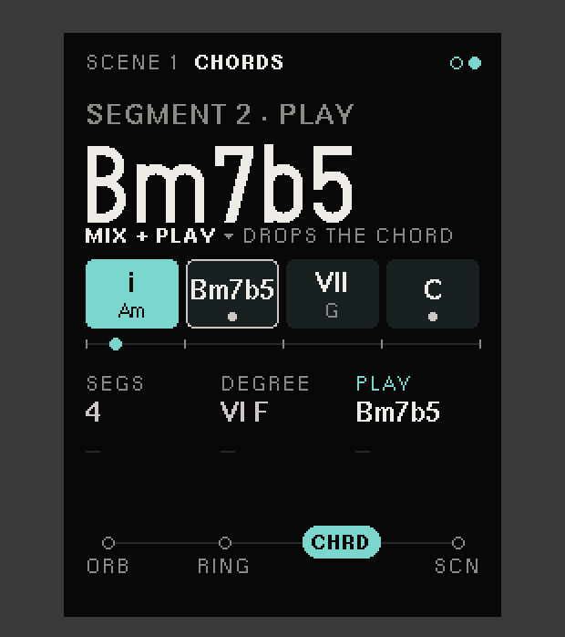

The playing chord is what SNAP CHORD fits to.

**Why** plain PLAY down only disarms: detents arrive over several frames, so a quick flick would disarm and then drop.

## ORBIT: the SCN page (scenes)

A scene is the five rings, the progression, key, scale and BARS.


1. Header: `SCENE 1  SCENES`.
2. Focused cell, large: `SCENE · PLAYING` 1, or `SCENE · ON THE LOOP` when queued.
3. Eight slots: saved filled, empty outlined, playing ringed, queued filling, SAVE's dotted.
4. **SCENE**: 1.
5. **SAVE**: `TO 1`.
6. **SWITCH**: LOOP.
7. Chain map, SCN lit; SCN has no sub-pages.

| Cell | Range | What it does |
|---|---|---|
| **SCENE** | 1 to 8 | Queue a scene for the loop's end; turn back to cancel. Stopped, it switches at once |
| **SAVE** | 1 to 8 | Where **EDIT** saves the playing scene |
| **SWITCH** | LOOP | When a switch lands. Read-only |

**EDIT** saves at once over its own or an empty slot; over another it asks `SAVE OVER SCENE n?`. While a switch is queued it is refused (`SWITCH PENDING`).

### ORBIT: edits, drift and saving a scene

- Your edits stay with their scene, across switches.
- MUTATE's drift does not: switch away and back and it restarts from your edits.
- SAVE (EDIT on SCN, or SETTINGS › ORBIT › SAVE TO PROJ) writes the scene drift and all: the way to keep a variation.
- SETTINGS › ORBIT › **RELOAD FROM PROJ** drops the drift and keeps the edits; **CLEAR** empties the slot. Both land at the loop's end.

**Why:** as on Elektron sequencers and the Cirklon, your edits persist and machine-made variation stays playback until you choose to write it in.

## ORBIT: the clock and transport

**B6** starts from bar 1 and stops; stop ends only ORBIT's notes. SETTINGS › MIDI CONFIG › **SYNC** decides who leads:

| SYNC | What happens |
|---|---|
| **EXT** (default) | A MIDI clock drives ORBIT: Start plays from bar 1, Stop stops, Continue plays on; the header shows `MIDI`. If the clock stops for half a second, ORBIT's own clock takes over at BPM |
| **INT** | ORBIT always runs at BPM; clock and transport messages are ignored |

A clock alone never starts ORBIT. B6 and a DAW share one transport: the last word wins. Changing SYNC never jumps or stops playback. SYNC is a unit setting, not a project one, so a project taken to another studio does not bring a clock that fights it. Notes land within a fraction of a millisecond of their step.

**Why EXT:** a DAW works out of the box, and with no clock ORBIT still runs on B6.

## ORBIT: under MIDI control

- **Learn:** touch a ring amount (HITS, ROTATE, CHANCE, MUTATE, GATE, VEL, ACCENT, OCTAVE) and press **MIX + SEQ**. The binding lives in the current Part's map, on its channel, named `RING 1 CHANCE`. A fader on HITS or ROTATE spans 0 to STEPS.
- **SEQUENCER channel:** SETTINGS › MIDI CONFIG › CONTROL CHANNELS › SEQ gives ORBIT CCs for PLAY/STOP, each ring's ON/OFF, CHANCE and STEPS, KEY and SCALE; a note sets KEY.

Both are in [MIDI](#midi-channels-maps-and-controllers).

## ORBIT: saved with the project

The eight scenes, the playing scene and BPM are part of the project: a project save (hold **MENU**, or SETTINGS › PROJECT) writes them; a load brings ORBIT back stopped. A queued switch is saved as landed. Saving on SCN keeps a scene in memory only until the project is saved. A damaged ORBIT section never costs you the Parts.

While ORBIT plays it keeps a little processing time aside so it is never late ([Limits](#limits-voices-cpu-and-memory)).

## ORBIT: starting points

- **Hear it now:** new project, hold **SEQ**, **B6**; then **MIX + B5** brings in ring 5.
- **Polyrhythm:** rings on 16/4, 12/5 and 7/3 STEPS/HITS; turn ROTATE until it grooves.
- **Living arpeggio:** POOL, WALK PING-PG, RANGE 1, SNAP CHORD, notes LEARNed from a chord, MUTATE 20 %.
- **Bass on the chords:** one POOL note at OCTAVE 2, SNAP CHORD.
- **Sparser hats:** 16 STEPS, 16 HITS, CHANCE 60 %, ACCENT 4.
- **Drum pattern:** a DRUM Part, MODE STEP, SCALE CUSTOM with all twelve notes, each step's NOTE set to its pad.

# SETTINGS

This chapter covers the SETTINGS menu: moving in it, every list and page, and every question it asks before it changes a file. MIDI's pages are in [MIDI](#midi-channels-maps-and-controllers), tuning in [tuning](#tuning-temperaments-scala-files-and-mts), the card and its files in [the SD card, Sounds and the library](#the-sd-card-projects-sounds-and-the-library), ORBIT's scenes in [ORBIT](#orbit-the-ring-sequencer).

## SETTINGS: opening and moving

| Keys | Does |
|---|---|
| **MENU** | Opens SETTINGS from anywhere; inside, steps back one level, and at the top closes it |
| **hold MENU** | Quick-saves the project, from anywhere ([quick save](#settings-quick-save-with-a-menu-hold)) |
| **MINUS / PLUS**, any encoder | Move the bar |
| **EDIT** | Opens the row (list, page, screen) or runs it (action) |
| **SEQ** | Back |
| **B1–B6** | Leave SETTINGS for that Part's pages, from any depth |

SETTINGS has its own look: whole-width lists with a highlight bar, a growing breadcrumb, a footer with the project and the keys, no chain map. Leaf pages use the six-cell grid inside that frame.


1. Breadcrumb: `SETTINGS`, growing as you go in (`SETTINGS › PROJECT`).
2. The bar.
3. A chevron: the row opens a list or page.
4. `LATER`: not built yet; dimmed and skipped.
5. The project's name and state: `SAVED`, `* MODIFIED` (warning colour; any turn or RANDOMIZE roll counts), or the name alone for an unsaved `NEW PROJECT`.
6. The keys: `EDIT OPEN · MENU CLOSE`, `EDIT RUN · MENU BACK`, `A-F EDIT · MENU BACK`, `EDIT OK · MENU BACK`.

**Why:** each row opens one page and nothing more: no SETTINGS page has sub-pages, so nothing hides behind EDIT or PLUS. Planned rows stay as `LATER` so the list never reshuffles.

## SETTINGS: the top list

| Row | Breadcrumb | What it holds |
|---|---|---|
| **PROJECT** | PROJECT | Load, save, manage and clean up projects |
| **PART** | `PART 1` | The active Part's Sound |
| **ORBIT** | `SCENE 3` | The playing scene |
| **MIDI CONFIG** | MIDI | See [MIDI](#midi-channels-maps-and-controllers) |
| **SYSEX DUMP** | | `LATER` |
| **AUDIO ROUTING** | AUDIO | Output pairs, tuning, USB audio |
| **PERSONALIZE** | PERSONAL | Screen and page behaviour |
| **SYSTEM** | SYSTEM | Update entry, diagnostics, push encoders, ABOUT |

## SETTINGS: quick save with a MENU hold

Hold **MENU** to save the project over its own file at once. A never-saved project asks for a name first; a different card in the slot asks `CARD CHANGED` before writing anything.

**Why:** saving mid-performance should never take a trip through menus.

## SETTINGS: PROJECT


| Row | What it does |
|---|---|
| **LOAD PROJECT** | Lists the card's projects; EDIT loads one. **+ CREATE NEW** starts a fresh one |
| **SAVE PROJECT AS** | Saves a copy under a new name (proposed, e.g. `DRIFT-002`) |
| **MANAGE PROJECTS** | Projects on the left, commands on the right |
| **POOL** | How the project's Sound memory is used (read-only) |
| **PURGE UNUSED SRC** | Frees memory held by TAPE sources no Part uses; the card keeps the files (`NO UNUSED SOURCES` when none) |

Projects live in `/CHIMERA/PROJECTS/` ([the SD card, Sounds and the library](#the-sd-card-projects-sounds-and-the-library)). In LOAD PROJECT the loaded row reads `● LOADED`; rows may also read `FILE DAMAGED`, `NEWER FIRMWARE`, `NO PROJECTS`, `MORE ON CARD` or `NO CARD` (EDIT re-reads the card).


### PROJECT: MANAGE PROJECTS

EDIT on a project moves into its commands (`EDIT COMMANDS · MENU BACK`); EDIT runs one (`EDIT RUN · MENU LIST`).

| Command | What it does |
|---|---|
| **LOAD FROM** | Loads that project |
| **SAVE TO** | Saves the open project over that file |
| **RENAME** | Renames the loaded project only (`LOAD TO RENAME` on others) |
| **CLEAR** | Empties that project to a new one |
| **DELETE** | Deletes the file; dimmed on the loaded project |
| **PROTECT** | `LATER` |


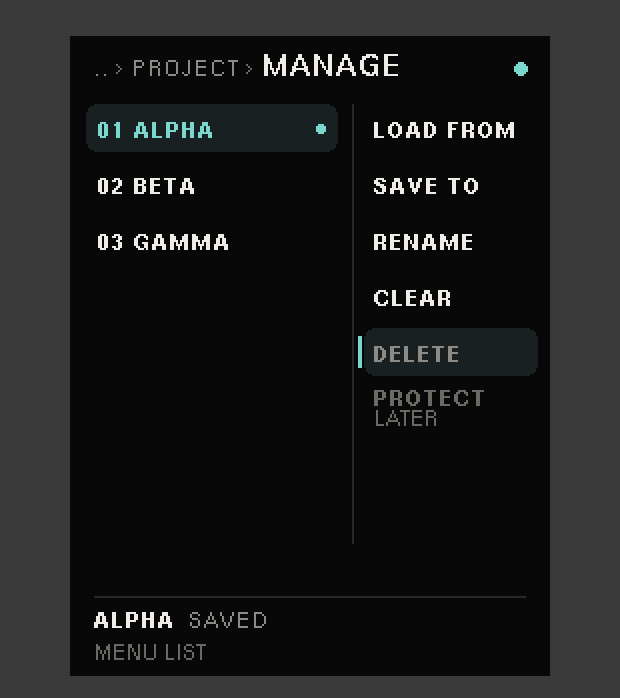


**Why:** a name never changes under a file you are not looking at, and you cannot delete the project you are standing in; CLEAR it instead.

### PROJECT: POOL


1. Breadcrumb.
2. **USED**, large.
3. Its arc.
4. The pool as a bar.
5. **SOUNDS**: count and memory.
6. **SOURCES**: TAPE sources and memory.
7. **FREE**.
8. Footer: project and state.
9. Footer: `MENU BACK`.

**PENDING** shows only while freed memory waits to be reclaimed.

## SETTINGS: the naming screen

One screen names a project, a Sound or a MIDI map (`PROJECT NAME`, `SOUND NAME`, `MAP NAME`), up to 16 characters.

| Encoder | Cell | What it does |
|---|---|---|
| 1 | **CURSOR** | Moves the cursor (`3 / 16`) |
| 2 | **LETTER** | A to Z |
| 3 | **DIGIT** | A digit, space or dash |
| 4 | **CASE** | `ABC` / `abc` at the cursor |
| 5 | **DELETE** | Right deletes under the cursor, left the one before |
| 6 | **TAGS** | `LATER` |

**EDIT** saves (`EDIT SAVE · MENU BACK`); **MENU** or **SEQ** cancels.

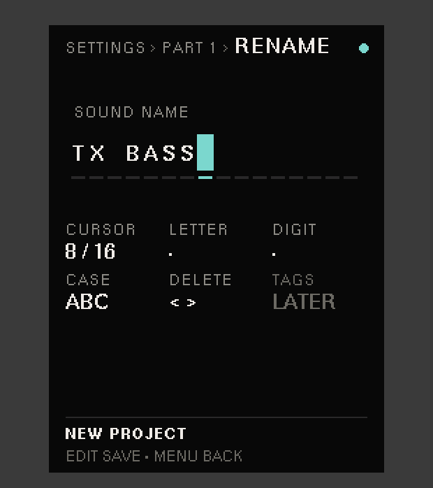

## SETTINGS: PART

PART acts on the active Part. A strip under the breadcrumb names its Sound (`P1 · TX BASS`) and state: `CLEAN`, `* EDITED · FROM SLOT 03`, `* EDITED · FROM INIT`, or `◦ SLOT 03 MOVED` (the slot changed since).


| Row | What it does |
|---|---|
| **RENAME** | Names the Sound |
| **CLEAR** | Clears the Part to its engine's INIT |
| **SAVE TO PROJ** | Saves into a Sound slot: `OVER SLOT 03` or `TO NEW SLOT 07`; then `SAVED TO SLOT 03`, or `POOL FULL` |
| **RELOAD FROM PROJ** | Drops edits and reloads from the slot; dimmed with nothing to drop |
| **LIVE SNAP** | Snaps your keys to ORBIT's harmony |
| **SAVE TO LIBRARY** | Names the Sound and saves it to the card's library |
| **RANDOMIZE** | Rolls a new Sound |
| **MIDI MAP** | The Part's control map ([MIDI](#midi-channels-maps-and-controllers)) |

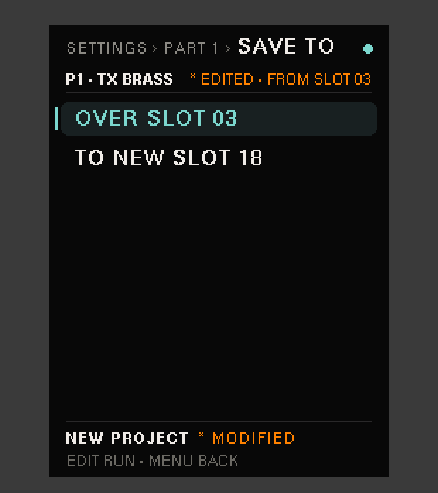

**Why:** every action that would replace an edited Part offers to save it first, and a save over a shared slot asks whether the other Parts should follow.

### PART: LIVE SNAP

**LIVE SNAP** (SNP in the editor) snaps the notes you play on this Part to ORBIT's harmony while ORBIT runs (or follows a running clock). Saved with the project.

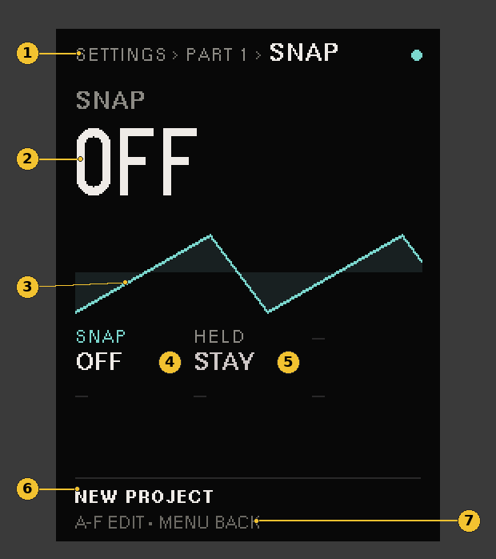

1. Breadcrumb.
2. Focused cell.
3. The live output's waveform.
4. **SNAP**.
5. **HELD**.
6. Footer: project and state.
7. Footer: `A-F EDIT · MENU BACK`.

| Cell | Options | Default | What it does |
|---|---|---|---|
| **SNAP** | OFF, SCALE, CHORD | OFF | To the nearest note of ORBIT's scale, or of the playing chord |
| **HELD** | STAY, RE-SNAP | STAY | On a harmony change, a held key keeps its note or glides (about 40 ms, no restrike) to the new one |

Two keys snapping to one note share a voice. RE-SNAP works from the key held, so a held chord follows the progression without drifting.

### PART: RANDOMIZE

**RANDOMIZE** (RND in the editor) rolls a new Sound inside musical bounds: pitch kept, envelopes from a chosen family, modulation bounded, levels near INIT. The same seed and amounts on the same Sound always give the same roll.


1. Breadcrumb: the Part being rolled.
2. The focused value.
3. Hint: `TURN ROLLS THE SOUND`.
4. The amounts: OSC, ENV, TONE, MOD (`OFF` leaves that part alone).
5. **SEED**: each detent a new Sound; turn back and it returns.
6. The project reads `* MODIFIED`.

| Cell | Values | Default | What it rolls |
|---|---|---|---|
| **OSC** | OFF, PURE, RICH, WILD | RICH | ALGO: algorithm, ratios (carriers in octaves), waves; WILD may MORPH. VA: MODE, waves, OSC 2 interval, detune, SUB, SHAPE, NOISE. MODAL: STRUCT, POS, MODEL from RICH. TAPE: nothing |
| **ENV** | OFF, PLUCK, PAD, ANY | ANY | Amp envelope family. ALGO: every operator. VA, TAPE: ENV 1. MODAL: DAMP |
| **TONE** | OFF, SOFT, BRIGHT, WILD | BRIGHT | CUTOFF and RESO. ALGO: modulator depth, FEEDBACK, VEL. MODAL: BRIGHT, BODY, COLOR, BURST |
| **MOD** | OFF, SUBTLE, MOVING, WILD | SUBTLE | LFO 2 and 3, ENV 2 and their depths to CUTOFF and RESO; MODAL's ensemble |
| **SEED** | 0 to 255 | 0 | Which roll |

Each amount draws on its own stream. A roll never touches LEVEL, PITCH, sends, LFO 1, ENV 1's VCA route, the filter TYPE and MODE, or a TAPE source. ENV 2 only opens the filter. The five cells are not stored. To undo, **RELOAD FROM PROJ**. After an incomplete update they read `NEEDS UPDATE`.

Starting points: plucks, ENV PLUCK, MOD OFF, turn SEED. Pads, ENV PAD, MOD MOVING. New envelopes on the same oscillators, OSC OFF.

> **Design note:** the four amounts come from the stock PreenFM3 randomizer (OPER, ENV, IM, MODL), renamed for what they do. Behind them is a pure function, the Sound and five numbers in, a Sound out. ALGO carriers drop a little for each extra, so a six-carrier stack sums like one. A dice cup that never lands on a dead patch, which is more than most dice manage.

## SETTINGS: ORBIT

Acts on the playing scene ([ORBIT](#orbit-the-ring-sequencer)).

| Row | What it does |
|---|---|
| **RENAME** | `LATER` |
| **CLEAR** | Empties the scene at the loop's end |
| **SAVE TO PROJ** | A row per slot: `OVER SCENE 2` or `SCENE 5` |
| **RELOAD FROM PROJ** | Drops the drift, keeps edits; dimmed with no drift |

CLEAR and RELOAD are refused while a switch waits (`SWITCH PENDING`).


## SETTINGS: MIDI CONFIG

Rows **SYNC**, **PORT CONFIG** (`LATER`), **CHANNELS**, **CONTROL CHANNELS**, **ECHO** and **MPE**: all in [MIDI](#midi-channels-maps-and-controllers). They belong to the unit, except CHANNELS, which are each Part's.


## SETTINGS: AUDIO ROUTING

| Row | What it holds |
|---|---|
| **OUTPUTS** | Each Part's output pair |
| **SENDS** | `LATER` |
| **TUNING** | See [tuning](#tuning-temperaments-scala-files-and-mts) |
| **USB AUDIO** | USB IN level |


### AUDIO ROUTING: OUTPUTS

**OUTPUTS** (OUT in the editor): each Part's pair in one place, the same value as OUT on the mixer's [PRT page](#mixer-the-prt-page).

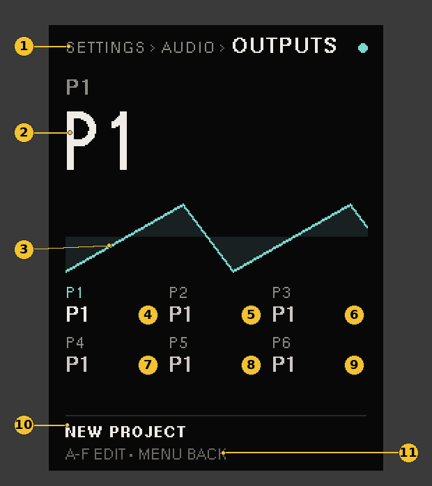

1. Breadcrumb.
2. Focused cell.
3. Waveform.
4. **P1**.
5. **P2**.
6. **P3**.
7. **P4**.
8. **P5**.
9. **P6**.
10. Footer: project and state.
11. Footer: keys.

**P1** to **P6**: P1, P2 or P3, default P1. Effects return on P1 only ([signal flow](#mixer-signal-flow-and-gain-staging)); a Part on P2 or P3 shows `OUT P2` / `OUT P3` in its header.

### AUDIO ROUTING: USB AUDIO

**USB AUDIO** (USB in the editor) sets how loud your computer plays through Chimera's main out.

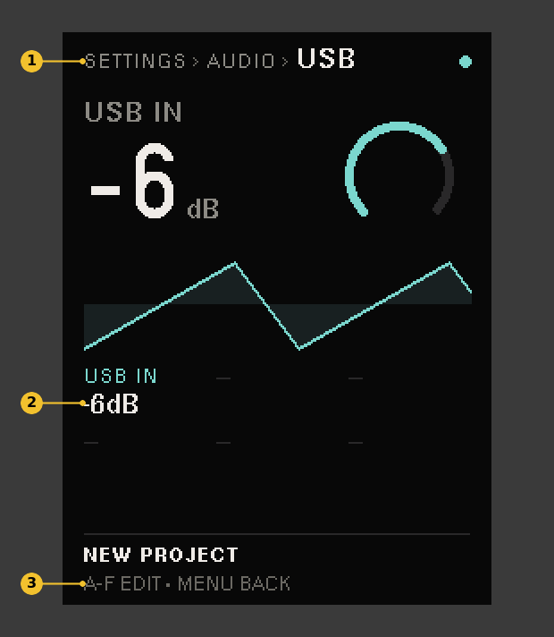

1. The breadcrumb.
2. **USB IN** (A).
3. The hint: `A-F EDIT · MENU BACK`.

**USB IN**: OFF, -24dB, -18dB, -12dB, -9dB, -6dB, -3dB, 0dB; default 0dB. Changes fade in. At 0dB a loud track over a loud patch can clip, so turn one down. It is mixed in after the synth, so recording Chimera over USB never records it back ([USB](#usb-midi-audio-and-the-console-over-one-cable)).

## SETTINGS: PERSONALIZE

Unit settings, kept in the SYSTEM file on the card across projects. Every page here has the same frame: breadcrumb, focused cell (some with a glyph), waveform, the cells, and the footer's project and keys.

| Row | Editor | Cells |
|---|---|---|
| **THEME** | THM | BRIGHT, GAMMA, ACCENT, BLACK, HINTS, INVERT |
| **SCREENSAVER** | SAV | SAVER |
| **CHAIN MAP** | MAP | PAGES |
| **TEXT SIZE** | TXT | SIZE |
| **PAD FOLLOW** | FOL | FOLLOW |
| **ALGO PAGES** | ALG | FIRST |


### PERSONALIZE: THEME


1. Breadcrumb.
2. Focused cell.
3. Glyph: an arc.
4. Waveform.
5. **BRIGHT**.
6. **GAMMA**.
7. **ACCENT**.
8. **BLACK**.
9. **HINTS**.
10. **INVERT**.
11. Footer: project and state.
12. Footer: keys.

| Cell | Options | Default | What it does |
|---|---|---|---|
| **BRIGHT** | 10, 15, 20, 25, 30, 35, 40, 45, 50, 55, 60, 65, 70, 75, 80, 85, 90, 95, 100 | 70 | Backlight, % |
| **GAMMA** | PANEL, SOFT, PUNCH | PUNCH | PANEL the screen's own; PUNCH deeper blacks; SOFT between |
| **ACCENT** | TEAL, AMBER, ROSE, LIME, ICE | TEAL | The one accent colour |
| **BLACK** | -2, -1, 0, +1, +2, +3, +4 | -2 | Lifts black toward grey (in light mode, softens the white) |
| **HINTS** | OFF, ON | ON | Gesture hints in the focus band; gestures work either way |
| **INVERT** | OFF, ON | OFF | Light mode |

In light mode accents darken only as far as they must. The boot splash keeps its own colours. Without a SYSTEM file the unit starts at 70, PUNCH, TEAL, -2.

> **Design note:** the backlight runs at 20 kHz, above hearing, so dimming never whines into the audio. Colours are swapped on their way to the screen after drawing, so a theme costs the drawing code nothing. And yes, you can have a rose-pink synthesizer. We won't tell.

### PERSONALIZE: SCREENSAVER


1. Breadcrumb.
2. Focused cell.
3. Waveform.
4. **SAVER**.
5. Footer: project and state.
6. Footer: keys.

**SAVER**: OFF, 5 S, 7 S, 10 S, 30 S, 60 S, 2 MIN, 5 MIN, 10 MIN; default 5 MIN. The screensaver is an oscilloscope of the main out, with the last note received, the note it sounds as (after LIVE SNAP and pitch), the measured pitch above about 300 Hz, and the keys held with their chord. A button wakes it and does its job; a turn loses its first detent. MIDI never wakes it.

### PERSONALIZE: CHAIN MAP


1. Breadcrumb.
2. Focused cell.
3. Waveform.
4. **PAGES**.
5. Footer: project and state.
6. Footer: keys.

**PAGES**: ROW (default; full words under the map, **SEQ** on, **EDIT** back) or STACK (a list under the node, **EDIT** down, **SEQ** up). See [the panel and navigation](#the-panel-and-navigation).

### PERSONALIZE: TEXT SIZE


1. Breadcrumb.
2. Focused cell.
3. Waveform.
4. **SIZE**.
5. Footer: project and state.
6. Footer: keys.

**SIZE**: NORMAL (default) or LARGE, which draws cell labels and values, the focus label, hints, SETTINGS lists and Sound names a size up wherever they fit. Header, breadcrumbs, chain map, the big value, pictures, dialogs, ORBIT's rings and MANAGE's columns stay.


### PERSONALIZE: PAD FOLLOW


1. Breadcrumb.
2. Focused cell.
3. Waveform.
4. **FOLLOW**.
5. Footer: project and state.
6. Footer: keys.

**FOLLOW** sets whether a hit on a DRUM Part selects its pad: OFF (only MIX + MINUS / PLUS and the PAD cell do), ALWAYS, or IDLE (default: only once 2 seconds have passed since you last edited that Part's DRUM pages).

**Why:** following hits finds a pad by playing it, and is maddening while you tweak one pad. IDLE follows until you start editing. See [DRUM](#drum-the-kit-engine).

### PERSONALIZE: ALGO PAGES

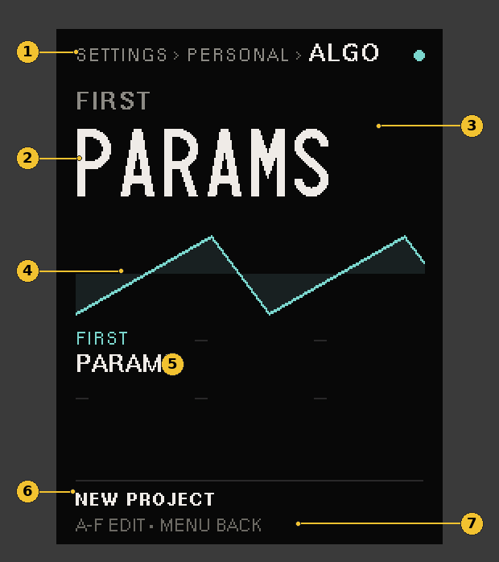

1. Breadcrumb.
2. Focused cell.
3. Waveform.
4. **FIRST**.
5. Footer: project and state.
6. Footer: keys.

**FIRST** orders ALGO's OSC sub-pages: PARAMS (default; one parameter across six operators first) or OPS (OPERATOR 1 to 6 first). No page is ever skipped, even a silent operator's, since LEVEL 0 is exactly the page you open to turn it up ([ALGO](#algo-the-six-operator-engine)).

## SETTINGS: SYSTEM


| Row | What it does |
|---|---|
| **OS UPGRADE** | Restarts into the chip's DFU loader for an update ([updating and recovery](#updating-and-recovery)); silent until flashed or power-cycled |
| **STORAGE**, **FORMAT CARD**, **USB CONFIG** | `LATER` |
| **DIAGNOSTICS** | AUDIO LOAD; TEST TONE and INPUT TEST are `LATER` |
| **PUSH ENCODERS** | For control boards whose encoders push |
| **ABOUT** | Firmware, chip and card |

### SYSTEM: DIAGNOSTICS

**AUDIO LOAD** is the audio engine's health, useful in a glitch report.

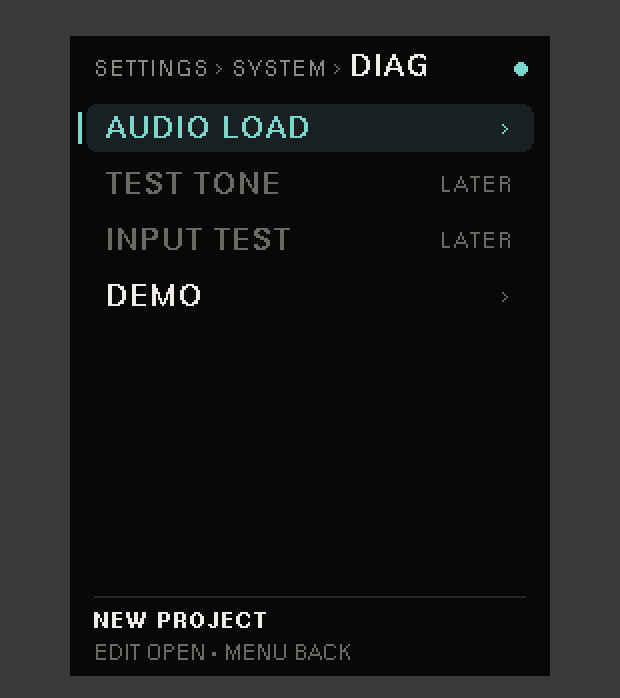

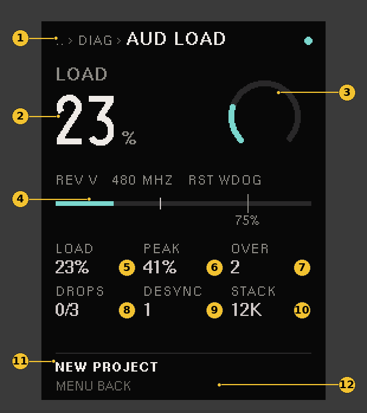

1. Breadcrumb.
2. LOAD, large, in %.
3. Its arc.
4. Chip revision, clock, last reset, and load against its 75 % budget.
5. **LOAD**: share of each audio block's time used.
6. **PEAK**.
7. **OVER**: blocks that ran over.
8. **DROPS**: blocks dropped, by source.
9. **DESYNC**: times the audio lost step.
10. **STACK**.
11. Footer: project and state.
12. Footer: `MENU BACK`.

### SYSTEM: PUSH ENCODERS

Some PreenFM3 control boards have push encoders; nothing says so, so **PUSH** (OFF, ON; default OFF) is a setting (PSH in the editor).


1. Breadcrumb.
2. Focused cell.
3. Glyph.
4. Waveform.
5. **PUSH**.
6. Footer: project and state.
7. Footer: keys.

With PUSH ON, push and turn is a fine turn; push and release jumps to the default (`PUSH DEFAULT  PUSH + TURN FINE`). Every push gesture has another path (SEQ + turn, MIX + turn), so a board without pushes misses nothing.

### SYSTEM: ABOUT

Read-only; reads nothing new from the card.


1. Breadcrumb.
2. The name, large.
3. `FIRMWARE 0.4.0 RELEASE`: version and build type.
4. The build's identity: version and commit (`0.4.0 b42f427c`).
5. **VERSION**.
6. **BUILD**.
7. **CHIP**: revision and board package.
8. **CLOCK**.
9. **RESET**: why the unit last restarted.
10. **CARD**: label or serial as last seen, `NO CARD` or `ERROR`.
11. Footer: project and state.
12. Footer: `MENU BACK`.

## SETTINGS: every question it asks

A question is a panel: the question, what will happen, the answers. Any encoder moves, **EDIT** answers, **MENU** or **SEQ** cancels (`EDIT OK · MENU BACK`). DELETE, CLEAR, SAVE OVER, RELOAD SCENE and ENTER DFU open on CANCEL. Every question but `NAME EXISTS` and the slot-update one (`P4 ALSO USES SLOT 03`) offers CANCEL; the table lists the other answers.

| Prompt (second line) | When it appears | Answers |
|---|---|---|
| `LOAD BETA?` / `START A NEW PROJECT?` | Loading, or + CREATE NEW, over unsaved changes | **SAVE THEN LOAD** saves first (naming if needed); **LOAD ANYWAY** discards |
| `NAME EXISTS` (`SLOT 02 IS NAMED BETA`) | SAVE PROJECT AS onto a taken name | **KEEP BOTH** saves beside it; **OVERWRITE THAT ONE** replaces it (no CANCEL) |
| `CARD CHANGED` (`SAVE AS A NEW PROJECT ON THIS CARD?`) | A save to a card the project did not come from | **SAVE AS** writes a new project on this card |
| `SAVE OVER BETA?` (`ITS CONTENTS ARE REPLACED`) | MANAGE › SAVE TO | **SAVE OVER** replaces that file |
| `CLEAR BETA?` (`IT BECOMES A NEW PROJECT`) | MANAGE › CLEAR | **CLEAR** empties it (the loaded one: its file too) |
| `DELETE BETA?` (`THIS CANNOT BE UNDONE`) | MANAGE › DELETE | **DELETE** removes the file |
| `PURGE 3 SOURCES? FREES 61K` (`THE CARD KEEPS THEM`) | PURGE UNUSED SRC | **PURGE** frees the memory |
| `CLEAR P1 TO INIT?` | PART › CLEAR on an edited Part | **SAVE PART FIRST**; **REPLACE** clears |
| `REPLACE P1 SOUND?` | Browser load into an edited Part | **SAVE PART FIRST**; **REPLACE** loads |
| `LOAD INTO P1?` | Library load into an edited Part | **SAVE PART FIRST**; **REPLACE** loads |
| `LOAD INTO P1?` (`KIT NOT IN LIBRARY`) | Loading over an unsaved DRUM kit | **REPLACE** loads |
| `RELOAD P1 FROM SLOT 03?` | PART › RELOAD FROM PROJ | **SAVE PART FIRST**; **RELOAD** drops edits |
| `P4 ALSO USES SLOT 03` (`IT KEEPS THE OLD SOUND`) | Saving over a slot other Parts play | **UPDATE P4** / **UPDATE ALL** move them to the new Sound; **LEAVE** keeps the old until they reload (no CANCEL) |
| `CLEAR SLOT 03?` (`NO PART USES IT`) | MIX + MINUS in the Sound browser ([the SD card](#the-sd-card-projects-sounds-and-the-library)) | **CLEAR** empties the slot |
| `CLEAR SCENE 3?` (`IT GOES SILENT ON THE LOOP`) | ORBIT › CLEAR | **CLEAR** |
| `SAVE OVER SCENE 2?` (`ITS SAVED SCENE IS REPLACED`) | ORBIT › SAVE TO PROJ, or EDIT on SCN, over a saved scene | **SAVE OVER** |
| `RELOAD SCENE 3?` (`ITS DRIFT RESTARTS, ITS EDITS STAY`) | ORBIT › RELOAD FROM PROJ | **RELOAD** |
| `ENTER DFU?` (`PLAY STOPS UNTIL FLASHED OR POWER-CYCLED`) | SYSTEM › OS UPGRADE | **ENTER DFU** restarts into the loader |
| `DELETE MAP?` / `DELETE CC 74?` | PART › MIDI MAP ([MIDI](#midi-channels-maps-and-controllers)) | **DELETE** |


**Why:** everything that changes or removes a file, or throws away an edit, asks first, and nothing else does. EDIT is always OK and MENU always backs out.

# MIDI, channels, maps and controllers

How Chimera listens and talks over MIDI, on DIN and USB: Part channels, CONTROL CHANNELS, SYNC and program change, MPE, the built-in CCs, learn, MIDI MAP and controller maps, NRPN, SysEx, ECHO and PARAM OUT. The USB port itself is in [USB](#usb-midi-audio-and-the-console-over-one-cable); tunings and MIDI Tuning Standard are in [Tuning](#tuning-temperaments-scala-files-and-mts). On SETTINGS pages and on MIDI MAP, **A** to **F** are encoders 1 to 6.

## MIDI: how Chimera listens

Each of the six Parts listens on its own MIDI channel; out of the box Part *n* is on channel *n*, over DIN and USB alike. Parts on one channel layer. On its channel a Part answers:

- notes, velocity, pitch bend, the sustain pedal, the mod wheel, channel and poly pressure;
- the [built-in CCs](#midi-the-built-in-ccs), with no setup;
- the bindings in its [MIDI map](#midi-the-midi-map-page): the Sound's own rows and the Part's controller map;
- every stored cell's fixed [NRPN address](#midi-nrpn-addresses);
- program changes, when PROGRAM is on (see [program change](#midi-program-change-sounds-from-a-sequencer)).

Three more channels can get jobs of their own ([CONTROL CHANNELS](#midi-control-channels-mixer-sequencer-and-auto)), and MPE controllers play in [zones](#midi-mpe-zones).

**Why per Part, and no global CC chart:** each Part can play a different engine with different cells, so a unit-wide chart could only name the cells all engines share. The General MIDI controllers work on every Part, a Sound carries the knobs it was voiced with, and a controller map follows the Part through every Sound and project.

The MIDI settings live in **SETTINGS › MIDI CONFIG**: SYNC, PORT CONFIG (dimmed, marked LATER: not built), CHANNELS, CONTROL CHANNELS, ECHO and MPE. They are kept with SETTINGS on the unit, not in the project (except the Part channels), because they describe your studio, not a song.

## MIDI: the SYNC page

**SETTINGS › MIDI CONFIG › SYNC** (SYN on the settings chain).


1. Header: `SETTINGS › MIDI › SYNC`.
2. Focused cell, large: SYNC EXT.
3. The picture band: a test wave in this shot.
4. **SYNC** (A): EXT.
5. **PROGRAM** (B): OFF.
6. Footer: the project's name (`NEW PROJECT`), marked when unsaved.
7. Footer: `A-F EDIT · MENU BACK`.

| Cell | Options | Default | What it does |
|---|---|---|---|
| **SYNC** (A) | INT, EXT | EXT | ORBIT's transport follows its own clock (INT) or MIDI clock (EXT) |
| **PROGRAM** (B) | OFF, ON | OFF | A program change loads a Sound ([program change](#midi-program-change-sounds-from-a-sequencer)) |

**Under EXT** a DAW drives [ORBIT](#orbit-the-ring-sequencer): Start plays from bar 0, Stop stops, Continue plays on from where ORBIT is. Clock alone never starts ORBIT. **B6** still plays and stops it; the last command wins. If ticks stop for half a second, ORBIT's own clock takes over at the same tempo, so nothing jumps; with no clock at all, ORBIT runs free on B6. **Under INT** clock and transport messages are ignored; notes still play. Switching SYNC carries on without a jump.

**Why EXT by default:** a DAW works at once, and with no clock arriving ORBIT runs free anyway. **Why not in the project:** a project taken to another rig must not bring a clock setting that fights it.

## MIDI: the CHANNELS page

**SETTINGS › MIDI CONFIG › CHANNELS** (CHN on the settings chain) sets each Part's channel.


1. Header: `SETTINGS › MIDI › CHANNELS`.
2. Focused cell, large: P1 on 1, with its arc.
3. The picture band: a test wave in this shot.
4. **P1** (A): 1.
5. **P2** (B): 2.
6. **P3** (C): 3.
7. **P4** (D): 4.
8. **P5** (E): 5.
9. **P6** (F): 6.
10. Footer: the project's name (`NEW PROJECT`), marked when unsaved.
11. Footer: `A-F EDIT · MENU BACK`.

| Cell | Range | Default | What it does |
|---|---|---|---|
| **P1** to **P6** (A to F) | 1 to 16 | 1 to 6 | The channel Part *n* listens, echoes and sends on |

These are the same values as the channel on the mixer's Part page ([the mixer](#the-mixer-and-the-master-effects)) and are saved in the project. Put two Parts on one channel to layer them; put a Part on 1 or 16 to play an [MPE zone](#midi-mpe-zones).

## MIDI: CONTROL CHANNELS, MIXER, SEQUENCER and AUTO

**SETTINGS › MIDI CONFIG › CONTROL CHANNELS** (CTL on the settings chain) gives three channels a job and holds the switch for the built-in CCs.


1. Header: `SETTINGS › MIDI › CONTROL`.
2. Focused cell, large: MIXER OFF, with its arc.
3. The picture band: a test wave in this shot.
4. **MIXER** (A): OFF.
5. **SEQ** (B): OFF; the readout and focus band call it SEQUENCER.
6. **AUTO** (C): OFF.
7. **BUILT-IN** (D): ON.
8. Footer: the project's name (`NEW PROJECT`), marked when unsaved.
9. Footer: `A-F EDIT · MENU BACK`.

Here AUTO is on Part 1's channel, so it is dimmed:


1. Breadcrumb: `SETTINGS › MIDI › CONTROL`.
2. **MIXER** (A), here 14.
3. **SEQ** (B), here 15.
4. **AUTO** (C), here `1`: a Part has it, so it is dimmed and does nothing.
5. The band says who has the channel: `A PART HAS THIS CHANNEL`, `MIXER HAS THIS CHANNEL`, `SEQUENCER HAS THIS CHANNEL` or `MPE HAS THIS CHANNEL`.
6. **BUILT-IN** (D), `ON` or `OFF`.

| Cell | Options | Default | What it does |
|---|---|---|---|
| **MIXER** (A) | OFF, 1 to 16 | OFF | Channel of the [mixer chart](#midi-the-mixer-channel-chart) |
| **SEQUENCER** (B) | OFF, 1 to 16 | OFF | Channel of [ORBIT's chart](#midi-the-sequencer-channel-chart) |
| **AUTO** (C) | OFF, 1 to 16 | OFF | Plays the [Part you are on](#midi-the-auto-channel) |
| **BUILT-IN** (D) | OFF, ON | ON | Each Part answers the [built-in CCs](#midi-the-built-in-ccs) |

A Part's channel always wins over a CONTROL channel; then MIXER wins over SEQUENCER, and SEQUENCER over AUTO. Keep them off MPE zones' channels. The MIXER and SEQUENCER charts are fixed: learn and controller maps do not apply on their channels.

**Why all OFF:** a channel taken by default would steal notes from an existing setup, and MPE uses 2 to 16.

> **Design note:** track channels, an effects channel and an "auto" channel that follows the selected track are inspired by Elektron's Digitakt and Digitone, where AUTO CHANNEL and FX CONTROL CH have earned their keep on a lot of stages. Chimera adds a SEQUENCER channel for ORBIT, because a ring sequencer you can't drive from a footswitch is just a very pretty clock.

### MIDI: the AUTO channel

Notes, CCs, bend, pressure and the pedal on AUTO's channel play the Part you are on, exactly as on that Part's channel (layered Parts and its map included). Change Part and AUTO follows; a held note or pedal stays with the Part that started it. **Why:** one keyboard on one channel plays every Part in turn.

### MIDI: the MIXER channel chart

On MIXER's channel these 7-bit CCs move the mixer and master FX, gliding like a knob. Notes are ignored. The FX's [NRPNs](#midi-nrpn-addresses) also work here, for finer steps and their other cells; the [NRPN chart](https://joegiralt.github.io/chimera-releases/guides/nrpn) has the full detail.

| CCs | Moves (in order) |
|---|---|
| 20-25 | PART LEVEL, Parts 1 to 6 |
| 26-31 | PART PAN, Parts 1 to 6 |
| 41-46, 47-52, 53-58 | OUT CHORUS, OUT DELAY, OUT REVERB (the Sound's sends), Parts 1 to 6 |
| 70-72 | CHORUS RATE, DEPTH, MIX |
| 73-83 | DELAY TIME, FDBK, MECHANICS, SAT, TONE, MIX, REV, SIZE, DENSITY, PITCH, TEXTURE |
| 84-94 | REVERB TIME, DAMP, SIZE, MIX, TONE, DIFFUSE, PRE-DLY, SHAPE, SMEAR, RATE, DENSITY |
| 102-108 | COMP THRESH, ATK, REL, MAKEUP, MIX, VOL, PAN |

No reserved CC is used (bank select, data entry and increment/decrement, RPN/NRPN select, sustain).

### MIDI: the SEQUENCER channel chart

On SEQUENCER's channel these CCs drive [ORBIT](#orbit-the-ring-sequencer). PLAY/STOP and ON/OFF act as **B6** and **MIX + B*n*** each time the value rises past 63 (127 then 0 is one press). CHANCE, STEPS, KEY and SCALE sweep their values over 0 to 127. A note sets KEY to its pitch class: play an E and the chords move to E.

| CCs | Moves |
|---|---|
| 20 | PLAY/STOP |
| 21-25 | RING1 to RING5 ON/OFF |
| 26-30 | RING1 to RING5 CHANCE |
| 102-106 | RING1 to RING5 STEPS |
| 107, 108 | ORBIT KEY, ORBIT SCALE |

## MIDI: MPE zones

An MPE controller (LinnStrument, Seaboard, Osmose…) sends each note on its own channel, so each finger bends, presses and slides its own note. Chimera plays two zones:

- **lower zone**: master channel 1, notes on 2 and up;
- **upper zone**: master channel 16, notes on 15 and down.

A zone's notes play the Parts on its master channel (Part 1 is on 1 already). Parts on its note channels don't hear them while the zone is on. Each note's bend bends it alone over the zone's bend range; its pressure feeds PRESS and its CC 74 feeds SLIDE in the [mod matrix](#the-mod-matrix-and-routes), for that note only. The master channel's bend (over the Part's BEND), wheel, pressure, CC 74, pedal and All Notes Off reach every note.

Most controllers set the zones themselves with RPN 6 (zone on, bend range 48). Or set them on **SETTINGS › MIDI CONFIG › MPE** (MPE on the settings chain):


1. Header: `SETTINGS › MIDI › MPE`.
2. Focused cell, large: LOWER OFF, with its arc.
3. The picture band: a test wave in this shot.
4. **LOWER** (A): OFF.
5. **L BEND** (B): 48.
6. **UPPER** (C): OFF.
7. **U BEND** (D): 48.
8. Footer: the project's name (`NEW PROJECT`), marked when unsaved.
9. Footer: `A-F EDIT · MENU BACK`.

| Cell | Options | Default | What it does |
|---|---|---|---|
| **LOWER** (A) | OFF, 1 to 15 | OFF | Lower zone's note channels, counting up from 2 |
| **L BEND** (B) | 0 to 96 semitones | 48 | Lower zone's per-note bend, each way |
| **UPPER** (C) | OFF, 1 to 15 | OFF | Upper zone's note channels, counting down from 15 |
| **U BEND** (D) | 0 to 96 semitones | 48 | Upper zone's per-note bend, each way |

Zones never overlap: growing one shrinks the other. RPN 0 on a note channel sets its zone's bend; on the master channel it sets the Part's BEND. With both OFF, every channel is its own.

**Why the master channel's Parts:** under MPE the master channel names the instrument; the note channels only carry fingers.

## MIDI: the mod wheel, pressure and slide

The [mod matrix](#the-mod-matrix-and-routes) has three sources for your hands:

- **WHEEL** (MOD WHEEL in the readout): CC 1, 0 at rest to 1 fully up.
- **PRESS** (PRESSURE in the readout): channel pressure moves every note, poly pressure one note; each note follows the higher.
- **SLIDE**: CC 74, 0 to 1; under MPE each note also has its own, and follows the higher.

They glide, so a fast throw never steps. A new note starts with no poly pressure; wheel and channel pressure carry across notes and loads.

An INIT Sound routes WHEEL into LFO 1's DEPTH (+127) and LFO 1 into PITCH, with DEPTH at 0: wheel up is full vibrato. Moving the wheel is playing, not editing. Factory Sounds that move LFO 1 instead carry a MIDI map row of CC 1 on LFO 1's DEPTH, so there the wheel edits DEPTH and the Sound shows `*`. Wheel, CC 74 and pressure also reach the MIDI map, so a binding on them works beside a route.

## MIDI: the built-in CCs

Every Part answers the General MIDI controllers on its own channel, so a DAW's mixer lanes or a keyboard's sliders work at once:

| CC | Name | Moves |
|---|---|---|
| 7 | Volume | The Part's LEVEL |
| 10 | Pan | The Part's PAN |
| 11 | Expression | A swell under LEVEL (below) |
| 71 | Resonance | The filter's RESO |
| 72 | Release | Shifts release: ALGO every operator's RR, VA and TAPE ENV 1's REL, MODAL DAMP |
| 73 | Attack | Shifts attack: ALGO every operator's AR, VA and TAPE ENV 1's ATK, MODAL nothing |
| 74 | Brightness | The filter's CUTOFF |
| 91 | Reverb | The Sound's REVERB send |
| 93 | Chorus | The Sound's CHORUS send |
| 94 | Delay | The Sound's DELAY send |

- Each glides over the cell's whole range, except ATTACK and RELEASE.
- **ATTACK and RELEASE** shift from the Sound's own values: 64 is the Sound, above is longer, below shorter. Each cell moves from where it is, so ALGO keeps its operators' envelope shapes (64 to 127 is 15 AR steps slower and 7 RR steps longer; AR never reaches 0). VA and TAPE move 1/127 of the range a step. The page shows the shifted values; saving keeps them, and 64 is then the saved Sound. A Sound load or Reset All Controllers (CC 121) returns to 64.
- **Expression** turns the Part down from its LEVEL, sends included: 127 as set, 64 about −12 dB, 0 silent. It is never saved, leaves no `*`, and resets to 127 on a project load, NEW, or Reset All Controllers.
- **Your bindings win:** a CC bound by the Sound or the controller map does only that.
- **Under MPE**, CC 74 on a master channel is SLIDE only; on note channels every CC is the note's.
- **AUTO** reaches the Part you are on; MIXER's and SEQUENCER's channels never reach these.

Set **BUILT-IN** to OFF on [CONTROL CHANNELS](#midi-control-channels-mixer-sequencer-and-auto) when a controller sends CC 7 or 74 for something else.

**Why these numbers:** they are General MIDI's and the sound-controller recommendation's, so GM gear reaches the same controls with no setup.

## MIDI: what a binding can drive

A binding ties one control to one cell:

- **the Sound's cells**: engine, filter, envelopes, LFOs, FX slot and output, not the jacks;
- **the Part's LEVEL and PAN**;
- **the master FX's continuous cells** (CHORUS, DELAY, REVERB, MASTER), not TYPE, MODE or the delay's SYNC. The delay's TIME is two cells (ms under FREE, note under SYNC), each bound separately;
- **ORBIT's ring amounts**: HITS, ROTATE, CHANCE, MUTATE, GATE, VEL, ACCENT and OCTAVE (not STEPS, MUTE, choices or the chord ring).

MOD MATRIX routes and DRUM pad cells can't be bound. A binding to the master FX or ORBIT lives in the map of the Part you learned it on and listens on that Part's channel; if two Parts bind one cell, the last message wins. A ring amount moves the playing scene and its saved slot; HITS and ROTATE span the ring as it is (0 to STEPS, or STEPS − 1).

A control can be a **CC** (`CC 74`), a **14-bit CC pair** (`CC 2+34`, CC 1 to 31 with CC *n* + 32), an **NRPN** (`NRPN 10:3`), **PRESSURE** (channel aftertouch), or a **SysEx message** (`SYSEX 9`, see [SysEx controllers](#midi-sysex-controllers)).

## MIDI: learn

1. Touch the cell (turn its encoder a notch) on a Part's page, a master FX page or an ORBIT page.
2. Hold **MIX** and press **SEQ**. The value line reads `MOVE A KNOB · CUTOFF`.
3. Move the control. The binding is written at once.
4. Turn it right, then left: Chimera guesses its kind and shows the guess.
5. Press **MIX + SEQ** again to keep it. A page change, a nav key or one of Chimera's own encoders also ends learn.

While learning, the control moves nothing. The row goes into the Sound's own rows.


1. The binding: control heard and cell driven (`CC 21 → FINE`).
2. The guess: `TURN IT RIGHT, THEN LEFT` until sure, then the kind (`RELATIVE · TWOS COMPLEMENT`).
3. The hint `MIX + SEQ  DONE`: press it to finish.

Guesses are `ABSOLUTE`, the relative encodings (`RELATIVE · TWOS COMPLEMENT`, `RELATIVE · BINARY OFFSET`…), `BUTTON`, `14-BIT CC` and `INC DEC`. Fix a wrong guess with **E** on MIDI MAP. Learn refuses with:

- `NOT MAPPABLE`: the cell can't be bound;
- `CC 21 ON CH 3, PART ON CH 1`: wrong channel;
- `CC 64 RESERVED`: sustain, bank select, data entry, NRPN/RPN select or channel mode messages;
- `MAP FULL`: the Sound already holds 16 rows.

A relative encoder or 14-bit control learns with ECHO on, so LED rings follow; others learn with ECHO off.

**Why learn guesses:** endless encoders use four relative codes and rarely say which; right-then-left tells them apart.

## MIDI: SysEx controllers

Old programmers made to edit another synth by SysEx can drive Chimera's cells. Learn as usual (**MIX + SEQ**), then move the box's knob slowly: Chimera compares two messages to find the value byte. Keep turning past a coarse step and it also finds a second (14-bit) byte. Press **MIX + SEQ** to finish.

The message then sweeps the cell's full range, gliding. Other addresses from the box move nothing. A SysEx binding listens on every Part whose Sound holds it, whatever the channel. On MIDI MAP it reads `SYSEX` and the value's byte, counting F0 as 1 (`SYSEX 9`); it is always JUMP with no ECHO. Messages up to 32 bytes are heard; a value split into two nibbles reads as 14-bit and won't reach the full range.

> **Design note:** learn finds the value by diffing two messages from the same knob and skipping a Roland-style checksum at the end, so a programmer built for a synth from decades ago can drive a filter it has never heard of. The box is none the wiser, and frankly, it's had a long career and deserves a gentle retirement gig.

## MIDI: the MIDI MAP page

**SETTINGS › PART › MIDI MAP** (MAP in the editor's schemas) lists the current Part's bindings: first **`CONTROLLER`** (the Part's [controller map](#midi-controller-maps) or `NONE`), then the map's rows (`IN <map name>`), then the Sound's own rows (up to 16), then **`+ NEW BINDING`** ([pointing](#midi-adding-a-row-by-pointing)). Empty, it reads `NO CCS · MIX+SEQ ON A CELL`.

Here Part 1 plays the map `EC4`, two rows above its Sound's rows:


1. Breadcrumb: `… › PART 1 › MIDI MAP`, the Part whose map this is.
2. `CONTROLLER`, the first row, with the map in use: `EC4` (or `NONE`).
3. The bar: control, then cell (`CC 30  MORPH`). **A** moves it. Master FX and ORBIT cells name their block (`REVERB MIX`, `RING 1 CHANCE`).
4. Its INPUT kind, short: `JUMP`.
5. A dimmed row (`CC 74  - RESO`) does nothing now: the Sound binds the same control, or the cell is not in the Part's engine (`- STRUCT`). The rows below it are the Sound's own.
6. The bar's INPUT spelled out (`ABSOLUTE · JUMPS TO THE KNOB`); for a relative kind, the bytes for one step each way.
7. `IN EC4`: the row belongs to the map.
8. The C/D/F line: **C MIN**, **D MAX** (0 to 255; MAX below MIN reverses), **F ECHO**.
9. **B CONTROL**, **E INPUT**, **EDIT TARGET**.
10. Footer: the project's name and `* MODIFIED`.
11. Footer: `A MOVE · MIX+MINUS DELETES`.

### MIDI: the keys on a MIDI MAP row

| Key | On a binding row | On `CONTROLLER` |
|---|---|---|
| **A** | Moves the bar | Moves the bar |
| **B** | CONTROL: CC number (NRPN, PRESSURE, SysEx are `B FIXED`: learn again) | PICK: maps on the card and `NONE` |
| **C** / **D** | MIN / MAX, 0 to 255 | |
| **E** | INPUT (below) | |
| **F** | ECHO, OFF or ON | |
| **EDIT** | TARGET: point at another cell | SAVE ROWS TO MAP ([saving](#midi-saving-a-controller-map)) |
| **MIX + C** / **MIX + D** | FINE: one place a frame | |
| **MIX + MINUS** | DELETE (asks `DELETE CC 74?`) | DELETE the map from the card (asks `DELETE MAP?`) |
| **MIX + PLUS** | | [KEEP MAP](#midi-keep-map-keeping-the-parts-rows) on or off |
| **MIX + EDIT** | | RENAME the map |

The hint line names only the keys a row answers (`B CONTROL  E INPUT  EDIT TARGET`; with **MIX** held, `MIX+C/D FINE  MIX+MINUS DELETE`; on `CONTROLLER`, `B PICK  EDIT SAVE ROWS TO MAP`, or with a map picked `EDIT SAVE  MIX+MINUS DELETE` and `MIX+EDIT RENAME`).

Editing a Sound row edits the Sound (`*`); editing a map row changes the map on the card, not the Sound.

**Why 256 places and FINE:** 256 is already twice a CC's resolution; FINE exists because an accelerated turn skips places.

### MIDI: the INPUT response kinds

| Row | Spelled out | Line below | For |
|---|---|---|---|
| `JUMP` | `ABSOLUTE · JUMPS TO THE KNOB` | | Knob or fader: the cell glides to it at once. Default |
| `PICKUP` | `ABSOLUTE · WAITS TO PICK UP` | | Knob or fader: nothing moves until it reaches the value |
| `SCALE` | `ABSOLUTE · SCALES TO MEET` | | Knob or fader: moves at once, meeting the knob at the ends |
| `TWOS COMP` | `RELATIVE · TWOS COMPLEMENT` | `+1 = 1  -1 = 127` | Endless encoder |
| `OFFSET` | `RELATIVE · BINARY OFFSET` | `+1 = 65  -1 = 63` | Endless encoder |
| `SIGNED` | `RELATIVE · SIGNED BIT` | `+1 = 1  -1 = 65` | Endless encoder |
| `SIGNED 2` | `RELATIVE · SIGNED BIT 2` | `+1 = 65  -1 = 1` | Endless encoder |
| `INC DEC` | `RELATIVE · NRPN` | `INCREMENT AND DECREMENT` | NRPN data increment/decrement |
| `MOMENTARY` | `BUTTON · HELD IS MAX` | | Button: held MAX, released MIN |
| `TOGGLE` | `BUTTON · EACH PRESS FLIPS` | | Button: each press flips MIN/MAX |

| Control | Kinds (the schema spells TWOS-COMP, SIGNED-2, INC-DEC) |
|---|---|
| CC | all but INC DEC |
| 14-bit CC pair (CC14), PRESSURE (PRESS) | JUMP, PICKUP, SCALE |
| NRPN | all |
| SysEx (SYSEX) | JUMP |

A relative encoder moves the cell one step a detent, like Chimera's own encoders.

### MIDI: pickup


1. The touched cell, bound to a PICKUP knob sitting below its value.
2. `MOVE THE KNOB UP TO PICK UP` (or `DOWN`); it clears when the knob reaches the value. Shown while HINTS is on (SETTINGS › PERSONALIZE › THEME).

**Why PICKUP:** after a Sound load knob and cell rarely agree. JUMP moves at once (smoothly), PICKUP waits for you, SCALE moves at once and meets at the ends.

### MIDI: adding a row by pointing

Add a binding without the controller, choosing its CC afterwards:


The steps:

1. On MIDI MAP, put the bar on `+ NEW BINDING` (`POINT AT A CELL`, `ITS CC IS SET ON ITS ROW`) and press **EDIT**.
2. Chimera opens the page you came from. The value line reads `NEW BINDING`, the hint `A-F POINT  MENU CANCELS`.
3. Walk the pages with **EDIT** (Part, mixer, FX, ORBIT). Turn the wanted cell's encoder: it points, changing nothing. The hint becomes `EDIT BINDS  MENU CANCELS`.
4. Press **EDIT**. MIDI MAP returns, bar on the new row.
5. Set the CC with **B**, then MIN, MAX, INPUT, ECHO.

The row joins the picked controller map, or the Sound under `NONE`. Its CC is the first free one that is not CC 1, a built-in CC, or on another of the Part's rows. **EDIT** on an existing row re-points it (`NEW TARGET`), keeping everything but the cell.

While pointing: an unbindable cell reads `NOT MAPPABLE  MENU CANCELS`, a bound one `ALREADY BOUND  MENU CANCELS`, and **EDIT** walks on. **MENU** (tap or hold, no quick save) cancels back to MIDI MAP. **MIX + SEQ** does nothing. A Sound load, a Part change or opening SETTINGS ends pointing. A failed bind says `BINDING GONE` or `NO FREE CC`. A full list dims `+ NEW BINDING` with `MAP FULL` and `DELETE A ROW FIRST`.

**Why EDIT binds only on the hint:** EDIT also walks pages, so it binds only after you turned a cell on the page in view.

## MIDI: controller maps

A controller map is a named, flat list of up to 90 bindings on the card (FADERFOX, CIRKLON, LCXL3…), apart from any Sound or project. A Part picks one on MIDI MAP's first row, so a controller is set up once for every project.

- **Any map plays on any engine.** Rows for cells the engine lacks are dimmed until the Part switches engine.
- **Parts can share a map**; a change reaches all of them.
- **The Sound's own rows win** on a shared control; the map's row dims.
- **The project remembers each Part's map by name**, and it stays through Sound loads.
- **A Part plays 16 of the map's rows at a time:** ECHO rows take the slots first, then rows in order. A moved control without a slot takes the least recently heard slot (a PICKUP row then waits again).

**Why on the card, not in the project:** a controller belongs to the studio, not the song; one map serves every project.

### MIDI: picking a controller map

On **SETTINGS › PART › MIDI MAP**, with the bar on `CONTROLLER`, turn **B** through the maps and `NONE`. The Part plays the map at once. Up to 16 maps are listed (the five factory maps and 11 of yours); with more, `CARD HOLDS MORE: 16 SHOWN` shows.

### MIDI: saving a controller map

1. Learn controls on the Part (**MIX + SEQ**); they become Sound rows.
2. On `CONTROLLER`, press **EDIT** (`SAVE ROWS TO MAP`). NAMING opens on the map's name (`CONTROLLER` if none).
3. Keep the name to update, or type a new one, and press **EDIT**.

The Sound's rows move into the map, replacing rows on the same control or cell, after the existing rows. The Part plays the saved map and its Sound shows `*` (its rows are now empty). A new name copies the current map first. Over 90 rows is refused with `MAP FULL`; a name whose files hold another map with `NAME TAKEN`. To cover another engine, switch engine, learn and save under the same name.

### MIDI: KEEP MAP, keeping the Part's rows

The Sound's own rows change with each Sound load. To browse Sounds with the rows you learned, press **MIX + PLUS** on `CONTROLLER` (`MIX + PLUS KEEP MAP ON`). Each loaded Sound then plays the Part's rows, with no `*`. Rows learned or changed while on show `*` once and are kept (REPLACE keeps them; so does a revert). Press again for `MIX + PLUS KEEP MAP OFF`: if the rows differ from the Sound's, it shows `*` (save to keep, revert to drop). KEEP MAP is not saved; it is off after a project load or power-on.

**Why kept rows are not an edit:** otherwise every load would stop at "save first?".

> **Design note:** this is a DAW's control-surface lock, so the knobs stay yours while presets change underneath. It is also the cure for the classic "I spent ten minutes mapping, loaded one preset, and now I'm sad" experience.

### MIDI: changing and deleting map rows

- **Change** a map row with **B** to **F**: it changes for every Part on the map and is written to the card a moment later. Or learn the same control on the Part (hiding the map row) and save.
- **Re-point** it with **EDIT** ([pointing](#midi-adding-a-row-by-pointing)).
- **Delete** it with **MIX + MINUS**; the card follows.

If the map left the card since it was read, Chimera says `FILE NOT FOUND` and writes nothing.

### MIDI: renaming and deleting a controller map

On `CONTROLLER` with a map picked: **MIX + EDIT** opens NAMING (`RENAME MAP`); every Part follows the new name, and a taken name is refused (`NAME TAKEN`). **MIX + MINUS** asks `DELETE MAP?` and deletes it; Parts that played it play `NONE`.

### MIDI: controller maps on the card

Maps live in `/CHIMERA/MAPS`, a file pair each (`FADE3C04.A` and `.B`: up to four letters of the name plus four characters made from the whole name). The full name is inside, so MIDI MAP lists it by name.

The card is inside the case. Copy maps with the bootloader's SD card access (hold **MENU** at power-on, then button 3) or with `chimera-usb.py` over the USB console ([USB](#usb-midi-audio-and-the-console-over-one-cable), [the card](#the-sd-card-projects-sounds-and-the-library)):

```
python3 chimera-usb.py ls maps
python3 chimera-usb.py get /CHIMERA/MAPS/FADE3C04 faderfox.map
python3 chimera-usb.py put faderfox.map /CHIMERA/MAPS/
```

`get` never overwrites a local file. `put` replaces a map of the same name, and Parts playing it play the new one at once.

### MIDI: the factory maps

The factory maps are **ALGO**, **MODAL**, **VA**, **TAPE** and **DRUM**, one per engine. Set a box of knobs to these CCs on the Part's channel and pick the map. Every row is `JUMP` with ECHO off. The CCs avoid the built-in CCs, CC 1, 2, 4, 64 to 69, 84, and CC 16 to 19 (used by factory Sounds' own rows); CUTOFF, RESONANCE and the sends are left to the built-in CCs. To change one, save it under a new name first: reinstalling the factory set restores the originals.

Every map shares these rows (in order within each range):

| CCs | Cells |
|---|---|
| 3, 9, 14, 15, 20-24 | ENV 1 ATK, DEC, SUS, REL, RISE, FALL, SHAPE, TIME, LEVEL |
| 25-31, 85, 86 | ENV 2, the same nine |
| 87-90, 102 | LFO 1 RATE, DEPTH, OFST, RISE, FALL |
| 103-107 / 108-112 | LFO 2 / LFO 3, the same five |
| 113-116 | FILTER INPUT LEVEL, STAB, FEEDBACK, SEM MODE |
| 117-119, 5 | FX AMOUNT, SHAPE, LEVEL, MIX |
| 8, 12 | VOICE FINE, TIME |
| 13, 33-37, 39, 40 | OUTPUT LEVEL, PAN, VCA, VEL, LPG, DECAY, STRIKE, WIDTH |

Then each engine's own cells from CC 41 up (the [NRPN chart](https://joegiralt.github.io/chimera-releases/guides/nrpn) has the full cell lists):

| Map (file, rows) | Own rows |
|---|---|
| ALGO (`ALGODE32.A`, 86) | ALG A, ALG B, MORPH, TRNSP, VOWEL; each operator's WAVE, CRSE, FINE, DETUN, LEVEL |
| MODAL (`MODA3D52.A`, 77) | MODEL, EXCITE, BRIGHT, POS, BODY, ENS.D, ENS.R, ENS.M, DAMP, STRUCT, COUPLE, HALO, MODES, FORCE, SPEED, COLOR, BURST; ENV 3 |
| VA (`VA2B02.A`, 74) | WAVE1, WAVE2, MODE, AMNT, SUB, STAB, CRSE1, FINE1, SHAPE1, CRSE2, FINE2, SHAPE2, KIND, NOISE; ENV 3 |
| TAPE (`TAPE2C4E.A`, 84) | MODEL, START, END, POSITION, MOTION, TAPE, AGE, SIZE, XFADE, DRAG, TYPE, ROOT, PERIOD, SLICE, WOW, DIRECTION, RETRIG, TRON, DRIFT, KEY, LENGTH, GRAIN, SPRAY, FINISH; ENV 3 |
| DRUM (`DRUME1A7.A`, 86) | The master FX (pads have no mappable cells): CHORUS, DELAY (with NOTE), REVERB (with DUCK, RELEASE) and COMP cells |

TAPE's own rows drive whichever machine's cell sits in that slot (POSITION is WALK POSITION, STRCH POSITION, SCRUB FINGER or WAVE FRAME, and so on).

## MIDI: NRPN addresses

Every stored cell has a fixed NRPN address that works on the Part's channel with no binding, gliding like a knob. Addresses never change between firmwares, so a Cirklon instrument, Hapax definition or DAW lane made once keeps working.

- **Message:** CC 99 (address MSB), CC 98 (LSB), CC 6 (value MSB), and CC 38 (value LSB) for 14 bits.
- **Address:** MSB is the block (engine, operator, filter, envelope, master effect…), LSB the cell; written MSB:LSB and as MSB × 128 + LSB (`2:2 (258)` is ALGO's MORPH).
- **Value:** continuous cells take 0 to 16383 (CC 6 alone also spans the range); stepped cells a step count in CC 6; choices a fixed code in CC 6, not their on-screen order.
- Engine cells move only on a Part playing that engine; master FX NRPNs work on any Part's channel; ORBIT ring cells move the playing scene. Unlisted addresses do nothing. A map binding on the same NRPN wins.

The full list is the [NRPN chart](https://joegiralt.github.io/chimera-releases/guides/nrpn); each release also carries it as `NRPN.json` for building templates.

**Why frozen:** an address comes from the cell's identity in the file format, not its place on a page.

## MIDI: program change, Sounds from a sequencer

With **PROGRAM** ON ([SYNC](#midi-the-sync-page)), a program change loads a Sound into every Part on its channel. With it OFF, program changes and bank selects are ignored.

| Bank | Program 0 to 127 loads |
|---|---|
| 0 (default) | The project's Sound slots: SLOT 01 to SLOT 128 |
| 1 | An INIT Sound: 0 ALGO, 1 MODAL, 2 TAPE, 3 VA, 4 DRUM |

Select the bank with CC 0 (or CC 32 alone, or CC 0 at 0 then CC 32); it stays until the next bank select. Empty slots, programs past the last INIT, and bank 2 up do nothing. LIBRARY and FACTORY Sounds must be saved into the project first.

- **A Part already on that Sound** keeps it, edits and all (a `◦` Part, whose slot was saved over, reloads), so repeated program changes cost nothing.
- **A Part with edits** (`*`) loads without asking; its edits wait, and a program change back brings them back, still `*`. One set is kept per Part, dropped by any other load or a project load.
- **Following notes** wait up to 40 ms for the new Sound.
- **While busy** (card load, a prompt, learn or the Sound rung open), the last program change per channel waits.
- **On the Part you are editing**, the pages follow the new engine.

**Why only the project's slots:** LIBRARY and FACTORY order shifts as files are added; slots stay put.

## MIDI: ECHO, values back to the controller

**SETTINGS › MIDI CONFIG › ECHO** (ECH on the settings chain) switches everything Chimera sends.


1. Header: `SETTINGS › MIDI › ECHO`.
2. Focused cell, large: ECHO ON.
3. Its glyph: a switch, on.
4. The picture band: a test wave in this shot.
5. **ECHO** (A): ON.
6. **PARAM OUT** (B): OFF.
7. Footer: the project's name (`NEW PROJECT`), marked when unsaved.
8. Footer: `A-F EDIT · MENU BACK`.

| Cell | Options | Default | What it does |
|---|---|---|---|
| **ECHO** (A) | OFF, ON | ON | All MIDI OUT: value echo, identity replies, the dump, PARAM OUT |
| **PARAM OUT** (B) | OFF, NRPN | OFF | Each cell you turn goes out as its NRPN |

With ECHO on, each binding with its own ECHO on sends its cell's value back on its control (CC, both 14-bit halves, NRPN, a button's 0/127, or a relative encoder's absolute value for LED rings) whenever the value changes, by any cause. A binding's echo is held for a quarter second after its control last moved, so it never fights your hand, and an echo looped back through MIDI thru in that time is not taken as a turn. Part changes, Sound, map and project loads send all values at once. Of a map's rows, those holding slots echo. On a shared channel the lower Part echoes.

### MIDI: PARAM OUT, recording your edits

At NRPN, each cell you turn goes out of MIDI OUT and USB as its [NRPN](#midi-nrpn-addresses) on the Part's channel, for a DAW to record and play back. Cells without an NRPN (jacks, routes, SETTINGS) send nothing.

- Only your hands send: MIDI input, loads, ORBIT and modulation never go out, so a thru loop never feeds back.
- A fast turn sends the latest value as room allows, never a backlog (DIN carries about 300 NRPNs a second).
- Continuous cells send 14 bits, stepped cells and choices the MSB only.
- Master FX and ORBIT cells send on the channel of the Part you are on.

**Why NRPN:** the frozen addresses replay into the same cell on any Chimera, with no map.

### MIDI: the parameter dump

An editor or LED-ring controller can ask what a Part's Sound is set to. **Request:** `F0 7D 43 48 01 pp F7`.

| `pp` | Answers with |
|---|---|
| `00` to `05` | Part 1 to 6 |
| `10` to `1F` | The (lowest) Part on channel 1 to 16 |
| `7F` | The Part you are editing |

**Answer**, from the port that asked, on the Part's channel: one NRPN per cell the engine reads, in NRPN chart order, then `F0 7D 43 48 02 pp F7`. DIN takes about 0.5 s for ALGO, 0.3 s for others; USB under 0.1 s. No answer with ECHO off or no such Part; a Sound load restarts it. Only cell values: no routes, map, name, LEVEL, PAN or project effects.

## MIDI: what else Chimera answers

- **Pitch bend** over the Part's BEND; **RPN 0** sets BEND (0 to 24); **RPN 6** on 1 or 16 sets an MPE zone.
- **Sustain** (CC 64) holds notes.
- **Clock, Start, Continue, Stop** drive ORBIT under SYNC EXT.
- **Identity request** (`F0 7E 7F 06 01 F7`): identity and version, while ECHO is on.
- **All Notes Off** (CC 123) and CC 124 to 127 release the channel's notes; **All Sound Off** (CC 120) silences them; **Reset All Controllers** (CC 121) resets pedal, bend, wheel, pressure, CC 74, expression and the ATTACK/RELEASE shifts.
- **System Reset** (`FF`) stops every sound and resets every controller.
- **Active Sensing:** once sent, a pulled cable releases held notes within a third of a second (`DIN MIDI LOST`); a USB host that resets or sleeps does the same (`USB MIDI LOST`).
- **MIDI Tuning Standard** retunes Parts set to MTS ([Tuning](#tuning-temperaments-scala-files-and-mts)).

While SETTINGS › SYSTEM › ABOUT reads `NEEDS UPDATE`, MIDI in is ignored, MIDI MAP reads `NEEDS UPDATE`, and **MIX + SEQ** says so instead of learning ([Updating](#updating-and-recovery)).

## MIDI: over USB

Over USB, Chimera is one MIDI port, **Chimera**, both ways, carrying all 16 channels exactly as DIN does; DIN and USB work side by side. Why one port and not one per Part is in [USB MIDI](#usb-midi).

# Tuning, temperaments, Scala files and MTS

Each Part plays in a tuning of its own: equal temperament, a historical temperament, a Scala file from the card, or MIDI Tuning Standard. This chapter covers the TUNING page, the temperaments, Scala files and keyboard maps, MTS, and how tuning meets SNAP. See also [MIDI](#midi-channels-maps-and-controllers), [the card](#the-sd-card-projects-sounds-and-the-library) and [USB](#usb-midi-audio-and-the-console-over-one-cable). On SETTINGS pages **A** to **F** are encoders 1 to 6.

## Tuning: the TUNING page

**SETTINGS › AUDIO ROUTING › TUNING** (TUN on the settings chain; breadcrumb `SETTINGS › AUDIO › TUNING`). TUNE is the whole unit's; TUNING and MAPPING belong to the active Part: press another Part's button to set its tuning.


1. Header: `SETTINGS › AUDIO › TUNING`.
2. Focused cell, large: TUNE, 0, with its arc.
3. Picture band.
4. **TUNE** (A), 0.
5. **TUNING** (B), 12-TET.
6. **MAPPING** (C), CONTIN.
7. Footer: the project and its state.
8. Footer: `A-F EDIT · MENU BACK`.

With a Scala file picked, **TUNING** shows the file's name (its first 7 characters in the cell; with focus, a long name scrolls), and the focus band shows the description line written inside the file, or the file name when it has none.

| Cell | Range or options | Default | What it does |
|---|---|---|---|
| **TUNE** (A) | −100 to +100 cents | 0 | Shifts the unit's A4 = 440 Hz reference; every Part follows |
| **TUNING** (B) | 12-TET, JUST, PYTHAG, MEANTONE, WERCK, MTS, then Scala files | 12-TET | The active Part's tuning |
| **MAPPING** (C) | CONTIN., KEYBD | CONTIN. | How the Part's Scala file lies on the keys ([MAPPING](#tuning-mapping-the-scale-on-the-keys)) |

New notes play the tuning; sounding notes keep their pitch. TUNE is kept on the unit; TUNING and MAPPING are saved per Part in the project. The focus band explains the choice: `FOLLOWS MTS SYSEX FROM MIDI IN` on MTS; the `.SCL` file (and `.KBM MAPS THE KEYS` when a `.kbm` is beside it) on a Scala file; `EACH KEY THE NEXT STEP` (CONTIN.), `EACH C STARTS THE SCALE` (KEYBD) or `FOR SCALA FILES` on MAPPING. The PITCH page's tuner ([the voice chain](#the-voice-chain-pitch-filter-fx-amp-stereo-and-sends)) reads notes in the Part's tuning.

**Why per Part:** one Part can drone in just intonation under equal-tempered chords. **Why TUNE is the unit's:** it matches the room, whatever project is loaded.

## Tuning: the built-in temperaments

| TUNING | What it plays |
|---|---|
| `12-TET` | Equal temperament, 100 cents a semitone |
| `JUST` | 5-limit just intonation on C: pure thirds and fifths |
| `PYTHAG` | Pythagorean on C: pure fifths, wide bright thirds |
| `MEANTONE` | Quarter-comma meantone: pure major thirds, a wolf on G♯–E♭ |
| `WERCK` | Werckmeister III: every key playable, each its own colour |
| `MTS` | Tuning received over MIDI ([MTS](#tuning-midi-tuning-standard)) |
| a file name (`PELOG`) | A Scala file from the card (the schema's SCALA choice) |

C keeps its usual pitch in every named temperament, so JUST and 12-TET Parts agree on C.

**Why named temperaments:** most players want to hear one, not edit one; Scala files cover the rest.

## Tuning: Scala files

A Scala file (`.scl`, up to 4 KB) holds a scale of up to 128 steps, in cents or ratios; thousands are in the Scala archive (huygens-fokker.org). Chimera reads them from **/CHIMERA/TUNINGS** and never writes there.

> **Design note:** the `.scl` and `.kbm` formats are Manuel Op de Coul's, from his Scala program, and they have quietly become the lingua franca of microtonal music. KEYBD and CONTIN. lay a file on the keys the way the stock PreenFM3 firmware does, so a tuning you loved on stock plays the same here (we read how it behaves, not its code). And yes, you can now play Bohlen–Pierce at a dinner party. Results may vary.

### Tuning: putting Scala files on the card

The card is inside the case, so files arrive over USB.

**With the bootloader's SD card access:**

1. Hold **MENU** while turning the PreenFM3 on, then press **button 3 (SD card access)**. The card mounts as a USB drive.
2. In **CHIMERA**, make a **TUNINGS** folder if there is none, and copy the `.scl` in, with a `.kbm` of the same name beside it if you want your own key map.
3. Eject, press **MENU**, and power-cycle.

Names show in capitals (`BOHLEN-PIERCE`; non A–Z letters as `?`, first 32 characters). A Mac's hidden `._` files and `.DS_Store` are never listed.

**With `chimera-usb.py`** (Python 3, Linux or macOS, Chimera running; see [USB](#usb-midi-audio-and-the-console-over-one-cable)):

```
python3 chimera-usb.py tuning pelog.scl
python3 chimera-usb.py tuning pelog.scl java.kbm
```

`pelog.scl` lands as `PELOG.SCL`, and a `.kbm` sent with it as `PELOG.KBM`. The tool takes names of 1 to 8 letters and digits (rename `bohlen-pierce.scl` to `bohlen.scl`, or use SD card access). Resending a name replaces it, and Parts playing it switch at once. A new `.scl` clears its old `.kbm`, so send both together.

To remove a file, move it out with SD card access; Parts playing it fall back to 12-TET (or, with only the `.kbm` gone, to their MAPPING).

### Tuning: picking a Scala file

Turn **B** past MTS on TUNING. The first 128 `.scl` files are reached, in copy order; past the last, `FIRST 128 FILES ONLY`. A file is read when picked, when a project loads it, and when resent over USB. On failure the Part plays 12-TET and the screen says `PELOG.SCL NOT FOUND`, `NOT SCALA`, `TOO BIG` or `NOT READ`.

The project keeps the file's name, so added files move nothing, and a changed `PELOG.SCL` changes every project that plays it. **Why by name:** a list position would shift as files are added.

### Tuning: MAPPING, the scale on the keys

| MAPPING | What it does | Use it for |
|---|---|---|
| **CONTIN.** | Middle C plays step 1 at its usual pitch; each key up is the next step | Non-octave scales, or one long row of steps |
| **KEYBD** | Each scale starts on a C; its octave rounds up to whole octaves of keys (7 steps take 12 keys, 19 take 24), the rest silent | Keeping the scale's octave under the hand's octave |

A 12-step scale plays the same either way. A `.kbm` of the same name overrides MAPPING: it maps keys to steps and sets the reference pitch; keys it leaves out (`x`) or outside its range play equal temperament.

## Tuning: MIDI Tuning Standard

A Part on MTS plays the tuning received over DIN or USB: single-note tuning changes (real-time and bank form), bulk dumps (all 128 keys), and one- and two-byte scale/octave tuning. Device 7F or 0 is accepted; tuning program and channel bits are ignored. Every MTS Part shares one tuning, which lasts until power-off and is not saved.

**Why one shared tuning:** a DAW or tuning editor retunes the instrument as a whole; Parts set to MTS join in, others keep theirs.

## Tuning: how SNAP and tuning meet

LIVE SNAP (SETTINGS › PART › LIVE SNAP, see [Settings](#settings)) and ORBIT's scale fitting work in semitones; the tuning then pitches the key SNAP chose:

1. A note comes in.
2. SNAP (if on) moves it to a key of the scale or chord.
3. The tuning gives that key its pitch.

So SNAP to C major on a JUST Part plays C major's keys, justly tuned. A key KEYBD leaves silent stays silent. A held note that RE-SNAPs glides to the new key's tuned pitch; onto a silent key it keeps sounding in equal temperament.

**Why semitones:** SNAP's scales come from the twelve keys you play; tuning after keeps each tool simple.

# The SD card, projects, Sounds and the library

This chapter covers what Chimera keeps on the PreenFM3's SD card: the folders, projects, the Sound browser with its PROJECT, LIBRARY and FACTORY tabs, the INIT Sounds, the pool, copying files from a computer, and the card messages. The SETTINGS › PROJECT list is in [the SETTINGS menu](#settings); TAPE sources in [TAPE](#tape-the-sample-engine); controller maps in [MIDI](#midi-channels-maps-and-controllers); tunings in [Tuning](#tuning-temperaments-scala-files-and-mts).

## Card: the SD card inside the PreenFM3

The card sits inside the case; files reach it over USB through the bootloader ([Card: copying files from a computer](#card-copying-files-from-a-computer)).

- It must be **FAT32** (FAT16 also reads). An exFAT card shows **CARD IS EXFAT: FORMAT FAT32**.
- Chimera reads and writes only inside `/CHIMERA/`; stock PreenFM3 files are left alone.
- At power-on Chimera gives the card up to a second to wake (**BUSY**), then loads the last project, or starts one and shows **NEW PROJECT**.
- SETTINGS › SYSTEM › ABOUT › **CARD** shows the card's volume label, its serial number if unlabelled, **NO CARD** or **ERROR**.

**Why:** opening the case to swap a card is no way to work, so everything comes over the USB cable, and staying out of the stock files lets you switch back at any time.

> **Design note:** Chimera talks to the card through its own small FAT layer, written for this synth: it knows only short 8.3 names, never renames a file, and never trusts a write to finish. That sounds like a list of limitations, and it is. Each one is a corner that couldn't go wrong because it wasn't there.

## Card: the folders under /CHIMERA

| Folder or file | What it holds |
|---|---|
| `/CHIMERA/PROJECTS/` | Projects, a pair each: `P0000001.A` and `.B` |
| `/CHIMERA/SOUNDS/` | LIBRARY and FACTORY Sounds, a pair each (`S0000001.A`, `.B`); factory numbers start at `S9000001`. Made at the first library save |
| `/CHIMERA/TAPES/` | TAPE sources, `<checksum>.SRC` |
| `/CHIMERA/MAPS/` | Controller maps, `.A` and `.B` pairs, including the factory maps ALGO, MODAL, VA, TAPE and DRUM |
| `/CHIMERA/TUNINGS/` | Scala tunings, `.SCL` and `.KBM` |
| `/CHIMERA/SYSTEM.A`, `SYSTEM.B` | The unit's settings: theme, MIDI setup, the last project |
| `/CHIMERA/SYSTEM/` | The second half of the firmware while it installs ([Updating: the install screen](#updating-the-install-screen)) |

A file's name is a number; the name you give it is stored inside, so two Sounds can share a name.

**Why numbers and pairs:** 8.3 names leave no room for a real name. Each file is written as two sides, `.A` and `.B`, with a generation counter: a save writes the older side, so a power cut mid-save damages only that side, and Chimera loads the newest side that reads correctly. Every file ends in a checksum, so a damaged side is noticed and never half-loaded.

## Card: copying files from a computer

The same steps add factory Sounds, TAPE sources, projects, maps, tunings or library Sounds, as in the [install guide](https://joegiralt.github.io/chimera-releases/install).

1. Connect the PreenFM3 with a USB cable that carries data.
2. Turn it off, hold **MENU** and turn it on, holding until the bootloader screen appears.
3. Press **button 3 (SD card access)**. The card appears as a USB drive.
4. Copy the files into the right folder under `CHIMERA` (library Sounds into `CHIMERA/SOUNDS`).
5. Safely eject the drive.
6. Press **MENU** to leave SD card access, and turn the unit off and on.

**The factory set onto a card that already has `CHIMERA`:** copy folder by folder, not the whole `CHIMERA` folder (on a Mac, replacing a folder throws away what was in it, your own Sounds and projects included). Copy the files inside **SOUNDS**, **TAPES**, **PROJECTS** and **MAPS** into the folders of the same name:

| Folder | On a clash |
|---|---|
| **SOUNDS**, **PROJECTS** | **Replace** |
| **MAPS** | **Replace**: puts back the factory maps, leaves yours alone. No MAPS folder yet: copy the whole folder |
| **TAPES** | **Skip** any `.SRC` already there: same name means same contents, and sources are read-only. No TAPES folder yet: copy the whole folder |

The four demo projects take project numbers 1 to 4: if `P0000001.A` to `P0000004.A` are your own, copy them off first.

To take a file off the unit, copy it to your computer the same way. To remove a project, use SETTINGS › PROJECT › MANAGE PROJECTS › **DELETE**.

**Why:** Chimera checks every file it reads, so a damaged or wrong file copied by hand is refused with a message, never loaded wrongly.

## Projects on the card

A project is the six Parts and their Sounds, its own Sound pool (the PROJECT tab), its TAPE sources, the mixer and effects, and ORBIT: one file pair in `/CHIMERA/PROJECTS/`.

| To | Do |
|---|---|
| Quick save over its own file | **Hold MENU**. A never-saved project (NEW PROJECT) asks for a name first |
| Save a copy | SETTINGS › PROJECT › **SAVE PROJECT AS** |
| Load or start one | SETTINGS › PROJECT › **LOAD PROJECT**, **EDIT** on a project or **+ CREATE NEW**; unsaved changes are asked about (**SAVE THEN LOAD**) |
| Rename, copy, clear, delete | SETTINGS › PROJECT › **MANAGE PROJECTS**: **LOAD FROM**, **SAVE TO**, **RENAME**, **CLEAR**, **DELETE** (not the loaded project) |

A save ends on **SAVED**; SETTINGS footers show **MODIFIED** while changes are unsaved. At power-on the last project loads, or a new one starts.

**`SAVED: P1 DIFFERS FROM SLOT 03`** means the project saved, and Part 1 plays an edited version of slot 03: the project keeps both. To make the slot match, save the Part's Sound over it ([Sounds: saving to the project](#sounds-saving-to-the-project)). With several: `SAVED: 3 PARTS DIFFER FROM SLOTS`.

**A quick save on another card** asks **CARD CHANGED · SAVE AS A NEW PROJECT ON THIS CARD?** (**SAVE AS**, **CANCEL**), so it never overwrites a different project with the same number.


**Why projects own their Sounds:** each load is a copy, so a project you open next year sounds as you left it, whatever happened to your library.

## Sounds: the Sound browser

Hold **EDIT** and press **B1**–**B6** to open the browser for that Part, on the PROJECT tab and the Part's own Sound.


1. **PROJECT**: the lit tab (then **LIBRARY**, **FACTORY**).
2. **P1**: the Part it loads into.
3. **INIT**: the INIT rows: **INIT ALGO**, **INIT MODAL**, **INIT VA**, **INIT TAPE**, **INIT DRUM**.
4. **DRUM**: an INIT row's engine tag.
5. **01**: the slot number, 01 to 128.
6. **0.3K**: the Sound's cost in the pool.
7. **02 GLASS PLUCK**: the selected row.
8. **EDIT LOADS**: the load key.
9. **MIX + EDIT SAVES · +0.3K**: the save key and what it adds.
10. **MIX + MINUS CLEARS · FREES 0.3K**: the clear key and what it frees.
11. **4%**: the pool meter.

**B ◂▸** at the right of the keys: encoder 2 changes tab.

Any encoder but B moves the bar; **SEQ** goes back. **EDIT** loads (asking if the Part has unsaved edits); **MIX + EDIT** saves (to the pool on PROJECT, to the card on LIBRARY, nothing on FACTORY); **MIX + MINUS** clears a PROJECT slot after asking, unless a Part plays it. Empty slots are dimmed. Names have up to 16 characters and are cut short at the cost column.


## Sounds: INIT, the clean start for each engine

The INIT rows above slot 01 are plain, working Sounds, one per engine, at factory level. Loading one is how you change a Part's engine from scratch. INIT TAPE has no source and is silent until you pick one on SRC ([TAPE](#tape-the-sample-engine)). SETTINGS › PART › **CLEAR** resets a Part to its own engine's INIT. INIT rows cost nothing.

## Sounds: the PROJECT tab and the pool

The PROJECT tab lists the project's 128 slots. A new project starts with factory Sounds in them (TX BASS, TX EPIANO, TX BRASS, TX BELL, SAW LEAD, SQR BASS, MORPH PAD, MORPH KEYS, CHOIR, TALK BASS, BREATH, VOX); start a new project to get them back.

### Sounds: saving to the project

- **MIX + EDIT** on PROJECT saves over the Part's own slot, or a new one; the hint shows the cost (**SAVES · +0.3K**) or **WON'T FIT**.
- SETTINGS › PART › **SAVE TO PROJ** offers **OVER SLOT** or **TO NEW SLOT**; **RELOAD FROM PROJ** puts the Part back to its slot.

A Sound saved to the project lives in memory until you **hold MENU** to write the project to the card.

### Sounds: the pool and its memory

The project's Sounds and in-memory TAPE sources share one 160 KB pool. A Sound takes 0.2 to 0.4 KB; sources far more. The browser's meter shows it; SETTINGS › PROJECT › **POOL** details **USED**, **SOUNDS**, **SOURCES** and **FREE** ([Limits](#limits-the-sound-pool-the-projects-memory)). **PURGE UNUSED SRC** frees sources no Part uses; the files stay on the card.

When something doesn't fit, the browser says **POOL FULL** and what it needs (**NEEDS 2.0K, 0.2K FREE**), and nothing changes. A project that doesn't fully fit loads what it can: `LOADED · 2 SOUNDS, 1 SRC DIDN'T FIT`.


**Why one memory:** a project can be mostly Sounds or mostly recordings; one budget and one meter let you spend it either way and see the cost before you commit.

## Sounds: the LIBRARY tab

The LIBRARY is your own Sounds on the card, in `/CHIMERA/SOUNDS/`, loadable from any project.


- Newest first, 48 a page: **OLDER ›** at the bottom, **‹ NEWER** at the top.
- **EDIT** copies the Sound into a free project slot and loads it (`LOADED TO SLOT 12`); the hint shows the cost (**EDIT LOADS · +0.3K**) or **WON'T FIT**. A Sound already in the pool isn't copied twice.
- **MIX + EDIT**, or SETTINGS › PART › **SAVE TO LIBRARY**, opens the naming screen; **EDIT** saves (**SAVED TO LIBRARY**). A library save always makes a new file, never overwriting one.
- A Sound's TAPE source loads with it if it is on the card; a DRUM kit is saved with its Sound.


The naming screen is as in [Panel: naming](#panel-naming); its **TAGS** row reads LATER.

| On the LIBRARY tab | Meaning |
|---|---|
| **NO SOUNDS YET** | Nothing saved yet |
| **NO CARD** | No card |
| `—` and **FILE IS CUT SHORT** (or another file message) | An unreadable file, listed so you know it is there; **EDIT** does nothing |
| **LOADED · SOME PARAMS SKIPPED** | Loaded, minus settings this firmware doesn't know |
| **EDIT WON'T FIT**, then **POOL FULL** | The pool has no room; free some ([the pool](#sounds-the-pool-and-its-memory)) |


### Sounds: build stamps

Every library Sound carries the firmware version and build that saved it, on the third hint line: **SAVED ON THIS BUILD**, **SAVED ON 0.1.0 AABBCCDD** (a `+` marks a developer build), or **NO STAMP**. The stamp never stops a load.


**Why:** Chimera promises one thing about old files: they load safely. A Sound from another version loads, skips what it doesn't understand and says so, though it may not sound exactly the same. A file that needs newer firmware is refused with **NEEDS NEWER FIRMWARE**.

## Sounds: the FACTORY tab

The FACTORY tab lists the read-only factory Sounds: 128 across ALGO, MODAL, VA and TAPE, in three pages (**NEXT ›**, **‹ PREVIOUS**).


- The second hint line is the Sound's description (`A PAD SOFT, BRASS PLAYED HARD`), the third the set and build (`FACTORY · 0.1.0 1A2B3C4D`).
- **EDIT** loads it, copied into the pool. **MIX + EDIT** does nothing: save your edit to the LIBRARY or the project instead.
- Factory TAPE Sounds play the factory sources in `/CHIMERA/TAPES/`.


The factory zip (`factory-v1.zip`) on the releases page holds the Sounds, their TAPE sources, four demo projects and the five factory controller maps (ALGO, MODAL, VA, TAPE, DRUM). Copy it as in [Card: copying files from a computer](#card-copying-files-from-a-computer); until then the tab reads **NO FACTORY SOUNDS** (or **NO CARD**).


**Why read-only:** a factory Sound is the same everywhere, and your version lives beside it under your own name.

> **Design note:** sixteen of the factory ALGO Sounds are inspired by the Yamaha TX81Z's classic presets, voiced by hand for six operators and then left to wander. Each factory Sound starts life as a small text file and arrives on the card as the same kind of file your own Sounds are. No secret factory format: the only special thing about them is that the unit refuses to let you spill coffee on them.

## Card messages and what to do

Card messages appear as toasts; where a file is involved, the toast ends with its number (`P0000007`).

| Message | What happened | What to do |
|---|---|---|
| **NO CARD** | No card answered at power-on | Check it is seated. Chimera plays, but can't save or load |
| **CARD IS EXFAT: FORMAT FAT32**, **CARD IS NOT FAT16/FAT32**, **CARD HAS NO PARTITION TABLE**, **CARD FORMAT IS DAMAGED**, **CARD FAT NOT MIRRORED: FORMAT IT** | A format Chimera can't read | Copy off what you need, format FAT32 on a computer, copy back |
| **CARD CHANGED** | The card was swapped since the list was read | Open the list again |
| **FILE CHECKSUM FAILED**, **FILE IS CUT SHORT**, **FILE IS DAMAGED**, **FILE DATA OUT OF BOUNDS** | The file is damaged (Chimera uses the other side if whole) | Copy a backup over it |
| **NOT A CHIMERA FILE**, **WRONG FILE TYPE**, **FILE NAME IS INVALID** | A stray file in Chimera's folders | Move it off the card |
| **NEEDS NEWER FIRMWARE** | Saved by a newer Chimera | [Update](#updating-and-recovery) |
| **LOAD FAILED** | A project load failed partway; the unit is on a new project | Try again; twice means a damaged file |
| **PROJECT NOT FOUND** | The project's file is gone | Copy it back, or load another |
| **AUDIO BUSY, NOT LOADED** | A voice still held a TAPE source | Try again |
| **CARD FULL** | No room on the card | Make room, or delete a project |
| **FILE IS READ-ONLY** | Marked read-only (TAPE sources are, on purpose) | Clear the mark on a computer |
| **CARD TIMEOUT**, **CARD ERROR**, **CARD BUSY**, **CARD READ FAILED** | The card didn't answer, or a read or write failed | Try again; if it persists, power-cycle |
| **CHANGED SINCE ASKED: TRY AGAIN** | Something changed before you answered; nothing written | Do it again |
| **NO PROJECT IDS LEFT**, **NO SOUND IDS LEFT** | Every file number is used | Delete what you don't need |


**Why Chimera refuses rather than guesses:** every file is checked in full before use, so a load happens whole or not at all and never leaves a Part half-changed.

# USB, MIDI, audio and the console over one cable

One USB cable carries MIDI both ways, Chimera's main out to the computer, the computer's sound into the main out, and a console for the update tool and the browser editor. This chapter covers each, how Chimera shows up on a computer, and per-system notes. See also [MIDI](#midi-channels-maps-and-controllers), [the card](#the-sd-card-projects-sounds-and-the-library), [the browser editor](#the-browser-editor) and [Updating and recovery](#updating-and-recovery).

## USB: what the cable carries

Use a data cable (some only charge). While Chimera runs it shows up as one device, **Chimera**:

| Part | Shows up as | For |
|---|---|---|
| MIDI | port **Chimera**, in and out | Playing and controlling, as on DIN ([USB MIDI](#usb-midi)) |
| Audio input | input **Chimera**, stereo | Recording the main out ([USB audio](#usb-audio)) |
| Audio output | output **Chimera**, stereo | Playing the computer through the main out |
| Console | a serial port | Update tool, editor, file transfers ([the console](#usb-the-console)) |

MIDI and audio are class compliant (no driver on Linux, macOS or Windows). DIN MIDI and the jacks keep working alongside.

## USB MIDI

Over USB, Chimera is one MIDI port, **Chimera**, both ways, carrying every channel as DIN does: each Part on its own channel, CONTROL CHANNELS and MPE zones alike, plus clock, SysEx, MTS, the identity reply, the parameter dump, ECHO and PARAM OUT. Everything in [MIDI](#midi-channels-maps-and-controllers) applies. USB and DIN are heard side by side, and ECHO and PARAM OUT go out of both. If the computer resets or sleeps while holding a note or the pedal, Chimera releases them and shows `USB MIDI LOST`.

**Why one port, not one per Part:** a USB device's self-description must fit a fixed space. With the audio streams in it there is room for one MIDI port; six Part ports and audio don't fit, and audio won. Each Part still plays from its own channel.

> **Design note:** a USB device introduces itself with a descriptor, a little block of bytes the chip's USB library expects to fit a 256-byte box. Once, an early build sent a bigger one, and the unit stopped talking to the computer until it was put back by hand. Since then every USB layout is enumerated by a test on the computer before it is flashed, and the box has been fitted with a shoehorn and a very stern note.

## USB audio

Stereo, 24-bit, 48 kHz, both ways.

- **Input** (Chimera to computer): the main out after the master bus. Record it like any interface; the jacks keep playing.
- **Output** (computer to Chimera): mixed into the main out at the computer's own scale (full scale as loud as the synth at full scale). Chimera's clock sets the pace, so nothing drifts or clicks.
- The computer's sound joins after the point the input records, so a backing track played through Chimera is never recorded back. Turn off DAW input monitoring, or you hear Chimera twice.

### USB: the USB AUDIO page

**SETTINGS › AUDIO ROUTING › USB AUDIO** (USB on the settings chain) sets how loud the computer plays through Chimera.


1. Header: `SETTINGS › AUDIO › USB`.
2. Focused cell, large: USB IN, 0 dB.
3. Its glyph: a knob, full.
4. Picture band.
5. **USB IN** (A), 0dB.
6. Footer: the project and its state.
7. Footer: `A-F EDIT · MENU BACK`.

| Cell | Options | Default | What it does |
|---|---|---|---|
| **USB IN** (A) | OFF, -24dB, -18dB, -12dB, -9dB, -6dB, -3dB, 0dB | 0dB | Level of the computer's sound in the main out |

Changes and new streams fade in, never click. At 0dB a loud track over a loud patch can clip cleanly at full scale: turn one down. OFF keeps the output present but silent. USB IN is kept on the unit, not in the project.

**Why 0dB:** the computer plays as soon as it sends, like any class-compliant interface.

> **Design note:** USB IN is Chimera's take on the USB-to-main control on Elektron's boxes: the computer becomes one more voice, after the synth's effects. Recording leaves it out, as an interface does with loopback off, so nobody discovers the sound of infinite gain at 2 a.m.

## USB: the console

A serial port on the same cable, used by tools rather than typed into:

- **Updates:** `chimera-usb.py update` checks both halves, puts the second on the card, writes the first, and the unit installs the rest after restart ([Updating and recovery](#updating-and-recovery)).
- **The browser editor**, through Web Serial in Chrome, Edge or another Chromium browser ([the browser editor](#the-browser-editor)).
- **Files on the card** while Chimera runs: projects, library Sounds, TAPE sources, [controller maps](#midi-controller-maps-on-the-card) and [Scala tunings](#tuning-putting-scala-files-on-the-card), sent in checked pieces through Chimera's own save ([the card](#the-sd-card-projects-sounds-and-the-library)).
- **Bug reports:** `chimera-usb.py status` prints state and version; `chimera-usb.py shot` saves a PNG screenshot.

`chimera-usb.py` is one Python 3 file with no other dependencies, for Linux and macOS (`python3 chimera-usb.py help` lists commands). On Windows, use SD card access and the card install steps.

**Why a console too:** files and editor traffic are large and need replies; a serial port carries them without disturbing the music's MIDI port.

## USB: how Chimera shows up on a computer

Chimera uses the stock PreenFM3's USB ID, **0483:5740**, named **Chimera**; the serial port shares it. It is the same instrument running different firmware. The device version changes when the USB layout does, so Windows sets up its driver afresh.

Two modes belong to the bootloader, not Chimera:

- **SD card access:** hold **MENU** at power-on, then press **button 3**. The card mounts as a USB drive; no MIDI or audio.
- **DFU mode** (USB ID **0483:df11**), for installing; **SETTINGS › SYSTEM › OS UPGRADE** restarts into it ([Updating and recovery](#updating-and-recovery)).

SETTINGS › SYSTEM › USB CONFIG is a dimmed placeholder (LATER): nothing to set.

> **Design note:** Chimera is a guest in someone else's beautifully built house. The hardware and bootloader stay as they are, and Chimera keeps the instrument's USB identity, so to your computer it is still a PreenFM3, now with opinions.

## USB: notes for Linux, macOS and Windows

USB MIDI and audio work driverless on Linux, macOS and Windows 11 (thanks to Xavier Hosxe, of PreenFM fame, for testing all three). Computer sleep and unplugging and replugging the cable haven't been tried yet; the known issues page says how to report what you find.

| System | Note |
|---|---|
| Linux | PipeWire may start the **Chimera** output at 40 % (about −24 dB): set it to 100 % |
| Linux | `chimera-usb.py` "no access": join the `dialout` group (log out and in) or run the `sudo tee` line it prints |
| Linux | `dfu-util` can't reach DFU mode: see the udev line in the install guide's troubleshooting |
| macOS | `chimera-usb.py` needs `pyserial`, updates need `dfu-util`; the site's install page walks a first-time Terminal user through both |
| macOS | Hidden `._name` files left by SD card access are never listed |
| Windows | After an update the driver may be set up again: let it finish, then pick **Chimera** again |
| Windows | `chimera-usb.py` doesn't run: use SD card access and the card install steps |
| All | The editor needs a Chromium browser; Safari, Firefox and phones lack Web Serial |
| All | A buzz when USB-powered from the audio computer is a ground loop: use the 9 V supply or a USB isolator |
| All | Sleep and replugging during USB audio are untried; starting and stopping recording works |

# The browser editor

The browser editor is a sound editor that runs in a web browser and talks to Chimera over the USB cable. It shows the current Part's Sound on one screen: turn a control in the editor and the unit follows, turn a knob on the unit and the editor follows. This chapter covers what it needs, connecting, what it shows and its messages. The pages it mirrors are in the engine chapters ([ALGO](#algo-the-six-operator-engine), [MODAL](#modal-the-physical-modelling-engine), [VA](#va-the-variable-wave-engine), [TAPE](#tape-the-sample-engine), [DRUM](#drum-the-kit-engine)), [the voice chain](#the-voice-chain-pitch-filter-fx-amp-stereo-and-sends), [the mod matrix](#the-mod-matrix-and-routes) and [the mixer](#the-mixer-and-the-master-effects); the USB connection is in [USB](#usb-midi-audio-and-the-console-over-one-cable).

## Editor: what you need

- **Chimera 0.4 or later** on the unit.
- **Chrome, Edge or another Chromium browser.** The editor uses Web Serial, which Safari, Firefox and phones lack; there it says **USE CHROME OR EDGE**.
- A USB cable that carries data.

Nothing is installed: open the editor from the **EDITOR** page of the Chimera website (**OPEN THE EDITOR**).

**Why Web Serial:** the editor speaks to the text console Chimera already has on USB, so it needs no driver, app or extra firmware mode.

## Editor: connecting to the unit

1. Connect the PreenFM3 and turn it on as usual.
2. Press **CONNECT UNIT** in the editor.
3. Pick the PreenFM3 in the browser's list and press **Connect**.

The editor says **READING THE UNIT**, then shows the current Part's page, titled with Part and engine (`PART 1 · VA`), with the link live in the top bar. Before you connect it reads **NOT CONNECTED** and **NO UNIT**.

Only one program can hold the USB port: while the update tool runs, the editor says **THE PORT IS IN USE (CLOSE chimera-usb.py)**. **CONNECT SIMULATOR** is for people who build Chimera's desktop simulator from source.

## Editor: what it shows

The page is laid out like a hardware panel, built from what the unit describes, and every control shows the value the unit has stored.

| Part of the page | What it does |
|---|---|
| Top bar | **CHIMERA**, tabs **P1**–**P6** named by engine (clicking one moves the unit to that Part), **MIXER**, the **DAY \| NIGHT** theme switch and the link |
| **SHOW** | Chips that show or hide module groups (**ALGORITHM**, **PITCH**, **OPERATORS**, **OSCILLATORS**, **RESONATOR**, **TAPE**, **FILTER**, **FX**, **AMP**, **ENVELOPES**, **LFOS**, **MOD**, **KIT**, **OUT**, **PAD**…); **FOLD ALL**, **OPEN ALL** |
| Screens | Each page's picture (algorithm, filter response, envelope, LFO), drawn as the unit draws it |
| Knobs, faders, choices | Drag, mouse wheel or arrow keys to turn; **double-click** for the default; more than eight options open a list |
| MOD patch bay | Sources as jacks on the left, destinations on the right, a cable per route. Drag output to input to patch; the knob mid-cable sets the amount, double-click unpatches. Amber adds, blue subtracts. **PATCH \| MATRIX** shows the same routes as a grid |
| DRUM | A strip of pads, named by machine, picks the pad you edit |
| MIXER | A strip per Part, the **OUT** strip, and the effects as tabs with their pictures |
| **OTHER** | Anything the layout doesn't place yet, so nothing is hidden |

A change in the editor on the page the unit shows moves the unit's focus to that cell.

**Why the editor follows the unit:** the editor keeps no copy of a Sound; every value is read back from the unit after each change, so screen and synth always agree.

> **Design note:** the pictures in the editor aren't copies of the unit's screens. They are the unit's own drawing code, compiled for the browser and fed the unit's values: when the filter curve bends in the editor, it bends by exactly the same maths as on the synth. DAY is a cream panel in the spirit of a Cascadia; NIGHT is the dark of the unit itself.

## Editor: messages

Messages appear in a **THE UNIT SAID** module at the top; **SEEN** clears them, and a repeat shows a count (`×3`). A busy unit is asked again quietly; a message shows only if the editor gives up.

| Message | Meaning | What to do |
|---|---|---|
| **THIS EDITOR NEEDS CHIMERA 0.4 OR LATER. THIS UNIT IS RUNNING 0.3.0.** | Firmware too old | [Update](#updating-and-recovery); the editor links **DOWNLOAD CHIMERA 0.4 OR LATER** |
| **USE CHROME OR EDGE** | No Web Serial | Use a Chromium browser |
| **THE PORT IS IN USE (CLOSE chimera-usb.py)** | Another program holds the port | Close it, connect again |
| **THE UNIT WAS DISCONNECTED** | Cable out or unit off | Reconnect, **CONNECT UNIT** |
| **THE UNIT STOPPED ANSWERING** | No reply | Check the cable, reconnect |
| **UPDATE THE EDITOR** | Unit newer than editor | Reload the page |
| **THE UNIT REFUSED: …** | A change was turned down, with the reason | Read it; pointing at the control shows it too |
| **NOT TAKEN: THE UNIT KEPT ITS VALUE** | A change didn't land | Try again |
| **THE TURN OF … WAS NOT SENT: THE BOX TOOK ANOTHER PART** | The unit changed Part or Sound mid-turn | The editor shows the new Part; turn again |

**Why plainly:** a silently dropped change leaves you guessing. Every refusal comes back in the unit's words, and the control keeps the unit's value.

# Updating and recovery

This chapter covers installing and updating Chimera, the install screen, the stock bootloader it relies on, DFU mode, going back to the stock PreenFM3 firmware, recovery, and bug reports. Copying files to the card is in [the SD card chapter](#card-copying-files-from-a-computer); the USB port is in [USB](#usb-midi-audio-and-the-console-over-one-cable).

## Updating: the two halves of the firmware

Chimera comes as two files, and needs both:

- `CHIMERA.BIN`, the first half, written by the bootloader;
- `CHIMERA.BK2`, the second half, which Chimera installs itself when it finds a new one on the card or from the update tool.

A release also has the factory zip (`factory-v1.zip`: factory Sounds, their TAPE sources, four demo projects and the five factory controller maps) and the update tool, `chimera-usb.py`.

File names never carry a version (that is in the release title, the boot splash and SETTINGS › SYSTEM › ABOUT). Keep them exactly as they are: if your browser saved `CHIMERA (1).BIN` or `CHIMERA (1).BK2`, rename it back in Finder or Explorer rather than deleting it.

| Way | When |
|---|---|
| [The browser editor](#updating-from-the-browser-editor) | The unit runs Chimera 0.4 or later (or connects as an older unit), in Chrome or Edge. One button |
| [The update tool over USB](#updating-with-the-update-tool-over-usb) | The unit runs Chimera 0.3 or later, on macOS or Linux. One command |
| [The SD card](#updating-from-the-sd-card) | A first install, Windows, or if the tool stops |
| [USB DFU with dfu-util](#updating-over-usb-dfu-with-dfu-util) | When the card can't be used, on macOS or Linux |

All four end on the same install screen, and your projects and Sounds stay on the card.

**Why two halves:** the flash area the bootloader writes is too small for Chimera; the rest lives where the bootloader doesn't reach, so Chimera writes it itself. The tool and install screen make the two halves one step.

## Updating from the browser editor

You need Chrome or Edge (they have Web Serial and WebUSB; Firefox and Safari don't), a data USB cable, and the unit connected in the [browser editor](#the-browser-editor).

1. Connect the unit in the editor. When a newer release is out, the editor says so right away (**Chimera 0.4.1 is available. You're running 0.4.0. Update now?**): press **UPDATE**, or **NOT NOW** to be asked again only the next time you open the editor. It never offers the same version, or an older one.
2. Or press **UPDATE** in the editor's top bar at any time. It shows **THIS UNIT** (the version the unit runs) and **LATEST** (the newest release). When they match it offers **REINSTALL…** instead; when the release is older than the unit's firmware, **DOWNGRADE…**, with a warning.
3. Press **UPDATE…**, read the confirm screen, and press **START UPDATE**. Don't unplug the unit or power it off until the page says **DONE**.
4. If the project has unsaved changes, the page asks first: **SAVE AND UPDATE** saves it over its own file (a project never saved becomes **BEFORE_UPDATE**), **DISCARD AND UPDATE** reloads it as last saved, and **CANCEL** keeps working with the changes and updates nothing.

The page goes through **CHECKING**, **COPYING BANK 2** (with a percentage), **RESTARTING INTO UPDATE MODE**, **WRITING FIRMWARE** (with a percentage) and **INSTALLING**, and ends on **UPDATED** with the old and new versions. The first time, the browser asks which device to use for update mode: press **CHOOSE UPDATE DEVICE** and pick **STM32 BOOTLOADER**. The editor writes only to the one STM32 DFU device that appears after the unit restarts into update mode, and only if its flash is laid out as the PreenFM3's STM32H7; one that was already there, or a board with another chip, is refused. It can't tell two STM32H7 boards apart, though: another one in DFU mode (a Daisy Seed, say), picked in the browser's list or plugged in at the same moment, could pass. Keep other boards out of DFU mode while you update. While it runs, the browser asks before you close or reload the tab.

When the new firmware starts with `CHIMERA.BK2` on the card but bank 2 not installed, the editor sends `bank2 install` to finish it. The update tool stops there instead (and the next start installs it); the editor's way ends in the same place without another restart by hand.

**A unit that updates itself** (firmware 0.4.1 and later, which says so to the editor) takes a shorter way: the editor copies `CHIMERA.BK2` (unless the same one is already installed) and `CHIMERA.BIN` onto the card, and the unit writes its own firmware. The page shows **INSTALLING** and the version with a bar, then **RESTARTING · INSTALLING BANK 2** (up to three minutes), then **UPDATED**. There is no update mode, no device to pick and no Windows driver. If the unit gives up, it starts its old firmware untouched and the page offers **TRY AGAIN** or **USE UPDATE MODE (DFU)**. If it doesn't come back within three minutes, hold **MENU** at power-on, step to `CHIMERA.BIN` (already on the card) and press button 1.

**CHOOSE FILES…** takes a release's `CHIMERA.BIN`, `CHIMERA.BK2` and `SHA256SUMS` from your computer instead (choose all three at once). Every file is checked against `SHA256SUMS`, and the two as one build, before anything is written.

**If the browser can't open update mode's device**, another program may hold it: on Linux, fwupd takes every new DFU device for a moment, and the editor waits up to 10 seconds for it. Press **WRITE AGAIN**, or write the firmware from a terminal with `dfu-util -a0 -d 0x0483:0xdf11 -s 0x8020000:leave -D CHIMERA.BIN`.

**On Windows**, the browser needs a driver for update mode, once: the editor says so and lists the steps (Zadig, select **STM32 BOOTLOADER**, **WinUSB**, **Install Driver**), then **WRITE AGAIN**.

**If it stops**, the page says what happened and what to do. Before **WRITING FIRMWARE** the firmware is as it was, though `CHIMERA.BK2` may already be on the card (harmless) and the unit may be waiting in update mode with its screen dark: unplug the cable and plug it back in and it starts as before. If the write is cut off, the bootloader is untouched: hold **MENU** at power-on, press button 2 (DFU Mode) and press **WRITE AGAIN**, or use [the SD card](#updating-from-the-sd-card). After the write, **TRY AGAIN** and **CHECK AGAIN** ask the unit what it runs and finish from there.

**A unit stuck in update mode** (its screen dark after a stopped update, or after button 2 in the bootloader): open the editor and press **UNIT STUCK IN UPDATE MODE? FINISH THE UPDATE** on its connect page. In update mode the unit can't say which version it had, so the page can't either. It writes the firmware, then installs bank 2 once the unit restarts (if the page never had the unit's port, **CONNECT UNIT…** asks for it). Once a write has been cut off, the firmware area holds half an image: finish it (here, or from the bootloader) rather than unplugging, which won't bring the old firmware back.

## Updating with the update tool over USB

You need the PreenFM3 running Chimera 0.3 or later, a data USB cable, and `CHIMERA.BIN`, `CHIMERA.BK2` and `chimera-usb.py` in your Downloads folder, names unchanged. On Windows, use [the SD card](#updating-from-the-sd-card).

**Once, on a Mac:**

1. Open Terminal (**Command + Space**, type **Terminal**, **Return**). Type each command on the line ending in `%` or `$` and press Return; when the line comes back, it has finished.
2. Install Homebrew with the one command on brew.sh if you don't have it. Your password doesn't show as you type; that is normal.
3. Install dfu-util, which writes the firmware:

   ```bash
   brew install dfu-util
   ```

4. Install pyserial, which finds the PreenFM3 (if the Mac offers the command line developer tools, install them and run this again):

   ```bash
   python3 -m pip install --user pyserial
   ```

On Linux, install `dfu-util` with your package manager (`sudo apt install dfu-util`).

**The update:**

1. **Hold MENU** to save your project: the tool won't start with unsaved changes.
2. Connect the PreenFM3 and turn it on as usual, playing Chimera.
3. In Terminal:

   ```bash
   cd ~/Downloads
   python3 chimera-usb.py update CHIMERA.BIN CHIMERA.BK2
   ```

4. Wait. The tool checks both files, writes the firmware, and the PreenFM3 restarts showing **DON'T POWER OFF**. Leave cable, power and Terminal alone until it prints `OK updated` and the version, which can take a few minutes.

The tool updates firmware only; add the factory Sounds as in [the SD card chapter](#card-copying-files-from-a-computer). Close the [browser editor](#the-browser-editor) first: only one program can hold the port.

**If it stops** before the restart, nothing has changed: fix what the last line names and run it again. After the restart, the bootloader is untouched: hold **MENU** at power-on and use [the SD card](#updating-from-the-sd-card).

**Why one command:** an update is one package, one command and one install screen, never two jobs you could do in the wrong order.

## Updating from the SD card

No software is needed on the computer.

**Step 1: check the bootloader.** Turn the unit off, hold **MENU**, turn it on, and hold until the screen lights. The top line must read `pfm3 BootLoader 1.09`; if older, [update it](#updating-an-older-bootloader) once. If nothing appears, see [Recovery: the bootloader screen doesn't appear](#recovery-the-bootloader-screen-doesnt-appear).

**Step 2: download** `CHIMERA.BIN`, `CHIMERA.BK2` and the factory zip, and unzip it (to a folder called **CHIMERA**).

**Step 3: copy the files.**

1. Connect the PreenFM3 by USB, enter the bootloader (hold **MENU** at power-on) and press **button 3 (SD card access)**.
2. Copy `CHIMERA.BIN` and `CHIMERA.BK2` into the drive's main folder; choose **Replace** over older copies.
3. Copy the factory set as [the SD card chapter](#card-copying-files-from-a-computer) describes.
4. Eject the drive, then press **MENU** on the PreenFM3.

**Step 4: flash and install.**

1. Under **Firmware to flash**, press **−** / **+** until it shows `CHIMERA.BIN`.
2. Press **button 1 (flash)**.
3. Chimera starts, finds `CHIMERA.BK2` and installs it ([the install screen](#updating-the-install-screen)). Leave the power on.

**Pick `CHIMERA.BIN`, the big file.** The bootloader lists every `.bin`. A Mac also leaves a hidden twin, `._CHIMERA.BIN`, listed as `CHIMER~1.BIN`: it isn't firmware, and flashing it gives a black screen. Leave it; just pick the real one.

The two files can stay on the card; next time, copy the new ones over them with **Replace**.

**On Windows**, the first USB connection after an update may set up the driver again; let it finish, then pick **Chimera** again in your music software.

## Updating over USB DFU with dfu-util

On macOS or Linux, `CHIMERA.BIN` can go over USB.

1. Install `dfu-util` (`brew install dfu-util`, or your package manager).
2. Enter DFU: with USB connected, hold **MENU** at power-on and press **button 2 (DFU Mode)**, or use SETTINGS › SYSTEM › **OS UPGRADE** ([DFU from SETTINGS](#updating-dfu-from-settings)).
3. In the firmware's folder, run exactly:

   ```bash
   dfu-util -a 0 -d 0483:df11 -D CHIMERA.BIN -s 0x08020000:leave
   ```

   The unit restarts into Chimera. `Error during download get_status` afterwards is normal.

4. Copy `CHIMERA.BK2` and the factory set to the card as in [Updating from the SD card](#updating-from-the-sd-card), then power-cycle; Chimera installs `CHIMERA.BK2` on that start.

**Only ever use that command.** Chimera always goes to `0x08020000`. Never write it to `0x08000000` (the bootloader), and never use `-a 1` (the chip's option bytes, which can lock the chip for good).

If Linux can't access the DFU device, use `sudo`, or allow your user once and replug:

```bash
echo 'SUBSYSTEM=="usb", ATTRS{idVendor}=="0483", ATTRS{idProduct}=="df11", TAG+="uaccess"' | sudo tee /etc/udev/rules.d/70-stm32-dfu.rules && sudo udevadm control --reload
```

## Updating: DFU from SETTINGS

SETTINGS › SYSTEM › **OS UPGRADE** restarts into DFU without the power-on hold. It asks **ENTER DFU? PLAY STOPS UNTIL FLASHED OR POWER-CYCLED** (**ENTER DFU**, **CANCEL**), opening on **CANCEL**.


Nothing plays in DFU. Flash with the command above, or power-cycle to return unchanged.

## Updating: the install screen


1. **DON'T POWER OFF.** Chimera is writing its second half; sound keeps playing.
2. The version being installed, with its build (`INSTALLING 0.4.0 b42f427c`).
3. The step, here **WRITING** (**ERASING**, **WRITING**, **SEALING**). Then Chimera carries on.

Buttons and knobs wait until it ends. If the power goes off, the next start installs again from the beginning; the bootloader and first half are never touched.

**Why it survives a power cut:** the seal is written last, and until it is, Chimera treats the second half as absent. A half-written install never runs.

> **Design note:** Chimera rides on the stock PreenFM3 bootloader, Ixox's, version 1.09, and never writes a byte of it. The bootloader is the one program that can always bring the synth back, so Chimera treats it like a landlord's wiring. Look, admire, do not rewire.

### Updating: when the install is refused


**NOT INSTALLED · THE MIXER SLOT HOLDS OTHER CODE. · NOTHING WAS WRITTEN.** (or **THE EDIT SLOT**) means another program sits in a flash area the bootloader keeps for optional programs (started by holding **MIXER** or **EDIT** at power-on). Chimera won't overwrite it. After 5 seconds or a button, Chimera starts without its second half: those Parts and effects say **UPDATE**, and ABOUT reads **SLOT IN USE**. Please [report it](#recovery-reporting-a-bug) with the version.

### Updating: a Part or effect says UPDATE or NEEDS UPDATE

`CHIMERA.BK2` is missing or from another version. Without it, the engines, effects, ORBIT and most of MIDI stay silent, and MIDI in is ignored. Copy the matching `CHIMERA.BK2` to the card's main folder (hold **MENU** at power-on, button 3), eject and restart.

## Updating an older bootloader

Chimera needs the stock bootloader **1.09** and never changes it. If yours is older, update it once: `p3_boot_1_09.bin` is in `pfm3_firmware_1_03.zip` on the PreenFM3 v1.03 release page, with its own instructions.

1. Enter DFU ([step 2 above](#updating-over-usb-dfu-with-dfu-util)).
2. Run:

   ```bash
   dfu-util -a 0 -d 0483:df11 -D p3_boot_1_09.bin -s 0x08000000
   ```

   The only time you write to `0x08000000`, and only with this file. Don't interrupt it: an interrupted bootloader update can stop the unit starting.

3. Restart holding **MENU** and check it says 1.09.

**Why 1.09:** it is the bootloader PreenFM3 owners already have, so installing and leaving Chimera are the same steps as for the stock firmware.

## Going back to the stock PreenFM3 firmware

Download the stock v1.03 firmware and install `p3_1_03.bin` with the SD card or DFU method above, in place of `CHIMERA.BIN`. Your stock patches and settings were never touched, and Chimera's files stay in `/CHIMERA/` for when you come back.

## Recovery: what to do when something goes wrong

Never power off, pull the cable or stop the tool while `dfu-util` or the update tool writes, or while the screen says **DON'T POWER OFF**. If it happens anyway: during the install screen, the next start installs again; during a `CHIMERA.BIN` write, hold **MENU** at power-on and flash again.

| Symptom | What to do |
|---|---|
| Black screen after flashing | Hold **MENU** at power-on and flash again, picking `CHIMERA.BIN`, not `CHIMER~1.BIN` |
| The computer doesn't see the card | Use a data cable, and press **button 3 (SD card access)** in the bootloader |
| Dark screen at every power-on, computer sees a DFU device | The BOOT0 jumper inside must sit fully on its **NORMAL** pins. Bridged, or hanging on one pin, it starts the chip's own DFU |
| The unit starts in DFU again once after a flash (flashed with BOOT0 bridged) | Leave DFU without flashing: `dfu-util -a 0 -d 0483:df11 -s 0x08020000:leave` (an error on exit is expected), then set the jumper to NORMAL |

### Recovery: the bootloader screen doesn't appear

Turn the unit fully off, hold **MENU** before turning it on, and keep holding. If it still doesn't appear, check the BOOT0 jumper, then [open an issue](#recovery-reporting-a-bug) before trying anything else.

### Recovery: a damaged bootloader

A Chimera install never writes the bootloader. If it is ever lost (say, after an interrupted bootloader update), the chip's own DFU, in memory that can't be written, brings the unit back:

1. Bridge BOOT0 and plug in; `dfu-util -l` lists `0483:df11`.
2. Write the stock bootloader:

   ```bash
   dfu-util -a 0 -d 0483:df11 -D p3_boot_1_09.bin -s 0x08000000
   ```

3. Write Chimera and leave DFU:

   ```bash
   dfu-util -a 0 -d 0483:df11 -D CHIMERA.BIN -s 0x08020000:leave
   ```

4. Put BOOT0 back to NORMAL and power-cycle; Chimera installs `CHIMERA.BK2` from the card.

Every command here uses `-a 0`; never `-a 1`.

## Recovery: reporting a bug

Check [Known issues](https://joegiralt.github.io/chimera-releases/guides/known-issues) first, then open **Issues › New issue › Bug report** on the releases page. The form asks for:

- **Which build are you on?** From ABOUT or the boot splash (`0.4.0 b42f427c`).
- **Board.** The **CHIP** cell on ABOUT (`V 176`).
- **What were you doing when you first noticed it?** Part, engine, Sound or project, what you played.
- **How can we make it happen?** Steps, from a fresh start if you can.
- **What did you expect to happen?** and **What actually happened?**
- **How often?** Every time, sometimes, once.
- **Your setup** (optional): controller, power (9 V or USB), other gear.
- **Attachments** (optional): a recording, a screen photo or the project file.


1. Header: SETTINGS › SYSTEM › ABOUT.
2. The firmware's name, CHIMERA.
3. FIRMWARE: version and build type (`0.4.0  RELEASE`).
4. The build's identity: version and commit (`0.4.0 b42f427c`), the line a bug report asks for.
5. **VERSION**, 0.4.0.
6. **BUILD**, RELEASE.
7. **CHIP**, the board (`V 176`).
8. **CLOCK**, 480 MHZ.
9. **RESET**, why the chip last restarted (WDOG).
10. **CARD**, NO CARD here.
11. Footer: the project and its state.
12. Footer: `MENU BACK`.

A faint buzz when powered over USB from the computer your audio interface is on is a ground loop, not a bug: use the 9 V supply.

# Limits: voices, CPU and memory

This chapter covers the instrument's ceilings and what happens at each: voices and stealing, **VOICES** and **RESERVE**, the CPU readout, the pool, TAPE streaming, and list sizes. Parts and Sounds are in [Concepts](#concepts-parts-sounds-projects-and-the-voice-chain).

## Limits: the voice pool

Chimera has **eight voices**, shared by all six Parts. A voice plays one note or one DRUM hit; any Part can use any free voice, and a MONO Part uses one at a time. Eight is the most that ever sound; how many a Sound gets depends on its cost ([the voice budget](#limits-the-voice-budget-why-rich-sounds-get-fewer-voices)).

**Why eight:** each voice keeps its state in the chip's fastest memory, and a MODAL voice needs a delay line long enough for a bass guitar's low G. Eight of those are what that memory holds.

## Limits: the voice budget, why rich Sounds get fewer voices

Each 64-sample block (1.33 ms) must be computed before the next is due. About three quarters of the chip's time goes to audio; the rest runs the screen, controls, MIDI and card.

Each Sound has a **cost**, measured on the unit: more ALGO operators and links, a moving filter, FUZZ or FOLD, the low-pass gate, many routes or a costly filter TYPE all add to it. Before a note starts, Chimera checks that it fits beside the voices sounding, the shared effects and ORBIT; if not, a voice is [stolen](#limits-voice-stealing). So a Part beside a heavy Sound gets fewer notes than alone.

| Sound | Voices |
|---|---|
| Simple (a one-oscillator VA, a light ALGO patch) | All eight |
| Rich (two morphing six-operator algorithms, a modelled filter, a fuzz) | About six |
| The costliest ALGO Sound | At least four; three with a formant operator |

ALGO's formant (FRMT) and noise (NOIS) operators are the one place a choice is refused for cost: a WAVE or ALG that would go under that floor shows dimmed with `OVER BUDGET` (or `BUDGET FULL · OTHER FORMANTS`), and nothing changes ([ALGO](#algo-the-six-operator-engine)).

The chip revision matters too: revision V runs at 480 MHz, revision Y at 400 MHz, so a Y unit gets a voice or so fewer. AUDIO LOAD shows yours (`REV V  480 MHZ`).

**Why:** each Chimera note runs its own engine, filter model, FX slot, amp, gate, stereo and modulation. Chimera spends the chip on rich voices and accepts six to eight of a typical patch; billing each Sound by what it uses gives light Sounds every voice there is.

> **Design note:** every cost in Chimera was measured on a real PreenFM3 with a cycle counter, worst block first, then rounded up. When a reading came back higher than its bill, the bill went up. When it came back lower, it stayed put until a second reading agreed. Accountants would approve; synth players mostly just notice that nothing glitches.

## Limits: voice stealing

When no voice is free, or the budget has no room, Chimera takes one:

1. A Part re-playing its own key reuses that key's voice; a MONO Part always reuses its one voice.
2. Otherwise the oldest released note (a tail) goes first.
3. Only then the oldest held note.
4. A MONO Part's voice is never stolen by another Part.

**VOICES** and **RESERVE** change who may be taken (below). A stolen voice fades over about 3 ms, then the new note starts clean. Within a Part, PITCH's **STEAL** decides whether the new note cuts in or glides ([The voice chain](#the-voice-chain-pitch-filter-fx-amp-stereo-and-sends)).

**Why:** a tail is the least missed; held notes are what you are playing.

## Limits: VOICES and RESERVE per Part

Two voice limits sit on the Part's mixer VOICES page (MIXER › PRT, then SEQ: PRT lit on the chain map, with VOICES as its sub-page). They belong to the project's mix, not the Sound.


1. Header: `PART 1 · MIX`, the VOICES page.
2. The focused cell, MODE, and its value (POLY).
3. The hint: `MIX + B1-6 PART` opens another Part's VOICES.
4. The picture: all six Parts' levels, the current one (1) in accent.
5. **MODE** (encoder 1): MONO or POLY.
6. **VOICES** (encoder 2): the cap, AUTO or 1–8.
7. **RESERVE** (encoder 3): voices guarded, 0–8.
8. The chain map: PRT lit.
9. The sub-page row: PART, VOICES (underlined), EQ.

| Cell | Range | Default | What it does |
|---|---|---|---|
| **MODE** | MONO, POLY | POLY | One voice at a time, or one a note |
| **VOICES** | AUTO, 1–8 | AUTO | The most voices the Part sounds, tails included; at the cap a new note takes the Part's own oldest tail, else oldest held note |
| **RESERVE** | 0–8 | 0 | Held notes up to this many can't be stolen by other Parts |

**VOICES** stops a long-release pad eating the pool; **RESERVE** keeps a bass or lead intact under busy chords. A reserve guards held notes (and DRUM hits until they end), never tails, and never holds free voices back. RESERVE's focus band shows the total booked, `RESERVES 3/8`.

A Part's RESERVE can't exceed its VOICES, and all reserves together can't exceed eight. A turn past that is held dimmed with its reason (`RESERVE 3 · VOICES 2`, `RESERVES 9 · POOL HOLDS 8`); a CC or the editor asking the same gets the message as a toast.

**Why:** with one shared pool, the busiest Part would otherwise always win. The cap stops one Part taking everything; the reserve promises another what it needs. Both are off by default.

## Limits: when the CPU is full, shedding

When the voices already sounding no longer fit (a costlier filter TYPE, a FUZZ, ORBIT starting), Chimera **sheds** voices: tails first, oldest first, then the newest held note, reserved voices last. A shed voice fades over two blocks (about 3 ms) on the sound it had before the change, so the edit is never heard as a click. A new note waits for a fading voice rather than cutting a held one, starting at most about 3 ms late.

As a safety net, if a block ever takes more than 95 % of its time, Chimera sheds one more voice before the next block, until the load is back under. A shed voice always fades, never cuts.

**Why:** a late block glitches every Part at once; losing the quietest note, faded, is far less noticeable.

## Limits: CPU and the load readout

The header's `CPU 23%` ([The panel](#panel-the-cpu-readout-in-the-header)) is the share of each block's time the audio took, averaged over a few frames: grey to 60 %, amber to 80 %, red above. High numbers are normal, since the budget fills the audio's share on purpose; glitches are not. If you hear one, check AUDIO LOAD.

### Limits: the AUDIO LOAD page

SETTINGS › SYSTEM › DIAGNOSTICS › AUDIO LOAD (AUD LOAD).


1. Header: where you are in SETTINGS (`..` › DIAG › AUD LOAD).
2. The focused cell, LOAD (23 %).
3. Its glyph, an arc of the load.
4. The picture: chip revision and clock (`REV V  480 MHZ`), last restart cause (`RST WDOG` for the watchdog), and a load bar with the 75 % mark.
5. **LOAD** (encoder 1): average load, % of block time.
6. **PEAK** (encoder 2): the worst block since power-on.
7. **OVER** (encoder 3): blocks that missed their deadline, each a glitch; should stay 0.
8. **DROPS** (encoder 4): notes and MIDI events dropped by a full queue, one count per note source, joined by `/`.
9. **DESYNC** (encoder 5): a timing count for diagnosis; should stay at or near 0.
10. **STACK** (encoder 6): the most working memory the audio has used, in K.
11. Footer: the project and its state.
12. Footer: MENU goes back.

The numbers are read-only. If OVER or DROPS climb in normal playing, note what was playing and [report it](#recovery-reporting-a-bug).

**Timing.** Notes land on block edges, every 1.33 ms. While ORBIT plays, part of the budget is kept for it and for up to five notes starting in one block, leaving a little less room for voices.

## Limits: the sound pool, the project's memory

A project's Sounds and TAPE sources share one 160 KB **pool**:

- **Sounds**: up to 128 slots. A Sound is stored as its differences from its engine's INIT, so most take 0.1K to 0.5K, none more than about 3K.
- **TAPE sources**: up to 32. Short ones are held whole; long ones keep only their first tenth of a second here and [stream](#limits-tape-sources-and-streaming) the rest.

The six Parts' current Sounds don't count: each Part plays its own copy.


1. Header: SETTINGS › PROJECT › POOL.
2. The focused cell, USED, in % (4 %).
3. Its glyph, an arc of the same.
4. The picture: Sounds in white, sources in grey, a faint part being freed, then free space.
5. **SOUNDS** (encoder 1): how many, and their memory (`17 · 5.8K`).
6. **SOURCES** (encoder 2): how many, and their memory (`0 · 0.0K`).
7. **FREE** (encoder 3): what is left (154K).
8. Footer: the project and its state.
9. Footer: MENU goes back.

The same meter sits under the Sound browser, whose rows and hints show each cost (`MIX + EDIT SAVES · +0.3K`, `MIX + MINUS CLEARS · FREES 0.3K`).

### Limits: when the pool is full

Chimera says so and changes nothing:

| Action | Message |
|---|---|
| Saving a Sound to the project | `POOL FULL`, `NEEDS 2.0K, 0.2K FREE`; a full 128 slots also refuses |
| Loading a card source on TAPE's SRC | `WON'T FIT · NEEDS 41K, 12K FREE`, the meter previewing it in red |
| Loading a library Sound whose source won't fit | Said before loading |


Clear unused Sounds (MIX + MINUS on the PROJECT tab; not one a Part uses), or SETTINGS › PROJECT › PURGE UNUSED SRC (the files stay on the card).

**Why:** the pool is what memory is left after voices and delay lines. One meter for Sounds and sources tells you how full the project is, and sparse Sounds let it hold many more than fixed slots would.

## Limits: TAPE sources and streaming

A source is 12-bit audio at its own rate, 4 to 48 kHz (24 kHz usual). At 24 kHz the whole pool holds only about four and a half seconds, so:

- **A short source** loads whole; every machine and direction plays it.
- **A long source** streams from the card, its first tenth of a second kept in the pool so notes start at once. SOURCE then shows how many notes can stream at the root pitch (`24K · 30.0 S · 7 STREAMS`); higher notes read faster and take more of the card.
- **A stream can't** play backwards or jump: REVERSE, PING, STRETCH, SCRUB and WAVE are dimmed with the reason (`REVERSE NEEDS RAM`, `STRETCH NEEDS RAM`, `… NEEDS RAM · STREAMED`).
- **When the card can't keep up**, a new streamed note can stop a streamed tail, never a held note another Part reserves; failing that, it doesn't play and reads `STREAMS FULL`.
- **A damaged file** reads `BAD FILE · DROPS OUT`; only its notes drop out.

The machines are in [TAPE](#tape-the-sample-engine).

**Why:** the card is large and memory small; streaming trades the read-anywhere machines for length.

## Limits: lists, maps and names

| What | Limit | Past it |
|---|---|---|
| Sound slots in a project | 128 | A new slot is refused |
| TAPE sources in a project | 32 | Refused; purge unused ones |
| Projects in LOAD PROJECT and MANAGE PROJECTS | 48 | The rest don't show |
| Card sources listed on SRC | 64 | The rest don't show |
| Rows per Sound browser page | 48 | `NEXT ›` / `OLDER ›` |
| Scala files TUNING walks | First 128 | The rest don't show ([Tuning](#tuning-temperaments-scala-files-and-mts)) |
| Maps listed on MIDI MAP | 16 | `CARD HOLDS MORE: 16 SHOWN` |
| Rows in a controller map (a flat list) | 90 | `MAP FULL` |
| A Sound's own MIDI rows | 16 | `MAP FULL` |
| SysEx controls in one map | 16 | `MAP FULL` |
| MOD matrix destinations per Sound | 16 | `MATRIX FULL` ([The mod matrix](#the-mod-matrix-and-routes)) |
| Voice groups in a DRUM kit | 8 | A ninth CHOKE group is held dimmed ([DRUM](#drum-the-kit-engine)) |
| A name (project, Sound, map) | 16 characters | The cursor stops |
| A factory Sound's description | 40 characters | |
| Incoming MIDI events waiting | 64 | Counted in DROPS; note-offs have room of their own, so no note hangs |

**Why:** Chimera never allocates memory while it plays, so every list read from the card has a fixed size, chosen to cover normal use.

## Limits: the firmware's size, and NEEDS UPDATE

The chip's built-in program memory is small. Chimera keeps most of the engines, the effects, ORBIT and much of MIDI in a second part installed from `CHIMERA.BK2`. Without it, or with one from another version, those parts stay silent and say **UPDATE** or **NEEDS UPDATE**: copy the matching `CHIMERA.BK2` to the card and restart ([Updating and recovery](#updating-and-recovery)).

**Why:** the chip was chosen for speed, not program memory. The two halves always come from the same release and install as one update.

# Glossary

Short definitions of the words this manual and the screen use, each with a link to the section that explains it in full. Screen labels are in capitals, as the screen shows them.

## Glossary: terms A to F

- **ALGO.** The six-operator phase-modulation engine, with 32 algorithms and a MORPH between two of them. See [ALGO](#algo-the-six-operator-engine).
- **ALGORITHM (ALG).** How ALGO's six operators connect: which modulate which, and which are heard. See [the ALGORITHM page](#algo-the-algorithm-page-alg).
- **AMP.** The voice's VCA and low-pass gate page, last in the voice before stereo and the sends. See [AMP](#amp-the-vca-and-low-pass-gate).
- **AUTO channel.** A MIDI channel that plays whichever Part you are editing. See [CONTROL CHANNELS](#midi-control-channels-mixer-sequencer-and-auto).
- **B1 to B6.** The six buttons under the screen. Each one selects a Part. See [the controls](#panel-the-controls).
- **Cell.** One of the six value boxes on a page, turned by the encoder below it. See [the cells](#panel-the-cells-and-how-values-move).
- **Chain, chain map.** A Part's pages in a row of nodes (for example ALG, OSC, FLT, AMP, MOD), drawn at the bottom of the screen. See [the screen](#panel-the-screen).
- **Choke group.** DRUM pads in one group cut each other off, like an open and a closed hi-hat. See [choke groups](#drum-choke-groups-and-voice-groups).
- **CHRD.** ORBIT's chord ring, which sets the harmony the other rings fit to. See [the CHRD page](#orbit-the-chrd-page).
- **Controller map.** A list of up to 90 bindings from a controller's knobs to Chimera's parameters, kept on the card. See [controller maps](#midi-controller-maps).
- **D-pad.** MINUS and PLUS move along the chain; SEQ and EDIT move through a node's sub-pages. The same four keys work everywhere. See [the D-pad](#panel-the-d-pad).
- **Design note.** A boxed aside in this manual that tells where a part of Chimera came from and how it was modelled. It is not needed to play the instrument.
- **DFU.** The chip's own USB update mode, used when the normal update path is not available. See [DFU](#updating-over-usb-dfu-with-dfu-util).
- **DRUM.** The kit engine: twelve pads, each with its own machine, filter, amp and envelopes. See [DRUM](#drum-the-kit-engine).
- **ENV A, ENV B.** The two kinds of envelope slot: A is an AHDSR, B a function generator that can also loop as an LFO or burst. See [envelopes](#envelopes-the-three-slots).
- **Exciter.** What sets a MODAL resonator ringing: a strike, a bow, a burst of noise. See [the EXC page](#modal-the-exc-page-exciter).
- **FACTORY.** The read-only Sounds that come with Chimera. Edits are saved to the LIBRARY. See [the FACTORY tab](#sounds-the-factory-tab).
- **Focus band.** The upper part of the screen. It shows the touched cell large, with its glyph and the gestures it answers to. See [the focus band](#panel-the-focus-band).
- **FX slot.** One drive or shaping stage per voice (SOFT, FUZZ, FOLD), before or after the filter. See [the FX slot](#fx-the-fx-slot).

## Glossary: terms G to M

- **Glide.** A value change eases to its target instead of jumping. Every continuous setting glides, so knob moves never click. See [design ideas](#concepts-design-ideas-you-will-meet-everywhere).
- **Glyph.** The small picture beside a focused value: an arc, a waveform, a staff, a level. See [the focus band](#panel-the-focus-band).
- **Hint.** A line in the focus band that names the hidden gestures the touched cell answers to, such as MIX + SEQ LEARN. See [hints](#panel-hints-in-the-focus-band).
- **INIT.** The clean starting Sound of each engine. See [INIT](#sounds-init-the-clean-start-for-each-engine).
- **KIT keymap.** Which MIDI keys play which DRUM pad. See [the KIT keymap](#drum-the-kit-keymap-and-tonal).
- **Learn.** Binding a controller's knob to a cell by touching the cell and moving the knob. See [learn](#midi-learn).
- **LFO.** A low-frequency oscillator. Each Sound has three LFO slots, CLASSIC or FUNC. See [LFOs](#lfos-the-three-lfo-slots).
- **LIBRARY.** Your own Sounds, saved on the card and loadable into any project. See [the LIBRARY tab](#sounds-the-library-tab).
- **Low-pass gate (LPG).** A VCA and a low-pass filter moved together, so a note gets darker as it gets quieter. See [AMP](#amp-the-vca-and-low-pass-gate).
- **Machine.** In TAPE, the way a source is played (WALK, STRETCH, SCRUB, WAVE). In DRUM, the sound model of a pad (TONE KICK, METAL HAT, NONE). See [TAPE](#tape-the-deck-page) and [every machine](#drum-every-machine).
- **Master effects.** The chorus, delay, reverb and compressor shared by all six Parts, on the MIXER chain. See [how the effects are wired](#mixer-how-the-effects-are-wired).
- **MIX.** The key that, held, turns other keys into secondary actions (MIX + …). See [key combos](#panel-key-combos-and-holds).
- **MIXER.** The pages for each Part's level, voices, EQ and sends, and for the master effects. See [the MIXER](#the-mixer-and-the-master-effects).
- **MODAL.** The physical-modelling engine: an exciter sets a resonator (string, bank, bowed, sympathetic) ringing. See [MODAL](#modal-the-physical-modelling-engine).
- **Mod matrix (MTX).** The grid of every modulation route of a Sound: sources down the side, destinations across. See [the matrix page](#mod-the-matrix-page).
- **MORPH.** ALGO's blend between ALG A and ALG B. See [the ALGORITHM page](#algo-the-algorithm-page-alg).
- **MPE.** MIDI Polyphonic Expression: per-note pitch, pressure and slide from an MPE controller. See [MPE zones](#midi-mpe-zones).

## Glossary: terms N to R

- **NRPN.** A MIDI message that addresses a parameter by number. Every stored parameter of Chimera has a fixed NRPN address. See [NRPN addresses](#midi-nrpn-addresses).
- **Node.** One stop on the chain map, such as FLT. A node can hold sub-pages. See [the D-pad](#panel-the-d-pad).
- **ORBIT.** The ring sequencer: a chord ring and five step rings that play Parts or kit pads. See [ORBIT](#orbit-the-ring-sequencer).
- **Part.** One of six instruments, each with its own Sound, engine, MIDI channel and mixer strip. See [Parts](#concepts-parts).
- **Pickup.** A controller knob takes over a value only once it passes the value's current position, so nothing jumps. See [the MIDI MAP page](#midi-the-midi-map-page).
- **Pool.** The project's memory for Sounds and TAPE sources. See [the sound pool](#limits-the-sound-pool-the-projects-memory).
- **Priming.** Picking a destination on the matrix before choosing a source for it. See [priming](#mod-priming-a-destination).
- **Project.** Six Parts with their Sounds, the mixer and ORBIT, saved together on the card. See [projects](#concepts-projects).
- **RANDOMIZE.** Rolls the active Part's Sound from a seed, in a chosen style. See [PART](#settings-part).
- **RESERVE.** Voices a Part keeps for itself so other Parts cannot steal them. See [VOICES and RESERVE](#limits-voices-and-reserve-per-part).
- **Resonator.** The ringing body of a MODAL voice. See [the RES page](#modal-the-res-page-resonator).
- **Ring.** One of ORBIT's circular step patterns. See [how a ring makes a rhythm](#orbit-how-a-ring-makes-a-rhythm).
- **Route.** One connection from a modulation source to a destination, with an amount. Every modulation in Chimera is a route. See [every connection is a route](#mod-every-connection-is-a-route).

## Glossary: terms S to Z

- **Scala file.** A text file that describes a tuning. Chimera reads them from the card. See [Scala files](#tuning-scala-files).
- **Scene.** A stored ORBIT state you can switch to in time. See [scenes](#orbit-the-scn-page-scenes).
- **Sends.** How much of a Part goes to the chorus, delay and reverb. See [SENDS](#sends-chorus-delay-and-reverb).
- **SETTINGS.** The menu behind MENU: projects, Parts, MIDI, audio, personal choices and system pages. See [SETTINGS](#settings).
- **Shedding.** When the CPU runs out, Chimera fades voices out, released tails first, instead of glitching. See [shedding](#limits-when-the-cpu-is-full-shedding).
- **SMART EQ.** A Part EQ that carves room for the Part by its ROLE in the mix. See [SMART EQ](#mixer-smart-eq).
- **SNAP.** Fits played keys to a scale, per Part. See [how SNAP and tuning meet](#tuning-how-snap-and-tuning-meet).
- **Sound.** A Part's patch: its engine and every setting of its voice. See [Sounds](#concepts-sounds).
- **Source.** A sample on the card that a TAPE Part plays. See [sources and memory](#tape-sources-and-memory).
- **STABILITY.** How steady VA's oscillators and some filters are. Lower values drift like old analogue circuits. See [STABILITY](#va-stability).
- **Streaming.** A TAPE source too long for memory plays straight from the card. See [streaming](#limits-tape-sources-and-streaming).
- **Sub-page.** A page under a node, reached with SEQ and EDIT. See [the D-pad](#panel-the-d-pad).
- **TAPE.** The sample engine, with its machines and 12-bit character. See [TAPE](#tape-the-sample-engine).
- **Toast.** A short message that appears over the screen and goes away by itself, such as SAVED. See [card messages](#card-messages-and-what-to-do).
- **VA.** The virtual analogue engine: two variable-wave oscillators combined by a MODE, with SUB and NOISE. See [VA](#va-the-variable-wave-engine).
- **Voice.** One sounding note. Chimera shares a pool of voices among the six Parts. See [the voice pool](#limits-the-voice-pool).
- **Voice chain.** The path a note takes: engine, filter, FX slot, AMP, stereo, sends. See [the voice chain](#concepts-the-voice-chain).
